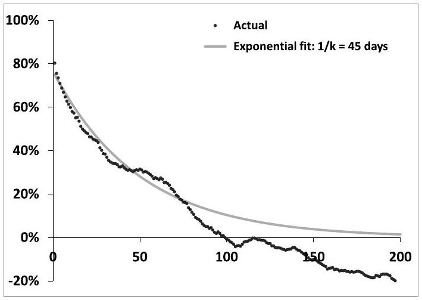
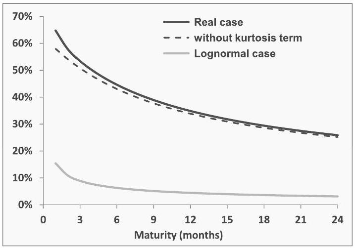
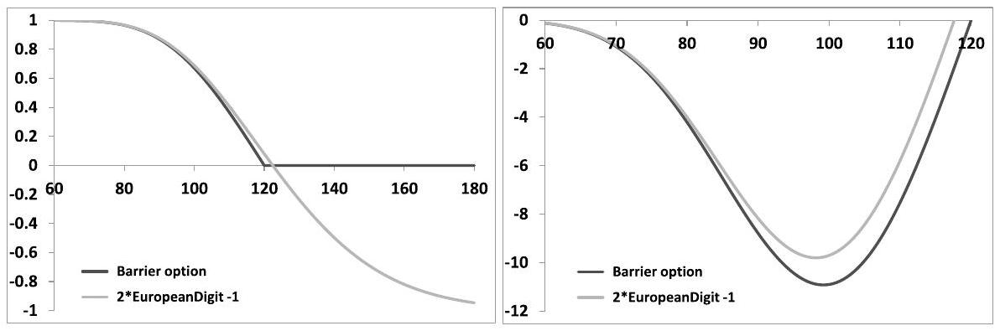

## Chapter 1

## Introduction

Why would a trader use a stochastic volatility model? What for? Which issues does one address by using a stochastic volatility model? Why aren't practitioners content with just delta-hedging their derivative books? These are the questions we address in this introduction.

We begin our analysis by reviewing the Black-Scholes model and how it is used on trading desks. It may come as a surprise to many that, despite the widely publicized inconsistency between the actual dynamics of financial securities, as observed in reality, and the idealized lognormal dynamics that the Black-Scholes model postulates, it is still used daily in banks to risk-manage derivative books.

One may think that a model derives its legitimacy and usefulness from the accuracy with which it captures the historical dynamics of the underlying security - hence the scorn demonstrated by econometricians and econophysicists for the Black-Scholes model and its simplistic assumptions, upon first encounter. With regard to models, many are used to a normative thought process. Given the behavior of securities' prices - as specified for example by an xx-GARCH or xxx-GARCH model - this is what the price of a derivative should be. Models not conforming to such type of specification - or to some canonical set of stylized facts - are deemed "wrong".

This would be suitable if (a) the realized dynamics of securities benevolently complied with the model's specification and (b) if practitioners only engaged in deltahedging. The dynamics of real securities, however, is not regular enough, nor can it be characterized with sufficient accuracy that the normative stance is appropriate. Moreover, such an approach skirts the issue of dynamical trading in options - at market prices - and of marking to market.

Rather than calibrating their favorite model to historical data for the spot process, and, armed with it and trusting its seaworthiness, endeavor to ride out the rough seas of financial markets, derivatives practitioners will be content with barely floating safely and making as few assumptions as possible about future market conditions.

Still, this requires some modeling infrastructure - hence this book: while they do not use the models' predictive power and may have little confidence in the reliability of the models' underlying assumptions, practitioners do need and make use of the models' pricing equations. This is an important distinction: while the Black-Scholes model is not used on derivatives desks, everybody uses the Black-Scholes pricing equation.

Indeed, a pricing equation is essentially an analytical accounting device: rather than predicting anything about the future dynamics of the underlying securities, a model's pricing equation supplies a decomposition of the profit and loss (P\&L) experienced on a derivative position as time elapses and securities' prices move about. It allows its user to anticipate the sign and size of the different pieces in his/her P\&L. We will illustrate this below with the example of the Black-Scholes equation, which could be motivated by elementary break-even accounting criteria.

More sophisticated models enable their users to characterize more precisely their P\&L and the conditions under which it vanishes, for example by separating contributions from different effects that may be lumped together in simpler models. Again, the issue, from a practitioner's perspective, is not to be able to predict anything, but rather to be able to differentiate risks generated by these different contributions to his/her P\&L and to ensure that the model offers the capability of pricing these different types of risk consistently across the book at levels that can be individually controlled.

It is then a trading decision to either hedge away some of these risks, by taking offsetting positions in more liquid - say vanilla - options or by taking offsetting positions in other exotic derivatives, or to keep these risks on the book.

### 1.1 Characterizing a usable model - the Black-Scholes equation

Imagine we are sitting on a trading desk and are tasked with pricing and riskmanaging a short position in an option - say a European option of maturity $T$ whose payoff at $t=T$ is $f\left(S_{T}\right)$, where $S$ is the underlying.

The bank quants have coded up a pricing function: $P(t, S)$ is the option's price in the library model. Assume we don't know anything about what was implemented. How can we assess whether using the black-box pricing function $P(t, S)$ for riskmanaging a derivative position is safe, that is whether the library model is usable?

We assume here that the underlying is the only hedging instrument we use. The case of multiple hedging instruments is examined next.

- The first sanity check we perform is set $t=T$ and check that $P$ equals the payoff:

$$
\begin{equation*}
P(t=T, S)=f(S), \forall S \tag{1.1}
\end{equation*}
$$
^eq1-1

Provided (1.1) holds, we proceed to consider the P\&L of a delta-hedged position. For the purpose of splitting the total P\&L incurred over the option's lifetime into pieces that can be ascribed to each time interval in between two successive delta rehedges, we can assume that we sell the option at time $t$, buy it back at $t+\delta t$ then
start over again. $\delta t$ is typically 1 day. Let $\Delta$ be the number of shares we buy at $t$ as delta-hedge.

Our P\&L consists of two pieces: the P\&L of the option itself, of which we are short, which comprises interest earned on the premium received at $t$, and the P\&L generated by the delta-hedge, which incorporates interest we pay on money we have borrowed to buy $\Delta$ shares, as well as money we make by lending shares out during $\delta t$ :

$$
P \& L=-[P(t+\delta t, S+\delta S)-P(t, S)]+r P(t, S) \delta t+\Delta(\delta S-r S \delta t+q S \delta t)
$$

where $\delta S$ is the amount by which $S$ moves during $\delta t . r$ is the interest rate and $q$ the repo rate, inclusive of dividend yield.

How should we choose $\Delta$ ? We pick $\Delta=\frac{d P}{d S}$ so as to cancel the first-order term in $\delta S$ in the P\&L above.

We now expand the P\&L in powers of $\delta S$ and $\delta t$. We would like to stop at the lowest non-trivial orders for $\delta t$ and $\delta S$ : order one in $\delta t$, and order two in $\delta S$, as the order one contribution is canceled by the delta-hedge. What about cross-terms such as $\delta S \delta t$ ?

In practice, this term, as well as higher order terms in $\delta S$, are smaller than $\delta S^{2}$ and $\delta t$ terms. Indeed, to a good approximation, the variance of returns scales linearly with their time scale, thus $\left\langle\delta S^{2}\right\rangle$ is of order $\delta t$ and $\delta S$ is of order $\sqrt{\delta t} .^{1}$ The contributions at order one in $\delta t$ and order two in $\delta S$ are then both of order $\delta t$ while the cross-term $\delta S \delta t$ and terms of higher order in $\delta S$ are of higher order in $\delta t$, thus become negligible as $\delta t \rightarrow 0 .^{2}$

We then get the following expression for our carry P\&L - the standard denomination for the P\&L of a hedged option position:

$$
\begin{equation*}
P \& L=-\left(\frac{d P}{d t}-r P+(r-q) S \frac{d P}{d S}\right) \delta t-\frac{1}{2} S^{2} \frac{d^{2} P}{d S^{2}}\left(\frac{\delta S}{S}\right)^{2} \tag{1.2}
\end{equation*}
$$
^eq1-2

- The first piece - called the theta portion - is deterministic. It is given by the time derivative of the option's price (sometimes theta is used to denote $\frac{d P}{d t}$ only), corrected for the financing cost/gain during $\delta t$ of the delta hedge and the premium.

[^2]- The second piece is random and quadratic in $\delta S$, as the linear term is cancelled by the delta position. $\frac{d^{2} P}{d S^{2}}$ is called "gamma". We usually prefer to work with the "dollar gamma" $S^{2} \frac{d^{2} P}{d S^{2}}$, as it has the same dimension as $P$.

Our daily P\&L reads:

$$
\begin{equation*}
P \& L=-A(t, S) \delta t-B(t, S)\left(\frac{\delta S}{S}\right)^{2} \tag{1.3}
\end{equation*}
$$
^eq1-3

where $A=\left(\frac{d P}{d t}-r P+(r-q) S \frac{d P}{d S}\right)$ and $B=\frac{1}{2} S^{2} \frac{d^{2} P}{d S^{2}}$. Because the second piece in the $\mathrm{P} \& \mathrm{~L}$ is random we cannot demand that the $\mathrm{P} \& \mathrm{~L}$ vanish altogether.

- What if $A \geq 0$ and $B \geq 0$ ? We lose money, regardless of the value of $\delta S$. This means $P$ cannot be used for risk-managing our option. The initial price $P\left(t=0, S_{0}\right)$ we have charged is too low. We should have charged more so as not to keep losing money as we delta-hedge our option.
- What if $A \leq 0$ and $B \leq 0$ ? We make "free" money, regardless of $\delta S$. While less distressing than persistently losing money, the consequence is identical: $P$ cannot be used for risk-managing our option. The initial price $P\left(t=0, S_{0}\right)$ we have charged is too high.
- The model is thus usable only if the signs of $A(t, S)$ and $B(t, S)$ are different, $\forall t, \forall S$. The values of $\frac{\delta S}{S}$ such that money is neither made nor lost are $\frac{\delta S}{S}= \pm \sqrt{-\frac{A(t, S)}{B(t, S)}} \sqrt{\delta t}$.

This condition is necessary, otherwise the model is unusable. We now introduce a further reasonable requirement.

While daily returns are random, empirically their squares average out over time to their realized variance. Let us call $\widehat{\sigma}$ the (lognormal) historical volatility of $S$ : $\left\langle\left(\frac{\delta S}{S}\right)^{2}\right\rangle=\widehat{\sigma}^{2} \delta t$. Requiring that we do not lose or make money on average is a natural risk-management criterion - it reads: $A(t, S)=-\widehat{\sigma}^{2} B(t, S), \forall S, \forall t$.

- Replacing $A$ and $B$ with their respective expression yields the following identity that $P_{\widehat{\sigma}}$ ought to obey:

$$
\begin{equation*}
\frac{d P_{\widehat{\sigma}}}{d t}-r P_{\widehat{\sigma}}+(r-q) S \frac{d P_{\widehat{\sigma}}}{d S}=-\frac{\widehat{\sigma}^{2}}{2} S^{2} \frac{d^{2} P_{\widehat{\sigma}}}{d S^{2}} \tag{1.4}
\end{equation*}
$$
^eq1-4

where subscript $\widehat{\sigma}$ keeps track of the dependence of $P$ on the break-even level of volatility $\widehat{\sigma}$.

Plugging now in (1.2) the expression for $\left(\frac{d P}{d t}-r P+(r-q) S \frac{d P}{d S}\right)$ in (1.4) yields:

$$
\begin{equation*}
P \& L=-\frac{S^{2}}{2} \frac{d^{2} P_{\widehat{\sigma}}}{d S^{2}}\left(\frac{\delta S^{2}}{S^{2}}-\widehat{\sigma}^{2} \delta t\right) \tag{1.5}
\end{equation*}
$$
^eq1-5

The condition for the two pieces in the P\&L to offset each other is then expressed very simply as a condition on the realized variance of $S$ : the P\&L will be positive or negative depending upon whether $\frac{\delta S^{2}}{S^{2}}$ is larger or smaller than $\widehat{\sigma}^{2} \delta t$.

In the absence of a volatility market for $S, \widehat{\sigma}$ should be chosen as our best estimate of future realized volatility, weighted by the option's dollar gamma. ${ }^{3}$

For vanilla options that can be bought or sold at market prices we can define the notion of implied volatility - hence the hat: $\widehat{\sigma}$ is such that $P_{\widehat{\sigma}}$ is equal to the market price of the option considered.
(1.4) is in fact the Black-Scholes equation. Together with condition (1.1) it defines $P_{\widehat{\sigma}}(t, S)$.

Starting from expression (1.2) for our P\&L and imposing the basic accounting criterion that the $\mathrm{P} \& \mathrm{~L}$ vanish for $\left(\frac{\delta S}{S}\right)^{2}=\widehat{\sigma}^{2} \delta t$, at order one in $\delta t$ and two in $\delta S$, a (gifted) trader would thus have obtained the Black-Scholes pricing equation (1.4), though he may not have known anything about Brownian motion and may have been reluctant to assume that real securities are lognormal. The Black-Scholes model is typical of the market models considered in this book:

- there exists a well-defined break-even level for $\left(\frac{\delta S}{S}\right)^{2}$ such that the P\&L at order two in $\delta S$ of a delta-hedged position vanishes,
- this break-even level does not depend on the specific payoff of the option at hand.

This last condition is important: should the gamma of an options portfolio vanish - that is the portfolio is locally riskless - then theta should vanish as well. If breakeven levels were payoff-dependent, we could possibly run into one of the two absurd situations considered above, with $B=0$ and $A \neq 0$, at the portfolio level.

A model not conforming to these criteria is unsuitable for trading purposes. ${ }^{4}$

## Multiple hedging instruments

What if our pricing function is a function of several asset values: $P\left(t, S_{1} \ldots S_{n}\right)$ where the $S_{i}$ are market values of our hedge instruments - either different underlyings, or one underlying and its associated vanilla options?

[^3]Running through the same derivation that led to (1.3), the P\&L in the multi-asset case reads:

$$
\begin{equation*}
P \& L=-A(t, S) \delta t-\frac{1}{2} \Sigma_{i j} \phi_{i j}(t, S) \frac{\delta S_{i}}{S_{i}} \frac{\delta S_{j}}{S_{j}} \tag{1.6}
\end{equation*}
$$
^eq1-6

where $\phi_{i j}(t, S)=\left.S_{i} S_{j} \frac{d^{2} P}{d S_{i} d S_{j}}\right|_{t, S}$ and $S$ denotes the vector of the $S_{i}$.
Let us diagonalize $\phi$, a real symmetric matrix, and denote by $\varphi_{k}$ its eigenvalues and $T_{k}$ the associated eigenvectors. Also denote by $\varphi$ the diagonal matrix with the $\varphi_{k}$ on its diagonal. We have:

$$
\phi=T \varphi T^{\top}
$$

The gamma portion of our P\&L can be rewritten as:

$$
\Sigma_{i j} \phi_{i j} \frac{\delta S_{i}}{S_{i}} \frac{\delta S_{j}}{S_{j}}=U^{\boldsymbol{\top}} \phi U=U^{\boldsymbol{\top}} T \varphi T^{\boldsymbol{\top}} U=\left(T^{\boldsymbol{\top}} U\right)^{\boldsymbol{\top}} \varphi\left(T^{\boldsymbol{\top}} U\right)=\Sigma_{k} \varphi_{k} \delta z_{k}^{2}
$$

where $U_{i}=\frac{\delta S_{i}}{S_{i}}$ and $\delta z_{k}=T_{k}^{\top} U$. Our P\&L now reads:

$$
P \& L=-A \delta t-\frac{1}{2} \Sigma_{k} \varphi_{k} \delta z_{k}^{2}
$$

which is a sum of P\&Ls of the type in (1.3).
The $\delta z_{k}$ are variations of particular baskets of the hedge instruments $S_{i}$. These baskets can be considered our effective hedge instruments, since the $T_{k}$ form a basis.
$\delta z_{k}{ }^{2}$ is always positive. As in the mono-asset case, the condition for our model to be usable is that there exist $n$ positive numbers $\omega_{k}$ such that:

$$
\begin{equation*}
A=-\frac{1}{2} \Sigma_{k} \varphi_{k} \omega_{k} \tag{1.7}
\end{equation*}
$$
^eq1-7

so that our P\&L reads:

$$
P \& L=-\frac{1}{2} \Sigma_{k} \varphi_{k}\left(\delta z_{k}^{2}-\omega_{k} \delta t\right)
$$

Let us express $A$ differently, so as to give our $\mathrm{P} \& \mathrm{~L}$ in (1.6) a more symmetrical form. Denote by $\omega$ the diagonal matrix with the $\omega_{k}$ on the diagonal. We have:

$$
\begin{aligned}
A & =-\frac{1}{2} \Sigma_{k} \varphi_{k} \omega_{k}=-\frac{1}{2} \operatorname{tr}(\varphi \omega)=-\frac{1}{2} \operatorname{tr}\left(T^{\top} \phi T \omega\right)=-\frac{1}{2} \operatorname{tr}\left(\phi T \omega T^{\top}\right)=-\frac{1}{2} \operatorname{tr}(\phi C) \\
& =-\frac{1}{2} \Sigma_{i j} \phi_{i j} C_{i j}
\end{aligned}
$$

where $C=T \omega T^{\top}$ is a positive matrix by construction, as the $\omega_{k}$ are positive.
Our P\&L then reads:

$$
\begin{equation*}
P \& L=-\frac{1}{2} \Sigma_{i j} \phi_{i j}\left(\frac{\delta S_{i}}{S_{i}} \frac{\delta S_{j}}{S_{j}}-C_{i j} \delta t\right) \tag{1.8}
\end{equation*}
$$
^eq1-8

Because $C$ is a positive matrix, it can be interpreted as an (implied) covariance matrix; its elements are implied covariance break-even levels.

We have just shown that on the condition that our model is usable, there exists a positive break-even covariance matrix $C$ such that our $\mathrm{P} \& \mathrm{~L}$ reads as in (1.8).

In our construction $C$ is given by: $C=T \omega T^{\top}$, based on expression (1.7) for $A$. Is this restrictive, or is $\mathrm{P} \& \mathrm{~L}(1.8)$ guaranteed to be nonsensical, for any positive matrix $C$ ? The answer is yes. ${ }^{5}$

## Conclusion

In the general case of multiple hedge instruments, the condition that our model is usable - no situation in which our carry P\&L is systematically positive or negative - is that there exists a positive break-even covariance matrix $C(t, S), \forall S, \forall t$, such that the model's theta and cross-gammas are related through:

$$
A=-\frac{1}{2} \Sigma_{i j} \phi_{i j} C_{i j}
$$

Again, a model not meeting this criterion is unsuitable for trading purposes. In the sequel, suitable models are also called market models.

The important thing here is that cross-gammas $\phi_{i j}$ involve derivatives with respect to values of actual hedge instruments, not model-specific state variables.

We will see in Chapter 2 that the local volatility model is a market model, in Chapter 7 that forward variance models are market models, and in Chapter 12 that most local-stochastic volatility models are not.

Specifying a break-even condition for the carry P\&L at order 2 in $\delta S$ leads to pricing equation (1.4). It so happens that the latter - a parabolic equation - has a probabilistic interpretation: the solution can be written as the expectation of the payoff applied to the terminal value of a stochastic process for $S_{t}$ that is a diffusion: $d S_{t}=(r-q) S_{t} d t+\widehat{\sigma} S d W_{t}$.

The argument goes this way and not the other way around - modeling in finance does not start with the assumption of a stochastic process for $S_{t}$ and has little to do with Brownian motion.

Expression (1.5) is a useful accounting tool - and the Black-Scholes equation (1.4) can be used to risk-manage options - despite the fact that real securities are not lognormal and do not exhibit constant volatility.

[^4]where $\alpha_{k}=T_{k}^{\top} C T_{k}$ are positive numbers as $C$ is positive. $C$ can thus be any positive matrix.

### 1.2 How (in)effective is delta hedging?

Expression (1.5) quantifies the P\&L of a short delta-hedged option position. The aim of delta-hedging is to reduce uncertainty in our final $\mathrm{P} \& \mathrm{~L}-$ it removes the linear term in $\delta S$ : is this sufficient from a practical point of view? How large is the gamma/theta P\&L (1.5)? More precisely, how large is the average and standard deviation of the total P\&L incurred over the option's life?

It can be shown - this is the principal result of the Black-Scholes-Merton analysis - that:

- if the underlying security indeed follows a lognormal process with the same volatility $\sigma$ as that used for pricing and delta-hedging the option; that is, $S$ follows the Black-Scholes model with volatility $\sigma$
- and if we take the limit of very frequent hedging: $\delta t \rightarrow 0$
then the sum of P\&Ls (1.5) incurred over the option's life vanishes with probability 1.
In real life delta-hedging occurs discretely in time, typically on a daily basis, and real securities do not follow diffusive lognormal processes. Thus, the sum of P\&Ls (1.5) over the option's life will not vanish. Already in the lognormal case, if $S$ follows a lognormal process but with a different volatility - say higher - than the implied volatility $\widehat{\sigma}$, the sum of P\&Ls (1.5) will not vanish in the limit $\delta t \rightarrow 0$.

Obviously, the condition that the final P\&L vanishes on average requires that the implied volatility $\widehat{\sigma}$ used for pricing and risk-managing the option match on average the future realized volatility weighted by the option's dollar gamma over the option's life:

$$
\left\langle\int_{0}^{T} e^{-r t} S^{2} \frac{d^{2} P_{\widehat{\sigma}}}{d S^{2}} \sigma_{t}^{2} d t\right\rangle=\left\langle\int_{0}^{T} e^{-r t} S^{2} \frac{d^{2} P_{\widehat{\sigma}}}{d S^{2}} \widehat{\sigma}^{2} d t\right\rangle
$$

where $\sigma_{t}$ is the instantaneous realized volatility defined by: $\sigma_{t}^{2} \delta t=\frac{\delta S_{t}^{2}}{S_{t}^{2}}$ and the discount factor $e^{-r t}$ is used to convert $P \& L$ generated at time $t$ into $P \& L$ at $t=0$.

Throughout this book, we use $\rangle$ to denote either an average or a quadratic (co)variation - context should dispel any ambiguity as to which is intended.

Let us assume that this condition holds, so that our final P\&L is not biased on average and let us concentrate on the dispersion - the standard deviation - of the final P\&L. It vanishes in the Black-Scholes case with continuous hedging. How large is it, first in the Black-Scholes case with discrete hedging and then in the case of discrete hedging with real securities?

Assume that the option is delta-hedged daily at times $t_{i}: \delta t=1$ day. The total P\&L over the option's life, discounted at time $t=0$, is:

$$
\begin{equation*}
P \& L=-\sum_{i} e^{-r t_{i}} \frac{S_{i}^{2}}{2} \frac{d^{2} P_{\widehat{\sigma}}}{d S^{2}}\left(t_{i}, S_{i}\right)\left(r_{i}^{2}-\widehat{\sigma}^{2} \delta t\right) \tag{1.9}
\end{equation*}
$$
^eq1-9

where $r_{i}$ are daily returns, given by $r_{i}=\frac{S_{i+1}-S_{i}}{S_{i}}$. As expression (1.9) shows, at order 2 in $\delta S$ and order 1 in $\delta t$, the total $\mathrm{P} \& \mathrm{~L}$ is given by the sum of the differences between realized daily quadratic variation $\frac{\delta S_{i}^{2}}{S_{i}^{2}}$ and the implied quadratic variation $\widehat{\sigma}^{2} \delta t$, weighted by the prefactor $e^{-r t_{i}} \frac{S_{i}^{2}}{2} \frac{d^{2} P_{\widehat{\sigma}}}{d S^{2}}\left(t_{i}, S_{i}\right)$, which is payoff-dependent and involves the gamma of the option. $\widehat{\sigma}$ is the implied volatility we are using to risk-manage our option position.

Let us make the approximation that the option's discounted dollar gamma $e^{-r t_{i}} S^{2} \frac{d^{2} P_{\widehat{\sigma}}}{d S^{2}}$ is a constant, equal to its initial value $S_{0}^{2} \frac{d^{2} P_{\widehat{\sigma}}}{d S^{2}}\left(t_{0}, S_{0}\right)$ - this removes one source of randomness in the P\&L. ${ }^{6}$ The standard deviation of the total P\&L depends on the variances of individual daily P\&Ls as well as on their covariances. Let us write the daily return $r_{i}$ as:

$$
\begin{equation*}
r_{i}=\sigma_{i} \sqrt{\delta t} z_{i} \tag{1.10}
\end{equation*}
$$
^eq1-10

where $\sigma_{i}$ is the realized volatility for day $i$, and $z_{i}$ is centered and has unit variance: $\left\langle z_{i}\right\rangle=0,\left\langle z_{i}^{2}\right\rangle=1$. Let us assume that the $z_{i}$ are iid and are independent of the volatilities $\sigma_{i}$.

Because the $z_{i}$ are independent, returns $r_{i}$ have no serial correlation but are not independent, as daily volatilities $\sigma_{i}$ may be correlated. Expression (1.10) allows separation of the effects of the scale $\sigma_{i}$ of return $r_{i}$ on one hand, and of the distribution of $r_{i}$ - which up to a rescaling is given by that of $z_{i}$ - on the other hand. Our total P\&L now reads:

$$
P \& L=-\frac{S_{0}^{2}}{2} \frac{d^{2} P_{\widehat{\sigma}}}{d S^{2}}\left(t_{0}, S_{0}\right) \sum_{i}\left(\sigma_{i}^{2} z_{i}^{2}-\widehat{\sigma}^{2}\right) \delta t
$$

Let us assume that the process for the $\sigma_{i}$ is time-homogeneous so that, in particular, $\left\langle\sigma_{i}^{2}\right\rangle$ does not depend on $i$ and let us take $\widehat{\sigma}^{2}=\left\langle\sigma_{i}^{2}\right\rangle$. The variance of[^5]

$$
\begin{align*}
& \sum_{i}\left(\sigma_{i}^{2} z_{i}^{2}-\widehat{\sigma}^{2}\right) \delta t \text { is given by: } \\
&\left\langle\sum_{i j}\left(\sigma_{i}^{2} z_{i}^{2}-\widehat{\sigma}^{2}\right) \delta t\left(\sigma_{j}^{2} z_{j}^{2}-\widehat{\sigma}^{2}\right) \delta t\right\rangle \\
&=\sum_{i}\left(\left\langle\sigma_{i}^{4} z_{i}^{4}\right\rangle+\widehat{\sigma}^{4}-2 \widehat{\sigma}^{4}\right) \delta t^{2}+\sum_{i \neq j}\left\langle\sigma_{i}^{2} \sigma_{j}^{2} z_{i}^{2} z_{j}^{2}+\widehat{\sigma}^{4}-2 \widehat{\sigma}^{4}\right\rangle \delta t^{2} \\
&=\sum_{i}(2+\kappa) \widehat{\sigma}^{4} \delta t^{2}+\sum_{i \neq j}\left(\left\langle\sigma_{i}^{2} \sigma_{j}^{2}\right\rangle-\widehat{\sigma}^{4}\right) \delta t^{2} \\
&=\sum_{i}(2+\kappa) \widehat{\sigma}^{4} \delta t^{2}+\left(\left\langle\sigma^{4}\right\rangle-\widehat{\sigma}^{4}\right) \sum_{i \neq j} f_{i j} \delta t^{2} \\
&=\widehat{\sigma}^{4}\left(\sum_{i}(2+\kappa) \delta t^{2}+\Omega \sum_{i \neq j} f_{i j} \delta t^{2}\right) \tag{1.11}
\end{align*}
$$
^eq1-11
where we have introduced the (excess) kurtosis $\kappa$ of returns $r_{i}$ and the variance/variance correlation function $f$ defined by:

$$
\kappa=\frac{\left\langle\sigma_{i}^{4} z_{i}^{4}\right\rangle}{\widehat{\sigma}^{4}}-3, \quad f_{i j}=\frac{\left\langle\left(\sigma_{i}^{2}-\widehat{\sigma}^{2}\right)\left(\sigma_{j}^{2}-\widehat{\sigma}^{2}\right)\right\rangle}{\sqrt{\left\langle\sigma_{i}^{4}\right\rangle-\widehat{\sigma}^{4}} \sqrt{\left\langle\sigma_{j}^{4}\right\rangle-\widehat{\sigma}^{4}}}
$$
and where the dimensionless factor $\Omega$, which quantifies the variance of daily variances $\sigma_{i}^{2}$ is given by:

$$
\Omega=\frac{\left\langle\sigma^{4}\right\rangle-\widehat{\sigma}^{4}}{\widehat{\sigma}^{4}}=\frac{\left\langle\sigma^{4}\right\rangle-\left\langle\sigma^{2}\right\rangle^{2}}{\left\langle\sigma^{2}\right\rangle^{2}}
$$

We then get:

$$
\operatorname{StDev}(P \& L)=\left|\frac{S_{0}^{2}}{2} \frac{d^{2} P_{\widehat{\sigma}}}{d S^{2}}\left(t_{0}, S_{0}\right)\right| \sqrt{\widehat{\sigma}^{4}\left(\sum_{i}(2+\kappa) \delta t^{2}+\Omega \sum_{i \neq j} f_{i j} \delta t^{2}\right)}
$$

It is useful to measure the standard deviation of the final P\&L in units of the option's vega, the sensitivity of the option's price to the implied volatility $\widehat{\sigma}$. In the Black-Scholes model, for European options the following relationship linking vega and gamma holds:

$$
\begin{equation*}
\frac{d P_{\widehat{\sigma}}}{d \widehat{\sigma}}=S^{2} \frac{d^{2} P_{\widehat{\sigma}}}{d S^{2}} \widehat{\sigma} T \tag{1.12}
\end{equation*}
$$
^eq1-12

where $T$ is the residual option's maturity - this is derived in Appendix A of Chapter 5, page 181. Using now the vega, the final expression for the standard deviation of the P\&L is:

$$
\begin{equation*}
\operatorname{StDev}(P \& L)=\left|\widehat{\sigma} \frac{d P_{\widehat{\sigma}}}{d \widehat{\sigma}}\right| \frac{1}{2 T} \sqrt{\sum_{i}(2+\kappa) \delta t^{2}+\Omega \sum_{i \neq j} f_{i j} \delta t^{2}} \tag{1.13}
\end{equation*}
$$
^eq1-13

### 1.2.1 The Black-Scholes case

Let us first assume that $S$ follows the lognormal Black-Scholes dynamics. $\sigma_{i}$ is constant, equal to $\widehat{\sigma}$, hence $\Omega=0$. Since $\sigma_{i} \sqrt{\delta t}$ is small ( $\delta t$ is one day and typically $\sigma_{i}=20 \%$, so that $\sigma_{i} \sqrt{\delta t} \simeq 0.01$ ), daily returns can be considered Gaussian: $\kappa=0$. $\Sigma_{i}(2+\kappa) \delta t^{2}=\frac{2 T^{2}}{N}$, where $T$ is the option's maturity and $N$ is the number of delta rehedges: $N \delta t=T$. Expression (1.13) becomes:

$$
\begin{equation*}
\operatorname{StDev}(P \& L)=\frac{1}{\sqrt{2 N}}\left|\widehat{\sigma} \frac{d P_{\widehat{\sigma}}}{d \widehat{\sigma}}\right| \tag{1.14}
\end{equation*}
$$
^eq1-14

Thus, provided it is small, the standard deviation of our final $\mathrm{P} \& \mathrm{~L}$ is equivalent to the impact on the option's price of a relative perturbation of $\widehat{\sigma}$ of size $\frac{1}{\sqrt{2 N}}$.

Note that $\frac{\widehat{\sigma}}{\sqrt{2 N}}$ is approximately the standard deviation of the historical volatility estimator. The standard variance estimator is given by:

$$
\bar{\sigma}^{2}=\frac{1}{N \delta t} \sum_{i}\left(\frac{S_{i+1}-S_{i}}{S_{i}}\right)^{2}
$$

In the Black-Scholes case, for daily returns, $\frac{S_{i+1}-S_{i}}{S_{i}}$ is approximately Gaussian and we have:

$$
\bar{\sigma}^{2} \simeq \frac{\widehat{\sigma}^{2}}{N} \sum_{i} z_{i}^{2}
$$

where $z_{i}$ are standard normal random variables. The variance of $\bar{\sigma}^{2}$ is $\frac{2 \widehat{\sigma}^{4}}{N}$, thus the relative standard deviation $\operatorname{StDev}\left(\bar{\sigma}^{2}\right) /\left\langle\bar{\sigma}^{2}\right\rangle$ is $\sqrt{\frac{2}{N}}$ and, if it is not too large, the relative standard deviation of the volatility estimator $\bar{\sigma}$ is approximately half of this, that is $\frac{1}{\sqrt{2 N}}$.

The standard deviation observed on our final $\mathrm{P} \& \mathrm{~L}$ is then approximately given by the option's vega multiplied by the standard deviation of the volatility estimator built on the same schedule as that of the delta rehedges.

Consider the example of a one-year at-the-money call option, with $\widehat{\sigma}=20 \%$, vanishing interest rates, repo and dividends, and $S=1$. The option's price is then $P=7.97 \%$. There are about 250 trading days in one year, which gives $\frac{1}{\sqrt{2 N}} \simeq 0.045$. An at-the-money option has the property that its price is approximately linear in $\widehat{\sigma}$ for short maturities: $P_{\widehat{\sigma}} \simeq \frac{1}{\sqrt{2 \pi}} S \widehat{\sigma} \sqrt{T}$, thus $\widehat{\sigma} \frac{d P_{\widehat{\sigma}}}{d \widehat{\sigma}} \simeq P$ (using this approximation yields a price of $7.98 \%$ ).

We then get for the one-year at-the-money option: $\operatorname{StDev}(P \& L) \simeq 0.045 P$ : the standard deviation of our final P\&L is about $5 \%$ of the option's price we charged at inception.
$5 \%$ of the premium charged for the option - or equivalently $5 \%$ of the volatility may seem a very reasonable risk to take. Alternatively, adjusting the option's price to account for one standard deviation of our final P\&L would result in a relative bid/offer spread on the option price of about $10 \%$.

### 1.2.2 The real case

In real life, in contrast to the Black-Scholes case, the second term in the square root in (1.13) does not vanish. It involves the variance/variance correlation function $f_{i j}$. We have made the (reasonable) assumption that the process for the $\sigma_{i}$ is timehomogeneous: $f_{i j}$ is then a function of the difference $j-i$, actually a function of $|j-i|$.

As $\delta t$ is small compared to the option's maturity, we convert the sums in (1.11) into integrals:

$$
\sum_{i j} f_{i j} \delta t^{2} \simeq \int_{0}^{T} d u \int_{0}^{T} d t f(t-u)=2 \int_{0}^{T}(T-\tau) f(\tau) d \tau
$$

We now have from (1.13):

$$
\begin{align*}
\operatorname{StDev}(P \& L) & \simeq\left|\widehat{\sigma} \frac{d P_{\widehat{\sigma}}}{d \widehat{\sigma}}\right| \frac{1}{2 T} \sqrt{(2+\kappa) \frac{T^{2}}{N}+2 \Omega \int_{0}^{T}(T-\tau) f(\tau) d \tau} \\
& =\left|\widehat{\sigma} \frac{d P_{\widehat{\sigma}}}{d \widehat{\sigma}}\right| \sqrt{\frac{2+\kappa}{4 N}+\frac{\Omega}{2 T^{2}} \int_{0}^{T}(T-\tau) f(\tau) d \tau} \tag{1.15}
\end{align*}
$$
^eq1-15

Let us now examine the two contributions to $\operatorname{StDev}(P \& L)$.
Imagine first that daily variances are constant: $\Omega$ vanishes and the first piece alone contributes to the standard deviation of the P\&L. Just as in the Black-Scholes case (equation (1.14)), the variance of the final P\&L scales like $1 / N$, where $N$ is the number of daily rehedges, which is natural as the final P\&L is the sum of $N$ identically distributed and independent daily P\&Ls.

In contrast to the Black-Scholes case though, in which daily returns are approximately Gaussian, the effect of the tails of the distribution of daily returns appears through the kurtosis $\kappa$. By setting $\kappa=0$ we recover result (1.14).

Consider now the second contribution in (1.15). The prefactor $\Omega$ quantifies the dispersion of daily variances while $f(\tau)$ quantifies how a fluctuation in daily variance $\sigma_{i}^{2}$ on day $t_{i}$ impacts daily variances $\sigma_{i+\tau}^{2}$ on subsequent days. If $f$ decays slowly, daily variances will be very correlated: in case one daily variance was higher than $\widehat{\sigma}$, daily variances for the following days are likely to be higher as well, resulting in daily gamma/theta P\&Ls all having the same sign - thus generating strong correlation among daily P\&Ls and increasing the variance of our final P\&L.

For example, assume that daily variances are perfectly correlated: $f(\tau)=1$. The second piece in (1.15) is then simply equal to $\frac{\Omega}{4}$. If $\Omega$ is small, the contribution of this term is then equivalent to the impact of a relative displacement of $\widehat{\sigma}$ by $\widehat{\sigma} \frac{\sqrt{\Omega}}{2}$, regardless of the number $N$ of daily rehedges. ${ }^{7}$

[^6]
## Estimating $f(\tau), \Omega, \kappa$

Consider now the dynamics of daily variances $\sigma_{i}$ in the case of real securities. Separating in $r_{i}$ the contributions from $\sigma_{i}$ and $z_{i}$ is difficult if the only daily data we have are daily returns. In what follows we have estimated daily volatilities $\sigma_{i}$ using 5minute returns: $\sigma_{i}$ is given by the square root of the sum of squared 5-minute returns during the exchange's opening hours, plus the square of the close-to-open return. Figure 1.1 shows the autocorrelation function $f$ averaged over a set of European financial stocks, evaluated on a two-year sample: [August 2008, August 2010]. ${ }^{8}$

Figure 1.1: Correlation function $f(\tau)$ of daily volatilities evaluated on a basket of financial stocks. $\tau$ is in business days.

For $\tau=0, f(\tau)=1$. As is customary with correlation functions, however, $\lim _{\tau \rightarrow 0} f(\tau) \neq 1$, and the discontinuity in $\tau=0$ quantifies the signal-to-noise ratio of our measurement of daily volatilities. As Figure 1.1 shows, this discontinuity is rather moderate and we get a robust estimation of the autocorrelation of daily volatilities up to time scales $\tau \simeq 100$ days.

For larger $\tau$, Figure 1.1 displays negative autocorrelations: this is unphysical and most likely due to the fact that, over our historical sample (2 years), for $\tau>100$ days, $i$ and $i+\tau$ fall into two different regimes of respectively low and high volatilities.

We have also graphed in Figure 1.1 an exponential fit to $f: f(\tau)=\rho e^{-k \tau}$, with $\rho=0.78$ and $\frac{1}{k}=45$ days. The agreement of $f$ with the exponential form is acceptable in the region $\tau<100$ days, where our measurement is reliable.

Using this form for $f(\tau)$ yields our final expression for the standard deviation of the P\&L:

$$
\begin{equation*}
\frac{\operatorname{StDev}(P \& L)}{\left|\widehat{\sigma} \frac{d P_{\widehat{\sigma}}}{d \widehat{\sigma}}\right|} \simeq \sqrt{\frac{2+\kappa}{4 N}+\frac{\rho \Omega}{2} \frac{k T-1+e^{-k T}}{(k T)^{2}}} \tag{1.16}
\end{equation*}
$$
^eq1-16

[^7]$\Omega$ quantifies the relative variance of daily variances $\sigma_{i}^{2}$. It varies appreciably, even among stocks of the same sector: a typical range for $\Omega$ is [1.5,4]. Let us use the value $\Omega=2$.

Estimating the unconditional kurtosis $\kappa$ is also difficult, as the 4th order moment of daily returns converges slowly, so slowly that it is unreasonable to assume that the same regime of kurtosis holds throughout the historical sample used for its estimation: a typical order of magnitude is $\kappa=5$.

### 1.2.3 Comparing the real case with the Black-Scholes case

We now use the typical values for $\Omega, \kappa, \rho, k$ estimated above in expression (1.16). Figure 1.2 shows the right-hand side of equation (1.16), that is the relative displacement of $\widehat{\sigma}$ that produces a variation of the option's price $P$ equal to one standard deviation of the P\&L. For an at-the-money option, whose price is approximately linear in $\widehat{\sigma}$, this number is also the ratio of one standard deviation of the P\&L to the option's price itself.

Figure 1.2: Right-hand side in equation 1.16 (darker line), as a function of maturity, compared to the same quantity, but without the kurtosis term (dashed line), and the lognormal case (lighter line).

Figure 1.2 also displays the same quantity, but without the term $\frac{2+\kappa}{4 N}$, to remove the effect of the tails of the daily returns, as well as the standard deviation of the P\&L in the lognormal, Black-Scholes case (1.14).

We can see that the standard deviation of the final P\&L of a delta-hedged option in the real case is much larger than its estimation in the Black-Scholes case.

Consider again the example of a 1 -year at-the-money option, with $\widehat{\sigma}=0.2$, with $P=7.97 \%$. As Figure 1.2 shows, while in the Black-Scholes case, the standard deviation is $4.5 \%$ of the option's price, that is $0.35 \%$, in the real case, for a 1 -year maturity it is equal to $35 \%$ of the option's price, that is $2.8 \%$.

Comparison of the dark and dashed lines in Figure 1.2 shows that, but for very short maturities, the dispersion of the P\&L is mostly generated by correlation of daily volatilities rather than the thickness of the tails of daily returns.

Delta-hedging our one-year at-the-money option position exposes us to the risk of making or losing about one third of the option premium ${ }^{9}$ - this is an unreasonable risk to take considering that, typically, commercial fees charged by banks on option transactions are much smaller than the option's value.

The conclusion is that, in real life, delta-hedging is not sufficient: while deltahedging removes the linear term in $\delta S$ in our daily P\&L, the effect of the $\delta S^{2}$ term is still too large: the only way to remove it is to use other options - for example vanilla options - to offset the gamma of the option we are risk-managing.

This was expressed bluntly to the author upon starting his career in finance by Nazim Mahrour, an FX option trader: "options are hedged with options".

### 1.3 On the way to stochastic volatility

Let us then use other options to offset the gamma of the exotic option we are risk-managing: assume for simplicity that we use a single vanilla option, whose implied volatility is $\widehat{\sigma}_{O}$. The P\&L of a delta-hedged position in the vanilla option $O$ has the same form as in equation (1.5), except it involves the implied volatility $\widehat{\sigma}_{O}$ :

$$
\begin{equation*}
P \& L_{O}=-\frac{S^{2}}{2} \frac{d^{2} O}{d S^{2}}\left(\frac{\delta S^{2}}{S^{2}}-\widehat{\sigma}_{O}^{2} \delta t\right) \tag{1.17}
\end{equation*}
$$
^eq1-17

The number $\lambda$ of vanilla options $O$ we are buying as gamma hedge is :

$$
\begin{equation*}
\lambda=\frac{1}{\frac{d^{2} O}{d S^{2}}} \frac{d^{2} P}{d S^{2}} \tag{1.18}
\end{equation*}
$$
^eq1-18

The gamma profiles of $P$ and $O$ are unlikely to be homothetic, thus this gamma hedge will be efficient only locally; as time elapses and $S$ moves, we need to readjust the hedge ratio $\lambda$.

We could decide to risk-manage each option $P$ and $O$ with its own implied volatility $\widehat{\sigma}$ and $\widehat{\sigma}_{O}$, but this leads to incongruous carry P\&Ls.

Indeed by selecting $\lambda$ as specified in (1.18) we cancel the gamma of the hedged position. The P\&Ls of options $O$ and $P$ are both of the form in (1.17). If $\widehat{\sigma} \neq \widehat{\sigma}_{O}$, the theta portion of our global P\&L does not vanish, even though gamma vanishes, a situation as nonsensical as those encountered in Section 1.1, when $A$ and $B$ have the same sign - see also the discussion in Section 2.8 below.

[^8]We must thus choose $\widehat{\sigma}=\widehat{\sigma}_{O}$. We now have for $P$ a pricing function that explicitly depends on two dynamical variables: $S$ and $\widehat{\sigma}_{O}$ :

$$
P\left(t, S, \widehat{\sigma}_{O}\right)
$$

which is natural as we are using two instruments as hedges.
This is an elementary instance of calibration: we decide to make our exotic option's price a function of other derivatives' prices. It is a trading decision.

In the unhedged case we were free to chose the implied volatility $\widehat{\sigma}$ as our best estimate of future realized volatility and kept it constant throughout: no P\&L was generated by the variation of $\widehat{\sigma}$.

Unlike $\widehat{\sigma}$, however, $\widehat{\sigma}_{O}$ is a market implied volatility and cannot be kept constant. As $S$ moves and time flows we readjust $\lambda$, thus buying or selling the vanilla option at prevailing market prices: $\widehat{\sigma}_{O}$ will move so as to reflect the market price $O$ of the vanilla option. Daily P\&Ls for $O$ and $P$ will include extra terms involving $\delta \widehat{\sigma}_{O}$. At second order in $\delta \widehat{\sigma}_{O}$ :

$$
\begin{equation*}
P \& L_{O}=-\frac{S^{2}}{2} \frac{d^{2} O}{d S^{2}}\left(\frac{\delta S^{2}}{S^{2}}-\widehat{\sigma}_{O}^{2} \delta t\right)-\frac{d O}{d \widehat{\sigma}_{O}} \delta \widehat{\sigma}_{O}-\frac{1}{2} \frac{d^{2} O}{d \widehat{\sigma}_{O}^{2}} \delta \widehat{\sigma}_{O}^{2}-\frac{d^{2} O}{d S d \widehat{\sigma}_{O}} \delta S \delta \widehat{\sigma}_{O} \tag{1.19}
\end{equation*}
$$
^eq1-19

The expansion of the $\mathrm{P} \& \mathrm{~L}$ of the hedged position at second order in $\delta S, \delta \widehat{\sigma}_{O}$ and order 1 in $\delta t$ reads:

$$
\begin{align*}
P \& L & =-\left(\frac{d P}{d \widehat{\sigma}_{O}}-\lambda \frac{d O}{d \widehat{\sigma}_{O}}\right) \delta \widehat{\sigma}_{O}  \tag{1.20}\\
& -\frac{1}{2}\left(\frac{d^{2} P}{d \widehat{\sigma}_{O}^{2}}-\lambda \frac{d^{2} O}{d \widehat{\sigma}_{O}^{2}}\right) \delta \widehat{\sigma}_{O}^{2}-\left(\frac{d^{2} P}{d S d \widehat{\sigma}_{O}}-\lambda \frac{d^{2} O}{d S d \widehat{\sigma}_{O}}\right) \delta S \delta \widehat{\sigma}_{O}
\end{align*}
$$
^eq1-20

This is an accounting equation: the $\mathrm{P} \& \mathrm{~L}$ generated by these three terms is no less real than the usual gamma/theta $\mathrm{P} \& \mathrm{~L}-$ it is usually called mark-to-market $\mathrm{P} \& \mathrm{~L}$, while the gamma/theta $\mathrm{P} \& \mathrm{~L}$ is typically called carry $\mathrm{P} \& \mathrm{~L} .^{10}$

There is no contribution from $\delta S^{2}$ as $\frac{d^{2} P}{d S^{2}}=\lambda \frac{d^{2} O}{d S^{2}}$ by construction. Exotic options are typically path-dependent options: their final payoff is a function of values of $S$ observed at discrete dates, specified in the option's term sheet. Between two observation dates, the pricing equation for $P$ in the Black-Scholes framework is the same as that of a European option. Since $P$ and $O$ are given by a Black-Scholes pricing equation with the same implied volatility $\widehat{\sigma}_{O}$, cancellation of gamma implies cancellation of theta as well: there is no $\delta t$ term in (1.20).

Consider the last two terms in $\delta \widehat{\sigma}_{O}^{2}$ and $\delta S \delta \widehat{\sigma}_{O}$ in (1.19) and (1.20). While their contributions to $P \& L_{O}$ and $P \& L$ look similar, they have a different status and have to be treated differently. Expression (1.19) is the P\&L of a vanilla option position.

[^9]The extra terms that come in addition to the gamma/theta P\&L do not warrant any adjustment to the price of the vanilla option: their contribution to the P\&L is already priced-in in the market price of the vanilla option.

In expression (1.20), however, what appear as prefactors of $\delta \widehat{\sigma}_{O}^{2}$ and $\delta S \delta \widehat{\sigma}_{O}$ are the second-order sensitivities of the hedged position. We then need to adjust the price $P\left(t, S, \widehat{\sigma}_{O}\right)$ of our exotic option for the cost of these two contributions to the P\&L.

What matters in the evaluation of extra-model cost is not so much the secondorder sensitivities of the naked exotic option, but the residual sensitivities of the hedged position.

Three observations are in order:

- We now have a vega term in $\delta \widehat{\sigma}_{O}$. If $P$ is a European option with the same maturity as $O$, the vega of a gamma-hedged position cancels out, owing to relationship (1.12) linking gamma and vega in the Black-Scholes model. A European payoff is statically hedged with a portfolio of vanilla options of the same maturity; it can hardly be called an exotic derivative.

The situation we have in mind is that of real exotics that has no static hedge, whose hedge portfolio comprises vanilla options of different maturities: gamma cancellation does not imply vega cancellation. Depending on the relative sizes of the gamma and vega risks we may prefer to gamma-hedge or vega-hedge our exotic option: this is a trading decision. In practice an exotics book is a large caldron where mitigation of the gamma and vega risks of many different exotic and vanilla options takes place: gamma and vega hedging, unachievable on a deal-by-deal basis, can be reasonably achieved at the book level. ${ }^{11}$

- Our P\&L does not involve realized volatility anymore. Instead, we have acquired sensitivity to $\widehat{\sigma}_{O}$. While in the unhedged case we were exposed to realized volatility, we are now exposed to the dynamics of the implied volatility $\widehat{\sigma}_{O} \cdot{ }^{12}$
- Unlike in the unhedged case for the $\delta S^{2}$ term, no deterministic $\delta t$ term is now offsetting the $\delta \widehat{\sigma}_{O}^{2}$ and $\delta S \delta \widehat{\sigma}_{O}$ terms: depending on their realized values and the signs of their prefactors, we may systematically make or lose money. This is a serious issue. While in the Black-Scholes pricing equation we had a parameter - the implied volatility - to control how the gamma and theta terms for the spot offset each other, we have no equivalent parameter at our disposal to control break-even levels for gammas on $\widehat{\sigma}_{O}$ : no implied volatility of $\widehat{\sigma}_{O}$ and no implied correlation of $S$ and $\widehat{\sigma}_{O} . P$ and $O$ should then be given by a different pricing equation than Black-Scholes', that explicitly includes

[^10]these new parameters so as to generate additional theta terms in the P\&L: this is the general task of stochastic volatility models. ${ }^{13}$

The general conclusion is that by using options as hedges we lower - or cancel - our exposure to realized volatility, but acquire an exposure to the dynamics of implied volatilities. However, while the Black-Scholes pricing equation provides a theta term to offset the gamma term for $S$, no provision of a theta is made to offset the gamma P\&Ls experienced on the variation of implied volatilities of options used as hedges.

This is not surprising as the notion of dynamic implied volatilities is alien to the Black-Scholes framework.

This is where stochastic volatility models are called for: their aim is not to model the dynamics of realized volatility, which is hedged away by trading other options, but to model the dynamics of implied volatilities, and provide their user with simple break-even accounting conditions for the P\&L of a hedged position.

[^11]In practice, for liquid securities such as equity indexes, there are plenty of options available: rather than one implied volatility $\widehat{\sigma}_{O}$, one needs to model the dynamics of all implied volatilities $\widehat{\sigma}_{K T}$, where $K$ and $T$ are, respectively, the strikes and maturities of vanilla options. The two-dimensional set $\widehat{\sigma}_{K T}$ is known as the volatility surface.

While a stochastic volatility model should ideally offer maximum flexibility as to the range of dynamics of the volatility surface it is able to produce, we may not be able to build such a flexible model on one hand, and on the other hand we may not need so much versatility: some classes of exotic options are only sensitive to specific features of the dynamics of the volatility surface.

Before we delve into stochastic volatility models, we present two examples of exotic options whose type of volatility risk can be exactly pinpointed.

### 1.3.1 Example 1: a barrier option

Consider an option of maturity one year that pays at maturity 1 unless $S_{t}$ hits the barrier $L=120$, in which case the option expires worthless. The initial spot value is $S_{0}=100$. The pricing function $F(t, S)$ of this barrier option has to satisfy the terminal condition at maturity: $F(T, S)=1$, for $S<L$ as well as the boundary condition $F(t, L)=0$ for all $t \in[0, T]$.

How do we hedge this barrier option with vanilla options? Peter Carr and Andrew Chou show in [22] that, given a barrier option with payoff $f(S)$ and upper barrier $L$, it is possible to find a European payoff $g(S)$ of maturity $T$ such that in the BlackScholes model its value $G(t, S)$ exactly equals that of the barrier option, $F(t, S)$ for $S \leq L$, at all times.

The condition that $G(t, S)=F(t, S)$ at $t=T$ implies that $g(S)=f(S)$ for $S<L$. For $S>L, f$ is not defined, but we have to find $g(S)$ such that $G(t, S=L)$ vanishes for all $t<T$.

Imagine we are able to find $g$ such that this condition is satisfied. Then we have a European payoff that: (a) has the same final payoff as the barrier option, (b) satisfies the same boundary condition for $S=L$ and (c) solves the same pricing equation over $[0, L]$ : this implies that $F(t, S)=G(t, S)$ for all $S \in[0, L], t \in[0, T]$ : the barrier option is statically hedged by the European payoff $G$.

Carr and Chou give the following explicit expression for $g$, in the Black-Scholes model:

$$
\begin{array}{ll}
S<L & g(S)=f(S) \\
S>L & g(S)=-\left(\frac{L}{S}\right)^{\frac{2 r}{\sigma^{2}}-1} f\left(\frac{L^{2}}{S}\right) \tag{1.23b}
\end{array}
$$
^eq1-23b

where $r$ is the interest rate and $\sigma$ the volatility. Let us assume vanishing interest rates. The replicating European payoff for our barrier options is:

$$
\begin{array}{ll}
S<L & g(S)=1 \\
S>L & g(S)=-\frac{S}{L}=-1-\frac{1}{L}(S-L)^{+}
\end{array}
$$

This static hedge thus consists of two European digital options struck at $L$, each of which pays 1 if $S_{T}<L$ and 0 otherwise, minus (a) one zero-coupon bond that pays $1, \forall S_{T}$, and (b) $\frac{1}{L}$ call options of strike $L . S_{T}$ is the value of $S$ at maturity.

Equations (1.23a), (1.23b) for $g(S)$ show that if $f(L) \neq 0, g$ has a discontinuity in $S=L$ whose magnitude is twice that of $f$. The replicating European payoff includes a digital option whose role is instrumental in replicating the sharp variation of $F$ in the vicinity of $L$.

Let us consider for simplicity that we are only using the double European digital option: it pays 1 at $T$ if $S_{T}<L$ and -1 if $S_{T}>L$. Even though European digitals are not liquid, they can be synthesized just like any European payoff by trading an appropriate set of vanilla options, in our case a very tight put spread, that is the combination of $\frac{1}{2 \varepsilon}$ puts struck at $L+\varepsilon$ minus $\frac{1}{2 \varepsilon}$ puts struck at $L-\varepsilon$.

The values of the barrier option, $F$, and of the double European digital option minus the zero-coupon bond - are shown as a function of $S$ at $t=0$ on the left-hand side of Figure 1.3 while the right-hand side shows the dollar gamma for both options. We have used $\sigma=20 \%$.

Figure 1.3: Value (left) and dollar gamma (right) of barrier option and double European digital option.

Had we used the exact static European hedge, curves would have overlapped exactly, in both graphs, by construction. Simply using the double European digital option still provides an acceptable hedge. Let us assume that we have sold at $t=0$ the barrier option and have simultaneously purchased the double European digital as a hedge.

Which price do we quote for the barrier option? We are using as hedge a double European digital option whose market price will likely differ from its Black-Scholes
price. The price we charge must thus be equal to the Black-Scholes price of the barrier option augmented by the difference between market and Black-Scholes prices of the double European digital: this extra charge covers the cost of actually purchasing the European hedge. ${ }^{14}$

If we reach maturity without hitting the barrier $L=120$, the payoffs of the barrier option and the static European hedge exactly match: the hedge is perfect.

What if instead $S$ hits the barrier? When $S$ hits $L$ at time $\tau$, the barrier option expires worthlessly and we need to unwind our static European hedge. By construction, in the Black-Scholes model, its value for $S=L$ approximately vanishes. ${ }^{15}$

How about in reality? In reality, the value of our European static hedge will depend on market implied volatilities at time $\tau$ for European options of maturity $T$ and will likely not vanish.

Let us make this dependence more explicit: the value $D$ of the double European digital is given by:

$$
D=2 \frac{\mathcal{P}_{L+\varepsilon}-\mathcal{P}_{L-\varepsilon}}{2 \varepsilon}-1=\left.2 \frac{d \mathcal{P}_{K}}{d K}\right|_{L}-1
$$

where $\mathcal{P}_{K}$ denotes the value of a put option of strike $K$, which is given by the Black-Scholes formula for put options, using the implied volatility for strike $K$ : $\mathcal{P}_{K}=\mathcal{P}_{K}^{B S}\left(\widehat{\sigma}=\widehat{\sigma}_{K}\right)$. We have:

$$
\begin{aligned}
\frac{d \mathcal{P}_{K}}{d K} & =\frac{d \mathcal{P}_{K}^{B S}\left(\widehat{\sigma}_{K}\right)}{d K}=\frac{d \mathcal{P}_{K}^{B S}}{d K}+\frac{d \mathcal{P}_{K}^{B S}}{d \widehat{\sigma}} \frac{d \widehat{\sigma}_{K}}{d K} \\
& =\mathcal{D}_{K}^{B S}\left(\widehat{\sigma}_{K}\right)+\frac{d \mathcal{P}_{K}^{B S}}{d \widehat{\sigma}} \frac{d \widehat{\sigma}_{K}}{d K}
\end{aligned}
$$

where $\mathcal{D}^{B S}$ is the value of a (single) European digital option, which pays 1 if $S_{T}<L$ and 0 otherwise, in the Black-Scholes model. We get the following value for the double European digital:

$$
\begin{equation*}
\mathcal{D}=2\left(\mathcal{D}_{L}^{B S}\left(\widehat{\sigma}_{L}\right)+\left.\frac{d \mathcal{P}_{L}^{B S}}{d \widehat{\sigma}} \frac{d \widehat{\sigma}_{K}}{d K}\right|_{L}\right)-1 \tag{1.24}
\end{equation*}
$$
^eq1-24

$\mathcal{D}^{B S}$ is evaluated for $S=L$; as can be checked numerically, $\mathcal{D}^{B S}$ for $S=L$ is almost equal to $50 \%$ and has little sensitivity to the implied volatility $\widehat{\sigma}_{L}$. Expression (1.24) shows, though, that the value of the double European digital is very sensitive to $\left.\frac{d \widehat{\sigma}_{K}}{d K}\right|_{L}$ which is the at-the-money skew at the time $S$ hits $L$. Take the example of a one-year ATM digital option; while $\mathcal{D}_{L}^{B S}\left(\widehat{\sigma}_{L}\right)$ is about $50 \%$, the size of the correction term $\left.\frac{d \mathcal{P}_{L}^{B S}}{d \widehat{\sigma}} \frac{d \widehat{\sigma}_{K}}{d K}\right|_{L}$ for an equity index is typically about $8 \%$ : this is not a small effect.

[^12]Thus, as we unwind our static hedge the magnitude of the then-prevailing at-the-money skew will determine whether we make or lose money. The Black-Scholes price of the barrier option has then to be adjusted manually to include an estimation of this gain or loss.

The lesson of this example is that the price of a barrier option is mostly dependent on the dynamics of the at-the-money skew conditional on $S$ hitting the barrier. ${ }^{16} \mathrm{~A}$ stochastic volatility model for barrier options would need to provide a direct handle on this precise feature of the dynamics of the volatility surface so as to appropriately reflect its P\&L impact in the option price.

### 1.3.2 Example 2: a forward-start option

Forward-start options - also called cliquets ${ }^{17}$ - involve the ratio of a security's price observed at two different dates - they are considered in detail in Chapter 3. Let $T_{1}$ and $T_{2}$ be two dates in the future and consider the case of a simple call cliquet whose payoff at $T_{2}$ is given by

$$
\begin{equation*}
\left(\frac{S_{T_{2}}}{S_{T_{1}}}-k\right)^{+} \tag{1.25}
\end{equation*}
$$
^eq1-25

Let us choose $k=100 \%$ - this is called a forward-start at-the-money call. The price $P$ of this option in the Black-Scholes model, because of homogeneity, does not depend on $S$ and only depends on volatility. Assuming zero interest rates for simplicity, for $k=100 \%$, the Black-Scholes price of our cliquet is approximately given by:

$$
\begin{equation*}
P \simeq \frac{1}{\sqrt{2 \pi}} \sigma \sqrt{T_{2}-T_{1}} \tag{1.26}
\end{equation*}
$$
^eq1-26

The fact that $P$ does not depend on $S$ is worrisome: the only instrument whose dynamics is accounted for in the Black-Scholes model is $S$, yet $S$ is not appearing in the pricing function.
$P$ is only a function of volatility $\sigma-\sigma$ is in fact the real underlying of the cliquet option.

A cliquet is an option on volatility, more precisely on forward implied volatility, that is the future implied volatility observed at $T_{1}$ for maturity $T_{2}$. At $t=T_{1}$, the cliquet becomes a vanilla option of maturity $T_{2}$, in our case a call option struck at $k S_{T_{1}}$. A suitable hedging strategy needs to generate at time $T_{1}$ the money needed to purchase a call option of maturity $T_{2}$ struck at $k S_{T_{1}}$.

While payoff formula (1.25) suggests that the cliquet is an option of maturity $T_{2}$ on $S$ observed at $T_{1}$ and $T_{2}$, it is in fact an option of maturity $T_{1}$ whose underlying

[^13]is the at-the-money implied volatility for maturity $T_{2}$, observed at $T_{1}$. This is the quantity whose dynamics a stochastic volatility model ought to provide a handle on.

### 1.3.3 Conclusion

Running an exotics book entails trading options dynamically to hedge other options. Vanilla options should be considered as hedging instruments in their own right and their dynamics modeled accordingly; as such the task of a stochastic volatility model is to model the joint dynamics of the underlying security and its associated volatility surface.

## Chapter's digest

Delta hedging removes the order-one contribution of $\delta S$ to the $\mathrm{P} \& \mathrm{~L}$ of an option position. Specifying a break-even condition for the lowest-order portion - the second order in $\delta S$ - of the residual $\mathrm{P} \& \mathrm{~L}$ leads to the Black-Scholes pricing equation - a parabolic equation. The latter has a probabilistic interpretation: the solution can be expressed as the expectation of the payoff under a density which is generated by a diffusion for $S_{t}$.

The argument goes this way and not the other way around - modeling does not start with the assumption of a diffusion for $S_{t}$ and has little to do with Brownian motion; in this respect we refer the reader to Section 4.2 of [53]. ${ }^{18}$ For alternative break-even criteria that involve higher-order terms in $\delta S$ see Chapter 10.

When there are multiple hedge instruments, the suitability of a model depends on the existence of a - possibly state- and time-dependent - break-even covariance matrix for hedge instruments that ensures gamma/theta cancellation.

Delta hedging is not adequate for reducing the standard deviation of the P\&L of an option position to reasonable levels. The sources of the dispersion of this P\&L are: (a) the tails of returns, (b) the volatility of realized volatility and the correlation of future realized volatilities - see (1.15). Except for very short options, the latter effect prevails, because of the long-ranged nature of volatility/volatility correlations.

- Using options for gamma-hedging immunizes us against realized volatility. Dynamical trading of vanilla options, however, exposes us to uncertainty as to future levels of implied volatilities. Stochastic volatility models are thus needed for modeling the dynamics of implied volatilities, rather than that of realized volatility.
- Exotic options often depend in a complex way on the dynamics of implied volatilities. Some specific classes of options, such as barrier options, or cliquets, are such that their volatility risk can be pinpointed, enabling an easier assessment of the suitability of a given model.

[^14]
