## Chapter 2

## Local volatility

This chapter covers the simplest and most widely used stochastic volatility model: the local volatility model. Local volatility [37], [40] was introduced as an extension of the Black-Scholes model that can be exactly calibrated to the whole volatility surface $\widehat{\sigma}_{K T}$.

While its proponents did not have stochastic volatility in mind, local volatility is a particular breed of stochastic volatility. It is also the simplest market model.

### 2.1 Introduction - local volatility as a market model

Market models aim at treating vanilla options on the same footing as the underlying itself: vanilla option prices observed at $t=0$ are initial values of hedge instruments to be used as inputs in the model. ${ }^{1}$ A stochastic volatility model should be able to accommodate as initial condition any configuration of these asset values, provided it is not nonsensical: for example, call option prices for a given maturity should be a decreasing function of the option's strike. We will see in Chapter 4 that this basic capability is difficult to achieve - most stochastic volatility models cannot be calibrated to the volatility surface exactly.

The enduring popularity of the local volatility model lies in its ability - as a market model - to take as input an arbitrary volatility surface provided it is free of arbitrage. Because any European option can be synthesized using call and put options of the European option's maturity (see Section 3.1.3, page 106), the local volatility model prices European options exactly.

It is a peculiar market model, however, because calibration on the market smile fully determines the model. Such frugality comes at a price: the dynamics it generates for the volatility surface is fully fixed by the vanilla smile used for calibration, it is not explicit, and must be extracted a posteriori. Mathematically, it is a market model that possesses a Markov representation in terms of $t, S_{t}$.

[^15]Historically, the local volatility model has been published and presented as a variant of the Black-Scholes model such that the instantaneous volatility is a deterministic function of $t, S: \sigma(t, S)$.

The local volatility function $\sigma(t, S)$, however, only serves an ancillary purpose and has no physical significance. It is a by-product of the fact that the model has a one-dimensional Markov representation in terms of $t, S_{t}$.

Traditional presentations of the local volatility model make $\sigma(t, S)$ a central object: the local volatility function is calibrated at $t=0$ on the market smile and kept frozen afterwards. This contravenes the typical trading practice of recalibrating the local volatility function on a daily basis - which then seems to amount to an improper use of the model.

We will see instead in Section 2.7 that:

- this is how the local volatility model should be used,
- the resulting carry P\&L has the standard expression in terms of offsetting spot/volatility gamma/theta contributions with well-defined and payoffindependent break-even levels - the trademark of a market model.

Our aim in the following sections is to characterize the dynamics generated for implied volatilities and then discuss the issue of the delta and the carry P\&L. We will first need to establish the relationships linking local and implied volatilities.

### 2.1.1 SDE of the local volatility model

In the local volatility model, all assets have a one-dimensional representation in terms of $t, S$. The stochastic differential equation (SDE) for $S_{t}$ is:

$$
\begin{equation*}
d S_{t}=(r-q) S_{t} d t+\sigma\left(t, S_{t}\right) S_{t} d W_{t} \tag{2.1}
\end{equation*}
$$
^eq2-1

where $r$ is the interest rate and $q$ the repo rate inclusive of the dividend yield. The pricing equation is identical to the Black-Scholes equation (1.4), except $\sigma(t, S)$ now replaces $\widehat{\sigma}$ :

$$
\begin{equation*}
\frac{d P}{d t}+(r-q) S \frac{d P}{d S}+\frac{\sigma(t, S)^{2}}{2} S^{2} \frac{d^{2} P}{d S^{2}}=r P \tag{2.2}
\end{equation*}
$$
^eq2-2

Given a particular local volatility function $\sigma(t, S)$ one can get prices of vanilla options by setting $P(t=T, S)$ equal to the option's payoff and solving equation (2.2) backwards from $T$ to $t$, to generate $P(t, S)$. Conversely, given a configuration of vanilla options' prices, can we find a function $\sigma(t, S)$ such that, by solving equation (2.2) they are recovered? What is the condition for the existence of a $\sigma(t, S)$ ?

The expression of $\sigma(t, S)$, which we derive below, was found by Bruno Dupire [40]:

$$
\begin{equation*}
\sigma(t, S)^{2}=\left.2 \frac{\frac{d C}{d T}+q C+(r-q) K \frac{d C}{d K}}{K^{2} \frac{d^{2} C}{d K^{2}}}\right|_{\substack{K=S \\ T=t}} \tag{2.3}
\end{equation*}
$$
^eq2-3

where $C(K, T)$ is the price of a call option of strike $K$ and maturity $T$. This equation expresses the fact that the local volatility for spot $S$ and time $t$ is reflected in the differences of option prices with strikes straddling $S$ and maturities straddling $t$.

### 2.2 From prices to local volatilities

### 2.2.1 The Dupire formula

Consider the following diffusive dynamics for $S_{t}$ :

$$
d S_{t}=(r-q) S_{t} d t+\sigma_{t} S_{t} d Z_{t}
$$

where $\sigma_{t}$ is for now an arbitrary process. By only using vanilla option prices, how precisely can we characterize $\sigma_{t}$ ?

The price of a call option is given by:

$$
C(K, T)=e^{-r T} E\left[\left(S_{T}-K\right)^{+}\right]
$$

The dynamics of $S_{t}$ on the interval [ $T, T+d T$ ] determines how much prices of options of maturities $T$ and $T+d T$ differ. Let us write the Itô expansion for $\left(S_{T}-K\right)^{+}$ over $[T, T+d T]$ :

$$
\begin{align*}
& d\left(S_{T}-K\right)^{+} \\
& =\frac{d\left(S_{T}-K\right)^{+}}{d S_{T}}\left((r-q) S_{T} d T+\sigma_{T} S_{T} d Z_{T}\right) \\
& \quad+\frac{1}{2} \frac{d^{2}\left(S_{T}-K\right)^{+}}{d S_{T}^{2}} \sigma_{T}^{2} S_{T}^{2} d T \\
& =\theta\left(S_{T}-K\right)\left((r-q) S_{T} d T+\sigma_{T} S_{T} d Z_{T}\right)+\frac{1}{2} \delta\left(S_{T}-K\right) \sigma_{T}^{2} S_{T}^{2} d T \tag{2.4}
\end{align*}
$$
^eq2-4

where $\theta(x)$ is the Heaviside function: $\theta(x)=1$ for $x>0, \theta(x)=0$ for $x<0$, and $\delta$ is the Dirac delta function.

For simplicity let us switch temporarily to undiscounted option prices $\mathcal{C}(K, T)$. Taking derivatives with respect to $K$ of the identity: $\mathcal{C}(K, T)=E\left[\left(S_{T}-K\right)^{+}\right]$ we get:

$$
\begin{equation*}
E\left[\theta\left(S_{T}-K\right)\right]=-\frac{d \mathcal{C}}{d K}, \quad E\left[\delta\left(S_{T}-K\right)\right]=\frac{d^{2} \mathcal{C}}{d K^{2}} \tag{2.5}
\end{equation*}
$$
^eq2-5

The second equation expresses the well-known property that the second derivative of undiscounted call or put prices with respect to their strike yields the pricing (or risk-neutral) density of $S_{T}$.

From the identity

$$
\begin{aligned}
\mathcal{C} & =E\left[\left(S_{T}-K\right)^{+}\right]=E\left[\left(S_{T}-K\right) \theta\left(S_{T}-K\right)\right] \\
& =E\left[S_{T} \theta\left(S_{T}-K\right)\right]-K E\left[\theta\left(S_{T}-K\right)\right]
\end{aligned}
$$

we get:

$$
E\left[S_{T} \theta\left(S_{T}-K\right)\right]=\mathcal{C}-K \frac{d \mathcal{C}}{d K}
$$

Now take the expectation of both sides of equation (2.4). In the left-hand side, $E\left[d\left(S_{T}-K\right)^{+}\right]=d E\left[\left(S_{T}-K\right)^{+}\right]$, that is the difference of the undiscounted prices of two call options of strike $K$ expiring at $T$ and $T+d T$ : this is equal to $\frac{d \mathcal{C}}{d T} d T$.

$$
\frac{d \mathcal{C}}{d T} d T=(r-q)\left(\mathcal{C}-K \frac{d \mathcal{C}}{d K}\right) d T+\frac{K^{2}}{2} E\left[\sigma_{T}^{2} \delta\left(S_{T}-K\right)\right] d T
$$

yields:

$$
E\left[\sigma_{T}^{2} \delta\left(S_{T}-K\right)\right]=\frac{2}{K^{2}}\left(\frac{d \mathcal{C}}{d T}-(r-q)\left(\mathcal{C}-K \frac{d \mathcal{C}}{d K}\right)\right)
$$

Dividing the left-hand side by $E\left[\delta\left(S_{T}-K\right)\right]$ and the right-hand side by $\frac{d^{2} \mathcal{C}}{d K^{2}}$, which are equal, we get:

$$
\frac{E\left[\sigma_{T}^{2} \delta\left(S_{T}-K\right)\right]}{E\left[\delta\left(S_{T}-K\right)\right]}=2 \frac{\frac{d \mathcal{C}}{d T}-(r-q)\left(\mathcal{C}-K \frac{d \mathcal{C}}{d K}\right)}{K^{2} \frac{d^{2} \mathcal{C}}{d K^{2}}}
$$

and reverting back to discounted option prices: $C=e^{-r T} \mathcal{C}$ :

$$
\begin{equation*}
E\left[\sigma_{T}^{2} \mid S_{T}=K\right]=\frac{E\left[\sigma_{T}^{2} \delta\left(S_{T}-K\right)\right]}{E\left[\delta\left(S_{T}-K\right)\right]}=2 \frac{\frac{d C}{d T}+q C+(r-q) K \frac{d C}{d K}}{K^{2} \frac{d^{2} C}{d K^{2}}} \tag{2.6}
\end{equation*}
$$
^eq2-6

This identity, known as the Dupire equation, expresses a general relationship linking the expectation of the instantaneous variance conditional on the spot price to the maturity and strike derivatives of vanilla option prices.

It holds in diffusive models for $S_{t}$ : knowledge of vanilla options prices is not sufficient to pin down the process $\sigma_{t}$, but characterizes the class of diffusive processes that yield the same vanilla option prices. Two processes $\sigma_{t}, \sigma_{t}^{\prime}$ generate the same vanilla smile if $E\left[\sigma_{T}^{2} \mid S_{T}=K\right]=E\left[\sigma_{T}^{\prime 2} \mid S_{T}=K\right]$ for all $K, T .^{2}$

A stochastic volatility model aiming to reproduce at time $t=0$ the market smile has to satisfy this condition. The simplest way of accommodating this constraint is to take for process $\sigma_{t}$ a deterministic function of $t, S$ :

$$
\sigma_{t} \equiv \sigma(t, S)
$$

The conditional expectation of the instantaneous variance on the left-hand side of (2.6) is then simply $\sigma(t, S)^{2}$ and we get the Dupire formula (2.3). The Dupire

[^16]equation can also be used to compute call and put option prices for a known local volatility function $\sigma(t, S)$ - let us rewrite it as:

$$
\begin{equation*}
\frac{d C}{d T}+(r-q) K \frac{d C}{d K}-\frac{\sigma^{2}(t=T, S=K)}{2} K^{2} \frac{d^{2} C}{d K^{2}}=-q C \tag{2.7}
\end{equation*}
$$
^eq2-7

This is called the forward equation. Unlike the usual pricing equation, which is a backward equation and provides prices of a single call option with given maturity and strike for a range of initial spot prices, the forward equation, with initial condition $C(K, T=0)=\left(S_{0}-K\right)^{+}$, supplies prices for a single value of the spot price $S_{0}$, but for all $K$ and $T$ : this makes it attractive in situations when derivatives with respect to $S_{0}$ are not needed. Put option prices are obtained by changing the initial condition to $\left(K-S_{0}\right)^{+}$.

In the derivation above, we have made the assumption of a diffusive process for $S_{t}$. Consider now a given market smile - does there exist a local volatility function $\sigma(t, S)$ that is able to reproduce it? Choosing $\sigma(t, S)$ as specified by (2.3) will do the job, but what if the numerator or denominator in the right-hand side of (2.3) are negative? We now prove that this cannot be the case unless vanilla option prices are arbitrageable.

### 2.2.2 No-arbitrage conditions

## Strike arbitrage

The denominator in (2.6) involves the second derivative of the call price with respect to $K$ :

$$
\frac{d^{2} C(K, T)}{d K^{2}}=\lim _{\varepsilon \rightarrow 0} \frac{C(K-\varepsilon, T)-2 C(K, T)+C(K+\varepsilon, T)}{\varepsilon^{2}}
$$

Consider the European payoff consisting of $\frac{1}{\varepsilon^{2}}$ calls of strike $K-\varepsilon, \frac{1}{\varepsilon^{2}}$ calls of strike $K+\varepsilon$ and $-\frac{2}{\varepsilon^{2}}$ calls of strike $K-$ this is known as a butterfly spread.

The payout at maturity as a function of $S_{T}$ has a triangular shape whose surface area is unity: it vanishes for $S_{T} \leq K-\varepsilon$ and $S_{T} \geq K+\varepsilon$ and is equal to $\frac{1}{\varepsilon}$ for $S_{T}=K$. For $\varepsilon \rightarrow 0$ it becomes a Dirac delta function. It either vanishes or is strictly positive depending on $S_{T}$ : its price at inception must be positive.

Options' markets are arbitraged well enough that butterfly spreads do not have negative prices: ${ }^{3}$ the denominator in the Dupire formula (2.3) is positive.

In a model, $\frac{d^{2} C(K, T)}{d K^{2}}$ is related to the probability density of $S_{T}$ through:

$$
\begin{equation*}
\frac{d^{2} C(K, T)}{d K^{2}}=e^{-r T} E\left[\delta\left(S_{T}-K\right)\right] \tag{2.8}
\end{equation*}
$$
^eq2-8

[^17]thus is positive by construction. The condition $\frac{d^{2} C(K, T)}{d K^{2}}>0$ is equivalent to requiring that the market implied density be positive. Violation of the positivity of the denominator of (2.6) is called a strike arbitrage.

## Maturity arbitrage

What about the numerator in (2.3)? It can be rewritten as:

$$
e^{-q T} \frac{d}{d T}\left[e^{q T} C\left(K e^{(r-q) T}, T\right)\right]
$$

For it to be positive, $e^{q T}$ times the price of a call option struck at a strike that is a fixed proportion of the forward $F_{T}=S e^{(r-q) T}-$ that is $K=k F_{T}$ - must be an increasing function of maturity. For $T_{1} \leq T_{2}$ :

$$
\begin{equation*}
e^{q T_{1}} C\left(k F_{T_{1}}, T_{1}\right) \leq e^{q T_{2}} C\left(k F_{T_{2}}, T_{2}\right) \tag{2.9}
\end{equation*}
$$
^eq2-9

Imagine that this condition is violated: there exist two maturities $T_{1}<T_{2}$ and $k$ such that:

$$
e^{q T_{1}} C\left(k F_{T_{1}}, T_{1}\right)>e^{q T_{2}} C\left(k F_{T_{2}}, T_{2}\right)
$$

Set up the following strategy: buy one option of maturity $T_{2}$, strike $k F_{T_{2}}$ and sell $e^{-q\left(T_{2}-T_{1}\right)}$ options of maturity $T_{1}$, strike $k F_{T_{1}}$ : we pocket a net premium at inception. At $T_{1}$ take the following $\Delta$ position on $S$ :

$$
\begin{aligned}
& \text { if } S_{T_{1}}<k F_{T_{1}}: \quad \Delta=0 \\
& \text { if } S_{T_{1}}>k F_{T_{1}}: \quad \Delta=-1
\end{aligned}
$$

Our P\&L at $T_{2}$ comprises the payout of the $T_{2}$ option which we receive, the payout of the $T_{1}$ option which we pay, capitalized up to $T_{2}$, and the P\&L generated by the delta position entered at $T_{1}$, which we unwind at $T_{2}$ - inclusive of financing costs. Its expression is:

$$
\begin{aligned}
& \left(S_{T_{2}}-k F_{T_{2}}\right)^{+}-e^{r\left(T_{2}-T_{1}\right)} e^{-q\left(T_{2}-T_{1}\right)}\left(S_{T_{1}}-k F_{T_{1}}\right)^{+}+\Delta\left(S_{T_{2}}-\frac{F_{T_{2}}}{F_{T_{1}}} S_{T_{1}}\right) \\
& =\left(S_{T_{2}}-k F_{T_{2}}\right)^{+}-\left[\frac{F_{T_{2}}}{F_{T_{1}}}\left(S_{T_{1}}-k F_{T_{1}}\right)^{+}+\mathbf{1}_{S_{T_{1}}>k F_{T_{1}}}\left(S_{T_{2}}-\frac{F_{T_{2}}}{F_{T_{1}}} S_{T_{1}}\right)\right] \\
& =\left(S_{T_{2}}-k F_{T_{2}}\right)^{+}-\left[\left(S_{T_{1}}^{\star}-k F_{T_{2}}\right)^{+}+\mathbf{1}_{S_{T_{1}}^{\star}>k F_{T_{2}}}\left(S_{T_{2}}-S_{T_{1}}^{\star}\right)\right]
\end{aligned}
$$

where $S_{T_{1}}^{\star}=\frac{F_{T_{2}}}{F_{T_{1}}} S_{T_{1}}$. The last equation reads:

$$
f\left(S_{T_{2}}\right)-\left[f\left(S_{T_{1}}^{\star}\right)+\frac{d f}{d x}\left(S_{T_{1}}^{\star}\right)\left(S_{T_{2}}-S_{T_{1}}^{\star}\right)\right]
$$

with $f(x)=\left(x-k F_{T_{2}}\right)^{+}$. Since $f$ is convex this is positive. Our strategy not only produces strictly positive $\mathrm{P} \& \mathrm{~L}$ at inception; it also generates positive $\mathrm{P} \& \mathrm{~L}$ at $T_{2}$.

Real markets are sufficiently arbitraged that arbitrage opportunities of this type do not exist: market prices of vanilla options are such that the numerator in the Dupire equation (2.3) is always positive.

In a model, the numerator in (2.3) is positive by construction. Writing the price of an option of maturity $T_{2}$ as an expectation and conditioning with respect to $S_{T_{1}}$ at $T_{1}$ we get, using Jensen's inequality:

$$
\begin{aligned}
& e^{q T_{2}} C\left(k F_{T_{2}}, T_{2}\right) \\
& =e^{q T_{2}} e^{-r T_{2}} E\left[\left(S_{T_{2}}-k F_{T_{2}}\right)^{+}\right]=e^{-(r-q) T_{2}} E\left[E\left[\left(S_{T_{2}}-k F_{T_{2}}\right)^{+} \mid S_{T_{1}}\right]\right] \\
& \geq e^{-(r-q) T_{2}} E\left[\left(\frac{F_{T_{2}}}{F_{T_{1}}} S_{T_{1}}-k F_{T_{2}}\right)^{+}\right]=e^{-(r-q) T_{2}} \frac{F_{T_{2}}}{F_{T_{1}}} E\left[\left(S_{T_{1}}-k F_{T_{1}}\right)^{+}\right] \\
& \geq e^{q T_{1}} C\left(k F_{T_{1}}, T_{1}\right)
\end{aligned}
$$

Violation of the positivity of the numerator of (2.6) is called a maturity arbitrage.

## Conclusion

In conclusion, a violation of (2.9) can be arbitraged and the local volatility given by the Dupire equation is well-defined for any arbitrage-free smile.

Contrary to a frequently heard assertion, the steep skews observed for shortmaturity equity smiles are no evidence that jumps are needed to generate them - as long as they are non-arbitrageable, local volatility will be happy to oblige.

See also Section 8.7.2 for an example of how a two-factor stochastic volatility model is also able to generate the typical term structures of ATMF skews observed for equity indexes.

### 2.2.2.1 Convex order condition for implied volatilities

What does the convex order condition (2.9) for prices mean for implied volatilities?

Consider a call option of maturity $T$ for a strike $K=k F_{T}$, whose implied volatility we denote by $\widehat{\sigma}_{k T}$. We have:

$$
\begin{align*}
e^{q T} C_{B S}\left(k F_{T}, T, \widehat{\sigma}_{k T}\right) & =e^{-(r-q) T} E\left[\left(S_{T}-k F_{T}\right)^{+}\right] \\
& =S_{0} E\left[\left(U_{\tau(T)}-k\right)^{+}\right]=S_{0} f(k, \tau) \tag{2.10}
\end{align*}
$$
^eq2-10

where we have introduced $U_{\tau}$ defined by: $U_{\tau}=e^{-\frac{\tau}{2}+W_{\tau}}, \tau(T)=\widehat{\sigma}_{k T}^{2} T$ and $f$ is defined by:

$$
\begin{equation*}
f(k, \tau)=E\left[\left(U_{\tau}-k\right)^{+}\right] \tag{2.11}
\end{equation*}
$$
^eq2-11

$U_{\tau}$ is a martingale: for $\tau_{1} \leq \tau_{2} E\left[U_{\tau_{2}} \mid U_{\tau_{1}}\right]=U_{\tau_{1}}$. We could use Jensen's inequality exactly as above: for $\tau_{1} \leq \tau_{2}: E\left[\left(U_{\tau_{2}}-k\right)^{+}\right]=E\left[E\left[\left(U_{\tau_{2}}-k\right)^{+} \mid U_{\tau_{1}}\right]\right] \geq E\left[\left(U_{\tau_{1}}-\right.\right. k)^{+}$] thus

$$
\begin{equation*}
\tau_{1} \leq \tau_{2} \Rightarrow f\left(k, \tau_{1}\right) \leq f\left(k, \tau_{2}\right) \tag{2.12}
\end{equation*}
$$
^eq2-12

What we need, however, is the reverse implication.

From (2.11) $f(\tau, k)$ is the price of call option of strike $k$ in the Black-Scholes model where the underlying $U$ starts from $U_{0}=1$ and has a constant volatility equal to 1 . It obeys the following forward PDE:

$$
\begin{equation*}
\frac{d f}{d \tau}=\frac{1}{2} k^{2} \frac{d^{2} f}{d k^{2}} \tag{2.13}
\end{equation*}
$$
^eq2-13

with initial condition $f(k, \tau=0)=(1-k)^{+}$.
From (2.8) $\frac{d^{2} f}{d k^{2}}$ is proportional to the risk-neutral density of $U_{\tau}$, which in a lognormal model with constant volatility, is strictly positive. Thus, from (2.13) $\frac{d f}{d \tau}>$ 0 .

We now have property (2.12), with a strict inequality: $\tau_{1}<\tau_{2} \Rightarrow f\left(k, \tau_{1}\right)< f\left(k, \tau_{2}\right)$. This, together with (2.12) yields the following equivalence:

$$
\tau_{1} \leq \tau_{2} \Leftrightarrow f\left(k, \tau_{1}\right) \leq f\left(k, \tau_{2}\right)
$$

which, using (2.10), translates into:

$$
\begin{equation*}
e^{q T_{1}} C_{B S}\left(k F_{T_{1}}, T_{1}, \widehat{\sigma}_{k T_{1}}\right) \leq e^{q T_{2}} C_{B S}\left(k F_{T_{2}}, T_{2}, \widehat{\sigma}_{k T_{2}}\right) \Leftrightarrow T_{1} \widehat{\sigma}_{k T_{1}}^{2} \leq T_{2} \widehat{\sigma}_{k T_{2}}^{2} \tag{2.14}
\end{equation*}
$$
^eq2-14

Thus, in an arbitrage-free smile, the integrated variance corresponding to any given moneyness $k$ is an increasing function of maturity:

$$
\begin{equation*}
T_{1} \widehat{\sigma}_{k F_{T_{1}}, T_{1}}^{2} \leq T_{2} \widehat{\sigma}_{k F_{T_{2}}, T_{2}}^{2} \tag{2.15}
\end{equation*}
$$
^eq2-15

### 2.2.2.2 Implied volatilities of general convex payoffs

The notion of implied volatility is not a privilege of hockey-stick payoffs. One can show that, in the absence of arbitrage, the notion of (lognormal) implied volatility can be defined for any convex payoff. Moreover, consider a family of European options such that the payoff $f\left(S_{T}\right)$ for maturity $T$ is given by:

$$
\begin{equation*}
f\left(S_{T}\right)=h(x) \text { with } x=\frac{S_{T}}{F_{T}} \text { and } h \text { convex. } \tag{2.16}
\end{equation*}
$$
^eq2-16

It is shown in [81] that:

- there exists one single Black-Scholes implied volatility $\widehat{\sigma}_{T}$ that matches a given market price for payoff $f$.
- no-arbitrage in market prices for maturities $T_{1}, T_{2}$ implies that the following convex order condition holds:

$$
\begin{equation*}
T_{2} \widehat{\sigma}_{T_{2}}^{2} \geq T_{1} \widehat{\sigma}_{T_{1}}^{2} \tag{2.17}
\end{equation*}
$$
^eq2-17

Vanilla options are but a particular case of convex payoffs - the payoffs of maturities $T_{1}, T_{2}$ used above to derive (2.15) are of type (2.16), with $h(x)=(x-k)^{+}$.

We will consider in Section 4.3 the particular class $h(x)=x^{p}$ and will focus on the special case $p \rightarrow 0$.

## A note on "arbitrage" arguments

In all fairness, the type of arbitrage strategy we have outlined - entering a position and keeping it until maturity to pocket the (positive) arbitrage profit is a bit unrealistic as it does not take into account mark-to-market P\&L and the discomfort that comes with it, in the case of a large position. ${ }^{4}$

Imagine we bought yesterday a butterfly spread that had negative market value and today's market value is even more negative: we have lost money on yesterday's position. Our management may demand that we cut our position - at a loss - despite our plea that we will eventually make money if allowed to hold on to our position, that the arbitrage has actually become more attractive, and that we should in fact increase the size of our position.

### 2.3 From implied volatilities to local volatilities

The Dupire equation (2.3) expresses the local volatility as a function of derivatives of call option prices. Let us assume that there are no dividends or, less strictly, that dividend amounts are expressed as fixed yields applied to the stock value at the dividend payout date. ${ }^{5}$ The dividend yield can then be lumped together with the repo and we can use the Black-Scholes formula to express call option prices as a function of implied volatilities. Let us use the parametrization $f(t, y)$ with:

$$
\begin{align*}
y & =\ln \left(\frac{K}{F_{t}}\right)  \tag{2.18a}\\
f(t, y) & =\left(t-t_{0}\right) \widehat{\sigma}_{K t}^{2} \tag{2.18b}
\end{align*}
$$
^eq2-18a
^eq2-18b

where $F_{t}$ is the forward for maturity $t: F_{t}=S_{0} e^{(r-q)\left(t-t_{0}\right)}$. Replacing $C$ in the Dupire equation (2.3) with the Black-Scholes formula with implied volatility $\widehat{\sigma}_{K T}$, computing analytically all derivatives of $C$, and using $f$ and $y$ rather than $\widehat{\sigma}$ and $K$ yields the following formula:

$$
\begin{equation*}
\sigma(t, S)^{2}=\left.\frac{\frac{d f}{d t}}{\left(\frac{y}{2 f} \frac{d f}{d y}-1\right)^{2}+\frac{1}{2} \frac{d^{2} f}{d y^{2}}-\frac{1}{4}\left(\frac{1}{4}+\frac{1}{f}\right)\left(\frac{d f}{d y}\right)^{2}}\right|_{y=\ln \left(\frac{S}{F_{t}}\right)} \tag{2.19}
\end{equation*}
$$
^eq2-19

[^18]As mentioned above, option markets typically do not violate the no-arbitrage conditions of Section 2.2.2. Market prices, however, are only available for discrete strikes and maturities: prior to using equation (2.19) we need to build an interpolation in between discrete strikes and maturities - and an extrapolation outside the range of market-traded strikes - of market implied volatilities that comply with no-arbitrage conditions.

The latter take a particularly simple form in the $(y, t)$ coordinates. Let $T_{i}$ be the discrete maturities for which implied volatilities are available and set $f_{i}(y)=f\left(T_{i}, y\right)$. The convex order condition (2.15) translates into $\frac{d f}{d t} \geq 0$, thus implies the simple rule: $f_{i+1}(y) \geq f_{i}(y)$.

Once each $f_{i}(y)$ function has been created by interpolating $\widehat{\sigma}^{2}\left(K, T_{i}\right) T_{i}$ as a function of $\ln \left(K / F_{T_{i}}\right)$ the simple rule that the $f_{i}$ profiles should not cross ensures the positivity of the numerator in the right-hand side of (2.19).
$f(t, y)$ for $y \in\left[T_{i}, T_{i+1}\right]$ is then generated by affine interpolation:

$$
\begin{equation*}
f(t, y)=\frac{T_{i+1}-t}{T_{i+1}-T_{i}} f_{i}(y)+\frac{t-T_{i}}{T_{i+1}-T_{i}} f_{i+1}(y) \tag{2.20}
\end{equation*}
$$
^eq2-20

Though rustic, interpolation (2.20) ensures that the convex order condition holds over [ $T_{i}, T_{i+1}$ ] and that local volatilities $\sigma(t, S)$ for $t \in\left[T_{i}, T_{i+1}\right]$ only depend on implied volatilities for maturities $T_{i}, T_{i+1}$. Otherwise - in case a spline interpolation was used, for example - a European option expiring at $T \in\left[T_{i}, T_{i+1}\right]$ would be sensitive to implied volatilities for maturities longer than $T_{i+1}$, an incongruous and unintended consequence of the interpolation scheme.

As we turn to extrapolating $f(t, y)$ for values of $y$ corresponding to strikes that lie beyond the lowest/highest market-quoted strikes, care must be taken not to create strike arbitrage. Typically an affine extrapolation is used: $f_{i}(y)=a_{i} y+b_{i}$. It is easy to check that $\left|a_{i}\right| \leq 2$ is a necessary condition for positivity of the denominator in (2.19) for large values of $y$.

Finally, there may be situations - for illiquid underlyings - when one needs to build from scratch a volatility surface; we refer the reader to [49] for a popular example of a parametric volatility surface that, under certain conditions, is arbitragefree: the SVI formula.

### 2.3.1 Dividends

In the presence of cash-amount dividends, while the Dupire formula (2.3) with option prices is still valid, its version (2.19) expressing local volatilities directly as a function of implied volatilities cannot be used as is, as option prices are no longer given by the Black-Scholes formula.

We first present an exact solution then an accurate approximate solution.

### 2.3.1.1 An exact solution

The exact solution is taken from [58] and [19]. It relies on the mapping of $S$ to an asset $X$ that does not jump on dividend dates.

Let us assume that dividends consist of two portions: a fixed cash amount and a proportional part. The dividend $d_{i}$ falling at time $t_{i}$ is given by:

$$
d_{i}=y_{i} S_{t_{i}^{-}}+c_{i}
$$

When looking for a security that does not experience dividend jumps the forward naturally comes to mind. However, we would have to pick an arbitrary maturity $T$ for the forward - the local volatility function would change whenever an option with maturity longer than $T$ was priced.

Let us instead use a driftless process $X$ which starts with the same value as $S$ : $X_{t=0}=S_{t=0}$ and define $X_{t}$ as:

$$
\begin{equation*}
S_{t}=\alpha(t) X_{t}-\delta(t) \tag{2.21}
\end{equation*}
$$
^eq2-21

with $\alpha(t), \delta(t)$ given by:

$$
\begin{aligned}
\alpha(t) & =e^{(r-q) t} \prod_{t_{i}<t}\left(1-y_{i}\right) \\
\delta(t) & =\sum_{t_{i}<t} c_{i} e^{(r-q)\left(t-t_{i}\right)} \prod_{t_{i}<t_{j}<t}\left(1-y_{j}\right)
\end{aligned}
$$

One can check that $X_{t}$ is driftless and does not jump across dividend dates. Because the relationship of $S$ to $X$ is affine, the price of a vanilla option on $X$ is a multiple of the price of a vanilla option on $S$, with a shifted strike. We then have all implied volatilities for $X$ and can use equation (2.19) to get the local volatility function for $X: \sigma_{X}(t, X)$. The local volatility for $S$ is then given by:

$$
\begin{equation*}
\sigma(t, S)=\frac{S+\delta(t)}{S} \sigma_{X}(t, X(S, t)) \tag{2.22}
\end{equation*}
$$
^eq2-22

Across dividend dates $\sigma_{X}$ is continuous, but $\sigma$ is not, as $\delta(t)$ jumps. Those taking local volatility seriously may object to this. Consider, however, that just before a dividend date, the portion of $S$ which is the cash dividend is frozen and has no volatility: the volatility of $S$ only comes from the volatility of $S-c$. Consequently, as one crosses the dividend date, it is natural that the lognormal volatility of $S$ jumps, in a fashion that is exactly expressed by (2.22).

Equation (2.21) seems to imply that $S$ can go negative. This would be the case, for example, if $X$ were lognormal. In reality, it does not happen, as the implied volatilities of $X$ are derived from the smile of $S$ which - if extrapolated properly ensures that $S_{T}$ cannot go negative, hence $X_{T}$ cannot go below $\delta(T) / \alpha(T)$. For a typical negatively skewed smile for $S$, the smile of $X$ will have a similar shape, except implied volatilities for low strikes, of the order of $\delta(T) / \alpha(T)$, will fall off.

### 2.3.1.2 An approximate solution

We really would like to use an expression relating local volatilities to implied volatilities directly, similar to (2.19). Because of the presence of cash-amount dividends, the definition of $y$ in (2.18a) has to change.

The ingredient in (2.19) is $f(t, y)$, that is a parametrization of the implied volatility surface. When there are dividends, a suitable parametrization must ensure that appropriate matching conditions hold across dividend dates. Consider a dividend $d$ falling at time $\tau$, part cash amount, part yield:

$$
S_{\tau^{+}}=(1-z) S_{\tau^{-}}-c
$$

and a call option of strike $K$, maturity $\tau^{+}$. Its payoff can be written as a function of $S_{\tau^{-}}$:

$$
\begin{aligned}
\left(S_{\tau^{+}}-K\right)^{+} & =\left((1-z) S_{\tau^{-}}-c-K\right)^{+} \\
& =(1-z)\left(S_{\tau^{-}}-\frac{c+K}{1-z}\right)^{+}
\end{aligned}
$$

This option's payoff is proportional to that of a vanilla option of strike $\frac{c+K}{1-z}$, maturity $\tau^{-}$. Their implied volatilities are thus identical:

$$
\widehat{\sigma}_{K \tau^{+}}=\widehat{\sigma}_{\frac{K+c}{1-z}} \tau^{-}
$$

Equivalently:

$$
\begin{equation*}
\widehat{\sigma}_{K \tau^{-}}=\widehat{\sigma}_{(1-z) K-c \tau^{+}} \tag{2.23}
\end{equation*}
$$
^eq2-23

How can we alter the definition of $y$ in (2.18a) so that (2.23) holds? Our inspiration comes from an approximation for vanilla option prices in the Black-Scholes model when cash-amount dividends are present.

Proportional dividends are readily converted in an adjustment of the initial spot value. With regard to the cash-amount portion of dividends, one typically uses an approximation that condenses them into a smaller number of effective cash-amount dividends.

The most well-known is that published by Michael Bos and Stephen Vandermark - see [16] - where dividends are replaced with just two effective dividends. Each cash-amount dividend is split into two pieces, one falling at $t=0$, resulting in a negative adjustment $\delta S$ of the initial spot value, the other at maturity $T$, which translates into a positive shift $\delta K$ of the strike. For vanishing interest rate and repo, the proportions are, respectively, $\frac{T-t}{T}$ and $\frac{t}{T}$ where $t$ is the time the dividend falls.

Let $y_{i}$ and $c_{i}$ be the yield and cash-amount of the dividend falling at time $t_{i}: S_{t_{i}^{+}}=\left(1-y_{i}\right) S_{t_{i}^{-}}-c_{i}$. Define the functions $\alpha(T), \delta S(T), \delta K(T)$ as:

$$
\left\{\begin{align*}
\alpha(T) & =\prod_{t_{i}<T}\left(1-y_{i}\right)  \tag{2.24}\\
\delta S(T) & =\sum_{t_{i}<T} \frac{T-t_{i}}{T} c_{i}^{*} e^{-(r-q) t_{i}} \\
\delta K(T) & =\sum_{t_{i}<T} \frac{t_{i}}{T} c_{i}^{*} e^{(r-q)\left(T-t_{i}\right)}
\end{align*}\right.
$$
^eq2-24

with the effective cash amounts $c_{i}^{*}$ given by:

$$
c_{i}^{*}=c_{i} \prod_{t_{i}<t_{j}<T}\left(1-y_{j}\right)
$$

The price of a vanilla option of strike $K$, maturity $T$ is given approximately by the Black-Scholes formula with rate $r$ and repo $q$, with the initial spot value $S$ and strike $K$ replaced, respectively, by $\alpha(T) S-\delta S(T)$ and $K+\delta K(T)$ :

$$
\begin{equation*}
C(K, T)=P_{B S}\left(t_{0}, \alpha(T) S_{0}-\delta S(T), K+\delta K(T), \widehat{\sigma}_{K T}\right) \tag{2.25}
\end{equation*}
$$
^eq2-25

When there are no dividends, $\alpha=1, \delta S=0, \delta K=0$.
Directly using the Bos \& Vandermark approximation for vanilla option prices in the Dupire formula (2.3) does not work. Indeed, (2.3) expresses the square of the local volatility as the ratio of two quantities, each of which becomes very small when $S \ll S_{0}$ or $S \gg S_{0}$. An approximation of $C(K, T)$ has to be such that its derivatives with respect to $K, T$ are very accurate and remain so even when they are very small - this is too much to ask from (2.25).

For example consider a flat implied volatility surface: $\widehat{\sigma}_{K T} \equiv \sigma_{0}$. In order to recover $\sigma_{0}$ as the (constant) local volatility out of (2.3), $C(K, T)$ needs to obey the forward equation (2.7). It is easy to check that expression (2.25) for $C(K, T)$ with $\widehat{\sigma}_{K T} \equiv \sigma_{0}$ does not fulfill this condition.

While we will not use (2.25), we make use of the expressions of $\alpha(T), \delta S(T)$, $\delta K(T)$. Consider the following amended definition of $y$ and parametrization $f(t, y)$ of the volatility surface:

$$
\begin{cases}y & =\ln \left(\frac{K+\delta K(t)}{\alpha(t) S_{0}-\delta S(t)}\right)-(r-q)\left(t-t_{0}\right)  \tag{2.26}\\ f(t, y) & =\left(t-t_{0}\right) \widehat{\sigma}_{K t}^{2}\end{cases}
$$
^eq2-26

where $f(t, y)$ is continuous across dividend dates.
Consider a dividend falling at time $\tau$, with cash-amount $c$ and yield $z$ and a vanilla option of strike $K$, maturity $\tau^{-}$. Let us check that condition (2.23) holds.

Since $f$ is continuous across $\tau, \widehat{\sigma}_{K \tau^{-}}=\widehat{\sigma}_{K^{\prime} \tau^{+}}$, where $K, K^{\prime}$ are such that they correspond to the same value of $y$ :

$$
\begin{equation*}
\frac{K^{\prime}+\delta K\left(\tau^{+}\right)}{\alpha\left(\tau^{+}\right) S_{0}-\delta S\left(\tau^{+}\right)}=\frac{K+\delta K\left(\tau^{-}\right)}{\alpha\left(\tau^{-}\right) S_{0}-\delta S\left(\tau^{-}\right)} \tag{2.27}
\end{equation*}
$$
^eq2-27

From the definition of $\alpha, \delta S, \delta K$ :

$$
\begin{aligned}
\alpha\left(\tau^{+}\right) & =(1-z) \alpha\left(\tau^{-}\right) \\
\delta S\left(\tau^{+}\right) & =(1-z) \delta S\left(\tau^{-}\right) \\
\delta K\left(\tau^{+}\right) & =(1-z) \delta K\left(\tau^{-}\right)+c
\end{aligned}
$$

which, once plugged in (2.27) yields:

$$
K^{\prime}=(1-z) K-c
$$

Thus (2.23) is exactly obeyed: using a smooth function $f(t, y)$ with $y$ given by (2.26) automatically takes care of the matching conditions across dividend dates. Our final recipe is thus:

- Build a smooth interpolation of $f=\left(t-t_{0}\right) \widehat{\sigma}_{K t}^{2}$ as a function of $(t, y)$ with $y$ defined in (2.26).
- Use formula (2.19) to generate the local volatility function.

In the author's experience this approximate technique is accurate for indexes (many small dividends) and stocks (few large dividends) alike - see Figure 2.1 for an example with the S\&P 500 index. As an additional benefit, whenever we input a flat volatility surface $-\widehat{\sigma}_{K T}=\sigma_{0}, \forall K, T-$ we exactly recover a flat local volatility function: $\sigma(t, S)=\sigma_{0}, \forall t, S .^{6}$

### 2.4 From local volatilities to implied volatilities

Expression (2.19) gives local volatilities as a function of implied volatilities. For the sake of analyzing the dynamics of the local volatility model, we need to study how, for a set local volatility function $\sigma(t, S)$, implied volatilities respond to a move of $S$. Rather than solving the forward equation (2.7) for call option prices, we will use an approximate formula that expresses implied volatilities as a function of the local volatility function directly.

We first derive a more general identity.

[^19]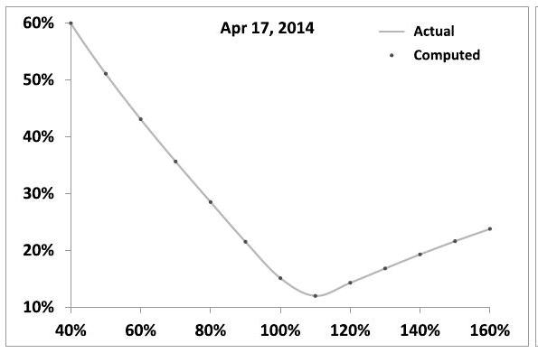
Figure 2.1: Comparison of market implied volatilities (solid line) with implied volatilities computed using the local volatility function generated by the approximate technique of Section 2.3.1.2 (dots), for the S\&P 500 index, for two maturities. Market parameters as of February 1, 2014 have been used.


### 2.4.1 Implied volatilities as weighted averages of instantaneous volatilities

Consider a base model - denoted model I - a local volatility model with volatility function $\sigma_{1}(t, S)$. Denote by $P_{1}(t, S)$ the price of a vanilla option of strike $K$, maturity $T$ in this base model.

Consider another model - denoted model II - such that the dynamics of $S_{t}$ is given by:

$$
\begin{equation*}
d S_{t}=(r-q) S_{t} d t+\sigma_{2 t} S_{t} d W_{t} \tag{2.28}
\end{equation*}
$$
^eq2-28

where the instantaneous volatility $\sigma_{2 t}$ is for now an arbitrary process.

Imagine delta-hedging a short vanilla option position of maturity $T$ using the base model with the actual dynamics of $S_{t}$ given by the second model. Our final P\&L is the sum of all gamma/theta P\&Ls between successive delta rehedges, each one equal to: $-\left.S_{t}^{2} \frac{d^{2} P_{1}}{d S^{2}}\right|_{S=S_{t}}\left(\sigma_{2 t}^{2}-\sigma_{1}\left(t, S_{t}\right)^{2}\right) d t$.

The price $P_{2}$ we should charge for this option is then the price in model I plus the opposite of an estimate of the sum of such gamma/theta P\&Ls. The following derivation makes this trading intuition more precise.

Consider process $Q_{t}$ defined by:

$$
Q_{t}=e^{-r t} P_{1}\left(t, S_{t}\right)
$$

At $t=0, Q_{t=0}$ is simply the initial price in model I, for the initial spot value $S_{0}$. The variation during $d t$ of $Q_{t}$ reads, in the dynamics of model II:

$$
\begin{align*}
d Q_{t} & =e^{-r t}\left[\left(-r P_{1}+\frac{d P_{1}}{d t}\right) d t+\frac{d P_{1}}{d S} d S_{t}+\frac{1}{2} \frac{d^{2} P_{1}}{d S^{2}}\left\langle d S_{t}^{2}\right\rangle\right] \\
& =e^{-r t}\left[\left(-r P_{1}+\frac{d P_{1}}{d t}\right) d t+\frac{d P_{1}}{d S} d S_{t}+\frac{1}{2} \sigma_{2 t}^{2} S_{t}^{2} \frac{d^{2} P_{1}}{d S^{2}} d t\right] \tag{2.29}
\end{align*}
$$
^eq2-29

where $P_{1}$ and its derivatives are evaluated at $\left(t, S_{t}\right)$. Taking the expectation of (2.29) yields:

$$
\begin{aligned}
E_{2}\left[d Q_{t} \mid t, S_{t}\right] & =e^{-r t}\left(-r P_{1}+\frac{d P_{1}}{d t}+(r-q) S_{t} \frac{d P_{1}}{d S}+\frac{1}{2} \sigma_{2 t}^{2} S_{t}^{2} \frac{d^{2} P_{1}}{d S^{2}}\right) d t \\
& =e^{-r t} \frac{S_{t}^{2}}{2} \frac{d^{2} P_{1}}{d S^{2}}\left(\sigma_{2 t}^{2}-\sigma_{1}\left(t, S_{t}\right)^{2}\right) d t
\end{aligned}
$$

where we have made use of pricing equation (2.2) for $P_{1}$ and where the subscript 2 indicates that the expectation is taken over paths of $S_{t}$ generated by SDE (2.28). Integrating the above expression on $[0, T]$ :

$$
\begin{aligned}
E_{2}\left[Q_{T}\right] & =Q_{0}+\int_{0}^{T} E_{2}\left[d Q_{t}\right] \\
& =P_{1}\left(0, S_{0}\right)+E_{2}\left[\int_{0}^{T} e^{-r t} \frac{S_{t}^{2}}{2} \frac{d^{2} P_{1}}{d S^{2}}\left(\sigma_{2 t}^{2}-\sigma_{1}\left(t, S_{t}\right)^{2}\right) d t\right]
\end{aligned}
$$

Now $Q_{T}=e^{-r T} P_{1}\left(T, S_{T}\right)=e^{-r T} f\left(S_{T}\right)$, where $f$ is the European option's payoff, thus $E_{2}\left[Q_{T}\right]=e^{-r T} E_{2}\left[f\left(S_{T}\right)\right]=P_{2}\left(0, S_{0}, \bullet\right)$ where $P_{2}$ is the pricing function of model 2, which involves its own parameters in addition to $t, S$. We thus have:

$$
\begin{equation*}
P_{2}\left(0, S_{0}, \bullet\right)=P_{1}\left(0, S_{0}\right)+E_{2}\left[\int_{0}^{T} e^{-r t} \frac{S_{t}^{2}}{2} \frac{d^{2} P_{1}}{d S^{2}}\left(\sigma_{2 t}^{2}-\sigma_{1}\left(t, S_{t}\right)^{2}\right) d t\right] \tag{2.30}
\end{equation*}
$$
^eq2-30

which expresses mathematically what trading intuition suggested.
The price of an option for an arbitrary dynamics of $S_{t}$ is given by its price in a given base model - here a local volatility model - supplemented with the expectation of the discounted gamma/theta P\&Ls incurred as one delta-hedges the option using the base model until maturity.

Assume now that model I is the Black-Scholes model with a constant volatility equal to the implied volatility of the vanilla option at hand, backed out of model II price: $\sigma_{1}\left(t, S_{t}\right) \equiv \widehat{\sigma}_{K T}$. By definition of $\widehat{\sigma}_{K T}$ :

$$
P_{1}\left(0, S_{0}\right)=P_{\widehat{\sigma}_{K T}}\left(0, S_{0}\right)=P_{2}\left(0, S_{0}, \bullet\right)
$$

where $P_{\widehat{\sigma}_{K T}}(t, S)$ denotes the Black-Scholes price with volatility $\widehat{\sigma}_{K T}$. (2.30) then yields:

$$
\begin{equation*}
\widehat{\sigma}_{K T}^{2}=\frac{E_{2}\left[\int_{0}^{T} e^{-r t} S_{t}^{2} \frac{d^{2} P_{\hat{\sigma}_{K T}}}{d S^{2}} \sigma_{2 t}^{2} d t\right]}{E_{2}\left[\int_{0}^{T} e^{-r t} S_{t}^{2} \frac{d^{2} P_{\hat{\sigma}_{K T}}}{d S^{2}} d t\right]} \tag{2.31}
\end{equation*}
$$
^eq2-31

This is true for an arbitrary instantaneous volatility $\sigma_{2 t}$. Specialize now to the case of a local volatility model: $\sigma_{2 t} \equiv \sigma(t, S)$ and $\widehat{\sigma}_{K T}$ is the implied volatility corresponding to the local volatility function. We have:

$$
\begin{equation*}
\widehat{\sigma}_{K T}^{2}=\frac{E_{\sigma(t, S)}\left[\int_{0}^{T} e^{-r t} S_{t}^{2} \frac{d^{2} P_{\hat{\sigma}_{K T}}}{d S^{2}} \sigma(t, S)^{2} d t\right]}{E_{\sigma(t, S)}\left[\int_{0}^{T} e^{-r t} S_{t}^{2} \frac{d^{2} P_{\hat{\sigma}_{K T}}}{d S^{2}} d t\right]} \tag{2.32}
\end{equation*}
$$
^eq2-32

$\widehat{\sigma}_{K T}^{2}$ is thus the average value of $\sigma(t, S)^{2}$, weighted by the dollar gamma computed with the constant volatility $\widehat{\sigma}_{K T}$ itself, over paths generated by the local volatility $\sigma(t, S)$.

Going back to identity (2.30), consider instead that model I is the local volatility model - $\sigma_{1}(t, S) \equiv \sigma(t, S)$ - and that model II is the Black-Scholes model with volatility $\widehat{\sigma}_{K T}$. Again we have $P_{1}\left(0, S_{0}\right)=P_{2}\left(0, S_{0}\right)$, and now get:

$$
\begin{equation*}
\widehat{\sigma}_{K T}^{2}=\frac{E_{\widehat{\sigma}_{K T}}\left[\int_{0}^{T} e^{-r t} S^{2} \frac{d^{2} P_{\sigma(S, t)}}{d S^{2}} \sigma(t, S)^{2} d t\right]}{E_{\widehat{\sigma}_{K T}}\left[\int_{0}^{T} e^{-r t} S^{2} \frac{d^{2} P_{\sigma(S, t)}}{d S^{2}} d t\right]} \tag{2.33}
\end{equation*}
$$
^eq2-33

where the averaging is now performed using the density generated by a BlackScholes model with constant volatility $\widehat{\sigma}_{K T}$ and $\sigma(t, S)^{2}$ is now weighted by the dollar gamma computed in the local volatility model. ${ }^{7}$

In this derivation we have used as base model the local volatility model, with a fixed volatility function - or the Black-Scholes model, a particular version of it and have considered a delta-hedged vanilla option position.

In Section 8.4, page 316, we derive a different expression for European option prices in diffusive models by considering a delta-hedged, vega-hedged option position, using as base model a Black-Scholes model whose volatility is constantly recalibrated to the terminal VS volatility.

### 2.4.2 Approximate expression for weakly local volatilities

While the Dupire formula (2.19) explicitly expresses local volatilities as a function of implied volatilities, formulas (2.32) and (2.33) for $\widehat{\sigma}_{K T}$ are implicit, as the righthand side depends on the unknown implied volatility $\widehat{\sigma}_{K T}$, either through the dollar gamma or through the density used for averaging the numerator and denominator.

[^20]In order to get a more usable expression, we will assume that $\sigma(t, S)$ is only weakly local.

We will use formula (2.32) with the Black-Scholes model with time-dependent volatility $\sigma_{0}(t)$ as base model.

Let us use the local variance $u(t, S)=\sigma(t, S)^{2}$ and assume that

$$
u(t, S)=u_{0}(t)+\delta u(t, S)
$$

where $u_{0}=\sigma_{0}^{2}(t)$ and $\delta u$ is a small perturbation. If $\delta u=0, \widehat{\sigma}_{K T}=\widehat{\sigma}_{0 T}$ where $\widehat{\sigma}_{t_{1} t_{2}}$ is defined as:

$$
\widehat{\sigma}_{t_{1} t_{2}}^{2}=\frac{1}{t_{2}-t_{1}} \int_{t_{1}}^{t_{2}} \sigma_{0}^{2}(t) d t
$$

Let us use expression (2.32) and expand $\widehat{\sigma}_{K T}^{2}$ at first order in $\delta u: \widehat{\sigma}_{K T}^{2}+\delta\left(\widehat{\sigma}_{K T}^{2}\right)$. $u(t, S)$ appears explicitly in the numerator as well as implicitly in the density used for computing expectations in both numerator and denominator. For the sake of computing the order-one perturbation in $\delta u$, however, the contribution generated by the density vanishes: from equation (2.32) and using a compact notation:

$$
\begin{align*}
\widehat{\sigma}_{K T}^{2}+\delta\left(\widehat{\sigma}_{K T}^{2}\right) & =\frac{E_{u_{0}+\delta u}\left[\left(u_{0}+\delta u\right) \bullet\right]}{E_{u_{0}+\delta u}[\bullet]}=u_{0}+\frac{E_{u_{0}+\delta u}[\delta u \bullet]}{E_{u_{0}+\delta u}[\bullet]} \\
& =u_{0}+\frac{E_{u_{0}}[\delta u \bullet]}{E_{u_{0}}[\bullet]} \tag{2.34}
\end{align*}
$$
^eq2-34

where • is computed at order zero in $\delta u$. We thus have:

$$
\begin{equation*}
\delta\left(\widehat{\sigma}_{K T}^{2}\right)=\frac{E_{\sigma_{0}}\left[\int_{0}^{T} e^{-r t} \delta u(t, S) S^{2} \frac{d^{2} P_{\sigma_{0}}}{d S^{2}} d t\right]}{E_{\sigma_{0}}\left[\int_{0}^{T} e^{-r t} S^{2} \frac{d^{2} P_{\sigma_{0}}}{d S^{2}} d t\right]} \tag{2.35}
\end{equation*}
$$
^eq2-35

The right-hand side of equation (2.35) now only requires the density and the dollar gamma of a call or put option, evaluated in the Black-Scholes model with deterministic volatility $\sigma_{0}(t)$ - both analytically known. The denominator in (2.35) involves the discounted dollar gamma of a European option, averaged over its lifetime. In the Black-Scholes model, $e^{-r t} S^{2} \frac{d^{2} P_{\sigma_{0}}}{d S^{2}}$ is a martingale - see a proof in Appendix A of Chapter 5, page 181. Thus:

$$
\begin{equation*}
E_{\sigma_{0}}\left[e^{-r t} S^{2} \frac{d^{2} P_{\sigma_{0}}}{d S^{2}}\right]=\left.S_{0}^{2} \frac{d^{2} P_{\sigma_{0}}}{d S^{2}}\right|_{t=0, S=S_{0}} \tag{2.36}
\end{equation*}
$$
^eq2-36

where $S_{0}$ denotes today's spot price. The denominator is then equal to $\left.T S_{0}^{2} \frac{d^{2} P_{\sigma_{0}}}{d S^{2}}\right|_{t=0, S=S_{0}}$.

Focus now on the numerator in (2.35). It reads:

$$
\begin{equation*}
\int_{0}^{T} d t \int_{0}^{\infty} d S \rho_{\sigma_{0}}(t, S) e^{-r t} \delta u(t, S) S^{2} \frac{d^{2} P_{\sigma_{0}}}{d S^{2}} \tag{2.37}
\end{equation*}
$$
^eq2-37

where $\rho_{\sigma_{0}}(t, S)$ is the lognormal density with deterministic volatility $\sigma_{0}(t)$. Define $x=\ln \left(S / F_{t}\right)$ where $F_{t}$ is the forward for maturity $t: F_{t}=S_{0} e^{(r-q) t} \cdot \rho_{\sigma_{0}}(t, S)$ and $S^{2} \frac{d^{2} P_{\sigma_{0}}}{d S^{2}}$ are given by:

$$
\begin{align*}
\rho_{\sigma_{0}}(t, S) & =\frac{1}{\sqrt{2 \pi \omega_{t}} S} e^{-\frac{\left(x+\frac{\omega_{t}}{2}\right)^{2}}{2 \omega_{t}}}  \tag{2.38}\\
S^{2} \frac{d^{2} P_{\sigma_{0}}}{d S^{2}} & =S \frac{F_{T}}{F_{t}} e^{-r(T-t)} \frac{1}{\sqrt{2 \pi\left(\omega_{T}-\omega_{t}\right)}} e^{-\frac{\left(-x_{K}+x+\frac{\left(\omega_{T}-\omega_{t}\right)}{2}\right)^{2}}{2\left(\omega_{T}-\omega_{t}\right)}} \tag{2.39}
\end{align*}
$$
^eq2-38
^eq2-39

where $x_{K}=\ln \left(\frac{K}{F_{T}}\right)$ and we have introduced the integrated variance $\omega_{t}$, defined as:

$$
\omega_{t}=\int_{0}^{t} \sigma_{0}^{2}(\tau) d \tau
$$

The numerator then reads:

$$
F_{T} e^{-r T} \int_{0}^{T} d t \int_{-\infty}^{+\infty} d x \frac{\delta u\left(t, F_{t} e^{x}\right)}{\sqrt{2 \pi\left(\omega_{T}-\omega_{t}\right)} \sqrt{2 \pi \omega_{t}}} e^{x} e^{-\frac{\left(-x_{K}+x+\frac{\left(\omega_{T}-\omega_{t}\right)}{2}\right)^{2}}{2\left(\omega_{T}-\omega_{t}\right)}} e^{-\frac{\left(x+\frac{\omega_{t}}{2}\right)^{2}}{2 \omega_{t}}}
$$

Combining the exponentials, we can rewrite this expression as:

$$
F_{T} e^{-r T} \int_{0}^{T} d t \int_{-\infty}^{+\infty} d x \frac{\delta u\left(t, F_{t} e^{x}\right)}{\sqrt{2 \pi\left(\omega_{T}-\omega_{t}\right)} \sqrt{2 \pi \omega_{t}}} e^{-\left(\frac{1}{2\left(\omega_{T}-\omega_{t}\right)}+\frac{1}{2 \omega_{t}}\right) \frac{\left(\omega_{T} x-\omega_{t} x_{K}\right)^{2}}{\omega_{T}^{2}}} e^{-\frac{\left(x_{K}-\frac{\omega_{T}}{2}\right)^{2}}{2 \omega_{T}}}
$$

We now divide this by (2.36), the dollar gamma evaluated at $t=0$ and multiplied by $T$, which reads:

$$
T F_{T} e^{-r T} \frac{1}{\sqrt{2 \pi \omega_{T}}} e^{-\frac{\left(-x_{K}+\frac{\omega_{T}}{2}\right)^{2}}{2 \omega_{T}}}
$$

and get for the ratio in (2.35):

$$
\frac{1}{T} \int_{0}^{T} d t \int_{-\infty}^{+\infty} d x \frac{\sqrt{\omega_{T}}}{\sqrt{\omega_{t}}} \frac{\delta u\left(t, F_{t} e^{x}\right)}{\sqrt{2 \pi\left(\omega_{T}-\omega_{t}\right)}} e^{-\left(\frac{1}{2\left(\omega_{T}-\omega_{t}\right)}+\frac{1}{2 \omega_{t}}\right) \frac{\left(\omega_{T} x-\omega_{t} x_{K}\right)^{2}}{\omega_{T}^{2}}}
$$

Switching now from $x$ to a new coordinate $y$ :

$$
x=\frac{\omega_{t}}{\omega_{T}} x_{K}+\frac{\sqrt{\left(\omega_{T}-\omega_{t}\right) \omega_{t}}}{\sqrt{\omega_{T}}} y
$$

yields our final formula for $\delta\left(\widehat{\sigma}_{K T}^{2}\right)$ at order one in $\delta u$ :

$$
\delta\left(\widehat{\sigma}_{K T}^{2}\right)=\frac{1}{T} \int_{0}^{T} d t \int_{-\infty}^{+\infty} d y \frac{e^{-\frac{y^{2}}{2}}}{\sqrt{2 \pi}} \delta u\left(t, F_{t} e^{\frac{\omega_{t}}{\omega_{T}} x_{K}+\frac{\sqrt{\left(\omega_{T}-\omega_{t}\right) \omega_{t}}}{\sqrt{\omega_{T}}} y}\right)
$$

Noting that, at order zero, $\widehat{\sigma}_{K T}^{2}=\frac{1}{T} \int_{0}^{T} \sigma_{0}^{2}(t) d t=\frac{1}{T} \int_{0}^{T} u_{0}(t) d t$, this can be rewritten, at order one in $\delta u=\sigma^{2}(t, S)-\sigma_{0}^{2}(t)$, as:

$$
\begin{equation*}
\widehat{\sigma}_{K T}^{2}=\frac{1}{T} \int_{0}^{T} d t \int_{-\infty}^{+\infty} d y \frac{e^{-\frac{y^{2}}{2}}}{\sqrt{2 \pi}} u\left(t, F_{t} e^{\frac{\omega_{t}}{\omega_{T}} x_{K}+\frac{\sqrt{\left(\omega_{T}-\omega_{t}\right) \omega_{t}}}{\sqrt{\omega_{T}}} y}\right) \tag{2.40}
\end{equation*}
$$
^eq2-40

This is the expression of $\widehat{\sigma}_{K T}$ at order one in the perturbation of $\sigma$ around a time-dependent volatility $\sigma_{0}(t)$. The square of the implied volatility is expressed as an integral of the square of the instantaneous volatility - thus (2.40) is exact when $u$ is a function of $t$ only. ${ }^{8}$

### 2.4.3 Expanding around a constant volatility

Consider as base case the Black-Scholes model with constant volatility $\sigma_{0}$ : $\sigma_{0}(t)=\sigma_{0}$, thus $\omega_{t}=\sigma_{0}^{2} t$ and write:

$$
\sigma(t, S)=\sigma_{0}+\delta \sigma(t, S)
$$

thus $\delta u=2 \sigma_{0} \delta \sigma(t, S)$. Using (2.40) together with $\widehat{\sigma}_{K T}^{2}=\sigma_{0}^{2}+2 \sigma_{0} \delta\left(\widehat{\sigma}_{K T}\right)$ yields:

$$
\begin{equation*}
\delta \widehat{\sigma}_{K T}=\frac{1}{T} \int_{0}^{T} d t \int_{-\infty}^{+\infty} d y \frac{e^{-\frac{y^{2}}{2}}}{\sqrt{2 \pi}} \delta \sigma\left(t, F_{t} e^{\frac{t}{T} x_{K}+\sigma_{0} \sqrt{\frac{(T-t) t}{T}} y}\right) \tag{2.41}
\end{equation*}
$$
^eq2-41

Adding $\sigma_{0}$ on both sides yields, at order one in $\delta \sigma(t, S)$ :

$$
\begin{equation*}
\widehat{\sigma}_{K T}=\frac{1}{T} \int_{0}^{T} d t \int_{-\infty}^{+\infty} d y \frac{e^{-\frac{y^{2}}{2}}}{\sqrt{2 \pi}} \sigma\left(t, F_{t} e^{\frac{t}{T} x_{K}+\sigma_{0} \sqrt{\frac{(T-t) t}{T}} y}\right) \tag{2.42}
\end{equation*}
$$
^eq2-42

Even though (2.40) may be slightly more accurate when the term-structure of volatilities is strong, we will use (2.42) in the sequel, since resulting expressions for the ATMF skew and the SSR are simpler.

### 2.4.4 Discussion

For $t=0, F_{t} \exp \left(\frac{t}{T} \ln \frac{K}{F_{T}}+\frac{\sqrt{\sigma_{0}^{2}(T-t) t}}{\sqrt{T}} y\right)=S_{0}$. Thus values of $\sigma(t=0, S)$ for $S \neq S_{0}$ do not contribute in (2.42) to $\widehat{\sigma}_{K T}$.

Likewise, for $t=T, F_{t} \exp \left(\frac{t}{T} \ln \frac{K}{F_{T}}+\frac{\sqrt{\sigma_{0}^{2}(T-t) t}}{\sqrt{T}} y\right)=K$ : values of $\sigma(t=T, S)$ for $S \neq K$ do not contribute either. This is natural, upon inspection of expression

[^21](2.37): for $t=0$, the density $\rho_{\sigma_{0}}$ vanishes unless $S=S_{0}$, while for $t=T$ the dollar gamma $S^{2} \frac{d^{2} P_{\sigma_{0}}}{d S^{2}}$ vanishes, unless $S=K$.

In (2.42), the largest weight is obtained for $y=0$ : this singles out a path for $\ln (S)$ which is a straight line starting at $\ln \left(S_{0}\right)$ for $t=0$ and ending at $\ln (K)$ at $t=T$. Replacing the integral over $y$ by the value for $y=0$ would give an approximation of $\widehat{\sigma}_{K T}$ as a uniform average of the local volatility along this line:

$$
\begin{equation*}
\widehat{\sigma}_{K T} \simeq \frac{1}{T} \int_{0}^{T} \sigma\left(t, F_{t} e^{\frac{t}{T} \ln \frac{K}{F_{T}}}\right) d t \tag{2.43}
\end{equation*}
$$
^eq2-43

Summing over values of $y \neq 0$, includes other paths in the average, with their ends pinned down at $S_{0}$ at $t=0$ and at $K$ for $t=T$ by the factor $\sqrt{\sigma_{0}^{2}(T-t) t}$.

However appealing expression (2.42) for $\widehat{\sigma}_{K T}$ may be, market smiles on equity underlyings are strong enough, and bid-offer spreads on vanilla option prices are tight enough, that its numerical accuracy is not sufficient for practical trading purposes: an order one expansion in $\delta \sigma(t, S)$ is simply not adequate. ${ }^{9}$

Can we do better? Expression (2.42) for $\widehat{\sigma}_{K T}$ amounts to merely setting $\widehat{\sigma}_{K T}= \sigma_{0}$ and using the lognormal density with volatility $\sigma_{0}$ for computing both averages in the numerator and denominator of the right-hand side of equation (2.32).

A number of tricks have been proposed under the loose name of "most likely path" techniques for approximating the right-hand side of (2.32), using a lognormal density but with a different implied volatility for each time slice - still, their accuracies are not adequate.

The reason for this is that formula (2.32) seems to suggest that the main contribution of $\sigma(t, S)$ is embodied in the explicit gamma term in the numerator and that using an approximate density - for example lognormal - for computing both averages in the numerator and the denominator will do. This is not the case. In practice, taking into account the dependence of the density itself on $\sigma(t, S)$ is mandatory for achieving the accuracy needed in trading applications. ${ }^{10}$ For realistic equity smiles, there isn't yet a computationally efficient alternative to numerically solving the forward equation (2.7).

Is formula (2.42) then of any use? While a good approximation of absolute volatility levels is hard to come by, the skew - which is the difference of two volatilities is more easily approximated. We now use equation (2.42) to calculate the skew and curvature of the smile, as a function of parameters of the local volatility function.

[^22]
### 2.4.5 The smile near the forward

Let us assume that the local volatility is smooth and given by:

$$
\begin{equation*}
\sigma(t, S)=\bar{\sigma}(t)+\alpha(t) x+\frac{\beta(t)}{2} x^{2} \tag{2.44}
\end{equation*}
$$
^eq2-44

where $x$ - which we call moneyness - is given by $x=\ln \left(S / F_{t}\right)$.
We assume that $\alpha(t), \beta(t)$ are small, and that $\bar{\sigma}(t)$ does not vary too much, so that the difference $\bar{\sigma}(t)-\sigma_{0}$ is small, where $\sigma_{0}$ is the constant volatility level around which the order-one expansion in (2.35) is performed.

We could as well perform the expansion around the time-deterministic volatility $\bar{\sigma}(t)$ - calculations are similar. For the sake of simplicity we carry out the expansion around a constant $\sigma_{0}$ - expressions for the more general case appear in (2.60), page 51.

Equation (2.42) gives :

$$
\begin{align*}
\widehat{\sigma}_{K T} & =\frac{1}{T} \int_{0}^{T} \bar{\sigma}(t) d t  \tag{2.45}\\
& +\frac{1}{T} \int_{0}^{T} d t \int_{-\infty}^{+\infty} d y \frac{e^{-\frac{y^{2}}{2}}}{\sqrt{2 \pi}}\left[\alpha(t) X(t, y)+\frac{\beta(t)}{2} X(t, y)^{2}\right]
\end{align*}
$$
^eq2-45

where

$$
\begin{equation*}
X(t, y)=\frac{t}{T} x_{K}+\frac{\sqrt{\sigma_{0}^{2}(T-t) t}}{\sqrt{T}} y \tag{2.46}
\end{equation*}
$$
^eq2-46

Doing the integrals over $y$ we get at order 1 in $\alpha, \beta$ :

$$
\begin{align*}
\widehat{\sigma}_{K T} & =\frac{1}{T} \int_{0}^{T} \bar{\sigma}(t) d t+\frac{\sigma_{0}^{2} T}{2} \frac{1}{T} \int_{0}^{T} \frac{(T-t) t}{T^{2}} \beta(t) d t  \tag{2.47}\\
& +\left(\frac{1}{T} \int_{0}^{T} \frac{t}{T} \alpha(t) d t\right) x_{K}+\frac{1}{2}\left(\frac{1}{T} \int_{0}^{T} \frac{t^{2}}{T^{2}} \beta(t) d t\right) x_{K}^{2}
\end{align*}
$$
^eq2-47

Thus, for a sufficiently smooth local volatility function, the skew and curvature of the smile near the forward are related to the skew and curvature of the local volatility function through:

$$
\begin{align*}
\mathcal{S}_{T}=\left.\frac{d \widehat{\sigma}_{K T}}{d \ln K}\right|_{F_{T}} & =\frac{1}{T} \int_{0}^{T} \frac{t}{T} \alpha(t) d t  \tag{2.48}\\
\left.\frac{d^{2} \widehat{\sigma}_{K T}}{d \ln K^{2}}\right|_{F_{T}} & =\frac{1}{T} \int_{0}^{T}\left(\frac{t}{T}\right)^{2} \beta(t) d t \tag{2.49}
\end{align*}
$$
^eq2-48
^eq2-49

where we have introduced $\mathcal{S}_{T}$ as a notation for the ATMF (at the money forward) skew. ${ }^{11}$

[^23]
### 2.4.5.1 A constant local volatility function

Assume that $\alpha$ and $\beta$ are constant. We get:

$$
\begin{align*}
\left.\frac{d \widehat{\sigma}_{K T}}{d \ln K}\right|_{F_{T}} & =\frac{1}{T} \int_{0}^{T} \frac{t}{T} d t \alpha=\frac{\alpha}{2}  \tag{2.50a}\\
\left.\frac{d^{2} \widehat{\sigma}_{K T}}{d \ln K^{2}}\right|_{F_{T}} & =\frac{1}{T} \int_{0}^{T}\left(\frac{t}{T}\right)^{2} \beta d t=\frac{\beta}{3} \tag{2.50b}
\end{align*}
$$
^eq2-50a
^eq2-50b

Thus, for a local volatility function of the form (2.44) with $\alpha$ and $\beta$ constant, at order one in $\alpha, \beta$, the ATMF skew of the implied volatility is half the skew of the local volatility function, while its curvature is one third the curvature of the local volatility function.

### 2.4.5.2 A power-law-decaying ATMF skew

Let us assume a power-law form for $\alpha(t)$. To prevent divergence as $t \rightarrow 0$ we take:

$$
\left\{\begin{array}{l}
\alpha(t)=\alpha_{0}\left(\frac{\tau_{0}}{t}\right)^{\gamma} \quad t>\tau_{0}  \tag{2.51}\\
\alpha(t)=\alpha_{0} \quad t \leq \tau_{0}
\end{array}\right.
$$
^eq2-51

where $\tau_{0}$ is a cutoff - typically $\tau_{0}=3$ months - and $\gamma$ is the characteristic exponent of the long-term decay of $\alpha(t)$. We get, from (2.48):

$$
\left\{\begin{array}{l}
\mathcal{S}_{T}=\frac{\alpha_{0}}{2} \quad T \leq \tau_{0}  \tag{2.52}\\
\mathcal{S}_{T}=\frac{1}{2-\gamma} \alpha_{0}\left(\frac{\tau_{0}}{T}\right)^{\gamma}-\frac{\gamma}{2(2-\gamma)} \alpha_{0}\left(\frac{\tau_{0}}{T}\right)^{2} \quad T \geq \tau_{0}
\end{array}\right.
$$
^eq2-52

$\gamma$ is typically smaller than 2 . For (very) long maturities the second piece in (2.52) can be ignored and we get:

$$
\begin{equation*}
\mathcal{S}_{T} \simeq \frac{1}{2-\gamma} \alpha_{0}\left(\frac{\tau_{0}}{T}\right)^{\gamma} \tag{2.53}
\end{equation*}
$$
^eq2-53

The long-term ATMF skew thus decays with the same exponent $\gamma$ as the local volatility function. For typical equity smiles, $\gamma \simeq \frac{1}{2}-$ see examples in Figure 2.3, page 58 . With respect to the local volatility skew $\alpha(t), \mathcal{S}_{T}$ is rescaled by a factor $\frac{1}{2-\gamma}$.

### 2.4.6 An exact result for short maturities

We consider here the case $T \rightarrow 0$, for which a particularly simple relationship linking local and implied volatilities exists, which we now derive.

Let us recall the definition of $y$ and $f$, which appear in expression (2.19):

$$
\begin{aligned}
y & =\ln \left(\frac{K}{F_{T}}\right) \\
f(T, y) & =\left(T-t_{0}\right) \widehat{\sigma}_{K=F_{T} e^{y}, T}^{2}
\end{aligned}
$$

To lighten the notation we use $\widehat{\sigma}(T, y)$ instead of $\widehat{\sigma}_{K=F_{T} e^{y}, T}$ and take $t_{0}=0$. Expression (2.19) reads:

$$
\sigma^{2}=\frac{\widehat{\sigma}^{2}+2 T \widehat{\sigma} \widehat{\sigma}_{T}}{\left(\frac{y}{\widehat{\sigma}^{2}} \widehat{\sigma} \widehat{\sigma}_{y}-1\right)^{2}+T\left(\widehat{\sigma}_{y}^{2}+\widehat{\sigma} \widehat{\sigma}_{y y}\right)-\left(\frac{1}{4}+\frac{1}{T \widehat{\sigma}^{2}}\right) \widehat{\sigma}^{2} \widehat{\sigma}_{y}^{2} T^{2}}
$$

where $\widehat{\sigma}_{y}, \widehat{\sigma}_{T}$ denote derivatives of $\widehat{\sigma}$ with respect to $y$ and $T$. Take the limit $T \rightarrow 0$ and keep the leading term in the numerator and denominator in an expansion in powers of $T$, assuming that $\widehat{\sigma}$ is a smooth function of $T$ and $y$ as $T \rightarrow 0$. We get:

$$
\sigma^{2}=\frac{\widehat{\sigma}^{2}}{\left(\frac{y}{\widehat{\sigma}} \widehat{\sigma}_{y}-1\right)^{2}}=\frac{1}{\left(\frac{y}{\widehat{\sigma}^{2}} \widehat{\sigma}_{y}-\frac{1}{\widehat{\sigma}}\right)^{2}}
$$

which yields

$$
\frac{1}{\sigma}= \pm\left(\frac{y}{\widehat{\sigma}^{2}} \widehat{\sigma}_{y}-\frac{1}{\widehat{\sigma}}\right)=\mp\left(y\left(\frac{1}{\widehat{\sigma}}\right)_{y}+\frac{1}{\widehat{\sigma}}\right)=\mp\left(\frac{y}{\widehat{\sigma}}\right)_{y}
$$

Thus

$$
\int_{0}^{y} \frac{d u}{\sigma\left(T=0, S e^{u}\right)}=\mp \frac{y}{\widehat{\sigma}\left(T=0, S e^{y}\right)}
$$

Following the usual convention of using positive volatilities:

$$
\begin{equation*}
\frac{1}{\widehat{\sigma}\left(T=0, S e^{y}\right)}=\frac{1}{y} \int_{0}^{y} \frac{d u}{\sigma\left(T=0, S e^{u}\right)} \tag{2.54}
\end{equation*}
$$
^eq2-54

or, equivalently:

$$
\frac{1}{\widehat{\sigma}(T=0, K)}=\frac{1}{\ln \frac{K}{S}} \int_{S}^{K} \frac{1}{\sigma(T=0, \mathcal{S})} \frac{d \mathcal{S}}{\mathcal{S}}
$$

This result was first published by Henri Beresticki, Jérôme Busca and Igor Florent [6]. The fact that the inverse of $\widehat{\sigma}$ should be given by the average of the inverse of $\sigma$ may surprise at first.

The squared volatility that one may have expected appears usually in averages only because they are temporal averages, akin to a quadratic variation. In our case $T \rightarrow 0$ and there is no temporal averaging.

Then note that the harmonic average complies with the basic requirement that if the local volatility vanishes in a region between the initial spot level and the strike, the implied volatility for that strike should vanish, as for $T \mapsto 0$, the effect of the drift is immaterial and the spot would be unable to cross that region. ${ }^{12}$

[^24]
### 2.5 The dynamics of the local volatility model

Once the volatility function $\sigma(t, S)$ is set, expression (2.32) shows that, in the local volatility model, $\widehat{\sigma}_{K T}$ changes only if time advances or $S$ moves. Mathematically, this is a consequence of the fact that the local volatility model is a market model for spot and implied volatilities that has a one-dimensional Markovian representation in terms of $t, S$.

Thus, practically, to characterize the joint dynamics of spot and implied volatilities, we only need to analyze how implied volatilities respond to a move of $S$.

As will be made clear in Section 2.7 below, the volatilities of volatilities and spot/volatility covariances, or SSRs, that we derive below are exactly the break-even levels of the P\&L of a delta and vega-hedged position - inclusive of recalibration of the local volatility function - an aspect that looks counter-intuitive at first.

### 2.5.1 The dynamics for strikes near the forward

How much do implied volatilities move when $S$ moves? Let us take the derivative of equation (2.42) with respect to $\ln \left(S_{0}\right)$, introducing the notation $S(t, y)= F_{t} \exp \left(\frac{t}{T} x_{K}+\frac{\sqrt{\sigma_{0}^{2}(T-t) t}}{\sqrt{T}} y\right)$ and remembering that $F_{t}$ and $x_{K}$ depend on $S_{0}$ : $F_{t}=S_{0} e^{(r-q) t} ; x_{K}=\ln \left(\frac{K}{S_{0} e^{(r-q) T}}\right)$.

$$
\begin{aligned}
\frac{d \widehat{\sigma}_{K T}}{d \ln S_{0}} & =\frac{1}{T} \int_{0}^{T} d t \int_{-\infty}^{+\infty} d y \frac{e^{-\frac{y^{2}}{2}}}{\sqrt{2 \pi}} \frac{d \sigma}{d \ln S_{0}}(t, S(t, y)) \\
& =\frac{1}{T} \int_{0}^{T} d t \int_{-\infty}^{+\infty} d y \frac{e^{-\frac{y^{2}}{2}}}{\sqrt{2 \pi}} \frac{d \sigma}{d S}(t, S(t, y)) \frac{d S(t, y)}{d \ln S_{0}} \\
& =\frac{1}{T} \int_{0}^{T} d t \int_{-\infty}^{+\infty} d y \frac{e^{-\frac{y^{2}}{2}}}{\sqrt{2 \pi}} \frac{d \sigma}{d S}(t, S(t, y))\left(1-\frac{t}{T}\right) S(t, y) \\
& =\frac{1}{T} \int_{0}^{T}\left(1-\frac{t}{T}\right) d t \int_{-\infty}^{+\infty} d y \frac{e^{-\frac{y^{2}}{2}}}{\sqrt{2 \pi}} \frac{d \sigma}{d \ln S}(t, S(t, y))
\end{aligned}
$$

Using expression (2.44) for $\sigma(t, S)$ and the definition of $X(t, y)$ in (2.46) we get:

$$
\begin{aligned}
\frac{d \widehat{\sigma}_{K T}}{d \ln S_{0}} & =\frac{1}{T} \int_{0}^{T}\left(1-\frac{t}{T}\right) d t \int_{-\infty}^{+\infty} d y \frac{e^{-\frac{y^{2}}{2}}}{\sqrt{2 \pi}}(\alpha(t)+\beta(t) X(t, y)) \\
& =\frac{1}{T} \int_{0}^{T}\left(1-\frac{t}{T}\right) \alpha(t) d t+\left[\frac{1}{T} \int_{0}^{T}\left(1-\frac{t}{T}\right) \frac{t}{T} \beta(t) d t\right] x_{K}
\end{aligned}
$$

Let us consider the special case of the ATMF volatility, that is the implied volatility for a strike equal to the forward: $x_{K}=0$. We get:

$$
\left.\frac{d \widehat{\sigma}_{K T}}{d \ln S_{0}}\right|_{K=F_{T}}=\frac{1}{T} \int_{0}^{T}\left(1-\frac{t}{T}\right) \alpha(t) d t
$$

This formula quantifies how the implied volatility for a fixed strike equal to the forward $F_{T}$ moves when the spot moves. It resembles equation (2.48) except the weight is $1-\frac{t}{T}$ rather than $\frac{t}{T}$. This is natural, as when $S_{0}$ moves while $K$ stays fixed, for $t=T$ only the value $\sigma(T, S=K)$ contributes to formula (2.32), thus $\alpha(t=T)$ is immaterial.

Symmetrically, for calculating how the implied volatility changes with strike $K$ for a fixed spot $S_{0}$, knowledge of $\alpha(t)$ for $t=0$ is not needed as only the value $\sigma\left(t=0, S_{0}\right)$ is contributing - hence the vanishing weight for $\alpha(t=0)$ in equation (2.48).

Consider now the motion of the ATMF implied volatility $\widehat{\sigma}_{K=F_{T} T}$ keeping in mind that, as $S_{0}$ moves, strike $K$ moves as well, so as to track the change in the forward $F_{T}$. We get the sum of two contributions:

$$
\begin{align*}
\frac{d \widehat{\sigma}_{F_{T} T}}{d \ln S_{0}} & =\left.\frac{d \widehat{\sigma}_{K T}}{d \ln K}\right|_{K=F_{T}}+\left.\frac{d \widehat{\sigma}_{K T}}{d \ln S_{0}}\right|_{K=F_{T}} \\
& =\frac{1}{T} \int_{0}^{T} \frac{t}{T} \alpha(t) d t+\frac{1}{T} \int_{0}^{T}\left(1-\frac{t}{T}\right) \alpha(t) d t \\
& =\frac{1}{T} \int_{0}^{T} \alpha(t) d t \tag{2.55}
\end{align*}
$$
^eq2-55

Thus the rate at which the ATMF volatility varies as the spot moves is simply given by the uniform time average of the skew of the local volatility function at the forward. In practice, given a market smile, $\alpha(t)$ is not accessible, but $\mathcal{S}_{T}$ is. Inverting equation (2.48) gives:

$$
\begin{equation*}
\alpha(t)=\frac{d}{d t}\left(t \mathcal{S}_{t}\right)+\mathcal{S}_{t} \tag{2.56}
\end{equation*}
$$
^eq2-56

Inserting this expression in equation (2.55) yields:

$$
\begin{equation*}
\frac{d \widehat{\sigma}_{F_{T} T}}{d \ln S_{0}}=\mathcal{S}_{T}+\frac{1}{T} \int_{0}^{T} \mathcal{S}_{t} d t \tag{2.57}
\end{equation*}
$$
^eq2-57

The rate at which the ATMF volatility moves when the spot moves is purely dictated by the term structure of the ATMF skew for maturities from 0 to $T$.

Let us assume that $\mathcal{S}$ is constant. Formula (2.57) then gives:

$$
\begin{equation*}
\frac{d \widehat{\sigma}_{F_{T} T}}{d \ln S_{0}}=2 \mathcal{S}_{T} \tag{2.58}
\end{equation*}
$$
^eq2-58

We get the property that, for weak skews that do not depend on maturity, the rate at which the ATMF implied volatility moves as the spot moves is exactly twice the rate at which the implied volatility varies as a function of the strike, near the forward.

This is a fundamental feature of the dynamics of implied volatilities in the local volatility model: their dynamics is entirely determined by the implied smile to which the model has been calibrated.

Recalling (2.48), let us summarize the three key properties for implied volatilities near the forward that we have derived at order one in $\alpha(t)$, in an expansion around a constant volatility $\sigma_{0}$ :

$$
\begin{align*}
\left.\frac{d \widehat{\sigma}_{K T}}{d \ln K}\right|_{K=F_{T}} & =\frac{1}{T} \int_{0}^{T} \frac{t}{T} \alpha(t) d t  \tag{2.59a}\\
\left.\frac{d \widehat{\sigma}_{K T}}{d \ln S_{0}}\right|_{K=F_{T}} & =\frac{1}{T} \int_{0}^{T}\left(1-\frac{t}{T}\right) \alpha(t) d t  \tag{2.59b}\\
\frac{d \widehat{\sigma}_{F_{T} T}}{d \ln S_{0}} & =\frac{1}{T} \int_{0}^{T} \alpha(t) d t=\mathcal{S}_{T}+\frac{1}{T} \int_{0}^{T} \mathcal{S}_{t} d t \tag{2.59c}
\end{align*}
$$
^eq2-59a
^eq2-59b
^eq2-59c

## Expanding around a time-dependent volatility

What about expanding around a **time-dependent volatility** $\bar{\sigma}(t)$ rather than a constant volatility $\sigma_{0}$ ? Starting from expression (2.40), page 44 , and local volatility function (2.44): $\sigma(t, S)=\bar{\sigma}(t)+\alpha(t) x+\frac{\beta(t)}{2} x^{2}$, and expanding around $\sigma_{0}(t)= \bar{\sigma}(t)$ yields the following expressions:

```handwritten-ink
{
	"versionAtEmbed": "0.3.4",
	"filepath": "03 - Resources/Quant/Bergomi Book/attach/Ink/Writing/2026.2.8 - 14.58pm.writing"
}
```

$$
\begin{align*}
\left.\frac{d \widehat{\sigma}_{K T}}{d \ln K}\right|_{K=F_{T}} & =\frac{1}{T} \int_{0}^{T} \frac{\widehat{\sigma}_{t}^{2} t}{\widehat{\sigma}_{T}^{2} T} \frac{\bar{\sigma}(t)}{\widehat{\sigma}_{T}} \alpha(t) d t  \tag{2.60a}\\
\left.\frac{d \widehat{\sigma}_{K T}}{d \ln S_{0}}\right|_{K=F_{T}} & =\frac{1}{T} \int_{0}^{T}\left(1-\frac{\widehat{\sigma}_{t}^{2} t}{\widehat{\sigma}_{T}^{2} T}\right) \frac{\bar{\sigma}(t)}{\widehat{\sigma}_{T}} \alpha(t) d t  \tag{2.60b}\\
\frac{d \widehat{\sigma}_{F_{T} T}}{d \ln S_{0}} & =\frac{1}{T} \int_{0}^{T} \frac{\bar{\sigma}(t)}{\widehat{\sigma}_{T}} \alpha(t) d t=\mathcal{S}_{T}+\frac{1}{T} \int_{0}^{T} \frac{\bar{\sigma}^{2}(t)}{\widehat{\sigma}_{t} \widehat{\sigma}_{T}} \mathcal{S}_{t} d t \tag{2.60c}
\end{align*}
$$
^eq2-60a
^eq2-60b
^eq2-60c

where $\widehat{\sigma}_{\tau}=\sqrt{\frac{1}{\tau} \int_{0}^{\tau} \bar{\sigma}^{2}(u) d u}$ .
$\bar{\sigma}(t)$ is arbitrary - a natural choice is to calibrate $\bar{\sigma}(t)$ to the term structure of ATMF volatilities.

> [!abstract] Proof: Derivation of Equation 2.60c
> The goal is to prove the total sensitivity of the ATMF volatility to the spot price:

> $$\frac{d \widehat{\sigma}_{F_{T} T}}{d \ln S_{0}} = \mathcal{S}_{T}+\frac{1}{T} \int_{0}^{T} \frac{\bar{\sigma}^{2}(t)}{\widehat{\sigma}_{t} \widehat{\sigma}_{T}} \mathcal{S}_{t} d t \tag{2.60c}
$$
^eq2-60c
> 
> ### Step 1: Formulate the Total Derivative
> The total derivative is the sum of Slide (2.60a) and Shift (2.60b). With Weight $W = \frac{\widehat{\sigma}_{t}^{2} t}{\widehat{\sigma}_{T}^{2} T}$, the weights cancel out ($W + (1-W) = 1$):

> $$\frac{d \widehat{\sigma}_{F_{T} T}}{d \ln S_{0}} = \frac{1}{T} \int_{0}^{T} \frac{\bar{\sigma}(t)}{\widehat{\sigma}_{T}} \alpha(t) d t \tag{1}
$$
^eq1
> 
> ### Step 2: Invert Skew Definition for $\alpha(t)$
> Define integrated base variance as $w(t) = \widehat{\sigma}_t^2 t = \int_0^t \bar{\sigma}^2(u) du$. 
> Rearranging the market skew $\mathcal{S}_T$ from 2.60a:

> $$\bar{\sigma}(t) \alpha(t) = \frac{1}{w(t)} \frac{d}{dt} \left( t^2 \widehat{\sigma}_t^3 \mathcal{S}_t \right) \tag{2}
$$
^eq2
> 
> ### Step 3: Integration by Parts
> Substituting (2) into (1):

> $$\text{Total} = \frac{1}{T \widehat{\sigma}_T} \int_{0}^{T} \frac{1}{w(t)} \frac{d}{dt} \left( t^2 \widehat{\sigma}_t^3 \mathcal{S}_t \right) d t$$
> 
> Using $\int u \, dv = uv - \int v \, du$ where $u = \frac{1}{w(t)}$ and $v = t^2 \widehat{\sigma}_t^3 \mathcal{S}_t$:
> 
> $$
> \begin{aligned}
> \text{Boundary } [uv]_0^T &= \frac{T^2 \widehat{\sigma}_T^3 \mathcal{S}_T}{\widehat{\sigma}_T^2 T} = T \widehat{\sigma}_T \mathcal{S}_T \\
> \text{Integral } -\int v \, du &= \int_{0}^{T} (t^2 \widehat{\sigma}_t^3 \mathcal{S}_t) \left( \frac{\bar{\sigma}^2(t)}{\widehat{\sigma}_t^4 t^2} \right) dt \\
> &= \int_{0}^{T} \frac{\bar{\sigma}^2(t) \mathcal{S}_t}{\widehat{\sigma}_t} dt
> \end{aligned}

> $$
> 
> ### Step 4: Final Assembly
> $$\text{Total} = \frac{1}{T \widehat{\sigma}_T} \left[ T \widehat{\sigma}_T \mathcal{S}_T + \int_{0}^{T} \frac{\bar{\sigma}^2(t)}{\widehat{\sigma}_t} \mathcal{S}_t dt \right]$$
> 
> Distributing the pre-factor:
> 1. $\frac{T \widehat{\sigma}_T \mathcal{S}_T}{T \widehat{\sigma}_T} = \mathcal{S}_T$
> 2. $\frac{1}{T \widehat{\sigma}_T} \int_{0}^{T} \frac{\bar{\sigma}^2(t)}{\widehat{\sigma}_t} \mathcal{S}_t dt = \frac{1}{T} \int_{0}^{T} \frac{\bar{\sigma}^2(t)}{\widehat{\sigma}_t \widehat{\sigma}_T} \mathcal{S}_t dt$
> 
> **Result:**

> $$\frac{d \widehat{\sigma}_{F_{T} T}}{d \ln S_{0}} = \mathcal{S}_{T} + \frac{1}{T} \int_{0}^{T} \frac{\bar{\sigma}^{2}(t)}{\widehat{\sigma}_{t} \widehat{\sigma}_{T}} \mathcal{S}_{t} d t$$

### 2.5.2 The Skew Stickiness Ratio (SSR)

It is useful to normalize $\frac{d \widehat{\sigma}_{F_{T} T}}{d \ln S_{0}}$ by the ATMF skew of maturity $T, \mathcal{S}_{T}$, thus defining a dimensionless number $\mathcal{R}_{T}$ which we call the Skew Stickiness Ratio (SSR) for maturity $T$ :

$$
\begin{equation*}
\mathcal{R}_{T}=\frac{1}{\mathcal{S}_{T}} \frac{d \widehat{\sigma}_{F_{T} T}}{d \ln S_{0}} \tag{2.61}
\end{equation*}

$$
^eq2-61

$\mathcal{R}_{T}$ quantifies how much the ATMF volatility for maturity $T$ responds to a move of the spot, in units of the ATMF skew.
$\mathcal{R}_{T}$ will be given in Chapter 9 a more general definition as the regression coefficient of the ATMF volatility on $\ln S$, normalized by the ATMF skew:

$$
\begin{equation*}
\mathcal{R}_{T}=\frac{1}{\mathcal{S}_{T}} \frac{\left\langle d \widehat{\sigma}_{F_{T} T} d \ln S_{0}\right\rangle}{\left\langle\left(d \ln S_{0}\right)^{2}\right\rangle} \tag{2.62}
\end{equation*}

$$
^eq2-62

$\mathcal{R}_{T}$ essentially quantifies the spot/volatility covariance in the model at hand.
In the local volatility model, $\widehat{\sigma}_{F_{T} T}$ is a function of $(t, S)$, hence expression (2.62) for $\mathcal{R}_{T}$ simplifies to (2.61). ${ }^{13}$

Practitioners routinely refer to two archetypical regimes:

- The "sticky-strike" regime corresponds to $\mathcal{R}_{T}=1$. As the spot moves, implied volatilities for fixed strikes near the money stay frozen - the ATMF volatility slides along the smile.
- The "sticky-delta" regime corresponds to $\mathcal{R}_{T}=0$. The whole smile experiences a translation alongside the spot: volatilities for fixed log-moneyness are frozen.

While the sticky-delta regime is observed for all $T$ in models with iid increments for $\ln S$ - such as jump-diffusion models - sticky-strike behavior is only observed as a limiting regime for long maturities for certain types of stochastic volatility models - see Section 9.5.

Using expression (2.57) for $\frac{d \widehat{\sigma}_{F_{T} T}}{d \ln S_{0}}$ we get:

$$
\begin{equation*}
\left\langle d \widehat{\sigma}_{F_{T} T} d \ln S_{0}\right\rangle=\left(\mathcal{S}_{T}+\frac{1}{T} \int_{0}^{T} \mathcal{S}_{t} d t\right)\left\langle\left(d \ln S_{0}\right)^{2}\right\rangle d t \tag{2.63}
\end{equation*}

$$
^eq2-63

which yields the following approximate expression for the SSR in the local volatility model, at order one in $\delta \sigma(t, S)$ :

$$
\begin{equation*}
\mathcal{R}_{T}=1+\frac{1}{T} \int_{0}^{T} \frac{\mathcal{S}_{t}}{\mathcal{S}_{T}} d t \tag{2.64}
\end{equation*}

$$
^eq2-64

For strong skews (2.64) typically overestimates the SSR - see the examples in Figure 2.4, page 59. This is due to the omission of higher-order contributions from $\alpha(t)$ in the expansion.

## Expanding around a time-dependent volatility

Expanding around a time-dependent volatility $\bar{\sigma}(t)$, rather than a constant, yields the following expression for $\mathcal{R}_{T}$ :

$$
\begin{equation*}
\mathcal{R}_{T}=1+\frac{1}{T} \int_{0}^{T} \frac{\bar{\sigma}^{2}(t)}{\widehat{\sigma}_{t} \widehat{\sigma}_{T}} \frac{\mathcal{S}_{t}}{\mathcal{S}_{T}} d t \tag{2.65}
\end{equation*}

$$
^eq2-65

This follows directly from (2.60c) - we use the same notations. ${ }^{14}$

[^25]
### 2.5.2.1 The $\mathcal{R}=2$ rule

In case $\mathcal{S}$ does not depend on maturity, or equivalently when $\alpha(t)$ is constant, (2.57) - or (2.64) - yields:

$$
\begin{equation*}
\mathcal{R}_{T}=2 \tag{2.66}
\end{equation*}

$$
^eq2-66

for all $T$. This is also true in the limit $T \rightarrow 0$ if $\alpha(t)$ is smooth:

$$
\begin{equation*}
\lim _{T \rightarrow 0} \frac{d \widehat{\sigma}_{F_{T} T}}{d \ln S_{0}}=\left.2 \lim _{T \rightarrow 0} \frac{d \widehat{\sigma}_{K T}}{d \ln S_{0}}\right|_{K=F_{T}}=\left.2 \lim _{T \rightarrow 0} \frac{d \widehat{\sigma}_{K T}}{d \ln K}\right|_{K=F_{T}} \tag{2.67}
\end{equation*}

$$
^eq2-67

Thus for short maturities, in the local volatility model:

$$
\begin{equation*}
\lim _{T \rightarrow 0} \mathcal{R}_{T}=2 \tag{2.68}
\end{equation*}

$$
^eq2-68

We will see in Chapter 9 that this property is shared by stochastic volatility models.

### 2.5.3 The $\mathcal{R}=2$ rule is exact

While we have just derived them using approximation (2.42), we now show that the properties

- $\mathcal{R}_{T}=2 \forall T$, if $\alpha(t)$ is a constant
- $\lim _{T \rightarrow 0} \mathcal{R}_{T}=2$
are in fact exact.


### 2.5.3.1 Time-independent local volatility functions

Imagine that the local volatility function is a function of $\frac{S}{F_{t}}$ only:

$$
\begin{equation*}
\sigma(t, S) \equiv \sigma\left(\frac{S}{F_{t}}\right) \tag{2.69}
\end{equation*}

$$
^eq2-69

with $F_{t}=S^{\star} e^{(r-q) t}$, where $S^{\star}$ is some fixed reference spot level. The time dependence is embedded in the moneyness and $\sigma$ has no explicit time dependence: we call this a time-independent local volatility function.

Let $C(t S ; K T)$ be the price of a call option of maturity $T$ and strike $K$, computed at time $t$ and spot value $S . C$ solves the following usual backward equation:

$$
\frac{d C}{d t}+(r-q) S \frac{d C}{d S}+\frac{1}{2} \sigma^{2}\left(\frac{S}{F_{t}}\right) S^{2} \frac{d^{2} C}{d S^{2}}=r C

$$

with terminal condition: $C(t=T, S ; K T)=(S-K)^{+}$. Consider now the change of variables: $\tau=T-t, s=S / F_{t}, k=K / F_{T}$ and let $f(\tau s ; k)$ be the solution of the following forward equation:[^26]

$$
\begin{equation*}
\frac{d f}{d \tau}=\frac{1}{2} \sigma^{2}(s) s^{2} \frac{d^{2} f}{d s^{2}} \tag{2.70}
\end{equation*}

$$
^eq2-70
with initial condition: $f(\tau=0, s ; k)=(s-k)^{+} . C$ can be expressed as:
$$
\begin{equation*}
C(t S ; K T)=e^{-r \tau} F_{T} f(\tau s ; k) \tag{2.71}
\end{equation*}

$$
^eq2-71

Let now $P(t S ; K T)$ be the price of a put option of maturity $T$ and strike $K$, computed at time $t$ and spot value $S$ and let us now express the fact that $P$ solves the forward equation:

$$
\frac{d P}{d T}+(r-q) K \frac{d P}{d K}-\frac{1}{2} \sigma^{2}\left(\frac{K}{F_{T}}\right) K^{2} \frac{d^{2} P}{d K^{2}}=-q P

$$

with initial condition $P(t S ; K, T=t)=(K-S)^{+} . P$ can be written as:

$$
\begin{equation*}
P(t S ; K T)=e^{-r \tau} F_{T} f(\tau k ; s) \tag{2.72}
\end{equation*}

$$
^eq2-72

Notice how the right-hand sides of (2.71) and (2.72) are identical, except $s$ and $k$ are exchanged. For a constant $\sigma$, the Black-Scholes solution of (2.70) is denoted $f_{B S}(\tau s ; k ; \sigma)$. Given a general solution of (2.70) with initial condition $(s-k)^{+}$let us denote $\Sigma_{k \tau}(s)$ its Black-Scholes implied volatility; $\Sigma_{k \tau}(s)$ is such that:

$$
f(\tau s ; k)=f_{B S}\left(\tau s ; k ; \Sigma_{k \tau}(s)\right)

$$

(2.71) and (2.72) can be rewritten as:

$$
\begin{align*}
C(t S ; K T) & =e^{-r \tau} F_{T} f_{B S}\left(\tau s ; k ; \Sigma_{k \tau}(s)\right)  \tag{2.73}\\
P(t S ; K T) & =e^{-r \tau} F_{T} f_{B S}\left(\tau k ; s ; \Sigma_{s \tau}(k)\right) \tag{2.74}
\end{align*}

$$
^eq2-73
^eq2-74

The following identity holds for $f_{B S}$ :

$$
\begin{equation*}
f_{B S}(\tau s ; k ; \Sigma)=(s-k)+f_{B S}(\tau k ; s ; \Sigma) \tag{2.75}
\end{equation*}

$$
^eq2-75

Using (2.75) and the call/put parity, we derive from (2.74) the following expression for the value of the call option:

$$
\begin{equation*}
C(t S ; K T)=e^{-r \tau} F_{T} f_{B S}\left(\tau s ; k ; \Sigma_{s \tau}(k)\right) \tag{2.76}
\end{equation*}

$$
^eq2-76

The right-hand sides of equations (2.73) and (2.76) are Black-Scholes formulas for the price of a call option with the same strike and maturity, computed for the same initial spot value. Their implied volatilities are then identical:

$$
\begin{equation*}
\Sigma_{k \tau}(s)=\Sigma_{s \tau}(k) \tag{2.77}
\end{equation*}

$$
^eq2-77

Standard implied volatilities $\widehat{\sigma}_{K T}(S)$ are given by: $\widehat{\sigma}_{K T}(S)=\Sigma_{\frac{K}{F_{T}}, T}\left(\frac{S}{F_{t}}\right)$. Using (2.77) we get our final result: ${ }^{15}$

$$
\begin{equation*}
\widehat{\sigma}_{S \frac{F_{T}}{F_{t}}, T}\left(K \frac{F_{t}}{F_{T}}\right)=\widehat{\sigma}_{K T}(S) \tag{2.78}
\end{equation*}

$$
^eq2-78

[^27]For zero interest rate and repo this simplifies to:

$$
\widehat{\sigma}_{S T}(K)=\widehat{\sigma}_{K T}(S)

$$

Thus knowledge of implied volatilities of all strikes for a given initial spot level $S$ (the right-hand side) supplies information on the implied volatility of a particular strike equal to the initial spot $S$, for all values of the spot level (the left-hand side).

## The $R=2$ rule

Taking the derivative of both sides of equation (2.78) with respect to $\ln (K)$ and setting $t=0, K=F_{T}$ and $S=F_{t}=S_{0}$ then yields:

$$
\begin{equation*}
\left.\frac{d \widehat{\sigma}_{K T}}{d \ln K}\right|_{K=F_{T}}=\left.\frac{d \widehat{\sigma}_{K T}}{d \ln S_{0}}\right|_{K=F_{T}} \tag{2.79}
\end{equation*}

$$
^eq2-79

From this we derive the relationship linking the rate at which the ATMF implied volatility moves as the spot moves to the ATMF skew:

$$
\frac{d \widehat{\sigma}_{F_{T} T}}{d \ln S_{0}}=\left.\frac{d \widehat{\sigma}_{K T}}{d \ln K}\right|_{K=F_{T}}+\left.\frac{d \widehat{\sigma}_{K T}}{d \ln S_{0}}\right|_{K=F_{T}}=\left.2 \frac{d \widehat{\sigma}_{K T}}{d \ln K}\right|_{K=F_{T}}

$$

Hence:

$$
\mathcal{R}_{T}=2

$$

This is an important result. The rule that the rate at which the ATMF implied volatility moves when the spot moves is twice the ATMF skew - or that the SSR equals 2 - is in fact exact for local volatilities that are a function of $S / F_{t}$ only.

The reason why the order-one expansion of $\widehat{\sigma}_{K T}$ in equation (2.42) yields this result is that it complies with the symmetry condition (2.78). Remember that in (2.42), $F_{t}$ is the forward associated to $S$, not the reference spot $S^{\star}$. For a local volatility of the form (2.69), equation (2.42) reads:

$$
\widehat{\sigma}_{K T}(S)=\frac{1}{T-t} \int_{t}^{T} d u \int_{-\infty}^{+\infty} d y \frac{e^{-\frac{y^{2}}{2}}}{\sqrt{2 \pi}} \sigma\left(\frac{S}{S^{*}} e^{\frac{u-t}{T-t} \ln \left(\frac{K F_{t}}{S F_{T}}\right)+\frac{\sqrt{\sigma_{0}^{2}(T-u)(u-t)}}{\sqrt{T-t}} y}\right)

$$

where we have set the initial time equal to $t$. One can check that, replacing in this expression $S$ with $K \frac{F_{t}}{F_{T}}$ and $K$ with $S \frac{F_{T}}{F_{t}}$ and making the change of variables $u \rightarrow T+t-u$ leaves the integrand unchanged and yields:

$$
\widehat{\sigma}_{S \frac{F_{T}}{F t}, T}\left(K \frac{F_{t}}{F_{T}}\right)=\widehat{\sigma}_{K T}(S)

$$

The diligent reader will have noticed that the backward-forward symmetry condition that yields equations (2.73) and (2.74) still holds if the local volatility function $\sigma$ is allowed to depend on $t$ such that $\sigma(t, s)$ is symmetric on $[0, T]$ with respect to $\frac{T}{2}$. Again one can check that if this holds, expression (2.42) yields identity (2.79).

### 2.5.3.2 Short maturities

Consider the case $T \rightarrow 0$. Implied volatilities are then given by the exact formula 2.54. One can check using (2.54) that the identity (2.79) holds, hence:

$$
\mathcal{R}_{T}=2

$$

holds, for any local volatility function: for $t \rightarrow 0$ the local volatility function becomes in effect "time-independent".

### 2.5.4 SSR for a power-law-decaying ATMF skew

Let us use the power-law benchmark (2.53) for $\mathcal{S}_{T}$, with characteristic exponent $\gamma$ and vanishing cutoff: $\tau_{0}=0$. (2.64) yields the following maturity-independent value of $\mathcal{R}_{T}$ :

$$
\begin{equation*}
\frac{2-\gamma}{1-\gamma} \tag{2.80}
\end{equation*}

$$
^eq2-80

That $\mathcal{R}_{T}$ does not depend on $T$ is due to our assumption of a vanishing cutoff. In practice $\mathcal{S}_{T}$ does not diverge as $T \rightarrow 0$.

Assume that $\mathcal{S}_{T}$ is given by (2.52), which is derived from expression (2.51) for $\alpha(t)$ with characteristic exponent $\gamma$ and cutoff $\tau_{0}$. Evaluation of the integral in (2.64) is straightforward. The resulting profile of $\mathcal{R}_{T}$ appears in Figure 2.2 for $\gamma=\frac{1}{2}$ and $\tau_{0}=0.05$ and 0.25 .

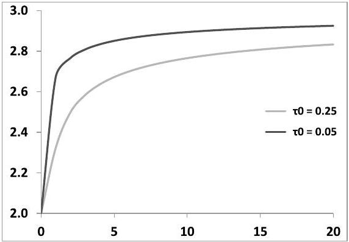
Figure 2.2: $\mathcal{R}_{T}$ as a function of $T$ (years) as given by formula (2.64), using expression (2.52), page 47 , for $\mathcal{S}_{T}$, with $\gamma=\frac{1}{2}$ and two values of $\tau_{0} \cdot \mathcal{R}_{\infty}=3$.

$\mathcal{R}_{T}$ is very sensitive to $\tau_{0}$. The limiting value (2.80) for long maturities

$$
\begin{equation*}
\mathcal{R}_{\infty}=\frac{2-\gamma}{1-\gamma} \tag{2.81}
\end{equation*}

$$
^eq2-81

may thus be reached for outrageously large maturities only - the limiting value in Figure 2.2 is $\mathcal{R}_{\infty}=3\left(\gamma=\frac{1}{2}\right)$. Stated differently, $\mathcal{R}_{T}$ is very dependent on the ATMF skew for short maturities.

What happens when $\gamma=1$ ? From (2.81) $\mathcal{R}_{\infty}=\infty$. How fast does $\mathcal{R}_{T}$ diverge? Going back to expression (2.64) we can see that, for large $T, \mathcal{R}_{T} \propto \ln T$. Again, the precise value of $\mathcal{R}_{T}$ depends on the short end of the smile - see the example in Section 2.5.6 below and Figure 2.6, page 61, for a smile whose ATMF skew decays like $\frac{1}{T}$ for long maturities.

### 2.5.5 Volatilities ofvolatilities

In the local volatility model implied volatilities are a function of $S_{t}$.

$$
d \widehat{\sigma}_{F_{T} T}=\frac{d \widehat{\sigma}_{F_{T} T}}{d \ln S} d \ln S_{t}+\bullet d t

$$

From (2.61):

$$
\begin{equation*}
d \widehat{\sigma}_{F_{T} T}=\mathcal{R}_{T} \mathcal{S}_{T} d \ln S_{t}+\bullet d t \tag{2.82}
\end{equation*}

$$
^eq2-82

Let us now set $t=0$ and note that the instantaneous volatility $\sigma\left(0, S_{0}\right)$ is equal to the short ATMF volatility $\widehat{\sigma}_{F_{0} 0}:\left\langle d \ln S^{2}\right\rangle=\widehat{\sigma}_{F_{0} 0}^{2} d t$. The instantaneous (lognormal) volatility of $\widehat{\sigma}_{F_{T} T}$ is given by:

$$
\operatorname{vol}\left(\widehat{\sigma}_{F_{T} T}\right)=\mathcal{R}_{T} \mathcal{S}_{T} \frac{\widehat{\sigma}_{F_{0} 0}}{\widehat{\sigma}_{F_{T} T}}

$$

- Inserting expression (2.64) for $\mathcal{R}_{T}$ :

$$
\begin{equation*}
\operatorname{vol}\left(\widehat{\sigma}_{F_{T} T}\right)=\left(\mathcal{S}_{T}+\frac{1}{T} \int_{0}^{T} \mathcal{S}_{t} d t\right) \frac{\widehat{\sigma}_{F_{0} 0}}{\widehat{\sigma}_{F_{T} T}} \tag{2.83}
\end{equation*}

$$
^eq2-83

- If instead we use expression (2.65) for $\mathcal{R}_{T}$ :

$$
\begin{equation*}
\operatorname{vol}\left(\widehat{\sigma}_{F_{T} T}\right)=\left(\mathcal{S}_{T}+\frac{1}{T} \int_{0}^{T} \frac{\bar{\sigma}^{2}(t)}{\widehat{\sigma}_{t} \widehat{\sigma}_{T}} \mathcal{S}_{t} d t\right) \frac{\widehat{\sigma}_{F_{0} 0}}{\widehat{\sigma}_{F_{T} T}} \tag{2.84}
\end{equation*}

$$
^eq2-84

For short maturities $\mathcal{R}_{T}=2$ and we get:

$$
\begin{equation*}
\operatorname{vol}\left(\widehat{\sigma}_{F_{T} T}\right)=2 \mathcal{S}_{T} \tag{2.85}
\end{equation*}

$$
^eq2-85

The (lognormal) volatility of a short volatility is just twice the ATMF skew.
For typical equity index smiles, whose ATMF skews decrease with $T$, the longer the maturity, the lower the instantaneous volatility of the ATMF volatility. For a power-law decay of the ATMF skew with a characteristic exponent $\gamma$, we get, for long maturities and ignoring the factor $\frac{\widehat{\sigma}_{F_{0} 0}}{\widehat{\sigma}_{F_{T} T}}$, which is only dependent on the term structure of ATMF volatilities:

$$
\begin{equation*}
\operatorname{vol}\left(\widehat{\sigma}_{F_{T} T}\right)=\frac{2-\gamma}{1-\gamma} \mathcal{S}_{T} \tag{2.86}
\end{equation*}

$$
^eq2-86

For long maturities the volatility of $\widehat{\sigma}_{F_{T} T}$ thus approximately decays as a function of $T$ with the same exponent as the ATMF skew. ${ }^{16}$

### 2.5.6 Examples and discussion

We now illustrate what we have just discussed with the example of two Euro Stoxx 50 smiles, then end with a remark on local volatility considered as a stochastic volatility model.

We use the Euro Stoxx 50 smiles of October 4, 2010 (a strong smile) and May 16, 2013 (a mild smile). Let us first consider implied volatilities for, respectively, September 16, 2011 and June 20, 2014 - roughly a 1 -year maturity in both cases and only use implied volatility data for this single maturity for calibrating the local volatility function.

As we have a single maturity, we take the local volatility function to be a function of $\frac{S}{F_{t}}$ only, so that it falls in the class of time-independent local volatilities. This is easily achieved by using the parametrization $f(t, y)$ in equations (2.18a) and (2.18b) where $f(T, y)$ is given for $T$, our single maturity. $f$ is defined for $t<T$ by $f(t, y)=\frac{t}{T} f(T, y)$. We are then in the setting of Section 2.5.3.1. Once we have calibrated a time-independent local volatility function, we move the initial spot value $S_{0}$ and reprice vanilla options.

The resulting smiles, along with the initial smile, are shown in Figure 2.3. In each smile the marker highlights the ATMF volatility.

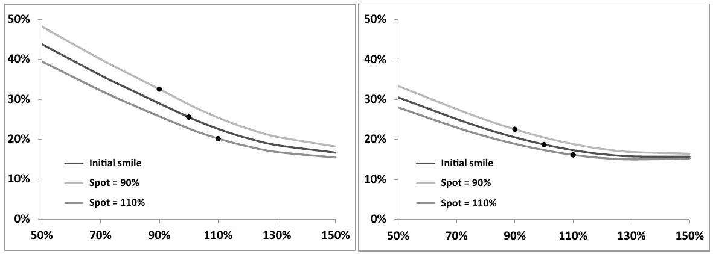
Figure 2.3: Smiles of the Euro Stoxx 50 index for a maturity $\simeq 1$ year (see text), observed on October 4, 2010 (left) and May 16, 2013 (right), along with smiles produced by the local volatility model - calibrated on these initial smiles - for two other values of $S_{0}$.

[^28]That the rate at which the ATMF volatility varies when $S_{0}$ varies is twice the ATMF skew - or equivalently that $\mathcal{R}_{T}=2$ - is apparent to the eye. ${ }^{17}$

We now use implied volatilities for all of the available maturities. The local volatility function cannot be assumed to be time-independent anymore and the SSR will be different than 2 . We use formula (2.64):

$$
\begin{equation*}
\mathcal{R}_{T}=1+\frac{1}{T} \int_{0}^{T} \frac{\mathcal{S}_{t}}{\mathcal{S}_{T}} d t \tag{2.87}
\end{equation*}

$$
^eq2-87

$\mathcal{R}_{T}$ as a function of $T$ is shown in Figure 2.4, together with the actual value of $\mathcal{R}_{T}$ obtained by shifting the spot value and repricing vanilla options.

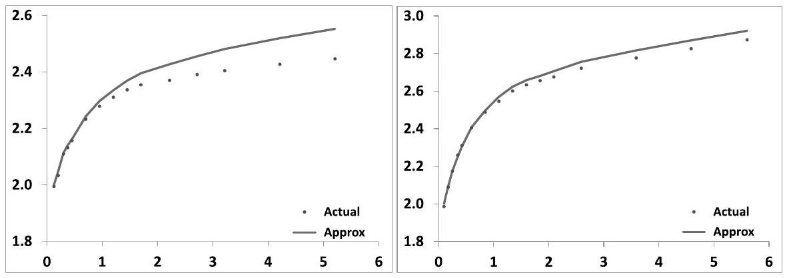
Figure 2.4: $\mathcal{R}_{T}$ for the Euro Stoxx 50 index as a function of $T$ computed: (a) directly in the local volatility model (actual), (b) using expression (2.87) (approx), for the smiles of October 4, 2010 (left) and May 16, 2013 (right).

Agreement is good except for the long end of the smile of October 4, 2010; (2.87) overestimates the SSR as the order-one expansion that leads to (2.87) ignores contributions from higher orders, which become material for strong skews.

Still the relative error in the estimation of the SSR - or equivalently in the level of volatility of volatility, or spot/volatility covariance - is about $5 \%$.

For the smile of May 16, 2013, which displays an appreciable (increasing) termstructure of ATMF volatilities, using (2.65) rather than (2.87) results in a slightly higher value for $\mathcal{R}_{T}-$ about 0.05 . For smiles with a strong term-structure of ATMF volatilities, that are not too steep, (2.65) is in practice more accurate than (2.87).

That ATMF skews of equity smiles are well captured by the power-law benchmark (2.52) is illustrated in Figure 2.5.

In our two examples the SSR values given by (2.87) using either the actual market ATMF skew or expression (2.52) are similar.

[^29]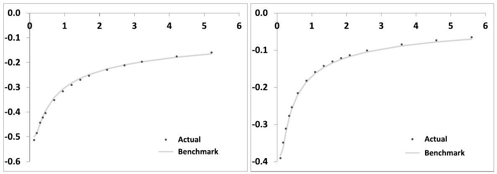
Figure 2.5: $\mathcal{S}_{T}$ for the Euro Stoxx 50 index as a function of $T$ (in years) as read off the market smile (actual) and as given by the power-law benchmark (2.52), for the smiles of October 4, 2010 (left: $\tau_{0}=0.15, \gamma=0.37$ ) and May 16, 2013 (right: $\tau_{0}=0.12, \gamma=0.52$ ).

The long-maturity value of the š is given by (2.81):

$$
\mathcal{R}_{\infty}=\frac{2-\gamma}{1-\gamma}

$$

$\mathcal{R}_{\infty}=2.6$ for the October 4, 2010 smile and $\mathcal{R}_{\infty}=3.1$ for the May 16, 2013 smile we know that $\mathcal{R}_{\infty}$ is only reached for very long maturities.

In the local volatility model, because implied volatilities are a function of $(t, S)$ the SSR provides substantial information: it determines both the break-even levels of the spot/volatility cross-gamma and of the volatility gamma. Expressions (2.64) for $\mathcal{R}_{T}$ and (2.83) for $\operatorname{vol}\left(\widehat{\sigma}_{F_{T} T}\right)$ are useful for sizing up these break-even levels and comparing them to realized levels.

Remember that the SSR involves the ratio of the spot/volatility covariance to the ATMF skew. Large values of the SSR may only be due to weak or vanishing ATMF skews and may not be a signal of particularly large volatilities of volatilities or spot/volatility covariances.

This applies to the following example of a fast-decaying ATMF skew.

## A $\frac{1}{T}$ decay for the ATMF skew

We now consider the case of a smile whose long-term ATMF skew decays like $\frac{1}{T}$. This is the case of stochastic volatility models of Type I - see Section 9.5 in Chapter 9.

For $\gamma=1$ formula (2.81) yields $\mathcal{R}_{\infty}=\infty$. From (2.87), it can be checked that if $\mathcal{S}_{T} \propto \frac{1}{T}$ for large $T$, then $\mathcal{R}_{T} \propto \ln T$.

Figure 2.6 shows that this is indeed the case. The local volatility function is calibrated on a smile generated by a one-factor stochastic volatility model of the
type discussed in Chapter 7, with $k=6.0$; for $T \gg \frac{1}{k}$ the resulting ATMF skew decays like $\frac{1}{T} .{ }^{18}$
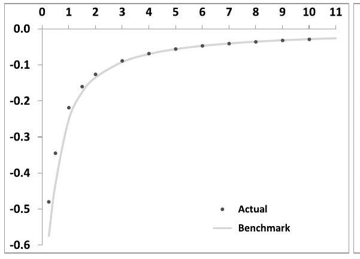


Figure 2.6: Left: $\mathcal{S}_{T}$ as a function of $T$, as read off the smile used as input (actual) and as given by the power-law benchmark (2.52), with $\gamma=0.999$ ). Right: $\mathcal{R}_{T}$ as a function of $T$ computed: (a) directly in the local volatility model (actual), (b) using expression (2.87) (approx). The smile used as input has been generated by a stochastic volatility model of Type I - its ATMF skew decays like $\frac{1}{T}$ for large $T$.

### 2.5.7 SSR in local and stochastic volatility models

Consider the instantaneous covariance of $\ln S_{t}$ and $\widehat{\sigma}_{F_{T} T}$ - denoted more compactly by $\widehat{\sigma}_{T}(t)$ - observed at $t$. Because $\widehat{\sigma}_{T}(t)$ is a function of $\ln S_{t}$ we have simply:

$$
\begin{aligned}
\frac{\left\langle d \ln S_{t} d \widehat{\sigma}_{T}(t)\right\rangle}{d t} & =\frac{d \widehat{\sigma}_{T}(t)}{d \ln S_{t}} \sigma^{2}\left(t, S_{t}\right) \\
& =\widehat{\sigma}_{t}^{2}\left(\frac{1}{T-t} \int_{t}^{T} \alpha(\tau) d \tau\right)
\end{aligned}

$$

where we have used expression (2.59c) for $\frac{d \widehat{\sigma}_{T}}{d \ln S}$, applied to time $t$ rather than 0 , and the fact that $\sigma\left(t, S_{t}\right)=\widehat{\sigma}_{t}$.

We are using formulas at order one in $\alpha(t)$, perturbing around a constant volatility $\sigma_{0}$. At order one in $\alpha(t)$, we can use the order-zero value for $\widehat{\sigma}_{F_{t} t}$, that is $\sigma_{0}$. We thus have:

$$
\begin{equation*}
\frac{\left\langle d \ln S_{t} d \widehat{\sigma}_{T}(t)\right\rangle}{d t}=\sigma_{0}^{2}\left(\frac{1}{T-t} \int_{t}^{T} \alpha(\tau) d \tau\right) \tag{2.88}
\end{equation*}

$$
^eq2-88

[^30]Multiplying both sides by ( $T-t$ ) and integrating with respect to $t$ on $[0, T]$ yields:

$$
\begin{aligned}
\int_{0}^{T}(T-t) \frac{\left\langle d \ln S_{t} d \widehat{\sigma}_{T}(t)\right\rangle}{d t} d t & =\sigma_{0}^{2} \int_{0}^{T} d t \int_{t}^{T} \alpha(\tau) d \tau \\
& =\sigma_{0}^{2} \int_{0}^{T} \tau \alpha(\tau) d \tau \\
& =\sigma_{0}^{2} T^{2} \mathcal{S}_{T}
\end{aligned}

$$

where the last line follows from the order-one expression of the ATMF skew in (2.59a). We thus get:

$$
\begin{equation*}
\mathcal{S}_{T}=\frac{1}{\widehat{\sigma}_{T}^{2} T} \int_{0}^{T} \frac{T-t}{T} \frac{\left\langle d \ln S_{t} d \widehat{\sigma}_{T}(t)\right\rangle}{d t} d t \tag{2.89}
\end{equation*}

$$
^eq2-89

where we have replaced in the denominator $\sigma_{0}^{2}$ with $\widehat{\sigma}_{T}^{2}$, still preserving the order-one accuracy in $\alpha(t)$.

As a formula for $\mathcal{S}_{T}(2.89)$ is useless - we may just as well use (2.59a). What it expresses though - that the ATMF skew for maturity $T$ is given by the integrated instantaneous covariance of $\ln S_{t}$ and the ATMF volatility for the residual maturity, $\widehat{\sigma}_{T}(t)$, weighted by $\frac{T-t}{T}$ - has wider relevance.

We have derived it here in the context of local volatility at order one in $\alpha(t)$ but this result is more general. ${ }^{19}$

As will be proven in Section 8.4 of Chapter 8, page 316, formula (2.89) holds for any diffusive model, at order one in volatility of volatility, whenever the instantaneous spot/variance covariation $\left\langle d \ln S_{t} d \widehat{\sigma}_{T}(t)\right\rangle$ does not depend on $S_{t}$. This is the case for a local volatility function linear in $\ln S$, hence (2.89).

Expression (2.89) accounts for why local volatility and stochastic volatility models calibrated to the same smile may have different SSRs, or, equivalently, generate different break-even levels for the spot/volatility cross-gamma.

From (2.89), the ATMF skew sets the integrated value of the covariance of $\ln S$ and $\widehat{\sigma}_{T}(t)$, the implied ATMF volatility for the residual maturity. Changing the distribution of this covariance on $[0, T]$ without changing its integrated value leaves the ATMF skew unchanged, but changes $\left\langle d \ln S_{t} d \widehat{\sigma}_{T}(t)\right\rangle_{t=0}$ - which sets the value of the SSR.

With respect to time-homogeneous stochastic volatility models, the local volatility model tends to generate larger covariances at short times - and consequently smaller covariances at future times. This translates into:

- larger SSRs than in time-homogeneous stochastic volatility models
- weaker future skews

See also related discussions in Section 9.11.1 of Chapter 9, page 379, and Section 12.6 of Chapter 12, page 482.

[^31]
### 2.6 Future skews and volatilities of volatilities

In Section 1.3.1 we showed how the price of a barrier digital option is mostly determined by the magnitude of the local skew at the barrier for the residual maturity, as generated by the model used for pricing. To assess how a given model prices barrier options, one needs to investigate the ATMF skews generated by a model for a given residual maturity, at future dates, and for different future spot levels. We do this now, for the local volatility model.

Imagine we are using a local volatility model calibrated to the market smile, with a local volatility function given by (2.44).

Let us assume that we are sitting at the forward date $\tau>0$ with spot $S_{\tau}$. What is the ATMF skew generated by the local volatility model? Expression (2.48) for the skew was derived for $t=0$ and a local volatility function given by (2.44) where $F_{t}$ is the forward at time $t$ for the initial spot level: $F_{t}=S_{0} e^{(r-q) t}$.

We can reuse the results above, but first need to express the local volatility function as a function of $y=\ln \left(\frac{S}{F_{t}\left(S_{\tau}\right)}\right)$, where $F_{t}\left(S_{\tau}\right)=S_{\tau} e^{(r-q)(t-\tau)}$. We have:

$$
\begin{aligned}
x & =\ln \left(\frac{S}{F_{t}}\right)=\ln \left(\frac{S}{F_{t}\left(S_{\tau}\right)}\right)+\ln \left(\frac{F_{t}\left(S_{\tau}\right)}{F_{t}}\right) \\
& =y+x_{\tau}
\end{aligned}

$$

where $x_{\tau}=\ln \left(\frac{S_{\tau}}{F_{\tau}}\right)$. Sitting at time $\tau$ and using $S_{\tau}$ as reference spot level, the local volatility function for $t>\tau$ is given by:

$$
\begin{aligned}
\sigma(t, S) & =\bar{\sigma}(t)+\alpha(t)\left(y+x_{\tau}\right)+\frac{\beta(t)}{2}\left(y+x_{\tau}\right)^{2} \\
& =\bar{\sigma}_{\tau}(t)+\alpha_{\tau}(t) y+\frac{\beta_{\tau}(t)}{2} y^{2}
\end{aligned}

$$

with

$$
\left\{\begin{array}{l}
\bar{\sigma}_{\tau}(t)=\bar{\sigma}(t)+\alpha(t) x_{\tau}+\frac{\beta(t)}{2} x_{\tau}^{2} \\
\alpha_{\tau}(t)=\alpha(t)+\beta(t) x_{\tau} \\
\beta_{\tau}(t)=\beta(t)
\end{array}\right.

$$

If $\beta(t) \neq 0$, since $\alpha_{\tau}(t)$ depends on $x_{\tau}$, the ATMF skew at time $\tau$ will depend on the spot level $S_{\tau}$. Let us, however, set $x_{\tau}=0-$ that is $S_{\tau}=F_{\tau}-$ and focus instead on how the ATMF skew at $\tau$ for a given residual maturity $\theta$ depends on $\tau$; or equivalently consider that $\beta(t)=0$.

Using (2.48), the ATMF skew at time $\tau$ for a residual maturity $\theta$ - that is for maturity $\tau+\theta-$ is given by:

$$
\begin{equation*}
\mathcal{S}_{\theta}(\tau)=\left.\frac{d \widehat{\sigma}_{K \tau+\theta}\left(S_{\tau}, \tau\right)}{d \ln K}\right|_{K=F_{\tau+\theta}\left(S_{\tau}\right)}=\frac{1}{\theta} \int_{\tau}^{\tau+\theta} \frac{t-\tau}{\theta} \alpha(t) d t \tag{2.90}
\end{equation*}

$$
^eq2-90

Using now expression (2.56), page 50, for $\alpha(t)$ we get the following expression of the foward-starting ATMF skew as a function of the term structure of the ATMF skew read off the vanilla smile used for calibration:

$$
\begin{equation*}
\mathcal{S}_{\theta}(\tau)=\mathcal{S}_{\tau+\theta}-\frac{\tau}{\theta}\left(\frac{1}{\theta} \int_{\tau}^{\tau+\theta} \mathcal{S}_{t} d t-\mathcal{S}_{\tau+\theta}\right) \tag{2.91}
\end{equation*}

$$
^eq2-91

where $\mathcal{S}_{t}$ is the spot-starting ATMF skew for maturity $t$.

- Formula (2.91) for $\mathcal{S}_{\theta}(\tau)$ involves the ATMF skew of the initial vanilla smile, but only for maturities in $[\tau, \tau+\theta]$. Thus there is no reason that $\mathcal{S}_{\theta}(\tau)$ should bear any resemblance with $\mathcal{S}_{\theta}$.
- The second piece in (2.91) involves $\mathcal{S}_{\tau+\theta}$ minus the average of $\mathcal{S}_{t}$ on the interval $[\tau, \tau+\theta]$ . For a decreasing term structure of the ATMF skew - which is typical - the latter is larger, in absolute value. We then have the property that:

$$
\left|\mathcal{S}_{\theta}(\tau)\right| \leq\left|\mathcal{S}_{\tau+\theta}\right| \ll\left|\mathcal{S}_{\theta}\right|

$$

The future skew is weaker than the spot-starting skew for maturity $\tau+\theta$, thus (much) weaker than the spot-starting skew for the same residual maturity.

- Consider the case of a power-law decaying skew with $\alpha(t)$ given by (2.51), without any cutoff for simplicity: $\alpha(t) \propto\left(\frac{\tau_{0}}{t}\right)^{\gamma}$. Focus on the case of a very short residual maturity $\theta$. From (2.90) for $\theta$ small, we have:

$$
\begin{aligned}
\mathcal{S}_{\theta} & =\frac{1}{2-\gamma} \alpha_{0}\left(\frac{\tau_{0}}{\theta}\right)^{\gamma} \\
\mathcal{S}_{\theta}(\tau) & =\frac{\alpha(\tau)}{2}=\frac{\alpha_{0}}{2}\left(\frac{\tau_{0}}{\tau}\right)^{\gamma}
\end{aligned}

$$

thus

$$
\begin{equation*}
\mathcal{S}_{\theta}(\tau) \propto\left(\frac{\theta}{\tau}\right)^{\gamma} \mathcal{S}_{\theta} \tag{2.92}
\end{equation*}

$$
^eq2-92

For typical equity smiles $\gamma \simeq \frac{1}{2}$. Thus, in the local volatility model, future ATMF skews will be much weaker than spot-starting skews for the same residual maturity: $\mathcal{S}_{\theta}(\tau) \ll \mathcal{S}_{\theta}$. This is apparent in Figure 2.7 which shows ATMF skews for the two smiles considered in the examples of Section 2.5.6, for different forward dates, calculated using (2.91).

- In the local volatility model, volatilities of ATMF volatilities are determined by the ATMF skew - see formula (2.83), page 57. Thus low levels of future ATMF skews translate also into low future levels of volatility of volatility.

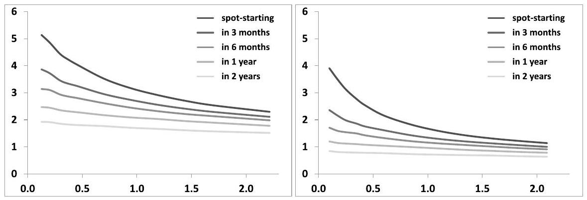
Figure 2.7: $\mathcal{S}_{\theta}(\tau)$ as a function of residual maturity $\theta$ for different future dates: $\tau=0$ (forward-starting), 3 months, 6 months, 1 year and 2 years. $\mathcal{S}_{\theta}(\tau)$ is evaluated using (2.91) and multiplied by $\ln (95 / 105)$ to convert it into the difference of implied volatilities for the $95 \%$ and $105 \%$ moneynesses. Smiles of the Euro Stoxx 50 index on October 4, 2010 (left) and May 16, 2013 (right) have been used.

### 2.6.1 Comparison with stochastic volatility models

Our analysis has concentrated on the price as generated by the local volatility model at $t=0$. We derive in the following section the expression of the daily P\&L of a delta and vega-hedged position. As we risk-manage our forward-start or barrier option together with its vanilla hedge, the daily P\&L of the hedged position reads as in (2.105). In case gammas and cross-gammas of the hedged position are sizeable, these P\&Ls will be large and unpredictable, randomly polluting our final P\&L - this is the price we pay for using the local volatility model.

In contrast, the stochastic volatility models of Chapter 7 are time-homogeneous. Future skews and future volatilities of volatilities are determined by the model's parameters and are commensurate with their values at $t=0$ - they are not altered by recalibration to the term structure of VS volatilities.

When using the local volatility model, it is then essential to realize that the model price at $t=0$ incorporates assumptions on future skews and break-even levels of spot/volatility gammas and cross-gammas that cannot be locked and will change as the model is recalibrated to future market smiles.

We refer the reader to Section 3.2 of the following chapter, page 119, where we continue our investigation of forward-start options in the local volatility model; the case of a forward-start call is covered in detail.

See also Section 12.6.1 of Chapter 12 where future smiles generated by local, stochastic and local volatility models are compared.

### 2.7 Delta and carry P\&L

We now consider two practically important issues that need to be answered before we can even consider using a model for trading purposes:

- Which delta should we trade?
- What is the carry P\&L of a hedged position?

We will show that the local volatility model is indeed a legitimate market model.

### 2.7.1 The "local volatility delta"

The price $P^{\mathrm{LV}}$ of a derivative in the local volatility model is given by:

$$
P^{\mathrm{LV}}(t, S, \sigma)

$$

where $\sigma$ denotes the local volatility function.
Imagine using the "local volatility delta", that is the delta computed with a fixed local volatility function:

$$
\begin{equation*}
\Delta^{\mathrm{LV}}=\left.\frac{d P^{\mathrm{LV}}}{d S}\right|_{\sigma} \tag{2.93}
\end{equation*}

$$
^eq2-93

The pricing equation (2.2) implies that the $\mathrm{P} \& \mathrm{~L}$ during $\delta t$ of a delta-hedged position reads - see expression (1.5):

$$
\begin{equation*}
P \& L=-\frac{1}{2} S^{2} \frac{d^{2} P^{\mathrm{LV}}}{d S^{2}}\left(\frac{\delta S^{2}}{S^{2}}-\sigma^{2}(t, S) \delta t\right) \tag{2.94}
\end{equation*}

$$
^eq2-94

In the local volatility model, implied volatilities of vanilla options are functions of $t$ and $S$. For strike $K$ and maturity $T$ :

$$
\begin{equation*}
\widehat{\sigma}_{K T}(t, S) \equiv \Sigma_{K T}^{\mathrm{LV}}(t, S, \sigma) \tag{2.95}
\end{equation*}

$$
^eq2-95

where $\sigma$ denotes the local volatility function used.
As $S$ moves by $\delta S$ during $\delta t$, only if market implied volatilities $\widehat{\sigma}_{K T}$ move as prescribed by (2.95) does the P\&L of the delta-hedged position read as in (2.94). Expression (2.94) has thus little usefulness.

In reality, implied volatilities will move however they wish. Changes in market implied volatilities $\delta \widehat{\sigma}_{K T}$ will be arbitrary, thus the local volatility function calibrated to the market smile at $t+\delta t$ differs from that calibrated at time $t$ : our P\&L will include additional terms reflecting this change.

Practically, we will be using the local volatility model in a way that it wasn't meant to be used - that is, recalibrating daily the local volatility function on market smiles. Is this nonsensical? Is it nevertheless possible to express simply our carry P\&L? Do payoff-independent break-even levels for volatilities of implied volatilities and correlations of spot and implied volatilities exist?

### 2.7.2 Using implied volatilities - the sticky-strike delta $\Delta^{\text {SS }}$

Denote by $P\left(t, S, \widehat{\sigma}_{K T}\right)$ the option price given by the local volatility model, at time $t$, for a spot value $S$ and implied volatilities $\widehat{\sigma}_{K T}$ :

$$
\begin{equation*}
P\left(t, S, \widehat{\sigma}_{K T}\right) \equiv P^{\mathrm{LV}}\left(t, S, \sigma\left[t, S, \widehat{\sigma}_{K T}\right]\right) \tag{2.96}
\end{equation*}

$$
^eq2-96

where the notation $\sigma\left[t, s, \widehat{\sigma}_{K T}\right]$ signals that the local volatility function is calibrated at time $t$, spot $S$, to the volatility surface $\widehat{\sigma}_{K T}$. Our state variables are thus $S$ and the $\widehat{\sigma}_{K T}$. Equivalently, we could use option prices $O_{K T}$ rather than implied volatilities - see the following section in this respect.
$P\left(t, S, \widehat{\sigma}_{K T}\right)$ is our pricing function. Assume we are short the option; the P\&L during the interval $[t, t+\delta t]$ of our option position - without its delta hedge - is simply:

$$
P \& L=-\left(P\left(t+\delta t, S+\delta S, \widehat{\sigma}_{K T}+\delta \widehat{\sigma}_{K T}\right)-(1+r \delta t) P\left(t, S, \widehat{\sigma}_{K T}\right)\right)

$$

Expanding at order one in $\delta t$ and two in $\delta S$ and $\delta \widehat{\sigma}_{K T}$ :

$$
\begin{align*}
P \& L & =r P \delta t \\
& -\frac{d P}{d t} \delta t-\frac{d P}{d S} \delta S-\frac{d P}{d \widehat{\sigma}_{K T}} \bullet \delta \widehat{\sigma}_{K T} \\
& -\left(\frac{1}{2} \frac{d^{2} P}{d S^{2}} \delta S^{2}+\frac{d^{2} P}{d S d \widehat{\sigma}_{K T}} \bullet \delta \widehat{\sigma}_{K T} \delta S+\frac{1}{2} \frac{d^{2} P}{d \widehat{\sigma}_{K T} d \widehat{\sigma}_{K^{\prime} T^{\prime}}} \bullet \delta \widehat{\sigma}_{K T} \delta \widehat{\sigma}_{K^{\prime} T^{\prime}}\right) \tag{2.97}
\end{align*}

$$
^eq2-97

The notation • stands for: ${ }^{20}$

$$
\frac{d f}{d \widehat{\sigma}_{K T}} \bullet \delta \widehat{\sigma}_{K T} \equiv \iint d K d T \frac{\delta f}{\delta \widehat{\sigma}_{K T}} \delta \widehat{\sigma}_{K T}

$$

We have made no model assumption so far - (2.97) is a basic accounting statement.

The derivatives $\frac{d P}{d S}, \frac{d P}{d t}$ are computed keeping the $\widehat{\sigma}_{K T}$ fixed - the underlying local volatility function is not fixed. Let us call $\frac{d P}{d S}$ the sticky-strike delta and denote it by $\Delta^{\mathrm{SS}}$

$$
\begin{equation*}
\Delta^{\mathrm{SS}}=\left.\frac{d P}{d S}\right|_{\widehat{\sigma}_{K T}} \tag{2.98}
\end{equation*}

$$
^eq2-98

[^32]Let us now utilize the fact that our "black box" valuation function $P$ is in fact the local volatility price. We will express the derivatives of $P^{\mathrm{LV}}$ with respect to $t, S$ - that is with a fixed local volatility function - in terms of derivatives of $P$ and use the pricing equation of the local volatility model to derive an identity involving derivatives of $P$.

By definition of $\Sigma_{K T}^{\mathrm{LV}}(t, S, \sigma), P\left(t, S, \widehat{\sigma}_{K T}=\Sigma_{K T}^{\mathrm{LV}}(t, S, \sigma)\right)$ is the local volatility price:

$$
P^{\mathrm{LV}}(t, S, \sigma)=P\left(t, S, \widehat{\sigma}_{K T}=\Sigma_{K T}^{\mathrm{LV}}(t, S, \sigma)\right)

$$

We will not carry the three arguments of $\Sigma_{K T}^{L V}$ anymore, unless necessary. Taking the derivative of this expression with respect to $t$ and $S$ yields:

$$
\begin{align*}
\frac{d P^{\mathrm{LV}}}{d t} & =\frac{d P}{d t}+\frac{d P}{d \widehat{\sigma}_{K T}} \bullet \frac{d \Sigma_{K T}^{\mathrm{LV}}}{d t}  \tag{2.99}\\
\frac{d P^{\mathrm{LV}}}{d S} & =\frac{d P}{d S}+\frac{d P}{d \widehat{\sigma}_{K T}} \bullet \frac{d \Sigma_{K T}^{\mathrm{LV}}}{d S} \tag{2.100}
\end{align*}

$$
^eq2-99
^eq2-100

Taking once more the derivative of $\frac{d P^{\mathrm{LV}}}{d S}$ with respect to $S$ we get:

$$
\begin{align*}
\frac{d^{2} P^{\mathrm{LV}}}{d S^{2}}= & \left(\frac{d^{2} P}{d S^{2}}+2 \frac{d^{2} P}{d S d \widehat{\sigma}_{K T}} \bullet \frac{d \Sigma_{K T}^{\mathrm{LV}}}{d S}+\frac{d^{2} P}{d \widehat{\sigma}_{K T} d \widehat{\sigma}_{K^{\prime} T^{\prime}}} \bullet \frac{d \Sigma_{K T}^{\mathrm{LV}}}{d S} \frac{d \Sigma_{K^{\prime} T^{\prime}}^{\mathrm{LV}}}{d S}\right) \\
& +\frac{d P}{d \widehat{\sigma}_{K T}} \bullet \frac{d^{2} \Sigma_{K T}^{\mathrm{LV}}}{d S^{2}} \tag{2.101}
\end{align*}

$$
^eq2-101

We now use (2.99) to express $\frac{d P}{d t}$ in terms of $\frac{d P^{\mathrm{LV}}}{d t}$ and then use the pricing equation of the local volatility model:

$$
\begin{equation*}
\frac{d P^{\mathrm{LV}}}{d t}+(r-q) S \frac{d P^{\mathrm{LV}}}{d S}+\frac{1}{2} \sigma^{2}(t, S) S^{2} \frac{d^{2} P^{\mathrm{LV}}}{d S^{2}}=r P^{\mathrm{LV}} \tag{2.102}
\end{equation*}

$$
^eq2-102

to express $\frac{d P^{\mathrm{LV}}}{d t}$ as a function of $\frac{d P^{\mathrm{LV}}}{d S}, \frac{P^{\mathrm{LV}}}{d S^{2}}$. We then use (2.101) and (2.100) to write everything in terms of derivatives of $P$. This yields the following expression of $\frac{d P}{d t}$ :

$$
\begin{gathered}
\frac{d P}{d t}=r P-(r-q) S \frac{d P}{d S}-\frac{d P}{d \widehat{\sigma}_{K T}} \bullet \mu_{K T} \\
-\frac{1}{2} \sigma^{2}(t, S) S^{2}\left(\frac{d^{2} P}{d S^{2}}+2 \frac{d^{2} P}{d S d \widehat{\sigma}_{K T}} \bullet \frac{d \Sigma_{K T}^{\mathrm{LV}}}{d S}+\frac{d^{2} P}{d \widehat{\sigma}_{K T} d \widehat{\sigma}_{K^{\prime} T^{\prime}}} \bullet \frac{d \Sigma_{K T}^{\mathrm{LV}}}{d S} \frac{d \Sigma_{K^{\prime} T^{\prime}}^{\mathrm{LV}}}{d S}\right)
\end{gathered}

$$

where $\mu_{K T}$ is given by:

$$
\begin{equation*}
\mu_{K T}=\frac{d \Sigma_{K T}^{\mathrm{LV}}}{d t}+\frac{1}{2} \sigma^{2}(t, S) S^{2} \frac{d^{2} \Sigma_{K T}^{\mathrm{LV}}}{d S^{2}}+(r-q) S \frac{d \Sigma_{K T}^{\mathrm{LV}}}{d S} \tag{2.103}
\end{equation*}

$$
^eq2-103

Inserting now this expression of $\frac{d P}{d t}$ in (2.97) yields the following expression for our P\&L:

$$
\begin{align*}
& P \& L=-\frac{d P}{d S}(\delta S-(r-q) S \delta t)-\frac{d P}{d \widehat{\sigma}_{K T}} \bullet\left(\delta \widehat{\sigma}_{K T}-\mu_{K T} \delta t\right) \\
& +\frac{1}{2} \sigma^{2}(t, S) S^{2}\left(\frac{d^{2} P}{d S^{2}}+2 \frac{d^{2} P}{d S d \widehat{\sigma}_{K T}} \bullet \frac{d \Sigma_{K T}^{\mathrm{LV}}}{d S}+\frac{d^{2} P}{d \widehat{\sigma}_{K T} d \widehat{\sigma}_{K^{\prime} T^{\prime}}} \bullet \frac{d \Sigma_{K T}^{\mathrm{LV}}}{d S} \frac{d \Sigma_{K^{\prime} T^{\prime}}^{\mathrm{LV}}}{d S}\right) \delta t \\
& \quad-\left(\frac{1}{2} \frac{d^{2} P}{d S^{2}} \delta S^{2}+\frac{d^{2} P}{d S d \widehat{\sigma}_{K T}} \bullet \delta \widehat{\sigma}_{K T} \delta S+\frac{1}{2} \frac{d^{2} P}{d \widehat{\sigma}_{K T} d \widehat{\sigma}_{K^{\prime} T^{\prime}}} \bullet \delta \widehat{\sigma}_{K T} \delta \widehat{\sigma}_{K^{\prime} T^{\prime}}\right) \tag{2.104}
\end{align*}

$$
^eq2-104

In the first line of (2.104), the linear contributions of $\delta S$ and $\delta \widehat{\sigma}_{K T}$ to the $\mathrm{P} \& \mathrm{~L}$ are accompanied by their respective financing costs - or risk-neutral drifts. While the financing cost of $S$ is model-independent, $\mu_{K T}$ is not as it depends on the dynamics of implied volatilities assumed by the model - in our case the local volatility model hence the LV superscript.

This is not an issue - it only happens because $\widehat{\sigma}_{K T}$ is not a tradeable asset; when we use option prices rather than implied volatilities, the model-dependence of the drift disappears - see Section 2.7.3 below.

The P\&L in (2.104) can be rewritten so as to make the break-even volatilities and correlations of $\delta S$ and $\delta \widehat{\sigma}_{K T}$ apparent. Denote by $\nu_{K T}$ the instantaneous (lognormal) volatility of $\widehat{\sigma}_{K T}$ in the local volatility model - that is of $\Sigma_{K T}^{\mathrm{LV}}$ :

$$
\nu_{K T}=\frac{1}{\Sigma_{K T}^{\mathrm{LV}}} \frac{d \Sigma_{K T}^{\mathrm{LV}}}{d S} S \sigma(t, S)

$$

Our P\&L during $\delta t$ can be rewritten as:

$$
\begin{align*}
& P \& L= \\
& -\frac{d P}{d S}(\delta S-(r-q) S \delta t)-\frac{d P}{d \widehat{\sigma}_{K T}} \bullet\left(\delta \widehat{\sigma}_{K T}-\mu_{K T} \delta t\right)  \tag{2.105a}\\
& -\frac{1}{2} S^{2} \frac{d^{2} P}{d S^{2}}\left[\frac{\delta S^{2}}{S^{2}}-\sigma^{2}(t, S) \delta t\right]  \tag{2.105b}\\
& -\frac{d^{2} P}{d S d \widehat{\sigma}_{K T}} \bullet S \widehat{\sigma}_{K T}\left[\frac{\delta S}{S} \frac{\delta \widehat{\sigma}_{K T}}{\widehat{\sigma}_{K T}}-\sigma(t, S) \nu_{K T} \delta t\right]  \tag{2.105c}\\
& -\frac{1}{2} \frac{d^{2} P}{d \widehat{\sigma}_{K T} d \widehat{\sigma}_{K^{\prime} T^{\prime}}} \bullet \widehat{\sigma}_{K T} \widehat{\sigma}_{K^{\prime} T^{\prime}}\left[\frac{\delta \widehat{\sigma}_{K T}}{\widehat{\sigma}_{K T}} \frac{\delta \widehat{\sigma}_{K^{\prime} T^{\prime}}}{\widehat{\sigma}_{K^{\prime} T^{\prime}}}-\nu_{K T} \nu_{K^{\prime} T^{\prime}} \delta t\right] \tag{2.105d}
\end{align*}

$$
^eq2-105a
^eq2-105b
^eq2-105c
^eq2-105d

$\frac{d P}{d S}$ in (2.105a) is the sticky-strike delta $\Delta^{\mathrm{SS}}$. This is our total P\&L - (2.105) incorporates the P\&L generated by the change in local volatility function over $[t, t+\delta t]$ - up to second order - except it is expressed in terms of changes in implied volatilities.

### 2.7.3 Using option prices - the market-model delta $\Delta^{\mathrm{MM}}$

While we have used implied volatilities $\widehat{\sigma}_{K T}$ as state variables, there is nothing special about them. The reader can check that the fact that $\widehat{\sigma}_{K T}$ is an implied volatility has played no part in the derivation leading to (2.105).

We could have used a different representation of the vanilla smile - for example straight option prices. Let us then replace $\widehat{\sigma}_{K T}$ with $O_{K T}$, the price of the vanilla option (say, a call) of strike $K$, maturity $T$ and replace $\Sigma_{K T}^{\mathrm{LV}}(t, S, \sigma)$ with $\Omega_{K T}^{\mathrm{LV}}(t, S, \sigma)$, the price of the same vanilla option in the local volatility model, as a function of time $t$, spot $S$, and the local volatility function $\sigma$.

Denote by $\mathcal{P}\left(t, S, O_{K T}\right)$ the price of our exotic option, now a function of vanilla option prices, rather than implied volatilities. $\mathcal{P}$ is related to $P$ through:

$$
\begin{equation*}
P\left(t, S, \widehat{\sigma}_{K T}\right)=\mathcal{P}\left(t, S, O_{K T}=P_{K T}^{\mathrm{BS}}\left(t, S, \widehat{\sigma}_{K T}\right)\right) \tag{2.106}
\end{equation*}

$$
^eq2-106

The expression of our $\mathrm{P} \& \mathrm{~L}$ is similar to (2.105), with $\widehat{\sigma}_{K T}$ replaced with $O_{K T}$. Drift $\mu_{K T}$, according to expression (2.103), is now given by:

$$
\mu_{K T}=\frac{d \Omega_{K T}^{\mathrm{LV}}}{d t}+\frac{1}{2} \sigma^{2}(t, S) S^{2} \frac{d^{2} \Omega_{K T}^{\mathrm{LV}}}{d S^{2}}+(r-q) S \frac{d \Omega_{K T}^{\mathrm{LV}}}{d S}

$$

Because $\Omega_{K T}^{\mathrm{LV}}$ is the price in the local volatility model, with a fixed local volatility function, it obeys (2.102), thus we have:

$$
\mu_{K T}=r \Omega_{K T}^{\mathrm{LV}}=r O_{K T}

$$

- which we knew in the first place: $O_{K T}$ is the price of an asset, thus its drift is model-independent and is simply its financing cost.

The expression of our P\&L during $\delta t$ using option prices thus reads:

$$
\begin{align*}
& P \& L= \\
& -\frac{d \mathcal{P}}{d S}(\delta S-(r-q) S \delta t)-\frac{d \mathcal{P}}{d O_{K T}} \bullet\left(\delta O_{K T}-r O_{K T} \delta t\right)  \tag{2.107a}\\
& -\frac{1}{2} \frac{d^{2} \mathcal{P}}{d S^{2}}\left[\delta S^{2}-\sigma^{2}(t, S) S^{2} \delta t\right]  \tag{2.107b}\\
& -\frac{d^{2} \mathcal{P}}{d S d O_{K T}} \bullet\left[\delta S \delta O_{K T}-\sigma^{2}(t, S) S^{2} \frac{d \Omega_{K T}^{L V}}{d S} \delta t\right]  \tag{2.107c}\\
& -\frac{1}{2} \frac{d^{2} \mathcal{P}}{d O_{K T} d O_{K^{\prime} T^{\prime}}} \bullet\left[\delta O_{K T} \delta O_{K^{\prime} T^{\prime}}-\sigma^{2}(t, S) S^{2} \frac{d \Omega_{K T}^{L V}}{d S} \frac{d \Omega_{K^{\prime} T^{\prime}}^{L V}}{d S} \delta t\right] \tag{2.107d}
\end{align*}

$$
^eq2-107a
^eq2-107b
^eq2-107c
^eq2-107d

Three observations are in order:

- Expression (2.107) for our carry P\&L is typical of a market model - remember our discussion in Section 1.1. Second-order gamma contributions involving prices of all hedge instruments - the spot and vanilla options - appear together with their offsetting thetas. The corresponding break-even levels are payoffindependent.
- (2.107) makes plain that the hedge ratios of our exotic option are simply given by $\frac{d \mathcal{P}}{d S}$ and $\frac{d \mathcal{P}}{d O_{K T}}$. In particular, the delta - that is the sensitivity of $\mathcal{P}$ to a move of $S$ that is not offset by the vanilla option hedge - is given by $\frac{d \mathcal{P}}{d S}$. This is obtained by moving $S$ while keeping vanilla option prices fixed. This is the natural delta as generated in any market model: move one asset value keeping all others unchanged. We call it the market-model delta, denoted by $\Delta^{\mathrm{MM}}$ :

$$
\begin{equation*}
\Delta^{\mathrm{MM}}=\left.\frac{d \mathcal{P}}{d S}\right|_{O_{K T}} \tag{2.108}
\end{equation*}

$$
^eq2-108

- In a market model - which local volatility is - the delta of a vanilla option is an irrelevant notion. $S$ and $O_{K T}$ are prices of two different assets, which are both hedge instruments. The incongruity of asking a model to output a hedge ratio of one hedge instrument on another is made manifest in the two-asset example of Section 2.7.6 below.

The local volatility delta of vanilla options, $\frac{d \Omega_{K T}^{\mathrm{LV}}}{d S}$, only appears in the expressions of the break-even levels as option prices in the local volatility model are functions of ( $t, S$ ). The instantaneous covariance of two securities $O_{1}, O_{2}$ in the model - be they the underlying or vanilla options - is then given by $\frac{d \Omega_{1}^{\mathrm{LV}}}{d S} \frac{d \Omega_{2}^{\mathrm{LV}}}{d S} \sigma^{2}(t, S) S^{2} \delta t$.

### 2.7.4 Consistency of $\Delta^{\mathrm{SS}}$ and $\Delta^{\mathrm{MM}}$

$\Delta^{\mathrm{MM}}$ is the "real" delta of the local volatility model: it is the number of units of $S$ that need to be held in the hedge portfolio, alongside a position $\frac{d \mathcal{P}}{d O_{K T}}$ in vanilla options of strike $K$, maturity $T$.
$\Delta^{\mathrm{SS}}$ on the other hand is tied to a specific representation of vanilla option prices - in terms of Black-Scholes lognormal implied volatilities. Should we use it? What is its connection to $\Delta^{\mathrm{MM}}$ ?

Our hedge portfolio $\Pi$ comprises $\Delta^{\mathrm{MM}}=\frac{d \mathcal{P}}{d S}$ units of the underlying and $\frac{d \mathcal{P}}{d O_{K T}}$ vanilla options of strike $K$, maturity $T$ :

$$
\Pi=\frac{d \mathcal{P}}{d S} S+\frac{d \mathcal{P}}{d O_{K T}} \bullet O_{K T}

$$

Typically, the convention on an exotic desk is to use delta-hedged - rather than naked - vanilla options, where the delta hedge is the vanilla option's Black-Scholes
delta computed using the option's implied volatility $\widehat{\sigma}_{K T}$. The composition of our hedge portfolio can thus be rewritten differently:

$$
\Pi=\left[\frac{d \mathcal{P}}{d S}+\frac{d \mathcal{P}}{d O_{K T}} \bullet \frac{d P_{K T}^{\mathrm{BS}}}{d S}\right] S+\frac{d \mathcal{P}}{d O_{K T}} \bullet\left[O_{K T}-\frac{d P_{K T}^{\mathrm{BS}}}{d S} S\right]

$$

What does $\frac{d \mathcal{P}}{d S}+\frac{d \mathcal{P}}{d O_{K T}} \bullet \frac{d P_{K T}^{\mathrm{BS}}}{d S}$ correspond to? It is the sensitivity of $\mathcal{P}$ to a simultaneous move of $S$ and a variation of vanilla option prices generated by their Black-Scholes deltas. Saying that a vanilla option's price varies by its Black-Scholes delta times the variation of $S$ is equivalent to saying that its Black-Scholes implied volatility stays fixed. This is the sticky-strike delta: $\frac{d \mathcal{P}}{d S}+\frac{d \mathcal{P}}{d O_{K T}} \bullet \frac{d P_{K T}^{\mathrm{BS}}}{d S}=\Delta^{\mathrm{SS}}$, which we can rewrite as:

$$
\Delta^{\mathrm{MM}}+\frac{d \mathcal{P}}{d O_{K T}} \bullet \frac{d P_{K T}^{\mathrm{BS}}}{d S}=\Delta^{\mathrm{SS}}

$$

Thus $\Delta^{\mathrm{SS}}$ is equal to the market-model delta $\Delta^{\mathrm{MM}}$ augmented by the BlackScholes deltas of the hedging vanilla options. Once Black-Scholes deltas of the hedging options are accounted for, we recover $\Delta^{\mathrm{MM}}$ as the aggregate delta in our hedge portfolio.

Had we used a different representation of vanilla option prices, ${ }^{21}$ we would have obtained a different "sticky-strike" delta. Yet, once the hedge porfolio is broken down into underlying + naked vanilla options the delta is always equal to $\Delta^{\mathrm{MM}}$.
$\Delta^{\mathrm{SS}}$ thus has no special status. It is simply the delta an exotic desk should trade if - as is customary - the delta hedges of delta-hedged vanilla options used as vega hedges are their Black-Scholes deltas.

### 2.7.5 Local volatility as the simplest market model

Expression (2.107) for the carry P\&L is so natural from a trading point of view that the derivation in Section 2.7.2 seems unnecessarily cumbersome on one hand and on the other hand does not shed much light on why things pan out so neatly indeed we have obtained (2.107) by using the local volatility model in an unorthodox manner, as we recalibrate the local volatility function at $t+\delta t$.

Consider a stochastic volatility market model ${ }^{22}$ defined by the following joint SDEs for the spot and vanilla option prices:

$$
\begin{align*}
d S_{t} & =(r-q) S_{t} d t+\sigma_{t} S_{t} d W_{t}^{S}  \tag{2.109a}\\
d O_{K T, t} & =r O_{K T, t} d t+\lambda_{K T, t} d W_{t}^{K T} \tag{2.109b}
\end{align*}

$$
^eq2-109a
^eq2-109b

and the following condition:

$$
\begin{equation*}
O_{K T, t=T}=\left(S_{T}-K\right)^{+} \tag{2.110}
\end{equation*}

$$
^eq2-110

[^33]together with the initial values $S_{t=0}, O_{K T, t=0}$. Processes $\sigma_{t}$ (resp. $\lambda_{K T}^{t}$ ) are the instantaneous lognormal (resp. normal) volatilities of $S_{t}$ (resp. $O_{K T}$ ). Imagine we are able to build such a model - that is a solution to (2.109) that satisfies (2.110). Then, the carry P\&L during $\delta t$ in such a model is exactly of the form in (2.107), with the respective break-even levels given by:

- $S_{t}^{2} \sigma_{t}^{2}$ for the spot/spot gamma
- $\sigma_{t} S_{t} \lambda_{K T, t} \rho_{S, K T, t}$ for spot/vanilla option cross-gammas
- $\lambda_{K T, t} \lambda_{K^{\prime} T^{\prime}, t} \rho_{K T, K^{\prime} T^{\prime}, t}$ for the option/option cross-gammas.
$\rho_{S, K T, t}$ and $\rho_{K T, K^{\prime} T^{\prime}, t}$ are, respectively, the instantaneous correlations of $S_{t}$ and $O_{K T, t}$ and of $O_{K T, t}$ and $O_{K^{\prime} T^{\prime}, t}$.

Building market models from scratch is difficult. Furthermore only market models possessing a Markov representation in terms of a (small) finite number of state variables can realistically be considered. Failing that, pricing requires simultaneous simulation of $S_{t}$ as well as all of the $O_{K T}$, a task which is unfeasible numerically.

Denote by $\sigma\left[O_{K T}, t, S\right]$ the local volatility function calibrated at time $t$ using vanilla option prices $O_{K T}$ and spot value $S$, and denote by $\sigma\left[O_{K T}, t, S\right](\tau, \mathcal{S})$ its value for time $\tau$ and spot value $\mathcal{S}$. Denote by $\Omega_{K T}^{\mathrm{LV}}(t, S, \sigma)$ the local volatility price of a vanilla option of strike $K$, maturity $T$, as a function of time $t$, spot $S$ and local volatility function $\sigma$.

Set:

$$
\begin{align*}
W_{t}^{K T} & \equiv W_{t}  \tag{2.111a}\\
\sigma_{t} & =\sigma\left[O_{K T, t}, t, S_{t}\right]\left(t, S_{t}\right)  \tag{2.111b}\\
\lambda_{K T, t} & =\left.\sigma_{t} S_{t} \frac{d \Omega_{K T}^{\mathrm{LV}}}{d S}\right|_{t, S=S_{t}, \sigma=\sigma\left[O_{K T, t}, t, S_{t}\right]} \tag{2.111c}
\end{align*}

$$
^eq2-111a
^eq2-111b
^eq2-111c

SDEs (2.109) together with (2.111) define a market model that starts from the initial condition $S_{0}, O_{K T, 0}$.
$\sigma_{t}$ and $\lambda_{K T, t}$ are functions of $S_{t}, O_{K T, t}$ only - information available at time $t$. Our model is Markovian in these state variables.

It is in fact the local volatility model and we know that it has a Markov representation in terms of $t, S_{t}$. We know that in the model defined by (2.109) and (2.111)which is the local volatility model - the local volatility function $\sigma\left[O_{K T, t}, t, S_{t}\right]$ is in fact constant and equal to $\sigma\left[O_{K T, 0}, 0, S_{0}\right] . O_{K T, t}$ can thus be written as:

$$
O_{K T, t}=\Omega_{K T}^{\mathrm{LV}}\left(t, S_{t}, \sigma\left[O_{K T, 0}, 0, S_{0}\right]\right)

$$

An alternative definition of local volatility is thus that it is $\mathrm{a}^{23}$ diffusive market model that has a one-dimensional Markov representation in terms of $(t, S)$. Because

[^34]the local volatility model is a diffusive market model - that is its SDEs are of the form in (2.109) - the carry P\&L is automatically of the form in (2.107) - no need to go through the rigmarole of Section 2.7.2.

In Chapter 12 we examine local-stochastic volatility models. They have a Markov representation in terms of $t, S$, plus a few other state variables - $X_{t}$ and $Y_{t}$ if one uses the two-factor model of Chapter 7. This additional flexibility can be exploited to produce different break-even levels for gamma/theta P\&Ls.

As we will see, only a few of them are market models, that is can actually be used to risk-manage a derivatives book.

### 2.7.6 A metaphor of the local volatility model

We now illustrate the irrelevance of the local volatility delta $\Delta^{\mathrm{LV}}$ and the inconsequentiality of the "recalibration" of the local volatility function, using the simple example of a basket option on two underlyings $S_{1}, S_{2}$ - say the Euro Stoxx 50 and S\&P 500 indexes. In our analogy with the local volatility model, $S_{1}$ is the actual underlying while $S_{2}$ is a vanilla option.

Consider the example of an ATM call option on an equally weighted basket of $S_{1}, S_{2}$ in a Black-Scholes model with identical volatilities and correlation $\rho$. We assume that the initial values $S_{1, \tau_{0}}, S_{2, \tau_{0}}$ of both underlyings are equal. The option price is $P\left(t, S_{1}, S_{2}\right)$.

The delta of an ATM option is about $50 \%$ thus:

$$
\Delta_{1} \simeq 25 \%, \quad \Delta_{2} \simeq 25 \%

$$

Imagine now raising $\rho$ until it reaches $100 \% .{ }^{24}$ For $\rho=100 \%$, we still have $\Delta_{1} \simeq 25 \%, \Delta_{2} \simeq 25 \%$.

For $\rho=100 \%$, however, rather than solving the two-dimensional PDE for the option price, we can express $S_{2}$ as a function of $\left(t, S_{1}\right)$. If the volatilities of $S_{1}, S_{2}$ are equal, $S_{2}=\left(\frac{S_{2, \tau_{0}}}{S_{1, \tau_{0}}}\right) S_{1}$. Our model has a Markov representation in terms of $\left(t, S_{1}\right)$ - the counterpart of the fact that the local volatility model has a one-dimensional Markov representation in terms of $(t, S)$.

We can then solve a one-dimensional equation for the option price which we denote by $P^{\mathrm{LV}}\left(t, S_{1}\right)$.

- In the local volatility model $P^{\mathrm{LV}}$ does not depend explicitly on $\widehat{\sigma}_{K T}$ anymore, because $\widehat{\sigma}_{K T}$ is a function of $t, S: \widehat{\sigma}_{K T}=\Sigma_{K T}(t, S, \sigma)$.
- Likewise, in our example $P^{\mathrm{LV}}$ does not depend on $S_{2}$ because $S_{2}$ is a function of $S_{1}: S_{2}=\left(\frac{S_{2, \tau_{0}}}{S_{1, \tau_{0}}}\right) S_{1}$ - hence the notation $P^{\mathrm{LV}}$. The ratio $\frac{S_{2, \tau_{0}}}{S_{1, \tau_{0}}}$ plays the role of the local volatility function.

[^35]We now compute deltas as derivatives of $P^{\mathrm{LV}}\left(t, S_{1}\right)$. We have:

$$
\Delta_{1}^{\mathrm{LV}}=\frac{d P^{\mathrm{LV}}}{d S_{1}} \simeq 50 \%, \quad \Delta_{2}^{\mathrm{LV}}=\frac{d P^{\mathrm{LV}}}{d S_{2}}=0

$$

- In the local volatility model, hedge ratios computed by taking the derivatives of $P^{\mathrm{LV}}$ imply that the only hedge instrument is $S$ and delta is $\Delta^{\mathrm{LV}}=\frac{d P^{\mathrm{LV}}}{d S}$. Vanilla options are not needed as hedges.
- Likewise, in our example, $\Delta_{2}=0$ means there's no need for $S_{2}$ in our hedge portfolio.
$\Delta_{1}^{\mathrm{LV}}, \Delta_{2}^{\mathrm{LV}}$ are obviously ludicrous - in particular any move of $S_{2}$ generates a change in option price that our (nonexistent) delta $\Delta_{2}^{\mathrm{LV}}$ is unable to offset.

Likewise, in the local volatility model, as discussed on page 66, $\Delta^{\mathrm{LV}}$ is useless since any move of $\widehat{\sigma}_{K T}$ that is not equal to that specified by $\Sigma_{K T}(t, S, \sigma)$ is not hedged.

What about the significance of recalibrating the local volatility function at $\tau_{0}+\delta \tau$ to take into account the fact that, at $\tau_{0}+\delta \tau, \widehat{\sigma}_{K T} \neq \Sigma_{K T}\left(\tau_{0}+\delta \tau, S+\delta S, \sigma\right)$ ?

In our example, at $\tau+\delta \tau, S_{2, \tau_{0}+\delta \tau}$ will likely not be equal to $\left(\frac{S_{2, \tau_{0}}}{S_{1, \tau_{0}}}\right) S_{1, \tau_{0}+\delta \tau}$. Thus by using the actual value $S_{2, \tau_{0}+\delta \tau}$ of $S_{2}$, we "recalibrate" the ratio $\left(\frac{S_{2, \tau_{0}}}{S_{1, \tau_{0}}}\right)$ which, in our one-dimensional Markov representation, relates $S_{2}$ to $S_{1}$.

Yet, this "recalibration" of $S_{2}$ at $\tau_{0}+\delta \tau$ is not an issue: we just enter at $\tau_{0}+\delta \tau$ the new values of $S_{1}, S_{2}$ in our pricing function $P\left(t, S_{1}, S_{2}\right)$. The fact that we are using $\rho=100 \%$ in our model is of no consequence, other than that of setting the break-even level for the P\&L generated by the cross-gamma $\frac{d^{2} P}{d S_{1} d S_{2}}$.

It is important to stress that (a) the delta, (b) the covariance structure of the model, are unrelated issues - a point we make again in Section 7.3.3.

The purpose of delta-hedging is to immunize a position at first order against arbitrary moves of the underlying assets, not just those allowed by the covariance structure of the model.

### 2.7.7 Conclusion

- The local volatility model is a diffusive market model - a somewhat special one as (a) it is a one-factor model, (b) it possesses a Markov representation in terms of $t, S$.

It can be used for risk-managing options, recalibrating on a daily basis the local volatility function to market smiles. The gamma/theta P\&L is well-defined: break-even levels for volatilities and correlations of $S$ and $\widehat{\sigma}_{K T}$ exist and are payoff-independent.

Obviously, one may wish that break-even correlations were different than $100 \%$ and that volatilities of implied volatilities could be controlled exogenously and not be dictated by the smile used for calibration, but this is how much we can get with a one-factor model.

- The fact that volatilities of implied volatilities, as generated by the model, are neither chosen by the user, nor even deterministic but depend at each point in time on the then-prevailing market smile is however an issue. There is no guarantee that these levels will be adequate with respect to realized levels. Moreover, they will vary unpredictably: in case future market smiles happen to be flat, so that $\frac{d \Sigma_{K T}^{\mathrm{LV}}}{d S} \simeq 0$, hence $\nu_{K T}=0$, we will find ourselves risk-managing our exotic option with a model that is locally pricing vanishing volatilities of implied volatilities.
In a stochastic volatility model of the type studied in Chapter 7, in contrast, these levels depend on parameters that are set at inception.
- In practice, unlike delta hedging, vega hedging is typically not performed on a daily basis, because of larger bid/offer costs. When rehedging frequencies for delta and vega hedges differ, what gamma/theta P\&L do we materialize? This question is answered in Section 9.11.3, page 383.
- The "local volatility delta" $\Delta^{\mathrm{LV}}$, computed with a fixed local volatility function, has no special significance or usefulness.
The delta of the local volatility model is the market-model delta $\Delta^{\mathrm{MM}}$ in (2.108), that is the sensitivity of the option's price to a move of the spot, with fixed vanilla option prices: $\frac{d \mathcal{P}}{d S}$. The hedge then consists of a position in $\frac{d \mathcal{P}}{d S}$ shares and $\frac{d \mathcal{P}}{d O_{K T}}$ naked vanilla options of strike $K$, maturity $T$.
If, as is customary, we use implied volatilities $\widehat{\sigma}_{K T}$ as a representation of market prices of vanilla options, rather than prices $O_{K T}$, we need to trade the sticky-strike delta $\Delta^{\mathrm{SS}}$ defined in (2.98) computed by moving $S$ and keeping the $\widehat{\sigma}_{K T}$ fixed. This is not the total delta in our hedge, as we also need to deltahedge the vanilla options used as vega hedges. Their deltas are computed in the Black-Scholes model using their respective implied volatilities. The aggregate delta is thus:

$$
\begin{aligned}
& \Delta^{\mathrm{SS}}-\frac{d \mathcal{P}}{d O_{K T}} \bullet \frac{d P_{K T}^{\mathrm{BS}}}{d S}=\left[\frac{d \mathcal{P}}{d S}+\frac{d \mathcal{P}}{d O_{K T}} \bullet \frac{d P_{K T}^{\mathrm{BS}}}{d S}\right]-\frac{d \mathcal{P}}{d O_{K T}} \bullet \frac{d P_{K T}^{\mathrm{BS}}}{d S} \\
& =\frac{d \mathcal{P}}{d S}=\Delta^{\mathrm{MM}}
\end{aligned}

$$

that is, we recover as the aggregate delta of our hedge portfolio the marketmodel delta $\Delta^{\mathrm{MM}}$.

- The very notion of a vanilla option's delta does not make sense in the context of a market model, such as the local volatility model. A market model takes as inputs vanilla option prices, in addition to the spot. The former are treated as
hedge instruments, on the same footing as the underlying itself. Just as the notion of the delta of one asset with respect to a different asset in a multi-asset model makes no sense, the delta of a vanilla option in a market model is an irrelevant notion.

We refer the reader to Section 2.9 for the practical numerical calculation of vega hedge ratios $\frac{\delta P}{\delta \widehat{\sigma}_{K T}}$.

### 2.7.8 Appendix - delta-hedging only

Consider a position that is only delta-hedged. The P\&L of the delta-hedged position is the P\&L in (2.105) supplemented with the contribution from the delta position, equal to $\Delta(\delta S-(r-q) S \delta t)$ where $\Delta$ is the delta we trade.

Trading a delta given by $\Delta=\frac{d P}{d S}$ leaves us with a residual vega position. At order one in $\delta \widehat{\sigma}_{K T}, \delta S, \delta t$ the P\&L or our delta-hedged position is:

$$
\begin{equation*}
P \& L=-\frac{d P}{d \widehat{\sigma}_{K T}} \bullet\left(\delta \widehat{\sigma}_{K T}-\mu_{K T}^{L V} \delta t\right) \tag{2.112}
\end{equation*}

$$
^eq2-112

Consider instead trading the local volatility delta $\Delta^{\mathrm{LV}}$ - computed with a fixed local volatility function. This is the delta generated by the local volatility model for a fixed volatility function. From (2.100):

$$
\Delta^{\mathrm{LV}}=\frac{d P}{d S}+\frac{d P}{d \widehat{\sigma}_{K T}} \bullet \frac{d \Sigma_{K T}^{\mathrm{LV}}}{d S}

$$

The P\&L at order one of our delta-hedged position now reads:

$$
\begin{equation*}
P \& L=-\frac{d P}{d \widehat{\sigma}_{K T}} \bullet\left(\delta \widehat{\sigma}_{K T}-\frac{d \Sigma_{K T}^{\mathrm{LV}}}{d S}(\delta S-(r-q) S \delta t)-\mu_{K T}^{\mathrm{LV}} \delta t\right) \tag{2.113}
\end{equation*}

$$
^eq2-113

In the dynamics of the local volatility model, $S$ and $O_{K T}$ - or equivalently $S$ and $\widehat{\sigma}_{K T}$ - are perfectly correlated. One can be written as a function of the other: $\widehat{\sigma}_{K T}=\Sigma_{K T}^{\mathrm{LV}}(t, S)$. The SDE for $\widehat{\sigma}_{K T}$ reads:

$$
\begin{aligned}
d \widehat{\sigma}_{K T} & =\frac{d \Sigma_{K T}^{\mathrm{LV}}}{d S} d S+\left(\frac{1}{2} \frac{d^{2} \Sigma_{K T}^{\mathrm{LV}}}{d S^{2}} \sigma^{2}(t, S) S^{2}+\frac{d \Sigma_{K T}^{\mathrm{LV}}}{d t}\right) d t \\
& =\frac{d \Sigma_{K T}^{\mathrm{LV}}}{d S}(d S-(r-q) S \delta t)+\mu_{K T}^{\mathrm{LV}} d t
\end{aligned}

$$

thus P\&L (2.113) vanishes with probability one.
This property, however, has no practical relevance. In real life $S$ and $\widehat{\sigma}_{K T}$ are separate instruments that will move about freely.

- Just as in the case of two equity underlyings - see the example in Section 2.7.6 - it makes no sense to try to offset P\&L (2.112) by spreading a vega position against a delta position. Doing so using the ratio $\frac{d \Sigma_{K T}^{\mathrm{LV}}}{d S}$ prescribed by the local volatility model is even less defensible: the realized regression coefficient of $\delta \widehat{\sigma}_{K T}$ on $\delta S$ will likely not match the regression coefficient implied by the local volatility model $\beta_{K T}^{\mathrm{LV}}=\frac{d \Sigma_{K T}^{\mathrm{LV}}}{d S}$.
- This is seen in the fact that realized values of the SSR (see for example Figure 9.3, page 367) are lower than their value in the local volatility model (see Figure 2.4, page 59 - typically $\mathcal{R}>2$ for equity smiles) - and also higher than what the sticky-strike delta implies $(\mathcal{R}=1)$. Neither sticky-strike nor local-volatility deltas are good proxies for hedging the residual vega position.
- Local and stochastic volatility models, and more generally diffusive models, share the property that the SSR for short maturities - thus the value of $\beta_{K T}-$ is model-independent: $\mathcal{R}_{T \rightarrow 0}=2$. This implies that the implied spot/ATMF volatility instantaneous covariance can be read off the market smile in modelindependent fashion, just as a short ATM option's implied volatility supplies the implied instantaneous break-even variance of $\delta \ln S$. However, this is irrelevant to delta-hedging: the way we compute deltas has nothing to do with the covariance structure - the break-even levels of correlations and volatilities - of the particular model at hand. We also refer the reader to the discussions in Sections 7.3.3, page 225, and 9.11.1, page 379.
- In case we are adamant about delta-hedging the residual vega exposure (2.112) we should use the delta that minimizes the standard deviation of the order-one contribution to the P\&L:

$$
\Delta=\frac{d P}{d S}+\frac{d P}{d \widehat{\sigma}_{K T}} \bullet \beta_{K T}

$$

where $\beta_{K T}$ is the historical - rather than implied - regression coefficient of $\delta \widehat{\sigma}_{K T}$ on $\delta S$.

### 2.7.9 Appendix - the drift of $V_{t}$ in the local volatility model

Local volatility is but a special kind of stochastic volatility. Let $V_{t}$ be the instantaneous variance. Two features single out the local volatility model:

- $V_{t}$ is $100 \%$ correlated with $S_{t}$.
- $V_{t}$ is not just a functional of the path of $S_{t}$, it is actually a function of $S_{t}$.

In the local volatility model $V_{t}=\sigma^{2}\left(t, S_{t}\right)$. The dynamics of $S_{t}, V_{t}$ then reads:

$$
\begin{aligned}
d S_{t} & =(r-q) S_{t} d t+\sqrt{V_{t}} S_{t} d W_{t} \\
d V_{t} & =\left((r-q) S_{t} \frac{d \sigma^{2}}{d S}+\frac{d \sigma^{2}}{d t}+\frac{S_{t}^{2}}{2} \frac{d^{2} \sigma^{2}}{d S^{2}} \sigma^{2}\right) d t+S_{t} \frac{d \sigma^{2}}{d S} \sqrt{V_{t}} d W_{t}
\end{aligned}

$$

where $\sigma^{2}, \frac{d \sigma^{2}}{d S}, \frac{d^{2} \sigma^{2}}{d S^{2}}$ are evaluated with arguments $t, S_{t}$. Notice again that the instantaneous volatility of $V_{t}$ is determined by the skew of the local volatility function, $S \frac{d \sigma}{d S}$.

Also note how complicated the drift of $V_{t}$ is. Yet, while the drift of $V_{t}$ - historically called the "market price of risk" - has been the subject of much ado in stochastic volatility papers, no one seems to get quite as concerned about the drift of $V_{t}$ in the local volatility model.

We come back to the issue of the drift of $V_{t}$ and its significance in Section 6.3.

### 2.8 Digression - using payoff-dependent break-even levels

We have stressed in the previous section that the local volatility model is a market model: break-even levels of volatilities and correlations of hedging instruments - spot and vanilla options - are payoff-independent. This has an important consequence: if the gamma of a position locally vanishes, so does its theta.

What if we do not use a real model?
Imagine for example being short a one-year 90/110 call spread: short a call option struck at $K_{1}=90$ and long a call option struck at $K_{2}=110$ and assume that the initial value of $S$ is 100 . Let us also make the assumption that we are free to risk-manage these options until maturity without remarking them to market at intermediate times.

Figure 2.8 shows the price of this call spread in the Black-Scholes model as a function of volatility for zero interest rate and repo.

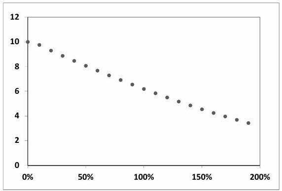
Figure 2.8: Black-Scholes price of a one-year $90 / 110$ call spread as a function of volatility, for $S=100$, zero interest rate and repo.

Notice that the price is maximum for zero volatility. For other configurations of $K_{1}, K_{2}$ it would have peaked for a different volatility: because of the varying sign
of the payoff's convexity and unlike vanilla options, the Black-Scholes price of a call spread is not necessarily a monotonic function of volatility.

The market price of the call spread is simply $P_{B S}\left(t S, K_{1} T, \widehat{\sigma}_{K_{1} T}\right)- P_{B S}\left(t S, K_{2} T, \widehat{\sigma}_{K_{2} T}\right)$. The smile of equity underlyings is usually strong enough ( $\widehat{\sigma}_{K_{1} T}$ larger than $\widehat{\sigma}_{K_{2} T}$ ) that the market price of the call spread lies above the highest price attainable in the Black-Scholes model: the notion of an implied volatility vanishes. For example, taking $\widehat{\sigma}_{K_{1} T}=22.5 \%, \widehat{\sigma}_{K_{2} T}=17.5 \%$ gives a price equal to 11.04 .

Thus we cannot risk-manage our short call spread position in the Black-Scholes model using a single implied volatility - what about delta-hedging each vanilla option using its own implied volatility? This gives rise during $\delta t$ to the following P\&L:

$$
\begin{equation*}
P \& L=-\frac{1}{2} S^{2} \frac{d^{2} P_{B S}^{1}}{d S^{2}}\left(\frac{\delta S^{2}}{S^{2}}-\widehat{\sigma}_{K_{1} T}^{2} \delta t\right)+\frac{1}{2} S^{2} \frac{d^{2} P_{B S}^{2}}{d S^{2}}\left(\frac{\delta S^{2}}{S^{2}}-\widehat{\sigma}_{K_{2} T}^{2} \delta t\right) \tag{2.114}
\end{equation*}

$$
^eq2-114

Now, consider risk-managing this position with the local volatility model, keeping the local volatility function fixed, that is using the delta $\Delta^{\mathrm{LV}}$ in (2.93). There is no contradiction with our discussion in the previous section: since we are not marking our call spread to market, we are free to keep the local volatility function fixed. The P\&L over $[t, t+\delta t]$ is then given by (2.94) rather than (2.105). Our P\&L reads:

$$
\begin{align*}
P \& L & =-\frac{1}{2} S^{2} \frac{d^{2} P_{\sigma}^{1}}{d S^{2}}\left(\frac{\delta S^{2}}{S^{2}}-\sigma(t, S)^{2} \delta t\right)+\frac{1}{2} S^{2} \frac{d^{2} P_{\sigma}^{2}}{d S^{2}}\left(\frac{\delta S^{2}}{S^{2}}-\sigma(t, S)^{2} \delta t\right) \\
& =-\frac{1}{2} S^{2}\left(\frac{d^{2} P_{\sigma}^{1}}{d S^{2}}-\frac{d^{2} P_{\sigma}^{2}}{d S^{2}}\right)\left(\frac{\delta S^{2}}{S^{2}}-\sigma(t, S)^{2} \delta t\right) \tag{2.115}
\end{align*}

$$
^eq2-115

In the Black-Scholes model, for a vanilla option, $\frac{d^{2} P_{B S}}{d S^{2}}$ is positive and peaks in the vicinity of the option's strike. There is then a particular value of $S$ such that $\frac{d^{2} P_{B S}^{1}}{d S^{2}}-\frac{d^{2} P_{B S}^{2}}{d S^{2}}=0$. For this value of $S$, the P\&L in equation (2.114) becomes:

$$
P \& L=\frac{1}{2} S^{2} \frac{d^{2} P_{B S}^{1}}{d S^{2}}\left(\widehat{\sigma}_{K_{1} T}^{2}-\widehat{\sigma}_{K_{2} T}^{2}\right) \delta t

$$

Our delta strategy pays us "free" money ( $\widehat{\sigma}_{K_{1} T}>\widehat{\sigma}_{K_{2} T}$ ) in a region of spot prices where there is no gamma risk. Note that this is not the case if we risk-manage both options in the same model - see (2.115) - as cancellation of gamma implies cancellation of the associated theta as well, which is much more reasonable. Note that prices of the call spread in both delta-hedging strategies are identical. Depending on which one is used, however, the theta is distributed differently.

It seems more judicious to use a hedging strategy that pays more theta in regions where gamma is large and pays no theta wherever gamma vanishes - which is what the local volatility model, or any model for that matter, does - rather than squander theta in regions of $S$ where there is little or no risk. We examine this issue further below in Appendix A in the context of the Uncertain Volatility Model.

### 2.9 The vega hedge

In the Black-Scholes model there is only one vega, as there is only one volatility parameter: any option can be used to vega-hedge any other option. The situation improves somewhat in the Black-Scholes model with deterministic time-dependent volatility $\sigma(t)$. The relationship linking $\sigma(t)$ to implied volatilities $\widehat{\sigma}_{T}$ is:

$$
\sigma^{2}(t)=\left.\frac{d}{d T}\left(T \widehat{\sigma}_{T}^{2}\right)\right|_{T=t}

$$

Thus an option's sensitivity to $\delta \sigma(t)$ can be hedged - within the model - by trading narrow calendar spreads of vanilla options. Equivalently, given the sensitivity of an option to $\sigma(t)$ for all $t$ up to its maturity, we can derive the maturity distribution of vanilla options to be used as hedges.

In the local volatility model, the price of an exotic option is a functional of the whole volatility surface $\widehat{\sigma}_{K T}$. Alongside a position in the underlying, the hedge portfolio consists of $\frac{d \mathcal{P}}{d O_{K T}}$ vanilla options of strike $K$, maturity $T$. Equivalently, the vanilla option hedge immunizes the global position at order one against fluctuations of the local volatility function $\sigma(t, S)$.

How do we calculate $\frac{d \mathcal{P}}{d O_{K T}}$ ? This question was first tackled by Bruno Dupire [41]. What follows is based on his and Pierre Henry-Labordère's work - see [59].

### 2.9.1 The vanilla hedge portfolio

Let $P(t, S, \bullet)$ be the price of an exotic option, where • stands for all pathdependent variables, whose number usually varies during the option's life. ${ }^{25}$ Pathdependent variables only change discontinuously at times when $S$ is observed, as mandated by the term sheet of our exotic payoff. While the option price is continuous across each of these dates, the function $P$ changes discontinuously so as to absorb the discontinuity in the path-dependent variables, but in between obeys the usual pricing equation:

$$
\begin{equation*}
\frac{d P}{d t}+(r-q) S \frac{d P}{d S}+\frac{\sigma^{2}(t, S) S^{2}}{2} \frac{d^{2} P}{d S^{2}}-r P=0 \tag{2.116}
\end{equation*}

$$
^eq2-116

Let us perturb $\sigma^{2}(t, S)$ by $\delta \sigma^{2}(t, S)$ and let us call $\delta P$ the resulting perturbation for $P$ - working with variances is equivalent to working with volatilities and lightens the notation. Replacing $\sigma^{2}$ with $\sigma^{2}+\delta \sigma^{2}$ and $P$ with $P+\delta P$ in (2.116) and expanding at order one in $\delta \sigma^{2}$ yields the following equation for $\delta P$ :

$$
\frac{d \delta P}{d t}+(r-q) S \frac{d \delta P}{d S}+\frac{\sigma^{2}(t, S) S^{2}}{2} \frac{d^{2} \delta P}{d S^{2}}-r \delta P=-\frac{1}{2} S^{2} \frac{d^{2} P}{d S^{2}} \delta \sigma^{2}(t, S)

$$

[^36]which is similar to (2.116) except it has a source term. At maturity $\delta P=0$. Application of the Feynman-Kac theorem yields:
$$
\delta P=\frac{1}{2} E_{\sigma}\left[\int_{0}^{T} d t e^{-r t} S^{2} \frac{d^{2} P}{d S^{2}}(t, S, \bullet) \delta \sigma^{2}(t, S)\right]

$$
where $E_{\sigma}$ denotes the expectation taken over paths of $S_{t}$ generated by the local volatility $\sigma(t, S)$. Conditioning now with respect to the value of $S$ at time $t$ :
$$
\begin{align*}
\delta P & =\frac{1}{2} \int_{0}^{T} d t e^{-r t} \int_{0}^{\infty} d S \rho(t, S) E_{\sigma}\left[\left.S^{2} \frac{d^{2} P}{d S^{2}}(t, S, \bullet) \right\rvert\, S, t\right] \delta \sigma^{2}(t, S) \\
& =\frac{1}{2} \int_{0}^{T} d t e^{-r t} \int_{0}^{\infty} d S \rho(t, S) \phi(t, S) \delta \sigma^{2}(t, S) \tag{2.117}
\end{align*}

$$
^eq2-117
where $\rho(t, S)$ is the density of $S$ at time $t$ and $\phi(t, S)$ is the expectation of the dollar gamma conditional on the underlying having the value $S$ at time $t$ :
$$
\begin{equation*}
\phi(t, S)=E_{\sigma}\left[\left.S^{2} \frac{d^{2} P}{d S^{2}}(t, S, \bullet) \right\rvert\, S, t\right] \tag{2.118}
\end{equation*}

$$
^eq2-118

Equation (2.117) expresses $\delta P$ as an average of $\delta \sigma^{2}$, weighted by the product of the density and $\phi$. We now look for a portfolio $\Pi$ of call options of all strikes and maturities:

$$
\begin{equation*}
\Pi=\int_{0}^{T} d \tau \int_{0}^{\infty} d K \mu(\tau, K) C_{K \tau} \tag{2.119}
\end{equation*}

$$
^eq2-119

that hedges our exotic option at order one against any perturbation $\delta \sigma^{2}(t, S)$. $\mu(\tau, K)$ is the density of vanilla options of strike $K$, maturity $\tau$. Equation (2.117) implies:

$$
\phi_{\Pi}(t, S)=\phi(t, S)

$$

where $\phi_{\Pi}$ is the dollar gamma of portfolio $\Pi$. How can we choose $\mu$ so that the resulting dollar gamma is $\phi$ ? Imagine that the exotic option was in fact a straight vanilla option - could we tell by just looking at $\phi$ ?

First note that, because a vanilla option is European, it is not path-dependent and $\phi$ is simply the dollar gamma:

$$
\phi(t, S)=S^{2} \frac{d^{2} P}{d S^{2}}(t, S)

$$

Starting from the pricing equation:

$$
\frac{d P}{d t}+(r-q) S \frac{d P}{d S}+\frac{\sigma^{2}(t, S) S^{2}}{2} \frac{d^{2} P}{d S^{2}}=r P

$$

and applying the operator $S^{2} \frac{d^{2}}{d S^{2}} \equiv\left(S \frac{d}{d S}\right)^{2}-S \frac{d}{d S}$ :

$$
\frac{d\left(S^{2} \frac{d^{2} P}{d S^{2}}\right)}{d t}+(r-q) S \frac{d\left(S^{2} \frac{d^{2} P}{d S^{2}}\right)}{d S}+\frac{1}{2} S^{2} \frac{d^{2}}{d S^{2}}\left(\sigma^{2}(t, S) S^{2} \frac{d^{2} P}{d S^{2}}\right)=r\left(S^{2} \frac{d^{2} P}{d S^{2}}\right)

$$

yields:

$$
\frac{d \phi}{d t}+(r-q) S \frac{d \phi}{d S}+\frac{1}{2} S^{2} \frac{d^{2}}{d S^{2}}\left(\sigma^{2}(t, S) \phi\right)=r \phi

$$

Let us define operator $\mathcal{L}$ as:

$$
\begin{equation*}
\mathcal{L} f=\frac{d f}{d t}+(r-q) S \frac{d f}{d S}+\frac{1}{2} S^{2} \frac{d^{2}}{d S^{2}}\left(\sigma^{2}(t, S) f\right)-r f \tag{2.120}
\end{equation*}

$$
^eq2-120

We get the property that $\mathcal{L} \phi=0$ for a European option. Consider a discrete portfolio $\Pi$ of vanilla options of strikes $\left(K_{i}, \tau_{i}\right)$, in quantities $\mu_{i}$, and let the corresponding dollar gamma be $\phi_{\Pi}$. For $\left.t \in\right] \tau_{i-1}, \tau_{i}\left[, \mathcal{L} \phi_{\Pi}=0\right.$. However, as we cross forward - time $\tau_{i}, \phi_{\Pi}$ is discontinuous since for $t>\tau_{i}$ it does not include the dollar gamma of option $i$ anymore. This discontinuity contributes to $\mathcal{L} \phi_{\Pi}$, through the $\frac{d}{d t}$ operator in $\mathcal{L}$. The dollar gamma of option $i$ vanishes at $t=\tau_{i}^{-}$except for $S=K_{i}$. It is then equal to $\mu_{i} K_{i}^{2} \delta\left(S-K_{i}\right)$ where $\delta$ denotes the Dirac distribution: this is the distinguishing feature of call and put options. For our discrete portfolio we then have:

$$
\left(\mathcal{L} \phi_{\Pi}\right)(t, S)=-\sum_{i} \mu_{i} K_{i}^{2} \delta\left(t-\tau_{i}\right) \delta\left(S-K_{i}\right)

$$

Consider now a portfolio consisting of a continuous density of call options as in (2.119):

$$
\mathcal{L} \phi_{\Pi}(\tau, K)=-K^{2} \mu(\tau, K)

$$

We then have our final result. $\mu$ is simply given by:

$$
\begin{equation*}
\mu(\tau, K)=-\frac{1}{K^{2}} \mathcal{L} \phi(\tau, K) \tag{2.121}
\end{equation*}

$$
^eq2-121

To be able to use (2.121) we need an estimate for $\phi$ that is sufficiently smooth so that we can apply operator $\mathcal{L}$. Practically $\phi$ will be evaluated on a grid, in a Monte Carlo simulation, using Malliavin techniques as it is a conditional expectation: this is numerically delicate.

Our task is made a lot easier if we simply carry out the perturbation analysis around a flat local volatility function, as the forward transition densities are all analytically known and $S$ is simulated in the Black-Scholes model. In practice, for exotic options that do not depend explicitly on realized variance, the nature of the vega hedge will not depend much on the precise shape of the local volatility function around which perturbation is performed.

Consider a path-dependent payoff $f(\mathbf{S})$ where $\mathbf{S}$ is the vector of spot observations $S_{i} \equiv S_{t=t_{i}}$. Consider a time $t$ and let $t_{k-1}, t_{k}$ be spot observation dates such that $t \in] t_{k}, t_{k+1}[. \phi(t, S)$ is given by:

$$
\phi(t, S)=\frac{\int \prod_{i<k}\left(p_{i-1, i} d S_{i}\right) p\left(t_{k-1} S_{k-1}, t S\right) S^{2} \frac{d^{2} P}{d S^{2}}(t, S, \bullet)}{p\left(t_{0} S_{0}, t S\right)}

$$

$$
\begin{gather*}
=\frac{\int \prod_{i<k}\left(p_{i-1, i} d S_{i}\right) p\left(t_{k-1} S_{k-1}, t S\right) S^{2} \frac{d^{2}}{d S^{2}}\left[p\left(t S, t_{k} S_{k}\right) d S_{k} \prod_{j>k}\left(p_{j-1, j} d S_{j}\right) f(\mathbf{S})\right]}{p\left(t_{0} S_{0}, t S\right)} \\
=\frac{\int \prod_{i \neq k}\left(p_{i-1, i} d S_{i}\right) p\left(t_{k-1} S_{k-1}, t S\right) S^{2} \frac{d^{2} p}{d S^{2}}\left(t S, t_{k} S_{k}\right) d S_{k} f(\mathbf{S})}{p\left(t_{0} S_{0}, t S\right)} \tag{2.122}
\end{gather*}

$$
^eq2-122

where $p_{i, i+1}$ is a shorthand notation for the transition density $p\left(t_{i} S_{i}, t_{i+1} S_{i+1}\right)$ in the Black-Scholes model:

$$
p\left(t_{i} S_{i}, t_{i+1} S_{i+1}\right)=\frac{1}{S_{i+1} \sqrt{2 \pi \sigma_{0}^{2}\left(t_{i+1}-t_{i}\right)}} e^{-\frac{\left(\ln \left(S_{i+1} / S_{i}\right)-\left(r-q-\frac{\sigma^{2}}{2}\right)\left(t_{i+1}-t_{i}\right)\right)^{2}}{2 \sigma_{0}^{2}\left(t_{i+1}-t_{i}\right)}}

$$

In equation (2.122), $S^{2} \frac{d^{2}}{d S^{2}}$ only acts on $p\left(t S, t_{k} S_{k}\right)$ : the calculation can be done analytically and we get our final expression for $\phi$ :

$$
\begin{align*}
& \phi(t, S)=\frac{\int \prod_{i \neq k}\left(p_{i-1, i} d S_{i}\right) p\left(t_{k-1} S_{k-1}, t S\right) w\left(t S, t_{k} S_{k}\right) p\left(t S, t_{k} S_{k}\right) d S_{k} f(\mathbf{S})}{p\left(t_{0} S_{0}, t S\right)} \\
& \quad=\frac{1}{p\left(t_{0} S_{0}, t S\right)} E\left[\frac{p\left(t_{k-1} S_{k-1}, t S\right) w\left(t S, t_{k} S_{k}\right) p\left(t S, t_{k} S_{k}\right)}{p\left(t_{k-1} S_{k-1}, t_{k} S_{k}\right)} f(\mathbf{S})\right] \tag{2.123}
\end{align*}

$$
^eq2-123

where $w$ is given by:

$$
\begin{aligned}
w\left(t S, t_{k} S_{k}\right) & =\frac{1}{\sigma_{0}^{2}\left(t_{k}-t\right)}\left(\frac{z^{2}}{\sigma_{0}^{2}\left(t_{k}-t\right)}-1-z\right) \\
z & =\ln \left(S_{k} / S\right)-\left(r-q-\frac{\sigma_{0}^{2}}{2}\right)\left(t_{k}-t\right)
\end{aligned}

$$

Equation (2.123) expresses $\phi$ as an expectation of the option's payoff multiplied by a weight that involves $S_{k-1}, S, S_{k}$. We recognize in $w$ the classical expression of the weight for computing gamma in a Monte Carlo simulation, in the Black-Scholes model.

As is well known, in practice it provides noisy estimates of gamma, especially when $t_{k}-t$ is small, as the variance of $w$ blows up. In our context this will be the case whenever the spot observation dates of our exotic option are closely spaced. This issue is compounded by the fact that in (2.123) $w$ is sandwiched in between two transition densities that contribute their fair share of the variance of our estimator for $\phi$. Getting an accurate estimate for $\phi$ is then computationally expensive but presents no special difficulty.

### 2.9.2 Calibration and its meaningfulness

What do we do once we have the hedge portfolio $\Pi$ ? Can we use it in practice?
Consider a constant volatility $\widehat{\sigma}_{0}$ and call $P^{0}$ the corresponding Black-Scholes price. Let us assume that the market smile is not too strong so that $\widehat{\sigma}_{K \tau}-\widehat{\sigma}_{0}$ is small. Using the above results and expanding at order one in $\widehat{\sigma}_{K \tau}-\widehat{\sigma}_{0}$ :

$$
\begin{equation*}
P=P^{0}+\int_{0}^{T} d \tau \int_{0}^{\infty} d K \mu(\tau, K)\left(C_{K \tau}-C_{K \tau}^{0}\right) \tag{2.124}
\end{equation*}

$$
^eq2-124

where $C_{K \tau}^{0}$ is the Black-Scholes price with volatility $\widehat{\sigma}_{0}$ and $C_{K \tau}$ the market price of the vanilla option of strike $K$, maturity $\tau$.
(2.124) can be interpreted as expressing the following: ${ }^{26}$

- Choose an implied volatility $\widehat{\sigma}_{0}$ for risk-managing the exotic option. This generates price $P^{0}$.
- Determine the quantities $\mu(\tau, K)$ of vanilla options to be used as hedges.
- Seting up the hedging portfolio entails paying market prices $C_{K \tau}$ rather than model prices $C_{K \tau}^{0}$ for the hedging vanilla options. The corresponding mismatch is passed on to the client as a hedging cost - the price we quote for the exotic option is given by (2.124).

The conclusion is that the price produced by a calibrated model is as credible as the hedge it implies. Is the latter really a statement on the exotic option or does it reflect model-specific features? This issue needs to be assessed on a case-by-case basis.

The impatient reader can jump to Section 3.2.4 where the case of a forward-start call is analyzed in detail.

### 2.10 Markov-functional models

In the local volatility model $S_{t}$ is generally a function of the path of $W_{t}$ up to time $t$, where $W_{t}$ is the driving Brownian motion. Are there special forms of the local volatility function such that $S_{t}$ can be written as a function of $t$ and $W_{t}$, hence can be simulated without any time-stepping? The Black-Scholes model is one example:

$$
S_{t}=S_{0} e^{\left(r-q-\frac{\sigma^{2}}{2}\right) t+\sigma W_{t}}

$$

[^37]Imagine there exists $f(t, x)$ such that

$$
\begin{equation*}
S_{t}=f\left(t, W_{t}\right) \tag{2.125}
\end{equation*}

$$
^eq2-125

The condition that the drift of $S$ be $r-q$ translates into the following PDE for $f$ :

$$
\begin{equation*}
\frac{d f}{d t}+\frac{1}{2} \frac{d^{2} f}{d x^{2}}=(r-q) f \tag{2.126}
\end{equation*}

$$
^eq2-126

and the instantaneous (lognormal) volatility of $S$ is given by:

$$
\begin{equation*}
\sigma(t, S)=\left.\frac{d \ln f}{d x}\right|_{x=f^{-1}(t, S), t} \tag{2.127}
\end{equation*}

$$
^eq2-127

which makes it clear that it is a local volatility model.
For $\sigma(t, S)$ to be well-defined, $f$ has to be a monotonic function of $x$. Markovfunctional Models (MFM) for equities were first introduced by Peter Carr and Dilip Madan - see [23] - who provide some analytic non-trivial solutions to (2.126).

Given now a market smile, is it possible to find a function $f$ such that market prices of vanilla options are recovered?

If $f$ is known for a given time $T$, equation (2.126) generates $f$ for times $t \leq T$, thus determining smiles for maturities less than $T$. This implies that we can at most calibrate the smile for one maturity $T$. Smiles for maturities shorter than $T$ are dictated by the smile at $T$.

We have shown at the beginning of this chapter that, given a full vanilla smile that is free of arbitrage, there exists one local volatility function $\sigma(t, S)$ that is able to generate it. If instead we only have a volatility smile for a single maturity, there exist generally many different local volatility functions that are able to recover it. What we have just shown is that one of them corresponds to a Markov-functional model: the process for $S_{t}$ in this particular local volatility model can be simulated without any time-stepping by simply drawing $W_{t}$ and setting $S_{t}=f\left(t, W_{t}\right)$.

Assume we are given the market smile for maturity $T$ : we can price digital options for all strikes, which gives access to the cumulative distribution function of $S_{T}$, $\mathcal{F}(S)$. Denoting $\mathcal{N}$ the cumulative distribution of the centered normal distribution, $f(t=T, x)$ is given by:

$$
\begin{equation*}
f(T, x)=\mathcal{F}^{-1}\left(\mathcal{N}\left(\frac{x}{\sqrt{T}}\right)\right) \tag{2.128}
\end{equation*}

$$
^eq2-128

$f(t=T, x)$ is monotonic by construction and so is $f(t, x)$ for $t<T .^{27}$

[^38]Note that by using other processes than a straight Brownian motion in (2.125) one can generate different smiles for intermediate maturities, for example by taking $S_{t}=f\left(t, Z_{t}\right)$ where $d Z_{t}=\sigma(t) d W_{t}$.

In the context of equities MFMs are very rarely used: one usually needs to calibrate a set of maturities simultaneously. In fixed income markets, on the other hand, MFMs are natural, as cap/floors on LIBOR rates, swaptions, have maturities that match the fixing date of the underlying rate - see [64] for Markov-functional interest rate models. This is also the case of futures in commodity markets and VIX futures - see Section 7.8.2 for an example of an MFM in this context.

### 2.10.1 Relationship of Gaussian copula to multi-asset local volatility prices

MFMs can be used for European options on a basket of equities $S^{i}$. Let us call $T$ the option's maturity: one draws the (correlated) Gaussian random variables $W_{T}^{i}$, applies the mapping in (2.128) and evaluates the payoff. This is exactly equivalent to using the marginal densities supplied by the market smile for maturity $T$ for each asset, and then using a Gaussian copula function to generate the multivariate density for the $S_{T}^{i}$.

This is worth noting as, usually, given a multivariate density $\rho$ generated by an arbitrary copula function, one is unable to characterize the dynamics that underlies $\rho$ : it is not even clear that there exists a diffusive process that is able to generate $\rho$ one then has no idea of what the gamma/theta break-even levels of his/her position are: the model is unusable.

Because MFMs are a particular instance of local volatility, in the case of a multiasset European option, pricing with a Gaussian copula thus exactly boils down to using a particular ${ }^{28}$ multi-asset local volatility model calibrated on implied volatilities of the option's maturity, with constant correlations, equal to the correlations of the Gaussian copula.

## Appendix A - the Uncertain Volatility Model

Treating the Uncertain Volatility Model (UVM) as a local volatility model is not quite natural, as it is typically used in situations when there are no market implied volatilities. We still cover it as it is a (very) special and useful instance of local volatility: in its basic version the local volatility function is not determined by the market smile, but set by a trading criterion.

[^39]Imagine selling an option on an underlying for which no option market exists typically a fund share. For example, consider a short position in a call option, whose dollar gamma is always positive. We should typically sell it for a Black-Scholes implied volatility $\widehat{\sigma}$ that is sufficiently higher than the expected realized volatility $\sigma_{r}$ to ensure that our gamma/theta P\&L is mostly positive. Conversely, we would buy this option for a value of $\widehat{\sigma}$ lower than $\sigma_{r}$. What about an option whose gamma can be positive or negative, depending on $S, t$ ?

For example, imagine being short a call spread: we sell the call struck at $K_{1}$ and buy the call struck at $K_{2}\left(K_{2}>K_{1}\right)$, and assume that we price the $K_{1}$ call with $\widehat{\sigma}_{1}$ and the $K_{2}$ call with $\widehat{\sigma}_{2}$, with $\widehat{\sigma}_{1}>\widehat{\sigma}_{2}$. Our P\&L during $\delta t$ is:

$$
\begin{equation*}
P \& L=-\frac{\Gamma_{1}}{2}\left(\sigma_{r}^{2}-\widehat{\sigma}_{1}^{2}\right)+\frac{\Gamma_{2}}{2}\left(\sigma_{r}^{2}-\widehat{\sigma}_{2}^{2}\right) \tag{2.129}
\end{equation*}

$$
^eq2-129

where $\Gamma_{1}, \Gamma_{2}$ are the (positive) dollar gammas of both calls.
Whenever $\sigma_{r}$ is such that $\widehat{\sigma}_{1}<\sigma_{r}<\widehat{\sigma}_{2}$, both contributions in (2.129) are positive. For $S \ll K_{1}, \Gamma_{2} \ll \Gamma_{1}$ and $P \& L \simeq-\Gamma_{1}\left(\sigma_{r}^{2}-\widehat{\sigma}_{1}^{2}\right) / 2$. Similarly, for $S \gg K_{2}, P \& L \simeq \Gamma_{2}\left(\sigma_{r}^{2}-\widehat{\sigma}_{2}^{2}\right) / 2$ : our gamma/theta break-even levels are $\widehat{\sigma}_{1}$ (resp. $\widehat{\sigma}_{2}$ ) for very low (res. high) values of $S$. Now, as discussed in Section 2.8, for $S$ such that the residual gamma $\Gamma_{1}-\Gamma_{2}$ vanishes, our P\&L is uselessly positive. Can we use a pricing and hedging scheme such that this P\&L is redistributed to regions where $\Gamma$ is sizeable, thus improving our gamma/theta break-even levels?

This is exactly what the Uncertain Volatility Model (UVM), introduced by Marco Avellaneda, Arnon Levy, Antonio Paras in [3] and Terry Lyons in [71], does.

The UVM is a local volatility model where the instantaneous volatility $\sigma$ is a function of the dollar gamma of the option being priced. In the original version of the UVM, $\sigma$ can take two values: $\sigma_{\text {min }}, \sigma_{\text {max }}$, depending on the sign of the dollar gamma: $\sigma(t, S)=\sigma_{\max }$ if $\frac{d^{2} P}{d S^{2}}>0, \sigma(t, S)=\sigma_{\min }$ if $\frac{d^{2} P}{d S^{2}}<0$. Our P\&L thus reads:

$$
\begin{aligned}
P \& L & =-\frac{\Gamma}{2}\left(\sigma_{r}^{2}-\sigma_{\max }^{2}\right) \text { if } \Gamma>0 \\
& =-\frac{\Gamma}{2}\left(\sigma_{r}^{2}-\sigma_{\min }^{2}\right) \text { if } \Gamma<0
\end{aligned}

$$

The pricing equation for $P$ is non-linear as $\sigma(t, S)$ is a function of $P:$

$$
\frac{d P}{d t}+(r-q) S \frac{d P}{d S}+\frac{1}{2} \sigma^{2}\left(\frac{d^{2} P}{d S^{2}}\right) S^{2} \frac{d^{2} P}{d S^{2}}=r P

$$

which can be written as:

$$
\begin{equation*}
\frac{d P}{d t}+(r-q) S \frac{d P}{d S}+\frac{1}{2} \quad \max _{\sigma=\sigma_{\min }, \sigma_{\max }}\left(\sigma^{2} S^{2} \frac{d^{2} P}{d S^{2}}\right)=r P \tag{2.130}
\end{equation*}

$$
^eq2-130

Equation (2.130) is the Hamilton-Jacobi-Bellman equation for the following stochastic control problem:

$$
\begin{equation*}
P=\max _{\sigma_{t} \in\left[\sigma_{\min }, \sigma_{\max }\right]} E\left[f\left(S_{T}\right)\right] \tag{2.131}
\end{equation*}

$$
^eq2-131

where $f$ is the option's payoff, the maximum is taken over all processes for the instantaneous volatility $\sigma_{t}$ such that $\sigma_{t} \in\left[\sigma_{\text {min }}, \sigma_{\text {max }}\right]$ and the expectation is taken over paths of $S_{t}$.

This implies that for an option whose payoff is a sum of two payoffs, the UVM price $P$ satisfies the inequality $P \leq P_{1}+P_{2}$, where $P_{1}, P_{2}$ are the respective UVM prices of both payoffs. Going back to our example, the price of the call spread in the UVM with $\sigma_{\text {max }}=\widehat{\sigma}_{1}, \sigma_{\text {min }}=\widehat{\sigma}_{2}$ is lower than the difference of the Black-Scholes prices of each call, computed with volatilities $\widehat{\sigma}_{1}, \widehat{\sigma}_{2}$.

Equivalently, we can find better levels $\sigma_{\text {max }}>\widehat{\sigma}_{1}$ and $\sigma_{\text {min }}<\widehat{\sigma}_{2}$ that still allow us to match the market price. Risk-managing our call spread with the UVM pays zero theta wherever gamma vanishes but provides better break-even volatility levels elsewhere.

For a payoff whose dollar gamma has varying sign, there exist generally many different couples ( $\sigma_{\text {min }}, \sigma_{\text {max }}$ ) such that the UVM price matches a given price level.

## A. 1 An example

Take the example of a 3-year maturity call spread with $K_{1}=90 \%, K_{2}=160 \%$ with $\widehat{\sigma}_{1}=38 \%, \widehat{\sigma}_{2}=31 \%$. Examples of ( $\sigma_{\text {min }}, \sigma_{\text {max }}$ ) couples that match the Black-Scholes price of the call spread are given in Table 2.1.

| $\sigma_{\min }$ | $20 \%$ | $22 \%$ | $24 \%$ | $26 \%$ | $28 \%$ |
| :--- | :--- | :--- | :--- | :--- | :--- |
| $\sigma_{\max }$ | $28 \%$ | $32 \%$ | $36 \%$ | $41 \%$ | $46 \%$ |

Table 2.1: Examples of ( $\sigma_{\text {min }}, \sigma_{\text {max }}$ ) couples yielding the same price for a 3-year $90 \% / 160 \%$ call spread, in the UVM.

From a trading point of view, for the same price charged, it is more reasonable to not have any theta P\&L whenever gamma vanishes and have break-even levels $26 \% / 41 \%$, for example, than getting positive theta P\&L in a region of vanishing gamma and having break-even levels $31 \% / 38 \%$ in regions where gamma is sizeable.

In practice, rather than taking $\sigma=\sigma_{\max } \theta(\Gamma)+\sigma_{\min }(1-\theta(\Gamma))$, we can use smoother functions of $\Gamma$, for example requiring more comfortable break-even levels as the dollar gamma increases.

It is however necessary to ensure that $\sigma(\Gamma)^{2} \Gamma$ is an increasing function of $\Gamma$ to preclude arbitrage, that is the possibility that given two payoffs $u(S), v(S)$ such that $u(S) \geq v(S), u$ might be cheaper than $v$.

## A. 2 Marking to market

The UVM was originally designed for underlyings for which no volatility market exists. Is it suited to underlyings for which implied volatilities exist?

## A.2.1 An unhedged position

Consider the case of a large trade in a call spread. While the liquidity of vanilla options is not sufficient for us to hedge ourselves in the market, it may be sufficient enough that we decide ${ }^{29}$ to mark our position to market.

With respect to the previous situation, the benefits of the wider break-even levels are wiped out because of the mark-to-market constraint: $\sigma_{\text {min }}, \sigma_{\text {max }}$ have to be moved throughout time so that the UVM price of the call spread always matches its market value.

Let us assume that, during the option's lifetime, implied volatilities $\widehat{\sigma}_{1}, \widehat{\sigma}_{2}$ do not move: we start initially with $\sigma_{\max }>\widehat{\sigma}_{1}$ and $\sigma_{\min }<\widehat{\sigma}_{2}$. As we reach maturity, the dollar gammas $\Gamma_{1}, \Gamma_{2}$ become localized near their respective strikes and do not overlap anymore. Thus, at maturity $\sigma_{\text {max }}=\widehat{\sigma}_{1}$ and $\sigma_{\text {min }}=\widehat{\sigma}_{2}$. As time advances, $\sigma_{\text {max }}$ (resp. $\sigma_{\text {min }}$ ) will converge to $\widehat{\sigma}_{1}$ (resp. $\widehat{\sigma}_{2}$ ). This daily remarking of $\sigma_{\text {min }}, \sigma_{\text {max }}$ will generate additional theta.

By doing this, we extract more theta from the UVM than we need with the consequence that, near the option's maturity, when dollar gammas are largest, our break-even levels become identical to the Black-Scholes ones ( $\sigma_{\text {max }}=\widehat{\sigma}_{1}$, $\sigma_{\text {min }}=\widehat{\sigma}_{2}$ ). This defeats the purpose of the UVM.

## A.2.2 A hedged position - the $\lambda$-UVM

Let us assume here that we have traded an exotic option $F$ that can be reasonably - but not perfectly - hedged with a portfolio of vanilla options. Pricing the exotic at hand in the UVM is a very conservative approach: rather than pricing the full gamma of $F$ with $\sigma_{\text {min }}, \sigma_{\text {max }}$, depending on its sign, it is preferable to first assemble a portfolio of vanilla options that best offsets the gamma profile of our exotic, and then price the package consisting of the exotic option minus its hedge in the UVM. This idea was first proposed in [4] under the name of $\lambda$-UVM model - or Lagrangian UVM; see also [47] for more recent work.

The price $\mathcal{P}(F)$ we quote for the exotic is then given by:

$$
\begin{equation*}
\mathcal{P}(F)=\mathcal{P}_{\mathrm{UVM}}\left(F-\Sigma \lambda_{i} O_{i}\right)+\Sigma \lambda_{i} \mathcal{P}_{\mathrm{Mkt}}\left(O_{i}\right) \tag{2.132}
\end{equation*}

$$
^eq2-132

where $F$ is the exotic option's payoff, $\mathcal{P}_{\text {UVM }}$ and $\mathcal{P}_{\text {Mkt }}$ denote, respectively, the UVM price and the market price, and $\lambda_{i}$ the quantities of vanilla options $O_{i}$ traded. The second piece represents the cost of buying the vanilla portfolio at market price.

How should we choose vector $\lambda$ ? The $\lambda_{i}$ should be chosen so that for given values of $\sigma_{\text {min }}, \sigma_{\text {max }}$, we quote the most competitive - i.e. lowest possible - price

[^40]$\overline{\mathcal{P}}(F)$ for our exotic option:
$$
\begin{align*}
\lambda & =\arg \min _{\lambda}\left[\mathcal{P}_{\mathrm{UVM}}\left(F-\Sigma \lambda_{i} O_{i}\right)+\Sigma \lambda_{i} \mathcal{P}_{\mathrm{Mkt}}\left(O_{i}\right)\right] \\
\overline{\mathcal{P}}(F) & =\min _{\lambda}\left[\mathcal{P}_{\mathrm{UVM}}\left(F-\Sigma \lambda_{i} O_{i}\right)+\Sigma \lambda_{i} \mathcal{P}_{\mathrm{Mkt}}\left(O_{i}\right)\right] \tag{2.133}
\end{align*}

$$
^eq2-133

## Optimality conditions

Let us express that the derivative of $\overline{\mathcal{P}}(F)$ with respect to $\lambda_{i}$ vanishes. Consider equation (2.130) for the UVM price $P$ of the package $F-\Sigma \lambda_{i} O_{i}$ and assume a small perturbation of the $\lambda_{i}$ which results in a variation $\delta P$ of $P$ and a variation $\delta\left(\sigma^{2}\right)$ of $\sigma^{2}$ :

$$
\begin{equation*}
\frac{d(P+\delta P)}{d t}+(r-q) S \frac{d(P+\delta P)}{d S}+\frac{\sigma^{2}+\delta\left(\sigma^{2}\right)}{2} S^{2} \frac{d^{2}(P+\delta P)}{d S^{2}}=r(P+\delta P) \tag{2.134}
\end{equation*}

$$
^eq2-134

where $\sigma$ is the local volatility function that maximizes the UVM price of $F-\Sigma \lambda_{i} O_{i}$. Expanding (2.134) at order one in $\delta P$ and $\delta\left(\sigma^{2}\right)$ gives for $\delta P$ the following PDE:

$$
\begin{equation*}
\frac{d \delta P}{d t}+(r-q) S \frac{d \delta P}{d S}+\frac{\sigma^{2}}{2} S^{2} \frac{d^{2} \delta P}{d S^{2}}=r \delta P-\frac{\delta\left(\sigma^{2}\right)}{2} S^{2} \frac{d^{2} P}{d S^{2}} \tag{2.135}
\end{equation*}

$$
^eq2-135

with the terminal condition $\delta P(T, S)=-\Sigma \delta \lambda_{i} O_{i}(S)$. The solution of (2.135) is given by:

$$
\begin{equation*}
\delta P=e^{-r T} E_{\sigma}\left[\delta P\left(T, S_{T}\right)\right]+E_{\sigma}\left[\int_{0}^{T} e^{-r t} S^{2} \frac{d^{2} P}{d S^{2}} \frac{\delta\left(\sigma^{2}\right)}{2} d t\right] \tag{2.136}
\end{equation*}

$$
^eq2-136

Consider the second piece of (2.136). It would be the only contribution to $\delta P$ if $\delta P(T, S)=0$, that is if the $\delta \lambda_{i}$ were vanishing. It represents the effect of a small perturbation of $\delta \sigma^{2}$ on $P$ - for an unchanged payoff. By definition, $\sigma$ is the local volatility function that maximizes the price $\mathcal{P}_{\text {UVM }}\left(F-\Sigma \lambda_{i} O_{i}\right)$ : at order one any perturbation $\delta\left(\sigma^{2}\right)$ leaves $P$ unchanged: the second piece in (2.136) vanishes.

We are then left with:

$$
\delta P=e^{-r T} E_{\sigma}\left[\delta P\left(T, S_{T}\right)\right]

$$

which expresses that $\delta P$ is given by a standard local volatility PDE where the local volatility is fixed, given by the solution of the UVM price for $F-\Sigma \lambda_{i} O_{i}$. In other words:

$$
\delta \mathcal{P}_{\mathrm{UVM}}\left(F-\Sigma \lambda_{i} O_{i}\right)=-\Sigma \delta \lambda_{i} \mathcal{P}_{\mathrm{UVM}}^{F-\Sigma \lambda_{i} O_{i}}\left(O_{i}\right)

$$

where $\mathcal{P}_{\mathrm{UVM}}^{F-\Sigma \lambda_{i} O_{i}}(G)$ is defined as the price of payoff $G$ calculated with a local volatility function $\sigma$ that maximizes the UVM price of the package $F-\Sigma \lambda_{i} O_{i}$.

Taking now the derivative of $\mathcal{P}(F)$ with respect to $\lambda_{i}$ yields:

$$
\frac{d \mathcal{P}(F)}{d \lambda_{i}}=-\mathcal{P}_{\mathrm{UVM}}^{F-\Sigma \lambda_{i} O_{i}}\left(O_{i}\right)+\mathcal{P}_{\mathrm{Mkt}}\left(O_{i}\right)

$$

Condition $\frac{d \mathcal{P}(F)}{d \lambda_{i}}=0$ implies:

$$
\begin{equation*}
\mathcal{P}_{\mathrm{UVM}}^{F-\Sigma \lambda_{i} O_{i}}\left(O_{i}\right)=\mathcal{P}_{\mathrm{Mkt}}\left(O_{i}\right) \tag{2.137}
\end{equation*}

$$
^eq2-137

Thus, for $\lambda$ such that $\mathcal{P}(F)$ is extremal, prices of vanilla options used as hedges calculated using the local volatility that maximize the UVM price of $F-\Sigma \lambda_{i} O_{i}$ match their market prices. The $\lambda$-UVM thus ensures that if $F$ should collapse to a vanilla option $O_{i}, \overline{\mathcal{P}}\left(O_{i}\right)$ would match the market price $\mathcal{P}_{\text {Mkt }}\left(O_{i}\right) . \overline{\mathcal{P}}(F)$ can then be called a mark-to-market price.

Going back to the definition of $\overline{\mathcal{P}}(F)$ in (2.133) and using identity (2.137) yields:

$$
\overline{\mathcal{P}}(F)=\mathcal{P}_{\mathrm{UVM}}^{F-\Sigma \lambda_{i} O_{i}}(F)

$$

Alternatively $\overline{\mathcal{P}}(F)$ can also be characterized as the solution of the following stochastic control problem:

$$
\begin{equation*}
\overline{\mathcal{P}}(F)=\max _{\substack{\sigma_{t} \in\left[\sigma_{\min }, \sigma_{\max }\right] \\ E_{\sigma}\left[O_{i}\right]=\mathcal{P}_{\operatorname{Mkt}}\left(O_{i}\right)}} E_{\sigma}[F] \tag{2.138}
\end{equation*}

$$
^eq2-138

which generalizes criterion (2.131): we have added the additional constraint that market prices of options used as hedges have to be matched. ${ }^{30}$

## A.2.3 Discussion

Note that, for given market prices $\mathcal{P}_{\mathrm{Mkt}}\left(O_{i}\right), \sigma_{\text {min }}, \sigma_{\text {max }}$ have to be chosen so that $\mathcal{P}_{\text {Mkt }}\left(O_{i}\right)$ is attainable in the UVM. For example, imagine that the market implied volatilities are all equal to $25 \%$ and that we have chosen $\sigma_{\text {min }}=10 \%, \sigma_{\text {max }}=20 \%$. Obviously UVM prices of vanilla options are such that their implied volatilities cannot exceed $20 \%$. Problem (2.138) has no solution. Practically this would manifest itself in the fact that $\mathcal{P}(F)$ in (2.132) can be made as negative as we wish by making $\lambda$ sufficiently negative.

The above derivation was carried out for the situation when we are selling payoff $F: \overline{\mathcal{P}}(F)$ is our offer price. If instead we are buying the exotic option we can follow a similar derivation, defining our bid price as $\underline{\mathcal{P}}(F)$ given by:

$$
\underline{\mathcal{P}}(F)=\max _{\lambda}\left[\mathcal{P}_{\mathrm{UVM}}\left(F-\Sigma \lambda_{i} O_{i}\right)+\Sigma \lambda_{i} \mathcal{P}_{\mathrm{Mkt}}\left(O_{i}\right)\right]

$$

$\underline{\mathcal{P}}(F)$ is also characterized as:

$$
\underline{\mathcal{P}}(F)=\min _{\substack{\sigma_{t} \in\left[\sigma_{\min }, \sigma_{\max }\right] \\ E_{\sigma}\left[O_{i}\right]=\mathcal{P}_{\mathrm{Mkt}}\left(O_{i}\right)}} E_{\sigma}[F]

$$

In practice, whenever $F$ can be suitably hedged with vanilla options - this is assessed by checking that for a comfortably wide interval $\left[\sigma_{\text {min }}, \sigma_{\text {max }}\right], \overline{\mathcal{P}}(F)$ is

[^41]not inconsiderately expensive, or better that our bid/offer spread $\overline{\mathcal{P}}(F)-\underline{\mathcal{P}}(F)$ is not too large - the $\lambda$-UVM model is an effective tool for pricing and risk-managing exotic options. Unfortunately this isn't often the case, which is testament to the fact that most exotic risks are of a different nature than vanilla risks. We refer the reader to our experiment with forward-start options in Section 3.1.7.

When using vanilla options as hedges, $\overline{\mathcal{P}}(F)-\underline{\mathcal{P}}(F)$ provides an indication of how vanilla-like the risk of our exotic option is. We can, however, also use exotic options as hedges - for example cliquets. $\overline{\mathcal{P}}(F)-\underline{\mathcal{P}}(F)$ then supplies a measure of the kinship of exotic risks of the hedged and hedging options. Practically though, solving the stochastic control problem (2.138) in the situation of an exotic option hedged with other exotic options is typically not possible, as the high degree of path-dependence of exotic options results in the high dimensionality of equation (2.130).

Note that, as time elapses and we update $\lambda$ so as to keep $\overline{\mathcal{P}}(F)$ in (2.133) minimal, we never lose any money, as, by construction, shifting from a previously optimized to a currently optimal vector $\lambda$ lowers $\overline{\mathcal{P}}(F)$.

What if we set $\sigma_{\text {min }}=0, \sigma_{\text {max }}=+\infty ? \underline{\mathcal{P}}(F)$ (resp. $\overline{\mathcal{P}}(F)$ ) are then modelindependent lower (resp. upper) bounds for the price of payoff $F$, given market prices of payoffs $O_{i}$-see [47] for more on this and the connection with the dual problem of model-independent sub- (resp. super-) replication.

## A. 3 Using the UVM to price transaction costs

Consider selling a call option on a security $S$, risk-managed in the Black-Scholes model with an implied volatility $\widehat{\sigma}$, but assume that bid/offer costs are incurred as we adjust our delta - say on a daily basis. Assume the relative bid-offer spread is $k$ : we pay $\left(1+\frac{k}{2}\right) S$ to buy one unit of the security, and receive $\left(1-\frac{k}{2}\right) S$ when we sell it.

The P\&L over $[t, t+\delta t]$ of a delta-hedged short option position reads as in (1.5), page 4 , with the additional contribution of bid/offer costs:

$$
P \& L=-\frac{S^{2}}{2} \frac{d^{2} P}{d S^{2}}\left(\frac{\delta S^{2}}{S^{2}}-\widehat{\sigma}^{2} \delta t\right)-\frac{k}{2} S|\delta \Delta|

$$

where $\delta \Delta$ is the variation of our delta during $\delta t$; we use an absolute value as the impact of bid/offer is always a cost. $\delta \Delta$ is generated by (a) time advancing by $\delta t$, (b) $S$ moving by $\delta S$.

Since $\delta S$ if or order $\sqrt{\delta t}$ we keep the latter contribution only: $\delta \Delta=\frac{d^{2} P}{d S^{2}} \delta S$.

$$
\begin{aligned}
P \& L & =-\frac{S^{2}}{2} \frac{d^{2} P}{d S^{2}}\left(\frac{\delta S^{2}}{S^{2}}-\widehat{\sigma}^{2} \delta t\right)-\frac{k}{2} S\left|\frac{d^{2} P}{d S^{2}} \delta S\right| \\
& =-\frac{S^{2}}{2} \frac{d^{2} P}{d S^{2}}\left(\frac{\delta S^{2}}{S^{2}}-\widehat{\sigma}^{2} \delta t+\varepsilon_{\Gamma} k\left|\frac{\delta S}{S}\right|\right)
\end{aligned}

$$

where $\varepsilon_{\Gamma}$ is the sign of $\frac{d^{2} P}{d S^{2}}$.

If the realized volatility of $S$ is indeed $\widehat{\sigma}$, the gamma and theta contributions cancel out and the third piece will make our P\&L persistently negative. Can we find an implied volatility $\widehat{\sigma}^{*}$ such that risk-managing the option position at $\widehat{\sigma}^{*}$ generates, on average, zero P\&L? $\widehat{\sigma}^{*}$ must be such that:

$$
\left\langle\frac{\delta S^{2}}{S^{2}}\right\rangle-\widehat{\sigma}^{* 2} \delta t+\varepsilon_{\Gamma} k\langle | \frac{\delta S}{S}| \rangle=0

$$

Assuming a lognormal dynamics for $S$ with realized volatility $\widehat{\sigma}$ and $\delta t$ small, $\frac{\delta S}{S}=\widehat{\sigma} \sqrt{\delta t} Z$ where $Z$ is a standard normal variable, thus $\left\langle\frac{\delta S^{2}}{S^{2}}\right\rangle=\widehat{\sigma}^{2} \delta t$ and $\langle | \frac{\delta S}{S}\left\rangle=\gamma \widehat{\sigma} \sqrt{\delta t}\right.$ with $\gamma=\sqrt{\frac{2}{\pi}} \cdot \widehat{\sigma}^{*}$ is given by:

$$
\widehat{\sigma}^{*}=\sqrt{\widehat{\sigma}^{2}+\varepsilon_{\Gamma} k \gamma \frac{\widehat{\sigma}}{\sqrt{\delta t}}}

$$

Depending on the sign of the option's gamma, we need to use either $\widehat{\sigma}_{\Gamma+}^{*}$ or $\widehat{\sigma}_{\Gamma-}^{*}$, given by:

$$
\begin{equation*}
\widehat{\sigma}_{\Gamma+}^{*}=\sqrt{\widehat{\sigma}^{2}+k \gamma \frac{\widehat{\sigma}}{\sqrt{\delta t}}} \quad \widehat{\sigma}_{\Gamma-}^{*}=\sqrt{\widehat{\sigma}^{2}-k \gamma \frac{\widehat{\sigma}}{\sqrt{\delta t}}} \tag{2.139}
\end{equation*}

$$
^eq2-139

with $\widehat{\sigma}_{\Gamma+}^{*} \geq \widehat{\sigma}_{\Gamma-}^{*}$.
Expression (2.139) for $\widehat{\sigma}_{\Gamma+}^{*} / \widehat{\sigma}_{\Gamma-}^{*}$ was first published by Hayne E. Leland in [68]. When trading a call option, whose gamma is always positive, we use $\widehat{\sigma}_{\Gamma+}^{*}$ when selling it and $\widehat{\sigma}_{\Gamma-}^{*}$ when buying it.

What if we trade a call spread, or generally an option payoff whose gamma has varying sign? This is where the UVM is called for. We use the UVM with:

$$
\sigma_{\min }=\widehat{\sigma}_{\Gamma-}^{*}, \quad \sigma_{\max }=\widehat{\sigma}_{\Gamma+}^{*}

$$

Two final observations are in order:

- $\gamma$ depends on the distribution we assume for daily returns. It equals $\sqrt{\frac{2}{\pi}}$ for Gaussian returns. In practice, daily returns of equities are better modeled with a Student distribution - see Chapter 10 for examples of actual distributions of index returns. In this respect, $\gamma=\sqrt{\frac{2}{\pi}}$ is an over-estimation.
- The period $\delta t$ of our delta rehedging schedule appears explicitly in (2.139). As $\delta t \rightarrow 0$, rehedging costs become prohibitive, to the point where $\widehat{\sigma}_{\Gamma-}^{*}$ does not exist anymore. When rehedging is frequent, or bid/offer spreads are large, rather than use the Black-Scholes delta and charge for the costs this incurs, it
is preferable to go back to square one and cast the delta-hedging strategy as a stochastic control problem that maximizes a utility function which balances the costs generated by hedging with the benefit of a reduced uncertainty of our final P\&L. This was done by Mark Davis, Vassilios Panas and Thaleia Zhariphopoulou in [35]. In practice, an exponential utility function $e^{-\lambda P \& L}$ is well suited as the ensuing delta strategy is independent on the initial wealth. ${ }^{31}$

[^42]
## Chapter's digest

### 2.2 From prices to local volatilities

- Given a full volatility surface $\widehat{\sigma}_{K T}$ that complies with the following noarbitrage conditions:

$$
\begin{aligned}
e^{q T_{1}} C\left(\alpha F_{T_{1}}, T_{1}\right) & \leq e^{q T_{2}} C\left(\alpha F_{T_{2}}, T_{2}\right) \\
\frac{d^{2} C(K, T)}{d K^{2}} & \geq 0
\end{aligned}

$$

there exists one volatility function $\sigma(t, S)$ given by the Dupire formula (2.3):

$$
\sigma(t, S)^{2}=\left.2 \frac{\frac{d C}{d T}+q C+(r-q) K \frac{d C}{d K}}{K^{2} \frac{d^{2} C}{d K^{2}}}\right|_{\substack{K=S \\ T=t}}

$$

More generally, for any stochastic volatility model that recovers the market smile, whose instantaneous volatility is $\sigma_{t}$, the following condition holds:

$$
E\left[\sigma_{t}^{2} \mid S_{t}=S\right]=\sigma(t, S)^{2}

$$

In the absence of arbitrage, implied volatilities of vanilla options obey the convex order condition:

$$
T_{2} \widehat{\sigma}_{\alpha F_{T_{2}}, T_{2}}^{2} \geq T_{1} \widehat{\sigma}_{\alpha F_{T_{1}}, T_{1}}^{2}

$$

This condition is shared by any family of convex payoffs $f\left(S_{T}\right)=h\left(\frac{S_{T}}{F_{T}}\right)$.

### 2.3 From implied volatilities to local volatilities

- When there are no cash-amount dividends, local volatilities are obtained directly as a function of implied volatilities through (2.19):

$$
\sigma(t, S)^{2}=\left.\frac{\frac{d f}{d t}}{\left(\frac{y}{2 f} \frac{d f}{d y}-1\right)^{2}+\frac{1}{2} \frac{d^{2} f}{d y^{2}}-\frac{1}{4}\left(\frac{1}{4}+\frac{1}{f}\right)\left(\frac{d f}{d y}\right)^{2}}\right|_{y=\ln \left(\frac{S}{F_{t}}\right)}

$$

- When cash-amount dividends are present, there exists (a) an exact solution based on a mapping from $S_{t}$ to an asset that does not jump across dividend dates, (b) an approximate solution that allows one to use the same formula as in the nodividend case, except the definition of $y$ changes so that, in particular, it complies with the matching conditions for implied volatilities across dividend dates.
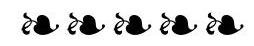


### 2.4 From local volatilities to implied volatilities

- Given a local volatility function $\sigma(t, S)$, implied volatilities satisfy the following condition: (2.32):

$$
\widehat{\sigma}_{K T}^{2}=\frac{E_{\sigma(S, t)}\left[\int_{0}^{T} e^{-r t} \sigma(t, S)^{2} S^{2} \frac{d^{2} P_{\widehat{\sigma}_{K T}}}{d S^{2}} d t\right]}{E_{\sigma(S, t)}\left[\int_{0}^{T} e^{-r t} S^{2} \frac{d^{2} P_{\widehat{\sigma}_{K T}}}{d S^{2}} d t\right]}

$$

- For weakly local volatilities $\widehat{\sigma}_{K T}$ is given, at order one in the perturbation with respect to a time-dependent volatility $\sigma_{0}(t)$ by (2.40):

$$
\widehat{\sigma}_{K T}^{2}=\frac{1}{T} \int_{0}^{T} d t \int_{-\infty}^{+\infty} d y \frac{e^{-\frac{y^{2}}{2}}}{\sqrt{2 \pi}} u\left(t, F_{t} e^{\frac{\omega_{t}}{\omega_{T}} x_{K}+\frac{\sqrt{\left(\omega_{T}-\omega_{t}\right) \omega_{t}}}{\sqrt{\omega_{T}}} y}\right)

$$

where $\omega_{t}=\int_{0}^{t} \sigma_{0}^{2}(u) d u$. When expanding around a constant volatility $\sigma_{0}$, this simplifies to (2.42):

$$
\widehat{\sigma}_{K T}=\frac{1}{T} \int_{0}^{T} d t \int_{-\infty}^{+\infty} d y \frac{e^{-\frac{y^{2}}{2}}}{\sqrt{2 \pi}} \sigma\left(t, F_{t} e^{\frac{t}{T} x_{K}+\frac{\sqrt{(T-t) t}}{\sqrt{T}} y}\right)

$$

- For a local volatility function of the form

$$
\sigma(t, S)=\bar{\sigma}(t)+\alpha(t) x+\frac{\beta(t)}{2} x^{2}, x=\ln \frac{S}{F_{t}}

$$

the ATMF skew and curvature are given, at order one in $\alpha$ and $\beta$ by (2.48) and (2.49):

$$
\begin{aligned}
\mathcal{S}_{T}=\left.\frac{d \widehat{\sigma}_{K T}}{d \ln K}\right|_{F_{T}} & =\frac{1}{T} \int_{0}^{T} \frac{t}{T} \alpha(t) d t \\
\left.\frac{d^{2} \widehat{\sigma}_{K T}}{d \ln K^{2}}\right|_{F_{T}} & =\frac{1}{T} \int_{0}^{T}\left(\frac{t}{T}\right)^{2} \beta(t) d t
\end{aligned}

$$

If $\alpha(t)$ decays as a power law, so does $\mathcal{S}_{T}$ for large $T$, with the same exponent: the exponent of the decay of $\alpha(t)$ can be read off the market smile.

- For $T \rightarrow 0$ we have the exact result:

$$
\frac{1}{\widehat{\sigma}(T=0, K)}=\frac{1}{\ln \frac{K}{S}} \int_{S}^{K} \frac{1}{\sigma(T=0, \mathcal{S})} \frac{d \mathcal{S}}{\mathcal{S}}

$$

### 2.5 The dynamics of the local volatility model

- Given a fixed local volatility function of the above form, as the spot moves, implied volatilities move. At first order in $\alpha(t)$ the sensitivity of the ATMF volatility to a spot move is given by

$$
\frac{d \widehat{\sigma}_{F_{T} T}}{d \ln S_{0}}=\frac{1}{T} \int_{0}^{T} \alpha(t) d t

$$

which can be expressed using the term-structure of the ATMF skew:

$$
\frac{d \widehat{\sigma}_{F_{T} T}}{d \ln S_{0}}=\mathcal{S}_{T}+\frac{1}{T} \int_{0}^{T} \mathcal{S}_{t} d t

$$

- How the ATMF volatility moves when the spot moves is quantified by the Skew Stickiness Ratio (SSR) - a dimensionless number defined as:

$$
\mathcal{R}_{T}=\frac{1}{\mathcal{S}_{T}} \frac{d \widehat{\sigma}_{F_{T} T}}{d \ln S_{0}}

$$

For a weakly local volatility function:

$$
\mathcal{R}_{T}=1+\frac{1}{T} \int_{0}^{T} \frac{\mathcal{S}_{t}}{\mathcal{S}_{T}} d t

$$

which implies $\lim _{T \rightarrow 0} \mathcal{R}_{T}=2$, an exact result shared by all diffusive models.
For an ATMF skew decaying as a power law with exponent $\gamma$, in the local volatility model, for large $T$, for a weakly local volatility function:

$$
\mathcal{R}_{T} \rightarrow \frac{2-\gamma}{1-\gamma}

$$

For typical equity smiles $\gamma=\frac{1}{2}$, thus $\mathcal{R}_{\infty}=3$.

- We have the exact result that $\lim _{T \rightarrow 0} \mathcal{R}_{T}=2$. In addition, for a local volatility function that is a function of $\frac{S}{F_{t}}$ only, $\mathcal{R}_{T}=2, \forall T$.
- Expressions above for $\left.\frac{d \widehat{\sigma}_{K T}}{d \ln K}\right|_{F_{T}},\left.\frac{d^{2} \widehat{\sigma}_{K T}}{d \ln K^{2}}\right|_{F_{T}}, \mathcal{R}_{T}$ are obtained in an order-one expansion around a constant volatility $\sigma_{0}$. See (2.60) and (2.65) for formulas in an expansion around a deterministic volatility $\bar{\sigma}(t)$.
- In the local volatility model, implied volatilities are a function of $S$. The instantaneous volatility of the ATMF volatility is thus proportional to the instantaneous volatility of $S$, which is equal to $\widehat{\sigma}_{F_{t} t} \cdot \operatorname{vol}\left(\widehat{\sigma}_{F_{T} T}\right)$ is given by:

$$
\operatorname{vol}\left(\widehat{\sigma}_{F_{T} T}\right)=\mathcal{R}_{T} \mathcal{S}_{T} \frac{\widehat{\sigma}_{F_{t} 0}}{\widehat{\sigma}_{F_{T} T}}=\left(1+\frac{1}{T} \int_{0}^{T} \frac{\mathcal{S}_{t}}{\mathcal{S}_{T}} d t\right) \mathcal{S}_{T} \frac{\widehat{\sigma}_{F_{t} t}}{\widehat{\sigma}_{F_{T} T}}

$$

Thus, for short maturities, $\operatorname{vol}\left(\widehat{\sigma}_{F_{T} T}\right)=2 \mathcal{S}_{T}$ while for long maturities: $\operatorname{vol}\left(\widehat{\sigma}_{F_{T} T}\right)= \frac{2-\gamma}{1-\gamma} \mathcal{S}_{T}$, for a flat term structure of ATMF volatilities where $\gamma$ is the characteristic exponent of the decay of the ATMF skew.

At order one in $\alpha(t)$ the ATMF skew is related to the weighted average of the instantaneous covariance of $\ln S$ and the ATMF volatility for the residual maturity:

$$
\mathcal{S}_{T}=\frac{1}{\widehat{\sigma}_{T}^{2} T} \int_{0}^{T} \frac{T-t}{T}\left\langle d \ln S_{t} d \widehat{\sigma}_{F_{T} T}(t)\right\rangle

$$

This relationship is derived more generally in Chapter 8, Section 8.4. One consequence of this formula is that, with respect to time-homogeneous stochastic volatility models, a local volatility model calibrated to the same smile generates larger SSRs and weaker future skews.
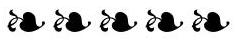

### 2.6 Future skews and volatilities of volatilities

- In the local volatility model, skews observed at future dates for a given residual maturity are typically weaker than spot-starting skews. For a spot-starting skew $\mathcal{S}_{\theta}(\tau=0)$ that decays as a function of residual maturity $\theta$ with characteristic exponent $\gamma$, the skew at a future date $\tau$ for the same residual maturity $\theta$ scales like, for small $\theta$ :

$$
\mathcal{S}_{\theta}(\tau) \propto\left(\frac{\theta}{\tau}\right)^{\gamma} \mathcal{S}_{\theta}(\tau=0)

$$

- Investigating model-generated future skews is useful for assessing localvolatility prices of options that are subject to forward-smile risk. One should bear in mind that these future skews - and future levels of volatility of volatility - cannot be locked and will vary as the model is recalibrated to market smiles. Thus, unpredictable gamma/theta carry P\&Ls will impact substantially the P\&L of a hedged position, in case residual gammas and cross-gammas are sizeable.


### 2.7 Delta and carry P\&L

- The carry P\&L of a delta and vega-hedged option position in the local volatility model can be expressed in the usual gamma-theta form, with payoffindependent break-even levels for spot variance, spot/volatility covariances and volatility/volatility covariances. The local volatility model is a genuine diffusive market model.
- The carry P\&L of a delta-hedged, vega-hedged option position can be equivalently expressed either in terms of spot and implied volatilities (2.105), or as a
function of spot and option prices (2.107). The "real" delta of the local volatility model is given by the derivative of the price with respect to $S$, keeping vanilla option prices fixed. The delta computed by keeping fixed implied volatilities is called the sticky-strike delta. Regardless of the particular parametrization used for vanilla option prices, once the deltas of the hedging vanilla options are included, the "real" delta is recovered.

The delta of the local volatility model - computed with a fixed local volatility function - has no particular significance or usefulness. Furthermore the delta of a vanilla option in the local volatility model is an irrelevant notion. More generally, the issue of outputting a delta of one asset (a vanilla option) on another (the spot) is irrelevant in a market model.
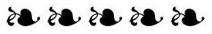

### 2.9 The vega hedge

- Which portfolio of vanilla options immunizes our derivative position at order one against all perturbations of the local volatility function? Denote by $\mu(\tau, K)$ the density of vanilla options of maturity $\tau$, strike $K$, in the hedging portfolio. $\mu(\tau, K)$ is given by formula (2.121):

$$
\mu(\tau, K)=-\frac{1}{K^{2}} \mathcal{L} \phi(\tau, K)

$$

where $\phi(t, S)$ is the conditional dollar gamma, given by formula (2.118):

$$
\phi(t, S)=E_{\sigma}\left[\left.S^{2} \frac{d^{2} P}{d S^{2}}(t, S, \bullet) \right\rvert\, S, t\right]

$$

and operator $\mathcal{L}$ is defined by:

$$
\mathcal{L} f=\frac{d f}{d t}+(r-q) S \frac{d f}{d S}+\frac{1}{2} S^{2} \frac{d^{2}}{d S^{2}}\left(\sigma^{2}(t, S) f\right)-r f

$$

In the case of a flat local volatility function, $\phi(t, S)$ is easily computed in a Monte Carlo simulation - see expression (2.123).


### 2.10 Markov-functional models

- In Markov-functional models, $S_{t}$ is a function of a process $W_{t}: S_{t}=f\left(t, W_{t}\right)$, where $W_{t}$ is typically a Brownian motion or an Ornstein-Ühlenbeck process. Markovfunctional models are special instances of local volatility and can be calibrated at most to the smile of a single maturity. Smiles for intermediate maturities depend on the choice for the underlying process $W_{t}$.
- Pricing a multi-asset European derivative using a Gaussian copula together with marginals supplied by each asset's respective vanilla smile is equivalent to pricing with a multi-asset local volatility model, with the correlation matrix equal to the Gaussian copula's correlation matrix.
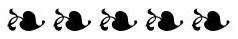


## Appendix A - the Uncertain Volatility Model

- In the UVM, minimum and maximum volatility levels $\sigma_{\min }, \sigma_{\max }$ are specified. The UVM ensures that no money is lost as long as the realized volatility lies in the interval $\left[\sigma_{\min }, \sigma_{\max }\right]$. The seller's price of a derivative with payoff $f\left(S_{T}\right)$ in the UVM solves PDE (2.130) - it is also characterized by:

$$
P=\max _{\sigma_{t} \in\left[\sigma_{\min }, \sigma_{\max }\right]} E\left[f\left(S_{T}\right)\right]

$$

- Rather than pricing a derivative fully in the UVM, one can avail oneself of market-traded options to lower as much as possible the sensitivity of the hedged position to realized volatility, and instead use the UVM for the hedged position: this is the idea in the Lagrangian UVM. The seller's price for the derivative can be defined as:

$$
\overline{\mathcal{P}}(F)=\max _{\substack{\sigma_{t} \in\left[\sigma_{\min }, \sigma_{\max }\right] \\ E_{\sigma}\left[O_{i}\right]=\mathcal{P}_{\text {Market }}\left(O_{i}\right)}} E_{\sigma}[F]

$$

where $O_{i}$ are the market-traded options. Likewise the buyer's price is defined by:

$$
\underline{\mathcal{P}}(F)=\min _{\substack{\sigma_{t} \in\left[\sigma_{\min }, \sigma_{\max }\right] \\ E_{\sigma}\left[O_{i}\right]=\mathcal{P}_{\text {Market }}\left(O_{i}\right)}} E_{\sigma}[F]

$$

Options that can be exactly replicated by means of a static position in markettraded options are such that $\overline{\mathcal{P}}(F)=\underline{\mathcal{P}}(F)$.
$\overline{\mathcal{P}}(F)-\underline{\mathcal{P}}(F)$ otherwise quantifies the non-vanilla character of the payoff at hand.

The UVM can be used to price-in transaction costs on the delta-hedge: $\sigma_{\text {min }}$, $\sigma_{\text {max }}$ are given by Leland's formula.
