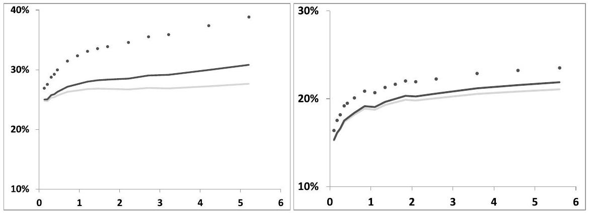
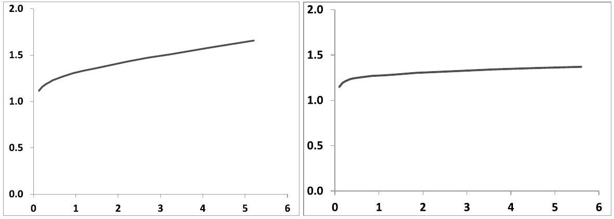
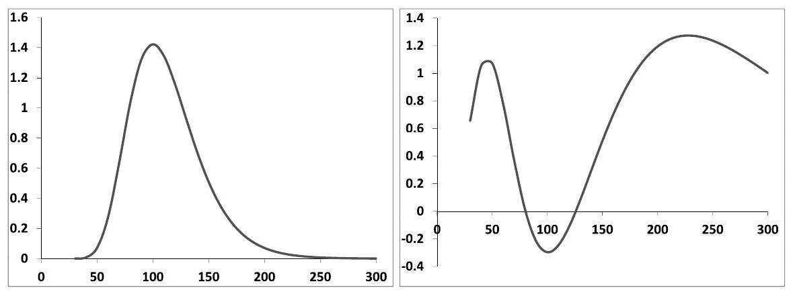

## Chapter 3

## Forward-start options

Before embarking on stochastic volatility, we pause to study the case of forwardstart options - also called cliquets, which we briefly touched upon in Section 1.3. Characterizing the risks of cliquets and how their pricing should be approached provides precious clues as to which aspects of the dynamics of implied volatilities are relevant for pricing these (popular) options, and which features of the vanilla smile a model should be calibrated to.

That cliquet prices are in fact loosely constrained by vanilla smiles is made plain in Section 3.1.7 where we compute lower and upper bounds on the price of a forward-start call option, given vanilla smiles.

We then assess how forward-smile risk is handled in the local volatility model. We work out the example of a forward-start call option in detail; this sheds light on the suitability of local volatility with regard to forward-start options.

### 3.1 Pricing and hedging forward-start options

Many exotic options are sensitive to forward-smile risk, that is risk associated with the uncertainty about market implied volatilities observed in the future, or future smiles - the case of barrier options was briefly examined in the introduction. Among exotics, forward-start options, or cliquets, form a very popular class of derivatives whose prices are purely determined by the distribution of forward returns in the pricing model.

The payoffs of cliquets involve the ratio of a security's price observed at two different dates $T_{1}, T_{2}$ : the payoff at time $T_{2}$ is $g\left(\frac{S_{T_{2}}}{S_{T_{1}}}\right)$. It is a function of the forward return $\frac{S_{T_{2}}}{S_{T_{1}}}-1$. As shown below in Section 3.1.3, any European payoff can be expressed as a linear combination of call and put option payoffs. Market smiles for maturities $T_{1}$ (resp. $T_{2}$ ) determine prices of payoffs of the form $f\left(S_{T_{1}}\right)$, (resp. $f\left(S_{T_{2}}\right)$ ), but payoffs of the form $g\left(\frac{S_{T_{2}}}{S_{T_{1}}}\right)$ require modeling assumptions. It is not clear at this stage what, if any, implied volatility data of maturities $T_{1}$ and $T_{2}$ are relevant for pricing payoff $g$.

The following analysis of the risks of cliquets is typical of how one approaches the problem of pricing and hedging an exotic option, by:

- first finding a pricing model and a hedge portfolio that, within the chosen model, hedges the gamma/theta and vega risks,
- then estimating the costs of rebalancing the vanilla hedge.

## The forward smile

Throughout this book, we use the expression forward-smile risk to designate the risk associated with the realization of future smiles. We do not use the notion of forward smile. The forward smile $\widehat{\sigma}_{k}^{T_{1} T_{2}}$ for two dates $T_{1}, T_{2}>T_{1}$ is obtained, in a given model, by:

- pricing a forward-start call for different values of moneyness $k$, whose payoff is: $\left(\frac{S_{T_{2}} / F_{T_{2}}}{S_{T_{1}} / F_{T_{1}}}-k\right)^{+}$, whose undiscounted price is $P(k)$, where $F_{T}$ is the forward for maturity $T$.
- implying a Black-Scholes volatility $\widehat{\sigma}_{k}^{T_{1} T_{2}}$ through:

$$
P(k)=P_{B S}\left(S=1, K=k, T=T_{2}-T_{1}, r=0, q=0 ; \widehat{\sigma}_{k}^{T_{1} T_{2}}\right)
$$

$\widehat{\sigma}_{k}^{T_{1} T_{2}}$ is a well-defined function of $k$, but is an impractical object that has no historical counterpart. Indeed, $\widehat{\sigma}_{k}^{T_{1} T_{2}}$ is the future implied volatility for moneyness $k$, averaged over all realizations of future smiles in the model: it is an aggregate of future smile risk and volatility-of-volatility risk.

Therefore, it does not make sense to assess the suitability of a model by comparing $\widehat{\sigma}_{k}^{T_{1} T_{2}}$ with typical market smiles of maturity $T_{2}-T_{1}$, if anything because the forward smile is invariably more convex, due to its being an average and the connection between price and implied volatility being nonlinear. ${ }^{1}$

The forward smile is thus a notion of limited usefulness - we do not use in the sequel.

### 3.1.1 A Black-Scholes setting

In the standard Black-Scholes model, implied volatilities have no term structure. Since a cliquet involves $S_{T_{1}}$ and $S_{T_{2}}$, it is natural to use a Black-Scholes model with time-dependent instantaneous volatility $\sigma(t)$ : in such a model, implied volatilities are maturity-dependent but the smile for any given maturity is flat and the implied volatility for maturity $T, \widehat{\sigma}_{T}$, is given by:

$$
\widehat{\sigma}_{T}^{2}=\frac{1}{T-t} \int_{t}^{T} \sigma(u)^{2} d u
$$

Because of homogeneity, the price of a cliquet in this model does not depend on $S$ and, besides interest and repo rates, only depends on the integrated variance over the interval [ $T_{1}, T_{2}$ ]: it is a function of the forward volatility $\widehat{\sigma}_{T_{1} T_{2}}$ :

$$
\begin{equation*}
P=e^{-r\left(T_{1}-t\right)} G\left(\widehat{\sigma}_{T_{1} T_{2}}\right) \tag{3.1}
\end{equation*}
$$
^eq3-1

[^43]defined by:

$$
\begin{equation*}
\widehat{\sigma}_{T_{1} T_{2}}^{2}=\frac{1}{T_{2}-T_{1}} \int_{T_{1}}^{T_{2}} \sigma(t)^{2} d t=\frac{\left(T_{2}-t\right) \widehat{\sigma}_{T_{2}}^{2}-\left(T_{1}-t\right) \widehat{\sigma}_{T_{1}}^{2}}{T_{2}-T_{1}} \tag{3.2}
\end{equation*}
$$
^eq3-2

We need to answer two questions:

- How can this forward-start option be hedged?
- Which payoffs of maturities $T_{1}$ and $T_{2}$ should $\widehat{\sigma}_{T_{1}}$ and $\widehat{\sigma}_{T_{2}}$ be calibrated to? Note that implied volatilities can be defined for any payoff that is convex. These payoffs need to be such that their implied volatilities satisfy the convex order condition:

$$
\begin{equation*}
\left(T_{2}-t\right) \widehat{\sigma}_{T_{2}}^{2} \geq\left(T_{1}-t\right) \widehat{\sigma}_{T_{1}}^{2} \tag{3.3}
\end{equation*}
$$
^eq3-3

so that $\widehat{\sigma}_{T_{1} T_{2}}$ in (3.2) is well-defined.

Prior to $T_{1}$, the cliquet's delta and gamma vanish and the cliquet is only sensitive to $\widehat{\sigma}_{T_{1} T_{2}}$. At time $t=T_{1}, S_{T_{1}}$ is known: the cliquet becomes a standard European option of maturity $T_{2}$.

The above formula shows that $\widehat{\sigma}_{T_{1} T_{2}}$ is a function of implied volatilities $\widehat{\sigma}_{T_{1}}$, $\widehat{\sigma}_{T_{2}}$. Trading single vanilla options of maturities $T_{1}, T_{2}$ is inappropriate as, unlike the forward-start option, their sensitivities to $\widehat{\sigma}_{T_{1}}, \widehat{\sigma}_{T_{2}}$ will vary as $S$ moves and their combined gamma will likely not vanish. Does there exist a portfolio of vanilla options of maturities $T_{1}, T_{2}$ whose vega is spot-independent?

### 3.1.2 A vanilla portfolio whose vega is independent of $S$

Let $\rho(K)$ be the density of vanilla options of strike $K$ in the portfolio. We make no distinction between call or put options struck at the same strike as they have the same vega. Because of the homogeneity of degree 1 in $S$ and $K$ of the Black-Scholes formula, the price of a vanilla option of strike $K$ can be written as: $P=K f\left(\frac{S}{K}\right)$ and likewise for the vega:

$$
\operatorname{Vega}_{K}(S)=K \varphi\left(\frac{S}{K}\right)
$$

The vega of our portfolio thus reads:

$$
\operatorname{Vega}_{\Pi}(S)=\int d K \rho(K) K \varphi\left(\frac{S}{K}\right)
$$

After switching to variable $u=\frac{S}{K}$ this becomes:

$$
\begin{equation*}
\operatorname{Vega}_{\Pi}(S)=\int \frac{d u}{u^{3}} S^{2} \rho\left(\frac{S}{u}\right) \varphi(u) \tag{3.4}
\end{equation*}
$$
^eq3-4

$\operatorname{Vega}_{\Pi}(S)$ is independent of $S$ only if we choose:

$$
\begin{equation*}
\rho(K) \propto \frac{1}{K^{2}} \tag{3.5}
\end{equation*}
$$
^eq3-5

A portfolio of European options with a density proportional to $\frac{1}{K^{2}}$ is such that its vega in the Black-Scholes model does not depend on $S$. Up to an affine function of $S$ the corresponding payoff is in fact $\ln S$ - it is called the log contract and was first proposed by Anthony Neuberger in [75].

We now verify this by recalling a representation of an arbitrary European payoff in terms of cash, forwards and a portfolio of vanilla options.

### 3.1.3 Digression: replication of European payoffs

The derivation of the well-known formula expressing this decomposition ${ }^{2}$ starts from the identity:

$$
\begin{aligned}
f(S) & =f\left(K_{0}\right)+\int_{K_{0}}^{S} \frac{d f}{d K} d K \\
& =f\left(K_{0}\right)+\int_{K_{0}}^{\infty} \theta(S-K) \frac{d f}{d K} d K-\int_{0}^{K_{0}} \theta(K-S) \frac{d f}{d K} d K
\end{aligned}
$$

where $\theta(x)$ is the Heaviside function $(\theta(x)=1$ if $x \geq 0, \theta(x)=0$ otherwise) and where the second line can be checked by taking either the case $S>K_{0}$ or the case $S<K_{0}$. Integrate now by parts using $(K-S)^{+}$as primitive of $\theta(K-S)$ and $-(S-K)^{+}$as primitive of $\theta(S-K)$. We get:

$$
\begin{aligned}
f(S)=f\left(K_{0}\right)+\int_{K_{0}}^{\infty} \frac{d^{2} f}{d K^{2}} & (S-K)^{+} d K+\int_{0}^{K_{0}} \frac{d^{2} f}{d K^{2}}(K-S)^{+} d K \\
& +\left[-\frac{d f}{d K}(S-K)^{+}\right]_{K_{0}}^{\infty}-\left[\frac{d f}{d K}(K-S)^{+}\right]_{0}^{K_{0}}
\end{aligned}
$$

which after simplification gives:

$$
\begin{align*}
f(S)=f\left(K_{0}\right) & +\left.\frac{d f}{d K}\right|_{K_{0}}\left(S-K_{0}\right) \\
& +\int_{0}^{K_{0}} \frac{d^{2} f}{d K^{2}}(K-S)^{+} d K+\int_{K_{0}}^{\infty} \frac{d^{2} f}{d K^{2}}(S-K)^{+} d K \tag{3.6}
\end{align*}
$$
^eq3-6

This expresses $f$ as a linear combination of an affine function and a continuous density of calls struck above $K_{0}$ and puts struck below $K_{0}$. Let $P_{f}$ be the price of the

[^44]options that pays $f\left(S_{T}\right) . P_{f}$ is the sum of the prices of the different contributions to $f$ :

$$
\begin{aligned}
P_{f}=f\left(K_{0}\right) e^{-r(T-t)}+\left.\frac{d f}{d K}\right|_{K_{0}} & \left(S e^{-q(T-t)}-K_{0} e^{-r(T-t)}\right) \\
& +\int_{0}^{K_{0}} \frac{d^{2} f}{d K^{2}} P_{K} d K+\int_{K_{0}}^{\infty} \frac{d^{2} f}{d K^{2}} C_{K} d K
\end{aligned}
$$
where $C_{K}, P_{K}$ denote, respectively, the prices of a call and a put struck at $K$. Choosing for $K_{0}$ the forward for maturity $T, F_{T}$, yields:

$$
\begin{equation*}
P_{f}=f\left(F_{T}\right) e^{-r(T-t)}+\int_{0}^{F_{T}} \frac{d^{2} f}{d K^{2}} P_{K} d K+\int_{F_{T}}^{\infty} \frac{d^{2} f}{d K^{2}} C_{K} d K \tag{3.7}
\end{equation*}
$$
^eq3-7

This is an equality of prices - one should not forget the forwards in the replication of $f$.

Conversely, consider a portfolio consisting of a density $\rho(K)$ of vanilla options of strike $K$. Identity (3.6) shows that the resulting payoff $-\int_{0}^{\infty} \rho(K)(S-K)^{+} d K$, or $\int_{0}^{\infty} \rho(K)(K-S)^{+} d K$ if we use put options - is obtained, up to an affine function of $S$, by simply integrating $\rho(K)$ twice.

### 3.1.4 A vanilla hedge

Starting with the density $\frac{1}{K^{2}}$ derived above and integrating twice, we recover the payoff of the $\log$ contract: $-\ln S$.

For reasons that will become clear when we discuss variance swaps, we prefer to work with payoff $-2 \ln S$ rather than $\ln S$. We will henceforth denote by "log contract" the payoff $-2 \ln S$. It is replicated with a density of vanilla options equal to $\frac{2}{K^{2}}$.

The price $Q^{T}(t, S)$ of a log contract of maturity $T$ in the Black-Scholes model is given by:

$$
\begin{equation*}
Q^{T}(t, S)=-2 e^{-r(T-t)}\left(\ln S+(r-q)(T-t)-\frac{\widehat{\sigma}_{T}^{2}}{2}(T-t)\right) \tag{3.8}
\end{equation*}
$$
^eq3-8

and its sensitivity to $\widehat{\sigma}_{T}$ is:

$$
\frac{d Q^{T}}{d \widehat{\sigma}_{T}}=2 e^{-r(T-t)}(T-t) \widehat{\sigma}_{T}
$$

We now resume our discussion of the vega hedge of our forward-start option $P$. Using equations (3.1) and (3.2) we get the sensitivities of $P$ to $\widehat{\sigma}_{T_{1}}$ and $\widehat{\sigma}_{T 2}$ :

$$
\begin{aligned}
\frac{d P}{d \widehat{\sigma}_{T_{2}}} & =e^{-r\left(T_{1}-t\right)}\left(T_{2}-t\right) \widehat{\sigma}_{T_{2}} \mathcal{N} \\
\frac{d P}{d \widehat{\sigma}_{T_{1}}} & =-e^{-r\left(T_{1}-t\right)}\left(T_{1}-t\right) \widehat{\sigma}_{T_{1}} \mathcal{N}
\end{aligned}
$$

where prefactor $\mathcal{N}$ is:

$$
\mathcal{N}=\frac{1}{\left(T_{2}-T_{1}\right) \widehat{\sigma}_{T_{1} T_{2}}} \frac{d G}{d \widehat{\sigma}_{T_{1} T_{2}}}
$$

Thus the portfolio

$$
\begin{equation*}
\Pi=-P+\frac{\mathcal{N}}{2}\left(e^{r\left(T_{2}-T_{1}\right)} Q^{T_{2}}-Q^{T_{1}}\right) \tag{3.9}
\end{equation*}
$$
^eq3-9

has zero sensitivity to both $\widehat{\sigma}_{T_{1}}$ and $\widehat{\sigma}_{T_{2}}$. Notice that the hedge ratios for $Q^{T_{1}}$ and $Q^{T_{2}}$ depend neither on $t$, nor on $S$ : the hedge is stable as time elapses and $S$ moves, and will only need to be readjusted whenever the forward volatility $\widehat{\sigma}_{T_{1} T_{2}}$ varies.

What about the gamma of the vanilla hedge? Taking twice the derivative of equation (3.8) we get:

$$
\begin{equation*}
S^{2} \frac{d^{2} Q^{T}}{d S^{2}}=2 e^{-r(T-t)} \tag{3.10}
\end{equation*}
$$
^eq3-10

Thus the dollar gamma of the log contract - up to the usual discounting factor - is equal to 2 . The combination $e^{r\left(T_{2}-T_{1}\right)} Q^{T_{2}}-Q^{T_{1}}$ has thus vanishing gamma and consequently, in our deterministic volatility model, vanishing theta as well.

We have been able to choose a hedging model and have assembled a static ${ }^{3}$ vanilla portfolio that perfectly hedges at order one our cliquet against variations of $\widehat{\sigma}_{T_{1} T_{2}}$.

## Checking that $\widehat{\sigma}_{T_{1} T_{2}}$ is well-defined

Implied volatilities of $\log$ contracts of maturities $T_{1}$ and $T_{2}$ satisfy the convex order condition (3.3) because of the convexity of the log contract. The log-contract falls in the class of payoffs considered in Section 2.2.2.2, page 32, for which (a) an implied volatility can be defined, (b) the convex order condition (3.3) holds.

When there are no cash-amount dividends, log contract implied volatilities $\widehat{\sigma}_{T}$ are expressed directly as an average of implied volatilities of vanilla options - see formula (4.21), page 142.

### 3.1.5 Using the hedge in practice - additional P\&Ls

### 3.1.5.1 Before $T_{1}$-volatility-of-volatility risk

Market implied volatilities are not only maturity- but also strike-dependent: how should we define $\sigma(t)$ or $\widehat{\sigma}_{T}$ ?

We decide to define $\widehat{\sigma}_{T}$ as the implied volatility of the log contract of maturity $T$. $\widehat{\sigma}_{T}$ is well-defined as the function $\ln S$ is concave: we only need to invert equation (3.8). Using this definition for $\widehat{\sigma}_{T}$ ensures that our hedge instruments have their

[^45]right market prices. The P\&L over $[t, t+\delta t]$ of portfolio $\Pi$ reads:

$$
\begin{aligned}
P \& L_{\Pi}= & -\left(e^{-r\left(T_{1}-t-\delta t\right)} G\left(\widehat{\sigma}_{T_{1} T_{2}}+\delta \widehat{\sigma}_{T_{1} T_{2}}\right)-(1+r \delta t) e^{-r\left(T_{1}-t\right)} G\left(\widehat{\sigma}_{T_{1} T_{2}}\right)\right) \\
& +\frac{\mathcal{N}}{2} e^{r\left(T_{2}-T_{1}\right)}\left(Q_{t+\delta t}^{T_{2}}-(1+r \delta t) Q_{t}^{T_{2}}+\frac{d Q^{T_{2}}}{d S}(\delta S-r S \delta t)\right) \\
& -\frac{\mathcal{N}}{2}\left(Q_{t+\delta t}^{T_{1}}-(1+r \delta t) Q_{t}^{T_{1}}+\frac{d Q^{T_{1}}}{d S}(\delta S-r S \delta t)\right)
\end{aligned}
$$
where $Q_{t}^{T}$ (resp. $Q_{t+\delta t}^{T}$ ) is a shorthand notation for $Q^{T}\left(t, S, \widehat{\sigma}_{T}\right)$ (resp. $Q^{T}\left(t+\delta t, S+\delta S, \widehat{\sigma}_{T}+\delta \widehat{\sigma}_{T}\right)$ ). Let us expand this $\mathrm{P} \& \mathrm{~L}$ at order 1 in $\delta t$ and order 2 in $\delta S$.

If $\delta \widehat{\sigma}_{T_{2}}=\delta \widehat{\sigma}_{T_{1}}=0$, since the cliquet has vanishing gamma/theta and so does our log contract hedge, we get zero P\&L.

The only contribution to the $\mathrm{P} \& \mathrm{~L}$ is then generated by $\delta \widehat{\sigma}_{T_{1}}, \delta \widehat{\sigma}_{T_{2}}$. Using expression (3.8) for $Q^{T}$, we get:

$$
\begin{aligned}
P \& L_{\Pi}= & -e^{-r\left(T_{1}-t\right)}\left(G\left(\widehat{\sigma}_{T_{1} T_{2}}+\delta \widehat{\sigma}_{T_{1} T_{2}}\right)-G\left(\widehat{\sigma}_{T_{1} T_{2}}\right)\right) \\
& +\frac{\mathcal{N}}{2} e^{-r\left(T_{1}-t\right)}\left(T_{2}-t\right)\left(\left(\widehat{\sigma}_{T_{2}}+\delta \widehat{\sigma}_{T_{2}}\right)^{2}-\widehat{\sigma}_{T_{2}}^{2}\right) \\
& -\frac{\mathcal{N}}{2} e^{-r\left(T_{1}-t\right)}\left(T_{1}-t\right)\left(\left(\widehat{\sigma}_{T_{1}}+\delta \widehat{\sigma}_{T_{1}}\right)^{2}-\widehat{\sigma}_{T_{1}}^{2}\right)
\end{aligned}
$$

which yields:

$$
\begin{align*}
& P \& L_{\Pi}=-e^{-r\left(T_{1}-t\right)}\left(G\left(\widehat{\sigma}_{T_{1} T_{2}}+\delta \widehat{\sigma}_{T_{1} T_{2}}\right)-G\left(\widehat{\sigma}_{T_{1} T_{2}}\right)\right) \\
&+\frac{1}{2 \widehat{\sigma}_{T_{1} T_{2}}} \frac{d G}{d \widehat{\sigma}_{T_{1} T_{2}}} e^{-r\left(T_{1}-t\right)}\left(\left(\widehat{\sigma}_{T_{1} T_{2}}+\delta \widehat{\sigma}_{T_{1} T_{2}}\right)^{2}-\widehat{\sigma}_{T_{1} T_{2}}^{2}\right) \\
&=e^{-r\left(T_{1}-t\right)}\left[-\left(G\left(\widehat{\sigma}_{T_{1} T_{2}}+\delta \widehat{\sigma}_{T_{1} T_{2}}\right)-G\left(\widehat{\sigma}_{T_{1} T_{2}}\right)\right)+\frac{d G}{d\left(\widehat{\sigma}_{T_{1} T_{2}}^{2}\right)} \delta\left(\widehat{\sigma}_{T_{1} T_{2}}^{2}\right)\right] \tag{3.11}
\end{align*}
$$
^eq3-11

In the derivation of (3.11) we have used variances $\widehat{\sigma}_{T_{1}}^{2}, \widehat{\sigma}_{T_{2}}^{2}, \widehat{\sigma}_{T_{1} T_{2}}^{2}$ rather than volatilities $\widehat{\sigma}_{T_{1}}, \widehat{\sigma}_{T_{2}}, \widehat{\sigma}_{T_{1} T_{2}}$. The natural reason for analyzing our P\&L using variances rather than volatilities is that the price of the hedge instruments - log-contracts is affine in $\widehat{\sigma}_{T_{1}}^{2}, \widehat{\sigma}_{T_{2}}^{2}$, rather than $\widehat{\sigma}_{T_{1}}, \widehat{\sigma}_{T_{2}}$; just as we use $S$ rather than $\sqrt{S}$ for the sake of writing out the P\&L of a delta-hedged option.

Expression (3.11) shows that $P \& L_{\Pi}$ is a function of $\delta\left(\widehat{\sigma}_{T_{1} T_{2}}^{2}\right)$, not $\delta\left(\widehat{\sigma}_{T_{1}}^{2}\right)$ and $\delta\left(\widehat{\sigma}_{T_{2}}^{2}\right)$ separately.
(3.11) is not an expansion of $P \& L_{\Pi}$ at order two in $\delta \widehat{\sigma}_{T_{1} T_{2}}$ : it is the actual P\&L generated by a change of $\widehat{\sigma}_{T_{1} T_{2}}$. One can check on equation (3.11) that the order-one contribution from $\delta\left(\widehat{\sigma}_{T_{1} T_{2}}^{2}\right)$ vanishes - as it should. This expression highlights the fact that the value of the log contract hedge - the second piece inside the brackets is exactly quadratic in $\widehat{\sigma}_{T_{1} T_{2}}$ : this is also apparent in (3.8).

If $G$ is an affine function of $\widehat{\sigma}_{T_{1} T_{2}}^{2}$, the hedge is perfect and our $\mathrm{P} \& \mathrm{~L}$ is exactly zero until we reach $T_{1}$. This is the case for two particular payoffs: one is given by
$g\left(\frac{S_{T_{2}}}{S_{T_{1}}}\right)=\ln \left(\frac{S_{T_{2}}}{S_{T_{1}}}\right)$, which is a linear combination of our two log contracts and has no commercial interest whatsoever. The other one is the same payoff, but deltahedged on a daily basis: it is called a forward variance swap and pays the realized quadratic variation over the interval $\left[T_{1}, T_{2}\right] .^{4}$

Usually $G$ will not be an affine function of $\widehat{\sigma}_{T_{1} T_{2}}^{2}$. P\&L (3.11) thus starts with a term of order two in $\delta\left(\widehat{\sigma}_{T_{1} T_{2}}^{2}\right)$. Keeping this term only yields:

$$
\begin{equation*}
P \& L_{\Pi}=-\frac{e^{-r\left(T_{1}-t\right)}}{2} \frac{d^{2} G}{d\left(\widehat{\sigma}_{T_{1} T_{2}}^{2}\right)^{2}}\left(\delta\left(\widehat{\sigma}_{T_{1} T_{2}}^{2}\right)\right)^{2} \tag{3.12}
\end{equation*}
$$
^eq3-12

For an at-the-money forward call, $g$ is given by:

$$
\begin{equation*}
g\left(\frac{S_{T_{2}}}{S_{T_{1}}}\right)=\left(\frac{S_{T_{2}}}{S_{T_{1}}}-1\right)^{+} \tag{3.13}
\end{equation*}
$$
^eq3-13

If $T_{2}-T_{1}$ is small, for vanishing interest rate and repo, $G$ is approximately linear in $\widehat{\sigma}$ :

$$
G\left(\widehat{\sigma}_{T_{1} T_{2}}\right) \simeq \frac{\widehat{\sigma}_{T_{1} T_{2}}}{\sqrt{2 \pi}} \sqrt{T_{2}-T_{1}}
$$

Using (3.12), at order 2 in $\delta\left(\widehat{\sigma}_{T_{1} T_{2}}^{2}\right), P \& L_{\Pi}$ reads:

$$
\begin{equation*}
P \& L_{\Pi} \simeq e^{-r\left(T_{1}-t\right)} \frac{\sqrt{T_{2}-T_{1}}}{\sqrt{2 \pi}} \frac{1}{2 \widehat{\sigma}_{T_{1} T_{2}}}\left(\delta \widehat{\sigma}_{T_{1} T_{2}}\right)^{2} \tag{3.14}
\end{equation*}
$$
^eq3-14

We thus make money every time $\widehat{\sigma}_{T_{1} T_{2}}$ moves - this will occur generally for all payoffs whose value is a concave function of $\widehat{\sigma}_{T_{1} T_{2}}^{2}$.

In the general case, $P \& L_{\Pi}$ will then not vanish - it is generated by the dynamics of $\widehat{\sigma}_{T_{1} T_{2}}$ : we call this volatility-of-volatility risk. The estimation of $P \& L_{\Pi}$ over $\left[0, T_{1}\right]$ entails making an assumption for the volatility of $\widehat{\sigma}_{T_{1} T_{2}}$. The resulting extra charge - or gain - has to be added to the price $P=e^{-r T_{1}} G\left(\widehat{\sigma}_{T_{1} T_{2}}(t=0)\right)$ quoted at time $t=0$. In the case of the at-the-money forward option, this charge will be negative, as we reduce the price charged to the client by an estimation of the positive P\&Ls (3.14) pocketed every time $\widehat{\sigma}_{T_{1} T_{2}}$ moves. ${ }^{5}$

Up to $t=T_{1}$, our pricing and hedging scheme works, provided we have included this extra charge - or gain - in our price.

### 3.1.5.2 At $T_{1}$ - forward-smile risk

At $T_{1}$, the cliquet turns into a European option of maturity $T_{2}$. As seen in Section 3.1.3, it can be replicated with vanilla options of maturity $T_{2}$, hence its value is a function of implied volatilities for maturity $T_{2}$ observed at $T_{1}: \widehat{\sigma}_{K T_{2}}\left(T_{1}\right)$.

[^46]Imagine that the cliquet is an at-the-money forward call, whose payoff is given in equation (3.13). At $T_{1}$ the market price of the cliquet is then:

$$
\begin{equation*}
P_{B S}\left(S_{T_{1}}, K=S_{T_{1}}, T_{2} ; \widehat{\sigma}_{K=S_{T_{1}} T_{2}}\left(T_{1}\right)\right) \tag{3.15}
\end{equation*}
$$
^eq3-15

In our hedging scheme both the cliquet and its hedge are risk-managed in a Black-Scholes model with volatilities $\widehat{\sigma}(T)$ defined as implied volatilities of log contracts. Equation (3.2) shows that, at $t=T_{1}, \widehat{\sigma}_{T_{1} T_{2}}=\widehat{\sigma}_{T_{2}}$, thus the model price of the cliquet at $T_{1}$ is:

$$
\begin{equation*}
P_{B S}\left(S_{T_{1}}, K=S_{T_{1}}, T_{2} ; \widehat{\sigma}_{T_{2}}\left(T_{1}\right)\right) \tag{3.16}
\end{equation*}
$$
^eq3-16

Compare this formula with expression (3.15). They are identical, except in our pricing and hedging scheme the at-the-money call is valued using the implied volatility of the log contract of the same maturity, $T_{2}$, rather than the market implied volatility of the at-the-money call. The price we quote at $t=0$ for our forward-start at-themoney option has then to include a provision to cover for the difference between (3.15) and (3.16).

The risk created by the uncertainty as to the smile prevailing at $T_{1}$ for maturity $T_{2}$ - given a known level of the log-contract implied volatility $\widehat{\sigma}_{T_{2}}\left(T_{1}\right)$ - is called forward-smile risk. For a general cliquet payoff $g\left(S_{T_{2}} / S_{T_{1}}\right)$, we need to supplement the initial price $P=e^{-r T_{1}} G\left(\widehat{\sigma}_{T_{1} T_{2}}(t=0)\right)$ with an extra charge to cover for the difference between the market price of the payoff at $T_{1}$ and the Black-Scholes price computed with volatility $\widehat{\sigma}_{T_{2}}\left(T_{1}\right)$.

What if our forward-start option has no - or hardly any - sensitivity to $\widehat{\sigma}_{T_{2}}\left(T_{1}\right)$ ? This is the case for a digital payoff:

$$
g\left(\frac{S_{T_{2}}}{S_{T_{1}}}\right)=1_{\frac{S_{T_{2}}}{S_{T_{1}}}>1}
$$

or a narrow call spread or put spread struck around $S_{T_{1}}$. In this case $G$ has negligible or vanishing sensitivity to $\widehat{\sigma}_{T_{1} T_{2}}$. Using the term structure of log-contracts as hedge instruments does not make sense anymore, and the adjustment for forward-smile risk represents in fact the bulk of the forward-start option price: our cliquet is a pure forward-smile instrument.

### 3.1.6 Cliquet risks and their pricing: conclusion

- We choose to price and risk-manage our cliquet in a Black-Scholes model with time-dependent volatility, recalibrated every day on market implied volatilities $\widehat{\sigma}(T)$ of log contracts. We are then able to exactly gamma-hedge and vegahedge our cliquet, and have to make two adjustments to our price: $\delta P_{1}$ to cover for volatility-of-volatility risk over $\left[0, T_{1}\right]$, that is $\mathrm{P} \& \mathrm{Ls}(3.12)$, and $\delta P_{2}$ to cover for forward-smile risk at $T_{1}$, that is the difference between (3.15) and (3.16). The price we quote for this cliquet at $t=0$ is then:

$$
\begin{equation*}
P=e^{-r T_{1}} G\left(\widehat{\sigma}_{T_{1} T_{2}}(t=0)\right)+\left(\delta P_{1}+\delta P_{2}\right) \tag{3.17}
\end{equation*}
$$
^eq3-17

How should we estimate $\delta P_{1}$ and $\delta P_{2}$ ? In case there is no market for volatility of volatility and forward smile we can do the following:

- $\delta P_{1}$ : use historical data of log contract implied volatilities to estimate conservatively the expected realized volatility of $\widehat{\sigma}_{T_{1} T_{2}}$ over $\left[0, T_{1}\right]$.
$-\delta P_{2}$ : use historical data of market smiles of residual maturity $T_{2}-T_{1}$ to estimate conservatively the difference between implied volatilities of our payoff and that of the log contract.

If instead we are able to offset these risks on the market - for example by trading other cliquets $-\delta P_{1}$ and $\delta P_{2}$ are computed using implied values in place of historical values. Practically, whether we decide to use calibrated or chosen values for volatility of volatility or the future smile, we will use a stochastic volatility model to estimate $\delta P_{1}+\delta P_{2}$. The model generates a global price that aggregates all risks - as priced by the model. $\delta P_{1}$ and $\delta P_{2}$ are evaluated initially at $t=0$.

- As we risk-manage the cliquet from $t=0$ to $t=T_{1}$, we need to ensure that (a) $\delta P_{1}$ converges to zero at $T_{1}$, (b) $\delta P_{2}$ converges to the adjustment corresponding to the exact difference between the implied volatilities of our forward-start payoff and that of the log contract of maturity $T_{2}$, as observed at $T_{1}-$ whether $\delta P_{1}, \delta P_{2}$ have been calculated by hand or evaluated in a model.
- In a model, $\delta P_{1}$ will automatically converge to zero as $t \rightarrow T_{1}$. For $\delta P_{2}$ to converge to the right value, though, the model has to be such that it recovers at $T_{1}$ the smile of maturity $T_{2}$.
$\delta P_{2}$ makes up the bulk of volatility risk for options that have mostly forwardsmile risk - forward ATM call spreads or digital payoffs: $G$ has hardly any sensitivity to $\widehat{\sigma}_{T_{1} T_{2}}$ and $\delta P_{1} \simeq 0$.

## Pricing forward-smile risk in a model

- In the continuous forward variance models of Chapter 7, there are no separate handles on (a) the spot-starting vanilla smile and (b) future smiles. Thus, at inception, the model should be parametrized so that the desired future smile at $T_{1}$ is obtained, while as $t \rightarrow T_{1}$, the model is calibrated to the vanilla smile.
- The local-stochastic volatility models of Chapter 12, on the other hand, are calibrated to the vanilla smile, thus $\delta P_{2} \rightarrow 0$ as $t \rightarrow T_{1}$. The price we pay for this is less control on future smiles generated by the model - that is the value of $\delta P_{2}$ at $t=0$.

We refer the reader to Section 12.6.1 of Chapter 12 for a comparison of prices of forward-start options in different models calibrated to the same vanilla smile.

- The discrete forward variance models discussed in Section 7.8 of Chapter 7 offer maximum flexibility: we have a handle on the term-structure of forward skew, while still retaining the capability of matching the short market spotstarting smile. In addition they also afford separate control of $\delta P_{1}$ (volatility-of-volatility risk) and $\delta P_{2}$ (forward-smile risk).

Our analysis has shown that the risk that can be hedged using vanilla options is the forward volatility $\widehat{\sigma}_{T_{1} T_{2}}$. Other risks - forward smile and volatility-of-volatility risk - cannot be hedged with vanilla options and have to be priced-in using exogenous parameters.

Contrary to what is sometimes heard on trading desks, an at-the-money forward call option does have forward smile sensitivity. The fact that it is at-the-money has no special significance, as forward implied volatilities of vanilla options - be they at-the-money or not - cannot be locked, unlike forward log-contract implied volatilities. ${ }^{6}$ Consequently, for cliquets with payoff $g\left(\frac{S_{T_{2}}}{S_{T_{1}}}\right)$, the only information available in vanilla option prices to be used in the calibration of our model is the term structure of implied volatilities $\widehat{\sigma}_{T}$ of log contracts, as these are our hedge instruments.

We have no reason to use other vanilla option data: market prices of other instruments should be included in the calibration only if one is able to exactly pinpoint which instruments to use and which risk they offset.

We study in Section 3.1.9 further below the interesting example of payoffs $S_{T_{1}} g\left(\frac{S_{T_{2}}}{S_{T_{1}}}\right)$ which call for different hedging instruments, thus requiring calibration on a different set of European payoffs, leading to the definition of yet another class of forward volatilities.

The notion that a pricing model should generally be calibrated to the vanilla smile on the grounds that, hopefully, vanilla option prices provide information that should, somehow, be used, is fallacious at best and dangerous at worst. Going back to our forward-start option, this amounts to letting the model arbitrarily link the values of $\delta P_{1}, \delta P_{2}$ to the vanilla smile, when in practice no trading strategy is able to lock this dependency.

We now provide an illustration of the fact that cliquet prices are in fact rather loosely confined by vanilla smiles.

### 3.1.7 Lower/upper bounds on cliquet prices from the vanilla smile

As a simple example of a cliquet consider a forward ATM call that pays $\left(\frac{S_{T_{2}}}{S_{T_{1}}}-1\right)^{+}$at $T_{2}$. Let the hedging instruments be the underlying itself and call options of maturities $T_{1}$ and $T_{2}$. Assume zero interest rate and repo for simplicity.

[^47]Can the information in market smiles of maturities $T_{1}$ and $T_{2}$ be used to bound the price of our cliquet? We would like to derive model-independent lower and upper bounds such that if we were quoted a price that lay outside these bounds - say a lower price than the lower bound - a strategy consisting of (a) a long position in the cliquet entered at that price, (b) a static position in vanilla options of maturities $T_{1}$ and $T_{2}$ entered at market price, (c) a delta strategy over $\left[T_{1}, T_{2}\right]$, would generate positive P\&L at $T_{2}$, for all ( $S_{T_{1}}, S_{T_{2}}$ ) configurations.

The spread between lower and upper bound quantifies how much the cliquet differs from a statically replicable payoff and provides a measure of how vanilla-like - or unlike - the cliquet is. In case our cliquet payoff could be in fact synthesized by a combination of: (a) a fixed cash amount, (b) a static position in vanilla options of maturities $T_{1}$ and $T_{2}$, (c) a delta strategy set up at $T_{1}$ and unwound at $T_{2}$, then lower and upper bounds would coincide.

Consider thus a trading strategy that consists of (a) a cash amount $c$, (b) a static position in $\lambda_{i}$ call options of strikes $K_{i} /$ maturity $T_{1}$ and $\mu_{j}$ call options of strikes $K_{j} /$ maturity $T_{2}$, (c) a delta position $\Delta\left(S_{T_{1}}\right)$ starting at $T_{1}$ and unwound at $T_{2}$, such that it super-replicates the cliquet's payoff.

Since entering the delta position $\Delta\left(S_{T_{1}}\right)$ at $T_{1}$ does not require any cash outlay, the initial amount of cash needed for setting up this strategy is:

$$
c+\Sigma_{i} \lambda_{i} C_{K_{i} T_{1}}+\Sigma_{j} \mu_{j} C_{K_{j} T_{2}}
$$

Among all super-replicating strategies, that with the lowest initial cost provides the upper model-independent bound $U B$ for the cliquet's price that is compatible with market prices of hedging instruments. Mathematically:

$$
U B=\min _{\lambda, \mu, \Delta\left(S_{1}\right), c}\left(c+\sum_{i} \lambda_{i} C_{K_{i} T_{1}}+\sum_{j} \mu_{j} C_{K_{j} T_{2}}\right)
$$

such that:

$$
\begin{aligned}
c+\sum_{i} \lambda_{i}\left(S_{1}-K_{i}\right)^{+}+\sum_{j} \mu_{j}\left(S_{2}-K_{j}\right)^{+}+\Delta\left(S_{1}\right)\left(S_{2}-S_{1}\right) & \geq\left(\frac{S_{2}}{S_{1}}-1\right)^{+} \\
& \forall\left(S_{1}, S_{2}\right)
\end{aligned}
$$

The model-independent lower bound can be defined analogously. ${ }^{7}$
We choose a discrete set of strikes $K_{i}$ for options of maturity $T_{1}$, a discrete set of strikes $K_{j}$ for options of maturity $T_{2}$ and a finite-dimensional basis for $\Delta\left(S_{1}\right)$. We

[^48]then need to minimize an affine function of the vectors $\lambda, \mu$ and the components of $\Delta\left(S_{1}\right)$ on the basis we have chosen, subject to a set of constraints that are linear as well in $\lambda, \mu, \Delta\left(S_{1}\right)$ : one constraint for each couple ( $S_{1}, S_{2}$ ). Practically we choose a (large) discrete set of such couples.

Numerically, this problem is solved with the simplex algorithm - we refer the reader to [57] for a more general account of sub and super-replicating strategies.

- Let us take $T_{1}=1$ year, $T_{2}=2$ years, vanishing interest rate and repo, and assume that the vanilla smiles for maturities $T_{1}$ and $T_{2}$ are flat with implied volatilities all equal to $20 \%$. The model-independent lower and upper bounds for the implied volatility of the forward ATM call are: $\widehat{\sigma}_{\text {min }} \simeq 9 \%$, $\widehat{\sigma}_{\text {max }} \simeq 25 \% .^{8}$
- Now, keeping the same smiles at $T_{1}$ and $T_{2}$ let us compute lower ( $C S_{\text {min }}$ ) and upper bounds ( $C S_{\max }$ ) for the price of a $95 \% / 105 \%$ forward call spread: $\left(\frac{S_{T_{2}}}{S_{T_{1}}}-95 \%\right)^{+}-\left(\frac{S_{T_{2}}}{S_{T_{1}}}-105 \%\right)^{+}$.

We get $C S_{\text {min }} \simeq 1.6 \%, C S_{\text {max }} \simeq 7.7 \%$. These prices correspond approximately to skews $\left(\widehat{\sigma}_{95 \%}-\widehat{\sigma}_{105 \%}\right)_{\text {min }}=-8 \%$ and $\left(\widehat{\sigma}_{95 \%}-\widehat{\sigma}_{105 \%}\right)_{\text {max }} \simeq 8 \%$. Notice how wide this range is - the typical order of magnitude of an index skew for a one-year maturity is $\widehat{\sigma}_{95 \%}-\widehat{\sigma}_{105 \%}=3 \%$.

- Let us compute again lower and upper bounds for our call spread, this time adding as an extra constraint the price of the forward ATM call, computed with an implied volatility of $20 \%: 7.96 \%$.

We now get: $C S_{\text {min }} \simeq 1.8 \%, C S_{\text {max }} \simeq 7.2 \%$. The additional information on the joint distribution of $S_{T_{1}}, S_{T_{2}}$ supplied by the forward ATM call has narrowed the price range only slightly.

- This time let us use as extra constraint the price of the forward call spread $\left(\frac{S_{T_{2}}}{S_{T_{1}}}-90 \%\right)^{+}-\left(\frac{S_{T_{2}}}{S_{T_{1}}}-110 \%\right)^{+}$computed with implied volatilities $\widehat{\sigma}_{90 \%}= 22 \%, \widehat{\sigma}_{110 \%}=18 \%$. The price of this call spread is $10.7 \%$.

We now get: $C S_{\text {min }} \simeq 4.25 \%, C S_{\text {max }} \simeq 6.7 \%$, which corresponds approximately to $\left(\widehat{\sigma}_{95 \%}-\widehat{\sigma}_{105 \%}\right)_{\text {min }}=-1 \%$ and $\left(\widehat{\sigma}_{95 \%}-\widehat{\sigma}_{105 \%}\right)_{\text {max }} \simeq 5.5 \%$. Observe how inclusion of the price of a payoff whose risk is congruent with that of our $95 \% / 105 \%$ call spread has tightened significantly the price range of the latter.

[^49]
### 3.1.8 Calibration on the vanilla smile - conclusion

The conclusion from the above results is that vanilla smiles hardly constrain cliquet prices. Only market prices of payoffs whose risks are congruent with those of the exotic at hand are able to narrow down the price range of the latter.

Our example illustrates the fact that an exotics business is not a brokerage business - otherwise exotics could be statically hedged by vanillas and hence simply priced with models whose parameters are fully determined by the vanilla smile. Rather, running a book of exotics entails taking controlled risks on exotic parameters such as: forward smile, volatility of volatility, smile of volatility of volatility, spot/volatility covariance. A suitable model should offer the capability of specifying these parameter levels exogenously.

Ideally the model should also be able to match market prices of vanilla options (really) used as hedges.

When this proves impossible, it is more reasonable to adjust the exotic's price to cover for the difference between model and market prices of hedging instruments, than to corrupt the dynamics in the model in order to calibrate vanilla option prices, with the prospect of mispricing future carry P\&Ls.

### 3.1.9 Forward volatility agreements

So far we have defined cliquets as payoffs involving ratios of a spot price observed at dates $T_{1}$ and $T_{2}$. As a consequence their price in the Black-Scholes model does not depend on $S$ and, besides interest and repo rates, is a function of forward volatility only.

One may also be interested in payoffs involving absolute, rather than relative performances of an asset - typically for assets that move in narrow ranges, such as FX exchange rates.

Consider for example the payoff $\left(S_{T_{2}}-k S_{T_{1}}\right)^{+}$: this is known in FX as a forward volatility agreement (FVA). ${ }^{9}$ More generally, consider payoffs of type $S_{T_{1}} g\left(\frac{S_{T_{2}}}{S_{T_{1}}}\right)$. In a Black-Scholes framework with deterministic time-dependent volatility the value at $T_{1}$ of this option is $S_{T_{1}} G\left(\widehat{\sigma}_{T_{1} T_{2}}\right)$ where $\widehat{\sigma}_{T_{1} T_{2}}$ is defined in (3.2). $G$ also involves interest and repo rates over $\left[T_{1}, T_{2}\right]$. The value of our forward-start option at time $t<T_{1}$ is:

$$
\begin{equation*}
P(t, S)=S e^{-q\left(T_{1}-t\right)} G\left(\widehat{\sigma}_{T_{1} T_{2}}\right) \tag{3.18}
\end{equation*}
$$
^eq3-18

Just as in Section (3.1.1) we need to answer the following questions:

- Which vanilla payoffs should be used as hedges and whose implied volatilities should be used for defining $\widehat{\sigma}_{T_{1} T_{2}}$ ?
- Which additional P\&Ls do we need to estimate?

[^50]
### 3.1.9.1 A vanilla portfolio whose vega is linear in $S$

In comparison with (3.1), (3.18) involves $S$ as a prefactor. While in Section 3.1.2 we looked for European hedges of maturities $T_{1}, T_{2}$ whose vegas do not depend on $S$, we now look for payoffs whose vegas are proportional to $S$. From expression (3.4) for the vega of a portfolio of vanilla options in the Black-Scholes model, $\operatorname{Vega}_{\Pi}(S)$ is proportional to $S$ only if $\rho(K)$ has the form:

$$
\rho(K) \propto \frac{1}{K}
$$

Integrating twice with respect to $K$ yields the payoff:

$$
f(S)=S \ln S
$$

which we call the $S \ln S$ contract. In the Black-Scholes model the price $R^{T}(t, S)$ of the $S \ln S$ contract of maturity $T$ is:

$$
\begin{equation*}
R^{T}(t, S)=S e^{-q(T-t)}\left(\ln S+(r-q)(T-t)+\frac{(T-t) \widehat{\sigma}_{T}^{2}}{2}\right) \tag{3.19}
\end{equation*}
$$
^eq3-19

and its sensitivity to $\widehat{\sigma}_{T}$ is given by:

$$
\begin{equation*}
\frac{d R^{T}}{d \widehat{\sigma}_{T}}=S e^{-q(T-t)}(T-t) \widehat{\sigma}_{T} \tag{3.20}
\end{equation*}
$$
^eq3-20

The sensitivities of $P$ in (3.18) to $\widehat{\sigma}_{T_{1}}, \widehat{\sigma}_{T_{2}}$ are given by:

$$
\begin{align*}
\frac{d P}{d \widehat{\sigma}_{T_{2}}} & =S e^{-q\left(T_{1}-t\right)}\left(T_{2}-t\right) \widehat{\sigma}_{T_{2}} \mathcal{N}  \tag{3.21}\\
\frac{d P}{d \widehat{\sigma}_{T_{1}}} & =-S e^{-q\left(T_{1}-t\right)}\left(T_{1}-t\right) \widehat{\sigma}_{T_{1}} \mathcal{N} \tag{3.22}
\end{align*}
$$
^eq3-21
^eq3-22

where $\mathcal{N}$ is given by:

$$
\mathcal{N}=\frac{1}{\left(T_{2}-T_{1}\right) \widehat{\sigma}_{T_{1} T_{2}}} \frac{d G}{d \widehat{\sigma}_{T_{1} T_{2}}}
$$

Observe how the vega of the $S \ln S$ contract in (3.20) exactly matches the $\widehat{\sigma}_{T_{1}}$ and $\widehat{\sigma}_{T_{2}}$ vegas of $P$, both in its dependence on $S$ and the repo rate. The portfolio

$$
\begin{equation*}
\Pi=-P+\mathcal{N}\left(e^{q\left(T_{2}-T_{1}\right)} R^{T_{2}}-R^{T_{1}}\right) \tag{3.23}
\end{equation*}
$$
^eq3-23

has vanishing sensitivity to $\widehat{\sigma}_{T_{1}}$ and $\widehat{\sigma}_{T_{2}}$. As is apparent in (3.23) the hedge ratios for $S \ln S$ payoffs of maturities $T_{1}$ and $T_{2}$ do not depend on $S$ or $t$ : our hedge remains stable if $S$ moves or time advances. Only when $\widehat{\sigma}_{T_{1} T_{2}}$ moves will it need to be readjusted.

Taking the second derivatives of (3.18) with respect to $S$ shows that the gamma of our forward-start option vanishes. What about the gamma of our hedge? From
expression (3.19) of $R^{T}$ we can see that the coefficient of $S \ln S$ in the portfolio $e^{q\left(T_{2}-T_{1}\right)} R^{T_{2}}-R^{T_{1}}$ vanishes: our hedge has vanishing gamma and vanishing theta as well.

## Is $\widehat{\sigma}_{T_{1} T_{2}}$ well-defined?

The answer is yes. Implied volatilities of $S \ln S$ payoffs of maturities $T_{1}$ and $T_{2}$ satisfy the convex order condition (3.3) because of the convexity of the $S \ln S$ payoff. The $S \ln S$ payoff falls in the class of payoffs considered in Section 2.2.2.2, page 32, for which (a) an implied volatility can be defined, (b) the convex order condition (3.3) holds.

When there are no cash-amount dividends, implied volatilities $\widehat{\sigma}_{T}$ of $S \ln S$ payoffs are expressed directly as an average of implied volatilities of vanilla options - see formula (4.22), page 143.

### 3.1.9.2 Additional P\&Ls and conclusion

Consider portfolio $\Pi$ and let us write the $\mathrm{P} \& \mathrm{~L}$ during $\delta t$, at order two in $\delta S, \widehat{\sigma}_{T_{1}}, \widehat{\sigma}_{T_{2}}$. In contrast with the forward-start option in Section 3.1.5, $S$ appears explicitly in $P$ and $R^{T_{1}}, R^{T_{2}}$. In addition to the forward-start option and the $S \ln S$ contracts of maturities $T_{1}, T_{2}$, our hedge portfolio also includes a delta position.

Our P\&L comprises:

- no order-one contributions from $\delta S, \delta \widehat{\sigma}_{T_{1}}, \delta \widehat{\sigma}_{T_{2}}$ as, by construction, the sensitivities of $\Pi$ to $\widehat{\sigma}_{T_{1}}, \widehat{\sigma}_{T_{2}}$ vanish and $\Pi$ is delta-hedged.
- no $\delta t$ and $\delta S^{2}$ terms as the portfolio's theta and gamma vanish.
- no order-two $\delta S \delta \widehat{\sigma}_{T_{1}}$ and $\delta S \delta \widehat{\sigma}_{T_{2}}$ contributions. Indeed, the sensitivities of the forward-start option's price $P$ in (3.21), (3.22) and of the $S \ln S$ contract's price $R^{T}$ in (3.20) to $\widehat{\sigma}_{T_{1}}, \widehat{\sigma}_{T_{2}}$ are proportional to $S$. If $\frac{d \Pi}{d \widehat{\sigma}_{T_{1}}}, \frac{d \Pi}{d \widehat{\sigma}_{T_{2}}}$ vanish for a particular value of $S$, they do so for all values of $S: \frac{d^{2} \Pi}{d S d \widehat{\sigma}_{T_{1}}}=\frac{d^{2} \Pi}{d S d \widehat{\sigma}_{T_{2}}}=0$.

At order two our P\&L thus only comprises terms in $\delta \widehat{\sigma}_{T_{1}}^{2}, \delta \widehat{\sigma}_{T_{2}}^{2}, \delta \widehat{\sigma}_{T_{1}} \delta \widehat{\sigma}_{T_{2}}$. Moreover, from (3.19), it is apparent that $e^{q\left(T_{2}-T_{1}\right)} R^{T_{2}}-R^{T_{1}}$ is a function of $\widehat{\sigma}_{T_{1} T_{2}}$, rather than a separate function of $\widehat{\sigma}_{T_{1}}, \widehat{\sigma}_{T_{2}}$. Note that it is simply an affine function of $\widehat{\sigma}_{T_{1} T_{2}}^{2}$. Using this variable, rather than $\widehat{\sigma}_{T_{1} T_{2}}$, we can write down our P\&L at order two in $\delta\left(\widehat{\sigma}_{T_{1} T_{2}}^{2}\right)$ directly - note the similarity with (3.12).

$$
\begin{equation*}
P \& L_{\Pi}=-\frac{S e^{-q\left(T_{1}-t\right)}}{2} \frac{d^{2} G}{d\left(\widehat{\sigma}_{T_{1} T_{2}}^{2}\right)^{2}}\left(\delta\left(\widehat{\sigma}_{T_{1} T_{2}}^{2}\right)\right)^{2} \tag{3.24}
\end{equation*}
$$
^eq3-24

## Conclusion

Again we have been able to find a portfolio of European payoffs that provides a suitable vega, gamma and theta-hedge for our forward-start option. The implied volatilities we use are those of $S \ln S$ contracts.

The price we quote consists of the three pieces in (3.17). $\delta P_{1}$ is an estimation of P\&Ls (3.24) over $\left[0, T_{1}\right]$. Because $S$ appears as a prefactor, the estimation of $\delta P_{1}$ may also involve an assumption about the correlation of $S$ and the realized volatility of the forward variance $\widehat{\sigma}_{T_{1} T_{2}}^{2} . \delta P_{2}$ represents an estimation of the difference between the market price at $T_{1}$ of a vanilla option of strike $k S_{T_{1}}$, maturity $T_{2}$, and its price computed with the implied volatility at $T_{1}$ of the $S \ln S$ contract of maturity $T_{2}$.

A hasty assessment of our forward-start option starting with expression (3.18) in the Black-Scholes model would have singled out the cross spot/forward volatility covariance as one of the main risks in our product. Our analysis demonstrates, however, that spot/volatility covariance risk is not relevant; it is offset by utilizing the right hedge instruments - $S \ln S$ payoffs.

### 3.2 Forward-start options in the local volatility model

We now assess how the local volatility model prices forward-smile risk.
Once the local volatility model is calibrated on a given smile, log contract volatilities $\widehat{\sigma}_{T}$ will be exactly calibrated, as the log contract is a European payoff. However, calibration to the market smile also determines the dynamics of $\widehat{\sigma}_{T}$ - and especially that of $\widehat{\sigma}_{T_{1} T_{2}}$. The local volatility model will price volatility-of-volatility and forward-smile risks - that is adjustments $\delta P_{1}, \delta P_{2}$ - according to its own dynamics, which we now characterize assuming that the local volatility function is weakly local.

### 3.2.1 Approximation for $\widehat{\sigma}_{T}$

Let us approximate the log contract implied volatility $\widehat{\sigma}_{T}$ by starting from expression (2.35). The reader can check that the derivation leading to equation (2.35) applies generally to any European option for which an implied volatility can be defined, i.e. applies to any payoff that is convex or concave, in particular the log contract.

Calculation is simpler now than it was in Section 2.4.2 for vanilla options as the dollar gamma of the log contract does not depend on $S$. The numerator in (2.35) reads:

$$
\begin{aligned}
& \int_{0}^{T} d t \int_{0}^{\infty} d S \rho_{\sigma_{0}}(t, S) e^{-r t} \delta u(t, S) S^{2} \frac{d^{2} P_{\sigma_{0}}}{d S^{2}} \\
& =e^{-r T} \int_{0}^{T} d t \int_{0}^{\infty} d S \rho_{\sigma_{0}}(t, S) \delta u(t, S)
\end{aligned}
$$

where we have used (3.10). Using now expression (2.38) for $\rho_{\sigma_{0}}(t, S)$ we get for the numerator:

$$
e^{-r T} \int_{0}^{T} d t \int_{-\infty}^{\infty} d y \frac{1}{\sqrt{2 \pi}} e^{-\frac{y^{2}}{2}} \delta u\left(t, F_{t} e^{-\frac{\sigma_{0}^{2} t}{2}+\sigma_{0} \sqrt{t} y}\right)
$$

where $F_{t}$ is the forward for maturity $t: F_{t}=S_{0} e^{(r-q) t}$. Dividing now by the denominator in (2.35), which is simply equal to $T e^{-r T}$, yields:

$$
\begin{equation*}
\widehat{\sigma}_{T}^{2}=\frac{1}{T} \int_{0}^{T} d t \int_{-\infty}^{\infty} d y \frac{1}{\sqrt{2 \pi}} e^{-\frac{y^{2}}{2}} u\left(t, F_{t} e^{-\frac{\sigma_{0}^{2} t}{2}+\sigma_{0} \sqrt{t} y}\right) \tag{3.25}
\end{equation*}
$$
^eq3-25

(3.25) should be compared to formula (2.40), page 44, previously derived for vanilla options. While (3.25) could be used directly, for consistency with Section 2.5 we derive an equation for volatilities rather than variances. Let us assume that $\sigma(t, S)=\sigma_{0}+\delta \sigma(t, S)$. At order one in $\delta \sigma, \delta u=2 \sigma_{0} \delta \sigma$. (3.25) together with $\widehat{\sigma}_{T}^{2}=\sigma_{0}^{2}+2 \sigma_{0} \delta \widehat{\sigma}_{T}$ yields:

$$
\delta \widehat{\sigma}_{T}=\frac{1}{T} \int_{0}^{T} d t \int_{-\infty}^{\infty} d y \frac{1}{\sqrt{2 \pi}} e^{-\frac{y^{2}}{2}} \delta \sigma\left(t, F_{t} e^{-\frac{\sigma_{0}^{2} t}{2}+\sigma_{0} \sqrt{t} y}\right)
$$

Adding $\sigma_{0}$ to both sides, we get:

$$
\begin{equation*}
\widehat{\sigma}_{T}=\frac{1}{T} \int_{0}^{T} d t \int_{-\infty}^{\infty} d y \frac{1}{\sqrt{2 \pi}} e^{-\frac{y^{2}}{2}} \sigma\left(t, F_{t} e^{-\frac{\sigma_{0}^{2} t}{2}+\sigma_{0} \sqrt{t} y}\right) \tag{3.26}
\end{equation*}
$$
^eq3-26

Assume that $\sigma$ is given by the smooth form of the same type as in (2.44):

$$
\begin{equation*}
\sigma(t, S)=\bar{\sigma}(t)+\alpha(t) x+\frac{\beta(t)}{2} x^{2} \tag{3.27}
\end{equation*}
$$
^eq3-27

where $x=\ln \left(S / F_{t}\right)$. We get:

$$
\begin{aligned}
\widehat{\sigma}_{T} & =\frac{1}{T} \int_{0}^{T} \bar{\sigma}(t) d t-\frac{1}{T} \int_{0}^{T} \alpha(t) \frac{\sigma_{0}^{2} t}{2} d t+\frac{1}{T} \int_{0}^{T} \frac{\beta(t)}{2}\left(\sigma_{0}^{2} t+\frac{\sigma_{0}^{4} t^{2}}{4}\right) d t \\
& =\frac{1}{T} \int_{0}^{T} \bar{\sigma}(t) d t-\frac{\sigma_{0}^{2} T}{2} \mathcal{S}_{T}+\frac{1}{T} \int_{0}^{T} \frac{\beta(t)}{2}\left(\sigma_{0}^{2} t+\frac{\sigma_{0}^{4} t^{2}}{4}\right) d t
\end{aligned}
$$

where we have used formula (2.48) for the ATMF skew $\mathcal{S}_{T}$.
We also need an expression for how $\widehat{\sigma}_{T}$ moves when $S_{0}$ moves; for this we go back to the general expression of $\widehat{\sigma}_{T}$ in (3.26). Let us use the notation $S(t, y)=F_{t} \exp \left(-\frac{\sigma_{0}^{2} t}{2}+\sigma_{0} \sqrt{t} y\right)$ and take the derivative of (3.26) with respect to $\ln S_{0}$.

$$
\begin{aligned}
\frac{d \widehat{\sigma}_{T}}{d \ln S_{0}} & =\frac{1}{T} \int_{0}^{T} d t \int_{-\infty}^{\infty} d y \frac{1}{\sqrt{2 \pi}} e^{-\frac{y^{2}}{2}} \frac{d \sigma(t, S(t, y))}{d \ln S_{0}} \\
& =\frac{1}{T} \int_{0}^{T} d t \int_{-\infty}^{\infty} d y \frac{1}{\sqrt{2 \pi}} e^{-\frac{y^{2}}{2}} \frac{d \sigma}{d \ln S}(t, S(t, y)) \frac{d \ln S(t, y)}{d \ln S_{0}} \\
& =\frac{1}{T} \int_{0}^{T} d t \int_{-\infty}^{\infty} d y \frac{1}{\sqrt{2 \pi}} e^{-\frac{y^{2}}{2}} \frac{d \sigma}{d \ln S}(t, S(t, y))
\end{aligned}
$$

Substituting now in this equation the smooth form (3.27) for $\sigma(t, S)$ yields:

$$
\begin{aligned}
\frac{d \widehat{\sigma}_{T}}{d \ln S_{0}} & =\frac{1}{T} \int_{0}^{T} d t \int_{-\infty}^{\infty} d y \frac{1}{\sqrt{2 \pi}} e^{-\frac{y^{2}}{2}}\left(\alpha(t)+\beta(t)\left(-\frac{\sigma_{0}^{2} t}{2}+\sigma_{0} \sqrt{t} y\right)\right) \\
& =\frac{1}{T} \int_{0}^{T} \alpha(t) d t-\frac{\sigma_{0}^{2} T}{2} \frac{1}{T} \int_{0}^{T} \frac{t}{T} \beta(t) d t
\end{aligned}
$$

We now drop the contribution from the curvature term $\beta$ as we will not use it. Setting $\beta(t)=0$ in the expressions for $\widehat{\sigma}_{T}$ and $\frac{d \widehat{\sigma}_{T}}{d \ln S_{0}}$ above yields the following simpler expressions:

$$
\begin{align*}
\widehat{\sigma}_{T} & =\frac{1}{T} \int_{0}^{T} \bar{\sigma}(t) d t-\frac{\sigma_{0}^{2} T}{2} \mathcal{S}_{T}  \tag{3.28}\\
\frac{d \widehat{\sigma}_{T}}{d \ln S_{0}} & =\frac{1}{T} \int_{0}^{T} \alpha(t) d t \tag{3.29}
\end{align*}
$$
^eq3-28
^eq3-29

Taking $\beta(t)=0$ in expression (2.47) for implied volatilities of vanilla options yields the following simple result for the ATMF implied volatility: $\widehat{\sigma}_{F_{T} T}= \frac{1}{T} \int_{0}^{T} \bar{\sigma}(t) d t$. Let us choose $\sigma_{0}$, the constant volatility level around which the orderone expansion in (2.35) is performed, as $\sigma_{0}=\widehat{\sigma}_{F_{T} T}$. Equation (3.28) now reads:

$$
\begin{equation*}
\widehat{\sigma}_{T}=\widehat{\sigma}_{F_{T} T}-\frac{\widehat{\sigma}_{F_{T} T}^{2} T}{2} \mathcal{S}_{T} \tag{3.30}
\end{equation*}
$$
^eq3-30

The integral in the right-hand side in (3.29) also appears in (2.59c). (3.29) can be rewritten, with no explicit reference to local volatility $\sigma$ anymore, as:

$$
\begin{equation*}
\frac{d \widehat{\sigma}_{T}}{d \ln S_{0}}=\frac{d \widehat{\sigma}_{F_{T} T}}{d \ln S_{0}} \tag{3.31}
\end{equation*}
$$
^eq3-31

While we have derived equation (3.30) using local volatilities, it is a relationship involving implied volatilities only: it relates the implied volatility of the log contract, a European payoff, to the smile of vanilla options for the same maturity at order one
in the perturbation around a flat local volatility function. ${ }^{10}$ We could have derived it in a model-independent fashion, by assuming that the smile for maturity $T$ is given by:

$$
\widehat{\sigma}_{K T}=\widehat{\sigma}_{F_{T} T}+\mathcal{S}_{T} \ln \left(\frac{K}{F_{T}}\right)
$$

At order one in $\mathcal{S}_{T}$ we would have recovered (3.30).
Equation (3.30) implies that for downward sloping smiles ( $\mathcal{S}_{T}<0$ ), which are typical for equities, $\widehat{\sigma}_{T}>\widehat{\sigma}_{F_{T} T}$. Equation (3.31) states that the rate at which the log contract implied volatility moves as $S$ moves matches that of the ATMF volatility for the same maturity. Equations (3.30) and (3.31) have been obtained for a weakly local volatility of the form

$$
\begin{equation*}
\sigma(t, S)=\bar{\sigma}(t)+\alpha(t) \ln \left(\frac{S}{F_{t}}\right) \tag{3.32}
\end{equation*}
$$
^eq3-32

How accurate are they for real smiles?
Figure 3.1 shows $\widehat{\sigma}_{T}, \widehat{\sigma}_{F_{T} T}$, as well as $\widehat{\sigma}_{T}$ computed with formula (3.30) for two Euro Stoxx 50 smiles - with zero rates and repos. Figure 3.2 shows the ratio $\frac{d \widehat{\sigma}_{T}}{d \ln S_{0}} / \frac{d \widehat{\sigma}_{F_{T} T}}{d \ln S_{0}}$ for the same smiles.

Figure 3.1: Implied volatilities as a function of maturity - in years - for the Euro Stoxx 50 smiles of October 4, 2010 (left) and May 16, 2013 (right); dots: $\widehat{\sigma}_{T}$, light line: $\widehat{\sigma}_{F_{T} T}$, dark line: approximation (3.30) for $\widehat{\sigma}_{T}$.

The 1-year smiles of the Euro Stoxx 50 index appear in Figure 2.3, page 58.
It is apparent that formula (3.30) is inaccurate. This is not surprising: the local volatility of the Euro Stoxx 50 market smile is not of type (3.32). In particular the difference between $\widehat{\sigma}_{T}$ and $\widehat{\sigma}_{F_{T} T}$ is not entirely determined by the ATMF skew $\mathcal{S}_{T}$, a very local feature of the smile.

Then note that an expansion of implied volatilities at order one in the local volatility is expected to be less accurate for log contracts than for calls and puts. We

[^51]
Figure 3.2: $\frac{d \widehat{\sigma}_{T}}{d \ln S_{0}} / \frac{d \widehat{\sigma}_{F_{T} T}}{d \ln S_{0}}$ ratio in the local volatility model, as a function of maturity - in years - for the Euro Stoxx 50 index smiles of October 4, 2010 (left) and May 16, 2013 (right).

already mentioned that, because of the steepness of market smiles, unless one takes into account - at least at order one - the correction to the density in equation (2.32), the approximation is inaccurate.

This issue is magnified in the case of the log contract: for vanilla options, the dollar gamma restricts integration in (2.32) to a region of spot prices around $K$, thus reducing the dependence of implied volatilities of vanilla options to the density for spot values far away from $K$. In contrast, the dollar gamma of the log contract is constant: its implied volatility depends on the density for values of $S$ far away from the initial spot price. Typically densities implied from market smiles are skewed: for low values of $S$, for which $\sigma(t, S)$ is large, the density is larger than the lognormal density used in the approximation.

Formula (3.30) for $\widehat{\sigma}_{T}$ will then only be acceptable for smooth smiles that are not too steep.

Figure 3.2 shows that the ratio $\frac{d \widehat{\sigma}_{T}}{d \ln S_{0}} / \frac{d \widehat{\sigma}_{F_{T} T}}{d \ln S_{0}}$ is, in our example, larger than its value of 1 predicted by approximation (3.32), especially for the October 4, 2010 smile, which is particularly steep, presumably because approximation (3.30) underestimates $\widehat{\sigma}_{T}$ in the first place. While numerically inaccurate, approximation (3.31) does give however the right order of magnitude for $\frac{d \widehat{\sigma}_{T}}{d \ln S_{0}}$.

We now use it to estimate the volatility of $\widehat{\sigma}_{T_{1} T_{2}}$, assuming for simplicity that the term structure of $\widehat{\sigma}_{T}$ is flat: $\widehat{\sigma}_{T_{1}}=\widehat{\sigma}_{T_{2}}$. From the definition (3.2) and using approximation (3.29) we have:

$$
\begin{align*}
d \widehat{\sigma}_{T_{1} T_{2}} & =\frac{T_{2}-t}{T_{2}-T_{1}} \frac{\widehat{\sigma}_{T_{2}}}{\widehat{\sigma}_{T_{1} T_{2}}} d \widehat{\sigma}_{T_{2}}-\frac{T_{1}-t}{T_{2}-T_{1}} \frac{\widehat{\sigma}_{T_{1}}}{\widehat{\sigma}_{T_{1} T_{2}}} d \widehat{\sigma}_{T_{1}} \\
& \simeq\left(\frac{1}{T_{2}-T_{1}} \int_{t}^{T_{2}} \alpha(u) d u-\frac{1}{T_{2}-T_{1}} \int_{t}^{T_{1}} \alpha(u) d u\right) d \ln S_{t} \\
& \simeq\left(\frac{1}{T_{2}-T_{1}} \int_{T_{1}}^{T_{2}} \alpha(u) d u\right) d \ln S_{t} \tag{3.33}
\end{align*}
$$
^eq3-33

The volatility of $\widehat{\sigma}_{T_{1} T_{2}}$ over [ $0, T_{1}$ ] is then entirely set by the skew of the local volatility function for $t \in\left[T_{1}, T_{2}\right]$, and presumably will bear no resemblance to historical or implied levels of volatility of volatility. In particular, (3.33) shows that if the local volatility is flat over the interval $\left[T_{1}, T_{2}\right], \widehat{\sigma}_{T_{1} T_{2}}$ is frozen.

Moreover, for $T_{2}-T_{1}$ fixed, the volatility of $\widehat{\sigma}_{T_{1} T_{2}}$ is not a function of $T_{1}-t$ : the local volatility model is not time-homogeneous, in contrast to the stochastic volatility models of Chapter 7.

### 3.2.2 Future skews in the local volatility model

We now turn to the forward skew in the local volatility model. The smile prevail$\operatorname{ing}$ at $T_{1}$ for maturity $T_{2}$ is fully determined by $\sigma(t, S)$ for $t \in\left[T_{1}, T_{2}\right]$. The local volatility function in (3.32) falls in the class studied in Section 2.5, with $\beta(t) \equiv 0$.

Let us use approximation (3.30) for the difference between the log contract and ATMF implied volatilities. We have:

$$
\widehat{\sigma}_{T_{2}}\left(S_{T_{1}}, T_{1}\right)-\widehat{\sigma}_{F_{T_{2}}\left(S_{T_{1}}\right) T_{2}}\left(S_{T_{1}}, T_{1}\right)=\frac{\left(T_{2}-T_{1}\right) \widehat{\sigma}_{F_{T_{2}}\left(S_{T_{1}}\right) T_{2}}^{2}}{2} \mathcal{S}_{T_{2}-T_{1}}\left(S_{T_{1}}, T_{1}\right)
$$

where $\mathcal{S}_{T_{2}-T_{1}}\left(S_{T_{1}}, T_{1}\right)$ is the ATMF skew for the residual maturity $T_{2}-T_{1}$, at time $T_{1}$, as a function of $S_{T_{1}}$.

Let us denote the residual maturity by: $\theta=T_{2}-T_{1}$. $\mathcal{S}_{\theta}\left(S_{T_{1}}, T_{1}\right)$ is given by expression (2.90), page 63:

$$
\begin{equation*}
\mathcal{S}_{\theta}\left(S_{T_{1}}, T_{1}\right)=\int_{0}^{1} \alpha\left(T_{1}+u \theta\right) u d u \tag{3.34}
\end{equation*}
$$
^eq3-34

which can be contrasted with the spot-starting ATMF skew for the same residual maturity:

$$
\mathcal{S}_{\theta}\left(S_{0}, 0\right)=\int_{0}^{1} \alpha(u \theta) u d u
$$

For typical equity smiles, $\alpha(t)$ is of the form (2.51) and decays with an exponent $\gamma \simeq \frac{1}{2}$. For short residual maturities $\left(\theta \ll T_{1}\right)$, result (2.92), page 64, implies that:

$$
\mathcal{S}_{\theta}\left(S_{T_{1}}, T_{1}\right) \propto \frac{1}{T_{1}^{\gamma}}
$$

This formula shows that the ATMF skew generated by the local volatility model at time $T_{1}$ for residual maturity $\theta$ decays like $1 / T_{1}^{\gamma}$, thus will be much lower than the ATMF skew observed at $t=0$ for the same residual maturity:

$$
\mathcal{S}_{\theta}\left(S_{T_{1}}, T_{1}\right) \ll \mathcal{S}_{\theta}\left(S_{0}, 0\right)
$$

Imagine that our cliquet is an at-the-money forward call whose payoff is (3.13). At $T_{1}$ we are exposed to the difference between the implied volatilities of the log contract and the at-the-money call for maturity $T_{2}$. If $T_{1}$ is far into the future, the
local volatility model generates a smile at $T_{1}$ for maturity $T_{2}$ which is very weak compared to the smile we are likely to witness on the market.

The local volatility model will underestimate the difference between the log contract and at-the-money implied volatilities, and more generally the differences between implied volatilities of vanilla options with different strikes: it misprices forward-smile risk.

Remember that in the local volatility model, instantaneous volatilities of volatilities are also determined by the ATM skew. From equation (2.83), page 57,

$$
\operatorname{vol}\left(\widehat{\sigma}_{F_{T} T}\right)=\left(\mathcal{S}_{T}+\frac{1}{T} \int_{0}^{T} \mathcal{S}_{\tau} d \tau\right) \frac{\widehat{\sigma}_{F_{0} 0}}{\widehat{\sigma}_{F_{T} T}}
$$

Thus future volatilities of volatilities are smaller than their spot-starting values: the local volatility model also misprices volatility-of-volatility risk.

### 3.2.3 Conclusion

The conclusion is that the local volatility model is not suitable for pricing forwardstart options, or more generally options that involve volatility-of-volatility and forward-smile risks.

On one hand, volatilities of forward volatilities generated by the model will depend exclusively on the steepness of the skews prevailing at the time of calibration and may lie arbitrarily above or below historical or implied volatilities of volatilities - thus $\delta P_{1}$ in (3.17), page 111, is mispriced.

On the other hand, forward skews generated in the model will invariably be too low with respect to both market implied forward skews and historical skews - thus $\delta P_{2}$ in (3.17) is mispriced as well.

To further understand how the local volatility model uses the information in vanilla smiles to price a cliquet, we now consider a forward-start call and apply the technique of Section 2.9 to explicitly derive the vega hedge - as generated by the local volatility model.

### 3.2.4 Vega hedge of a forward-start call in the local volatility model

Consider the following payoff:

$$
\begin{equation*}
\left(\frac{S_{T_{2}}}{S_{T_{1}}}-k\right)^{+}=\frac{1}{S_{T_{1}}}\left(S_{T_{2}}-k S_{T_{1}}\right)^{+} \tag{3.35}
\end{equation*}
$$
^eq3-35

To compute the vega hedge in the local volatility model, all we need is the conditional gamma notional, defined in (2.118), page 82:

$$
\phi(t, S)=E_{\sigma}\left[\left.S^{2} \frac{d^{2} P}{d S^{2}}(t, S, \bullet) \right\rvert\, S, t\right]
$$

We consider for simplicity the case of flat local volatility function. Calculations can then be carried out analytically, besides, we do not expect the structure of the hedge portfolio to depend much on this assumption.

We also use vanishing interest and repo rates.
Let us call $\sigma_{0}$ the constant level of our flat local volatility function. Because of homogeneity, for $t<T_{1}$ the Black-Scholes price does not depend on $S$, hence $\phi=0$. At $t=T_{1}^{+}$, our option becomes $\frac{1}{S_{T_{1}}}$ times a standard call of maturity $T_{2}$ whose strike is $k S_{T_{1}}$.

## Hedge portfolio for maturity $T_{1}$

At $t=T_{1}^{+}, S_{T_{1}}=S$ and the dollar gamma is given by:

$$
\phi\left(T_{1}^{+}, S\right)=\left.\frac{1}{S} S^{2} \frac{d^{2} P_{B S}\left(T_{1} S ; K T_{2} ; \sigma_{0}\right)}{d S^{2}}\right|_{K=k S}
$$

where the $\frac{1}{S}$ prefactor is the $\frac{1}{S_{T_{1}}}$ in (3.35). We now use the relationship connecting the vega and dollar gamma of a European option in the Black-Scholes model: $\frac{d P}{d \sigma_{0}}=S^{2} \frac{d^{2} P}{d S^{2}} \sigma_{0} T$ to rewrite this as:

$$
\phi\left(T_{1}^{+}, S\right)=\left.\frac{1}{\sigma_{0}\left(T_{2}-T_{1}\right)} \frac{1}{S} \frac{d P_{B S}\left(T_{1} S ; K T_{2} ; \sigma_{0}\right)}{d \sigma_{0}}\right|_{K=k S}
$$

Because $P_{B S}\left(T_{1} S ; k S T_{2} ; \sigma_{0}\right)$ is homogeneous in $S, \phi\left(T_{1}^{+}, S\right)$ does not depend on $S . \phi$ thus has a discontinuity at $t=T_{1}$ that does not depend on $S$, which generates a discrete portfolio of vanilla options of maturity $T_{1}$. Applying operator $\mathcal{L}$ defined in (2.120) on $\phi$ - only $\frac{d}{d t} \phi$ contributes - we get the following expression for the (discrete) density of vanilla options of maturity $T_{1}$, struck at $K$ :

$$
\begin{align*}
\Psi_{1}(K) & =-\frac{1}{K^{2}} \phi\left(T_{1}^{+}, S\right) \\
& =-\frac{1}{K^{2}} \frac{1}{\sqrt{2 \pi \sigma_{0}^{2}\left(T_{2}-T_{1}\right)}} e^{-\frac{\left(-\ln k+\frac{\sigma_{0}^{2}\left(T_{2}-T_{1}\right)}{2}\right)^{2}}{2 \sigma_{0}^{2}\left(T_{2}-T_{1}\right)}} \tag{3.36}
\end{align*}
$$
^eq3-36

This is an interesting result: $\mu$ is proportional to $\frac{1}{K^{2}}$. Compare (3.36) with expression (3.9) that specifies the number of $\log$ contracts of maturity $T_{1}$ and $T_{2}$ needed to hedge a forward-start option, in the framework of Section 3.1.4. Once we recall that one $\log$ contract can be synthesized with a continuous density $\frac{2}{K^{2}}$ of vanilla options, we realize that result (3.36) is exactly identical: perturbation around a flat volatility yields a vega hedge for maturity $T_{1}$ which is exactly what we used in Section 3.1.4.

Notice that the vanilla portfolio struck at $T_{1}$ is static, in that it depends only on $T_{2}-T_{1}$ : it depends neither on $T_{1}$, nor on the initial spot level $S_{0}$.

## Hedge portfolio for maturity $T_{2}$

Let us compute $\phi$ for $t \in] T_{1}, T_{2}$ [. Using formula (2.39) for the dollar gamma of a call option in the Black-Scholes model, we get the dollar gamma for payoff (3.35):

$$
\begin{equation*}
S^{2} \frac{d^{2} P}{d S^{2}}=\frac{k}{\sqrt{2 \pi \sigma_{0}^{2}\left(T_{2}-t\right)}} e^{-\frac{\left(\ln \left(\frac{S}{k S_{T_{1}}}\right)-\frac{\sigma_{0}^{2}\left(T_{2}-t\right)}{2}\right)^{2}}{2 \sigma_{0}^{2}\left(T_{2}-t\right)}} \tag{3.37}
\end{equation*}
$$
^eq3-37

which we need to average, conditional on the underlying's value being $S$ at time $t$. The Brownian motion $W_{T_{1}}$ can be written as a function of $W_{t}$ and an independent Gaussian random variable $Z$ :

$$
W_{T_{1}}=\frac{T_{1}}{t} W_{t}+\sqrt{T_{1}\left(1-\frac{T_{1}}{t}\right)} Z
$$

which gives:

$$
\ln \frac{S_{T_{1}}}{S_{0}}=\frac{T_{1}}{t} \ln \frac{S_{t}}{S_{0}}+\sigma_{0} \sqrt{T_{1}\left(1-\frac{T_{1}}{t}\right)} Z
$$

Inserting this expression for $S_{T_{1}}$ in (3.37) yields the following expression for $\phi$ :
$\phi=\int_{-\infty}^{+\infty} \frac{e^{-\frac{Z^{2}}{2}}}{\sqrt{2 \pi}} \frac{k}{\sqrt{2 \pi \sigma_{0}^{2}\left(T_{2}-t\right)}} e^{-\frac{\left(\left(1-\frac{T_{1}}{t}\right) \ln \frac{S}{S_{0}}-\ln k-\frac{\sigma_{0}^{2}\left(T_{2}-t\right)}{2}-\sigma_{0} \sqrt{T_{1}\left(1-\frac{T_{1}}{t}\right)} z\right)^{2}}{2 \sigma_{0}^{2}\left(T_{2}-t\right)}} d Z$
Computing the integral over $Z$ yields:

$$
\phi=\frac{k}{\sqrt{2 \pi \sigma_{0}^{2}\left(T_{2}-t+T_{1}\left(1-\frac{T_{1}}{t}\right)\right)}} e^{-\frac{\left(\left(1-\frac{T_{1}}{t}\right) \ln \frac{S}{S_{0}}-\ln k-\frac{\sigma_{0}^{2}\left(T_{2}-t\right)}{2}\right)^{2}}{2 \sigma_{0}^{2}\left(T_{2}-t+T_{1}\left(1-\frac{T_{1}}{t}\right)\right)}}
$$

Let us compute $\phi$ for $t=T_{2}^{-}$:

$$
\phi\left(t=T_{2}^{-}, S\right)=\frac{k}{\sqrt{2 \pi \sigma_{0}^{2} T_{1}\left(1-\frac{T_{1}}{T_{2}}\right)}} e^{-\frac{\left(\left(1-\frac{T_{1}}{T_{2}}\right) \ln \frac{S}{S_{0}}-\ln k\right)^{2}}{2 \sigma_{0}^{2} T_{1}\left(1-\frac{T_{1}}{T_{2}}\right)}}
$$

For $t>T_{2} \phi=0$ : the discontinuity of $\phi$ in $T_{2}$ generates a discrete quantity of vanilla options struck at $T_{2}$, whose density $\Psi_{2}(K)$ is $\frac{1}{K^{2}} \phi\left(T_{2}^{-}, K\right)$ :

$$
\begin{equation*}
\Psi_{2}(K)=\frac{1}{K^{2}} \frac{k}{\sqrt{2 \pi \sigma_{0}^{2} T_{1}\left(1-\frac{T_{1}}{T_{2}}\right)}} e^{-\frac{\left(\left(1-\frac{T_{1}}{T_{2}}\right) \ln \frac{K}{S_{0}}-\ln k\right)^{2}}{2 \sigma_{0}^{2} T_{1}\left(1-\frac{T_{1}}{T_{2}}\right)}} \tag{3.38}
\end{equation*}
$$
^eq3-38

First note that, unlike the $T_{1}$ portfolio, the $T_{2}$ hedge portfolio is not static: $T_{1}, T_{2}$ and $S$ appear explicitly. As time advances, $T_{1}$ and $T_{2}$ shrink, and $S$ moves. The
number of vanilla options of maturity $T_{2}$ struck at $K$, as given by (3.38) will need to be readjusted. This does not correspond to the $T_{2}$ hedge we assembled in Section 3.1.4 which, with zero interest rates, consists of a number of log contracts for maturity $T_{2}$ that is exactly the opposite of that of maturity $T_{1}$ - see equation (3.9).

## Intermediate maturities

Beside the discrete portfolios of vanilla options for maturities $T_{1}$ and $T_{2}$ that are generated by the discontinuity of $\phi$ at $T_{1}$ and $T_{2}$, application of the operator $\mathcal{L}$ defined in (2.120) on $\phi$ generates a continuous density of options for intermediate maturities that can be easily computed numerically.

Our hedge portfolio in Section 3.1.4, on the contrary, only consists of options of maturity $T_{1}$ and $T_{2}$.

### 3.2.5 Discussion and conclusion

The density of vanilla options generated by the log contract hedge in Section 3.1.4 was $\left|\Psi_{1}(K)\right|$ for $T_{2}$ and $-\left|\Psi_{1}(K)\right|$ for $T_{1}$.

Rather than work directly with the (discrete) density of options struck at $T_{2}$ and the (continuous) density for $T \in\left[T_{1}, T_{2}\right]$, let us normalize the former by $\left|\Psi_{1}(K)\right|$ and the latter by $\left|\Psi_{1}(K)\right| /\left(T_{2}-T_{1}\right)$, to highlight the deviation with respect to the log contract hedge. As (3.36) shows, $\left|\Psi_{1}(K)\right|$ is proportional to $1 / K^{2}$.

Consider the following at-the-money forward call: $T_{1}=1$ year, $T_{2}=2$ years, $\sigma_{0}=20 \%, k=100 \%$, and pick $T=1.5$ years. Figure 3.3 shows the following quantities:

$$
\begin{equation*}
\frac{\Psi_{2}(K)}{\left|\Psi_{1}(K)\right|}, \frac{\left(T_{2}-T_{1}\right) \mu(T, K)}{\left|\Psi_{1}(K)\right|} \tag{3.39}
\end{equation*}
$$
^eq3-39

where we multiply $\mu$ by ( $T_{2}-T_{1}$ ) since $\mu$, unlike $\Psi_{1}$ and $\Psi_{2}$, is a continuous density.

Figure 3.3: Densities of vanilla options struck at $T_{2}$ (left) and at an intermediate maturity $T$, normalized as in (3.39) (right).

Notice how the $T_{2}$-portfolio deviates from the log contract hedge we used in Section 3.1.4. The local volatility model suggests that we should trade more options
struck near the current value of the spot price (100 in our example) and fewer out-of-the-money options. It makes up for this by asking us to trade options for intermediate maturities: a short position for strikes near the current value of the spot price and a long position for far out-of-the-money strikes. Inspection of Figure 3.3 shows that the vanilla hedge for intermediate maturities approximately makes up for the difference between the $T_{2}$-portfolio and the log contract hedge, which because of the normalization we use - would correspond in the left-hand graph to a constant value equal to 1 .

While the $T_{1}$-portfolio is static, portfolios for $T_{2}$ and intermediate maturities in $] T_{1}, T_{2}$ [ depend explicitly on $T_{1}, T_{2}, S_{0}$ : as the spot moves and time advances, they will need to be readjusted. Using this vega hedge in practice would expose us to variations of $S$ and market implied volatilities, thus generating extra P\&Ls - of order two in $\delta S$ and $\delta \widehat{\sigma}_{K T}$ - which we cannot expect the local volatility model to have priced in properly.

Carrying out the same analysis for a forward call option struck at $k \neq 100 \%$, would have given similar curves, now centered on $K^{*}=S_{0} k^{\frac{T_{2}}{T_{2}-T_{1}}}-$ as is clear from (3.38).

The conclusion is that it is much more reasonable to use the log contract hedge developed in Section 3.1.4: only when the forward volatility $\widehat{\sigma}_{12}$ moves does the hedge need to be readjusted and the volatility-of-volatility and forward-smile risks can be cleanly isolated and priced.

What about the price in the local volatility model? Consider again Figure 3.3 which expresses the dependence of the price of the forward call option to implied volatilities of vanilla options - as seen by the local volatility model. It is difficult to imagine a plausible justification for such peculiar sensitivities, especially as they change when $S$ and $t$ move. They may be more a statement on the local volatility model itself than on the forward call option: besides the hedge, the price generated by the local volatility model is suspicious as well.

Quite generally, whenever the vega hedge suggested by the local volatility model is not static, both the usefulness of the hedge and the reliability of the model's price are questionable. We are exposed to the cost of future vega rehedging at thenprevailing market conditions without the ability to gauge the size and sign of these future P\&Ls, and cannot trust the local volatility model to have priced them correctly.

## Chapter's digest

### 3.1 Pricing and hedging forward-start options

- Cliquets whose payoffs are of the form $g\left(\frac{S_{T_{2}}}{S_{T_{1}}}\right)$ are hedged by trading dynamically log-contracts. Implied volatilities of log contracts obey the convex order condition, hence forward volatilities are well-defined, and the sensitivities of log-contracts to forward volatilities are spot-independent. The carry P\&L of a vega-hedged cliquet consists of (a) gamma P\&L on forward volatility and (b) an adjustment for forwardsmile risk, that is uncertainty about the value at $T_{1}$ of the difference between the implied volatility of the log-contract and that of the payoff at hand.
- Calibration on the vanilla smile has little relevance for the pricing of cliquets. Calibrating a model on the vanilla smile in the hope that information contained therein should somehow be reflected in the cliquet price is unreasonable. Indeed, this may result in a price that is overly dependent on the arbitrariness of the connection that a given model establishes between today's smile and its future dynamics. The local volatility model is a case in point.

That vanilla option smiles do not constrain much cliquet prices is confirmed in Section 3.1.7. Model-independent lower and upper bounds are computed for the price of a forward-start call. The farther apart the lower and upper bounds are, the least vanilla-like the cliquet is.

- Forward-start options whose payoffs are of the form $S_{T_{1}} g\left(\frac{S_{T_{2}}}{S_{T_{1}}}\right)$ - which include the case of FVAs in the FX world - have a Vega in the Black-Scholes model that is linear in $S$. This calls for a new family of hedging instruments, European payoffs $S_{T} \ln S_{T}$ whose vegas are linear in $S$. The implied volatilities of these payoffs obey the convex order condition, thus allowing the definition of forward volatilities. As with payoffs $g\left(\frac{S_{T_{2}}}{S_{T_{1}}}\right)$, the carry $\mathrm{P} \& \mathrm{~L}$ includes a gamma $\mathrm{P} \& \mathrm{~L}$ on these particular forward volatilities.

### 3.2 Forward-start options in the local volatility model

- For a local volatility function of the form $\sigma(t, S)=\bar{\sigma}(t)+\alpha(t) \ln \frac{S}{F_{t}}$, the dynamics of a forward VS volatility is given at order one in $\alpha$ by (3.33):

$$
d \widehat{\sigma}_{T_{1} T_{2}}=\left(\frac{1}{T_{2}-T_{1}} \int_{T_{1}}^{T_{2}} \alpha(u) d u\right) d \ln S_{t}
$$

The instantaneous volatility of $d \widehat{\sigma}_{T_{1} T_{2}}$ is set by the slope of the local volatility function for times $t \in\left[T_{1}, T_{2}\right]$. The volatility of a very short volatility ( $T_{2}-T_{1} \ll T_{1}$ )
is proportional to $\alpha\left(T_{1}\right)$ : the model is not time-homogeneous. For typical equity smiles $\alpha(u)$ is decreasing, thus instantaneous volatilities of VS volatilities at future dates will be systematically smaller than those of spot-starting VS volatilities with the same maturity and will also depend on future spot levels. The local volatility model misprices volatility-of-volatility risk.

- The skew at a future date $T_{1}$ for residual maturity $\theta$ is given by expression (3.34):

$$
\mathcal{S}_{\theta}\left(S_{T_{1}}, T_{1}\right)=\int_{0}^{1} \alpha\left(T_{1}+u \theta\right) u d u
$$

For typical equity smiles $\alpha(t)$ is decreasing, thus $\mathcal{S}_{\theta}\left(S_{T_{1}}, T_{1}\right) \ll \mathcal{S}_{\theta}\left(S_{0}, t=0\right)$ : future skews in the local volatility model are weaker than spot-starting skews. The local volatility model misprices forward smile risk.

- Deriving the vega-hedge in the local volatility model of a forward-start call option with payoff $\left(\frac{S_{T_{2}}}{S_{T_{1}}}-k\right)^{+}$yields a hedge portfolio consisting of a discrete quantity of options of maturity $T_{1}$ - which exactly matches the log-contract hedge studied in Section 3.1, a discrete portfolio of vanilla options of maturity $T_{2}$ and a continuous density of options with intermediate maturities.

In the discussion of Section 3.2.5 we argue why this is not a reasonable hedge. Hoping to immunize ourselves from the local volatility model's idiosyncrasies by hedging against perturbations of the local volatility function is not a viable route.
