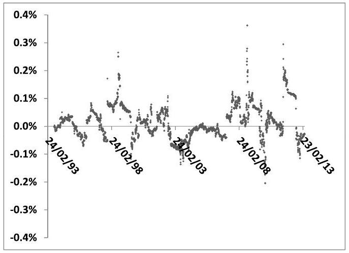
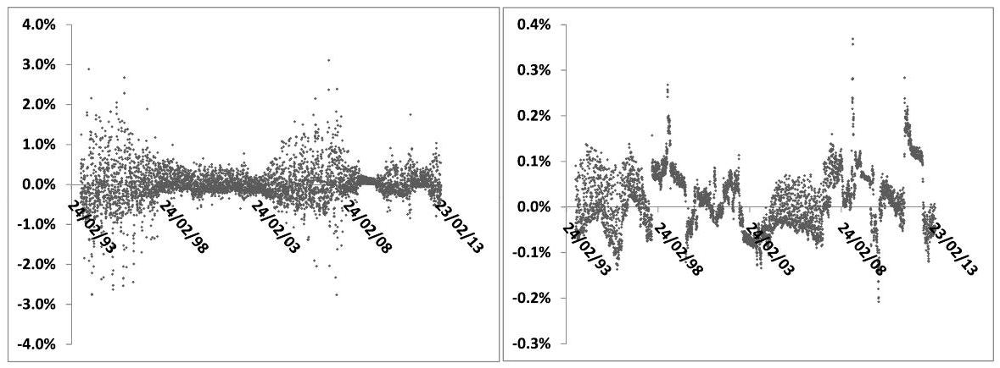
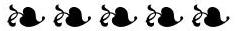
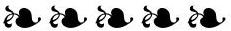

## Chapter 5

## Variance swaps

This chapter is devoted to variance swaps (VS) and their connection to delta-hedged log contracts - it is a prerequisite for the chapters that follow.

We show how a VS can be synthesized using European payoffs, characterize the impact of large returns on its replication and assess the relevance of pricing a VS in a jump-diffusion model. Finally we analyze the impact of cash-amount dividends on the VS replication, as well as the effect of interest-rate volatility.

We then study the replication of weighted variance swaps.
This is followed by two appendices - Appendix A on timer options and Appendix B on the perturbation of the lognormal density.

### 5.1 Variance swap forward variances

A variance swap (VS) contract pays at maturity the realized variance of a financial underlying, computed as the sum of the squares of daily log-returns. The market convention for the VS payoff is:

$$
\begin{equation*}
\frac{252}{N} \sum_{i=0}^{N-1} \ln ^{2}\left(\frac{S_{i+1}}{S_{i}}\right)-\widehat{\sigma}_{\mathrm{VS}, T}^{2}(t) \tag{5.1}
\end{equation*}
$$
^eq5-1

where $N$ is the number of trading days for the maturity of the variance swap, $S_{i}$ are the daily closing quotes of the underlying. $\widehat{\sigma}_{\mathrm{VS}, T}(t)$ is set so that the initial value at time $t$ of the VS is zero and is called the VS volatility for maturity $T .^{1} 252$ is the typical number of trading days in a year. Because the distribution of trading days is not uniform throughout the year, the ratio $\frac{N}{252}$ is generally not equal to the year fraction for the maturity of the VS and $\widehat{\sigma}_{\text {VS }}$ is a biased estimator of realized volatility, especially for short maturities. We prefer to work with the following convention:

$$
\begin{equation*}
\frac{1}{T-t} \sum_{i=0}^{N-1} \ln ^{2}\left(\frac{S_{i+1}}{S_{i}}\right)-\widehat{\sigma}_{\mathrm{VS}, T}^{2}(t) \tag{5.2}
\end{equation*}
$$
^eq5-2

[^61]where the $S_{i}$ are observed at dates $t_{i}$, such that $t_{N}=T$, which we rewrite for notational economy as:

$$
\begin{equation*}
\frac{1}{T-t} \sum_{t}^{T} \ln ^{2}\left(\frac{S_{i+1}}{S_{i}}\right)-\widehat{\sigma}_{\mathrm{VS}, T}^{2}(t) \tag{5.3}
\end{equation*}
$$
^eq5-3

Imagine taking at time $t$ a long position in ( $T_{2}-t$ ) VSs of a maturity $T_{2}$ and a short position in $\left(T_{1}-t\right) e^{-r\left(T_{2}-T_{1}\right)}$ VSs of maturity $T_{1}$ with $T_{2}>T_{1}$. The market implied volatilities of these two VSs are, at time $t, \widehat{\sigma}_{\mathrm{VS}, T_{2}}(t)$ and $\widehat{\sigma}_{\mathrm{VS}, T_{1}}(t)$. From (5.3), the payoff of this position, capitalized at $T_{2}$ is:

$$
\begin{align*}
& \sum_{T_{1}}^{T_{2}} \ln ^{2}\left(\frac{S_{i+1}}{S_{i}}\right)-\left(\left(T_{2}-t\right) \widehat{\sigma}_{\mathrm{VS}, T_{2}}^{2}(t)-\left(T_{1}-t\right) \widehat{\sigma}_{\mathrm{VS}, T_{1}}^{2}(t)\right) \\
& =\sum_{T_{1}}^{T_{2}} \ln ^{2}\left(\frac{S_{i+1}}{S_{i}}\right)-\left(T_{2}-T_{1}\right) \widehat{\sigma}_{\mathrm{VS}, T_{1} T_{2}}^{2}(t) \tag{5.4}
\end{align*}
$$
^eq5-4

where we have introduced the discrete forward variance $\widehat{\sigma}_{\mathrm{VS}, T_{1} T_{2}}$ defined as:

$$
\widehat{\sigma}_{\mathrm{VS}, T_{1} T_{2}}^{2}(t)=\frac{\left(T_{2}-t\right) \widehat{\sigma}_{\mathrm{VS}, T_{2}}^{2}(t)-\left(T_{1}-t\right) \widehat{\sigma}_{\mathrm{VS}, T_{1}}^{2}(t)}{T_{2}-T_{1}}
$$

$\widehat{\sigma}_{\mathrm{VS}, T_{1} T_{2}}^{2}(t)$ is positive by construction, as the value at time $t$ of the second-hand side of (5.4) vanishes and its first piece is positive by construction. Imagine we unwind our position by entering at a later time $t^{\prime}<T_{1}$ the reverse position: selling $\left(T_{2}-t^{\prime}\right)$ VSs of maturity $T_{2}$ and buying $\left(T_{1}-t^{\prime}\right) e^{-r\left(T_{2}-T_{1}\right)}$ VSs of maturity $T_{1}$ at market implied volatilities prevailing at $t^{\prime}$. This cancels the contribution from the realized variance over $\left[T_{1}, T_{2}\right]$ and the P\&L of our strategy capitalized at time $T_{2}$ is:

$$
\begin{equation*}
\left(T_{2}-T_{1}\right)\left(\widehat{\sigma}_{\mathrm{VS}, T_{1} T_{2}}^{2}\left(t^{\prime}\right)-\widehat{\sigma}_{\mathrm{VS}, T_{1} T_{2}}^{2}(t)\right) \tag{5.5}
\end{equation*}
$$
^eq5-5

It no longer involves the realized variance of $S$ and only depends on the variation of implied VS volatilities over $\left[t, t^{\prime}\right]$. (5.5) shows that we are able to generate a P\&L that is linear in the variation of $\widehat{\sigma}_{\mathrm{VS}, T_{1} T_{2}}^{2}$ over $\left[t, t^{\prime}\right]$ at no cost.

To produce a P\&L that is linear in the variation of an equity underlying $S$, we borrow money to buy the underlying share and need to pay interest while we hold the share, hence the non-vanishing pricing drift of $S$. In the case of forward VS variances, no money is needed to materialize P\&L (5.5): $\widehat{\sigma}_{\mathrm{VS}, T_{1} T_{2}}^{2}$ has vanishing pricing drift.
$\widehat{\sigma}_{\mathrm{VS}, T_{1} T_{2}}^{2}$ is a discrete forward variance. We can similarly define continuous VS forward variances, which we simply denote by $\xi_{t}^{T}$, given by:

$$
\xi_{t}^{T}=\frac{d}{d T}\left((T-t) \widehat{\sigma}_{\mathrm{VS}, T}^{2}(t)\right)
$$

The $\xi^{T}$ are driftless as well; in a diffusive setting:

$$
\begin{equation*}
d \xi_{t}^{T}=\bullet d W_{t}^{T} \tag{5.6}
\end{equation*}
$$
^eq5-6

### 5.2 Relationship of variance swaps to log contracts

Consider the VS payoff (5.2). As $\widehat{\sigma}_{\text {VS }, T}^{2}$ is a constant, we will focus on the first piece in (5.2) and simply take for the VS payoff:

$$
\begin{equation*}
\sum_{i=0}^{N-1} \ln ^{2}\left(\frac{S_{i+1}}{S_{i}}\right) \tag{5.7}
\end{equation*}
$$
^eq5-7

Let us assume for simplicity that dates $t_{i}$ are equally spaced by $\Delta t$. If $\ln \left(\frac{S_{i+1}}{S_{i}}\right)$ is small, at order two in $\frac{\delta S_{i}}{S_{i}}$ the payoff (5.7), discounted at $t=0$ can be rewritten as:

$$
\begin{equation*}
e^{-r T} \sum_{i=0}^{N-1}\left(\frac{\delta S_{i}}{S_{i}}\right)^{2}=\sum_{i=0}^{N-1} e^{-r t_{i}} e^{-r\left(T-t_{i}\right)}\left(\frac{\delta S_{i}}{S_{i}}\right)^{2} \tag{5.8}
\end{equation*}
$$
^eq5-8

where $\delta S_{i}=S_{i+1}-S_{i}$. We recognize the typical expression of the discounted sum of the gamma portion of the usual daily gamma/theta P\&Ls (1.9) of a delta-hedged option risk-managed at zero volatility. The gamma/theta P\&L reduces to its gamma part only if we choose a vanishing implied volatility for risk-managing the option.

Is it possible to find a European payoff whose dollar gamma - when risk-managed at vanishing volatility - matches that of the VS? This condition reads:

$$
\begin{equation*}
\frac{1}{2} S^{2} \frac{d^{2} P_{\widehat{\sigma}=0}}{d S^{2}}=e^{-r(T-t)} \tag{5.9}
\end{equation*}
$$
^eq5-9

The answer is yes - it is, up to a factor, the log contract. The value $Q^{T}(t, S)$ of payoff $-2 \ln S_{T}$ in the Black-Scholes model with implied volatility $\widehat{\sigma}$, assuming there are no dividends with fixed cash amounts, is given by (3.8):

$$
\begin{equation*}
Q^{T}(t, S)=-2 e^{-r(T-t)}\left(\ln S+(r-q)(T-t)-\frac{\widehat{\sigma}^{2}}{2}(T-t)\right) \tag{5.10}
\end{equation*}
$$
^eq5-10

Take $\widehat{\sigma}=0$ - the delta and gamma of $Q^{T}$ do not depend on $\widehat{\sigma}$ and we get:

$$
\begin{equation*}
\frac{d Q_{\widehat{\sigma}=0}^{T}}{d S}=-e^{-r(T-t)} \frac{2}{S}, \quad \frac{1}{2} S^{2} \frac{d^{2} Q_{\widehat{\sigma}=0}^{T}}{d S^{2}}=e^{-r(T-t)} \tag{5.11}
\end{equation*}
$$
^eq5-11

$Q_{\widehat{\sigma}=0}^{T}$ indeed fulfills condition (5.9) - we could have obtained (5.10) by straight integration of (5.9). Risk-managing the European payoff $-2 \ln S_{T}$ with zero implied volatility exactly produces - at second order in $\delta S_{i}$ - payoff (5.7). How much should we charge for it - or, equivalently, what is $\widehat{\sigma}_{\mathrm{VS}, T}^{2}$ so that the value at $t=0$ of the VS contract vanishes?

If the market price at $t=0$ of the log contract were $Q_{\widehat{\sigma}=0}^{T}$ we would not need to charge anything - we would set $\widehat{\sigma}_{\mathrm{VS}, T}=0$. In reality, the log contract has a
market price $Q_{\text {market }}^{T}$ : purchasing the log contract generates a mark-to-market P\&L $-\left(Q_{\text {market }}^{T}-Q_{\widehat{\sigma}=0}^{T}\right)$ for us, which we charge to the client as the premium of the variance swap. This premium is $T \widehat{\sigma}_{\mathrm{VS}, T}^{2}$ and is paid at maturity. $\widehat{\sigma}_{\mathrm{VS}, T}$ is then given by:

$$
\begin{equation*}
\widehat{\sigma}_{\mathrm{VS}, T}^{2}=\frac{e^{r T}}{T}\left(Q_{\text {market }}^{T}-Q_{\widehat{\sigma}=0}^{T}\right) \tag{5.12}
\end{equation*}
$$
^eq5-12

Given the market price $Q_{\text {market }}^{T}$ we can invert (5.10) to back out the log contract implied volatility $\widehat{\sigma}_{T}$. Substituting expression (5.10) for $Q_{\text {market }}^{T}$ in (5.12) then yields:

$$
\begin{align*}
\widehat{\sigma}_{\mathrm{VS}, T} & =\widehat{\sigma}_{T}  \tag{5.13}\\
\xi_{t}^{T} & =\zeta_{t}^{T} \tag{5.14}
\end{align*}
$$
^eq5-13
^eq5-14

The log contract is replicated with a vanilla portfolio using a density proportional equal to $\frac{2}{K^{2}}$ - see Section 3.1.3:

$$
\begin{align*}
-2 \ln S= & -2 \ln S_{0}-\frac{2}{S_{0}}\left(S-S_{0}\right)  \tag{5.15}\\
& +\int_{0}^{S_{0}} \frac{2}{K^{2}}(K-S)^{+} d K+\int_{S_{0}}^{\infty} \frac{2}{K^{2}}(S-K)^{+} d K
\end{align*}
$$
^eq5-15

At order two in $\frac{\delta S}{S}$ the payoff of a VS is then synthesized by delta-hedging this portfolio until maturity with zero implied volatility: $\widehat{\sigma}_{T}$ is simply computed as the implied volatility of the replicating vanilla portfolio and is model-independent. ${ }^{2}$ As a consequence, forward variances of log contracts and VSs are identical objects. (5.12) can be rewritten as:

$$
\begin{equation*}
\widehat{\sigma}_{\mathrm{VS}, T}^{2}=\frac{e^{r T}}{T} \int_{0}^{\infty} \frac{2}{K^{2}}\left(P_{\text {market }}^{K T}-P_{\widehat{\sigma}=0}^{K T}\right) d K \tag{5.16}
\end{equation*}
$$
^eq5-16

where $P^{K T}$ is the price of a vanilla option of strike $K$, maturity $T . P_{\widehat{\sigma}=0}^{K T}$, the price for a vanishing volatility is simply the intrinsic value computed for the forward and discounted to $t=0$; for a call option:

$$
P_{\widehat{\sigma}=0}^{K T}=e^{-r T}\left(S e^{(r-q) T}-K\right)^{+}
$$

( $P_{\text {market }}^{K T}-P_{\widehat{\sigma}=0}^{K T}$ ) is identical for a call or a put struck at $K$ because of call-put parity - no need to distinguish between both types of vanilla options. ${ }^{3}$

While $\widehat{\sigma}_{T}$ is well-defined whenever the market smile is non-arbitrageable, it is very sensitive to the extrapolation chosen for implied volatilities outside the range

[^62]of strikes traded on the market. In practice, for very liquid securities such as indexes, market-makers do the reverse and infer implied volatilities for low strikes from market quotes of VSs. ${ }^{4}$

The delta and gamma of the log contract in (5.11) do not depend on the implied volatility $\widehat{\sigma}$ : we could as well have chosen to risk-manage the log contract with a non-zero implied volatility. The most natural choice is $\widehat{\sigma}=\widehat{\sigma}_{T}$ : delta-hedging the log contract then generates a gamma P\&L and a theta P\&L that exactly match both pieces in (5.2).

The idea of using zero implied volatility proves useful when analyzing more complex payoffs involving realized variance weighted by a function of spot value, such as conditional variance swaps, for which squared daily returns are accumulated only when $S_{i}$ lies within an interval, typically $[0, L],[L, H]$ or $[H, \infty]$ - and also in the case of fixed amount dividends.

Weighted variance swaps - and in particular conditional VSs - are dealt with in Section 5.9, page 176.

### 5.2.1 A simple formula for $\widehat{\sigma}_{\mathrm{VS}, T}$

In (5.16) $\widehat{\sigma}_{\mathrm{VS}, T}$ is expressed in terms of market prices of vanilla options. (5.16) holds whenever cash-amount dividends are not present. Otherwise it is replaced with (5.47) - see Section 5.6.2 further below.

In the absence of cash-amount dividends, $\widehat{\sigma}_{\mathrm{VS}, T}$ can equivalently be computed as the implied volatility of the log contract - or of a set of European payoffs otherwise; see the derivation in Section 5.3.1 below. This is a more efficient method than using (5.16) as it is less sensitive to the discretization of the replicating portfolio in (5.15) in particular, for a flat volatility surface, we trivially recover the exact value of $\widehat{\sigma}_{\mathrm{VS}, T}$.

Still, with no cash-amount dividends present, there is a direct expression of $\widehat{\sigma}_{\mathrm{VS}, T}$ as a weighted average of implied volatilities of vanilla options. This was obtained in the context of power payoffs, in Section 4.3 of Chapter 4.

We simply quote result (4.21) and refer the reader to page 142 for its derivation:

$$
\begin{align*}
\widehat{\sigma}_{\mathrm{VS}, T}^{2} & =\int_{-\infty}^{+\infty} d y \frac{e^{-\frac{y^{2}}{2}}}{\sqrt{2 \pi}} \widehat{\sigma}_{K(y) T}^{2}  \tag{5.17a}\\
y(K) & =\frac{\ln \left(\frac{F_{T}}{K}\right)}{\widehat{\sigma}_{K T} \sqrt{T}}-\frac{\widehat{\sigma}_{K T} \sqrt{T}}{2} \tag{5.17b}
\end{align*}
$$
^eq5-17a
^eq5-17b

[^63]
### 5.3 Impact of large returns

The key property that synthesizing the VS payoff boils down to delta-hedging a log contract - hence that $\widehat{\sigma}_{\mathrm{VS}, T}=\widehat{\sigma}_{T}-$ has been derived in an expansion at order 2 in $\frac{\delta S}{S}$ of the VS payoff and the P\&L of a delta-hedged log contract. How robust is it? What if returns are large?

We now consider two canonical examples of dynamics for $S_{t}$ : a diffusive model and a jump-diffusion model. Unlike the former, the latter is able to generate large returns, even at short time scales, with a probability proportional to $\Delta t$. We consider the limit of very frequent observations of $S$ which enables us to explicitly compute all quantities of interest.

The case of real underliers is investigated next.

### 5.3.1 In diffusive models

The price of the log contract of maturity $T$, risk-managed at zero implied volatility, $P_{\widehat{\sigma}=0}^{T}$, satisfies the following condition:

$$
\begin{equation*}
\frac{1}{2} S^{2} \frac{d^{2} P_{\widehat{\sigma}=0}^{T}}{d S^{2}}=e^{-r(T-t)} \tag{5.18}
\end{equation*}
$$
^eq5-18

Assume that $S$ follows a diffusive dynamics:

$$
\begin{equation*}
d S_{t}=(r-q) S_{t} d t+\bar{\sigma}_{t} S_{t} d W_{t} \tag{5.19}
\end{equation*}
$$
^eq5-19

where instantaneous volatility $\bar{\sigma}$ is an arbitrary process.
Remember expression (2.30) in Section 2.4.1 relating the price of a payoff in an arbitrary diffusive model $P_{\bar{\sigma}}$ with instantaneous volatility $\bar{\sigma}$ to the price $P_{\sigma}$ in a local volatility model whose local volatility function is $\sigma(t, S)$ :

$$
\begin{equation*}
P_{\bar{\sigma}}(t=0)=P_{\sigma}\left(0, S_{0}\right)+E_{\bar{\sigma}}\left[\int_{0}^{T} \frac{1}{2} e^{-r t} S_{t}^{2} \frac{d^{2} P_{\sigma}}{d S^{2}}\left(\bar{\sigma}_{t}^{2}-\sigma\left(t, S_{t}\right)^{2}\right) d t\right] \tag{5.20}
\end{equation*}
$$
^eq5-20

We now set $\sigma(t, S) \equiv 0$ and use the notation: $P_{\bar{\sigma}}^{T}$ for $P_{\bar{\sigma}}$ and $P_{\widehat{\sigma}=0}^{T}$ for $P_{\sigma}$. Using identity (5.18) in (5.20) yields:

$$
\begin{equation*}
P_{\bar{\sigma}}^{T}=P_{\widehat{\sigma}=0}^{T}+e^{-r T} E_{\bar{\sigma}}\left[\int_{0}^{T} \bar{\sigma}_{t}^{2} d t\right] \tag{5.21}
\end{equation*}
$$
^eq5-21

where all prices are evaluated at $t=0$.
We now turn to the variance swap. We have:

$$
d \ln S_{t}=\left(r-q-\frac{1}{2} \bar{\sigma}_{t}^{2}\right) d t+\bar{\sigma}_{t} d W_{t}
$$

where the first term in the right-hand side is of order $d t$ and the second term is of order $\sqrt{d t}$. Square this expression and take the limit $d t \rightarrow 0$. The only contribution at order $d t$ comes from the square of the second term and we get:

$$
\lim _{d t \rightarrow 0} \frac{1}{d t}\left(d \ln S_{t}\right)^{2}=\bar{\sigma}_{t}^{2}
$$

which implies that:

$$
\lim _{\Delta t \rightarrow 0} \sum_{i=0}^{N-1} \ln ^{2}\left(\frac{S_{i+1}}{S_{i}}\right)=\int_{0}^{T} \bar{\sigma}_{t}^{2} d t
$$

Thus, in the limit of frequent observations, the VS implied volatility $\widehat{\sigma}_{\mathrm{VS}, T}$, defined by (5.2), is given by:

$$
\begin{equation*}
\widehat{\sigma}_{\mathrm{VS}, T}^{2}=\frac{1}{T} E\left[\lim _{\Delta t \rightarrow 0} \sum_{i=0}^{N-1} \ln ^{2}\left(\frac{S_{i+1}}{S_{i}}\right)\right]=E\left[\frac{1}{T} \int_{0}^{T} \bar{\sigma}_{t}^{2} d t\right] \tag{5.22}
\end{equation*}
$$
^eq5-22

How frequent is frequent? The log-return over $\left[t_{i}, t_{i+1}\right]$ is given by:

$$
\ln \left(\frac{S_{i+1}}{S_{i}}\right)=\int_{t_{i}}^{t_{i+1}} \bar{\sigma}_{t} d W_{t}+\int_{t_{i}}^{t_{i+1}}\left(r-q-\frac{\bar{\sigma}_{t}^{2}}{2}\right) d t
$$

The orders of magnitude of the two pieces in the right-hand side are, respectively, $\bar{\sigma} \sqrt{\Delta t}$ and $\bar{\sigma}^{2} \Delta t$, with $\Delta t=t_{i+1}-t_{i}$. The second piece can be safely ignored whenever $\bar{\sigma}^{2} \Delta t \ll \bar{\sigma} \sqrt{\Delta t}$, that is $\bar{\sigma} \sqrt{\Delta t} \ll 1$, which is typically the case for volatility levels of equity underlyings.

Assume now that our diffusive model is calibrated to the market smile: $P_{\bar{\sigma}}^{T}= P_{\text {Market. From (5.21) and (5.22): }}^{T}$

$$
\begin{equation*}
\widehat{\sigma}_{\mathrm{VS}, T}^{2}=E_{\bar{\sigma}}\left[\frac{1}{T} \int_{0}^{T} \bar{\sigma}_{t}^{2} d t\right]=\frac{e^{r T}}{T}\left(P_{\text {Market }}^{T}-P_{\widehat{\sigma}=0}^{T}\right) \tag{5.23}
\end{equation*}
$$
^eq5-23

This identity implies that any diffusive model calibrated to the vanilla smile prices VSs identically. Denote by $\widehat{\sigma}_{T}$ the implied volatility of the log contract; $\widehat{\sigma}_{T}$ is such that $P_{\text {Market }}^{T}=P_{\widehat{\sigma}_{T}}^{T}$.

Using (5.20) again, still setting $\sigma(t, S) \equiv 0$, but this time choosing for $\bar{\sigma}_{t}$ the constant volatility $\widehat{\sigma}_{T}$ yields:

$$
P_{\text {Market }}^{T}=P_{\widehat{\sigma}}^{T}=P_{\widehat{\sigma}=0}^{T}+e^{-r T} T \widehat{\sigma}_{T}^{2}
$$

Inserting this expression of $P_{\text {Market }}^{T}$ in (5.23) yields our final result:

$$
\widehat{\sigma}_{\mathrm{VS}, T}=\widehat{\sigma}_{T}
$$

$\widehat{\sigma}_{T}$ and $\widehat{\sigma}_{\mathrm{VS}, T}$ are identical and are simply related to the quadratic variation of $\ln S_{t}$ over $[0, T]$. VS forward variances $\xi^{T}$ are then identical to log contract forward variances $\zeta^{T}$ and the instantaneous variance of $S_{t}$ is the short end of the variance curve: $\bar{\sigma}_{t}=\sqrt{\xi_{t}^{t}}$. The joint dynamics of $S_{t}$ and $\xi_{t}$ is given by equations (4.36):

$$
\left\{\begin{aligned}
d S_{t} & =\sqrt{\xi_{t}^{t}} S_{t} d W_{t}^{S} \\
d \xi_{t}^{T} & =\lambda_{t}^{T} d W_{t}^{T}
\end{aligned}\right.
$$

## The case of cash-amount dividends

When there are cash-amount dividends the log contract no longer has constant dollar gamma. However, we show in Section 5.6.2 below that the log contract can be supplemented with European payoffs of intermediate maturities to generate a portfolio that, risk-managed at zero implied volatility, again satisfies condition (5.18).

In conclusion, in a diffusive setting:

- The VS volatility is the implied volatility of a portfolio of European options. This portfolio reduces to the log contract when there are no cash-amount dividends
- Any diffusive model calibrated to the vanilla smile yields the same value for $\widehat{\sigma}_{\mathrm{VS}, T}$

### 5.3.2 In jump-diffusion models

Assume that, in addition to the diffusion in (5.19), $S_{t}$ is allowed to abruptly jump at times generated by a Poisson process with constant intensity $\lambda$ - we take zero interest rate and repo without loss of generality:

$$
\begin{equation*}
d S_{t}=\bar{\sigma}_{t} S_{t} d W_{t}^{S}+S_{t^{-}}\left(J d N_{t}-\lambda \bar{J} d t\right) \tag{5.24}
\end{equation*}
$$
^eq5-24

where relative magnitudes $J$ of successive jumps are iid random variables, $\bar{J}=E[J]$ and $N_{t}$ is the counting process of the underlying Poisson process. $J$ and $N_{t}$ are assumed to be independent and $E\left[d N_{t}\right]=\lambda d t$. The drift in (5.24) is the compensator of the jump process; it ensures that the financing cost of $S$ vanishes: $E\left[d S_{t}\right]=0 .^{5}$ We have for $S_{T}$ :

$$
S_{T}=S_{0} e^{-\frac{1}{2} \int_{0}^{T} \bar{\sigma}_{t}^{2} d t+\int_{0}^{T} \bar{\sigma}_{t} d W_{t}^{S}} e^{-\lambda \bar{J} T} \prod_{i=1}^{N_{T}}\left(1+J_{i}\right)
$$

where $N_{T}$ is the (random) number of jumps occurring over $[0, T]$, whose probability distribution is $p_{n}=p\left(N_{T}=n\right)=e^{-\lambda T} \frac{(\lambda T)^{n}}{n!}$. In particular, $E\left[N_{T}\right]=\lambda T$. We get

[^64]for the price of the log contract:

$$
\begin{aligned}
& E\left[-2 \ln S_{T}\right] \\
& =-2 \ln S_{0}+2\left(\lambda \bar{J} T+\frac{1}{2} E\left[\int_{0}^{T} \bar{\sigma}_{t}^{2} d t\right]\right)-2 \Sigma_{n=0}^{\infty} p_{n} E\left[\ln \left((1+J)^{n}\right)\right] \\
& =-2 \ln S_{0}+2\left(\lambda \bar{J} T+\frac{1}{2} E\left[\int_{0}^{T} \bar{\sigma}_{t}^{2} d t\right]\right)-2 \lambda T \overline{\ln (1+J)}
\end{aligned}
$$
where we have used the fact that the $J_{i}$ are iid and independent of $N_{t}$ and $\Sigma_{n=0}^{\infty} n p_{n}=\lambda T$. Inverting (5.10) we get the implied volatility of the log contract:

$$
\begin{equation*}
\widehat{\sigma}_{T}^{2}=E\left[\frac{1}{T} \int_{0}^{T} \bar{\sigma}_{t}^{2} d t\right]-2 \lambda \overline{\ln (1+J)-J} \tag{5.25}
\end{equation*}
$$
^eq5-25

Let us now turn to the VS payoff (5.7). In the limit of frequent observations:

$$
\widehat{\sigma}_{\mathrm{VS}, T}^{2}=\frac{1}{T} E\left[\lim _{\Delta \rightarrow 0} \sum_{i=0}^{N-1} \ln ^{2}\left(\frac{S_{i+1}}{S_{i}}\right)\right]=\frac{1}{T} \int_{0}^{T} E\left[\frac{\left(d \ln S_{t}\right)^{2}}{d t}\right] d t
$$

We have:

$$
d \ln S_{t}=-\left(\frac{\bar{\sigma}_{t}^{2}}{2}+\lambda \bar{J}\right) d t+\bar{\sigma}_{t} d W_{t}+\ln (1+J) d N_{t}
$$

Squaring this expression and taking the expectation yields:

$$
\begin{equation*}
\frac{E\left[\left(d \ln S_{t}\right)^{2}\right]}{d t}=E\left[\bar{\sigma}_{t}^{2}\right]+\lambda \overline{\ln ^{2}(1+J)} \tag{5.26}
\end{equation*}
$$
^eq5-26

which gives, in the limit of frequent observations:

$$
\begin{equation*}
\widehat{\sigma}_{\mathrm{VS}, T}^{2}=E\left[\frac{1}{T} \int_{0}^{T} \bar{\sigma}_{t}^{2} d t\right]+\lambda \overline{\ln ^{2}(1+J)} \tag{5.27}
\end{equation*}
$$
^eq5-27

In the right-hand side of (5.26) the contribution of jumps to $E\left[\left(d \ln S_{t}\right)^{2}\right] / d t$ is weighted by $\lambda$, as for small $d t$ there can be at most one jump, with probability $\lambda d t$. If spot observations are not sufficiently frequent, more than one jump can occur during the interval $\Delta t$, with the result that the contribution of jumps is no longer linear in $\lambda$ : in addition to $\bar{\sigma} \sqrt{\Delta t} \ll 1$, we also need $\lambda \Delta t \ll 1$.

Compare (5.25) and (5.27). $\widehat{\sigma}_{T}$ and $\widehat{\sigma}_{V S, T}$ are not equal anymore and their difference is given by: ${ }^{6}$

$$
\begin{equation*}
\widehat{\sigma}_{\mathrm{VS}, T}^{2}-\widehat{\sigma}_{T}^{2}=\lambda \overline{\ln ^{2}(1+J)+2 \ln (1+J)-2 J} \tag{5.28}
\end{equation*}
$$
^eq5-28

[^65]remember that we are using $\xi^{T}$ to denote VS forward variances and $\zeta^{T}$ to denote log-contract forward variances. (5.28) implies that $\xi_{t}, \zeta_{t}$ are related though:

$$
\xi_{t}^{T}-\zeta_{t}^{T}=\lambda \overline{\ln ^{2}(1+J)+2 \ln (1+J)-2 J}
$$
$\zeta_{t}, \xi_{t}$ are both driftless and the joint dynamics of $S_{t}, \zeta_{t}, \xi_{t}$, is given by:

$$
\left\{\begin{aligned}
d S_{t} & =\bar{\sigma}_{t} S_{t} d W_{t}^{S}+S_{t^{-}}\left(J d N_{t}-\lambda \bar{J} d t\right) \\
d \zeta_{t}^{T} & =\lambda_{t}^{T} d W_{t}^{T} \\
d \xi_{t}^{T} & =\lambda_{t}^{T} d W_{t}^{T}
\end{aligned}\right.
$$
where $\bar{\sigma}_{t}$ equals neither $\sqrt{\xi_{t}^{t}}$ nor $\sqrt{\zeta_{t}^{t}}$. We can use (5.27) to express $\bar{\sigma}_{t}$ as a function of $\xi_{t}^{t}$ :

$$
\bar{\sigma}_{t}=\sqrt{\xi_{t}^{t}-\lambda \overline{\ln ^{2}(1+J)}}
$$

The fact that $\bar{\sigma}_{t}, \sqrt{\xi_{t}^{t}}$ and $\sqrt{\zeta_{t}^{t}}$ are all different is typical of models for $S_{t}$ that are not pure diffusions. We now estimate the order of magnitude of this difference and how it is related to the market smile used for calibration.

### 5.3.3 Difference of VS and log-contract implied volatilities

In the discussion that follows, we consider "pure" jump-diffusion/Lévy models, that is models with no dynamical variables besides $S_{t}$. This excludes mixtures of stochastic volatility and jump/Lévy processes, for example models where $\bar{\sigma}_{t}$ is a process correlated with $S_{t}$.

We will henceforth use "jump-diffusion" to denote jump/Lévy processes, that is processes with independent stationary increments for $\ln S_{t}$. In the context of the preceding section, this amounts to setting $\bar{\sigma}_{t}$ constant.

The dynamics in (5.24) serves as a basic prototype for the class of Lévy processes, but our conclusions have general relevance.

Let us expand the right-hand side of (5.28) in powers of $J$. The first non-vanishing contribution comes from $J^{3}$ and we get:

$$
\begin{equation*}
\widehat{\sigma}_{\mathrm{VS}, T}^{2}-\widehat{\sigma}_{T}^{2} \simeq-\frac{1}{3} \lambda \overline{J^{3}} \tag{5.29}
\end{equation*}
$$
^eq5-29

The fact that the first non-vanishing contribution is of order 3 in $J$ is expected: at order 2 in $J$ the effect of jumps is identical to that of a simple diffusion - see Appendix A of Chapter 10: whether the return was generated by a jump or by Brownian motion is immaterial.

Higher-order terms $-\lambda \overline{J^{4}}, \lambda \overline{J^{5}}$, etc. - contribute as well, but the order-three term is the leading contribution in the limit of small and frequent jumps. Indeed, when taking the limit $J \rightarrow 0, \lambda$ should be increased so that the contribution of jumps to the quadratic variation of $\ln S$ - and the quadratic variation itself - stays
fixed. Equation (5.26) shows that as $J \rightarrow 0$, for $\lambda \overline{J^{2}}$ to stay constant, $\lambda$ has to scale like $\frac{1}{J^{2}}$. Terms $\lambda \overline{J^{n}}$ are then of order $J^{n-2}$ : the largest contribution is generated by $n=3$.

## Calibrating jump parameters to the vanilla smile

In jump-diffusion models, jumps not only introduce a difference between $\widehat{\sigma}_{T}$ and $\widehat{\sigma}_{\mathrm{VS}, T}$; they also generate a smile. In Appendix A of Chapter 10 - see equation (10.26), page 413 - it is shown that in the limit $J \rightarrow 0$ the ATMF skew for maturity $T, \mathcal{S}_{T}$, is given, at order one in the skewness of $\ln S_{T}$, by:

$$
\begin{equation*}
\mathcal{S}_{T} \simeq \frac{\lambda \overline{J^{3}}}{6 \widehat{\sigma}_{T}^{3} T} \tag{5.30}
\end{equation*}
$$
^eq5-30

which, using (5.29), gives the following approximation for the difference of $\widehat{\sigma}_{T}$ and $\widehat{\sigma}_{\mathrm{VS}, T}$ as a function of the ATMF skew for maturity $T$ :

$$
\begin{equation*}
\widehat{\sigma}_{\mathrm{VS}, T}^{2}-\widehat{\sigma}_{T}^{2} \simeq-2 \widehat{\sigma}_{T}^{3} \mathcal{S}_{T} T \tag{5.31}
\end{equation*}
$$
^eq5-31

Assuming the right-hand side is small:

$$
\begin{equation*}
\widehat{\sigma}_{\mathrm{VS}, T} \simeq \widehat{\sigma}_{T}\left(1-\widehat{\sigma}_{T} \mathcal{S}_{T} T\right) \tag{5.32}
\end{equation*}
$$
^eq5-32

Thus, given a market smile, assuming a diffusion for $S$ leads to:

$$
\widehat{\sigma}_{\mathrm{VS}, T}=\widehat{\sigma}_{T}
$$

while assuming a jump-diffusion process leads to (5.28), which for weak smiles is approximated by (5.32):

$$
\widehat{\sigma}_{\mathrm{VS}, T} \simeq \widehat{\sigma}_{T}\left(1-\widehat{\sigma}_{T} \mathcal{S}_{T} T\right)
$$

Consider the case of a one-year maturity VS on an equity index. Typically, the difference of the implied volatilities for strikes $95 \%$ and $105 \%$ is of the order of 2 points of volatility, which gives $\mathcal{S}_{T}=-0.02 / \ln (105 / 95)=-0.2$. Taking $\widehat{\sigma}_{T}=20 \%$, yields $\widehat{\sigma}_{T} \mathcal{S}_{T} T=-4 \%$. Equation (5.32) then yields a difference of about one point of volatility between $\widehat{\sigma}_{\mathrm{VS}, T}$ and $\widehat{\sigma}_{T}$.

The size of this correction has prompted some to argue that replicating variance swaps with log contracts is inadequate and that variance swaps should be priced with jump/Lévy models calibrated on the market smile. Is this reasonable?

As we now show, the difference between $\widehat{\sigma}_{\mathrm{VS}, T}$ and $\widehat{\sigma}_{T}$ is due to the non-vanishing skewness of returns at short time scales. In the case of a jump-diffusion model, this skewness is inferred from the market smile of maturity $T$. Is this model-mediated relationship between skewness of short returns and skew of the $T$-maturity smile robust?

### 5.3.4 Impact of the skewness of daily returns - model-free

We now look at things in model-free fashion, with zero interest and repo, for simplicity.

Let $r_{i}$ be the log-return of $S$ over $\left[t_{i}, t_{i+1}\right]: r_{i}=\ln \left(\frac{S_{i+1}}{S_{i}}\right)$, and imagine that we have sold a variance swap and are long a delta-hedged log contract. We assume that we are keeping this static position until $t=T$, risk-managing the VS at a fixed implied volatility $\widehat{\sigma}_{\mathrm{VS}, T}$ and the log contract at a fixed implied volatility $\widehat{\sigma}_{T}$.

Our total P\&L during $\Delta t$ is the difference between the P\&L of the delta-hedged log contract and the payoff of the VS over time interval $\left[t_{i}, t_{i+1}\right]$ :

$$
\begin{align*}
P \& L= & \left(Q^{T}\left(t_{i+1}, S_{i+1}\right)-Q^{T}\left(t_{i}, S_{i}\right)\right)-\frac{d Q^{T}}{d S}\left(t_{i}, S_{i}\right)\left(S_{i+1}-S_{i}\right)  \tag{5.33}\\
& -\left(r_{i}^{2}-\widehat{\sigma}_{\mathrm{VS}, T}^{2} \Delta t\right) \\
= & \left(2\left(e^{r_{i}}-1\right)-2 r_{i}-\widehat{\sigma}_{T}^{2} \Delta t\right)-\left(r_{i}^{2}-\widehat{\sigma}_{\mathrm{VS}, T}^{2} \Delta t\right)  \tag{5.34}\\
= & \left(2\left(e^{r_{i}}-1\right)-2 r_{i}-r_{i}^{2}\right)-\left(\widehat{\sigma}_{T}^{2}-\widehat{\sigma}_{\mathrm{VS}, T}^{2}\right) \Delta t \tag{5.35}
\end{align*}
$$
^eq5-33
^eq5-34
^eq5-35

where the first piece in the right-hand side of (5.33) is the $\mathrm{P} \& \mathrm{~L}$ of the delta-hedged log contract over $\left[t_{i}, t_{i+1}\right]$. We have used the expressions of $Q^{T}$ and $\frac{d Q^{T}}{d S}$ given in (5.10) and (5.11) to get (5.35).

Expand this P\&L in powers of $r_{i}$. Up to order 2 in $r_{i}$, the payoff of the VS and the P\&L of the delta-hedged log contract match. The first non-vanishing contribution comes from the order-three term and we get:

$$
\begin{equation*}
P \& L \simeq \frac{r_{i}^{3}}{3}-\left(\widehat{\sigma}_{T}^{2}-\widehat{\sigma}_{\mathrm{VS}, T}^{2}\right) \Delta t \tag{5.36}
\end{equation*}
$$
^eq5-36

The combination of a static long position in a variance swap and a short position in a delta-hedged log contract generates at lowest order the daily P\&L (5.36) which looks like a gamma/theta P\&L except it involves $r_{i}^{3}$ rather than $r_{i}^{2}$.

Writing that the P\&L in (5.36) vanishes on average yields the following relationship between the skewness of daily log-returns and the difference between $\widehat{\sigma}_{T}$ and $\widehat{\sigma}_{\mathrm{VS}, T}$ :

$$
\begin{equation*}
\widehat{\sigma}_{\mathrm{VS}, T}^{2}-\widehat{\sigma}_{T}^{2} \simeq-\frac{\left\langle r^{3}\right\rangle}{3 \Delta t} \simeq-\frac{s_{\Delta t}}{3} \widehat{\sigma}_{T}^{3} \sqrt{\Delta t} \tag{5.37}
\end{equation*}
$$
^eq5-37

where $s_{\Delta t}$ denotes the skewness of daily returns defined by: $s_{\Delta t}=\left\langle r^{3}\right\rangle /\left\langle r^{2}\right\rangle^{\frac{3}{2}}$. For the sake of relating $\left\langle r^{3}\right\rangle$ to $s_{\Delta t}$ we have taken $\left\langle r^{2}\right\rangle=\widehat{\sigma}_{T}^{2} \Delta t$; at order one in the difference $\widehat{\sigma}_{\mathrm{VS}, T}-\widehat{\sigma}_{T}$ we could have equivalently used $\widehat{\sigma}_{\mathrm{VS}, T}^{2} \Delta t$.

Assuming that the right-hand side is small, this results in the following adjustment for $\widehat{\sigma}_{\mathrm{VS}, T}$, at order one:

$$
\begin{equation*}
\frac{\widehat{\sigma}_{\mathrm{VS}, T}}{\widehat{\sigma}_{T}}-1 \simeq-\frac{s_{\Delta t}}{6} \widehat{\sigma}_{T} \sqrt{\Delta t} \tag{5.38}
\end{equation*}
$$
^eq5-38

The interpretation of the results in Sections 5.3.1 and 5.3.2 is now clear:

- In diffusive models $\left\langle r^{3}\right\rangle$ scales like $\Delta t^{3 / 2}$. As $\Delta t \rightarrow 0$ the contribution of $\left\langle r^{3}\right\rangle$ becomes negligible with respect to that of $\left\langle r^{2}\right\rangle$, which scales like $\Delta t$ : $\widehat{\sigma}_{\mathrm{VS}, T}=\widehat{\sigma}_{T}$.
- In jump-diffusion models, the portion of $\left\langle r^{3}\right\rangle$ that is generated by jumps is proportional to $\lambda \Delta t \overline{J^{3}}$, thus scales like $\Delta t$, just as $\left\langle r^{2}\right\rangle$. Hence, $\widehat{\sigma}_{T} \neq \widehat{\sigma}_{\mathrm{VS}, T}$. The implied value of the cubes of daily log-returns is non-vanishing and depends on jump parameters calibrated on the smile of maturity $T$.

### 5.3.5 Inferring the skewness of daily returns from market smiles?

Using (5.37) together with (5.31) yields:

$$
-2 \widehat{\sigma}_{T}^{3} \mathcal{S}_{T} T \simeq-\frac{\widehat{s}_{\Delta t}}{3} \widehat{\sigma}_{T}^{3} \sqrt{\Delta t}
$$

which gives:

$$
\begin{equation*}
\widehat{s}_{\Delta t} \simeq 6 \frac{\mathcal{S}_{T} T}{\sqrt{\Delta t}} \tag{5.39}
\end{equation*}
$$
^eq5-39

Consider the case of a one-year maturity and let us use the same level of ATMF skew as in the numerical example on page 161. Taking $\mathcal{S}_{T}=-0.2$ and $\Delta t=\frac{1}{252}$ gives $\widehat{s}_{\Delta t} \simeq-19$. This is a very large value, much larger than its historical average - see below.

This value of $\widehat{s}_{\Delta t}$ is derived from the smile of maturity $T$, the VS maturity, through equation (5.39). How is it that, out of a calibration to the market smile of maturity $T$, the jump-diffusion model is able to predict the value of the skewness of returns at short time scales? Is this prediction robust?

Expression (5.39) shows that, had we used a different value for $T$, we would have obtained a different estimate for $\widehat{s}_{\Delta t}-$ unless $\mathcal{S}_{T}$ scales like $\frac{1}{T}$.

It is a well-known property of jump-diffusion processes, that, for small jump amplitudes, the ATMF skew they generate scales like $\frac{1}{T}$ - see equation (5.30). Indeed these processes generate independent stationary increments for $\ln S_{T}$. Cumulants of $\ln S_{T}$ then scale linearly with $T$, which implies that the skewness $s_{T}$ of $\ln S_{T}$ scales like $\frac{1}{\sqrt{T}}$.

As shown in Appendix B, perturbation of the lognormal Black-Scholes density at order one in the third-order cumulant yields identity (5.93) between the ATMF skew $\mathcal{S}_{T}$ and the skewness $s_{T}$ for maturity $T$ :

$$
\begin{equation*}
\mathcal{S}_{T}=\frac{s_{T}}{6 \sqrt{T}} \tag{5.40}
\end{equation*}
$$
^eq5-40

A scaling of $s_{T} \propto \frac{1}{\sqrt{T}}$ then translates into the property that the ATMF skew scales like $\frac{1}{T}$, which is what equation (5.30) expresses.

The skew that a jump-diffusion model generates is a direct reflection of the skewness of increments of $\ln S_{t}$ at short time scales: for weak skews $\mathcal{S}_{T} \propto \frac{1}{T}$ and
equation (5.39) supplies a value for the skewness of daily returns that does not depend on the particular value of $T$ used.

The situation is very different in diffusive stochastic volatility models: the process for $\ln S_{t}$ is Gaussian at short time scales ${ }^{7}$ and develops skewness at longer time scales by the fact that volatility is stochastic and correlated with $S_{t}$. The smile produced by a stochastic volatility model is not a reflection of the non-Gaussian character of returns at short time scales.

Thus, a jump-diffusion model yields a sizeable difference between $\widehat{\sigma}_{T}$ and $\widehat{\sigma}_{\mathrm{VS}, T}$ because it assumes a direct relationship between the ATMF skew of maturity $T$ and $\widehat{s}_{\Delta t}$. This is a bold assumption, which, moreover, is not supported by market data as, typically, ATMF skews approximately scale like $\frac{1}{\sqrt{T}}$, rather than $\frac{1}{T} .^{8}$

### 5.3.6 Preliminary conclusion

The difference between $\widehat{\sigma}_{T}$ and $\widehat{\sigma}_{\mathrm{VS}, T}$ depends on the non-Gaussian character of daily log-returns. Inferring the implied skewness of daily log-returns out of vanilla smiles through the filter of a calibrated model leads to a correction to $\widehat{\sigma}_{\mathrm{VS}, T}$ which is unreasonably model-dependent.

In fact the implied skewness of daily returns could only be accessible if the package consisting of a variance swap and the offsetting log contract was actually traded. While the realized skewness of daily returns is typically small - see below the implied skewness that would then be backed out of the difference between $\widehat{\sigma}_{T}$ and $\widehat{\sigma}_{\mathrm{VS}, T}$ could be arbitrarily large. ${ }^{9}$

### 5.3.7 In reality

Imagine that there was no active VS market and we were asked to quote a VS this would have been a typical situation in the late 90 s. What would we have done?

[^66]Typically we would have used a conservative estimate of the realized skewness to compute an adjustment to $\widehat{\sigma}_{T}$ using formula (5.38): ${ }^{10}$

$$
\widehat{\sigma}_{\mathrm{VS}, T} \simeq \widehat{\sigma}_{T}\left(1-\frac{s_{\Delta t}}{6} \widehat{\sigma}_{T} \sqrt{\Delta t}\right)
$$

For indexes, the realized skewness $s_{\Delta t}$ of daily log-returns, defined by: $s_{\Delta t}=\left\langle r^{3}\right\rangle /\left\langle r^{2}\right\rangle^{\frac{3}{2}}$, where we take $\langle r\rangle=0$, is a (dimensionless) number of order 1.

Perhaps surprisingly, the skewness of daily returns of equity indexes is not always negative. Historical skewness is difficult to measure, as the skewness estimator is very sensitive to large returns. The skewness estimator applied to a historical sample that includes an inordinately large return will be swamped by the contribution of that one return. Whenever one computes realized skewness over sufficiently long periods of time that do not contain large returns, one finds a number with varying sign, of order 1.

Obviously, evaluating $s_{\Delta t}$ for the S\&P 500 index over a historical sample that includes October 1987 will yield a large negative number, however its magnitude depends crucially on the size of the window used for its estimation, as this large number is generated by one single return. The notion that evaluating $s_{\Delta t}$ over a historical sample that includes a market crash - say, October 1987 - gives an estimate of $s_{\Delta t}$ that appropriately accounts for the possibility of crashes is thus a misguided idea. Whenever one wishes to adjust the price of a derivative for the impact of large market moves, it is much more reasonable to include an explicit stress-test impact in the derivative's price - see below (5.42) for the particular case of the variance swap.

Taking $s_{\Delta t}=-1, \widehat{\sigma}_{T}=20 \%, \Delta t=\frac{1}{252}$, and using (5.38) gives a relative adjustment $-\frac{s_{\Delta t}}{6} \widehat{\sigma}_{T} \sqrt{\Delta t}=0.2 \%$.

It is in fact possible to assess the magnitude of the contribution of all orders - not just that of $r^{3}$ - by directly measuring on a historical sample the relative difference of the payoff of the VS and the P\&L of the delta-hedged log contract (see the two expressions in (5.34)):

$$
\begin{equation*}
\frac{1}{2}\left(\frac{\left\langle r^{2}\right\rangle}{\left\langle 2\left(e^{r}-1\right)-2 r\right\rangle}-1\right) \tag{5.41}
\end{equation*}
$$
^eq5-41

We have used the factor $1 / 2$ to convert a relative mismatch of variances into a relative mismatch of volatilities. Figure 5.1 shows the ratio (5.41) computed over 20 years of daily returns of the S\&P 500 index, measured with a one-year sliding window.

[^67]
Figure 5.1: The ratio (5.41) evaluated for the S\&P 500 index over 20 years, with a one-year sliding window.

As is apparent, ratio (5.41) is very noisy, even with a one-year estimator, but $0.2 \%$ is the right order of magnitude for the relative adjustment of $\widehat{\sigma}_{\mathrm{VS}, T}$ with respect to $\widehat{\sigma}_{T} .{ }^{11}$

This represents a very minute correction: the level of realized skewness of daily returns does not warrant in practice a distinction between $\widehat{\sigma}_{T}$ and $\widehat{\sigma}_{\mathrm{VS}, T}$.

On the modeling side, it is possible to build a stochastic volatility model that affords full control of the conditional distribution of daily returns, thereby allowing an assessment of the difference between $\widehat{\sigma}_{T}$ and $\widehat{\sigma}_{\mathrm{VS}, T}$. This is done in Chapter 10 and the case of VSs is specifically covered in Section 10.2.4.

In case we would like to adjust $\widehat{\sigma}_{\mathrm{VS}, T}$ for the occurrence of large returns, for example to cover the cost of a stress-test P\&L on a VS position, it is more reasonable to use formula (5.28). For example, a trading desk that was charged on an annual basis a fraction $\varepsilon$ of its stress-test P\&L would quote $\widehat{\sigma}_{\mathrm{VS}, T}$ according to:

$$
\begin{equation*}
\widehat{\sigma}_{\mathrm{VS}, T}^{2}=\widehat{\sigma}_{T}^{2}+\varepsilon\left(\ln ^{2}(1+J)+2 \ln (1+J)-2 J\right) \tag{5.42}
\end{equation*}
$$
^eq5-42

where $J$ is the amplitude of the stress-test scenario - for equities $J$ would be negative.
In the absence of a VS market we would then have chosen $\widehat{\sigma}_{\mathrm{VS}, T}=\widehat{\sigma}_{T}$ with the possible addition of a reserve policy in the form of an adjustment given by (5.42).

It is important to note that adjustment (5.42) does not quantify the impact of large returns on a VS. It quantifies the impact of large returns on a position consisting of

[^68]a VS together with the offsetting log contract, i.e. the portion of the impact of large returns on VSs that is not already accounted for in vanilla option prices. ${ }^{12}$

Assuming a monthly negative jump of $5 \%(\varepsilon=12, J=-5 \%)$, (5.42) yields for $\widehat{\sigma}_{T}=20 \%$ an adjustment $\widehat{\sigma}_{\mathrm{VS}, T}=\widehat{\sigma}_{T}+0.13 \%$.

### 5.4 Impact of strike discreteness

The previous section has been devoted to the assessment of the difference between the payoff of a VS and the P\&L generated from delta-hedging a log contract. In reality, neither is the latter traded, nor can it be perfectly synthesized out of vanilla options, for the simple reason that only discrete strikes trade. The log contract is thus replaced with a piecewise affine profile.

Figure 5.2 shows the relative difference between the VS payoff and the P\&L generated by delta-hedging an approximation of the log contract that uses discrete strikes $K_{i}$, such that the $\ln K_{i}$ are equally spaced. This difference is expressed as a relative adjustment factor on $\widehat{\sigma}_{T}$. For $\Delta \ln K \rightarrow 0$ this adjustment factor is the ratio (5.41), shown in Figure 5.1 for the case of a 1-year VS contract.

Each point in Figure 5.2 corresponds to the replication of a 1-year VS using S\&P 500 daily closing quotes. The log contract is approximated by a strip of vanilla options with $\Delta \ln K=5 \%$ (resp. 1\%) for the left-hand (resp. right-hand) graph, with $K_{\text {min }}=10 \% S_{0}, K_{\text {max }}=500 \% S_{0}$, where $S_{0}$ is the spot value at inception of the 1 -year VS. We delta-hedge the vanilla portfolio at constant volatility. ${ }^{13}$

The right-hand graph in Figure 5.2 is similar to Figure 5.1: a strip of vanilla options with strikes spaced $1 \%$ apart provides an acceptable replication of the $\log$ contract, at least for a 1 -year maturity.

The left-hand graph shows that with a coarser discretization, the replication of the VS payoff is much less accurate: a relative adjustment of $\widehat{\sigma}_{T}$ of $2 \%$ translates for $\widehat{\sigma}_{T}=20 \%$ in an adjustment of about plus or minus half a volatility point. Notice however, that, in contrast with the P\&L impact of higher-order returns, the additional P\&L generated by the imperfect replication of the log-contract payoff has no reason

[^69]
Figure 5.2: Mismatch of (a) the payoff of a 1 -year VS, (b) the P\&L generated by delta-hedging an approximation of the log-contract payoff of maturity 1 year using discrete strikes $K_{i}$ with $\Delta \ln K=5 \%$ (left) and $1 \%$ (right). We have used S\&P 500 daily quotes. This difference is expressed as a relative adjustment on the VS volatility $\widehat{\sigma}_{T}$.

to be biased and should be considered a noise - this is clearly seen in the left-hand graph of Figure 5.2.

### 5.5 Conclusion

- If log contracts were traded or, equivalently, if vanilla options of all strikes were available, both VS ( $\widehat{\sigma}_{\mathrm{VS}, T}$ ) and log contract ( $\widehat{\sigma}_{T}$ ) implied volatilities would be market parameters.

Their difference would supply a measure of the implied skewness of daily returns, which could be arbitrarily large, even though its realized counterpart is small. In such a situation VS and log-contract forward variances $\xi^{T}$ and $\zeta^{T}$ would be different objects and the joint dynamics of $S, \xi^{T}, \zeta^{T}$ would read as:

$$
\left\{\begin{aligned}
d S_{t} & =\bar{\sigma}_{t} S_{t} d W_{t}^{S} \\
d \zeta_{t}^{T} & =\lambda_{t}^{T} d U_{t}^{T} \\
d \xi_{t}^{T} & =\psi_{t}^{T} d V_{t}^{T}
\end{aligned}\right.
$$

$\bar{\sigma}_{t}, \zeta_{t}^{T}, \xi_{t}^{T}$ are all different.

- In the absence of liquid log contracts, we have shown that it makes no sense to price VSs using a jump-diffusion or Lévy model calibrated on the vanilla smile. By doing so, we use the model as a tool for inferring the skewness of
returns at short time scales out of vanilla smiles; this is incongruous as there is no reason why these quantities should be related - except in the model.

Above all, there is no way of locking in this relationship - that is the difference between $\widehat{\sigma}_{\mathrm{VS}, T}$ and $\widehat{\sigma}_{T}$ - by trading vanilla options.

- In practice VSs are much more liquid than far out-of-the-money vanilla options: while $\widehat{\sigma}_{\mathrm{VS}, T}$ is a market parameter, $\widehat{\sigma}_{T}$ usually is not and depends on how one extrapolates implied volatilities for strikes that lie outside the liquid range.

It is then common practice among index volatility market makers to choose this extrapolation such that replication of the log contract recovers the VS implied volatility - this enforces the equality $\widehat{\sigma}_{T}=\widehat{\sigma}_{\mathrm{VS}, T}$.

- In the following chapters, we will thus make the assumption that the process for $S_{t}$ is a diffusion, so that $\widehat{\sigma}_{T}=\widehat{\sigma}_{\mathrm{VS}, T}$ and that the instantaneous volatility of $S$ is given by the short end of the variance curve:

$$
\left\{\begin{align*}
d S_{t} & =\sqrt{\xi_{t}^{t}} S_{t} d W_{t}^{S}  \tag{5.43}\\
d \xi_{t}^{T} & =\lambda_{t}^{T} d W_{t}^{T}
\end{align*}\right.
$$
^eq5-43

One exception is Chapter 10 where we examine the impact of the conditional distribution of daily returns on derivative prices. We employ a model that gives us explicit control on the one-day smile and assess the difference $\widehat{\sigma}_{\mathrm{VS}, T}-\widehat{\sigma}_{T}$.

- The two key properties expressed by (5.43) still hold in the presence of cashamount dividends:
- Forward VS variances are still driftless as the reasoning used in Section 5.1 still applies.
- The instantaneous volatility of $S$ is still given by the short end of the variance curve.

## When $\widehat{\sigma}_{\mathrm{VS}, T}$ and $\widehat{\sigma}_{T}$ are different

- For some very liquid indexes such as the S\&P 500 or Euro Stoxx 50, far out-of-the-money puts are liquid. The spread between $\widehat{\sigma}_{\mathrm{VS}, T}$ and $\widehat{\sigma}_{T}$ that one typically observes, even for short maturities, is not attributable to uncertainty about far out-of-money implied volatilities: the market does make a distinction between $\widehat{\sigma}_{\mathrm{VS}, T}$ and $\widehat{\sigma}_{T}$.
As discussed in Sections 5.3.7 and 5.4, there are valid reasons for this: (a) terms of order higher than 2 in the P\&L of the delta-hedged log contract, whose implied value could be much larger than their realized value in Figure 5.1, (b) the fact that the log contract is in practice approximated by a portfolio of vanilla options with discrete strikes.
- In these cases, one can use expression (5.42) to dissociate $\widehat{\sigma}_{\mathrm{VS}, T}$ from $\widehat{\sigma}_{T}$, with $J$ chosen and $\varepsilon$ - possibly time-dependent - calibrated so that the market VS volatility $\widehat{\sigma}_{\mathrm{VS}, T}$ is recovered.

This is not the same as using a jump model. Equation (5.42) expresses the spread between $\widehat{\sigma}_{\mathrm{VS}, T}$ and $\widehat{\sigma}_{T}$ as the difference in how a jump of magnitude $J$ impacts a VS relative to a log contract. Vanilla options would still be priced with a diffusive model - say a local volatility or stochastic volatility model of type (5.43) calibrated to the vanilla smile - but whenever a spot-starting or forward-starting VS was priced, the adjustment specified in (5.42) would be used to generate $\widehat{\sigma}_{\mathrm{VS}, T}$ from $\widehat{\sigma}_{T}$.

- In a pricing library, realized variance - in the form of squared log-returns would need to be identified as such so that it can be adjusted automatically. We still simulate SDE (5.43), except $\xi_{t}^{T}$ has the status of a log-contract forward variance. Whenever the payoff at hand calls for observation of realized variance, adjustment (5.42) is applied automatically:

$$
\ln ^{2}\left(\frac{S_{i+1}}{S_{i}}\right) \rightarrow \ln ^{2}\left(\frac{S_{i+1}}{S_{i}}\right)+(\lambda \Delta) \overline{\ln ^{2}(1+J)+2 \ln (1+J)-2 J}
$$

It is also applied when the payoff calls for observation of implied realized variance - that is a forward VS variance $\zeta_{t}^{T}$ - for example in the case of a variance swaption: ${ }^{14}$

$$
\zeta_{t}^{T}=\xi_{t}^{T}+\lambda \overline{\ln ^{2}(1+J)+2 \ln (1+J)-2 J}
$$

This additive adjustment preserves the martingality of $\zeta_{t}^{\tau} \cdot \lambda, J$ are chosen so as to match market values of $\widehat{\sigma}_{\mathrm{VS}, T}-\widehat{\sigma}_{T}$. $\lambda$ is posssibly time-dependent, in which case it is replaced by $\frac{1}{T} \int_{0}^{T} \lambda_{t} d t$ in the formulas above. The exposure to the spread between $\widehat{\sigma}_{\mathrm{VS}, T}$ and $\widehat{\sigma}_{T}$ is easily monitored at the book level.

- For longer-dated VSs a large mismatch between $\widehat{\sigma}_{\mathrm{VS}, T}$ and $\widehat{\sigma}_{T}$ is more likely caused by a mispricing of the effect of interest-rate volatility - see Section 5.8 below - or an inappropriate dividend model. ${ }^{15}$

[^70]
### 5.6 Dividends

Dividends have two effects on the pricing of VSs: on the payoff itself and on its replication with vanilla options.

### 5.6.1 Impact on the VS payoff

Imagine a dividend $d$ falls just after the close of day $t_{i}: S_{t_{i}^{+}}=S_{t_{i}^{-}}-d .^{16}$ The log-return over $\left[t_{i}, t_{i+1}\right]$ can then be written as:

$$
\ln \left(\frac{S_{i+1}}{S_{i}}\right)=\ln \left(\frac{S_{i+1}}{S_{i}-d}\right)+\ln \left(\frac{S_{i}-d}{S_{i}}\right)
$$

Let us assume that $S$ follows a diffusion with instantaneous volatility $\bar{\sigma}$. Squaring this expression, taking its expectation over $S_{i+1}$ and keeping terms up to order 2 in $\Delta t$ yields:

$$
\begin{equation*}
E\left[\ln ^{2}\left(\frac{S_{i+1}}{S_{i}}\right)\right]=\bar{\sigma}^{2} \Delta t+\ln ^{2}\left(\frac{S_{i}-d}{S_{i}}\right)+2\left(r-q-\frac{\bar{\sigma}^{2}}{2}\right) \Delta t \ln \left(\frac{S_{i}-d}{S_{i}}\right) \tag{5.44}
\end{equation*}
$$
^eq5-44

Let us take the following typical values for a stock: $\bar{\sigma}=30 \%, \Delta t=\frac{1}{252}, \frac{d}{S_{i}}= 3 \%, r-q=3 \%$ : the order of magnitudes of the three terms above is, respectively: $3.10^{-4}, 10^{-3}, 2.10^{-6}$ : the drift of $S$ over $\Delta t$ is so small that the last term can be safely ignored. It turns out that the second term in the right-hand side of (5.44) can be discarded as well for the following reasons:

- For stocks, the usual convention of VS term sheets is to adjust the return over [ $t_{i}, t_{i+1}$ ] by the dividend amount $d$. The return used for the sake of computing realized variance is $\ln \left(\frac{S_{i+1}}{S_{i}-d}\right)$.
- For indexes, the value of $S_{i}$ is not adjusted for $d$, however an index is a basket of stocks: it jumps whenever a dividend is paid on one of its components by an amount equal to the dividend times the relative weight of that particular stock in the index. The yearly dividend yield of an index is the same order of magnitude as the yields of the components, except it is spread out over many dates in the year, corresponding to the dividend payment dates of the components.
Take the example of the Euro Stoxx 50 index, with $n=50$ dividend dates per year. Let us use constant volatility $\bar{\sigma}=20 \%$ and assume that each of the $n$ dividends is proportional to $S$, with a proportionality coefficient equal to $q / n$,

[^71]so that the yearly dividend yield $q$ for the index is $3 \%$. Keeping the first two terms in (5.44) yields for the realized volatility over one year:

$$
\sigma_{r}=\sqrt{\bar{\sigma}^{2}+n \ln ^{2}\left(1-\frac{q}{n}\right)}
$$

For large $n, n \ln ^{2}\left(1-\frac{q}{n}\right)$ scales like $\frac{1}{n}$ and the contribution of dividends become negligible: using the numerical values above yields $\sigma_{r}=20.005 \%$.

The conclusion is that the impact of dividends on the VS payoff itself is negligible in practice.

### 5.6.2 Impact on the VS replication

Let us take zero interest rate and repo for simplicity and imagine that fixed cash dividends $d_{j}$ fall at dates $T_{j}$. Consider a delta-hedged log contract at zero implied volatility. Its value is now given by

$$
Q^{T}(t, S)=-2 \ln \left(S-\sum_{t<T_{j}<T} d_{j}\right)
$$

The dollar gamma is given by:

$$
\begin{equation*}
\frac{S^{2}}{2} \frac{d^{2} Q^{T}}{d S^{2}}=\frac{S^{2}}{\left(S-\sum_{t<T_{j}<T} d_{j}\right)^{2}} \tag{5.45}
\end{equation*}
$$
^eq5-45

Because of the presence of dividends with fixed cash amounts, it is no longer equal to one. It is however possible to assemble a portfolio that has constant dollar gamma by supplementing the $\log$ contract of maturity $T$ with a set of European payoffs $E^{j}$ of maturities $T_{j}^{-}$. Denote by $T_{N}$ the last dividend date before $T$. At time $t=T_{N}^{-}$, the value of the log contract is $-2 \ln \left(S-d_{N}\right)$. To have a portfolio whose value is $-2 \ln S$, we need to go long an additional European payoff $E^{N}(S)$ of maturity $T_{N}^{-}$ such that

$$
-2 \ln \left(S-d_{N}\right)+E^{N}(S)=-2 \ln S
$$

which yields:

$$
\begin{equation*}
E^{N}(S)=2 \ln \left(\frac{S-d_{N}}{S}\right) \tag{5.46}
\end{equation*}
$$
^eq5-46

Working backward in time we can check that European payoffs $E^{j}$ maturing at previous dates $T_{j}^{-}$have the same form as $E^{N}: E^{j}(S)=2 \ln \left(\frac{S-d_{j}}{S}\right)$. In case interest rates are non-vanishing, the quantities of these intermediate payoffs are changed slightly, but keep the form (5.46). ${ }^{17}$

[^72]The conclusion is that $\widehat{\sigma}_{\text {VS }}$ is no longer equal to $\widehat{\sigma}_{T}$ but depends on smiles of intermediate maturities. The VS is replicated statically at second order in $\frac{\delta S}{S}$ by trading a log contract plus a series of European payoffs with maturities corresponding to dividend dates. Using (5.23), we have:

$$
\begin{equation*}
\widehat{\sigma}_{\mathrm{VS}, T}^{2}=\frac{e^{r T}}{T}\left(Q_{\text {market }}^{T}-Q_{\widehat{\sigma}=0}^{T}+\sum_{T_{j}<T}\left(E_{\text {market }}^{j}-E_{\widehat{\sigma}=0}^{j}\right)\right) \tag{5.47}
\end{equation*}
$$
^eq5-47

For index VSs the contribution of dividends to the realized variance - examined in the previous section - has to be added by hand, in the form of additional $\ln ^{2}\left(1-\frac{d_{j}}{S}\right)$ payoffs - see section below.

### 5.7 Pricing variance swaps with a PDE

Indexes are large baskets; computing $\widehat{\sigma}_{\mathrm{VS}, T}$ with (5.47) entails replicating payoffs $E_{j}$ for many maturities, corresponding to the (numerous) dividend dates of the components. It is more convenient to compute $\widehat{\sigma}_{\mathrm{VS}, T}$ by using a diffusive model calibrated on the market smile - we know from Section 5.3.1 and equation (5.23) that this yields the same value for $\widehat{\sigma}_{\mathrm{VS}, T}$ as (5.47).

As any diffusive model calibrated to the market smile will do, we can simply use a local volatility model. We have:

$$
\begin{equation*}
\widehat{\sigma}_{\mathrm{VS}, T}^{2}=\frac{1}{T} \int_{0}^{T} E\left[\sigma^{2}\left(t, S_{t}\right)\right] d t \tag{5.48}
\end{equation*}
$$
^eq5-48

where $\sigma(t, S)$ is the local volatility function calibrated to the market smile, given by Dupire formula (2.3). ${ }^{18}$ The expectation in the right-hand side of (5.48) is evaluated by solving the following backward PDE:

$$
\begin{equation*}
\frac{d U}{d t}+(r-q) S \frac{d U}{d S}+\frac{\sigma^{2}(t, S)}{2} S^{2} \frac{d^{2} U}{d S^{2}}=-\sigma^{2}(t, S) \tag{5.49}
\end{equation*}
$$
^eq5-49

with terminal condition $U(t=T, S)=0$ and the following matching condition at each dividend date: $U\left(T_{j}^{-}, S\right)=U\left(T_{j}^{+}, S-d_{j}\right) . \widehat{\sigma}_{\mathrm{VS}, T}$ is given by:

$$
\begin{equation*}
\widehat{\sigma}_{\mathrm{VS}, T}=\sqrt{\frac{U\left(0, S_{0}\right)}{T}} \tag{5.50}
\end{equation*}
$$
^eq5-50

where $S_{0}$ is the spot value at $t=0$.

[^73]For indexes, the returns used for calculating the VS payout are not stripped of dividends. This extra contribution materializes as a discontinuity of $U$ at dividend dates. For a dividend $d_{j}$ falling at $T_{j}$ this matching condition is - see (5.44):

$$
\begin{equation*}
U\left(T_{j}^{-}, S\right)=U\left(T_{j}^{+}, S-d_{j}(S)\right)+\ln ^{2}\left(1-\frac{d_{j}(S)}{S}\right) \tag{5.51}
\end{equation*}
$$
^eq5-51

where $d_{j}(S)$ expresses that the dividend generally depends on the spot level. As argued in Section 5.6.1, this additional contribution of dividends to index VS levels should be small.

Using a pure cash amount dividend model may however result in a blatant overestimation. In fact, expression (5.51) requires $d_{j}(S)<S$, so $d_{j}(S)$ should be replaced with $\max \left(d_{j}(S), y_{j}^{\max } S\right)$ where $y_{j}^{\max }$ is the maximum yield allowed for dividend $d_{j}$, with $y_{j}^{\max }<1$. If $y_{j}^{\max }$ is too large, the steep smiles of equity indexes may cause the contribution of payoff

$$
\ln ^{2}\left(1-\max \left(\frac{d_{j}(S)}{S}, y_{j}^{\max }\right)\right)
$$

to become unreasonably large. It is thus important to cap the effective yield of dividends when pricing index VSs. ${ }^{19}$

## Adjustment for large returns

Imagine now that we would like to adjust the VS volatility for the impact of large returns - as in (5.42). This adjustment expresses the fact that while the VS can be perfectly hedged with vanilla options up to second order in ( $S_{i+1}-S_{i}$ ), higher-order terms impact the VS and the replicating vanilla portfolio differently. Expanding equation (5.42) in powers of the jump magnitude $J$ and stopping at the lowest non-trivial order gives: ${ }^{20}$

$$
\begin{align*}
\widehat{\sigma}_{\mathrm{VS}, T}^{2} & =\widehat{\sigma}_{T}^{2}+\varepsilon\left(\ln ^{2}(1+J)+2 \ln (1+J)-2 J\right) \\
& \simeq \widehat{\sigma}_{T}^{2}-\frac{1}{3} \varepsilon J^{3} \tag{5.52}
\end{align*}
$$
^eq5-52

where $\varepsilon$ is the annualized probability of a jump. $\widehat{\sigma}_{\mathrm{VS}, T}$ is still given by (5.50), except the PDE for $U$ now reads:

$$
\begin{equation*}
\frac{d U}{d t}+(r-q) S \frac{d U}{d S}+\frac{\sigma^{2}(t, S)}{2} S^{2} \frac{d^{2} U}{d S^{2}}=-\left(\sigma^{2}(t, S)-\frac{1}{3} \varepsilon J^{3}\right) \tag{5.53}
\end{equation*}
$$
^eq5-53

For constant $J$ and $\varepsilon$ the solution of (5.53) is simply $U\left(0, S_{0}\right)-\frac{1}{3}(\varepsilon T) J^{3}$, where $U\left(0, S_{0}\right)$ is the solution of (5.49).

[^74]PDE (5.53) proves useful in situations when one needs to price weighted VSs consistently with VSs, in circumstances when VS market volatilities do not match the vanilla replication - presumably because VS market prices include an adjustment of type (5.52).

Weighted VSs are covered in Section 5.9 below. In weighted VSs, the realized variance is weighted by a function of the spot, $w(S)$.

Because weighted VSs can be replicated with vanilla options, they can be priced with PDE (5.49) where $\sigma^{2}(t, S)$ is simply replaced with $w(S) \sigma^{2}(t, S)$. What about adjustment (5.52) for higher-order terms?

Rather than assuming that $J$ is constant, it is more reasonable to assume that the scale of a return occurring for a spot level $S$ at time $t$ is set by the local volatility $\sigma(t, S)$ - regardless of which component, be it Brownian motion or jump, generated that one return. We thus write:

$$
\varepsilon J^{3} \equiv-\mu \sigma^{3}(t, S)
$$

where $\mu$ is a constant chosen so that market prices of VSs are recovered. The PDE for the weighted VS then reads:

$$
\frac{d U}{d t}+(r-q) S \frac{d U}{d S}+\frac{\sigma^{2}(t, S)}{2} S^{2} \frac{d^{2} U}{d S^{2}}=-w(S)\left(\sigma^{2}(t, S)+\frac{1}{3} \mu \sigma^{3}(t, S)\right)
$$

where $\mu$ is calibrated to market VS quotes.

### 5.8 Interest-rate volatility

Assume that there are no cash-amount dividends. In a diffusive setting $\widehat{\sigma}_{\mathrm{VS}, T}$ is then equal to the implied volatility of the log contract.

As with any European payoff, the Black-Scholes implied volatility one backs out of a market price is in fact the integrated volatility of the forward $F_{t}^{T}= S_{t} e^{\left(r_{t}-q_{t}\right)(T-t)}$ rather than the integrated volatility of $S_{t}$, where $r_{t}, q_{t}$ are the interest rate and repo prevailing at $t$ for maturity $T$.

When interest rates are deterministic, the (lognormal) volatilities of $F_{t}^{T}$ and $S_{t}$ are identical and the Black-Scholes implied volatility is that of $S_{t}$. In the case of stochastic interest rates they are different - note that what matters is the volatility of the interest rate for the residual maturity.

We could still use $\widehat{\sigma}_{\mathrm{VS}, T}=\widehat{\sigma}_{T}$ if the VS contract paid the realized variance of the forward, i.e. the sum of $\ln ^{2}\left(\frac{F_{i+1}^{T}}{F_{i}^{T}}\right)$, however this is not the case.

In what follows, we still use the notation $\widehat{\sigma}_{T}$ for the implied (Black-Scholes) volatility of the log contract, i.e. the VS volatility of the forward, and $\widehat{\sigma}_{\mathrm{VS}, T}$ for the VS volatility of the spot.

Let us assume that the instantaneous normal volatility at time $t$ of the interest rate $r_{t}$ of maturity $T$ is constant, equal to $\sigma_{r}$. This dynamics is generated by the Ho\&Lee model, which is a short rate model such that rates for all maturities have the same (normal) volatility, equal to that of the short rate:

$$
d r_{t}=\left(\frac{d f_{0, t}}{d t}+\sigma_{r}^{2} t\right) d t+\sigma_{r} d W_{t}^{r}
$$

where $f_{0, t}$ is the initial term structure of forward rates.
Denote by $\sigma$ the (lognormal) volatility of $S_{t}$ and $\rho$ the correlation between $S_{t}$ and $r_{t}$. We assume for simplicity zero repo. The instantaneous variance of $F_{t}^{T}$ is given by:

$$
\begin{aligned}
E\left[\left(d \ln F_{t}^{T}\right)^{2}\right] & =E\left[\left(d \ln S_{t}+(T-t) d r_{t}\right)^{2}\right] \\
& =\left(\sigma^{2}+2 \rho(T-t) \sigma \sigma_{r}+(T-t)^{2} \sigma_{r}^{2}\right) d t
\end{aligned}
$$

The integrated variance of the forward reads:

$$
\frac{1}{T} \int_{0}^{T} E\left[\left(d \ln F_{t}^{T}\right)^{2}\right]=\frac{1}{T} \int_{0}^{T}\left(\widehat{\sigma}_{\mathrm{VS}, T}^{2}+2 \rho(T-t) \widehat{\sigma}_{\mathrm{VS}, T} \sigma_{r}+(T-t)^{2} \sigma_{r}^{2}\right) d t
$$

We thus get the following relationship between $\widehat{\sigma}_{T}$ and $\widehat{\sigma}_{\mathrm{VS}, T}$ :

$$
\begin{equation*}
\widehat{\sigma}_{T}^{2}=\widehat{\sigma}_{\mathrm{VS}, T}^{2}+\rho \widehat{\sigma}_{\mathrm{VS}, T} \sigma_{r} T+\frac{\sigma_{r}^{2} T^{2}}{3} \tag{5.54}
\end{equation*}
$$
^eq5-54

We leave it to the reader to invert (5.54) to get $\widehat{\sigma}_{\mathrm{VS}, T}$ as a function of $\widehat{\sigma}_{T}$. At order one in $\sigma_{r}$ the adjustment reads:

$$
\begin{equation*}
\widehat{\sigma}_{\mathrm{VS}, T}=\widehat{\sigma}_{T}-\frac{\rho}{2} \sigma_{r} T \tag{5.55}
\end{equation*}
$$
^eq5-55

Interest-rate volatility mostly affects long-maturity VSs. As an example take $\widehat{\sigma}_{T}=25 \%$, an interest-rate volatility of $5 \mathrm{bps} /$ day, a correlation equal to $50 \%$, and a maturity of 5 years. (5.55) yields $\widehat{\sigma}_{\mathrm{VS}, T}=24 \%$. The correction is about one point of volatility - this is not a small effect.

In the Ho\&Lee model we have a constant $\sigma_{r}$, independent of $T-t$. We can of course use a time-dependent $\sigma_{r}$, calibrated on co-terminal swaptions, and the full term structure of VS volatilities rather than assuming a constant spot volatility.

### 5.9 Weighted variance swaps

We have so far concentrated on the standard VS, by far the most common variance instrument. Other variance payoffs exist, corresponding to other ways of weighting
realized variance, as a function of the underlying. Their payoffs read:

$$
\begin{align*}
& \frac{1}{T-t} \sum_{t}^{T} w\left(S_{i}\right)\left(\ln ^{2}\left(\frac{S_{i+1}}{S_{i}}\right)-\Delta t \widehat{\sigma}^{2}\right) \\
& =\frac{1}{T-t} \sum_{t}^{T} w\left(S_{i}\right) \ln ^{2}\left(\frac{S_{i+1}}{S_{i}}\right)-\frac{\Delta t}{T-t} \widehat{\sigma}^{2} \sum_{t}^{T} w\left(S_{i}\right) \tag{5.56}
\end{align*}
$$
^eq5-56

where $\Delta t$ is 1 day and $\widehat{\sigma}$ is the strike of the weighted VS, such that the latter is worth zero at inception.

As the second term in (5.56) is simply a string of European payoffs, we concentrate on the first one.

We now discuss the replication of these payoffs - we refer the reader to original work in [24], [25] and [65].

The standard VS is sensitive to contributions of order 3 in $\delta S$, and to the discretization of the replicating European profile, effects dicussed above, which impact weighted VSs in equal measure.

We focus here on the replication at order two in $\delta S$, paralleling the analysis in Section 5.2.

Can we find a European payoff $f(S)$ of maturity $T$ such that, delta-hedging it at zero implied volatility generates as gamma P\&L the desired variance payoff? Using the same notation as in (5.9), this condition reads:

$$
\begin{equation*}
\frac{1}{2} S^{2} \frac{d^{2} P_{\widehat{\sigma}=0}}{d S^{2}}=w(S) e^{-r(T-t)} \tag{5.57}
\end{equation*}
$$
^eq5-57

$P_{\widehat{\sigma}=0}$ is the price of European payoff $f$ of maturity $T$, at zero implied volatility:

$$
P_{\widehat{\sigma}=0}(t, S)=e^{-r(T-t)} f\left(S e^{\mu(T-t)}\right)
$$

where $\mu=r-q$. (5.57) translates into:

$$
\frac{1}{2} S^{2} f^{\prime \prime}\left(S e^{\mu(T-t)}\right) e^{2 \mu(T-t)}=w(S)
$$

or equivalently:

$$
\begin{equation*}
\frac{1}{2} S^{2} f^{\prime \prime}(S)=w\left(S e^{-\mu(T-t)}\right) \tag{5.58}
\end{equation*}
$$
^eq5-58

which must be obeyed $\forall t, \forall S$.
The standard VS corresponds to $w \equiv 1$. Taking $f(S)=-2 \ln S$ indeed takes care of (5.58).

For other weighting schemes, (5.58) cannot hold, owing to the dependence of the right-hand side on $t$.

Let us then decide that $\mu=0$ : we risk-manage a long position in European payoff $f$ (a) at zero implied volatility, (b) with $q=r . P_{0} \equiv P_{\widehat{\sigma}=0}^{\mu=0}$ solves the Black-Scholes PDE with $q=r, \sigma=0$ :

$$
\begin{equation*}
\frac{d P_{0}}{d t}=r P_{\widehat{\sigma}=0}^{\mu=0}, \quad P_{0}(t=T, S)=f(S) \tag{5.59}
\end{equation*}
$$
^eq5-59

The P\&L during $\delta t$ of a long position in payoff $f$, delta-hedged, reads:

$$
\begin{align*}
P \& L & =\left(P_{0}(t+\delta t, S+\delta S)-P_{0}(t, S)\right)-\frac{d P_{0}}{d S}(\delta S-(r-q) S \delta t)-r P_{0} \delta t \\
& =e^{-r(T-t)} w(S)\left(\frac{\delta S}{S}\right)^{2}+S \frac{d P_{0}}{d S}(r-q) \delta t \tag{5.60}
\end{align*}
$$
^eq5-60

where we have expanded the $\mathrm{P} \& \mathrm{~L}$ at order two in $\delta S$, using (5.59) and the property that $\frac{1}{2} S^{2} \frac{d^{2} P_{0}}{d S^{2}}=w(S) e^{-r(T-t)}$.

The first portion in (5.60) is exactly what we need to replicate our weighted VS at order two in $\delta S .^{21}$

The second portion can be canceled by selling at inception a quantity $(r-q) \delta t$ of European options of maturity $t$ with payoff $S \frac{d P_{0}}{d S}(t, S)=e^{-r(T-t)} S \frac{d f}{d S}$.

In conclusion, a weighted VS of maturity $T$ with weight $w(S)$ is replicated at order two in $\delta S$ with:

- a European payoff $f(S)$ of maturity $T$ with $f$ such that $\frac{d^{2} f}{d S^{2}}=2 \frac{w(S)}{S^{2}}$, deltahedged at zero implied volatility, and with $q=r$
- a continuous density ( $r-q$ ) of (unhedged) European options of maturities $\tau$ spanning $[0, T]$ whose payoffs are $e^{-r(T-\tau)} S \frac{d f}{d S}$

We now review some examples of weighted VSs.
Gamma swap: $w(S)=S$
The replicating European payoff of maturity $T$ is $f(S)=2 S \ln S$ and the intermediate European payoffs are log contracts.

In case $r-q=0$, for example if the underlying is a future, the replicating portfolio only consists of the final payoff $2 S \ln S$. Strike $\widehat{\sigma}$ of the gamma swap then equals the implied volatility of this payoff, $\widehat{\sigma}_{S \ln S}$, which is given explicitly as a function of vanilla implied volatilities by:

$$
\begin{aligned}
\widehat{\sigma}_{S \ln S}^{2} & =\int_{-\infty}^{+\infty} d y \frac{e^{-\frac{y^{2}}{2}}}{\sqrt{2 \pi}} \widehat{\sigma}_{K(y) T}^{2} \\
y(K) & =\frac{\ln \left(\frac{F_{T}}{K}\right)}{\widehat{\sigma}_{K T} \sqrt{T}}+\frac{\widehat{\sigma}_{K T} \sqrt{T}}{2}
\end{aligned}
$$

[^75]This formula is derived on page 143, in Section 4.3.1 of Chapter 4.
The $S \ln S$ contract is replicated with a density $\frac{2}{K}$ of vanilla options, as opposed to a density $\frac{2}{K^{2}}$ for the standard VS, thus lessening the contribution of expensive low-strike vanilla options, in case of a strong skew.

In exchange for relinquishing part of the realized variance for low spot values, we get a lower strike: $\widehat{\sigma}_{S \ln S} \leq \widehat{\sigma}_{\text {VS }}$.

## Arithmetic variance swap $w(S)=S^{2}$

The payoff of the arithmetic VS is: $\Sigma_{i}\left(S_{i+1}-S_{i}\right)^{2}$.
It is not traded, though it enjoys a unique property among weighted VSs: it is exactly replicable, even in the presence of large returns.

Indeed, the replicating European payoff of maturity $T$ is a parabola. The expansion of the carry $\mathrm{P} \& \mathrm{~L}$ at order two in $\delta S$ in (5.60) is exact, as there are no higher-order terms.

## Corridor variance swap: $w(S)=1_{S \in[L, H]}$

In corridor variance swaps $w(S)$ is an indicator function. They are very popular, either as corridors, or as down-VSs $\left(w(S)=1_{S \in[0, H]}\right)$, or up-VSs $\left(w(S)=1_{S \in[L, \infty]}\right.$ ). Their replication has been first studied by Keith Lewis and Peter Carr in [24].

The terminal replicating European payoff is a truncated log contract, synthesized with a density $\frac{2}{K^{2}}$ of vanilla options of strikes $K \in[L, H] . f(S)$ is given by:

$$
\begin{array}{ll}
-2 \ln S & S \in[L, H] \\
-2 \ln H-\frac{2}{H}(S-H) & S \geq H \\
-2 \ln L-\frac{2}{L}(S-L) & S \leq L
\end{array}
$$

The intermediate European payoffs are simple combinations of zero-coupon bonds and vanilla options struck at $L$ and $H$.

How should returns that cross a barrier be treated? Consider for example a situation with $S_{i}<H$ and $S_{i+1}>H$.

For this particular return, our long, delta-hedged, position in payoff $f$ generates the following P\&L - taking zero interest rate for simplicity:

$$
\begin{aligned}
P \& L & =\left(f\left(S_{i+1}\right)-f\left(S_{i}\right)\right)-\frac{d f}{d S}\left(S_{i}\right)\left(S_{i+1}-S_{i}\right) \\
& =-2 \ln H-\frac{2}{H}\left(S_{i+1}-H\right)+2 \ln S_{i}+\frac{2}{S_{i}}\left(S_{i+1}-S_{i}\right)
\end{aligned}
$$

This is not equal to $\left(\frac{S_{i+1}-S_{i}}{S_{i}}\right)^{2}$, which is what the corridor VS payoff would prescribe, at order two in $\left(S_{i+1}-S_{i}\right)$. Expanding our P\&L at order two in $\left(S_{i}-H\right)$ and ( $S_{i+1}-H$ ) yields:

$$
P \& L=\frac{\left(S_{i+1}-S_{i}\right)^{2}}{H^{2}}-\frac{\left(S_{i+1}-H\right)^{2}}{H^{2}}
$$

We leave it to the reader to work out the other three cases. Unfortunately, none of the provisions typically found in term sheets of corridor VSs matches the P\&L that our replication strategy generates.

This mismatch has to be estimated separately and factored in the strike of the corridor VS.

## Appendix A - timer options

Let us take zero repo and interest rate and consider a short position in a European option of maturity $T$, delta-hedged in the Black-Scholes model with a fixed implied volatility $\widehat{\sigma}$.

We assume for now that our option's payoff is convex so that $\frac{d^{2} P_{\hat{\sigma}}}{d S^{2}} \geq 0$. Our final P\&L at order one in $\delta t$ and two in $\delta S$ is given by expression (1.9), page 9. In the continuous limit:

$$
\begin{equation*}
P \& L=-\int_{0}^{T} \frac{S_{t}^{2}}{2} \frac{d^{2} P_{\widehat{\sigma}}}{d S^{2}}\left(t, S_{t}\right)\left(\sigma_{t}^{2}-\widehat{\sigma}^{2}\right) d t \tag{5.61}
\end{equation*}
$$
^eq5-61

where $\sigma_{t}$ is the instantaneous realized volatility and $P_{\widehat{\sigma}}$ is the Black-Scholes expression for the option's price.

In case $\sigma_{t}$ lies consistently above/below $\widehat{\sigma}$ we will lose/make money. It can happen though that while the realized volatility over the option's maturity, $\sqrt{\frac{1}{T} \int_{0}^{T} \sigma_{t}^{2} d t}$, is lower than $\widehat{\sigma}, P \& L<0$ as in expression (5.61) the difference ( $\sigma_{t}^{2}-\widehat{\sigma}^{2}$ ) is weighted by the option's dollar gamma, which varies with $t$ and $S$.

Only for VSs, whose dollar gamma is constant, does the final P\&L only depend on the difference between realized volatility over $[0, T]$ and implied volatility.

Rather than keeping $\widehat{\sigma}$ fixed, consider adjusting it in real time so as to absorb, over each interval between two delta rehedges, the gamma/theta P\&L. ${ }^{22}$ Denote by $\widehat{\sigma}_{t}$ the implied volatility we use at time $t$. During $\delta t$, our total P\&L, including the mark-to-market P\&L from remarking our option position at $t+\delta t$ with the implied volatility $\widehat{\sigma}_{t}+\delta \widehat{\sigma}$, is:

$$
\begin{equation*}
P \& L=-\frac{S_{t}^{2}}{2} \frac{d^{2} P_{\widehat{\sigma}}}{d S^{2}}\left(\sigma_{t}^{2}-\widehat{\sigma}_{t}^{2}\right) \delta t-\frac{d P_{\widehat{\sigma}}}{d \widehat{\sigma}} \delta \widehat{\sigma} \tag{5.62}
\end{equation*}
$$
^eq5-62

with $\delta \widehat{\sigma}$ chosen so that $P \& L=0$.
We now pause to derive an ancillary result relating vega to the dollar gamma in the Black-Scholes model.

[^76]
## A. 1 Vega/gamma relationship in the Black-Scholes model

Denote by $V$ the vega: $V=\frac{d P_{\widehat{\sigma}}}{d_{\widehat{\sigma}}}$, where $P_{\widehat{\sigma}}$ is the Black-Scholes price with implied volatility $\widehat{\sigma}$. Taking the derivative of the Black-Scholes equation (1.4) with respect to $\widehat{\sigma}$ yields:

$$
\begin{equation*}
\frac{d V}{d t}+(r-q) S \frac{d V}{d S}+\frac{\hat{\sigma}^{2}}{2} S^{2} \frac{d^{2} V}{d S^{2}}-r V=-\widehat{\sigma} S^{2} \frac{d^{2} P_{\widehat{\sigma}}}{d S^{2}} \tag{5.63}
\end{equation*}
$$
^eq5-63

At maturity, $V(t=T, S)=0, \forall S . V$ is thus only generated by the source term in (5.63):

$$
\begin{equation*}
V(t, S)=\widehat{\sigma} \int_{t}^{T} E_{t, S}\left[e^{-r(\tau-t)} S_{\tau}^{2} \frac{d^{2} P_{\widehat{\sigma}}}{d S^{2}}\left(\tau, S_{\tau}\right)\right] d \tau \tag{5.64}
\end{equation*}
$$
^eq5-64

Setting $x=\ln S$, the Black-Scholes equation reads:

$$
\begin{equation*}
\frac{d P_{\widehat{\widehat{ }}}}{d t}+\left(r-q-\frac{\widehat{\sigma}^{2}}{2}\right) \frac{d P_{\widehat{\widehat{ }}}}{d x}+\frac{\widehat{\sigma}^{2}}{2} \frac{d^{2} P_{\widehat{\widehat{ }}}}{d x^{2}}=r P_{\widehat{\sigma}} \tag{5.65}
\end{equation*}
$$
^eq5-65

Take the derivative of (5.65) $n$ times with respect to $x$. Since neither $r$, nor $q$, nor $\widehat{\sigma}$ depend on $x, \frac{d^{n} P_{\widehat{\alpha}}}{d x^{n}}$ solves the same PDE as $P_{\widehat{\sigma}}$. We thus have:

$$
\frac{d^{n} P_{\widehat{\sigma}}}{d x^{n}}(t, x)=E_{t, x}\left[e^{-r(T-t)} \frac{d^{n} P_{\widehat{\sigma}}}{d x^{n}}\left(T, x_{T}\right)\right]
$$

$e^{-r(T-t)} \frac{d^{n} P_{\widehat{\sigma}}}{d \ln S^{n}}$ is thus a martingale.
Set $n=1: \frac{d P_{\hat{\sigma}}}{d \ln S}=S \frac{d P_{\hat{\sigma}}}{d S}$ - we get the result that the discounted dollar delta is a martingale.

Now set $n=2: \frac{d^{2} P_{\widehat{\sigma}}}{d \ln S^{2}}=S^{2} \frac{d^{2} P_{\widehat{\sigma}}}{d S^{2}}+S \frac{d P_{\widehat{\sigma}}}{d S}$. Combining this with the result for $n=1$ implies that the discounted dollar gamma is a martingale as well.

More generally $e^{-r(T-t)} S^{n} \frac{d^{n} P_{\widehat{\sigma}}}{d S^{n}}$ is a martingale for all $n$; this is also true in the Black-Scholes model with deterministic time-dependent volatility.

Thus, the expectation in (5.64) is simply equal to the dollar gamma evaluated at time $t$ for spot $S$. (5.64) then becomes:

$$
V(t, S)=\widehat{\sigma} S^{2} \frac{d^{2} P_{\widehat{\sigma}}}{d S^{2}} \int_{t}^{T} d \tau
$$

Thus

$$
\begin{equation*}
\frac{d P_{\widehat{\sigma}}}{d \widehat{\sigma}}=S^{2} \frac{d^{2} P_{\widehat{\sigma}}}{d S^{2}} \widehat{\sigma}(T-t) \tag{5.66}
\end{equation*}
$$
^eq5-66

Going back to (5.62), expressing now $\frac{d P_{\widehat{\alpha}}}{d \widehat{\sigma}}$ in terms of $S^{2} \frac{d^{2} P_{\widehat{\alpha}}}{d S^{2}}$, the condition $P \& L=0$ translates into:

$$
\frac{1}{2}\left(\sigma_{t}^{2}-\widehat{\sigma}_{t}^{2}\right) \delta t+(T-t) \widehat{\sigma}_{t} \delta \widehat{\sigma}=0
$$

Denote by $Q_{t}$ the quadratic variation of $\ln S$ realized since $t=0: Q_{t}=\int_{0}^{t} \sigma_{\tau}^{2} d \tau$. Replacing $\sigma_{t}^{2} \delta t$ with $\delta Q_{t}$, we get, at order one in $\delta t:^{23}$

$$
\delta\left(\widehat{\sigma}_{t}^{2}(T-t)\right)=-\delta Q_{t}
$$

$\widehat{\sigma}_{t}$ is thus given by:

$$
\begin{equation*}
\widehat{\sigma}_{t}^{2}=\frac{\widehat{\sigma}_{t=0}^{2} T-Q_{t}}{T-t} \tag{5.67}
\end{equation*}
$$
^eq5-67

Imagine that, over $[0, t]$, the integrated realized volatility matches the initial implied volatility, thus $Q_{t}=\widehat{\sigma}_{t=0}^{2} t$. If we had delta-hedged our option in standard fashion, our P\&L at time $t$ would be given by (5.61) with $T \equiv t$. Even though the average realized volatility matches the implied volatility, there is no reason why our theta/gamma P\&L would vanish.

In our situation (5.67) shows instead that, if $Q_{t}=\widehat{\sigma}_{t=0}^{2} t$ then $\widehat{\sigma}_{t}=\widehat{\sigma}_{t=0}$ : our option is valued at $t$ with an implied volatility that is equal to its initial value, and we have generated exactly zero carry P\&L.

In case $Q_{t}>\widehat{\sigma}_{t=0}^{2} t$ then $\widehat{\sigma}_{t}<\widehat{\sigma}_{t=0}$ : the negative gamma/theta $\mathrm{P} \& \mathrm{~L}$ is offset by a positive mark-to-market vega P\&L.

We then risk-manage our option by adjusting $\widehat{\sigma}_{t}$ according to (5.67), generating zero P\&L. Two things can happen, according to whether the realized volatility over $[0, T]$ exceeds $\widehat{\sigma}_{t=0}$ or not:

- $Q_{T}<\widehat{\sigma}_{t=0}^{2} T$ : from (5.67), $\widehat{\sigma}_{T}$ is infinite. In the Black-Scholes model, however, the price of a European option is not a separate function of $\widehat{\sigma}$ and $(T-t)$, but a function of $Q=\widehat{\sigma}^{2}(T-t)$. We will thus use the notation $P_{Q}$ rather than $P_{\widehat{\sigma}}$. From (5.67), $Q=\widehat{\sigma}_{t=0}^{2} T-Q_{T}$ : there is some time value left in our option. Since at $T$ we pay the intrinsic value to the client - given by $P_{Q=0}\left(T, S_{T}\right)-$ we make a net positive P\&L given by:

$$
P \& L=P_{Q=\left(\widehat{\sigma}_{t=0}^{2} T-Q_{T}\right)}\left(T, S_{T}\right)-P_{Q=0}\left(T, S_{T}\right)
$$

We have assumed that our option has convex payoff, thus $P \& L \geq 0$.

- $Q_{T}>\widehat{\sigma}_{t=0}^{2} T: Q_{t}$ is a process that starts from zero at $t=0$ and increases: there exists an intermediate time $\tau$ such that $Q_{\tau}=\widehat{\sigma}_{t=0}^{2} T$. From (5.67), at time $\tau, \widehat{\sigma}_{\tau}=0$. Moreover, for $t>\tau$, if we kept using (5.67) we would have $\widehat{\sigma}_{t}^{2}<0$. At $t=\tau$ we thus stop adjusting $\widehat{\sigma}$ and delta-hedge our option over $[\tau, T]$ using $\widehat{\sigma}_{\tau}$, i.e. zero implied volatility. Our net P\&L is then given by an expression similar to (5.61), except it is restricted to the interval $[\tau, T]$ and there is no theta contribution:

$$
P \& L=-\int_{\tau}^{T} \frac{S_{u}^{2}}{2} \frac{d^{2} P_{\widehat{\sigma}=0}}{d S^{2}}\left(u, S_{u}\right) \sigma_{u}^{2} d t
$$

Since our option's payoff is convex, this P\&L is negative.

[^77]The conclusion is that, unlike what happens with the standard delta-hedging process, with our hedging scheme, the sign of our final P\&L is exactly that of the difference between realized and implied volatility or, equivalently, between the realized quadratic variation $Q_{T}$ and $\widehat{\sigma}_{t=0}^{2} T$. The magnitude of the $\mathrm{P} \& \mathrm{~L}$ is random.

## A. 2 Model-independent payoffs based on quadratic variation

With the hedging scheme of the previous section, no P\&L is generated until we reach maturity unless $Q_{t}$ reaches our quadratic variation "budget" $\widehat{\sigma}_{t=0}^{2} T$. Our $\mathrm{P} \& \mathrm{~L}$ at $T$ depends on the remaining quadratic variation "budget" $\widehat{\sigma}_{t=0}^{2} T-Q_{T}$. This suggests we could create an exactly hedgeable claim by delivering the payout at a random maturity defined as the time $\tau$ when $Q_{\tau}$ reaches a pre-specified value $\mathcal{Q}$.

A timer option is such an option; it pays a payoff $f\left(S_{\tau}\right)$ at time $\tau$ such that $Q_{\tau}=\mathcal{Q}$, where $\mathcal{Q}$, called the quadratic variation budget, is specified in the term sheet, in lieu of maturity. ${ }^{24}$ From our analysis above, the price of this option - for zero interest rate and repo - is thus simply $P(S, Q, \mathcal{Q}) \equiv \mathcal{P}_{B S}(S, Q ; \mathcal{Q})$ where $P_{B S}$ is given by:

$$
\begin{equation*}
\mathcal{P}_{B S}(S, Q ; \mathcal{Q})=E\left[f\left(S e^{-\frac{\mathcal{Q}-\mathcal{Q}}{2}+\sqrt{\mathcal{Q}-Q} Z}\right)\right] \tag{5.68}
\end{equation*}
$$
^eq5-68

where $Z$ is a standard normal variable. It is the Black-Scholes price, calculated with an effective volatility equal to 1 and an effective maturity equal to $\mathcal{Q}-Q$.

The price of a timer option is thus model-independent, as by following the deltahedging outlined above, we replicate exactly the option's payoff, no matter what the realized volatility is. Physical time does not enter the pricing function.

Timer option prices do not depend on market implied volatilities - this makes timer options attractive for underlyings that lack a liquid options market. Carrying a naked gamma/theta position, in the case of a standard option, is too risky, even though we may have selected a conservative implied volatility. In the timer version, the carry P\&L - see below - is smaller. This enables trades that would not be contemplated otherwise.

Timer options effectively started trading around 2007, but the idea of replacing physical time with quadratic variation and designing payoffs that are not sensitive to volatility assumptions well predates timer options - see Avi Bick's 1995 article [14].

In practice, quadratic variation is measured using log returns of daily closes $S_{i}$ :

$$
Q_{i+1}=Q_{i}+\ln ^{2}\left(\frac{S_{i+1}}{S_{i}}\right)
$$

[^78]Are there other model-independent payoffs involving the quadratic variation? Write the price of such an option as $P(t, S, Q)$. The P\&L during $\delta t$ of a short, deltahedged position reads, at order one in $\delta t$ and two in $\delta S$ :

$$
\begin{align*}
P \& L & =-\frac{d P}{d t} \delta t-\frac{S^{2}}{2} \frac{d^{2} P}{d S^{2}} \frac{\delta S^{2}}{S^{2}}-\frac{d P}{d Q} \delta Q  \tag{5.69a}\\
& =-\frac{d P}{d t} \delta t-\left[\frac{S^{2}}{2} \frac{d^{2} P}{d S^{2}}+\frac{d P}{d Q}\right] \frac{\delta S^{2}}{S^{2}} \tag{5.69b}
\end{align*}
$$
^eq5-69a
^eq5-69b

where, by definition, $\delta Q=\frac{\delta S^{2}}{S^{2}}$. This P\&L vanishes if the following conditions hold:

$$
\begin{align*}
\frac{d P}{d t} & =0  \tag{5.70a}\\
\frac{S^{2}}{2} \frac{d^{2} P}{d S^{2}}+\frac{d P}{d Q} & =0 \tag{5.70b}
\end{align*}
$$
^eq5-70a
^eq5-70b

(5.70a) expresses that $P$ does not depend on physical time. (5.70b) is identical to the Black-Scholes equation, except time is replaced with quadratic variation; we only need to supplement (5.70b) with the terminal profile $P(S, \mathcal{Q})$, where $\mathcal{Q}$ is the quadratic variation budget.

Thus, in addition to the "European" timer option discussed above whose price is given by (5.68), many familiar payoffs have a timer counterpart.

We can define a timer barrier option that pays $f\left(S_{\tau}\right)$ when $Q_{\tau}$ reaches $\mathcal{Q}$ unless $S$ hits a barrier $B$ in which case the option pays a rebate $R\left(Q_{\tau}\right)$. This type of payoff will come in handy when we construct an upper bound for prices of options on realized variance - see Section 7.6.10. The barrier can also be made a function of $Q$.

Path-dependent variables can be used except they are not allowed to involve physical time. ${ }^{25}$

Quadratic variation does not need to accrue uniformly; we can choose to weight realized variance by a function of $S: \delta Q_{t}=\mu(S) \sigma_{t}^{2} \delta t$; for example realized variance is not counted whenever $S$ lies above or below a given threshold. (5.70b) is then replaced with:

$$
\frac{S^{2}}{2} \frac{d^{2} P}{d S^{2}}+\mu(S) \frac{d P}{d Q}=0
$$

Selecting $\mu(S)=S^{2}$ corresponds to accruing the quadratic variation of $S$, rather than $\ln S$.

[^79]We can also define multi-asset timer options. For example define $Q$ as the quadratic variation of $\ln \left(\frac{S_{2}}{S_{1}}\right)$. An option paying $S_{1} f\left(\frac{S_{2}}{S_{1}}\right)$ when $Q$ hits $\mathcal{Q}$ is modelindependent.

This is easily shown by using $S_{1}$ as numeraire: the value of all assets, including the value of our timer option as well as $S_{2}$ are expressed in units of $S_{1}$. $Q$ is then simply the quadratic variation of $S_{2}$ expressed in units of $S_{1}$ - in these new units this option becomes a standard timer option on $S_{2}$.

It can be shown that these are the only model-independent options that are functions of $S_{1}, S_{2}, Q$.

Finally, model-independent payoffs whose prices do not depend on physical time can also be created using $\min _{\tau} S_{\tau}$ and $\max _{\tau} S_{\tau}$ rather than quadratic variation see [31].

## A. 3 How model-independent are timer options?

Our analysis above applies to the ideal situation of real-time delta-hedging, and for a continuous process for $S$ - hence the expansion at order two in $\delta S$ and order one in $\delta t$ for $\delta Q_{t}$. What about the real case?

In standard options delta-hedging offsets the directional position on $S$; our P\&L starts with terms of order two in $\delta S$ whose contribution, as illustrated in Section 1.2, is not small.

One order is gained with timer options: condition $(5.70 \mathrm{~b})$ ensures that the $\delta S^{2}$ term in the gamma P\&L is offset by a corresponding change of the quadratic variation. Our P\&L now starts with terms of order three.

Consider a "European" timer option, that is with no path-dependence. $P(Q, S)$ solves equation (5.70b). In typical term sheets of timer options, quadratic variation is defined as the sum of squared log-returns: $\delta Q=\ln \left(1+\frac{\delta S}{S}\right)^{2}$. Expanding $P(S, Q)$ at order 3 in $\delta S$, setting $\delta Q=\frac{\delta S^{2}}{S^{2}}-\frac{\delta S^{3}}{S^{3}}$ and using (5.70b):

$$
\begin{align*}
P \& L & =-\frac{S^{2}}{2} \frac{d^{2} P}{d S^{2}} \frac{\delta S^{2}}{S^{2}}-\frac{d P}{d Q} \delta Q-\frac{S^{3}}{6} \frac{d^{3} P}{d S^{3}} \frac{\delta S^{3}}{S^{3}}-\frac{d^{2} P}{d Q d S} \delta Q \delta S \\
& =\left(\frac{S^{2}}{2} \frac{d^{2} P}{d S^{2}}+\frac{S^{3}}{3} \frac{d^{3} P}{d S^{3}}\right) \frac{\delta S^{3}}{S^{3}} \tag{5.71}
\end{align*}
$$
^eq5-71

Consider a timer call option. For spot values near the strike, the prefactor in (5.71) is dominated by $\frac{S^{2}}{2} \frac{d^{2} P}{d S^{2}}: P \& L \simeq \frac{S^{2}}{2} \frac{d^{2} P}{d S^{2}} \frac{\delta S^{3}}{S^{3}}$, to be compared with the gamma P\&L of the standard, non-timer, option: $-\frac{S^{2}}{2} \frac{d^{2} P}{d S^{2}} \frac{\delta S^{2}}{S^{2}}$. The prefactors are identical; the P\&L in the timer version is smaller by a factor $\frac{\delta S}{S}$.

Timer options are thus less risky than their non-timer counterparts but are in practice not fully model-independent. ${ }^{26}$ Mathematically, "model independent" means

[^80]model-independent as long as the process for $S_{t}$ is a continuous semimartingale. Practically, the meaning of "model-independent" is that the P\&L vanishes up to order two in $\delta S$.

We have assumed so far vanishing interest rate and repo. The essence of timer options is that quadratic variation replaces physical time. Financing costs/benefits, however, are paid/received prorata temporis: physical time re-enters the picture. Taking into account interest rate and repo, the P\&L in (5.69) now reads:

$$
\begin{aligned}
P \& L & =-\frac{d P}{d t} \delta t-\frac{S^{2}}{2} \frac{d^{2} P}{d S^{2}} \frac{\delta S^{2}}{S^{2}}-\frac{d P}{d Q} \delta Q+r P \delta t-(r-q) S \frac{d P}{d S} \delta t \\
& =-\left[\frac{d P}{d t}-r P+(r-q) S \frac{d P}{d S}\right] \delta t-\left[\frac{S^{2}}{2} \frac{d^{2} P}{d S^{2}}+\frac{d P}{d Q}\right] \frac{\delta S^{2}}{S^{2}}
\end{aligned}
$$

The conditions ensuring "model-independence" are now:

$$
\begin{align*}
\frac{S^{2}}{2} \frac{d^{2} P}{d S^{2}}+\frac{d P}{d Q} & =0  \tag{5.72a}\\
\frac{d P}{d t}-r P+(r-q) S \frac{d P}{d S} & =0 \tag{5.72b}
\end{align*}
$$
^eq5-72a
^eq5-72b

(5.72b) implies that $P(t, S, Q)$ has the following form:

$$
P(t, S, Q)=e^{r t} p\left(S e^{-(r-q) t}, Q\right)
$$

(5.72a) yields the following condition for $p(x, Q)$ :

$$
\frac{x^{2}}{2} \frac{d^{2} p}{d x^{2}}+\frac{d p}{d Q}=0
$$

Setting the terminal condition $p(x, Q=\mathcal{Q})=f(x)$ then fully determines $p$. At time $\tau$, when $Q_{\tau}$ reaches $\mathcal{Q}$, we pay the amount $e^{r \tau} f\left(S_{\tau} e^{-(r-q) \tau}\right)$ to the client. Commercially, this is less attractive than simply paying $f\left(S_{\tau}\right)$.

Select a (distant) maturity $T$ and redefine $f$ as: $f(x) \rightarrow e^{-r T} f\left(x e^{(r-q) T}\right)$. The payoff at $\tau$ is then $e^{-r(T-\tau)} f\left(S_{\tau} e^{(r-q)(T-\tau)}\right)$, which is equivalent to settling the payoff $f\left(F_{\tau}^{T}\right)$ at $T$, where $F_{\tau}^{T}$ is the forward at time $\tau$, spot $S_{\tau}$, for maturity $T$. $P(t, S, Q)$ is given by:

$$
\begin{equation*}
P(t, S, Q)=e^{-r(T-t)} \mathcal{P}_{B S}\left(S e^{(r-q)(T-t)}, Q ; \mathcal{Q}\right) \tag{5.73}
\end{equation*}
$$
^eq5-73

where $P_{B S}$ is defined in (5.68). This specification of a timer option remains in fact model-independent when interest rates are stochastic.

Thus, for non-vanishing interest rate and repo, model-independent payoffs still exist, but become somewhat convoluted.

Equivalently, a standard timer option now acquires a spurious sensitivity to realized - or implied - volatility, as this volatility determines the duration over
which financing costs are paid/received. For example, in the Black-Scholes model, with an implied volatility $\widehat{\sigma}$, the price of a standard vanilla timer option becomes:

$$
P(t, S, Q)=e^{-r \frac{\mathcal{Q}-Q}{\hat{\sigma}^{2}}} \mathcal{P}_{B S}\left(S e^{(r-q) \frac{\mathcal{Q}-Q}{\hat{\sigma}^{2}}}, Q ; \mathcal{Q}\right)
$$

$P$ explicitly depends on $\widehat{\sigma}$ thus is not model-independent anymore. ${ }^{27}$

Beside a reserve that covers third-order terms in the P\&L and an adjustment to account for interest rate, repo and dividends, two additional corrections to the model-independent price are needed.

The final quadratic variation is always larger than the allotted budget $\mathcal{Q}$ as, usually, the expiry of the timer option is defined as the first day when $Q_{\tau}$ exceeds $\mathcal{Q}$ : this overshoot needs to be factored in the price.

Also, term sheets of timer options specify a maximum maturity $T_{\text {max }}$, typically $T_{\text {max }}=2 \frac{\mathcal{Q}}{\widehat{\sigma}^{2}}$ where $\widehat{\sigma}$ is a reference volatility. The corresponding price adjustment is very model-dependent.

## A. 4 Leveraged ETFs

Consider a leveraged ETF (leveraged exchange traded fund [LETF]). The fund's strategy consists in investing in a security $S$, with a fixed leverage $\beta$. Ignoring borrowing costs, we would expect the performance of our investment $I$, over a given time horizon, to be $\beta$ times the performance of $S: \ln \left(I_{T} / I_{0}\right) \simeq \beta \ln \left(S_{T} / S_{0}\right)$.

At time $t$ we need to hold $\beta \frac{I_{t}}{S_{t}}$ units of $S$. $\frac{I_{t}}{S_{t}}$ will keep changing - except in the uninteresting case $\beta=1$. We thus need to rebalance our position - in the case of LETFs on a daily basis. This rebalancing is analogous to the readjustment of the delta of an option position and likely exposes us to realized volatility.

Let $I_{t}$ be the fund net asset value (NAV) at time $t$ and $S_{t}$ the security it invests in. As the fund manager, we borrow the amount $\beta I_{t}$, which we invest in $S$, while accruing interest on the amount $I_{t}$. Over $[t, T+\delta t]$, our return $r_{I}=\frac{I_{t+\delta t}}{I_{t}}-1$ is given by:

$$
r_{I}=\beta\left(r_{S}-(r-q) \delta t\right)+r \delta t
$$

where $r_{S}=\frac{S_{t+\delta t}}{S_{t}}-1$. Expanding at order two in $\delta \ln S$ and one in $\delta t$ the log-return $\delta \ln I=\ln \left(1+r_{I}\right)$ is given by:

$$
\begin{aligned}
& \delta \ln I \\
& =\ln \left(1+\beta\left(e^{\delta \ln S}-1-(r-q) \delta t\right)+r \delta t\right) \\
& =\beta \delta \ln S+(r-\beta(r-q)) \delta t-\frac{\beta(\beta-1)}{2} \delta \ln S^{2}
\end{aligned}
$$

[^81]Keeping terms up to $\delta \ln S^{2}$ :

$$
\delta \ln I=\beta \delta \ln S+(r-\beta(r-q)) \delta t-\frac{\beta(\beta-1)}{2} \delta Q
$$

where $\delta Q=\frac{\delta S^{2}}{S^{2}}$. This yields:

$$
\begin{align*}
I_{t} & =I\left(t, S_{t}, Q_{t}\right)  \tag{5.74}\\
I(t, S, Q) & =I_{0} e^{r t}\left(\frac{S}{S_{0} e^{(r-q) t}}\right)^{\beta} e^{-\frac{\beta(\beta-1)}{2} Q} \tag{5.75}
\end{align*}
$$
^eq5-74
^eq5-75

$I_{t}$ is the result of a pure delta strategy: (5.74) shows that the fund's NAV replicates (up to second order in $\delta S$ ) the (exotic) payoff $I\left(t, S_{t}, Q_{t}\right)$ that involves both $S_{t}$ and its realized variance - starting from NAV $I_{0}$ at $t=0 .{ }^{28}$ The reader can check that $I(t, S, Q)$ indeed satisfies conditions (5.72): the LETF is a perpetual contract, with no quadratic variation budget $\mathcal{Q}$.

Set a maturity $T$ : the payoff $I_{T}$ at $T$ can be generated out of an initial investment $I_{0}$. Equivalently the payoff $\frac{I_{T}}{I_{0}}-e^{r T}$ at $T$ can be synthesized with zero initial cash. Multiply by $e^{-r T}$ and take the limit $\beta \rightarrow 0$ :

$$
\begin{equation*}
\lim _{\beta \rightarrow 0} \frac{1}{\beta}\left(e^{-r T} \frac{I_{T}}{I_{0}}-1\right)=\ln \left(\frac{S_{T}}{S_{0} e^{(r-q) T}}\right)+\frac{Q_{T}}{2} \tag{5.76}
\end{equation*}
$$
^eq5-76

The package in the right-hand side of (5.76) is replicated with zero initial cash. Equivalently, the value at $t=0$ of a payoff of maturity $T$ that delivers either $-\ln \left(\frac{S_{T}}{S_{0} e^{(r-q) T}}\right)$ or $\frac{Q_{T}}{2}$ is equal - hence the replication strategy of the VS once again.

Finally, options on LETFs exist as well. Unlike LETFs, LETF options are highly model-dependent.

## Appendix B - perturbation of the lognormal distribution

In the Black-Scholes model implied volatilities are flat. A smile appears whenever the distribution of $S$ is not lognormal, such as in stochastic volatility or jump/Lévy models.

These models collapse onto the Black-Scholes model when a given parameter say volatility of volatility or jump size - vanishes. It is thus possible to carry out an

[^82]expansion in powers of this parameter, around the Black-Scholes case. In Chapter 8 we go through such an expansion for general forward variance models.

Here we consider the general case of a distribution of $S_{T}$ which we assume to be slightly non-lognormal. Our aim is to derive the expansion of European option prices at order one in the parameters that quantify the non-lognormality of $S_{T}-$ the cumulants of $\ln S_{T}$.

While this idea is not new (see for example [5]), it is important to ensure that, at the chosen order in the expansion, some quantities stay fixed. The constraint that the forward $F_{T}=E\left[S_{T}\right]$ should be unchanged is typically enforced.

In the context of forward variance models, forward variances $\xi_{0}^{\tau}$ are underlyings in their own right whose values should be left unchanged as well.

We thus require that prices of log contracts - hence VS volatilities - be unaffected in the expansion.

Let us start with a lognormal density for $S_{T}$. The density $\rho_{0}$ of $z=\ln \left(\frac{S_{T}}{F_{T}}\right)$, where $F_{T}$ is the forward for maturity $T$, is given by:

$$
\rho_{0}(z)=\frac{1}{\sqrt{2 \pi \Sigma^{2}}} e^{-\frac{(z-\mu)^{2}}{2 \Sigma^{2}}}
$$

where $\mu, \Sigma$ are the average and standard deviation of the unperturbed lognormal density whose volatility we denote by $\widehat{\sigma}_{0}$; namely:

$$
\begin{aligned}
\Sigma & =\widehat{\sigma}_{0} \sqrt{T} \\
\mu & =-\frac{\widehat{\sigma}_{0}^{2} T}{2}=-\frac{\Sigma^{2}}{2}
\end{aligned}
$$

Let us denote by $L(q)$ the logarithm of the characteristic function of a given density $\rho$ :

$$
\begin{equation*}
L(q)=\ln \left(\int_{-\infty}^{+\infty} e^{-q z} \rho(z) d z\right) \tag{5.77}
\end{equation*}
$$
^eq5-77

$L(q)$ is called the cumulant-generating function. For the normal density $\rho_{0}, L_{0}(q)$ reads:

$$
\begin{equation*}
L_{0}(q)=-\mu q+\frac{\Sigma^{2}}{2} q^{2}=\frac{\Sigma^{2}}{2}\left(q+q^{2}\right) \tag{5.78}
\end{equation*}
$$
^eq5-78

$L_{0}(q)$ is a polynomial of order 2 - this is a distinguishing feature of normal distributions. For a general density $\rho$, cumulants $\kappa_{n}$ are defined as the coefficients of the Taylor expansion of $L(q)$ around $q=0$ - when it exists:

$$
L(q)=\sum_{n=1}^{\infty} \frac{(-1)^{n}}{n!} \kappa_{n} q^{n}
$$

One can check by taking derivatives of $L(q)$ in (5.77) and evaluating them at $q=0$ that the first and second cumulants are related respectively to the mean and variance of $\rho$ :

$$
\kappa_{1}=\bar{z}, \kappa_{2}=\overline{(z-\bar{z})^{2}}
$$

where $\bar{f}$ denotes $E[f]$. Likewise, the third and fourth cumulants are related to centered moments of $\rho$ :

$$
\kappa_{3}=\overline{(z-\bar{z})^{3}}, \quad \kappa_{4}=\overline{(z-\bar{z})^{4}}-3{\overline{(z-\bar{z})^{2}}}^{2}
$$

Since cumulants $\kappa_{n}$ for $n>2$ vanish for a normal distribution, it is natural to consider a small perturbation $\delta \kappa_{n}$ of the cumulants of $L_{0}(q)$ for $n \geq 3$ :

$$
\begin{equation*}
L(q)=L_{0}(q)+\sum_{n=3}^{\infty} \frac{(-1)^{n}}{n!} \delta \kappa_{n} q^{n} \tag{5.79}
\end{equation*}
$$
^eq5-79

We now derive the perturbed density $\rho=\rho_{0}+\delta \rho$ at order one in the $\delta \kappa_{n}$.

## B. 1 Perturbing the cumulant-generating function

While we perturb $\rho_{0}$ to generate a smile for implied volatilities, we wish to keep the forward unchanged. By definition of $z$ :

$$
E\left[S_{T}\right]=F_{T} E\left[e^{z}\right]=F_{T} e^{L(-1)}
$$

which imposes the constraint $L(-1)=0$. Inspection of (5.78) shows that $L_{0}(p)$ obviously obeys this condition.

Imagine that only one $\delta \kappa_{n}-$ say $\delta \kappa_{3}-$ is non-vanishing. Then the constraint $L(-1)=0$ cannot be accommodated unless we shift cumulants of order 1 and 2 by an amount proportional to $\delta \kappa_{3}$. We then rewrite (5.79) as:

$$
L(q)=L_{0}(q)-\delta \kappa_{1} q+\delta \kappa_{2} \frac{q^{2}}{2}+\sum_{n=3}^{\infty} \frac{(-1)^{n}}{n!} \delta \kappa_{n} q^{n}
$$

Several choices are possible:

- Take $\delta \kappa_{1} \neq 0, \delta \kappa_{2}=0$ : this is the choice typically made in the literature, thereby translating the distribution of $z$ by an amount $\delta \kappa_{1}$ given by $\delta \kappa_{1}= -\sum_{n=3}^{\infty} \frac{1}{n!} \delta \kappa_{n}$ and leaving the standard deviation of $z$ unchanged. ${ }^{29}$ This results in the following expression for $L(q)$ :

$$
L(q)=L_{0}(q)+\sum_{n=3}^{\infty} \frac{\delta \kappa_{n}}{n!}\left((-1)^{n} q^{n}+q\right)
$$

[^83]- Take $\delta \kappa_{1}=0, \delta \kappa_{2}=-2 \sum_{n=3}^{\infty} \frac{1}{n!} \delta \kappa_{n}$. This yields:

$$
\begin{equation*}
L(q)=L_{0}(q)+\sum_{n=3}^{\infty} \frac{\delta \kappa_{n}}{n!}\left((-1)^{n} q^{n}-q^{2}\right) \tag{5.80}
\end{equation*}
$$
^eq5-80

- Take both $\delta \kappa_{1} \neq 0, \delta \kappa_{2} \neq 0$ :

$$
\begin{equation*}
L(q)=L_{0}(q)+\sum_{n=3}^{\infty} \frac{\delta \kappa_{n}}{n!}\left((-1)^{n} q^{n}-q^{2}+\theta_{n}\left(q+q^{2}\right)\right) \tag{5.81}
\end{equation*}
$$
^eq5-81

where the $\theta_{n}$ are arbitrary.

## B. 2 Choosing a normalization and generating a density

In diffusive models the VS volatility for maturity $T$ is equal to the implied volatility of the log contract and is given by:

$$
\widehat{\sigma}_{\mathrm{VS}, T}^{2} T=\widehat{\sigma}_{T}^{2} T=E\left[-2 \ln \left(S_{T} / F_{T}\right)\right]
$$

From the definition (5.77) of the cumulant-generating function, we get:

$$
\begin{equation*}
\widehat{\sigma}_{T}^{2}=\left.\frac{2}{T} \frac{d L}{d q}\right|_{q=0}=-\frac{2}{T} \kappa_{1} \tag{5.82}
\end{equation*}
$$
^eq5-82

Thus, keeping $\kappa_{1}$ unchanged guarantees that the log-contract implied volatility is unchanged. For diffusive models, this guarantees that $\widehat{\sigma}_{\mathrm{VS}, T}$ is also unchanged.

This is a very desirable feature for stochastic volatility models: forward VS variances are underlyings whose initial values should be left unchanged in a perturbation of the model's parameters. We then choose expression (5.80) for $L(q)$.

It is a classical result that a general perturbation in the cumulants of $L_{0}(q)$ :

$$
L(q)=L_{0}(q)+\sum_{n=1}^{\infty} \frac{\delta \kappa_{n}}{n!} q^{n}
$$

translates at order one in the $\delta \kappa_{n}$ into the following perturbation of the density:

$$
\begin{align*}
\rho(z) & =\rho_{0}(z)+\delta \rho(z) \\
\delta \rho(z) & =\sum_{n=1}^{\infty} \frac{\delta \kappa_{n}}{\Sigma^{n} \sqrt{n!}} H_{n}\left(\frac{z-\mu}{\Sigma}\right) \rho_{0}(z) \tag{5.83}
\end{align*}
$$
^eq5-83

where the $H_{n}$ are a family of orthogonal polynomials - the Hermite polynomials defined by:

$$
\begin{equation*}
H_{n}(z)=\frac{(-1)^{n}}{\sqrt{n!}} e^{\frac{z^{2}}{2}} \frac{d^{n}}{d z^{n}}\left(e^{-\frac{z^{2}}{2}}\right) \tag{5.84}
\end{equation*}
$$
^eq5-84

with the following properties:

$$
\begin{aligned}
\int_{-\infty}^{\infty} \frac{1}{\sqrt{2 \pi}} e^{-\frac{z^{2}}{2}} H_{n}(z) H_{m}(z) d z & =\delta_{n m} \\
\quad \int_{-\infty}^{\infty} \frac{1}{\sqrt{2 \pi}} e^{-\frac{z^{2}}{2}} H_{n}(z) e^{-q z} d z & =\frac{(-1)^{n} q^{n}}{\sqrt{n!}} e^{\frac{q^{2}}{2}}
\end{aligned}
$$

Using (5.84), (5.83) can be rewritten in a simpler form - this is the Gram-Charlier formula:

$$
\delta \rho(z)=\sum_{n=1}^{\infty} \frac{\delta \kappa_{n}}{n!}(-1)^{n} \frac{d^{n} \rho_{0}(z)}{d z^{n}}
$$

Choosing now normalization (5.80) results in the following expression of $\delta \rho$ at order one in $\delta \kappa_{n}, n \geq 3$ :

$$
\begin{equation*}
\delta \rho(z)=\sum_{n=3}^{\infty} \frac{\delta \kappa_{n}}{n!}\left((-1)^{n} \frac{d^{n}}{d z^{n}}-\frac{d^{2}}{d z^{2}}\right) \rho_{0}(z) \tag{5.85}
\end{equation*}
$$
^eq5-85

Normalization (5.81) would have yielded:

$$
\begin{equation*}
\delta \rho(z)=\sum_{n=3}^{\infty} \frac{\delta \kappa_{n}}{n!}\left((-1)^{n} \frac{d^{n}}{d z^{n}}-\frac{d^{2}}{d z^{2}}+\theta_{n}\left(\frac{d^{2}}{d z^{2}}+\frac{d}{d z}\right)\right) \rho_{0}(z) \tag{5.86}
\end{equation*}
$$
^eq5-86

The perturbed density is $\rho=\rho_{0}+\delta \rho$.

## B. 3 Impact on vanilla option prices and implied volatilities

Denote by $\delta P$ the perturbation in the price of a vanilla option generated by $\delta \rho$. Its payoff - for a call - is given by:

$$
\left(S_{T}-K\right)^{+}=K\left(\frac{S_{T}}{K}-1\right)^{+}=K f\left(\frac{F_{T} e^{z}}{K}\right)
$$

where $f(x)=(x-1)^{+}$.
Starting from the expression of the price $P_{0}$ in the Black-Scholes model:

$$
P_{0}=e^{-r T} \int_{-\infty}^{\infty} \rho_{0}(z) K f\left(\frac{F_{T} e^{z}}{K}\right) d z=e^{-r T} \int_{-\infty}^{\infty} \rho_{0}\left(u-\ln F_{T}\right) K f\left(\frac{e^{u}}{K}\right) d u
$$

and taking the derivative with respect to $\ln S$ - remembering that $F_{T}=S e^{(r-q) T-}$ yields:

$$
\begin{equation*}
\frac{d^{n} P_{0}}{d \ln S^{n}}=\frac{d^{n} P_{0}}{d \ln F_{T}^{n}}=e^{-r T} \int_{-\infty}^{\infty}(-1)^{n} \frac{d^{n} \rho_{0}}{d z^{n}}(z) K f\left(\frac{F_{T} e^{z}}{K}\right) d z \tag{5.87}
\end{equation*}
$$
^eq5-87

The perturbation $\delta \rho$ in (5.85) then results in a price variation $\delta P$ given by:

$$
\begin{equation*}
\delta P=\sum_{n=3}^{\infty} \frac{\delta \kappa_{n}}{n!}\left(\frac{d^{n}}{d \ln S^{n}}-\frac{d^{2}}{d \ln S^{2}}\right) P_{0} \tag{5.88}
\end{equation*}
$$
^eq5-88

If we do not require that the implied volatility of the log contract be unchanged and use formula (5.81) for $\delta \rho$ we get:

$$
\begin{equation*}
\delta P=\sum_{n=3}^{\infty} \frac{\delta \kappa_{n}}{n!}\left[\left(\frac{d^{n}}{d \ln S^{n}}-\frac{d^{2}}{d \ln S^{2}}\right)+\theta_{n}\left(\frac{d^{2}}{d \ln S^{2}}-\frac{d}{d \ln S}\right)\right] P_{0} \tag{5.89}
\end{equation*}
$$
^eq5-89

To obtain the perturbation of implied volatilities $\delta \widehat{\sigma}$ at order one in the $\delta \kappa_{n}$ simply divide $\delta P$ by the option's vega $\frac{d P_{0}}{d \widetilde{\sigma}}$, which is related to its dollar gamma through equation (5.66):

$$
\frac{d P_{0}}{d \widehat{\sigma}}=S^{2} \frac{d^{2} P_{0}}{d S^{2}} \widehat{\sigma} T=\left(\frac{d^{2} P_{0}}{d \ln S^{2}}-\frac{d P_{0}}{d \ln S}\right) \widehat{\sigma} T
$$

Equation (5.89) translates into:

$$
\begin{equation*}
\delta \widehat{\sigma}=\frac{1}{\widehat{\sigma}_{0} T} \sum_{n=3}^{\infty} \frac{\frac{\delta \kappa_{n}}{n!}\left(\frac{d^{n} P_{0}}{d \ln S^{n}}-\frac{d^{2} P_{0}}{d \ln S^{2}}\right)}{\frac{d^{2} P_{0}}{d \ln S^{2}}-\frac{d P_{0}}{d \ln S}}+\frac{1}{\widehat{\sigma}_{0} T} \sum_{n=3}^{\infty} \frac{\delta \kappa_{n}}{n!} \theta_{n} \tag{5.90}
\end{equation*}
$$
^eq5-90

As (5.90) makes it plain, choosing $\theta_{n} \neq 0$ has the effect of simply adding a constant shift to $\delta \widehat{\sigma}$, independent of the option's strike.

## B. 4 The ATMF skew

We now derive the expression of the ATMF skew $\mathcal{S}_{T}=\left.\frac{d \widehat{\sigma}_{K T}}{d \ln K}\right|_{F_{T}}$ at order one in the $\delta \kappa_{n}$. Because the second piece in the right-hand side of (5.90) generates a uniform shift of implied volatilities, it does not contribute to $\mathcal{S}_{T}$, hence $\mathcal{S}_{T}$ does not depend on the $\theta_{n}$.

Starting from (5.90), using (5.87) to express derivatives of $P_{0}$ in terms of derivatives of $\rho_{0}$, and using the Black-Scholes expression of the gamma yields, after some tedious algebra, the following result:

$$
\begin{equation*}
\mathcal{S}_{T}=\frac{1}{\sqrt{T}} \sum_{n=3}^{\infty} \frac{\delta \kappa_{n}}{n!} \frac{\int_{0}^{\infty}\left((-1)^{n}\left(\frac{1}{2} \frac{d^{n} \rho_{0}}{d z^{n}}+\frac{d^{n+1} \rho_{0}}{d z^{n+1}}\right)-\left(\frac{1}{2} \frac{d^{2} \rho_{0}}{d z^{2}}+\frac{d^{3} \rho_{0}}{d z^{3}}\right)\right)\left(e^{z}-1\right) d z}{\Sigma \rho_{0}(0)} \tag{5.91}
\end{equation*}
$$
^eq5-91

Remember that $\Sigma$ is not the volatility, but the unperturbed standard deviation of $\ln S_{T}: \Sigma=\widehat{\sigma}_{0} \sqrt{T}$.

Using formula (5.91) for $\mathcal{S}_{T}$ at order one in the $\delta \kappa_{n}$ is advantageous in situations when it is easier to approximately compute cumulants than carry out an expansion in powers of a given parameter. Let us concentrate on the contribution of $\delta \kappa_{3}$ and $\delta \kappa_{4}$. They are usually expressed in terms of the skewness $s$ and kurtosis $\kappa$ of $\delta \rho$ :

$$
\delta \kappa_{3}=s \Sigma^{3}, \delta \kappa_{4}=\kappa \Sigma^{4}
$$

Straightforward, though tedious, calculation of the numerator in (5.91) yields:

$$
\begin{equation*}
\mathcal{S}_{T}=\frac{1}{\sqrt{T}}\left(\frac{s}{6}+\frac{\kappa}{12} \widehat{\sigma}_{0} \sqrt{T}+\cdots\right) \tag{5.92}
\end{equation*}
$$
^eq5-92

This recovers the result in [5].

If we only consider the contribution of the third-order cumulant, $\delta P$ is given by:

$$
\delta P=\frac{\delta \kappa_{3}}{6}\left[\left(\frac{d^{3}}{d \ln S^{3}}-\frac{d^{2}}{d \ln S^{2}}\right)+\theta_{3}\left(\frac{d^{2}}{d \ln S^{2}}-\frac{d}{d \ln S}\right)\right] P_{0}
$$

with $\theta_{3}=0$ in case we keep the log contract implied volatility unchanged. (5.92) supplies the following simple relationship relating the ATMF skew to the skewness of $\ln S_{T}$ :

$$
\begin{equation*}
\mathcal{S}_{T}=\frac{s}{6 \sqrt{T}} \tag{5.93}
\end{equation*}
$$
^eq5-93

We have focused on the ATMF skew, but could have derived from (5.90) an expression for the ATMF implied volatility as well.

While approximations of the ATMF volatility at order one in $\delta \kappa_{3}$ and $\delta \kappa_{4}$ are usually insufficiently accurate for practical use, relationship (5.93) is remarkably robust - presumably because it does not involve any volatility reference level, and only depends on skewness - a dimensionless number.

## Chapter's digest

### 5.1 Variance swap forward variances

- Variance swap volatilities are strikes of variance swap contracts. $\widehat{\sigma}_{\mathrm{VS}, T}(t)$ is such that, at inception, a contract delivering at $T$ the following payoff is worth zero.

$$
\frac{1}{T-t} \sum_{i=0}^{N-1} \ln ^{2}\left(\frac{S_{i+1}}{S_{i}}\right)-\widehat{\sigma}_{\mathrm{VS}, T}^{2}(t)
$$

Forward VS variances $\xi_{t}^{T}$ are defined as:

$$
\xi_{t}^{T}=\frac{d}{d T}\left((T-t) \widehat{\sigma}_{\mathrm{VS}, T}^{2}(t)\right)
$$

They are positive and driftless.

### 5.2 Relationship of variance swaps to log contracts

Up to second order in $S_{i+1}-S_{i}$, VSs can be replicated by delta-hedging a static position in European payoff $-2 \ln S_{T}$, called the log contract. In the absence of cash-amount dividends, log-contract, hence VS, implied volatilities are given by formula (5.17):

$$
\begin{aligned}
\widehat{\sigma}_{\mathrm{VS}, T}^{2} & =\int_{-\infty}^{+\infty} d y \frac{e^{-\frac{y^{2}}{2}}}{\sqrt{2 \pi}} \widehat{\sigma}_{K(y) T}^{2} \\
y(K) & =\frac{\ln \left(\frac{F_{T}}{K}\right)}{\widehat{\sigma}_{K T} \sqrt{T}}-\frac{\widehat{\sigma}_{K T} \sqrt{T}}{2}
\end{aligned}
$$

### 5.3 Impact of large returns

The property that a delta-hedged log contract replicates the payoff of a VS holds at second order in $S_{i+1}-S_{i}$.

In a diffusive model, the VS volatility $\widehat{\sigma}_{\mathrm{VS}, T}$ and the log-contract implied volatility $\widehat{\sigma}_{T}$ match: any diffusive model calibrated to a given market smile yields the same value for $\widehat{\sigma}_{\mathrm{VS}, T}$.

In a jump-diffusion model, the difference between $\widehat{\sigma}_{\mathrm{VS}, T}$ and $\widehat{\sigma}_{T}$ is given by: (5.28):

$$
\widehat{\sigma}_{\mathrm{VS}, T}^{2}-\widehat{\sigma}_{T}^{2}=\lambda \overline{\ln ^{2}(1+J)+2 \ln (1+J)-2 J}
$$

This is expressed, as a function of the ATMF skew of the smile for maturity $T$, $\mathcal{S}_{T}$, at order one in $\mathcal{S}_{T}$, through (5.32):

$$
\widehat{\sigma}_{\mathrm{VS}, T} \simeq \widehat{\sigma}_{T}\left(1-\widehat{\sigma}_{T} \mathcal{S}_{T} T\right)
$$

The difference between $\widehat{\sigma}_{\mathrm{VS}, T}$ and $\widehat{\sigma}_{T}$ is independent on $T$ only if $\mathcal{S}_{T}$ decays as $\frac{1}{T}$.

In model-free fashion the difference between $\widehat{\sigma}_{\mathrm{VS}, T}$ and $\widehat{\sigma}_{T}$ is given by (5.38), which involves the skewness $s_{\Delta t}$ of daily returns.

$$
\frac{\widehat{\sigma}_{\mathrm{VS}, T}}{\widehat{\sigma}_{T}}-1 \simeq-\frac{s_{\Delta t}}{6} \widehat{\sigma}_{T} \sqrt{\Delta t}
$$

- Inferring the skewness of returns at short time scales from market smiles is very model-dependent and unreasonable.
- The realized skewness of daily returns is such that the adjustment it warrants for $\widehat{\sigma}_{\text {VS }, T}$ is minute. The implied value of this adjustment, however, could be arbitrarily large.
- Are there variance payoffs that can be exactly replicated, even for large returns? There is only one, whose payoff is:

$$
\sum_{i}\left(S_{i+1}-S_{i}\right)^{2}
$$

It is replicated by delta-hedging a parabolic profile.

## ১৫ ১৫ ১৫ ટેચ ૧

### 5.4 Impact of strike discreteness

- The fact that, in practice, only discrete strikes - rather than continuous ones can be traded, further adds to the imperfection of the replication of the VS.

## ১৫ ১৫ ১০ ১৫ ১০

### 5.5 Conclusion

- In practice one can take $\widehat{\sigma}_{\mathrm{VS}, T}$ and $\widehat{\sigma}_{T}$ to be equal, in effect setting $\widehat{\sigma}_{T}=\widehat{\sigma}_{\mathrm{VS}, T}$. VS and log-contract forward variances are identical objects. The model is simulated according to SDE (5.43):

$$
\left\{\begin{aligned}
d S_{t} & =\sqrt{\xi_{t}^{t}} S_{t} d W_{t}^{S} \\
d \xi_{t}^{T} & =\lambda_{t}^{T} d W_{t}^{T}
\end{aligned}\right.
$$

- For very liquid indexes, for which $\widehat{\sigma}_{\mathrm{VS}, T}$ and $\widehat{\sigma}_{T}$ are both observable, a practical solution is to stay within a diffusive model, driven by SDE (5.43). The spread between $\widehat{\sigma}_{\mathrm{VS}, T}$ and $\widehat{\sigma}_{T}$ is taken into account by adjusting the realized variance according to:

$$
\ln ^{2}\left(\frac{S_{i+1}}{S_{i}}\right) \rightarrow \ln ^{2}\left(\frac{S_{i+1}}{S_{i}}\right)+(\lambda \Delta) \overline{\ln ^{2}(1+J)+2 \ln (1+J)-2 J}
$$

and adjusting the implied realized variance - or the forward VS variance - according to:

$$
\zeta_{t}^{T}=\xi_{t}^{T}+\lambda \overline{\ln ^{2}(1+J)+2 \ln (1+J)-2 J}
$$

when the payoff calls for observation of implied VS volatilities. $\lambda, J$ are chosen to match market values for the spread between $\widehat{\sigma}_{\mathrm{VS}, T}$ and $\widehat{\sigma}_{T}$. The term structure of this spread is captured by making $\lambda$ time-dependent.

### 5.6 Dividends

- The impact of dividends on the VS payoff itself is zero for stocks, whose returns are corrected for the dividend impact, and minute for indexes.
- Fixed cash-amount dividends impact the replication of VSs. The log contract is supplemented with additional European payoffs with maturities matching the dividend schedule.

### 5.7 Pricing variance swaps with a PDE

- VS volatilities for indexes are most easily calculated by solving PDE (5.49):

$$
\frac{d U}{d t}+(r-q) S \frac{d U}{d S}+\frac{\sigma^{2}(t, S)}{2} S^{2} \frac{d^{2} U}{d S^{2}}=-\sigma^{2}(t, S)
$$

- The adjustment for large returns is performed by adding an extra term - one solves PDE (5.53):

$$
\frac{d U}{d t}+(r-q) S \frac{d U}{d S}+\frac{\sigma^{2}(t, S)}{2} S^{2} \frac{d^{2} U}{d S^{2}}=-\left(\sigma^{2}(t, S)-\frac{1}{3} \varepsilon J^{3}\right)
$$

### 5.8 Interest-rate volatility

- $\widehat{\sigma}_{T}$ is the implied volatility of the log-contract, a European payoff. Thus it really is the implied volatility of the forward for maturity $T, F_{t}^{T}$. VSs, on the other hand, pay the realized variance of $S_{t}$. Interest-rate volatility creates a difference between realized volatilities of $S_{t}$ and $F_{t}^{T}$ - at order one in interest-rate volatility, the resulting adjustment for $\widehat{\sigma}_{\mathrm{VS}, T}$ is given in (5.55):

$$
\widehat{\sigma}_{\mathrm{VS}, T}=\widehat{\sigma}_{T}-\frac{\rho}{2} \sigma_{r} T
$$

## ટે০ ટેવ ટેા ટેવ ટેા

### 5.9 Weighted variance swaps

In weighted VSs, realized variance is weighted with a function of the spot $w(S)$. At order two in $\delta S$, weighted VSs can be replicated exactly. Standard examples of weighted VSs include the Gamma swap, the arithmetic swap, for which replication is exact, and corridor variance swaps. The latter require an additional adjustment to their strike to take into account barrier crossings.

## 

## Appendix A - timer options

- Timer options expire when a given quadratic-variation budget $\mathcal{Q}$ is exhausted. The price of a timer option is a function of $t, S$ and the current quadratic variation $Q$, measured using daily log-returns of the underlying stock or index:

$$
Q_{i+1}-Q_{i}=\ln ^{2}\left(\frac{S_{i+1}}{S_{i}}\right)
$$

For vanishing interest rate and repo, no dividends, and if the process for $S_{t}$ is a diffusion, timer options are model-independent. They are replicated by a plain delta strategy and their prices are given by a Black-Scholes formula with an effective volatility equal to 1 and an effective maturity equal to $\mathcal{Q}-Q$. Physical time disappears.

In practice, timer options are not exactly model-independent. While ordertwo contributions in $\delta S$ vanish, higher-order terms contribute to the carry P\&L. Moreover, the presence of non-vanishing interest rate and repo as well as dividends reintroduces the dependence on physical time. Two additional effects need to be priced-in: the overshoot in realized quadratic variation with respect to the budget, and the provision of a maximum maturity in the term sheet.

- Leveraged ETFs are another breed of quadratic-variation-based payoffs that are model-independent, in a diffusive setting, as they are replicated by a plain delta strategy. Starting from a value $I_{0}$, the NAV $I_{t}$ at time $t$ of the ETF is $I\left(t, S_{t}, Q_{t}\right)$ where $I(t, S, Q)$ is given by (5.75):

$$
I(t, S, Q)=I_{0} e^{r t}\left(\frac{S}{S_{0} e^{(r-q) t}}\right)^{\beta} e^{-\frac{\beta(\beta-1)}{2} Q}
$$

where $\beta$ is the ETF's leverage.

## Appendix B - perturbation of the lognormal distribution

- The smile of vanilla options for maturity $T$ is generated by the nonlognormality of the distribution of $S_{T}$. Many types of models can be collapsed onto the Black-Scholes by setting a parameter to zero - stochastic volatility and jump-diffusion models are two examples. It is useful to have an expansion of implied volatilities at order one in such parameter.
- The non-lognormality of the distributon of $S_{T}$ is quantified by the cumulants $\kappa_{n}$ of the distribution of $\ln S_{T}$. For a lognormal distribution of $S_{T}, \kappa_{n}=0, \forall n \geq 3$. We carry out an expansion of implied volatilities in the $\kappa_{n}, n \geq 3$, at order one.
- As we perturb the cumulant-generating function, we require that prices of $\log$ contracts be unaffected, so that VS volatilities, in diffusive models, be unchanged.
- The perturbation of implied volatilities around a lognormal density of implied volatility $\widehat{\sigma}_{0}$ is given, at order one in the cumulants, by: (5.90):

$$
\delta \widehat{\sigma}=\frac{1}{\widehat{\sigma}_{0} T} \sum_{n=3}^{\infty} \frac{\frac{\delta \kappa_{n}}{n!}\left(\frac{d^{n} P_{0}}{d \ln S^{n}}-\frac{d^{2} P_{0}}{d \ln S^{2}}\right)}{\frac{d^{2} P_{0}}{d \ln S^{2}}-\frac{d P_{0}}{d \ln S}}+\frac{1}{\widehat{\sigma}_{0} T} \sum_{n=3}^{\infty} \frac{\delta \kappa_{n}}{n!} \theta_{n}
$$

where $\theta_{n}=0$ if we demand that $\log$-contract implied volatilities stay unchanged.

- At order one in the third cumulant - expressed in terms of the skewness $s$ of $\ln S_{T}$ through $\delta \kappa_{3}=s^{3}\left(\widehat{\sigma}_{0} \sqrt{T}\right)^{3}$ - the ATMF skew is given by (5.93):

$$
\mathcal{S}_{T}=\frac{s}{6 \sqrt{T}}
$$

