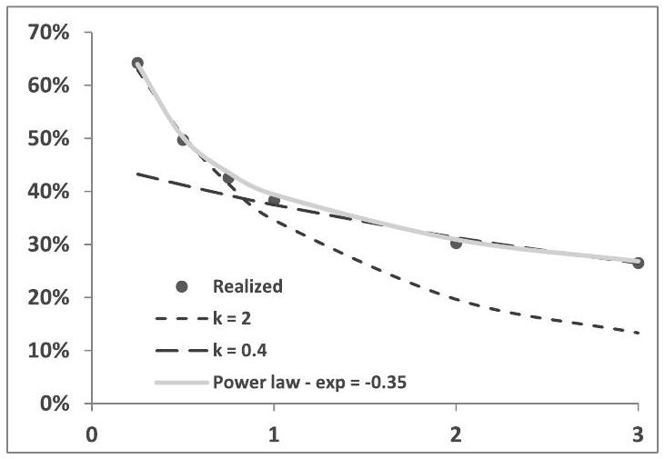
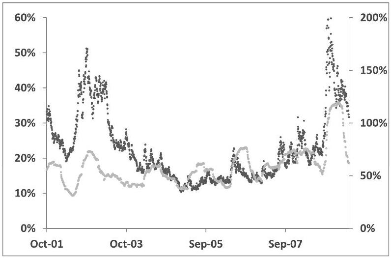
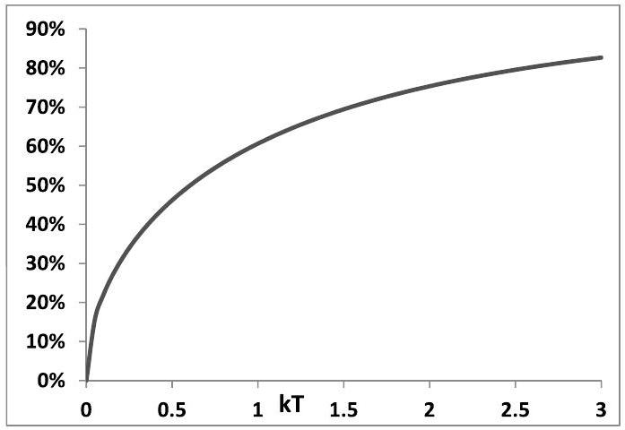
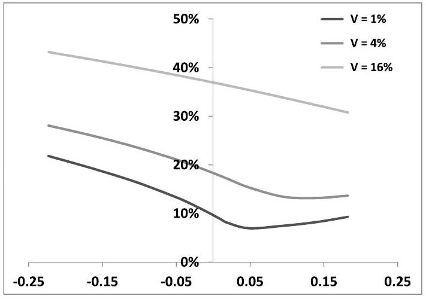
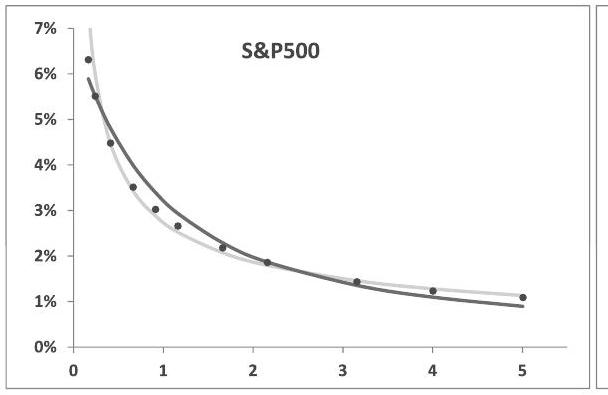
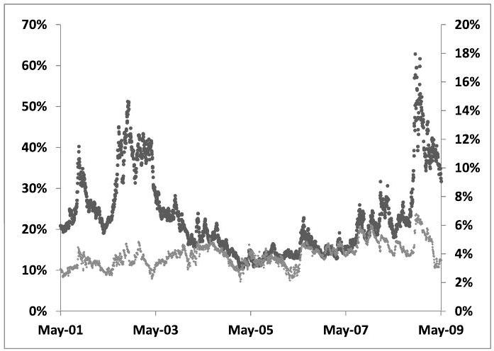

## Chapter 6

## An example of one-factor dynamics: the Heston model

In the next chapter we cover models built on a specification of the dynamics of forward VS variances that can be calibrated to a term structure of VS volatilities, or a term-structure of vanilla implied volatilities of an arbitrary moneyness.

We now briefly pause to consider the Heston model, which is not a forward variance model, since in its native form it can be calibrated to the VS volatility of one single maturity.

It is instructive to assess the Heston model and its capabilities in the framework of forward variances. This exercise will help us introduce suitability criteria which we then apply to the forward variance models covered in Chapter 7. Moreover, the Heston model is an archetypal example among first-generation stochastic volatility models, that is models written in terms of the instantaneous variance $V_{t}$.

Unless stated otherwise, forward VS variances $\xi_{t}^{T}$ will henceforth be called simply "forward variances" and we use $\widehat{\sigma}_{T}$ interchangeably for VS or log-contract implied volatilities.

### 6.1 The Heston model

The Heston model [60] is a first-generation model; it owes its popularity to the fact that, being an affine model, the Laplace transform of its moment-generating function for $\ln S$ is analytically known. Numerical inversion of this transform then yields vanilla option prices - when there are no dividends in fixed cash amounts.

The analytics of the Heston model is abundantly covered in the literature - see for example [48], [69]. Rather, we concentrate on the joint spot/volatility dynamics that this model generates. We assume for simplicity zero interest rate and repo.

The Heston model is a diffusive one-factor model - instead of forward variances, the instantaneous variance is modeled, according to the following SDEs:

$$
\left\{\begin{align*}
d S_{t} & =\sqrt{V_{t}} S_{t} d W_{t}  \tag{6.1}\\
d V_{t} & =-k\left(V_{t}-V^{0}\right) d t+\sigma \sqrt{V_{t}} d Z_{t}
\end{align*}\right.
$$
^eq6-1

$V_{t}$ is the instantaneous variance - with respect to our previous notation:

$$
V_{t}=\xi_{t}^{t}=\bar{\sigma}_{t}^{2}
$$

$\sigma$ is commonly called "volatility of volatility", though it is not a lognormal volatility as it has dimension time ${ }^{-1}$. The Brownian motions $W_{t}, Z_{t}$ are correlated, with correlation $\rho$. $V^{0}$ is a constant.

### 6.2 Forward variances in the Heston model

Forward variances $\xi_{t}^{T}$ are defined by:

$$
\xi_{t}^{T}=E_{t}\left[V_{T}\right]
$$

Taking the expectation of the second equation in (6.1) and using the compact notation $\bar{V}_{u}=E_{t}\left[V_{u}\right]$ yields:

$$
\begin{equation*}
d \bar{V}_{T}=-k\left(\bar{V}_{T}-V^{0}\right) d T \tag{6.2}
\end{equation*}
$$
^eq6-2

whose solution is

$$
\bar{V}_{T}=V^{0}+e^{-k(T-t)}\left(V_{t}-V^{0}\right)
$$

which, using our notation reads:

$$
\begin{equation*}
\xi_{t}^{T}=V^{0}+e^{-k(T-t)}\left(\xi_{t}^{t}-V^{0}\right) \tag{6.3}
\end{equation*}
$$
^eq6-3

VS volatilities $\widehat{\sigma}_{t}^{T}$ are given by:

$$
\begin{equation*}
\widehat{\sigma}_{T}^{2}(t)=\frac{1}{T-t} \int_{t}^{T} \xi_{t}^{\tau} d \tau=V^{0}+\frac{1-e^{-k(T-t)}}{k(T-t)}\left(V_{t}-V^{0}\right) \tag{6.4}
\end{equation*}
$$
^eq6-4

Differentiating (6.3) gives:

$$
d \xi_{t}^{T}=\sigma e^{-k(T-t)} \sqrt{\xi_{t}^{t}} d Z_{t}
$$

$\xi_{t}^{T}$ is driftless - as it should. In the framework of forward variances the Heston dynamics (6.1) reads:

$$
\left\{\begin{align*}
d S_{t} & =\sqrt{\xi_{t}^{t}} S_{t} d W_{t}  \tag{6.5}\\
d \xi_{t}^{T} & =\sigma e^{-k(T-t)} \sqrt{\xi_{t}^{t}} d Z_{t}
\end{align*}\right.
$$
^eq6-5

The Heston model is thus a one-factor model for forward variances where the instantaneous volatility of all forward variances $\xi_{t}^{T}$ is proportional to the instantaneous volatility $\bar{\sigma}_{t}=\sqrt{\xi_{t}^{t}}$. It is a Markov-functional model for forward variances, as $\xi_{t}^{T}$ is a function of $\xi_{t}^{t}$, given by (6.3).

Still, the Heston model should not be considered as a particular version of the forward variance models of Chapter 7; a one-dimensional Markov representation exists only if the initial values $\xi_{t=0}^{T}$ of forward variances satisfy condition (6.2):

$$
\frac{d \xi_{0}^{T}}{d T}=-k\left(\xi_{0}^{T}-V^{0}\right) d T
$$

It is not able to accommodate general term structure of VS volatilities.
Before analyzing further the dynamics of the Heston model, let us discuss the issue of the drift of $V_{t}$ in first-generation models.

### 6.3 Drift of $V_{t}$ in first-generation stochastic volatility models

The traditional approach to these models typically found in papers and textbooks can be summarized as follows:

- Start with historical dynamics of the instantaneous variance:

$$
d V_{t}=\mu(t, S, V, p) d t+\alpha d Z_{t}
$$

where $p$ are model parameters - such as $k, V^{0}$ in the Heston model.

- In risk-neutral dynamics, drift of $V_{t}$ is altered by "market price of risk" $\lambda$, which is an arbitrary function of $t, S, V$ :

$$
d V_{t}=(\mu(t, S, V, p)+\lambda(t, S, V)) d t+\alpha d Z_{t}
$$

- A few lines down the road, jettison "market price of risk" and conveniently decide that risk-neutral drift has same functional form as historical drift, except parameters now have stars:

$$
d V_{t}=\mu\left(t, S, V, p^{\star}\right) d t+\alpha d Z_{t}
$$

- Calibrate (starred) parameters on vanilla smile.

Discussions surrounding the "market price of risk" and the uneasiness generated by its a priori arbitrary form and hasty disposal are pointless - the "market price of risk" is a nonentity.
$V_{t}$ itself is an artificial object: for different $t, V_{t}$ represents a different forward variance. Its drift is then only a reflection of the term-structure of forward variances. Differentiating the identity $V_{t}=\xi_{t}^{t}$ and using the following dynamics for $\xi_{t}^{T}$ :

$$
d \xi_{t}^{T}=\lambda_{t}^{T} d Z_{t}^{T}
$$

yields

$$
d V_{t}=\left.\frac{d \xi_{t}^{T}}{d T}\right|_{T=t} d t+\lambda_{t}^{t} d Z_{t}^{t}
$$

The drift of the instantaneous variance is thus simply the slope at time $t$ of the short end of the variance curve. One can check that taking the derivative at $\xi_{t}^{T}$ with respect to $T$ in (6.3) indeed yields the drift of $V_{t}$ in the Heston model.

### 6.4 Term structure of volatilities of volatilities in the Heston model

Using (6.4) we get the following SDE for $\widehat{\sigma}_{T}$ :

$$
\begin{equation*}
d \widehat{\sigma}_{T}=\bullet d t+\frac{\sigma}{2} \frac{1-e^{-k(T-t)}}{k(T-t)} \frac{\widehat{\sigma}_{t}}{\widehat{\sigma}_{T}} d Z_{t} \tag{6.6}
\end{equation*}
$$
^eq6-6

where $\widehat{\sigma}_{t}=\sqrt{V_{t}}$. Let us examine the term structure of the volatility of VS volatilities, that is the dependence of the volatility of $\widehat{\sigma}_{T}$ on $T$. We have the two following limiting regimes:

$$
\begin{array}{ll}
T-t \ll \frac{1}{k} & d \widehat{\sigma}_{T} \simeq \bullet d t+\frac{\sigma}{2}\left(1-\frac{k(T-t)}{2}\right) \frac{\widehat{\sigma}_{t}}{\widehat{\sigma}_{T}} d Z_{t} \\
T-t \gg \frac{1}{k} & d \widehat{\sigma}_{T} \simeq \bullet d t+\frac{\sigma}{2} \frac{1}{k(T-t)} \frac{\widehat{\sigma}_{t}}{\widehat{\sigma}_{T}} d Z_{t} \tag{6.8}
\end{array}
$$
^eq6-8

Thus, for long maturities, the instantaneous volatility of $\widehat{\sigma}_{T}$ decays like $\frac{1}{T-t}$. For a flat term structure of VS volatilities, (6.6) implies that the instantaneous lognormal volatility of $\widehat{\sigma}_{T}$ is:

$$
\begin{equation*}
\operatorname{vol}\left(\widehat{\sigma}_{T}\right) \propto \frac{1-e^{-k(T-t)}}{k(T-t)} \tag{6.9}
\end{equation*}
$$
^eq6-9

Figure 6.1 shows the lognormal volatilities of VS implied volatilities of the Euro Stoxx 50 index, compared to expression (6.9), suitably rescaled, along with a power-law fit.

As Figure 6.1 shows, volatilities of VS volatilities are typically larger than volatilities of the underlying itself. This is not due to the fact that we are using VS volatilities - volatilities of ATM volatilities are similar.

As is apparent, while realized levels of volatilities of VS volatilities are consistent with a power law dependence on maturity, they cannot be captured by the dynamics of the Heston model over a wide range of maturities. The two values of $k$ used in Figure 6.1, 2 and 0.4, have been chosen so as to best match the short and long end of the term structure of the volatilities of VS volatilities in the graph.

Figure 6.1: Volatility of VS volatilities of the Euro Stoxx 50 index as a function of maturity (years), evaluated on the period [2005, 2010] (dots), along with (a) volatilities of VS volatilities in the Heston model given by (6.9) for two different values of $k$ (dotted lines), (b) a power-law fit $\propto T^{-0.35}$.

### 6.5 Smile of volatility of volatility

In diffusive models, for short maturities, the ATMF implied volatility is approximately equal to the instantaneous volatility, which is equal to $\sqrt{V}$. From (6.1) we get:

$$
d \sqrt{V}=\bullet d t+\frac{\sigma}{2} d Z_{t}
$$

Thus, in the Heston model, short ATMF implied volatilities are approximately normal, rather than lognormal, with a normal volatility equal to $\frac{\sigma}{2}$. Figure 6.2 shows the 3 month ATMF implied volatility as well as its realized (lognormal) volatility computed over a 6 -month sliding window.

Inspection of the scales of the left-hand and right-hand axes again confirms that volatilities of short-dated volatilities are larger than volatilities themselves. Also, Figure 6.2 shows that high levels of volatility tend to coincide with high levels of volatility of volatility. In this respect, implied volatilities are in fact more than lognormal: their dynamics seems to be of the type:

$$
d \widehat{\sigma}_{\mathrm{ATM}}=\bullet d t+\widehat{\sigma}_{\mathrm{ATM}}^{\gamma} d Z_{t}
$$

with $\gamma>1$. This should be compared with the value $\gamma=0$ that the Heston model generates for short maturities.

What about implied volatilities for longer maturities? Equation (6.8) shows that the instantaneous volatility of long-dated VS volatilities decays like $\frac{1}{T-t}$. Equation

Figure 6.2: The 3-month ATMF implied volatility of the Euro Stoxx 50 index (darker dots, left-hand axis) together with its (lognormal) volatility, evaluated with a sixmonth sliding window (lighter dots, right-hand axis) from October 2001 to May 2009.

(6.4) implies that, since $V_{t}$ is positive, $\widehat{\sigma}_{T}(t)$ has a floor:

$$
\widehat{\sigma}_{T}(t) \geq \widehat{\sigma}_{T}^{\min }(t)=\sqrt{V^{0}} \sqrt{1-\frac{1-e^{-k(T-t)}}{k(T-t)}}
$$

Figure 6.3 shows $\frac{\widehat{\sigma}_{T}^{\text {min }}(t)}{\sqrt{V^{0}}}$ as a function of $T-t$; note that, from (6.4), $\sqrt{V^{0}}$ is the level of VS volatility for long-dated maturities, calibrated at $t=0$. Forward VS volatilities are thus floored at a fraction of the initial long-run VS volatility level: The consequence for the smile of volatility of volatility is that volatilities of VS volatilities vanish as VS volatilities come near the floor. As is apparent in Figure 6.3, this floor on $\widehat{\sigma}_{T}(t)$ is not a minor effect.

### 6.6 ATMF skew in the Heston model

We now turn our attention to the dependence of the ATMF skew on maturity and volatility level. We obtain an approximation of the ATMF skew at order one in the volatility of volatility $\sigma$.

Figure 6.3: $\frac{\widehat{\sigma}_{T}^{\text {min }}(t)}{\sqrt{V^{0}}}$ as a function of $k(T-t)$.

### 6.6.1 The smile at order one in volatility of volatility

While we provide in Chapter 8 a general expression of the ATMF skew at order one in the volatility of volatility for general stochastic volatility models, we now carry out a derivation for the specific case of the Heston model.

The Heston model is homogeneous, thus vanilla implied volatilities are not a separate function of spot and strike, but of the ratio of the strike to the forward of the option's maturity. To reduce bookkeeping we now set interest rate and repo to zero and reinstate them once we have our final formulas.

From SDEs (6.1) we get the following equation for the price $P(t, S, V)$ of a European option:

$$
\begin{equation*}
\frac{d P}{d t}-k\left(V-V^{0}\right) \frac{d P}{d V}+\frac{V}{2} S^{2} \frac{d^{2} P}{d S^{2}}+\frac{\sigma^{2}}{2} V \frac{d^{2} P}{d V^{2}}+\rho \sigma V S \frac{d^{2} P}{d S d V}=0 \tag{6.10}
\end{equation*}
$$
^eq6-10

with the terminal condition at maturity $P(T, S, V)=f(S)$, where $f$ is the option's payoff. Denote by $P^{0}(t, S, V)$ the solution of (6.10) with $\sigma=0$ :

$$
\begin{equation*}
\frac{d P^{0}}{d t}-k\left(V-V^{0}\right) \frac{d P^{0}}{d V}+\frac{V}{2} S^{2} \frac{d^{2} P^{0}}{d S^{2}}=0 \tag{6.11}
\end{equation*}
$$
^eq6-11

with terminal condition $P^{0}(T, S, V)=f(S)$, where $f$ is the option's payoff.
To gain some intuition on the solution of (6.11) let us go back to the stochastic representation (6.1). For $\sigma=0, V$ is deterministic: the SDE for $V_{t}$ in (6.1) becomes an ODE, identical to (6.2). Given the value $V_{t}$ at time $t$, the value of $V_{\tau}$ at a later time $\tau$ is given by

$$
\begin{equation*}
V_{\tau}\left(V_{t}\right)=V^{0}+\left(V_{t}-V^{0}\right) e^{-k(\tau-t)} \tag{6.12}
\end{equation*}
$$
^eq6-12

For $\sigma=0$, the Heston model becomes a lognormal model with deterministic timedependent volatility $\sigma(\tau)$ given by:

$$
\sigma^{2}(\tau)=V_{\tau}\left(V_{t}\right)
$$

The implied volatility at time $t$ for maturity $T$ is given by:

$$
\begin{equation*}
\widehat{\sigma}_{T}^{2}(t, V)=\frac{1}{T-t} \int_{t}^{T} V_{\tau}(V) d \tau=V^{0}+\left(V-V^{0}\right) \frac{1-e^{-k(T-t)}}{k(T-t)} \tag{6.13}
\end{equation*}
$$
^eq6-13

where $V$ is the instantaneous variance at time $t . P^{0}$ is thus simply given by the Black-Scholes formula evaluated with implied volatility $\widehat{\sigma}_{T}(t, V)$ :

$$
P^{0}(t, S, V)=P_{B S}\left(t, S, \widehat{\sigma}_{T}(t, V)\right)
$$

Let us expand $P$ :

$$
P=P^{0}+\delta P
$$

where $\delta P$ is of order one in $\sigma$ and let us insert this expression in equation (6.10), keeping terms up to order one in $\sigma$. Using the fact that $P^{0}$ obeys (6.11) we are left with the following equation for $\delta P$ :

$$
\begin{equation*}
\frac{d \delta P}{d t}-k\left(V-V^{0}\right) \frac{d \delta P}{d V}+\frac{V}{2} S^{2} \frac{d^{2} \delta P}{d S^{2}}=-\rho \sigma V S \frac{d^{2} P^{0}}{d S d V} \tag{6.14}
\end{equation*}
$$
^eq6-14

with the terminal condition $\delta P(T, S, V)=0 . \delta P$ is generated by the source term in the right-hand side. The second derivative of $P_{0}$ with respect to $V$ does not appear, as it is multiplied by $\sigma^{2}$ - at order 1 in $\sigma$ only the mixed derivative of $P_{0}$ with respect to $S, V$ contributes.

The solution of (6.14) at time 0 is given by:

$$
\delta P(t, S, V)=\begin{gathered}
E_{t}^{0} \\
S_{t}=S \\
V_{t}=V
\end{gathered}\left[\left.\int_{t}^{T} \rho \sigma V_{\tau} S_{\tau} \frac{d^{2} P^{0}}{d S d V}\right|_{\tau, S_{\tau}, V_{\tau}} d \tau\right]
$$

where the subscript 0 indicates that the expectation is taken with respect to the dynamics (6.1) with $\sigma=0$, that is in a Black-Scholes model with deterministic time-dependent volatility $\sigma(\tau)$.

In the Black-Scholes model the vega of a European option is related to its dollar gamma - see (5.66), page 181:

$$
\frac{d P_{B S}}{d \widehat{\sigma}}=S^{2} \frac{d^{2} P_{B S}}{d S^{2}} \widehat{\sigma}(T-\tau)
$$

We then have:

$$
\begin{aligned}
\frac{d P_{0}}{d V} & =S^{2} \frac{d^{2} P^{0}}{d S^{2}} \widehat{\sigma}_{T}(\tau, V)(T-\tau) \frac{d \widehat{\sigma}_{T}(\tau, V)}{d V} \\
& =\frac{1-e^{-k(T-\tau)}}{2 k} S^{2} \frac{d^{2} P^{0}}{d S^{2}}
\end{aligned}
$$

where we have used expression (6.13) for $\widehat{\sigma}_{T}(\tau, V) . \delta P$ now reads:

$$
\delta P(t, S, V)=\begin{gathered}
E_{t}^{0} \\
S_{t}=S \\
V_{t}=V
\end{gathered}\left[\left.\int_{t}^{T} \frac{\rho \sigma}{2} V_{\tau}\left(V_{t}\right) \frac{1-e^{-k(T-\tau)}}{k} S_{\tau} \frac{d}{d S} S^{2} \frac{d^{2} P^{0}}{d S^{2}}\right|_{\tau, S_{\tau}, V_{\tau}} d \tau\right]
$$

where $V_{\tau}$ is given by expression (6.12) as a function of $V_{t}$, the instantaneous variance at time 0 .

We now take $t=0$ and simply denote by $V$ the instantaneous variance at $t=0$. We have shown in Appendix A of Chapter 5 that, in the Black-Scholes model with deterministic time-dependent volatility, $\mathrm{e}^{-r(\tau-t)} \frac{d^{n} P^{0}}{d \ln S^{n}}\left(\tau, S_{\tau}\right)$ is a martingale. Using:

$$
S \frac{d}{d S} S^{2} \frac{d^{2}}{d S^{2}}=\frac{d^{3}}{d \ln S^{3}}-\frac{d^{2}}{d \ln S^{2}}
$$

we get:

$$
\begin{equation*}
\delta P=\frac{\rho \sigma}{2}\left[\int_{0}^{T} V_{\tau}(V) \frac{1-e^{-k(T-\tau)}}{k} d \tau\right]\left(\frac{d^{3} P^{0}}{d \ln S^{3}}-\frac{d^{2} P^{0}}{d \ln S^{2}}\right)_{t=0, S, V} \tag{6.15}
\end{equation*}
$$
^eq6-15

where $V_{\tau}(V)$ is given by:

$$
V_{\tau}(V)=V^{0}+\left(V-V^{0}\right) e^{-k \tau}
$$

Compare (6.15) with expression (5.88), page 193: $\delta P$ has the same expression as a function of the second and third order derivatives of $P^{0}$ with respect to $\ln S$ : perturbing at order one in the volatility of volatility amounts to perturbing at order one in the third-order cumulant with fixed forward variances. ${ }^{1}$

This is not surprising. Indeed, the ODE for $E\left[V_{t}\right]$ in the Heston model - see equation (6.2) - does not involve $\sigma$. Consequently, the perturbation in powers of $\sigma$ leaves forward variances unchanged at all orders.

The interpretation of the integral over $\tau$ in the prefactor is not straightforward at this stage. It will become clear when we carry out the derivation for general stochastic volatility models - see Section 8.6.

The expansion of the implied volatility $\widehat{\sigma}_{K T}$ at order one in $\sigma$ is: $\widehat{\sigma}_{K T}=\widehat{\sigma}_{T}(0, V) +\delta \widehat{\sigma}_{K T}$ where $\delta \widehat{\sigma}_{K T}$ is given by:

$$
\begin{aligned}
\delta \widehat{\sigma}_{K T} & =\left(\frac{d P_{B S}}{d \widehat{\sigma}}\right)^{-1} \delta P \\
& =\frac{1}{\widehat{\sigma}_{T}(0, V) T}\left[\int_{0}^{T} \frac{\rho \sigma}{2} V_{\tau}(V) \frac{1-e^{-k(T-\tau)}}{k} d \tau\right] \frac{\frac{d^{3} P^{0}}{d \ln S^{3}}-\frac{d^{2} P^{0}}{d \ln S^{2}}}{\frac{d^{2} P^{0}}{d \ln S^{2}}-\frac{d P^{0}}{d \ln S}} \\
= & \frac{1}{\widehat{\sigma}_{T}(0, V) T}\left[\int_{0}^{T} \frac{\rho \sigma}{2} V_{\tau}(V) \frac{1-e^{-k(T-\tau)}}{k} d \tau\right] \frac{d}{d \ln S} \ln \left(\frac{d^{2} P^{0}}{d \ln S^{2}}-\frac{d P^{0}}{d \ln S}\right)
\end{aligned}
$$

[^84]where we have expressed vega in terms of gamma using relationship (5.66). Using the formula for the Black-Scholes dollar gamma, we get:

$$
\delta \widehat{\sigma}_{K T}=\frac{1}{\widehat{\sigma}_{T}^{3} T^{2}}\left[\frac{\rho \sigma}{2} \int_{0}^{T} V_{\tau}(V) \frac{1-e^{-k(T-\tau)}}{k} d \tau\right]\left(\frac{\widehat{\sigma}_{T}^{2} T}{2}+\ln \frac{K}{S}\right)
$$

We now reinstate interest rate and repo. As mentioned above, we only need to replace $\frac{K}{S}$ with $\frac{K}{F_{T}}$, where $F_{T}$ is the forward for maturity $T$ :

$$
\begin{equation*}
\delta \widehat{\sigma}_{K T}=\frac{1}{\widehat{\sigma}_{T}^{3} T^{2}}\left[\frac{\rho \sigma}{2} \int_{0}^{T} V_{\tau}(V) \frac{1-e^{-k(T-\tau)}}{k} d \tau\right]\left(\frac{\widehat{\sigma}_{T}^{2} T}{2}+\ln \frac{K}{F_{T}}\right) \tag{6.16}
\end{equation*}
$$
^eq6-16

We have used the shorthand notation $\widehat{\sigma}_{T}=\widehat{\sigma}_{T}(0, V)=\sqrt{V^{0}+\left(V-V^{0}\right) \frac{1-e^{-k T}}{k T}}$. The notation $\widehat{\sigma}_{T}$ is appropriate, as $\widehat{\sigma}_{T}$ is the VS volatility both in the order-zero and order-one expansion in $\sigma$. Denoting the ATMF skew by $\mathcal{S}_{T}$ and the ATMF volatility by $\widehat{\sigma}_{F_{T} T}$, (6.16) gives:

$$
\begin{align*}
\widehat{\sigma}_{F_{T} T} & =\widehat{\sigma}_{T}\left(1+\frac{\widehat{\sigma}_{T} T}{2} \mathcal{S}_{T}\right)  \tag{6.17a}\\
\mathcal{S}_{T} & =\left.\frac{d \widehat{\sigma}_{K T}}{d \ln K}\right|_{F_{T}}=\frac{1}{\widehat{\sigma}_{T}^{3} T^{2}} \frac{\rho \sigma}{2} \int_{0}^{T} V_{\tau} \frac{1-e^{-k(T-\tau)}}{k} d \tau \tag{6.17b}
\end{align*}
$$
^eq6-17a
^eq6-17b

## Short maturities

Let us take the limit $k T \ll 1$. Formula (6.16) translates at lowest order in $k T$ in the following expressions for $\widehat{\sigma}_{F_{T} T}$ and $\mathcal{S}_{T}$ :

$$
\begin{align*}
\widehat{\sigma}_{F_{T} T} & =\sqrt{V}\left(1+\frac{\rho \sigma T}{8}\right)  \tag{6.18a}\\
\mathcal{S}_{T} & =\frac{\rho \sigma}{4 \sqrt{V}}=\frac{\rho \sigma}{4 \widehat{\sigma}_{F_{T} T}} \tag{6.18b}
\end{align*}
$$
^eq6-18a
^eq6-18b

where the second equality in (6.18b) is correct at order 1 in $\sigma$.

## Long maturities

We now take the limit $k T \gg 1$. Keeping only terms of order 1 in $1 / k T$ we get:

$$
\begin{align*}
\widehat{\sigma}_{F_{T} T} & =\sqrt{V^{0}}\left(1+\frac{\rho \sigma}{4 k}\right)+\frac{1}{2 k T}\left(\frac{V-V^{0}}{\sqrt{V^{0}}}+\frac{\rho \sigma}{4 k} \frac{V-3 V^{0}}{\sqrt{V^{0}}}\right)  \tag{6.19a}\\
\mathcal{S}_{T} & =\frac{\rho \sigma}{2 \sqrt{V^{0}}} \frac{1}{k T} \tag{6.19b}
\end{align*}
$$
^eq6-19a
^eq6-19b

### 6.6.2 Example

Consider the example of a smile for a three-month maturity generated with the following parameters, whose values are typical of index smiles: $V^{0}=0.04, k=1$, $\sigma=0.6, \rho=-80 \%$.

Figure 6.4 shows $\widehat{\sigma}_{K T}$ as a function of $\ln \left(\frac{K}{F_{T}}\right)$ for three different values of $V$ : $1 \%, 4 \%, 16 \%$, corresponding approximately to ATMF volatilities around $10 \%, 20 \%$, and $40 \%$, respectively.

The reason why we choose to vary $V$ while keeping other parameters constant is that $V$ is the only state variable of the Heston model. Figure 6.4 provides an illustration of future smiles that the Heston model generates at time $T_{1}$ for maturity $T_{2}=T_{1}+3$ months - as a function of $V_{T_{1}}$.

Figure 6.4: Implied volatilities $\widehat{\sigma}_{K T}$ as a function of $\ln \left(\frac{K}{F_{T}}\right)$ for a maturity $T=3$ months, in the Heston model, generated with the following parameters: $V^{0}=0.04$, $k=1, \sigma=0.6, \rho=-80 \%$, for three different values of $V$.

The quality of approximations (6.17a, 6.17b) for these parameter values is assessed in Tables 6.1 and 6.2.

| $V$ | $1 \%$ | $4 \%$ | $16 \%$ |
| :--- | :---: | :---: | :---: |
| $S_{T}^{\text {real }}$ | -8.1 | -6.0 | -3.1 |
| $S_{T}^{\text {approx }}$ | -8.8 | -5.5 | -3.0 |

Table 6.1: ATMF skew in the Heston model for a three-month maturity, for different values of $V$ with $V^{0}=0.04, k=1, \sigma=0.6, \rho=-80 \%$, computed either exactly: $\mathcal{S}_{T}^{\text {real }}$ or using approximation (6.17b): $\mathcal{S}_{T}^{\text {approx }}$. Results have been multiplied by 10 to represent approximately the difference in volatility points of implied volatilities for strikes $0.95 F_{T}$ and $1.05 F_{T}$.

| $V$ | $1 \%$ | $4 \%$ | $16 \%$ |
| :--- | :---: | :---: | :---: |
| $\widehat{\sigma}_{T}$ | 11.6 | 20 | 38.2 |
| $\left(\widehat{\sigma}_{F_{T} T}-\widehat{\sigma}_{T}\right)_{\text {real }}$ | -1.9 | -1.7 | -1.2 |
| $\left(\widehat{\sigma}_{F_{T} T}-\widehat{\sigma}_{T}\right)_{\text {approx }}$ | -0.1 | -0.3 | -0.5 |

Table 6.2: $\widehat{\sigma}_{T}$ and the difference $\widehat{\sigma}_{F_{T} T}-\widehat{\sigma}_{T}$, both in volatility points, in the Heston model for a three-month maturity, for different values of $V$ with $V^{0}=0.04, k=1$, $\sigma=0.6, \rho=-80 \%$, computed either exactly (real) or using approximation (6.17a) (approx).

The ATMF skew is acceptably captured by an approximation at order one in $\sigma$ : the maximum relative error is about $10 \%$.

In contrast, the difference $\widehat{\sigma}_{F_{T} T}-\widehat{\sigma}_{T}$, is poorly estimated by (6.17a). Though both $\mathcal{S}_{T}$ and $\widehat{\sigma}_{F_{T} T}-\widehat{\sigma}_{T}$ are of order one in $\sigma$, the approximation for $\mathcal{S}_{T}$ is more robust.

This is generally observed in stochastic volatility models for equities: one typically needs to carry out the expansion of the ATMF volatility at order two in volatility of volatility to reach acceptable accuracy - more on this in Section 8.2.

### 6.6.3 Term structure of the ATMF skew

Equations (6.18b), (6.19b) show that while the ATMF skew tends to a constant for $T \rightarrow 0$, it decays like $\frac{1}{T}$ for long maturities, at order one in $\sigma$. The $\frac{1}{T}$ decay for long maturities is expected: because $V$ is mean-reverting, for maturities $T$ such that $T \gg \frac{1}{k}$, the distribution of returns of $\ln S$ over long periods becomes independent on the initial value of $V$, hence returns of $\ln S$ over long time scales become independent. The third-order cumulant $\kappa_{3}$ of $\ln S$ then scales like $T$, the skewness $s$ of $\ln S$ scales like $\frac{1}{\sqrt{T}}$ and (5.92) then implies that $\mathcal{S}_{T} \propto \frac{1}{T}$.

In the special case when $V=V^{0}$, the term structure of VS volatilities is flat, $V_{t}$ is constant and (6.16) takes the following simple form:

$$
\begin{equation*}
\left.\frac{d \widehat{\sigma}_{K T}}{d \ln K}\right|_{F_{T}}=\frac{\rho \sigma}{2 \sqrt{V^{0}}} \frac{k T+e^{-k T}-1}{(k T)^{2}} \tag{6.20}
\end{equation*}
$$
^eq6-20

Figure 6.5 shows an example of the term structure of the ATMF skew for the Euro Stoxx 50 and S\&P 500 indexes, together with a power-law fit and a best fit using formula (6.20). The maturity dependence of the market skew indeed exhibits a power-law-like behavior, which cannot be captured by the Heston model for both short and long maturities: the Heston model is a one-factor model, with an embedded time scale $1 / k$.

The issue here is not only about whether we are or aren't able to fit the vanilla smile. Rather, when risk-managing cliquets we may need to carry a naked forward smile position: it is then necessary to assess whether the model is able to gener-
ate future smiles - that is vanilla smiles at future dates - that are comparable to historically observed vanilla smiles - see the discussion below.

Figure 6.5: The ATMF skew as a function of maturity for the Euro Stoxx 50 and S\&P 500 indexes (dots), observed on October 22, 2010, expressed as the difference in volatility points of the implied volatilities of strikes $0.95 F_{T}$ and $1.05 F_{T}$. A best fit using a power law with exponent 0.55 (lighter line) as well as a best fit using formula (6.20) $(k=2.9)$ (darker line) are shown as well.

### 6.6.4 Relationship between ATMF volatility and skew

For short maturities, equation (6.18b) shows that, in the Heston model the ATMF skew is inversely proportional to the ATMF implied volatility - this is also evidenced in Figure 6.6. Is this dependence observed in reality?

Figure 6.6 displays the ATM volatility together with the ATM skew for a 3-month maturity, for the Euro Stoxx 50 index. ${ }^{2}$ We can see that while skew and volatility seem to behave fairly independently, they are, if anything, positively correlated rather than negatively. It seems unreasonable to hard-wire an inverse dependence of the ATMF skew to the ATMF volatility in our model.

### 6.7 Discussion

The above analysis has highlighted some discrepancies between the spot/volatility dynamics generated by the Heston model on one hand, and observed in reality on the other hand - see also [8]. What makes the Heston model unsuitable for handling exotics however, rather than its inability to reproduce exactly the observed historical dynamics, is the lack of flexibility it affords.

[^85]
Figure 6.6: The ATM skew (lighter dots, right-hand axis) as the difference of the implied volatilities of the $95 \%$ and $105 \%$ strikes, and the ATM volatility (darker dots, left-hand axis) of the Euro Stoxx 50 index, for a 3-month maturity.

Indeed, from a trading perspective, one may choose to use parameter levels different than their historical averages and structural dependencies other than what is historically observed, even for parameters that have no implied counterpart. For example, even though the historical realized correlation between two quantities may be negligibly small, we will use bid/offer levels that are different than zero, depending on the size and sign of the option's sensitivity to correlation.

Likewise, imagine that in reality the short ATMF skew was indeed approximately inversely proportional to the short ATMF volatility, thus in line with the behavior generated in the Heston model. Still, when selling an exotic option that has positive forward ATMF volatility/skew cross-gamma: $\frac{d^{2} P}{d \widehat{\sigma}_{T^{T}} d S_{T}}>0$, we may choose to conservatively price with a model that generates positive or vanishing covariance between ATMF volatility and skew - rather than negative.

Making the level of the short ATMF skew independent on the level of short ATMF volatility is easy: we only need to replace the SDE for $V_{t}$ in (6.1) with:

$$
d V_{t}=\bullet d t+\nu V_{t} d Z_{t}
$$

This would also have the advantage of making the short ATMF volatility lognormal rather than normal.

Other deficiencies of the Heston model are structural. For example, the scaling with maturity of the volatility of volatility in (6.6) and of the ATMF skew in (6.20) is intimately related to the fact that the Heston model is a one-factor model. Some have advocated making the parameters of the Heston model time-dependent so as to alter the dependence of $\mathcal{S}_{T}$ on $T$ and achieve accurate calibration of the vanilla smile.

Making $V^{0}$ time-dependent so as to best match the term structure of VS volatilities is appropriate, as forward variances can be hedged by trading variance swaps. ${ }^{3}$ Making $\sigma$ and $\rho$ time-dependent is more questionable.

Indeed, consider the example of a call-spread cliquet paying at time $T_{2}$ the payoff $\left(\frac{S_{T_{2}}}{S_{T_{1}}}-95 \%\right)^{+}-\left(\frac{S_{T_{2}}}{S_{T_{1}}}-105 \%\right)^{+}$, where $T_{2}-T_{1} \ll \frac{1}{k}$. This call spread has negligible sensitivity to volatility but is very sensitive to the ATMF skew observed at $T_{1}$ for maturity $T_{2}$. The order-one expansion in $\sigma$ in (6.18b) yields the following expression for the ATMF skew at $T_{1}$ for maturity $T_{2}$ :

$$
\mathcal{S}_{T_{2}}\left(T_{1}\right)=\frac{\rho\left(T_{1}\right) \sigma}{4 \sqrt{V_{T_{1}}}}
$$

where we have allowed $\rho$ to be time-dependent so as to match the term structure of the market vanilla ATMF skew. By pricing the cliquet with the Heston model thus calibrated we are betting on a given level of forward skew $\mathcal{S}_{T_{2}}\left(T_{1}\right)$, derived from calibration to today's term structure of the ATMF skew of vanilla options. Worse, the model will actually generate hedge ratios for our forward-start call spread on vanilla options of maturities $T_{1}$ and $T_{2}$.

This is not justified, as it is not possible to hedge forward-skew risk by trading vanilla options - we refer the reader to the illuminating experiment in Section 3.1.7. In case we are unable to take an offsetting position in a different exotic that has comparable forward-smile risk and have to keep the cliquet and its forward skew exposure on our book, it is more reasonable to select a conservative level of forward skew we are comfortable with, rather than having it dictated by calibration to market prices of instruments that are incapable of hedging it. The same goes for volatility-of-volatility risk.

Only if we are able to trade cliquets of varying maturities is it licit to make $\sigma$ or $\rho$ time-dependent, so as to match the term structure of the implied forward skew.

Fundamentally, the problem with the Heston model lies not so much with the model itself, its lack of flexibility, or even its peculiar idiosyncrasies, but with its usage (and its users): which practical pricing or hedging issue naturally calls for SDE (6.5)?

[^86]
## Chapter's digest

In terms of forward variances, the SDE of the Heston model reads:

$$
\left\{\begin{aligned}
d S_{t} & =\sqrt{\xi_{t}^{t}} S_{t} d W_{t} \\
d \xi_{t}^{T} & =\sigma e^{-k(T-t)} \sqrt{\xi_{t}^{t}} d Z_{t}
\end{aligned}\right.
$$

with the following constraint on the initial values of forward variances:

$$
\frac{d \xi_{0}^{T}}{d T}=-k\left(\xi_{0}^{T}-V^{0}\right) d T
$$

VS volatilities are given by:

$$
\widehat{\sigma}_{T}^{2}(t)=V^{0}+\frac{1-e^{-k(T-t)}}{k(T-t)}\left(V_{t}-V^{0}\right)
$$

thus are floored.
The drift of the instantaneous variance $V_{t}$ in stochastic volatility models has nothing to do with the "market price of risk". It is related to the initial slope of the variance curve:

$$
d V_{t}=\left.\frac{d \xi_{t}^{T}}{d T}\right|_{T=t} d t+\lambda_{t}^{t} d Z_{t}^{t}
$$

- For a flat term-structure of VS volatilities, at order one in volatility of volatility, the ATMF skew of the Heston model is given by:

$$
\mathcal{S}_{T}=\frac{\rho \sigma}{2 \sqrt{V^{0}}} \frac{k T+e^{-k T}-1}{(k T)^{2}}
$$

and the (lognormal) volatility of the VS volatility of maturity $T, \widehat{\sigma}_{T}$, has the form:

$$
\operatorname{vol}\left(\widehat{\sigma}_{T}\right) \propto \frac{1-e^{-k T}}{k T}
$$

At order one in volatility of volatility, the ATMF skew of the Heston model for short maturities is given by:

$$
\mathcal{S}_{T}=\frac{\rho \sigma}{4 \sqrt{V}}
$$

and for long maturities:

$$
\mathcal{S}_{T}=\frac{\rho \sigma}{2 \sqrt{V^{0}}} \frac{1}{k T}
$$

It decays as $\frac{1}{T}$.
