## Chapter 7

## Forward variance models

We catch up to where we left off, at the end of Chapter 4. We examine diffusive stochastic volatility models built on the dynamics of continuous forward VS variances - they are exactly calibrated to an initial term structure of VS volatilities, by construction. They can alternatively be calibrated to a term structure of implied volatilities of other payoffs, for example ATMF vanilla options, or power payoffs.

We concentrate on the control of the term structure of volatility of volatility, the term structure of the ATMF skew, the smile of volatility of volatility and cover options on realized variance and VIX instruments.

The last section deals with discrete forward variance models, a type of stochastic volatility model that is particularly suited to the analysis of exotic option risks in terms of volatility of volatility, spot/volatility covariance and future skew.

### 7.1 Pricing equation

The Heston model - studied in the preceding chapter - is an elementary attempt at designing a model such that implied volatilities are not frozen anymore and have their own dynamics. This is done by specifying an SDE for the instantaneous variance $V_{t}$, a non-physical object. It has then been our task to extract the dynamics of implied volatilities that this SDE gives rise to.

In this chapter we model implied volatilities directly. From the discussion in Section 4.3.6, page 148, and Section 5.5, page 168, it is clear that the easiest objects to model are VS forward variances $\xi^{T}$.

The $\xi^{T}$ will be our state variables, in addition to $S$, and we will design models so that we have a direct handle on the volatilities of VS volatilities - instantaneous or discrete, forward or spot-starting. The price of an option in such a model is given by:

$$
P(t, S, \xi)
$$

where $\xi$ is the variance curve.
Consider a short position in an option of maturity $T$ - first unhedged. Our P\&L during $\delta t$ is

$$
-[P(t+\delta t, S+\delta S, \xi+\delta \xi)-(1+r \delta t) P(t, S, \xi)]
$$

The delta hedge consists of $\frac{d P}{d S}$ shares and $\frac{\delta P}{\delta \xi^{u}}$ forward VS contracts of maturity $u$, for all $u$ in $[t, T]$, where $\frac{\delta P}{\delta \xi^{u}}$ is a functional derivative, since $\xi^{u}$ is a function of $u$. Our total P\&L during $\delta t$, including now our delta- and vega-hedge, is:

$$
\begin{aligned}
P \& L= & -[P(t+\delta t, S+\delta S, \xi+\delta \xi)-(1+r \delta t) P(t, S, \xi)] \\
& +\frac{d P}{d S}(\delta S-(r-q) S \delta t)+\int_{t}^{T} \frac{\delta P}{\delta \xi^{u}} \delta \xi^{u}
\end{aligned}
$$

We remind the reader of the fact that (forward) VSs - which provide exact delta hedges for the $\xi^{u}$ - can be entered into at zero cost. The $\xi^{u}$ have no financing cost thus zero risk-neutral drift - hence the simple form of the contribution of $\delta \xi^{u}$ to the P\&L.

Expanding at order one in $\delta t$ and two in $\delta S$ and $\delta \xi^{u}:^{1}$

$$
\begin{align*}
P \& L= & -\frac{d P}{d t} \delta t+r P \delta t-(r-q) S \frac{d P}{d S} \delta t \\
& -\frac{S^{2}}{2} \frac{d^{2} P}{d S^{2}} \frac{\delta S^{2}}{S^{2}}-\frac{1}{2} \int_{t}^{T} d u \int_{t}^{T} d u^{\prime} \frac{d^{2} P}{\delta \xi^{u} \delta \xi^{u^{\prime}}} \delta \xi^{u} \delta \xi^{u^{\prime}}-\int_{t}^{T} d u S \frac{d^{2} P}{d S \delta \xi^{u}} \frac{\delta S}{S} \delta \xi^{u} \tag{7.1}
\end{align*}
$$
^eq7-1

Using the same criteria that led us to the Black-Scholes equation in Section 1.1, we specify break-even levels for the random second-order terms in the P\&L. Denote by $\sigma(t)$ the instantaneous break-even volatility of $S_{t}$ and by $\nu\left(t, u, u^{\prime}\right)$ and $\mu(t, u)$ the instantaneous break-even covariances for, respectively, $\delta \xi^{u}, \delta \xi^{u^{\prime}}$ and $\delta \xi^{u}, \frac{\delta S}{S}$ :

$$
\begin{align*}
\mu(t, u) \delta t & =\left\langle\frac{\delta S}{S} \delta \xi^{u}\right\rangle_{t}  \tag{7.2a}\\
\nu\left(t, u, u^{\prime}\right) \delta t & =\left\langle\delta \xi^{u} \delta \xi^{u^{\prime}}\right\rangle_{t} \tag{7.2b}
\end{align*}
$$
^eq7-2a
^eq7-2b

Obviously $\mu$ is only defined for $u \geq t$ and $\nu$ for $u \geq t, u^{\prime} \geq t$.
Break-even variances and covariances can be at most a function of our state variables $S$ and $\xi$, unless we introduce additional degrees of freedom in the model. We thus write: $\sigma(t, S, \xi), \nu\left(t, u, u^{\prime}, S, \xi\right), \mu(t, u, S, \xi)$. In the models we will work with in the sequel, $\nu$ and $\mu$ do not depend on $S$, so let us write our covariance functions more simply as: $\nu\left(t, u, u^{\prime}, \xi\right), \mu(t, u, \xi)$.

We would like our carry $\mathrm{P} \& \mathrm{~L}$ at order one in $\delta t$, two in $\delta S, \delta \xi$ to read:

$$
\begin{align*}
P \& L= & -\frac{S^{2}}{2} \frac{d^{2} P}{d S^{2}}\left(\frac{\delta S^{2}}{S^{2}}-\sigma(t, S, \xi)^{2} \delta t\right)  \tag{7.3a}\\
& -\frac{1}{2} \int_{t}^{T} d u \int_{t}^{T} d u^{\prime} \frac{d^{2} P}{\delta \xi^{u} \delta \xi^{u^{\prime}}}\left(\delta \xi^{u} \delta \xi^{u^{\prime}}-\nu\left(t, u, u^{\prime}, \xi\right) \delta t\right)  \tag{7.3b}\\
& -\int_{t}^{T} d u S \frac{d^{2} P}{d S \delta \xi^{u}}\left(\frac{\delta S}{S} \delta \xi^{u}-\mu(t, u, \xi) \delta t\right) \tag{7.3c}
\end{align*}
$$
^eq7-3a
^eq7-3b
^eq7-3c

[^87]The gamma P\&L in (7.3a) can be offset by trading a short-maturity VS. So that no free theta is generated, we must impose that the break-even volatility at time $t$ is equal to the instantaneous VS volatility: $\sigma(t, S, \xi)^{2}=\left(\widehat{\sigma}_{t}^{t}\right)^{2}=\xi^{t}$.

Identifying the $\delta t$ terms in (7.1) and (7.3) supplies us with the pricing equation in our model:

$$
\begin{align*}
& \frac{d P}{d t}+(r-q) S \frac{d P}{d S}+\frac{\xi^{t}}{2} S^{2} \frac{d^{2} P}{d S^{2}} \\
& +\frac{1}{2} \int_{t}^{T} d u \int_{t}^{T} d u^{\prime} \nu\left(t, u, u^{\prime}, \xi\right) \frac{d^{2} P}{\delta \xi^{u} \delta \xi^{u^{\prime}}}+\int_{t}^{T} d u \mu(t, u, \xi) S \frac{d^{2} P}{d S \delta \xi^{u}}=r P \tag{7.4}
\end{align*}
$$
^eq7-4

with the terminal condition $P(t, S, \xi, t=T)=g(S)$ where $g$ is the option's payoff, in the case of a European option.

Generally, $g$ can depend on the full path of $S_{t}$ for a path-dependent option, or the full path of $S_{t}$ and of the $\xi_{t}^{\tau}$ if the payoff involves observations of VS volatilities. ${ }^{2}$

The probabilistic interpretation of (7.4) is that $P$ is given - in the case of a European payoff - by:

$$
P=E\left[g\left(S_{T}\right) \mid S_{t}=S, \xi_{t}^{u}=\xi^{u}\right]
$$

with the following SDEs for $S_{t}$ and $\xi_{t}^{u}$ :

$$
\left\{\begin{aligned}
d S_{t} & =(r-q) S_{t} d t+\sqrt{\xi_{t}^{t}} S_{t} d W_{t}^{S} \\
d \xi_{t}^{u} & =\lambda_{t}^{u} d W_{t}^{u}
\end{aligned}\right.
$$

with $\lambda_{t}^{u}$ and correlations between $W_{t}^{S}$ and $W_{t}^{u}$ such that:

$$
\begin{align*}
\lim _{d t \rightarrow 0} \frac{1}{d t} E_{t}\left[d \ln S_{t} d \xi_{t}^{u}\right] & =\sqrt{\xi_{t}^{t}} \lambda_{t}^{u} \frac{1}{d t} E_{t}\left[d W_{t}^{S} d W_{t}^{u}\right]=\mu(t, u, \xi)  \tag{7.5}\\
\lim _{d t \rightarrow 0} \frac{1}{d t} E_{t}\left[d \xi_{t}^{u} d \xi_{t}^{u^{\prime}}\right] & =\lambda_{t}^{u} \lambda_{t}^{u^{\prime}} \frac{1}{d t} E_{t}\left[d W_{t}^{u} d W_{t}^{u^{\prime}}\right]=\nu\left(t, u, u^{\prime}, \xi\right) \tag{7.6}
\end{align*}
$$
^eq7-5
^eq7-6

### 7.2 A Markov representation

While equation (7.4) is general, it is an infinite-dimensional equation that is not solvable unless the $\xi^{u}$ possess a Markov-functional representation. Failing that, in a Monte Carlo simulation the (infinitely many) $\xi^{u}$ need to be evolved individually. This is not possible, unless one resorts to an approximation. If instead a Markovfunctional representation exists, the $\xi^{u}$ can be expressed as a function of a small set of state variables.

[^88]In addition to this technical condition, we also require that the dynamics of forward variances be financially motivated. ${ }^{3}$

Consider a forward variance $\xi^{T}$, where $T$ is an arbitrary date, and let us start with a lognormal dynamics for $\xi^{T}$ - Figure 6.2 in Section 6.5 suggests that this assumption is a reasonable starting point. How should the volatility of $\xi_{t}^{T}$ depend on $t$ and $T$ ?

If there existed a market of options on $\xi^{T}$ with maturities ranging from $t$ to $T$, the volatility risk of $\xi^{T}$ could be hedged away and the volatility of $\xi^{T}$ would be derived from market implied volatilities. However, volatility of volatility is only traded in very special forms, for example through options on realized variance, through VIX futures and options, or cliquets. We have already considered cliquets beforehand and will analyze in detail other instruments further on, and characterize the type of volatility-of-volatility risk they are sensitive to.

In general we will have no choice but to carry a position on the realized volatility of $\xi^{T}$ and thus will need to make assumptions that we will depend on. It is then reasonable to make the assumption of time-homogeneity: the volatility of $\xi^{T}$ only depends on $T-t$, with a dependence that is adjustable so that, for example, volatilities of spot-starting VS volatilities $\widehat{\sigma}_{T}$ in the model can be made to match their historical counterparts. Let us then write:

$$
\begin{equation*}
d \xi_{t}^{T}=\omega(T-t) \xi_{t}^{T} d W_{t}^{T} \tag{7.7}
\end{equation*}
$$
^eq7-7

The solution of this SDE is

$$
\begin{equation*}
\ln \left(\xi_{t}^{T}\right)=\ln \left(\xi_{0}^{T}\right)-\frac{1}{2} \int_{0}^{t} \omega^{2}(T-\tau) d \tau+\int_{0}^{t} \omega(T-\tau) d W_{\tau}^{T} \tag{7.8}
\end{equation*}
$$
^eq7-8

Imagine the same Brownian motion $W_{t}$ drives the dynamics of all $\xi^{T}$. Equation (7.8) expresses $\ln \xi^{T}$ as a weighted average of increments of $W_{t}$, with a weight $\omega(T-t)$ that depends on $T$, hence is specific to forward variance $\xi^{T}$. Even though a single Brownian motion drives our model, simulation of the forward variance curve at time $t$ requires knowledge of the full path of $W_{t}$, as weights for different forward variances are different - all of the $\xi^{T}$ have to be simulated individually.

However, if $\omega$ is of the form:

$$
\begin{align*}
\omega(u) & =\omega e^{-k u}  \tag{7.9}\\
\int_{0}^{t} \omega(T-\tau) d W_{\tau} & =e^{-k T} \int_{0}^{t} e^{k \tau} d W_{\tau}
\end{align*}
$$
^eq7-9

The dependence on $T$ factors out and knowledge of one quantity $-\int_{0}^{t} e^{k \tau} d W_{\tau}-$ allows the construction of the full variance curve at time $t$ : a Markov-functional representation exists. ${ }^{4}$

[^89]Choosing an exponentially decaying volatility function is equivalent to driving the dynamics of forward variances with one Ornstein-Ühlenbeck (OU) process $X_{t}$ :

$$
d X_{t}=-k X_{t} d t+d W_{t}, X_{0}=0
$$

$X_{t}$ and its variance are given by:

$$
X_{t}=\int_{0}^{t} e^{-k(t-\tau)} d W_{\tau} \quad E\left[X_{t}^{2}\right]=\frac{1-e^{-2 k t}}{2 k}
$$

With $\omega(u)$ of the form (7.9), the solution of SDE (7.7) reads:

$$
\begin{equation*}
\xi_{t}^{T}=\xi_{0}^{T} \exp \left(\omega e^{-k(T-t)} X_{t}-\frac{\omega^{2}}{2} e^{-2 k(T-t)} E\left[X_{t}^{2}\right]\right) \tag{7.10}
\end{equation*}
$$
^eq7-10

$\omega$ is the lognormal volatility of $\xi_{t}^{T=t}$, a foward variance with vanishing maturity.

## $7.3 N$-factor models

Let us use $N$ Brownian motions and write the SDE of $\xi_{t}^{T}$ as:

$$
\begin{equation*}
d \xi_{t}^{T}=\omega \alpha_{w} \xi_{t}^{T} \sum_{i} w_{i} e^{-k_{i}(T-t)} d W_{t}^{i} \tag{7.11}
\end{equation*}
$$
^eq7-11

where $\alpha_{w}$ is a normalizing factor such that the instantaneous lognormal volatility of $\xi_{t}^{T=t}$ is $\omega$. Volatilities of volatilities are more natural objects than volatilities of variances. We thus introduce the lognormal volatility $\nu$ of a VS volatility of vanishing maturity, which is the square root of $\xi_{t}^{t}$. Its instantaneous volatility is half that of $\xi_{t}^{t}$. We have:

$$
\begin{align*}
\omega & =2 \nu  \tag{7.12a}\\
\alpha_{w} & =\frac{1}{\sqrt{\sum_{i j} w_{i} w_{j} \rho_{i j}}} \tag{7.12b}
\end{align*}
$$
^eq7-12a
^eq7-12b

The solution of (7.11) is given by:

$$
\begin{equation*}
\xi_{t}^{T}=\xi_{0}^{T} \exp \left(\omega \Sigma_{i} w_{i} e^{-k_{i}(T-t)} X_{t}^{i}-\frac{\omega^{2}}{2} \Sigma_{i j} w_{i} w_{j} e^{-\left(k_{i}+k_{j}\right)(T-t)} E\left[X_{t}^{i} X_{t}^{j}\right]\right) \tag{7.13}
\end{equation*}
$$
^eq7-13

where the $N$ OU processes $X^{i}$ are defined by:

$$
\begin{equation*}
d X_{t}^{i}=-k_{i} X_{t}^{i} d t+d W_{t}^{i}, X_{t=0}^{i}=0 \tag{7.14}
\end{equation*}
$$
^eq7-14

that ensure that $\xi_{t}^{T}$ are martingales. This amounts to enforcing a parametric representation of the variance curve - arbitrary VS term structures cannot be accommodated. He later relaxes this constraint by setting $\xi_{t}^{T}=\xi_{0}^{T} G\left(\mathbf{X}_{t}, T-t\right)$.

### 7.3.1 Simulating the $N$-factor model

Because it is driven by Ornstein-Ühlenbeck processes the $N$-factor model is easily and exactly simulable. We start at $t=0$ with:

$$
X_{0}^{i}=0, \quad E\left[X_{0}^{i} X_{0}^{j}\right]=0
$$

Imagine we have $X_{t}^{i}$, and $E\left[X_{t}^{i} X_{t}^{j}\right]$ at time $t=\tau_{n}$ and we need to generate them at time $\tau_{n+1}=\tau_{n}+\delta \tau$. The solution of (7.14) at time $t$ is given by:

$$
X_{t}^{i}=e^{-k_{i} t} X_{0}^{i}+\int_{0}^{t} e^{-k_{i}(t-u)} d W_{u}^{i}
$$

$X_{\tau_{n+1}}^{i}$ thus reads:

$$
\begin{aligned}
X_{\tau_{n+1}}^{i} & =e^{-k_{i} \tau_{n+1}} X_{0}^{i}+\int_{0}^{\tau_{n+1}} e^{-k_{i}\left(\tau_{n+1}-u\right)} d W_{u}^{i} \\
& =e^{-k_{i} \delta \tau} X_{\tau_{n}}^{i}+\int_{\tau_{n}}^{\tau_{n+1}} e^{-k_{i}\left(\tau_{n+1}-u\right)} d W_{u}^{i}
\end{aligned}
$$

Introducing the Gaussian random variable $\delta X^{i}=\int_{\tau_{n}}^{\tau_{n+1}} e^{-k_{i}\left(\tau_{n+1}-u\right)} d W_{u}^{i}$, with zero mean, $X_{\tau_{n+1}}^{i}$ is generated from $X_{\tau_{n}}^{i}$ through:

$$
\begin{equation*}
X_{\tau_{n+1}}^{i}=e^{-k_{i} \delta \tau} X_{\tau_{n}}^{i}+\delta X^{i} \tag{7.15}
\end{equation*}
$$
^eq7-15

Using this expression for $X_{\tau_{n+1}}^{i}$ and taking expectations:

$$
\begin{equation*}
E\left[X_{\tau_{n+1}}^{i} X_{\tau_{n+1}}^{j}\right]=e^{-\left(k_{i}+k_{j}\right) \delta \tau} E\left[X_{\tau_{n}}^{i} X_{\tau_{n}}^{j}\right]+E\left[\delta X^{i} \delta X^{j}\right] \tag{7.16}
\end{equation*}
$$
^eq7-16

To generate the Gaussian random variables $\delta X^{i}$ we only need their covariance matrix, which is given by:

$$
\begin{equation*}
E\left[\delta X^{i} \delta X^{j}\right]=\rho_{i j} \frac{1-e^{-\left(k_{i}+k_{j}\right) \delta \tau}}{k_{i}+k_{j}} \tag{7.17}
\end{equation*}
$$
^eq7-17

where $\rho_{i j}$ is the correlation of Brownian motions $W_{t}^{i}$ and $W_{t}^{j}$.
Thus, in case we do not need to simulate the spot process - for example if we are dealing with payoffs on realized or implied variance - no time stepping is required: the $X_{t}^{i}$ are generated exactly for times $t$ at which instantaneous or VS variances are needed, as mandated by the derivative's term sheet.

The stochastic volatility degrees of freedom of the $N$-factor lognormal model are easily and exactly simulated; this is a very attractive feature, especially when compared with the Heston model. ${ }^{5}$

[^90]In addition, as shown in Section 7.7 further below, we can easily relax the lognormality of forward variances while preserving the Markov-functional property of the model and retaining the capability of exactly simulating the dynamics of the variance curve.

Note that, unlike the $X_{t}^{i}$, the "convexity terms" $E\left[X_{t}^{i} X_{t}^{j}\right]$ are non-random, hence do not need to be simulated by the time-stepping process in (7.16); they can simply be computed in advance for times $t$ of interest.

## Simulating the spot process

Over the interval $\left[\tau_{n}, \tau_{n+1}\right]$ the process for $\ln S$ is discretized as:

$$
\delta \ln S=\left(r-q-\frac{\xi_{t}^{t}}{2}\right) \delta t+\sqrt{\xi_{t}^{t}} \delta W^{S}
$$

where $\delta W^{S}$ is a Gaussian random variable of variance $\delta t$. The covariance of $\delta W^{S}$ and $\delta X^{i}$ can be computed at once using their expressions:

$$
\delta X^{i}=\int_{\tau_{n}}^{\tau_{n+1}} e^{-k_{i}\left(\tau_{n+1}-u\right)} d W_{u}^{i} \quad \delta W^{S}=\int_{\tau_{n}}^{\tau_{n+1}} d W_{u}^{S}
$$

We get:

$$
\begin{equation*}
E\left[\delta W^{S} \delta X^{i}\right]=\rho_{i S} \frac{1-e^{-k_{i} \delta \tau}}{k_{i}} \tag{7.18}
\end{equation*}
$$
^eq7-18

where $\rho_{i S}$ is the correlation between $W^{i}$ and $W^{S}$.
Using expressions (7.17) and (7.18) for the various covariances, Gaussian random variables $\delta W^{S}$ and $\delta X^{i}$ are easily generated.

In case we are only interested in obtaining the vanilla smile generated by our model, there are more efficient techniques than simulating $S_{t}$ and evaluating vanilla payoffs - we refer the reader to Appendix A of Chapter 8, page 336.

### 7.3.2 Volatilities and correlations of variances

The instantaneous volatility of $\xi_{t}^{T}$ is, from SDE (7.11):

$$
\begin{equation*}
\omega(T-t)=(2 \nu) \alpha_{w} \sqrt{\Sigma_{i j} w_{i} w_{j} \rho_{i j} e^{-\left(k_{i}+k_{j}\right)(T-t)}} \tag{7.19}
\end{equation*}
$$
^eq7-19

and the instantaneous correlation of two forward variances $\xi^{T}, \xi^{T^{\prime}}$ is given by:

$$
\begin{equation*}
\rho_{t}\left(\xi^{T}, \xi^{T^{\prime}}\right)=\frac{\Sigma_{i j} w_{i} w_{j} \rho_{i j} e^{-\left(k_{i}(T-t)+k_{j}\left(T^{\prime}-t\right)\right)}}{\sqrt{\Sigma_{i j} w_{i} w_{j} \rho_{i j} e^{-\left(k_{i}+k_{j}\right)(T-t)}} \sqrt{\Sigma_{i j} w_{i} w_{j} \rho_{i j} e^{-\left(k_{i}+k_{j}\right)\left(T^{\prime}-t\right)}}} \tag{7.20}
\end{equation*}
$$
^eq7-20

Consider the VS volatility for maturity $T, \widehat{\sigma}_{T}(t): \widehat{\sigma}_{T}^{2}(t)=\frac{1}{T-t} \int_{t}^{T} \xi_{t}^{\tau} d \tau$. The dynamics of $\widehat{\sigma}_{T}(t)$ is given by:

$$
\begin{equation*}
d \widehat{\sigma}_{T}=\nu \alpha_{w} \frac{1}{\widehat{\sigma}_{T}} \sum_{i} w_{i}\left(\frac{1}{T-t} \int_{t}^{T} \xi_{t}^{\tau} e^{-k_{i}(\tau-t)} d \tau\right) d W_{t}^{i}+\bullet d t \tag{7.21}
\end{equation*}
$$
^eq7-21

We now introduce the notation $\nu_{T}(t)$ for the instantaneous lognormal volatility of $\widehat{\sigma}_{T}$ at time $t . \nu_{T}(t)$ is given by:

$$
\left\{\begin{array}{l}
\nu_{T}(t)=\nu \alpha_{w} \sqrt{\sum_{i j} w_{i} w_{j} \rho_{i j} f_{i}(t, T) f_{j}(t, T)}  \tag{7.22}\\
f_{i}(t, T)=\frac{\int_{t}^{T} \xi_{t}^{\tau} e^{-k_{i}(\tau-t)} d \tau}{\int_{t}^{T} \xi_{t}^{\tau} d \tau}
\end{array}\right.
$$
^eq7-22

The instantaneous volatility of a very short VS volatility is $\nu$ :

$$
\nu_{t}(t)=\nu
$$

As is clear from (7.22) $\nu$ is a global scale factor for volatilities of volatilities.
What about volatilities of forward VS volatilities? Consider two dates $T_{1}, T_{2}$ with $t \leq T_{1} \leq T_{2}$ and define the foward VS volatility $\widehat{\sigma}_{T_{1} T_{2}}$ as:

$$
\widehat{\sigma}_{T_{1} T_{2}}(t)=\sqrt{\frac{1}{T_{2}-T_{1}} \int_{T_{1}}^{T_{2}} \xi_{t}^{\tau} d \tau}
$$

The instantaneous volatility $\nu_{T_{1} T_{2}}(t)$ of $\widehat{\sigma}_{T_{1} T_{2}}$ is given by:

$$
\left\{\begin{array}{l}
\nu_{T_{1} T_{2}}(t)=\nu \alpha_{w} \sqrt{\sum_{i j} w_{i} w_{j} \rho_{i j} f_{i}\left(t, T_{1}, T_{2}\right) f_{j}\left(t, T_{1}, T_{2}\right)}  \tag{7.23}\\
f_{i}\left(t, T_{1}, T_{2}\right)=\frac{\int_{T_{1}}^{T_{2}} \xi_{t}^{\tau} e^{-k_{i}(\tau-t)} d \tau}{\int_{T_{1}}^{T_{2}} \xi_{t}^{\tau} d \tau}
\end{array}\right.
$$
^eq7-23

## Flat term structure of VS volatilities

In the case of a flat term structure of VS volatilities, $\xi_{t}^{\tau}$ does not depend on $\tau$. The integral in $f_{i}(t, T)$ in (7.22) can be evaluated analytically and we get the following simple formula for the instantaneous volatility of $\widehat{\sigma}_{T}$ at time $t$ :

$$
\begin{equation*}
\nu_{T}(t)=\nu \alpha_{w} \sqrt{\sum_{i j} w_{i} w_{j} \rho_{i j} I\left(k_{i}(T-t)\right) I\left(k_{j}(T-t)\right)} \tag{7.24}
\end{equation*}
$$
^eq7-24

where

$$
\begin{equation*}
I(x)=\frac{1-e^{-x}}{x} \tag{7.25}
\end{equation*}
$$
^eq7-25

Likewise, the instantaneous volatility $\nu_{T_{1} T_{2}}(t)$ of the forward VS volatility $\widehat{\sigma}_{T_{1} T_{2}}$ is given by:

$$
\begin{equation*}
\nu_{T_{1} T_{2}}(t)=\nu \alpha_{w} \sqrt{\sum_{i j} w_{i} w_{j} \rho_{i j} I\left(k_{i}\left(T_{2}-T_{1}\right)\right) I\left(k_{j}\left(T_{2}-T_{1}\right)\right) e^{-\left(k_{i}+k_{j}\right)\left(T_{1}-t\right)}} \tag{7.26}
\end{equation*}
$$
^eq7-26

As is clear from (7.24), whenever the VS term structure is flat at time $t, \nu_{T}(t)$ and $\nu_{T_{1} T_{2}}(t)$ are respectively functions of $T-t$ and $T_{1}-t, T_{2}-t$ only: the model is time-homogeneous.

In what follows, for the sake of setting model parameters, we will frequently use this situation as a reference case.

### 7.3.3 Vega-hedging in finite-dimensional models

Imagine we use $N$ OU processes. In a lognormal model for forward variances we then have a Markov-functional representation: all forward variances can be written as functions of the $N$ OU processes $X^{i}$ and time. One might argue that we should delta-hedge - in our case vega-hedge - forward variance risk using $N$ variance swaps of different maturities only, so as to neutralize sensitivities with respect to the $N$ factors $X^{i}$. In the case of a one-factor model we could pick a particular maturity and our delta hedge would consist of one variance swap only.

However the function of a delta - in our case vega - strategy is to immunize our position at order one against all deformations $\delta \xi^{T}$ of the variance curve - not only those allowed by the covariance structure of the model. Only if the deltas $\frac{d P}{d \xi^{T}}$ are traded are we then able to materialize during $\delta t$ the usual gamma/theta $P \& L$ with break-even levels specified by the covariance functions $\mu$ and $\nu$ in the pricing equation (7.4).

From SDE (7.11) for $\xi_{t}^{T}$ and SDE:

$$
d S_{t}=(r-q) S_{t} d t+\sqrt{\xi_{t}^{t}} S_{t} d W_{t}^{S}
$$

for $S_{t}$, we get the spot/variance and variance/variance covariance functions in the $N$-factor model:

$$
\begin{align*}
\mu(t, u, \xi) & =\omega \alpha_{w} \sqrt{\xi_{t}^{t}} \xi_{t}^{u} \sum_{i} \rho_{S X^{i}} w_{i} e^{-k_{i}(u-t)}  \tag{7.27a}\\
\nu\left(t, u, u^{\prime}, \xi\right) & =\omega^{2} \alpha_{w}^{2} \xi_{t}^{u} \xi_{t}^{u^{\prime}} \sum_{i j} \rho_{i j} w_{i} w_{j} e^{-k_{i}(u-t)} e^{-k_{j}\left(u^{\prime}-t\right)} \tag{7.27b}
\end{align*}
$$
^eq7-27a
^eq7-27b

where $\rho_{i j}$ is the correlation of $W^{i}$ and $W^{j}$ and $\rho_{S X^{i}}$ the correlation of $W^{i}$ and $W^{S}$.
Thus, with regard to deltas, the deformation modes of the variance curve generated by the $N$ processes have no special significance. Model factors simply set the structure and rank of the break-even covariance matrix of the gamma/theta P\&L of a hedged position. We refer the reader to the discussion of a similar issue - the delta in the local volatility model - in Section 2.7.8, page 77.

It is important to stress that calculation of deltas is not connected in any way to the covariance structure of the hedging instruments in the model at hand.

### 7.4 A two-factor model

How many OU processes should we use? How should we select their time scales $1 / k_{i}$ ? Let us start with a one-factor model:

$$
d \xi_{t}^{T}=(2 \nu) e^{-k(T-t)} \xi_{t}^{T} d W_{t}
$$

From (7.24) the instantaneous volatility of $\widehat{\sigma}_{T}$ in the case of a flat term structure of VS volatilities at time $t$ is:

$$
\nu_{T}(t)=\nu I(k(T-t))=\nu \frac{1-e^{-k(T-t)}}{k(T-t)}
$$

Observe that this expression is identical to formula (6.9) in the Heston model - we know from our study in Chapter 6 that one factor does not offer sufficient flexibility with regard to the dynamics of forward variances.

We now try with two OU processes $X^{1}$ and $X^{2}$. Denote by $k_{1}, k_{2}$ their meanreversion constants, and by $\rho_{12}$ the correlation between the Brownian motions driving $X^{1}$ and $X^{2}$. We introduce the mixing parameter $\theta \in[0,1]$ and denote by $\alpha_{\theta}$ the normalization constant previously noted $\alpha_{w}$ in (7.12) - recall that the instantaneous lognormal volatility of the instantaneous variance $\xi_{t}^{t}$ is equal to $2 \nu$ :

$$
\begin{align*}
d \xi_{t}^{T} & =(2 \nu) \xi_{t}^{T} \alpha_{\theta}\left((1-\theta) e^{-k_{1}(T-t)} d W_{t}^{1}+\theta e^{-k_{2}(T-t)} d W_{t}^{2}\right)  \tag{7.28}\\
\alpha_{\theta} & =1 / \sqrt{(1-\theta)^{2}+\theta^{2}+2 \rho_{12} \theta(1-\theta)} \tag{7.29}
\end{align*}
$$
^eq7-28
^eq7-29

We introduce processes $x_{t}^{T}$ defined by:

$$
\begin{equation*}
x_{t}^{T}=\alpha_{\theta}\left[(1-\theta) e^{-k_{1}(T-t)} X_{t}^{1}+\theta e^{-k_{2}(T-t)} X_{t}^{2}\right] \tag{7.30}
\end{equation*}
$$
^eq7-30

where $X_{t}^{1}, X_{t}^{2}$ are OU processes:

$$
\left\{\begin{array}{l}
d X_{t}^{1}=-k_{1} X_{t}^{1} d t+d W_{t}^{1}, \quad X_{0}^{1}=0 \\
d X_{t}^{2}=-k_{2} X_{t}^{2} d t+d W_{t}^{2}, \quad X_{0}^{2}=0
\end{array}\right.
$$

$x_{t}^{T}$ is a driftless Gaussian process:

$$
d x_{t}^{T}=\alpha_{\theta}\left[(1-\theta) e^{-k_{1}(T-t)} d W_{t}^{1}+\theta e^{-k_{2}(T-t)} d W_{t}^{2}\right]
$$

whose quadratic variation is given by:

$$
\begin{align*}
\left\langle\left(d x_{t}^{T}\right)^{2}\right\rangle & =\eta^{2}(T-t) d t  \tag{7.31a}\\
\eta(u) & =\alpha_{\theta} \sqrt{(1-\theta)^{2} e^{-2 k_{1} u}+\theta^{2} e^{-2 k_{2} u}+2 \rho_{12} \theta(1-\theta) e^{-\left(k_{1}+k_{2}\right) u}} \tag{7.31b}
\end{align*}
$$
^eq7-31a
^eq7-31b

By definition of $\alpha_{\theta}, \eta(0)=1$.

SDE (7.28) now simply reads:

$$
\begin{equation*}
d \xi_{t}^{T}=(2 \nu) \xi_{t}^{T} d x_{t}^{T} \tag{7.32}
\end{equation*}
$$
^eq7-32

Its solution is:

$$
\begin{align*}
\xi_{t}^{T} & =\xi_{0}^{T} f^{T}\left(t, x_{t}^{T}\right)  \tag{7.33}\\
f^{T}(t, x) & =e^{\omega x-\frac{\omega^{2}}{2} \chi(t, T)} \tag{7.34}
\end{align*}
$$
^eq7-33
^eq7-34

where $\omega=2 \nu$ and $\chi(t, T)$ is given by:

$$
\begin{align*}
\chi(t, T)= & \int_{T-t}^{T} \eta^{2}(u) d u  \tag{7.35}\\
= & \alpha_{\theta}^{2}\left[(1-\theta)^{2} e^{-2 k_{1}(T-t)} \frac{1-e^{-2 k_{1} t}}{2 k_{1}}+\theta^{2} e^{-2 k_{2}(T-t)} \frac{1-e^{-2 k_{2} t}}{2 k_{2}}\right. \\
& \left.\quad+2 \theta(1-\theta) \rho_{12} e^{-\left(k_{1}+k_{2}\right)(T-t)} \frac{1-e^{-\left(k_{1}+k_{2}\right) t}}{k_{1}+k_{2}}\right]
\end{align*}
$$
^eq7-35

(7.33) expresses the property that $\xi_{t}^{T}$ has a Markov representation as a function of $x_{t}^{T}$ - a Gaussian process. We have a Markov-functional model for $\xi_{t}^{T}$. The reason for introducing $x_{t}^{T}$ will become clear further below when we consider VIX futures.

Presently, the mapping function $f$ is just an exponential, thus forward variances are lognormally distributed, but we will use other forms for $f$ in Section 7.7.1.

We take $k_{1}>k_{2}$ without loss of generality and call $X^{1}$ the short factor and $X^{2}$ the long factor. From (7.21):

$$
\begin{align*}
\frac{d \widehat{\sigma}_{T}}{\widehat{\sigma}_{T}} & =\nu \alpha_{\theta}\left((1-\theta) \frac{\int_{t}^{T} \xi_{t}^{\tau} e^{-k_{1}(\tau-t)} d \tau}{\int_{t}^{T} \xi_{t}^{\tau} d \tau} d W_{t}^{1}+\theta \frac{\int_{t}^{T} \xi_{t}^{\tau} e^{-k_{2}(\tau-t)} d \tau}{\int_{t}^{T} \xi_{t}^{\tau} d \tau} d W_{t}^{2}\right)+\bullet d t  \tag{7.36}\\
& =\nu \alpha_{\theta}\left((1-\theta) A_{1} d W_{t}^{1}+\theta A_{2} d W_{t}^{2}\right)+\bullet d t \tag{7.37}
\end{align*}
$$
^eq7-36
^eq7-37

with $A_{i}$ given by:

$$
\begin{equation*}
A_{i}=\frac{\int_{t}^{T} \xi_{t}^{\tau} e^{-k_{i}(\tau-t)} d \tau}{\int_{t}^{T} \xi_{t}^{\tau} d \tau} \tag{7.38}
\end{equation*}
$$
^eq7-38

The instantaneous volatility of a VS volatility $\nu_{T}(t)$ is given by:

$$
\begin{equation*}
\nu_{T}(t)=\nu \alpha_{\theta} \sqrt{(1-\theta)^{2} A_{1}^{2}+\theta^{2} A_{2}^{2}+2 \rho_{12} \theta(1-\theta) A_{1} A_{2}} \tag{7.39}
\end{equation*}
$$
^eq7-39

For a flat term-structure of VS volatilities:

$$
A_{i}=I\left(k_{i}(T-t)\right)=\frac{1-e^{-k_{i}(T-t)}}{k_{i}(T-t)}
$$

### 7.4.1 Term structure of volatilities of volatilities

How flexible is a two-factor model? As illustrated in Figure 6.1, for equity indexes, volatilities of VS volatilities usually display a power-law dependence on maturity, with an exponent that typically lies between 0.3 and 0.6 .

In the sequel we will make frequent use of the following time-homogeneous benchmark form for $\nu_{T}(t)$ :

$$
\begin{equation*}
\nu_{T}^{\mathrm{B}}(t)=\sigma_{0}\left(\frac{\tau_{0}}{T-t}\right)^{\alpha} \tag{7.40}
\end{equation*}
$$
^eq7-40

where $\tau_{0}$ is a reference maturity and $\sigma_{0}$ is the volatility of $\widehat{\sigma}_{t+\tau_{0}}(t)$. Typically we will take $\alpha=0.4, \tau_{0}=3$ months and $\sigma_{0}=100 \%$. Figure 6.1 shows that the realized volatility of a 3 -month VS volatility is around $60 \%$ for the Euro Stoxx 50 index. Implied levels for $\sigma_{0}$ derived from prices of options on realized variance are about twice as large - hence our choice for $\sigma_{0}$.

Figure 7.1 shows $\nu_{T}^{\mathrm{B}}(t)$, as well as expression (7.39) for $\nu_{T}(t)$ generated by a two-factor model for a flat term structure of VS volatilities, at $t=0$. We have chosen three different sets of parameters, differentiated by the value of the correlation between processes $X^{1}$ and $X^{2}$. We have used $\rho_{12}=-70 \%, 0,70 \%$ and have selected the remaining parameters $\nu, \theta, k_{1}, k_{2}$ so as to best match our benchmark (7.40) for maturities from one month to 5 years.

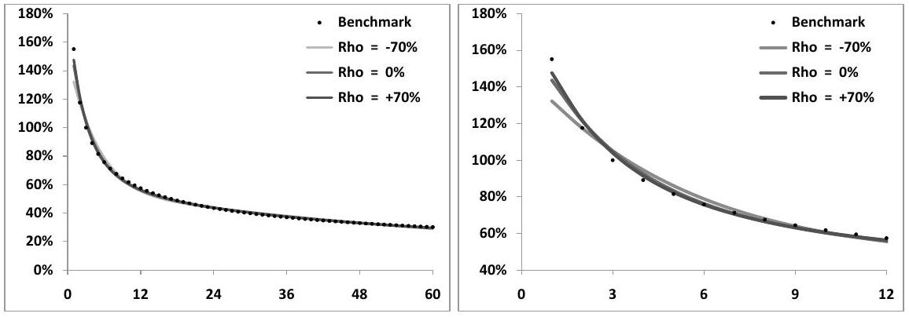
Figure 7.1: The left-hand graph displays the term structure of instantaneous volatilities at $t=0$ of VS volatilities $\nu_{T}(t)$ ( $y$ axis) as a function of $T$ ( $x$ axis, in months) generated by the benchmark form (7.40) as well as the two-factor model, with the different sets of parameters listed in Table 7.1. The right-hand graph focuses on maturities less than 1 year.

As is clear from Figure 7.1, the two-factor model is able to capture a powerlaw dependence for volatilities of volatilities over a wide range of maturities similarly good agreement is achieved for other values of $\alpha$. Moreover, for a given $\alpha$, many different sets of parameters exist that provide an equally acceptable fit to our benchmark $\nu_{T}^{\mathrm{B}}(t)$. Table 7.1 displays the parameters used.

|  | $\nu$ | $\theta$ | $k_{1}$ | $k_{2}$ | $\rho_{12}$ |
| :--- | :---: | :---: | :---: | :---: | :---: |
| Set I | $150 \%$ | 0.312 | 2.63 | 0.42 | $-70 \%$ |
| Set II | $174 \%$ | 0.245 | 5.35 | 0.28 | $0 \%$ |
| Set III | $186 \%$ | 0.230 | 7.54 | 0.24 | $70 \%$ |

Table 7.1: Three sets of parameters matching $\nu_{T}^{\mathrm{B}}(t)$ in (7.40) with $\sigma_{0}=100 \%, \tau_{0}= 0.25, \alpha=0.4$, for maturities up to 5 years. The resulting term structures of volatility of volatility are shown in Figure 7.1. $\nu$ is the instantaneous (lognormal) volatility of a VS volatility of vanishing maturity.

Notice how the time scales of the OU processes $1 / k_{1}, 1 / k_{2}$ are clearly separated, thus generating a volatility-of-volatility term structure that cannot be captured in a one-factor model. Figure 7.1 demonstrates that very similar term structures of instantaneous volatilities of spot-starting VS volatilities are obtained in sets I, II, III, employing very different time scales.

### 7.4.2 Volatilities and correlations of forward variances

What distinguishes parameters sets corresponding to the same value of $\alpha$ ? VS variances are equally weighted baskets of forward variances: $\widehat{\sigma}_{T}^{2}=\frac{1}{T} \int_{0}^{T} \xi^{\tau} d \tau$. It is instructive to look at the volatilities and correlations of the forward variances themselves. Figure 7.2 shows the instantaneous volatilities at $t=0$ of forward variances (not volatilities) using the three sets in Table 7.1, while Figure 7.3 displays $\rho\left(\xi_{t}^{T}, \xi_{t}^{T^{\prime}}\right)$. We have used expressions (7.19) and (7.20), specialized to the case of the two-factor model.

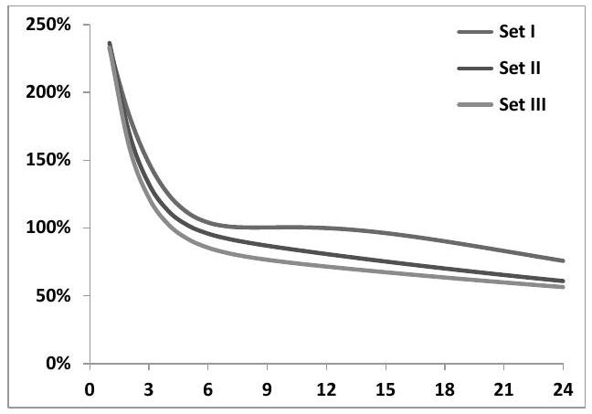
Figure 7.2: Instantaneous volatilities of forward variances $\xi_{t}^{T}$ at $t=0$ as a function of $T$ (in months), using parameter sets in Table 7.1.

While volatilities of forward variances are higher in Set I than in Set III, the opposite is true of correlations. This is natural since the volatilities of VS variances -

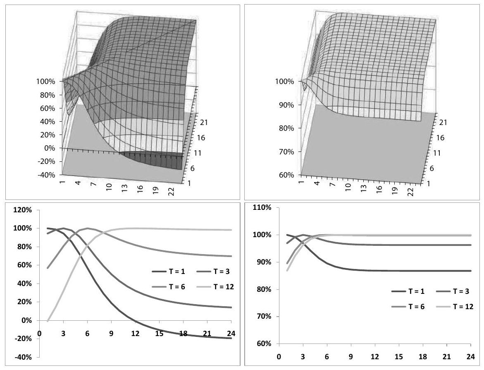
Figure 7.3: Top: $\rho\left(\xi_{t}^{T}, \xi_{t}^{T^{\prime}}\right)$ at $t=0$ as a function of $T, T^{\prime}$ (in months) in Set I (left) and Set III (right). Bottom: slices of $\rho\left(\xi_{t}^{T}, \xi_{t}^{T^{\prime}}\right)$ for $T^{\prime}=1$ month, 3 months, 6 months, 12 months, in Set I (left) and Set III (right).

which are baskets of forward variances - are almost identical in both sets as they have been calibrated to the same benchmark: the higher the volatilities of the basket components, the lower their correlations. Observe at the top of Figure 7.3 how $\rho\left(\xi_{t}^{T}, \xi_{t}^{T^{\prime}}\right)$ becomes almost constant, equal to one, for $T, T^{\prime}$ larger than a given threshold, especially for Set III.

Inspection of expression (7.20) for $\rho\left(\xi_{t}^{T}, \xi_{t}^{T^{\prime}}\right)$ shows that correlations are unchanged if all $k_{i}$ are shifted by the same constant: the relevant time scales for correlations are not the $\frac{1}{k_{i}}$, but the quantities $\frac{1}{k_{i}-k_{j}}$. In a two-factor model $\rho\left(\xi_{t}^{T}, \xi_{t}^{T^{\prime}}\right)$ is thus only a function of $k_{1}-k_{2}$ : the correlation structure has a single time scale $\frac{1}{k_{1}-k_{2}}$.

In Set III, the values of $k_{1}, k_{2}$ are, respectively 7.54 and 0.24. For $T-t \gg \frac{1}{k_{1}-k_{2}}=1.64$ months, the contribution of the short factor is negligible and the $\xi_{t}^{T}$ behave as in a one-factor model, with $100 \%$ correlations among themselves. Their correlations with variances $\xi_{t}^{T^{\prime}}$ with $T^{\prime}-t \gg \frac{1}{k_{1}-k_{2}}$ do not depend on $T$ anymore this is clearly seen in the slices of $\rho\left(\xi_{t}^{T}, \xi_{t}^{T^{\prime}}\right)$ for $T-t=6$ months and $T-t=12$
months in the right-hand graph at the bottom of Figure 7.3. Also note that, while long-dated variances are driven by process $X^{2}$, short-dated variances are driven by the linear combination $\theta X^{1}+(1-\theta) X^{2}$ : even with $\rho_{12}=0$, there is a fair amount of correlation between short- and long-dated variances; in this respect Set II is more akin to Set III than to Set I.

### 7.4.3 Smile of VS volatilities

We have chosen to model instantaneous forward variances $\xi^{T}$ as lognormal processes, based on historical evidence that VS volatilities are lognormal rather than normal - see Figure 6.2. VS variances $\widehat{\sigma}_{T}^{2}$, which are baskets of the $\xi^{T}$, will not be exactly lognormal and neither will VS volatilities $\widehat{\sigma}_{T}$. Their non-lognormality can be assessed by pricing variance swaptions, that is options to enter at $T_{1}$ into a long position in a VS of maturity $T_{2}$ with a strike $K$. The payoff of such a VS at $T_{2}$ is $\left(\sigma_{r}^{2}-K\right)$, where $\sigma_{r}$ is the realized volatility over $\left[T_{1}, T_{2}\right]$.

The option is exercised at $T_{1}$ only if the forward VS volatility $\widehat{\sigma}_{T_{1} T_{2}}$ observed at $T_{1}$ is larger than $\sqrt{K}$ : we exercise the swaption and sell a VS struck at the market implied VS volatility $\widehat{\sigma}_{T_{1} T_{2}}\left(T_{1}\right)$. The payout of this strategy at $T_{2}$ is: ${ }^{6}$

$$
\left(\sigma_{r}^{2}-K\right)-\left(\sigma_{r}^{2}-\widehat{\sigma}_{T_{1} T_{2}}^{2}\left(T_{1}\right)\right)=\widehat{\sigma}_{T_{1} T_{2}}^{2}\left(T_{1}\right)-K
$$

The underlying of the VS swaption is thus the forward VS volatility $\widehat{\sigma}_{T_{1} T_{2}}$ and the VS swaption is a call option of maturity $T_{1}$ on its square. ${ }^{7}$ Expressing $\widehat{\sigma}_{T_{1} T_{2}}^{2}\left(T_{1}\right)$ as a function of forward variances observed at $T_{1}$, the swaption payoff reads:

$$
\left(\frac{1}{T_{2}-T_{1}} \int_{T_{1}}^{T_{2}} \xi_{T_{1}}^{u} d u-K\right)^{+}
$$

Figure 7.4 shows the smile of variance swaptions with $T_{1}=3$ months and $T_{2}=6$ months, in Set I and Set III, in the case of a flat term structure of VS volatilities. Implied volatilities for $\widehat{\sigma}_{T_{1} T_{2}}^{2}\left(T_{1}\right)$ have been computed by simply inverting the Black-Scholes formula as $\widehat{\sigma}_{T_{1} T_{2}}^{2}$ is driftless. In the two-factor model $\widehat{\sigma}_{T_{1} T_{2}}\left(T_{1}\right)$ is a function of two Gaussian variables $X_{T_{1}}^{1}, X_{T_{1}}^{2}$ : variance swaptions are simply priced by two-dimensional quadrature. ${ }^{8}$

While the term structure of VS volatilities is flat at $t=0$, it is not at future dates. For the sake of computing the instantaneous volatility of $\widehat{\sigma}_{T_{1} T_{2}}$ at time $t$, let us make the approximation that the VS term structure at time $t$ is flat. The instantaneous volatility of $\widehat{\sigma}_{T_{1} T_{2}}$ at $t$ is then given by $\nu_{T_{1} T_{2}}(t)$ in (7.26). The instantaneous volatility of $\widehat{\sigma}_{T_{1} T_{2}}^{2}(t)$ is twice as large. We then get the following strike-independent approximation of the implied volatility $2 \widehat{\nu}_{T_{1} T_{2}}\left(T_{1}\right)$ by integrating the square of $\nu_{T_{1} T_{2}}(t)$ in

[^91]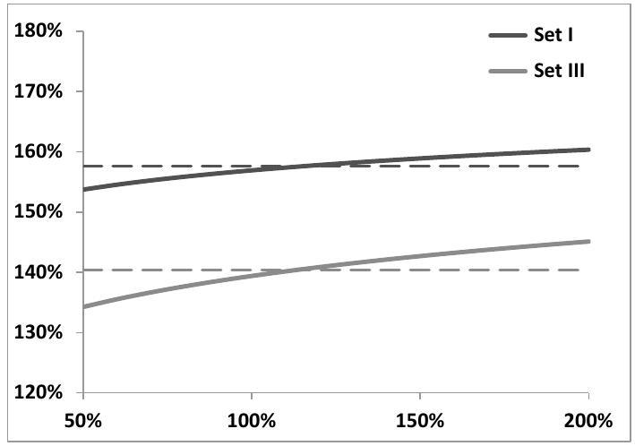
Figure 7.4: Implied volatilities of variance swaptions - that is of $\widehat{\sigma}_{T_{1} T_{2}}^{2}\left(T_{1}\right)$ - as a function of volatility moneyness: $\sqrt{K} / \widehat{\sigma}_{T_{1} T_{2}}(t=0)$ with $T_{1}=3$ months, $T_{2}=6$ months in sets I and III. Dotted lines correspond to the strike-independent level $2 \widehat{\nu}_{T_{1} T_{2}}\left(T_{1}\right)$, where the integral in (7.41) has been computed numerically.

(7.26) over $\left[0, T_{1}\right]$.

$$
\begin{equation*}
2 \widehat{\nu}_{T_{1} T_{2}}\left(T_{1}\right)=2 \sqrt{\frac{1}{T_{1}} \int_{0}^{T_{1}} \nu_{T_{1} T_{2}}^{2}(t) d t} \tag{7.41}
\end{equation*}
$$
^eq7-41

$2 \widehat{\nu}_{T_{1} T_{2}}\left(T_{1}\right)$ appears in Figure 7.4 as a dashed line.
Figure 7.4 displays the weak positively sloping smile that is typical of baskets of lognormal underlyings: while not exactly lognormal, VS volatilities are close to lognormal and approximation (7.41) is fairly accurate.

We will introduce further on an extension of the model that allows for full control of the smile of forward variances.

### 7.4.4 Non-constant term structure of VS volatilities

We now consider the effect of the shape of the term structure of VS volatilities on their instantaneous volatilities. Figure 7.5 shows the instantaneous volatilities at $t=0$ of VS volatilities $\widehat{\sigma}_{T}$ as a function of $T$ for a positively sloping, a negatively sloping, and a flat term structure of VS volatilities.

Consider formula (7.22) for $\nu_{T}(t)$. Volatilities of VS volatilities are larger for negatively sloping $\widehat{\sigma}_{T}$ : this can be understood by noting that in our model shortdated instantaneous variances $\xi^{T}$ have larger volatilities than longer-dated ones. A negatively sloping term structure of VS volatilities implies that the initial values of these shorter-dated variances are larger than those of longer-dated variances. This increases their relative weight in the expression of $\widehat{\sigma}_{T}^{2}$, thus increasing $\nu_{T}$ - see expression (7.22) for $\nu_{T}(t)$.

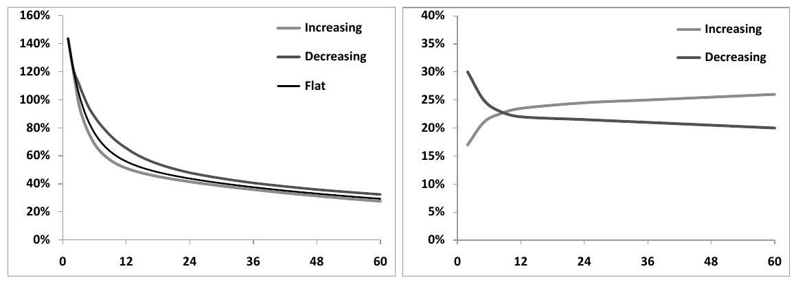
Figure 7.5: Left: instantaneous volatilities at $t=0$ of VS volatilities $\nu_{T}$ as a function of $T$ (months) computed in Set II for three different term structures of VS volatilities. Right: increasing and decreasing term structures of VS volatilities used in left-hand graph.

Note that simply multiplying all $\widehat{\sigma}_{T}$ by the same constant leaves volatilities of volatilities unchanged, as the $\xi^{T}$ are lognormal.

The smiles of VS volatilities shown in Figure 7.4, computed for a flat VS curve then have an additional dependence on the slope of the term structure of VS volatilities.

### 7.4.5 Conclusion

A two-factor model provides sufficient control on volatilities of forward variances so that the benchmark form $\nu_{T}^{\mathrm{B}}(t)$ in (7.40) can be matched over a wide range of maturities. Furthermore, very similar term structures of volatilities of spot-starting VS volatilities $\widehat{\sigma}_{T}$ can be obtained using different sets of parameters, which allows for separation of volatilities of (a) spot-starting VS volatilities and (b) forward VS volatilities.

While instantaneous volatilities of spot-starting VS volatilities are identical in these different sets, instantaneous volatilities and correlations of forward variances are different, hence volatilities of forward VS volatilities differ. This is clearly seen in the case of the 3-months in 3-months swaption implied volatilities in Figure 7.4: we get values around $160 \%$ using Set I and $140 \%$ using Set III - this disconnection of volatilities of spot-starting and forward-starting VS volatilities cannot be achieved within a one-factor model.

The correlation structure of forward variances in the two-factor model is rather poor as it is determined by a single time scale $\frac{1}{k_{1}-k_{2}}$; making it richer would be the primary motivation for introducing a third factor. Finally, while not exactly lognormal, VS volatilities are almost lognormal - Figure 7.5 highlights the fact that their volatilities will depend somewhat on the term structure of VS volatilities.

The question of which parameter set to use can only be settled on a case-by-case basis by analyzing the nature of the volatility-of-volatility risk of the payoff at hand.

In case the underlyings of our option are spot-starting volatilities, all sets corresponding to the same value of $\alpha$ will yield very similar prices. If instead forward volatilities are the real underlyings, we will need to discriminate among sets generating equal levels of volatilities of spot-starting volatilities, yet different levels of volatilities and correlations of forward volatilities.

### 7.5 Calibration - the vanilla smile

What do vanilla smiles look like in the two-factor model? This question should be asked jointly with another question: which financial observables should it be calibrated to, and which instruments used as hedges?

The natural building blocks of forward variance models are (a) the spot and (b) forward variances - or VS volatilities.

Calibrating a model amounts to deciding which (vanilla) instruments our exotic option price is a function of, along with the spot. The consequence is these instruments are our hedge instruments.

Calibrating our forward variance model to VSs implies these are the hedge instruments we use.

Alternatively, we can calibrate the $\xi_{0}^{t}$ so that the term structure of ATMF or ATM volatilities - or implied volatilities for an arbitrary moneyness - is recovered. ${ }^{9}$ Using the corresponding vanilla options as hedges - together with the spot - leads to a well-defined gamma/theta carry P\&L for a hedged position that involves covariances of implied volatilities of the calibrated instruments with each other and with the spot. ${ }^{10}$

In practice, lognormal volatilities of ATMF volatilities in the two-factor model are not much different than those of VS volatilities - thus formula (7.39) can be used to set model parameters so that desired levels of volatilities of ATMF volatilities are obtained.

Forward variance models can thus equivalently be viewed as genuine market models for the spot and the term structure of implied volatilities for a given moneyness, with the capability - as illustrated by the example of the two-factor model - of accommodating an exogenously specified dynamics for this one-dimensional set of instruments.

Once we have calibrated a term-structure of implied volatilities, say VS or ATMF, we can select the parameters of the model so as to achieve a best-fit of the whole

[^92]smile. This calibration is of a very different nature than calibration to the VS/ATMF volatility term structure. In the latter case the "calibration" process amounts to inputing the values of the model's underliers, that is ATMF or VS volatilities - this can hardly be called a calibration.

Inferring model parameters from market prices of vanilla options is a quite different matter. These parameters are then used to price more exotic structures. The resulting hedge ratios may be meaningless as they are likely to reflect structural relationships that are model-specific rather than express genuine matching of risks of a congruent nature. ${ }^{11}$

Characterizing the smiles generated by forward variance models and their determinants is then an important issue which is dealt with in detail in Chapter 8.

Smiles generated by the two-factor model are discussed in Section 8.7, page 326.
Efficient techniques for generating vanilla smiles in stochastic volatility models are surveyed in Appendix A of Chapter 8 - see page 336.

The relationship of the vanilla smile to the dynamics of implied volatilities is another important subject that is covered in Chapter 9 - the special case of the two-factor model is examined in Section 9.7, page 363.

### 7.6 Options on realized variance

Typically, options on realized variance comprise call and put payoffs on the realized variance of an equity underlying - usually an index - with the same convention for realized volatility as that of variance swaps. The payoff of a call on realized variance is:

$$
\frac{1}{2 \widehat{\sigma}_{\mathrm{ref}}}\left(\sigma_{r}^{2}(T)-\widehat{\boldsymbol{\sigma}}^{2}\right)^{+} \quad \text { with } \quad \sigma_{r}^{2}(T)=\frac{252}{N} \sum_{i=0}^{N-1} \ln ^{2}\left(\frac{S_{i+1}}{S_{i}}\right)
$$

where $\widehat{\boldsymbol{\sigma}}$ is the (volatility) strike, $\sigma_{r}(T)$ is the realized volatility over the option's maturity, and $\widehat{\sigma}_{\text {ref }}$ is usually chosen equal to the VS volatility $\widehat{\sigma}_{T}$ for the option's maturity. The reason for this normalization is that, for an at-the-money option, $\boldsymbol{\widehat { \sigma }}=\widehat{\sigma}_{T}$ and at order one in $\sigma_{r}(T)-\widehat{\sigma}_{T}$, the payoff of the ATM call on variance is simply $\left(\sigma_{r}(T)-\widehat{\sigma}_{T}\right)^{+}$.

Volatility swaps, whose payoff is:

$$
\sigma_{r}(T)-\widehat{\boldsymbol{\sigma}}
$$

trade as well; calls and puts on realized volatility trade occasionally.

[^93]A call option on realized variance can be promptly priced in any stochastic volatility model: this produces a number that acquires the status of a price once we have identified the main risks of our option, the instruments that can be used to hedge them, and appropriate carry levels for the residual risks. To this end we now develop a simple model (SM) that is sufficiently robust that it can be used practically. The path we follow is similar to how one derives a well-known approximation for Asian options - see footnote 14 below. ${ }^{12}$

### 7.6.1 A simple model (SM)

We drop for now the $\frac{1}{2 \sigma_{\text {ref }}}$ factor without loss of generality and focus on the payoff $\left(\sigma_{r}^{2}-\widehat{\boldsymbol{\sigma}}^{2}\right)^{+}$- we will also take vanishing interest rate and repo for simplicity. Let us use the notation $Q_{t}$ to denote the quadratic variation defined as the sum of daily squared log-returns over the interval $[0, t]$ :

$$
Q_{t}=\sum_{0}^{t} \ln ^{2}\left(\frac{S_{i+1}}{S_{i}}\right)=t \sigma_{r}^{2}(t)
$$

where $\sigma_{r}(t)$ is the realized volatility over $[0, t]$. The option's payoff is $\left(\frac{1}{T} Q_{T}-\widehat{\boldsymbol{\sigma}}^{2}\right)^{+}$. This suggests that the underlying of our option is $Q_{t}-$ can it be replicated?

The most natural candidate for hedging $Q$ is a VS: consider entering a VS contract of maturity $T$ at time $t$, struck at an implied volatility $\widehat{\sigma}_{T}(t)$, whose payoff at $T$ is:

$$
\frac{1}{T-t} \sum r_{i}^{2}-\widehat{\sigma}_{T}^{2}(t), r_{i}=\ln \left(\frac{S_{i+1}}{S_{i}}\right)
$$

where the sum runs over all returns over the interval $[t, T]$.
Imagine entering this VS contract at time $t$ - at no cost - and consider its value at some later time $t^{\prime}$. While at $t$ the market value of the realized quadratic variation over $[t, T]$ was $(T-t) \widehat{\sigma}_{T}^{2}(t)$, at $t^{\prime}$, the quadratic variation over $\left[t, t^{\prime}\right]$ has already been realized and is equal to $Q_{t^{\prime}}-Q_{t}$, while the market value of the quadratic variation over $\left[t^{\prime}, T\right]$ is $\left(T-t^{\prime}\right) \widehat{\sigma}_{T}^{2}\left(t^{\prime}\right)$. The P\&L over $\left[t, t^{\prime}\right]$ of our VS position is thus:

$$
\begin{align*}
P \& L & =\frac{1}{T-t}\left[\left(Q_{t^{\prime}}-Q_{t}\right)+\left(T-t^{\prime}\right) \widehat{\sigma}_{T}^{2}\left(t^{\prime}\right)\right]-\widehat{\sigma}_{T}^{2}(t) \\
& =\frac{1}{T-t}\left(Q_{t^{\prime}}+\left(T-t^{\prime}\right) \widehat{\sigma}_{T}^{2}\left(t^{\prime}\right)\right)-\frac{1}{T-t}\left(Q_{t}+(T-t) \widehat{\sigma}_{T}^{2}(t)\right) \\
& =\frac{T}{T-t}\left[\frac{Q_{t^{\prime}}+\left(T-t^{\prime}\right) \widehat{\sigma}_{T}^{2}\left(t^{\prime}\right)}{T}-\frac{Q_{t}+(T-t) \widehat{\sigma}_{T}^{2}(t)}{T}\right] \tag{7.42}
\end{align*}
$$
^eq7-42

The above equation expresses the property that taking at time $t$ a position in $\frac{T-t}{T}$ variance swaps of maturity $T$ perfectly hedges the "underlying" $U$ defined by:

$$
\begin{equation*}
U_{t}=\frac{Q_{t}+(T-t) \widehat{\sigma}_{T}^{2}(t)}{T} \tag{7.43}
\end{equation*}
$$
^eq7-43

[^94]over any finite interval $\left[t, t^{\prime}\right]$ as, from (7.42), the $\mathrm{P} \& \mathrm{~L}$ of such a position is simply $P \& L=\left(U_{t^{\prime}}-U_{t}\right)$.

The conclusion is that, while $Q_{t}$ itself is not hedgeable, the package consisting of $Q_{t}+(T-t) \widehat{\sigma}_{T}^{2}(t)$ can be exactly replicated: $U_{t}$ is a legitimate underlying. Moreover the pricing drift of $U$ is zero, since taking a VS position involves no cash outlay. This is consistent with the expression of $U$ in terms of forward variances:

$$
\begin{equation*}
U_{t}=\frac{1}{T}\left(\int_{0}^{t} \xi_{\tau}^{\tau} d \tau+\int_{t}^{T} \xi_{t}^{\tau} d \tau\right) \tag{7.44}
\end{equation*}
$$
^eq7-44

where the first piece in the right-hand side of (7.44) corresponds to past observations. As the $\xi^{\tau}$ are driftless, so is $U$. From definition (7.43), the values of $U$ at $t=0$ and $t=T$ are, respectively:

$$
U_{0}=\widehat{\sigma}_{T}^{2}(0) \quad U_{T}=\frac{1}{T} Q_{T}
$$

The payoff of the call on realized variance is then simply:

$$
\left(U_{T}-\widehat{\boldsymbol{\sigma}}^{2}\right)^{+}
$$

and the price $P$ of this option can be expressed as the expectation of the payoff $\left(U_{T}-\widehat{\boldsymbol{\sigma}}^{2}\right)^{+}$under a dynamics of $U_{t}$ that is driftless, with the initial condition $U_{0}=\widehat{\sigma}_{T}^{2}(0)$.

## A dynamics for $U_{t}$

From (7.43) we have:

$$
\begin{equation*}
d U_{t}=\frac{T-t}{T} \underbrace{d\left(\widehat{\sigma}_{T}^{2}(t)\right)}_{\text {Diffusive portion }} \tag{7.45}
\end{equation*}
$$
^eq7-45

where we are only keeping the diffusive portion of $d\left(\widehat{\sigma}_{T}^{2}(t)\right)$ as $U_{t}$ is driftless. Let us assume that $\widehat{\sigma}_{T}(t)$ is lognormal with deterministic volatility $\nu_{T}(t): \widehat{\sigma}_{T}^{2}(t)$ is lognormal with volatility $2 \nu_{T}(t)$. We get the following SDE for $U_{t}$ :

$$
d U_{t}=2 \frac{T-t}{T} \nu_{T}(t) \widehat{\sigma}_{T}^{2}(t) d W_{t}
$$

which we rewrite as:

$$
\begin{equation*}
\frac{d U_{t}}{U_{t}}=2 R_{t} \frac{T-t}{T} \nu_{T}(t) d W_{t} \tag{7.46}
\end{equation*}
$$
^eq7-46

with $R_{t}$ given by:

$$
\begin{equation*}
R_{t}=\frac{\widehat{\sigma}_{T}^{2}(t)}{U_{t}}=\frac{T \widehat{\sigma}_{T}^{2}(t)}{Q_{t}+(T-t) \widehat{\sigma}_{T}^{2}(t)}=\frac{T \widehat{\sigma}_{T}^{2}(t)}{t \sigma_{r}^{2}(t)+(T-t) \widehat{\sigma}_{T}^{2}(t)} \tag{7.47}
\end{equation*}
$$
^eq7-47

SDE (7.46) is problematic as the dynamics of $U_{t}$ is not autonomous - it involves $\widehat{\sigma}_{T}^{2}(t)$ through $R_{t}$. But for this prefactor, the dynamics of $U_{t}$ would be lognormal. The quadratic variation of $\ln U$ over $[t, T]$ is:

$$
\begin{equation*}
\int_{t}^{T} 4 R_{\tau}^{2}\left(\frac{T-\tau}{T}\right)^{2} \nu_{T}^{2}(\tau) d \tau \tag{7.48}
\end{equation*}
$$
^eq7-48

$R_{\tau}$ is the ratio of two integrated variances, thus is a number of order one.
We now make an approximation: let us replace $R_{\tau}$ with a constant - we approximate $R_{\tau}$ by its value at time $t$, the pricing date:

$$
R_{\tau} \simeq R_{t}
$$

SDE (7.46) now becomes:

$$
\frac{d U_{\tau}}{U_{\tau}}=2 R_{t} \frac{T-\tau}{T} \nu_{T}(\tau) d W_{\tau}
$$

where $t$ is now the pricing date. $U$ is then lognormal and the option price $P(t, U)$ is given by a Black-Scholes formula evaluated with an effective volatility $\sigma_{\text {eff }}$ :

$$
\begin{align*}
P(t, U) & =P_{\mathrm{BS}}\left(t, U, \sigma_{\mathrm{eff}}, T\right)  \tag{7.49a}\\
\sigma_{\mathrm{eff}}^{2} & =\frac{1}{T-t} \int_{t}^{T} 4 R_{t}^{2}\left(\frac{T-\tau}{T}\right)^{2} \nu_{T}^{2}(\tau) d \tau \tag{7.49b}
\end{align*}
$$
^eq7-49a
^eq7-49b

The number of VS contracts of maturity $T$ needed at time $t$ to hedge our option is: ${ }^{13}$

$$
\frac{T-t}{T} \frac{d P}{d U}
$$

where the ratio $\frac{T-t}{T}$ expresses the fact that it takes $\frac{T-t}{T}$ VS contracts of maturity $T$ at time $t$ to replicate $U$.

At inception $U_{t=0}=\widehat{\sigma}_{T}^{2}(0)$, so that $R_{t=0}=1$. The option premium is then given by: ${ }^{14}$[^95]

$$
\begin{align*}
P(t=0) & =P_{\mathrm{BS}}\left(t=0, \widehat{\sigma}_{T}^{2}(0), \sigma_{\mathrm{eff}}, T\right)  \tag{7.50a}\\
\sigma_{\mathrm{eff}}^{2} & =\frac{1}{T} \int_{0}^{T} 4\left(\frac{T-\tau}{T}\right)^{2} \nu_{T}^{2}(\tau) d \tau \tag{7.50b}
\end{align*}
$$
^eq7-50a
^eq7-50b

These are the basic equations of the SM.

### 7.6.2 Preliminary conclusion

So far, our main results are, assuming the approximation $R_{\tau} \equiv R_{t}$ is satisfactory - this will be checked further on:

- Options on realized variance are simply hedged by dynamically trading variance swaps of the option's residual maturity.
- Their value does not depend on the detailed dynamics of instantaneous forward variances - it only depends on the instantaneous volatility $\nu_{T}(t)$ of $\widehat{\sigma}_{T}(t)$, for all times $t \in[0, T]$ : the only pricing ingredient is the curve $\nu_{T}(t)$, such as those in Figure 7.1.
- The SM is a legitimate, arbitrage-free, model. The only approximation we are making is in the volatility of $U_{t}$ - hence in the value of $\sigma_{\text {eff }}$. We have replaced $R_{\tau}$ with its value at the pricing date, $R_{t}$ so that $U_{t}$ is lognormal.

In the following section we will assess the accuracy of the SM using various forms for $\nu_{T}(t)$.

### 7.6.3 Examples

Our conclusion suggests that options on realized variance are in fact simple instruments as their only volatility-of-volatility risk is the exposure to the realized volatility over $[0, T]$ of the VS volatility of maturity $T$.

We now check this prediction by pricing an at-the-money call on realized variance of maturity 6 months and 1 year in the two-factor model and in the SM.
$\nu_{T}(\tau)$ in formula (7.50b) for $\sigma_{\text {eff }}$ is the instantaneous volatility of the VS volatility for maturity $T$ observed at $t, \widehat{\sigma}_{T}(t)$. In our benchmark (7.40), $\nu_{T}(\tau)$ is specified directly:

$$
\begin{equation*}
\nu_{T}^{\mathrm{B}}(t)=\sigma_{0}\left(\frac{\tau_{0}}{T-t}\right)^{\alpha} \tag{7.51}
\end{equation*}
$$
^eq7-51

In the two-factor model, instead, the model generates its own dynamics for $\widehat{\sigma}_{T}(t)$. Set II parameters are such that, for a flat VS term structure, instantaneous volatilities of VS volatilities at $t=0$ - given by (7.39) - best match the benchmark form (7.51). What about instantaneous volatilities of VS volatilities at future times $t$ - which enter expression (7.50b) for $\sigma_{\text {eff }}$ ?

In expression (7.50b) for $\sigma_{\text {eff }}$ we use the following expression for $\nu_{T}(t)$, which we denote $\nu_{T}^{0}(t)$ :

$$
\begin{equation*}
\nu_{T}^{0}(t)=\nu \alpha_{\theta} \sqrt{(1-\theta)^{2} f_{1}^{0}(t, T)^{2}+\theta^{2} f_{2}^{0}(t, T)^{2}+2 \rho_{12} \theta(1-\theta) f_{1}^{0}(t, T) f_{2}^{0}(t, T)} \tag{7.52}
\end{equation*}
$$
^eq7-52

with $f_{i}^{0}(t, T)$ given by:

$$
f_{i}^{0}(t, T)=\frac{\int_{t}^{T} \xi_{0}^{\tau} e^{-k_{i}(\tau-t)} d \tau}{\int_{t}^{T} \xi_{0}^{\tau} d \tau}
$$

The reader can check - see expression (7.22) - that the actual expression of the instantaneous volatility of $\widehat{\sigma}_{T}(t)$ at time $t, \nu_{T}(t)$, specialized to the two-factor model, is identical to (7.52), except, $f_{i}(t, T)$ is used in place of $f_{i}^{0}(t, T)$ :

$$
f_{i}(t, T)=\frac{\int_{t}^{T} \xi_{t}^{\tau} e^{-k_{i}(\tau-t)} d \tau}{\int_{t}^{T} \xi_{t}^{\tau} d \tau}
$$

Using the time-deterministic form (7.52) instead of $\nu_{T}(t)$ - a process - amounts to making the assumption that at time $t$ forward variances $\xi_{t}^{\tau}$ are equal to their initial values $\xi_{0}^{\tau}$. For a flat term structure of VS volatilities, $\nu_{T}^{0}(t)=\nu_{T}(t)$ as given by expression (7.39), page 227.

Even though the VS term structure is flat at $t=0$, its shape at future times in the two-factor model will not be flat: the instantaneous volatility of $\widehat{\sigma}_{T}(t)$ will depend on the VS term structure prevailing at time $t$ and may differ from $\nu_{T}^{0}(t)$.

How good is the SM with $\sigma_{\text {eff }}$ in (7.50) computed with $\nu_{T}^{0}(t)$, compared with prices produced by a Monte Carlo simulation of the two-factor model?

Option prices appear in Table 7.2. We have used a flat initial term structure of VS volatilities at $20 \%$ and have followed the standard market practice for the normalization of the call payoff:

$$
\frac{1}{2 \widehat{\sigma}_{T}}\left(\sigma_{r}^{2}-\widehat{\boldsymbol{\sigma}}^{2}\right)^{+}
$$

Table 7.2 also lists prices produced by (7.50), with $\nu_{T}(t)=\nu_{T}^{\mathrm{B}}(t)$. In the latter case $\sigma_{\text {eff }}$ is given by:

$$
\begin{equation*}
\sigma_{\mathrm{eff}}=\frac{2 \sigma_{0}}{\sqrt{3-2 \alpha}}\left(\frac{\tau_{0}}{T}\right)^{\alpha} \tag{7.53}
\end{equation*}
$$
^eq7-53

Observe how close prices generated by the SM with $\nu_{T}(t)=\nu_{T}^{0}(t)$ are to exact prices. Also note how prices generated with parameter sets I, II, III almost match, and how they almost match prices produced by the SM with $\nu_{T}(t) \simeq \nu_{T}^{\mathrm{B}}(t)$. This confirms that, indeed, the primary risk of options on realized volatility is the exposure to the realized volatility of the VS volatility for the residual maturity.

|  |  | Set I | Set II | Set III | Benchmark |
| :--- | :--- | :---: | :---: | :---: | :---: |
| months | exact | $2.97 \%$ | $2.96 \%$ | $2.94 \%$ |  |
|  | SM | $2.93 \%$ | $2.88 \%$ | $2.86 \%$ | $2.82 \%$ |
| year | exact | $3.13 \%$ | $3.08 \%$ | $3.06 \%$ |  |
|  | SM | $3.02 \%$ | $2.99 \%$ | $2.98 \%$ | $3.01 \%$ |

Table 7.2: Prices of an ATM call option on realized variance computed in the twofactor model with parameter sets in Table 7.1, page 229, either in a Monte Carlo simulation (exact), or using the SM with $\nu_{T}^{0}(t)$ given by (7.52) (SM). Prices in the last column are computed using the SM with $\nu_{T}(t)$ given by benchmark (7.51) with $\sigma_{0}=100 \%, \tau_{0}=0.25, \alpha=0.4$. The term structure of VS volatilities is flat at $20 \%$.

Finally, notice how prices very weakly depend on maturity. This is due to the fact that the value of $\alpha$ in our benchmark, 0.4 , is close to 0.5 . For $\alpha=0.5, \sigma_{\text {eff }}$ in (7.53) is inversely proportional to $\sqrt{T}, \sigma_{\text {eff }} \sqrt{T}$ is constant and the price given by (7.50a) does not depend on $T$.

### 7.6.4 Accounting for the term structure of VS volatilities

So far, in the derivation of the SM, we have made the assumption $R_{\tau} \equiv R_{t}$. At inception $R_{0}=1$. However, (7.47) shows that $R_{\tau}$ will be different than 1 whenever the realized volatility over $[0, \tau], \sigma_{r}(\tau)$, is different than $\widehat{\sigma}_{T}(\tau)$.

Prices in Table 7.2 have been computed with flat VS volatilities equal to $20 \%$. Within the two-factor model, while $\sigma_{r}(\tau)$ and $\widehat{\sigma}_{T}(\tau)$ are random, the expectation of their squares is equal to $20 \%^{2}$, thus the expectations of the numerator and denominator of $R_{\tau}$ within the model are equal, and approximation $R_{\tau} \equiv R_{0}=1$ is appropriate. The good agreement of exact and SM prices in Table 7.2 shows that the fluctuation of $R_{\tau}$ around 1 has little impact on the option's premium.

Obviously, from a pricing point of view, the assumption $R_{\tau} \equiv 1$ will need to be corrected for non-constant term structures of VS volatilities. The dependence on the term structure of VS volatilities that the option price then acquires will need to be hedged, however.

In fact, regardless of the shape of the term structure of VS volatilities - and even for flat ones - the realized volatility, hence $Q_{t}$, will in practice be whatever it wants to be and realized values of $R_{\tau}$ will be substantially different than 1 .

For example, imagine that, in reality, realized volatilities are systematically lower than implied VS volatilities - which is usually the case for indexes: $Q_{t} / t<\widehat{\sigma}_{T}^{2}(t)$. $R_{t}$ will be systematically larger than 1 and (7.46) indicates that the realized volatility of $U$ will be larger than the level we have priced. If we have sold a call on realized variance, our daily gamma/theta $\mathrm{P} \& \mathrm{~L}$ on $U$ will be negative, thus we will lose money steadily even though the instantaneous realized volatility at time $\tau$ of $\widehat{\sigma}_{T}$ matches
our pricing level $\nu_{T}(\tau)$. Can we hedge this exposure of $R_{\tau}$ to the realized volatility of $S_{t}$ ?

As we will see shortly, the issues of (a) accounting for the term structure of VS volatilities in the option price, and (b) hedging the exposure of $R_{\tau}$ to the realized volatility of the underlying are connected.

Let us first amend (7.49b) to take into account the term structure of VS volatilities. For general term structures the expectations at time $t$ of the numerator and denominator of $R_{\tau}$ in (7.47) are:

$$
\begin{aligned}
E_{t}\left[U_{\tau}\right] & =U_{t} \equiv \frac{Q_{t}+(T-t) \widehat{\sigma}_{T}^{2}(t)}{T} \\
E_{t}\left[\widehat{\sigma}_{T}^{2}(\tau)\right] & =\frac{1}{T-\tau} \int_{\tau}^{T} \xi_{t}^{u} u=\widehat{\sigma}_{\tau T}^{2}(t)
\end{aligned}
$$

where $\widehat{\sigma}_{\tau T}(t)$ is the forward VS volatility at time $t$ for the interval $[\tau, T]$. We now make the approximation:

$$
\begin{equation*}
R_{\tau} \simeq \frac{E_{t}\left[\widehat{\sigma}_{T}^{2}(\tau)\right]}{E_{t}\left[U_{\tau}\right]}=\frac{T \widehat{\sigma}_{\tau T}^{2}(t)}{Q_{t}+(T-t) \widehat{\sigma}_{T}^{2}(t)} \tag{7.54}
\end{equation*}
$$
^eq7-54

Formula (7.49b) for $\sigma_{\text {eff }}$ now becomes:

$$
\begin{equation*}
\sigma_{\mathrm{eff}}^{2}=\frac{4}{T-t} \int_{t}^{T}\left(\frac{T-\tau}{T}\right)^{2}\left(\frac{T \widehat{\sigma}_{\tau T}^{2}(t)}{Q_{t}+(T-t) \widehat{\sigma}_{T}^{2}(t)}\right)^{2} \nu_{T}^{2}(\tau) d \tau \tag{7.55}
\end{equation*}
$$
^eq7-55

At time $t=0, Q_{0}=0, \sigma_{\text {eff }}$ and the option's price are given by:

$$
\begin{align*}
\sigma_{\mathrm{eff}}^{2} & =\frac{4}{T} \int_{0}^{T}\left(\frac{T-\tau}{T}\right)^{2}\left(\frac{\widehat{\sigma}_{\tau T}^{2}(0)}{\widehat{\sigma}_{T}^{2}(0)}\right)^{2} \nu_{T}^{2}(\tau) d \tau  \tag{7.56a}\\
P(t=0) & =P_{\mathrm{BS}}\left(t=0, \widehat{\sigma}_{T}^{2}(0), \sigma_{\mathrm{eff}}, T\right) \tag{7.56b}
\end{align*}
$$
^eq7-56a
^eq7-56b

In what follows we use this new expression for $\sigma_{\text {eff }}$ instead of (7.50b).
$\sigma_{\text {eff }}$ now depends on the full term structure of VS volatilities up to $T$, with the consequence that the option price acquires an exposure to intermediate VS volatilities which it is necessary to hedge.

### 7.6.5 Vega and gamma hedges

The continuous density $\lambda(\tau)$ of intermediate VSs is given by the functional derivative of $P$ with respect to $\widehat{\sigma}_{\tau}^{2}$. Writing $\widehat{\sigma}_{\tau T}^{2}(t)$ as:

$$
\widehat{\sigma}_{\tau T}^{2}(t)=\frac{(T-t) \widehat{\sigma}_{T}^{2}(t)-(\tau-t) \widehat{\sigma}_{\tau}^{2}(t)}{T-\tau}
$$

(7.55) can be rewritten as:

$$
\begin{equation*}
\sigma_{\mathrm{eff}}^{2}=\frac{4}{T-t} \int_{t}^{T}\left(\frac{(T-t) \widehat{\sigma}_{T}^{2}(t)-(\tau-t) \widehat{\sigma}_{\tau}^{2}(t)}{Q_{t}+(T-t) \widehat{\sigma}_{T}^{2}(t)}\right)^{2} \nu_{T}^{2}(\tau) d \tau \tag{7.57}
\end{equation*}
$$
^eq7-57

$\lambda(\tau)$ is given by:

$$
\begin{align*}
\lambda(\tau) & =\left.\frac{\delta P}{\delta \widehat{\sigma}_{\tau}^{2}}\right|_{t} \\
& =-8 \frac{d P}{d \sigma_{\mathrm{eff}}^{2}} \frac{(\tau-t)(T-\tau)}{(T-t) T} \frac{T \widehat{\sigma}_{\tau T}^{2}(t)}{\left(Q_{t}+(T-t) \widehat{\sigma}_{T}^{2}(t)\right)^{2}} \nu_{T}^{2}(\tau) \tag{7.58}
\end{align*}
$$
^eq7-58

Differentiating $\sigma_{\text {eff }}^{2}$ with respect to $\widehat{\sigma}_{T}^{2}$ also produces a discrete quantity of variance swaps of maturity $T$ which we denote by $\mu_{T}$ :

$$
\mu_{T}=\frac{d P}{d \sigma_{\mathrm{eff}}^{2}} \frac{d \sigma_{\mathrm{eff}}^{2}}{d \widehat{\sigma}_{T}^{2}}
$$

These come in addition to the VS of maturity $T$ that offsets $\frac{d P}{d U}$.
While we trade these intermediate VSs as well as an additional VS of maturity $T$ to hedge the mark-to-market P\&L generated by the dependence of $R_{\tau}$ - hence of $\sigma_{\text {eff }}$ - on intermediate VS volatilities, these VSs will also generate spurious gamma/theta P\&Ls.

These P\&Ls are in fact offsetting similar P\&Ls from the short option position. To see that this is indeed the case, rewrite expression (7.57) of $\sigma_{\text {eff }}^{2}$ as:

$$
\begin{equation*}
\sigma_{\mathrm{eff}}^{2}=\frac{4}{T-t} \int_{t}^{T}\left(\frac{\left(Q_{t}+(T-t) \widehat{\sigma}_{T}^{2}(t)\right)-\left(Q_{t}+(\tau-t) \widehat{\sigma}_{\tau}^{2}(t)\right)}{Q_{t}+(T-t) \widehat{\sigma}_{T}^{2}(t)}\right)^{2} \nu_{T}^{2}(\tau) d \tau \tag{7.59}
\end{equation*}
$$
^eq7-59

Recall that a position in a VS of maturity $T$ replicates the package $Q_{t}+ (T-t) \widehat{\sigma}_{T}^{2}(t)$ exactly - see equation (7.42). As is manifest in equation (7.59) $\widehat{\sigma}_{\tau}^{2}(t)$ does not appear alone, but associated with $Q_{t}$ in such a way that the VS position that hedges the exposure to $\widehat{\sigma}_{\tau}^{2}(t)$ actually hedges $Q_{t}+(\tau-t) \widehat{\sigma}_{\tau}^{2}(t)-$ the same goes for the exposure to $\widehat{\sigma}_{T}^{2}(t)$. In other words, the extra VS position that hedges the sensitivity of $\sigma_{\text {eff }}^{2}$ to the VS term structure also hedges the sensitivity of $R_{\tau}$ to $Q_{t}$.

The conclusion is that in the SM, the gamma/theta P\&L generated by the VS position that hedges the exposure of $\sigma_{\text {eff }}^{2}$ to the term structure of VS volatilities exactly offsets the gamma/theta $\mathrm{P} \& \mathrm{~L}$ generated by the dependence of $\sigma_{\text {eff }}^{2}$ on the quadratic variation $Q_{t}$ and VS volatilities $\widehat{\sigma}_{\tau}$ for $\tau \in[0, T]$.

Thus our vega hedge also functions as a gamma/theta hedge. We will need to check whether this property, obtained in the SM with the help of approximation (7.54), holds more generally.

The continuous density $\lambda(\tau)$ and discrete quantity $\mu_{T}$ of hedging VSs are related by a simple equation. Expression (7.56a) shows that $\sigma_{\text {eff }}$ is unchanged if all VS volatilities are rescaled uniformly - thus for a small change $\delta \widehat{\sigma}_{T}^{2}=\varepsilon \widehat{\sigma}_{T}^{2}$, at order one in $\varepsilon, \delta \sigma_{\text {eff }}^{2}=0$ :

$$
\int_{0}^{T} \lambda(\tau) \delta \widehat{\sigma}_{\tau}^{2} d \tau+\mu_{T} \delta \widehat{\sigma}_{T}^{2}=0
$$

which implies that

$$
\int_{0}^{T} \lambda(\tau) \widehat{\sigma}_{\tau}^{2} d \tau+\mu_{T} \widehat{\sigma}_{T}^{2}=0
$$

For the case of a flat term structure of VS volatilities, this simplifies to:

$$
\begin{equation*}
\int_{0}^{T} \lambda(\tau) d \tau+\mu_{T}=0 \tag{7.60}
\end{equation*}
$$
^eq7-60

The aggregate vega of the VS position that hedges $\sigma_{\text {eff }}$ thus vanishes: the total vega of the VS hedge reduces to the vega of the VS position of maturity $T$ that hedges $U$.

### 7.6.6 Examples

We now use expression (7.56a) for $\sigma_{\text {eff }}^{2}$ to study the nature of the VS hedge, concentrating first on the case of a flat term structure of VS volatilities. The pricing date is January 1, 2010 and the option's maturity is January 1, 2011. We have used market conventions: the payoff at $T$ of the ATM call on realized variance and the payoff at $\tau$ of a VS of maturity $\tau \in[0, T]$ are, respectively:

$$
\begin{equation*}
\frac{1}{2 \widehat{\sigma}_{T}}\left(\frac{Q_{T}}{T}-\widehat{\boldsymbol{\sigma}}^{2}\right)^{+}, \quad \frac{1}{2 \widehat{\sigma}_{\tau}}\left(\frac{Q_{\tau}}{\tau}-\widehat{\sigma}_{\tau}^{2}\right) \tag{7.61}
\end{equation*}
$$
^eq7-61

The vega of a VS contract is thus 1 .

## With the benchmark

We first use the SM with our benchmark form for $\nu_{T}^{\mathrm{B}}(t)$. We use a flat term structure of VS volatilities: while the price computed using either expression (7.56a) or expression (7.50b) for $\sigma_{\text {eff }}$ is identical, the VS hedge is different. The VS hedge, together with the dollar gammas generated by the hedging VSs are reported in Table 7.3.

In practice, VSs do not trade for all maturities, but for maturities corresponding to monthly or quarterly expiries of listed options: we have chosen monthly expiries, including an unrealistic one-day maturity. For the sake of computing hedge ratios for the intermediate maturities $\tau_{i}$ in Table 7.3 we have used a simple piecewise affine interpolation of $\tau \widehat{\sigma}_{\tau}^{2}$ over each interval $\left[\tau_{i}, \tau_{i+1}\right]$. This ensures that as $\widehat{\sigma}_{\tau_{i}}$ is shifted, only forward variances $\xi_{u}$ for $u \in\left[\tau_{i-1}, \tau_{i+1}\right]$ vary - in particular our variance option will have no vega on VS volatilities of maturities longer than the option's maturity. ${ }^{15}$

The rightmost column in Table 7.3 lists the dollar gammas generated by each intermediate VS. As expressed by equation (5.9) the dollar gamma of a VS - without the $\frac{1}{2 \widehat{\sigma}_{\tau}}$ prefactor - is $2 e^{-r(T-t)}$. Using the market convention in (7.61) and zero interest rate, the dollar gamma of a VS of maturity $\tau$ is given by:

$$
\begin{equation*}
S^{2} \frac{d^{2} \mathrm{VS}}{d S^{2}}=\frac{1}{\widehat{\sigma}_{\tau} \tau} \tag{7.62}
\end{equation*}
$$
^eq7-62

[^96]| Maturities | SM - benchmark |  |
| :--- | :--- | :--- |
|  | VS hedge | VS dollar gamma |
| 02-Jan-10 | -0.01\% | -13\% |
| 31-Jan-10 | -0.4\% | -25\% |
| 02-Mar-10 | -0.8\% | -25\% |
| 02-Apr-10 | -1.2\% | -25\% |
| 02-May-10 | -1.6\% | -25\% |
| 02-Jun-10 | -2.0\% | -24\% |
| 02-Jul-10 | -2.2\% | -22\% |
| 01-Aug-10 | -2.6\% | -22\% |
| 01-Sep-10 | -2.8\% | -21\% |
| 01-Oct-10 | -3.0\% | -20\% |
| 01-Nov-10 | -3.1\% | -18\% |
| 01-Dec-10 | -2.9\% | -16\% |
| 01-Jan-11 | 87.7\% | 438\% |
| Aggregate | 65.1\% | 182\% |
| Single maturity |  |  |
| 01-Jan-11 | 65.1\% | 325\% |

Table 7.3: VS vega hedges and the corresponding dollar gammas for an ATM call on realized variance of maturity 1 year starting on January 1, 2010, computed in the SM with $\nu_{T}(t)$ given by the benchmark form (7.51) with $\sigma_{0}=100 \%, \tau_{0}= 0.25, \alpha=0.4$, as well as aggregate vega and dollar gamma. The term structure of VS volatilities is flat at $20 \%$. The bottom line shows the same results when only the VS volatility for the option's maturity is used for pricing and hedging.

Table 7.3 shows that a call option on realized variance has negative sensitivities to VS volatilities for intermediate maturities. These sensitivities are identical for a call and a put struck at the same strike, as they are proportional to $\frac{d P}{d \sigma_{\text {eff }}}-$ see (7.58). ${ }^{16}$

Recall that the VS hedge for the option's maturity consists of two pieces: one piece hedges $U$ and acts as a delta; the other hedges $\sigma_{\text {eff }}$ and acts as a vega: as is apparent from the bottom of Table 7.3, the former is the largest contributor to the vega of the aggregate VS hedge.

The bottom of Table 7.3 also shows the vega and dollar gamma of the VS hedge obtained if we discard intermediate maturities and price our option using only the VS volatility for the option's maturity, in which case $\sigma_{\text {eff }}$ is given by (7.50b). Notice how the aggregate vegas are identical in both situations - which is expected from (7.60), which expresses that for a flat VS term structure the aggregate vega of the VSs that hedge $\sigma_{\text {eff }}$ vanishes.

[^97]Notice though how the aggregate gammas are very different, depending upon whether we use the full term structure of VS volatilities or not. Indeed, short-maturity VSs, despite their small vega, do contribute large dollar gammas ${ }^{17}$ - this is clear from formula (7.62).

In practice VSs for such short maturities do not trade: a long position on a call or put on realized variance generates a short gamma position that must be offset with vanilla options.

## Checking the gamma in the SM

What about the gamma of the option on realized variance? We have proved in Section 7.6.4 that in the SM the vega hedge also functions as a perfect gamma hedge. In the SM, the option's dollar gamma can then be computed by summing the dollar gammas of the hedging VSs. From Table 7.3 the dollar gamma thus computed is $182 \%$.

This is only applicable to the SM. There exists however a model-independent expression of the dollar gamma for models such that the dynamics of forward variances is independent on the spot level. This is the case for the forward variance models considered so far.

Imagine that $S$ is shifted by $\delta S$ : the quadratic variation is shifted from $Q$ to $Q+\left(\frac{\delta S}{S}\right)^{2}$. The dollar gamma of our option is then given by:

$$
S^{2} \frac{d^{2} P}{d S^{2}}=2 \frac{d P}{d Q}
$$

We have:

$$
\frac{d P}{d Q}=\frac{P\left(Q_{0}+\delta Q\right)-P\left(Q_{0}\right)}{\delta Q}
$$

for $\delta Q$ small where $Q_{0}=0$ is the quadratic variation at $t=0$, and $\delta Q$ is a small increment of $Q$. Quadratic variation is additive thus, all things being equal, a small perturbation of $Q_{0}$ generated by a change of the initial spot value results in the same perturbation in $Q_{T} .{ }^{18}$ Using convention (7.61) for the variance option payoff and denoting by $\widehat{\boldsymbol{\sigma}}$ its (volatility) strike, at first order in $\delta Q$ :

$$
\begin{aligned}
P\left(Q_{0}+\delta Q, \widehat{\boldsymbol{\sigma}}\right) & =\frac{1}{2 \widehat{\sigma}_{T}} E\left[\left(\frac{Q_{T}+\delta Q}{T}-\widehat{\boldsymbol{\sigma}}^{2}\right)^{+}\right] \\
& =\frac{1}{2 \widehat{\sigma}_{T}} E\left[\left(\frac{Q_{T}}{T}-\left(\widehat{\boldsymbol{\sigma}}^{2}-\frac{\delta Q}{T}\right)\right)^{+}\right]=P\left(Q_{0}, \widehat{\boldsymbol{\sigma}}-\frac{\delta Q}{2 \widehat{\boldsymbol{\sigma}} T}\right)
\end{aligned}
$$

The dollar gamma of the call option is thus related to the sensitivity to its (volatility) strike through:

$$
\begin{equation*}
S^{2} \frac{d^{2} P}{d S^{2}}=-\frac{1}{\widehat{\boldsymbol{\sigma}} T} \frac{d P}{d \widehat{\boldsymbol{\sigma}}} \tag{7.63}
\end{equation*}
$$
^eq7-63

[^98]Let us stress that while (7.63) holds for the forward variance models we are studying, it does not hold in local volatility or mixed local-stochastic volatility models - more generally models such that covariances of forward variances depend on the spot level.

Using (7.63) with $P$ given by the SM yields a dollar gamma of $175 \%$ for our 1 -year ATM call. The fact that the value of $182 \%$ obtained - in the framework of the SM - by summing the dollar gammas of the VS hedge is close to this is another check of the validity of approximation (7.54) for $R_{\tau}$ in the SM.

## With the two-factor model

We now use the two-factor model with Set II parameters, and compare exact VS hedges with those given by the SM with $\nu_{T}(t)=\nu_{T}^{0}(t)$. Results appear in Table 7.4. Hedge ratios computed either in a Monte Carlo simulation of the two-factor model or by using the SM are very similar.

| Maturities | VS hedge |  | VS dollar gamma |  |
| :--- | :--- | :--- | :--- | :--- |
|  | Exact | SM | Exact | SM |
| 02-Jan-10 | -0.02\% | -0.01\% | -31\% | -27\% |
| 31-Jan-10 | -0.9\% | -0.8\% | -55\% | -46\% |
| 02-Mar-10 | -1.2\% | -1.0\% | -37\% | -30\% |
| 02-Apr-10 | -1.2\% | -1.5\% | -23\% | -30\% |
| 02-May-10 | -1.0\% | -1.2\% | -14\% | -18\% |
| 02-Jun-10 | -0.8\% | -1.1\% | -9\% | -13\% |
| 02-Jul-10 | -0.7\% | -1.0\% | -7\% | -10\% |
| 01-Aug-10 | -0.5\% | -0.7\% | -5\% | -6\% |
| 01-Sep-10 | -0.4\% | -0.3\% | -3\% | -2\% |
| 01-Oct-10 | -0.1\% | -0.1\% | 0\% | -1\% |
| 01-Nov-10 | 0.5\% | 1.3\% | 3\% | 8\% |
| 01-Dec-10 | 1.9\% | 2.4\% | 10\% | 13\% |
| 01-Jan-11 | 68.2\% | 68.8\% | 341\% | 344\% |
| Aggregate | 63.8\% | 64.9\% | 169\% | 183\% |
| Single maturity |  |  |  |  |
| 01-Jan-11 | 63.8\% | 64.9\% | 319\% | 325\% |

Table 7.4: VS vega hedge for an ATM call on realized variance of maturity 1 year starting on January 1, 2010, computed with (a) a Monte Carlo simulation of the twofactor model with Set II parameters (Exact); (b) the SM with $\nu_{T}^{0}(t)$ given by (7.52) as well as the corresponding dollar gammas. The term structure of VS volatilities is flat at $20 \%$. The bottom line shows the same results when only the VS volatility for the option's maturity is used for pricing and hedging.

Comparison of Table 7.3 and Table 7.4 shows, however, that VS hedge ratios in the two-factor model or in the benchmark are different, even though the aggregate vegas are almost exactly equal: the VS hedge is distributed differently. Why is this?

Both the second column of Table 7.3 and the third column of Table 7.4 are computed using the SM except in the first case expression (7.56a) of $\sigma_{\text {eff }}^{2}$ makes use of $\nu_{T}^{\mathrm{B}}(t)$, while in the latter case $\nu_{T}^{0}(t)$ in (7.52) is used.

Set II parameters are such that, with the initial flat term structure of VS volatilities, $\nu_{T}^{0}(t) \simeq \nu_{T}^{\mathrm{B}}(t) . \nu_{T}^{\mathrm{B}}$ is by construction independent on the term structure of VS volatilities.

Unlike $\nu_{T}^{\mathrm{B}}, \nu_{T}^{0}(t)$ depends on this term structure - see expression (7.52). In the two-factor model, the instantaneous volatility of $\widehat{\sigma}_{T}(t)$ depends on the term structure of VS volatilities - this is illustrated in Figure 7.5, page 233.

This sensitivity of the instantaneous volatility of $\widehat{\sigma}_{T}(t)$ to the VS term structure is reflected in an additional sensitivity of the option on realized variance to the VS term structure. This accounts for the difference of the VS hedges in Tables 7.3 and 7.4.

The reason why aggregate vegas in (a) the second column of Table 7.3, (b) the third column of Table 7.4 almost exactly match is that we are using a flat term structure of VS volatilities. Indeed, in a uniform rescaling of VS volatilities $\nu_{T}^{0}(t)$ is unchanged, as can be checked on expression (7.52). With a flat term structure, a rescaling of VS volatilities is akin to a uniform shift. Thus, in a uniform shift of VS volatilities, $\nu_{T}^{0}(t)$ is unchanged, which implies that the sum of the additional VS hedges contributed by the sensitivity of $\nu_{T}^{0}(t)$ to the VS term structure must vanish.

Turning now to the dollar gamma, from Table 7.4 the aggregate dollar gamma of the VS hedge is $183 \%$, when the exact dollar gamma, computed through the sensitivity to the option's strike is $166 \%$. The SM property that the vega hedge of options on realized variance functions as a gamma hedge still holds approximately.

## Conclusion

We have pinpointed an additional element of model-dependence of options on realized variance: the dependence of volatilities of volatilities on the slope - not the level - of the VS term structure.

Depending on which assumption is made, one obtains different VS hedges column 2 in Table 7.3 or column 3 in Table 7.4 - even though the initial price is identical. Both hedges are acceptable as they are generated by legitimate models indeed the benchmark can be mimicked in the two-factor model, at the expense of time-homogeneity. ${ }^{19}$ Making volatilities of VS volatilities independent on the term structure is a simpler assumption to work with and a book of options on realized variance can be risk-managed using the SM.

On the other hand the dependence generated by the two-factor model is not implausible - see Figure 7.5, page 233. In the two-factor model, volatilities of volatilities are larger for decreasing term structures of VS volatilities, which is what one would indeed expect. Also, the two-factor model can be used to risk-manage options

[^99]on both spot-starting and forward-starting variance, as well as other payoffs that have volatility-of-volatility risk.

It is then more reasonable to pick one parameter set for the two-factor model that matches the benchmark with given $\sigma_{0}, \tau_{0}, \alpha$, and use it to risk-manage all options in a book.

### 7.6.7 Non-flat VS volatilities

Here we focus on the case of sloping VS term structures. In the two-factor model, for a given parametrization, instantaneous volatilities of VS volatilities depend on the VS term structure.

To be able to measure the "intrinsic" sensitivity of the option on realized variance to the VS term structure, we now recalibrate parameters $\nu, \theta, k_{1}, k_{2}$ of the two-factor model so that, for each term structure at hand, $\nu_{T}^{0}(t) \simeq \nu_{T}^{\mathrm{B}}(t)$, where $\nu_{T}^{0}(t)$ is given by (7.52). For $\nu_{T}^{\mathrm{B}}(t)$, we take $\sigma_{0}=100 \%, \tau_{0}=0.25, \alpha=0.4$.

Table 7.5 lists prices of an ATM call on realized variance of maturities 6 months and 1 year in the two-factor model, for two term structures of VS volatilities respectively decreasing and increasing - shown in Figure 7.6.

|  | 1 year |  | 6 months |  | Parameters |  |  |  |  |
| :--- | :---: | :---: | :---: | :---: | :---: | :---: | :---: | :---: | :---: |
|  | exact | approx | exact | approx | $\nu$ | $\theta$ | $k_{1}$ | $k_{2}$ | $\rho_{12}$ |
| Decreasing | $3.46 \%$ | $3.32 \%$ | $4.28 \%$ | $4.11 \%$ | 2.27 | 0.30 | 12.8 | 1.06 | $0 \%$ |
| Increasing | $4.46 \%$ | $4.36 \%$ | $3.03 \%$ | $2.95 \%$ | 2.22 | 0.29 | 12.0 | 0.96 | $0 \%$ |

Table 7.5: Prices of an ATM call on realized variance computed in the two-factor model for the case of a decreasing (resp. increasing) term structure of VS volatilities, either in a Monte Carlo simulation (exact) or in the approximate model with $\nu_{T}^{0}(t)$ given by (7.52) (approx). Parameter values appear in right-hand side of table.

For the 1 -year maturity case, the option's strike $\widehat{\sigma}_{T}$ is $25 \%$ whereas in the 6 month case $\widehat{\sigma}_{T}=31 \%$ (resp. $\widehat{\sigma}_{T}=19 \%$ ) for the decreasing (resp. increasing) term structure of VS volatilities.

As Table 7.5 shows, exact and approximate prices are very close, considering the unrealistically steep term structures we have used. This again confirms that the volatility of $U_{t}$ is the main contributor to the value of the option on realized variance.

For the 1 -year maturity case, the option's strike is $\widehat{\sigma}_{T}=25 \%$, for both increasing and decreasing term structures. Observe the sizeable impact of the term structure of VS volatilities on the option's price - of the order of $1 \%$.

### 7.6.8 Accounting for the discrete nature of returns

In the model developed so far, the time value of an option on realized variance is generated by the volatility of $\widehat{\sigma}_{T}(t)$, which is the only source of randomness.

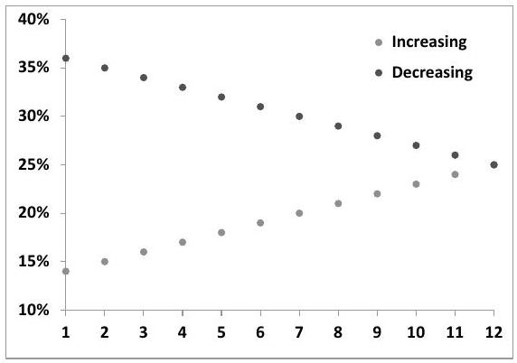
Figure 7.6: Term structures of VS volatilities at $t=0$ used for generating prices in Table 7.5. Maturities are expressed in months.

Setting $\nu_{T}(t) \equiv 0$ in expression (7.56a) leads to $\sigma_{\text {eff }}=0$ : the price of an ATM call on realized variance vanishes.

However, the volatility of $U_{t}$ in (7.46) vanishes when $\nu_{T}(t) \equiv 0$ only because we have chosen a continuous-time framework: the quadratic variation $Q_{t}$ accrues continuously in our model. In realized variance payoffs, however, $Q_{t}$ is expressed as the sum of squared daily log-returns up to time $t$.

In the Black-Scholes model with constant volatility, for example, using the standard definition for quadratic variation yields:

$$
Q_{t}=\lim _{\Delta t \rightarrow 0} \sum_{0}^{t-1} \ln ^{2}\left(\frac{S_{i+1}}{S_{i}}\right)=\sigma^{2} t
$$

which implies that $Q_{t}$ is deterministic and the price of an ATM call on realized variance vanishes. Consider instead the following definition for $Q_{t}$ :

$$
Q_{t}=\sum_{0}^{t-1} \ln ^{2}\left(\frac{S_{i+1}}{S_{i}}\right)
$$

$Q_{t}$ is the standard estimator of realized variance over $[0, t]$. The log-return $r= \ln \left(\frac{S_{i+1}}{S_{i}}\right)$ is given by:

$$
\begin{align*}
r & =\sigma \sqrt{\Delta t} Z-\frac{\sigma^{2} \Delta t}{2}  \tag{7.64a}\\
& \simeq \sigma \sqrt{\Delta t} Z \tag{7.64b}
\end{align*}
$$
^eq7-64a
^eq7-64b

where $Z$ is a gaussian random variable with unit variance and $\Delta t$ is the interval between two observations of $S$, i.e. 1 day.

Volatility levels of typical equity underlyings $-\sigma \sqrt{\Delta t}$ are of the order of $1 \%$ to $2 \%$ - are such that $\sigma \sqrt{\Delta t} \ll 1$, justifying the approximation in (7.64b). While the expectation of $Q_{t}$ is still (approximately) $\sigma^{2} t, Q_{t}$ is a finite sum of squared
random variables and has non-vanishing variance. Even in a Black-Scholes model with constant volatility, an ATM call on variance acquires a non-zero value. This value is generated by the intrinsic variance of the volatility estimator we are using.

Let us then switch to discrete time and consider the evolution of $U_{t}$ over the time interval $[t, t+\Delta t]$. Let $r$ be the log-return of $S_{t}$ over $[t, t+\Delta t]$. The variation of $U_{t}$ during $\Delta t$ reads:

$$
\begin{align*}
U_{t+\Delta t}-U_{t} & =\frac{\left(Q_{t}+r^{2}\right)+(T-t-\Delta t) \widehat{\sigma}_{T}^{2}(t+\Delta t)}{T}-\frac{Q_{t}+(T-t) \widehat{\sigma}_{T}^{2}(t)}{T} \\
& =\frac{T-t-\Delta t}{T}\left(\widehat{\sigma}_{T}^{2}(t+\Delta t)-\widehat{\sigma}_{T}^{2}(t)\right)+\frac{1}{T}\left(r^{2}-\widehat{\sigma}_{T}^{2}(t) \Delta t\right) \tag{7.65}
\end{align*}
$$
^eq7-65

The first piece in (7.65) is the discrete-time counterpart of the $\frac{T-t}{T} d\left(\widehat{\sigma}_{T}^{2}\right)$ term in (7.45), which is the only contribution to $d U_{t}$ in a continuous-time setting.

Let us assume that the volatility of $\widehat{\sigma}_{T}^{2}$ vanishes so that this contribution vanishes and let us concentrate on the contribution of the second piece to the variance of $U_{t+\Delta t}-U_{t}$.

Write the daily return over $\Delta t$ as:

$$
\begin{equation*}
r=\sigma_{t} \sqrt{\Delta t} Z \tag{7.66}
\end{equation*}
$$
^eq7-66

where $Z$ is a (possibly non-gaussian) random variable with unit variance, and $\sigma_{t}$ is the instantaneous (discrete) volatility over $[t, t+\Delta t]$. Let us make the approximation that the term structure of the VS curve at $t$ is flat: $\sigma_{t}=\widehat{\sigma}_{T}(t)$. The second piece in (7.65) then reads:

$$
\frac{\widehat{\sigma}_{T}^{2}(t) \Delta t}{T}\left(Z^{2}-1\right)
$$

where, just as in (7.64b), we have discarded terms of higher order in $\sigma \sqrt{\Delta t}$. Computing now the variance of $\frac{U_{t+\Delta t}}{U_{t}}$ contributed by the second term in (7.65) we get:

$$
\begin{align*}
E\left[\left(\frac{U_{t+\Delta t}}{U_{t}}-1\right)^{2}\right] & =\frac{1}{U_{t}^{2}}\left(\frac{\widehat{\sigma}_{T}^{2} \Delta t}{T}\right)^{2} E\left[\left(Z^{2}-1\right)^{2}\right] \\
& =\left(\frac{\widehat{\sigma}_{T}^{2}}{U_{t}}\right)^{2}\left(\frac{\Delta t}{T}\right)^{2}(2+\kappa) \tag{7.67}
\end{align*}
$$
^eq7-67

where $\kappa$ is the (excess) kurtosis of $Z: \kappa=E\left[Z^{4}\right]-3$. Let us assume that the term structure of VS volatilities is flat, so that $E\left[U_{t}\right]=\widehat{\sigma}_{T}^{2}$ and let us replace $U_{t}$ with its expectation. The prefactor in (7.67) is then simply equal to 1 . This yields:

$$
\begin{equation*}
E\left[\left(\frac{U_{t+\Delta t}}{U_{t}}-1\right)^{2}\right] \simeq\left(\frac{\Delta t}{T}\right)^{2}(2+\kappa) \tag{7.68}
\end{equation*}
$$
^eq7-68

We now revert to the continuous-time framework. The quadratic variation of $U_{t}$ over $[0, T]$ now acquires an extra contribution and reads :

$$
\begin{equation*}
\int_{0}^{T} 4 R_{\tau}^{2}\left(\frac{T-\tau}{T}\right)^{2} \nu_{T}^{2}(\tau) d \tau+N\left(\frac{\Delta t}{T}\right)^{2}(2+\kappa) \tag{7.69}
\end{equation*}
$$
^eq7-69

where $N=\frac{T}{\Delta t}$ is the number of returns in the interval $[0, T]$. Dividing now (7.69) by $T$ provides the following amended expression for $\sigma_{\text {eff }}^{2}$ which supersedes (7.56a):

$$
\begin{equation*}
\sigma_{\mathrm{eff}}^{2}=\frac{1}{T} \int_{0}^{T} 4\left(\frac{T-\tau}{T}\right)^{2}\left(\frac{\widehat{\sigma}_{\tau T}^{2}(0)}{\widehat{\sigma}_{T}^{2}(0)}\right)^{2} \nu_{T}^{2}(\tau) d \tau+\frac{2+\kappa}{N T} \tag{7.70}
\end{equation*}
$$
^eq7-70

where $N$ is the number of returns over $[0, T]: N=\frac{T}{\Delta t}$. The second piece in (7.70) is generated by the intrinsic variance of the variance estimator itself: as expected, its relative contribution to $\sigma_{\text {eff }}^{2}$ is largest for short maturities.

Which value should we pick for $\kappa ? \kappa$ is the conditional kurtosis of daily logreturns, that is the kurtosis of $Z$ in (7.66). It is the portion of the unconditional kurtosis - the kurtosis of $r$ - that is not generated by fluctuations of $\sigma_{t}$ - i.e. the scale - of daily returns. In practice, as already mentioned in Section 1.2.2, measuring the unconditional kurtosis is already tricky; 5 is a typical level for equity underlyings.

Sorting out which portion of $\kappa$ is attributable to fluctuations of $\sigma_{t}$ - a quantity that is not directly observable - or to the intrinsic kurtosis of scaled log-returns ( $Z$ ) is even more challenging. In numerical examples below we have used $\kappa=2$. The case of conditional lognormal daily returns corresponds to $\kappa=0$.

Setting $\kappa=-2$ in formula (7.70) suppresses the contribution of the kurtosis of daily returns to $\sigma_{\text {eff }}$ altogether.

Figure 7.7 shows prices of an ATM call option on realized variance for maturities 1 month to 1 year. We have used Set II parameters, flat VS volatilities equal to $20 \%$ and have used a ratio of 21 returns per month. We compare approximate prices obtained with expression (7.70) for $\sigma_{\text {eff }}$ with $\kappa=2$ or $\kappa=-2$ with (exact) prices computed in a Monte Carlo simulation of the two-factor model. While the dynamics of forward variances is generated in standard fashion, we draw daily returns with a Student distribution with $\nu=7$ degrees of freedom, so that their conditional kurtosis is equal to $2 .^{20}$

Figure 7.7 highlights the fact that the discrete nature of returns is mostly apparent for short-maturity options - say 3 months or less. Observe how prices computed in our approximate model with $\sigma_{\text {eff }}$ given by (7.70) are in good agreement with prices computed in a Monte Carlo simulation of the full-blown forward variance model -

[^100]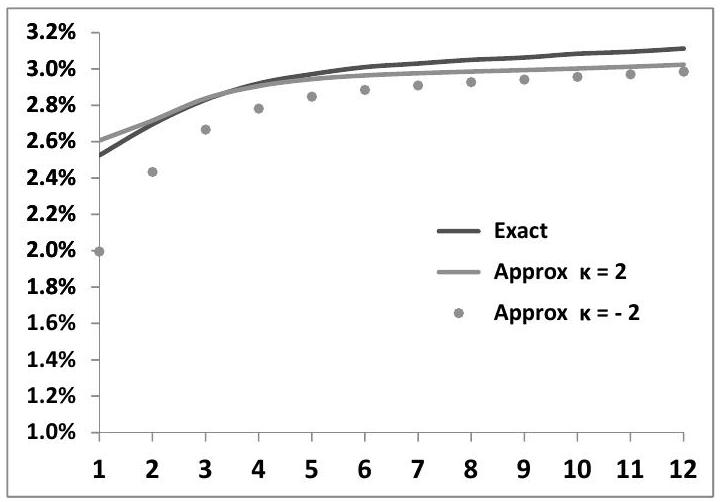
Figure 7.7: Price of an ATM call on realized variance as a function of maturity, from 1 month to 1 year, computed either in a Monte Carlo simulation of the forward variance model (exact), or in the approximate model with $\sigma_{\text {eff }}$ given by (7.70) with $\kappa=2$ and $\kappa=-2$.

with Student-like daily returns for $S_{t}$. The slight negative bias of approximate prices with respect to exact prices is also seen in Table 7.5.

### 7.6.9 Conclusion

- The primary risk of options on realized variance is the exposure to the realized volatility of $\widehat{\sigma}_{T}(t)$, the implied volatility for the option's maturity. This risk is well captured with an approximate model for the dynamics of $\widehat{\sigma}_{T}(t)$ : an option on realized variance is delta-hedged with VSs of the option's maturity. Forward variance models generating different volatilities and correlations of forward variances but the same volatility for $\widehat{\sigma}_{T}(t)$ yield very similar prices.
- Additional VSs for intermediate maturities are needed to hedge the residual exposure to the VS term structure and to properly gamma-hedge the option on realized variance against the realized volatility of the underlying. The approximate model does not price the gamma costs arising from dynamical trading of these intermediate VSs. Comparison of approximate and exact prices suggests however that these costs are small.
- Quadratic variation does not accrue continuously but is expressed as a discrete sum of squared daily log-returns: this results in a specific contribution of the intrinsic variance of the volatility estimator to the option's price.

### 7.6.10 What about the vanilla smile? Lower and upper bounds

Nowhere in our analysis have we calibrated our model to the vanilla smile except for determining VS volatilities. This is natural as we are only using VSs as hedges. Can the information in the vanilla smile be somehow used? In what measure do market prices of vanilla options restrict prices of options on realized variance?

We know that the density of $S_{T}$ can be extracted from the vanilla smile of maturity $T$ - see equation (2.8), page 29. If we now assume that the process for $S_{t}$ is a diffusion - which in practitioner terms means that the expansion of the daily P\&L of a delta-hedged position at order two in $\frac{\delta S}{S}$ is adequate - much more information can be extracted from the vanilla smile.

Indeed, by delta-hedging European options we are able to create payoffs that involve the realized variance weighted by the dollar gamma, a function of $t$ and $S$. The VS is an example of such a payoff - with a constant weight - but more complex payoffs involving $S_{t}$ and increments of the quadratic variation $Q_{t}$ can be synthesized.

What about call and put payoffs on $Q_{T}$ ? These are not replicable by a combination of a static position in a European payoff and a delta strategy on $S$. Given a particular market smile, can we nevertheless derive model-independent bounds for the prices of calls and puts on realized variance?

Model-independent lower and upper bounds for prices of options on realized variance are most naturally determined by solving the stochastic control problem touched upon in Appendix A of Chapter 2, in the context of the Lagrangian Uncertain Volatility Model. The higher bound $\overline{\mathcal{P}}(F)$ is obtained as the highest price generated by processes for the instantaneous volatility $\sigma_{t}$ such that vanilla option prices are recovered:

$$
\overline{\mathcal{P}}(F)=\max _{\substack{\sigma_{t} \in\left[\sigma_{\min }, \sigma_{\max }\right] \\ E_{\sigma}\left[O_{i}\right]=\mathcal{P}_{\text {Market }}\left(O_{i}\right)}} E_{\sigma}[F]
$$

where we set $\sigma_{\text {min }}=0, \sigma_{\text {max }}=+\infty . F$ is the payoff of the option on realized variance, and the $O_{i}$ are payoffs of vanilla options.

Likewise, the model-independent lower bound $\underline{\mathcal{P}}(F)$ is obtained by minimizing $E_{\sigma}[F]$. In the literature, this problem has been tackled differently, making use of particular solutions of the Skorokhod embedding problem - see [42] as well as [62], [28], [34].

The $\underline{\mathcal{P}}(F), \overline{\mathcal{P}}(F)$ bounds thus derived are sharp: in case they are violated, an arbitrage strategy consisting in a static position in an option on realized variance plus a European payoff together with a dynamic delta strategy nets a positive P\&L. Both the European payoff and the delta strategy have to be determined numerically. The delta strategy consists in delta-hedging the European payoff, either in timer-option fashion ( $\sigma=\sigma_{\max }=\infty$ ), or at zero volatility ( $\sigma=\sigma_{\min }=0$ ). ${ }^{21}$

[^101]To give the reader an intuition for how these delta-hedging regimes come into play, we now go through the derivation of a heuristic lower bound for a call on realized variance proposed by Bruno Dupire ${ }^{22}$ and a heuristic upper bound, proposed by Peter Carr and Roger Lee and published in [28]. ${ }^{23}$

Both are non-optimal bounds in the sense that the lower/upper bound lie lower/higher than $\underline{\mathcal{P}}(F) / \overline{\mathcal{P}}(F)$.

## A lower bound

Assume zero interest rate and repo and consider a short position in a European option of maturity $T$ with convex payoff $f(S)$. Let us delta-hedge this option in timer option manner with a quadratic variation budget given by $\mathcal{Q}=\widehat{\boldsymbol{\sigma}}^{2} T$, where $\widehat{\boldsymbol{\sigma}}$ is the (volatility) strike of the option on realized variance. ${ }^{24}$. The option's value is given by: $\mathcal{P}_{B S}^{f}\left(S_{t}, Q_{t} ; \mathcal{Q}\right)$, where $\mathcal{P}_{B S}^{f}$ is given by expression (5.68), page 183, and $Q_{t}$ is the realized quadratic variation since $t=0$.

If $Q_{T}<\widehat{\boldsymbol{\sigma}}^{2} T$, there remains at maturity some residual quadratic variation budget and we make a positive P\&L equal to:

$$
\begin{equation*}
P \& L_{\text {Final }}^{Q_{T}<\mathcal{Q}}=\mathcal{P}_{B S}^{f}\left(S_{T}, Q_{T} ; \mathcal{Q}\right)-\mathcal{P}_{B S}^{f}\left(S_{T}, Q_{T} ; Q_{T}\right) \tag{7.71}
\end{equation*}
$$
^eq7-71

If instead we exhaust our budget at time $\tau<T: Q_{\tau}=\mathcal{Q}$, we delta-hedge our option at zero implied volatility on $[\tau, T]$ and our final $\mathrm{P} \& \mathrm{~L}$ is:

$$
\begin{equation*}
P \& L_{\text {Final }}^{Q_{T}>\mathcal{Q}}=-\left.\frac{1}{2} \int_{\tau}^{T} S_{t}^{2} \frac{d^{2} f}{d S^{2}}\right|_{S_{t}} \bar{\sigma}_{t}^{2} d t \tag{7.72}
\end{equation*}
$$
^eq7-72

where $\bar{\sigma}_{t}$ is the instantaneous realized volatility.
Let us now assume that the convex profile $f$ is such that $\frac{S^{2}}{2} \frac{d^{2} f}{d S^{2}}$ either vanishes or is equal to a positive constant, $\Gamma: \frac{S^{2}}{2} \frac{d^{2} f}{d S^{2}}=\theta(S) \Gamma$ and $\Gamma \geq 0$, with $\theta(S)=0$ or 1 . Then:

$$
\begin{align*}
P \& L_{\text {Final }}^{Q_{T}>\mathcal{Q}} & \geq-\Gamma \int_{\tau}^{T} \bar{\sigma}_{t}^{2} d t  \tag{7.73}\\
& \geq-\Gamma\left(Q_{T}-Q_{\tau}\right)=-\Gamma\left(Q_{T}-\mathcal{Q}\right) \tag{7.74}
\end{align*}
$$
^eq7-73
^eq7-74

$$
\frac{d P}{d t}+\max _{\sigma=\sigma_{\min }, \sigma_{\max }} \sigma^{2}\left(\frac{S^{2}}{2} \frac{d^{2} P}{d S^{2}}+\frac{d P}{d Q}\right)=0
$$

with $\sigma_{\min }=0, \sigma_{\max }=+\infty$. In this equation $P$ is the price of payoff $F-\Sigma \lambda_{i} O_{i}$ where $F$ is the exotic option's payoff - in our case a call on realized variance - and the $O_{i}$ are vanilla options. Because $\sigma_{\text {min }}=0, \sigma_{\text {max }}=+\infty$, the solution of this PDE is then such that (a) $\frac{d P}{d t}=0$; (b) in regions of $S$ where the max is obtained with $\sigma=\sigma_{\max }=+\infty$, we have $\frac{S^{2}}{2} \frac{d^{2} P}{d S^{2}}+\frac{d P}{d Q}=0$. These are exactly conditions (5.70), page 184, that characterize timer options. I thank Pierre Henry-Labordère for pointing this out to me.
${ }^{22}$ Presented at the 2005 Global Derivatives conference.
${ }^{23}$ In what follows all $P \& L s$ are computed at order one in $\delta t$ and order two in $\delta S$; provided this is adequate, the sub- and super-replicating strategies derived below indeed work. Mathematically, they hold for processes of $S_{t}$ that are continuous semimartingales. Practically, they hold as long as contributions of order three and higher in $\delta S$ to our daily $P \& L$ can be ignored.
${ }^{24}$ See Section 5.9 on timer options.

Consider a call option on realized variance with strike $\widehat{\boldsymbol{\sigma}}$, whose payoff is

$$
\frac{1}{2 \widehat{\sigma}_{T}}\left(\frac{Q_{T}}{T}-\widehat{\boldsymbol{\sigma}}^{2}\right)^{+}=\frac{1}{2 \widehat{\sigma}_{T}^{T}}\left(Q_{T}-\mathcal{Q}\right)^{+}
$$

where $\widehat{\sigma}_{T}$ is the VS volatility for maturity $T$. Denote by $C_{\text {Mkt }}^{\widehat{\sigma}}$ its market price and let us buy $2 \widehat{\sigma}_{T} T \Gamma$ units of it.

In case $Q_{T}>\mathcal{Q}$, this option's payout more than offsets the negative P\&L $P \& L_{\mathrm{Final}}^{Q_{T}>\mathcal{Q}}$ : our total final $\mathrm{P} \& \mathrm{~L}$ is positive.

If instead $Q_{T}<\mathcal{Q}$, the option on realized variance expires worthless, and our final total $\mathrm{P} \& \mathrm{~L}$, given by $P \& L_{\text {Final }}^{Q_{T}<\mathcal{Q}}$ is positive as well.

Thus our short position in the European payoff $f(S)$ combined with a long position in $2 \widehat{\sigma}_{T} T \Gamma$ options on realized variance of strike $\widehat{\boldsymbol{\sigma}}$ nets a profit in all cases. It must then be that the cost for entering this position is positive. Setting up this position requires a cash amount equal to the market price of the realized variance call minus the difference between market and model prices of the European payoff at $t=0$, which is equal to:

$$
P_{\mathrm{Mkt}}^{f}-\mathcal{P}_{B S}^{f}\left(S_{0}, 0 ; \mathcal{Q}\right)
$$

The condition that the cash amount needed at $t=0$ be positive then reads:

$$
\left(2 \widehat{\sigma}_{T} T \Gamma\right) C_{\mathrm{Mkt}}^{\widehat{\sigma}}-\left(P_{\mathrm{Mkt}}^{f}-\mathcal{P}_{B S}^{f}\left(S_{0}, 0 ; \mathcal{Q}\right)\right) \geq 0
$$

This yields the following lower bound for $C_{\mathrm{Mkt}}^{\widehat{\sigma}}$ :

$$
\begin{equation*}
C_{\mathrm{Mkt}}^{\widehat{\sigma}} \geq \frac{1}{2 \widehat{\sigma}_{T} T} \frac{1}{\Gamma}\left(P_{\mathrm{Mkt}}^{f}-\mathcal{P}_{B S}^{f}\left(S_{0}, 0 ; \widehat{\sigma}^{2} T\right)\right) \tag{7.75}
\end{equation*}
$$
^eq7-75

where we have replaced $\mathcal{Q}$ with $\widehat{\boldsymbol{\sigma}}^{2} T$. This condition holds for any European payoff $f$ such that $\frac{S^{2}}{2} \frac{d^{2} f}{d S^{2}}$ either vanishes or is equal to $\Gamma$. Which payoff should we pick, so that the lower bound for $C_{\mathrm{Mkt}}^{\widehat{\sigma}}$ provided by the right-hand side of (7.75) is highest?
$f$ can be replicated with cash, forwards and vanilla options of all strikes, of which only the latter contribute to the right-hand side of (7.75). From formula (3.6) for the replication of European payoffs, the density of vanilla options of strike $K$ in the replicating portfolio is equal to the second derivative of the payoff, thus is equal to $2 \theta(K) \frac{\Gamma}{K^{2}}$. The right-hand side of (7.75) can thus be written as:

$$
\begin{equation*}
\frac{1}{2 \widehat{\sigma}_{T}^{T} T} \frac{1}{\Gamma} \int_{0}^{\infty} 2 \theta(K) \frac{\Gamma}{K^{2}}\left(P_{\mathrm{Mkt}}^{K}-\mathcal{P}_{B S}^{K}\left(S_{0}, 0 ; \hat{\boldsymbol{\sigma}}^{2} T\right)\right) d K \tag{7.76}
\end{equation*}
$$
^eq7-76

where $P_{\mathrm{Mkt}}^{K}$ is the market price for a vanilla option of strike $K$ and $\mathcal{P}_{B S}^{K}$ is its BlackScholes price. There is no need to distinguish between calls and puts, since by call-put parity $P_{\mathrm{Mkt}}^{K}-\mathcal{P}_{B S}^{K}$ is identical for a call or a put struck at the same strike.

Let us introduce the implied volatility for strike $K, \widehat{\sigma}_{K}$. By definition of $\widehat{\sigma}_{K}$ : $P_{\mathrm{Mkt}}^{K}=\mathcal{P}_{B S}^{K}\left(S_{0}, 0 ; \widehat{\sigma}_{K}^{2} T\right)$. (7.76) is thus equal to:

$$
\frac{1}{2 \widehat{\sigma}_{T} T} \int_{0}^{\infty} \frac{2}{K^{2}} \theta(K)\left(\mathcal{P}_{B S}^{K}\left(S_{0}, 0 ; \widehat{\sigma}_{K}^{2} T\right)-\mathcal{P}_{B S}^{K}\left(S_{0}, 0 ; \hat{\boldsymbol{\sigma}}^{2} T\right)\right) d K
$$

The highest value for this expression is obtained by setting $\theta(K)=1$ for strikes such that $\widehat{\sigma}_{K}>\widehat{\boldsymbol{\sigma}}$ and $\theta(K)=0$ otherwise. We thus get our final expression for the (sub-optimal) lower bound :

$$
\begin{equation*}
C_{\mathrm{Mkt}}^{\widehat{\boldsymbol{\sigma}}} \geq \frac{1}{2 \widehat{\sigma}_{T} T} \int_{0}^{\infty} \mathbf{1}_{\widehat{\sigma}_{K}>\widehat{\boldsymbol{\sigma}}} \frac{2}{K^{2}}\left(\mathcal{P}_{B S}^{K}\left(S_{0}, 0 ; \widehat{\sigma}_{K}^{2} T\right)-\mathcal{P}_{B S}^{K}\left(S_{0}, 0 ; \hat{\boldsymbol{\sigma}}^{2} T\right)\right) d K \tag{7.77}
\end{equation*}
$$
^eq7-77

This idea can be extended to the case of a call on forward-starting variance - see [28].

Imagine that implied volatilities all lie above the (volatility) strike of the call on realized variance: $\mathbf{1}_{\widehat{\sigma}_{K}>\widehat{\boldsymbol{\sigma}}}=1 \forall K$. This implies also that $\widehat{\sigma}_{T} \geq \widehat{\boldsymbol{\sigma}}$ : the call on realized variance is in the money. We then recognize in the right-hand side of (7.77) the difference between the market price for the VS for maturity $T$ - see equation (5.16), page 154 - and its price for a flat smile equal to $\widehat{\boldsymbol{\sigma}}$. This yields:

$$
C_{\mathrm{Mkt}}^{\widehat{\boldsymbol{\sigma}}} \geq \frac{1}{2 \widehat{\sigma}_{T}}\left(\widehat{\sigma}_{T}^{2}-\widehat{\boldsymbol{\sigma}}^{2}\right)
$$

which expresses that, with zero rates, the price of a call option is larger than its intrinsic value.

Likewise, if $\mathbf{1}_{\widehat{\sigma}_{K}>\widehat{\boldsymbol{\sigma}}}=0 \forall K, \widehat{\sigma}_{T} \leq \widehat{\boldsymbol{\sigma}}$ : the call on realized variance is out of the money, and (7.77) again expresses that $C_{\mathrm{Mkt}}^{\widehat{\sigma}}$ lies above the intrinsic value, in this case zero.

## An upper bound

We present here one version of Peter Carr and Roger Lee's super-replicating strategy - the upper bound in [28] is sharper.

We work with zero interest rate and repo and temporarily omit the $\frac{1}{2 \widehat{\sigma}_{T} T}$ prefactor in the payoff of the call on realized variance:

$$
\left(Q_{T}-\Sigma\right)^{+}
$$

with $\Sigma=\widehat{\boldsymbol{\sigma}}^{2} T$ where $\widehat{\boldsymbol{\sigma}}$ is the strike of the option on realized variance. Pick two barriers $L$ and $H$ such that $L \leq S_{0} \leq H$ where $S_{0}$ is the initial spot level. It is possible to generate model-independently the payoff $\left(Q_{\tau}-\Sigma\right)^{+}$where $\tau$ is defined as the time when $S_{\tau}$ first hits $L$ or $H$ - see Section 5.9 on timer options.

This payoff is the timer equivalent of a perpetual barrier option that pays a rebate $R(t)=(t-\Sigma)^{+}$when $S$ first hits $L$ or $H$.

Denote by $\mathcal{B}_{L H}\left(S_{0}, Q ; \Sigma\right)$ the price of this option - as a timer option price it does not depend on $t . \mathcal{B}_{L H}$ solves the following PDE:

$$
\begin{equation*}
\frac{S^{2}}{2} \frac{d^{2} \mathcal{B}_{L H}}{d S^{2}}+\frac{d \mathcal{B}_{L H}}{d Q}=0 \tag{7.78}
\end{equation*}
$$
^eq7-78

with boundary conditions: $\mathcal{B}_{L H}(L, Q ; \Sigma)=\mathcal{B}_{L H}(H, Q ; \Sigma)=(Q-\Sigma)^{+}$

- If $\tau>T$, at $t=T$ we have:

$$
\begin{align*}
\mathcal{B}_{L H}\left(S_{T}, Q_{T} ; \Sigma\right) & =E_{T}\left[\left(Q_{\tau}-\Sigma\right)^{+}\right]=E_{T}\left[\left(Q_{\tau}-Q_{T}+Q_{T}-\Sigma\right)^{+}\right] \\
& \geq\left(Q_{T}-\Sigma\right)^{+} \tag{7.79}
\end{align*}
$$
^eq7-79

where $E_{T}$ is a shorthand notation for $E_{T, S_{T}, Q_{T}}$, an expectation taken with respect to PDE (7.78), and we have used the property that the quadratic variation increases with time: $Q_{\tau}-Q_{T} \geq 0$. Thus, if $\tau>T$, a long position in the timer barrier option that pays $\left(Q_{\tau}-\Sigma\right)^{+}$super-replicates the payoff of the option on realized variance of maturity $T$.

- What if $\tau \leq T$ ? If $S$ hits either $L$ or $H$ at time $\tau<T$ our timer option pays us $\left(Q_{\tau}-\Sigma\right)^{+}$. Since our aim is to super-replicate payoff $\left(Q_{T}-\Sigma\right)^{+}$, we need to trade an additional instrument of maturity $T$ that generates $\left(Q_{T}-Q_{\tau}\right)$. At second order in $\delta S$, delta-hedging the profile $-2 \ln S$ at zero implied volatility generates the realized quadratic variation:

$$
d\left(-2 \ln S_{t}\right)+\frac{2}{S_{t}} d S_{t}=d Q_{t}
$$

The P\&L from the costless delta strategy $\frac{2}{S_{t}} d S_{t}$, combined with a long position in an option that pays $-2 \ln S_{T}$ at $T$, generates the quadratic variation up to $T$. Since we only need to generate the quadratic variation starting at $\tau$, when $S$ hits either $L$ or $H$, let us adjust $-2 \ln S$ by an affine function of $S$ that preserves the convexity of $-2 \ln S$ but ensures that the resulting payoff profile vanishes for $S=L$ and $S=H$. The resulting payoff $f_{L H}(S)$ is:

$$
f_{L H}(S)=-2 \ln S+2\left(\frac{\ln H-\ln L}{H-L}(S-L)+\ln L\right)
$$

$f_{L H}(S) \leq 0$ for $S \in[L, H]$ and is positive otherwise. We have:

$$
\begin{align*}
Q_{T}-Q_{\tau} & =\left(f_{L H}\left(S_{T}\right)-f_{L H}\left(S_{\tau}\right)\right)-\left.\int_{\tau}^{T} \frac{d f_{L H}}{d S}\right|_{S_{t}} d S_{t}  \tag{7.80a}\\
& =f_{L H}\left(S_{T}\right)-\left.\int_{\tau}^{T} \frac{d f_{L H}}{d S}\right|_{S_{t}} d S_{t} \tag{7.80b}
\end{align*}
$$
^eq7-80a
^eq7-80b

since by construction $f_{L H}\left(S_{\tau}\right)=0$. By buying the timer option discussed above as well as the European option that pays $f_{L H}\left(S_{T}\right)$ we generate at $T$
the amount: $\left(Q_{\tau}-\Sigma\right)^{+}+\left(Q_{T}-Q_{\tau}\right)$. It is easy to check that this again super-replicates the call on variance:

$$
\left(Q_{\tau}-\Sigma\right)^{+}+\left(Q_{T}-Q_{\tau}\right) \geq\left(Q_{T}-\Sigma\right)^{+}
$$

Our super-replicating portfolio thus comprises, in addition to the barrier timer option, a European option of maturity $T$ that pays $f_{L H}\left(S_{T}\right)$. In the case $\tau>T$, however, the value of our portfolio at $T$ is $\mathcal{B}_{L H}\left(S_{T}, Q_{T} ; \Sigma\right)+f_{L H}\left(S_{T}\right)$. Since $f_{L H}\left(S_{T}\right) \leq 0$ for $S \in[L, H]$, to ensure that the super-replication in (7.79) still works, we just need to replace $f_{L H}\left(S_{T}\right)$ with $g_{L H}\left(S_{T}\right)$ given by:

$$
g_{L H}(S)=\max \left(f_{L H}(S), 0\right)
$$

Because $g_{L H} \geq f_{L H}$, the super-replication still holds for $\tau \leq T$, provided we trade the delta $\frac{d f_{L H}}{d S}$ over $[\tau, T]$.

In conclusion, reverting to the usual normalization for the payoff of calls on realized variance: $\frac{1}{2 \widehat{\sigma}_{T} T}\left(Q_{T}-\widehat{\boldsymbol{\sigma}}^{2} T\right)$, whose price is $C_{\mathrm{Mkt}}^{\widehat{\boldsymbol{\sigma}}}$, we have:

$$
\begin{equation*}
C_{\mathrm{Mkt}}^{\widehat{\boldsymbol{\sigma}}} \leq \frac{1}{2 \widehat{\sigma}_{T} T}\left(\mathcal{B}_{L H}\left(S_{0}, 0 ; \hat{\boldsymbol{\sigma}}^{2} T\right)+\mathcal{G}_{L H}\left(S_{0}, T\right)\right) \tag{7.81}
\end{equation*}
$$
^eq7-81

where $\mathcal{G}_{L H}\left(S_{0}, T\right)$ is the market price of the option that pays $g_{L H}\left(S_{T}\right)$ at $T$. As it is a European payoff, it can be replicated with vanilla options: $\mathcal{G}_{L H}\left(S_{0}, T\right)$ only depends on the vanilla smile for maturity $T$.
$\mathcal{B}_{L H}\left(S_{0}, 0 ; \hat{\boldsymbol{\sigma}}^{2} T\right)$ instead, only depends on $L$ and $H$. The best higher bound is thus obtained for the $(L, H)$ couple that minimizes the right-hand side of (7.81).

The reasoning for the upper bound can be extended to calls on forward-starting variance - see [28].

As a sanity check, take $L=H=S_{0}$. Then $\mathcal{B}_{L H}\left(S_{0}, 0 ; \widehat{\boldsymbol{\sigma}}^{2} T\right)=0$ and $g_{L H}(S)$ is given by:

$$
\begin{aligned}
g_{L H}(S) & =f_{L H}(S) \\
& =-2 \ln \left(\frac{S}{S_{0}}\right)+\frac{2}{S_{0}}\left(S-S_{0}\right)
\end{aligned}
$$

We know from (5.12) that, with zero rate and repo, the market price of an option that pays $-2 \ln \left(\frac{S_{T}}{S_{0}}\right)$ is $\sigma_{T}^{2} T$. Thus, $\mathcal{G}_{L H}\left(S_{0}, T\right)=\sigma_{T}^{2} T$ and (7.81) expresses the fact that the price of a call option is bounded above by the forward. This higher bound is not indecent; it is the limit of a call price when volatility is taken to infinity.

## Conclusion

Information in the vanilla smile can be used to bound prices of options on realized variance. Using these bounds as bid/offer levels leads to prices that are, in practice, too conservative. ${ }^{25}$

[^102]
### 7.6.11 Options on forward realized variance

Consider two dates $T_{1}, T_{2}$. An option on forward realized variance pays at $T_{2}$ a vanilla payoff on the variance realized over the interval $\left[T_{1}, T_{2}\right]$. This type of option is attractive when the term structure of VS volatilities is such that forward VS implied volatilities appear to be much lower/higher than reasonable estimates of future realized volatility.

At $t=T_{1}$ the option is simply a spot-starting option on realized variance, which we have just extensively analyzed. Its price at $T_{1}$ is a function of VS volatilities $\widehat{\sigma}_{T}\left(T_{1}\right), T \in\left[T_{1}, T_{2}\right]$ given, for example in the SM, by expressions (7.56), but where we sit at $t=T_{1}$ rather than at $t=0$ :

$$
\begin{align*}
\sigma_{\text {eff }}^{2} & =\frac{4}{T_{2}-T_{1}} \int_{T_{1}}^{T_{2}}\left(\frac{T_{2}-\tau}{T_{2}-T_{1}}\right)^{2}\left(\frac{\widehat{\sigma}_{\tau T_{2}}^{2}\left(T_{1}\right)}{\widehat{\sigma}_{T_{2}}^{2}\left(T_{1}\right)}\right)^{2} \nu_{T_{2}}^{2}(\tau) d \tau \\
P\left(t=T_{1}\right) & =P_{\mathrm{BS}}\left(t=T_{1}, \widehat{\sigma}_{T_{2}}^{2}\left(T_{1}\right), \sigma_{\text {eff }}, T_{2}\right) \tag{7.82}
\end{align*}
$$
^eq7-82

The value of our option at $T_{1}$ is then a particular form of a swaption payoff. The price at $t=0$ of an option on forward realized variance is thus the price of a particular variance swaption of maturity $T_{1}$. It depends on assumptions about the volatility of forward variances $\xi_{t}^{\tau}, \tau \in\left[T_{1}, T_{2}\right]$, over the interval $t \in\left[0, T_{1}\right]$.

Consider replacing $\sigma_{\text {eff }}$ with 0 in (7.82); the value at $T_{1}$ of our option is then simply the call - or put - payoff applied to $\widehat{\sigma}_{T_{2}}^{2}\left(T_{1}\right)$. This is the payoff of a standard VS swaption, that is the option to enter at $T_{1}$ a VS contract of maturity $T_{2}$. ${ }^{26}$ An option on forward realized variance is thus more expensive than the corresponding VS swaption. ${ }^{27}$

Spot-starting options on realized variance can be economically priced and riskmanaged in the SM as the only ingredient is the curve $\nu_{T}(\tau), \tau \in[0, T]$ : the instantaneous volatility of the VS volatility for the residual maturity. Options on forward realized variance, on the other hand, require a specification of volatilities of forward VS volatilities. These cannot be backed out of the curve $\nu_{T}(\tau), \tau \in[0, T]$. An option on forward realized variance can then only be priced in a full-blown model.

In the two-factor model we can choose parameters such that, while volatilities of spot-starting VS volatilities are identical, volatilities of forward VS volatilities are different. Sets I, II, III in Table 7.1, page 229, have this property. They are chosen so as to match the benchmark $\nu_{T}^{B}(t)$ in (7.40) with $\sigma_{0}=100 \%, \tau_{0}=0.25 \alpha=0.4$.

[^103]Table 7.6 lists prices of a 6 month-in-6 month ATM call option on forward realized variance in Sets I, II, III, together with (a) prices of spot-starting options with the same maturity from Table 7.2, page 241, (b) prices of 6 month-in- 6 month variance swaptions. We can see that (a) options on forward realized variance are indeed more expensive than both spot-starting options and swaptions, (b) the price in Set I is appreciably higher than that in Set III, even though prices of spot-starting options are almost identical.

The difference between the second and third line of Table 7.6 is a measure of the additional time value contributed by the volatility of forward volatilities $\xi_{t}^{\tau}$ during the interval $\left[T_{1}, T_{2}\right]$.

|  | Set I | Set II | Set III |
| :--- | :---: | :---: | :---: |
| Spot-starting | $2.97 \%$ | $2.96 \%$ | $2.94 \%$ |
| Foward-starting | $4.25 \%$ | $4.09 \%$ | $3.94 \%$ |
| Swaption | $3.12 \%$ | $2.90 \%$ | $2.69 \%$ |

Table 7.6: Prices of an ATM call option on forward realized variance (top) and ATM call VS swaption (bottom) with $T_{1}=6$ months, $T_{2}=1$ year, computed in the two-factor model with parameter sets in Table 7.1, page 229.
Prices for a spot-starting option of the same maturity, from Table 7.2, are shown for reference. The term structure of VS volatilities is flat at $20 \%$.

### 7.7 VIX futures and options

We discuss here the application of the two-factor model to VIX instruments. This will allow us to relax the assumption of lognormality of forward variances.

VIX futures trade on the CBOE and expire on the morning of the Wednesday that is exactly 30 days prior to the monthly expiration dates of listed S\&P 500 options. The settlement value of the expiring VIX future is the 30 -day log-contract implied volatility, computed using market prices of listed S\&P 500 options. ${ }^{28}$ Ignoring the effect of fixed cash-amount dividends, the log-contract implied volatility at time $t$ for maturity $T$ is given by expression (5.12):

$$
\widehat{\sigma}_{T}^{2}(t)=\frac{e^{r(T-t)}}{T-t}\left(Q_{\mathrm{mkt}, t}^{T}-Q_{\widehat{\sigma}=0, t}^{T}\right)
$$

where $Q_{\mathrm{mkt}, t}^{T}$ is the market price at time $t$ of the payoff $-2 \ln S_{T}$ and $Q_{\widehat{\sigma}=0, t}^{T}$ is the price of the same payoff using vanishing volatility. We now set $t=T_{i}$, the expiration

[^104]date of the $i$ th future, and $T-t=\Delta=30$ days, and use the notation $\widehat{\sigma}_{\text {VIX }, T_{i}}$ for the settlement value of the VIX future expiring at $T_{i}$. As indicated in Section 5.2, the payoff $-2 \ln S_{T}$ is replicated by a continuous density $\frac{2}{K^{2}}$ of vanilla options, which yields:

$$
\begin{equation*}
\widehat{\sigma}_{\mathrm{VIX}, T_{i}}^{2}\left(T_{i}\right)=\frac{2 e^{r \Delta}}{\Delta}\left(\int_{0}^{F_{T_{i}}^{T_{i}+\Delta}} P_{\mathrm{mkt}, T_{i}}^{K, T_{i}+\Delta} \frac{d K}{K^{2}}+\int_{F_{T_{i}}^{T_{i}+\Delta}}^{\infty} C_{\mathrm{mkt}, T_{i}}^{K, T_{i}+\Delta} \frac{d K}{K^{2}}\right) \tag{7.83}
\end{equation*}
$$
^eq7-83
where $P_{\mathrm{mkt}, t}^{K T}\left(\right.$ resp. $\left.C_{\mathrm{mkt}, t}^{K T}\right)$ is the (discounted) market price at time $t$ of a put (resp. call) option of strike $K$, maturity $T$ on the S\&P 500 and $F_{T_{i}}^{T_{i}+\Delta}$ is the forward of the S\&P 500 index for maturity $T_{i}+\Delta$ observed at $T_{i}$. In the formula actually used by the CBOE, the integrals above are discretized using the trapezoidal rule and the integration does not run from 0 to $\infty$ but is cut off for small and large strikes wherever a zero bid price is encountered for two consecutive strikes. ${ }^{29}$ The resulting approximation is quite good, as strikes of listed S\&P 500 options are closely spaced and out-of-the-money strikes are reasonably liquid, typically from $50 \%$ to $125 \%$.

Note that $\widehat{\sigma}_{\text {VIX }, T_{i}}$ does not share the same convention as VS payoffs for annualizing volatility: in (7.83) $\frac{1}{\Delta}$ is used instead of $\frac{252}{N}$. Depending on the exact number of trading days for the 30 -day period at hand, this difference in conventions may translate into a difference of the order of one point of volatility. Further below, we will use the same $\frac{1}{\Delta}$ convention when comparing VIX and log-contract - or VS quotes.

Exchange-traded options on VIX futures exist as well, with the same expiration dates as the underlying VIX futures. Figure 7.8 shows the values of the 5 VIX futures for expiries July through December, observed on January 14, 2011, as well as the smiles of the associated options - see Figure 7.9 below for the expiry dates of the VIX futures. ${ }^{30}$

The settlement value of a VIX future is a log-contract volatility, not a VS volatility. However, for ease of exposition, since forward VS variances and forward log-contract variances are both driftless and can be modeled identically - see the discussion in Section 5.5, page 168 - we make no distinction in what follows between $\widehat{\sigma}_{T}$ and $\widehat{\sigma}_{\mathrm{VS}, T} \cdot \widehat{\sigma}_{T}=\widehat{\sigma}_{\mathrm{VS}, T}$ and forward log-contract and VS variances are identical, equal to $\xi_{t}^{T}$.

The distinction between $\widehat{\sigma}_{T}$ and $\widehat{\sigma}_{\mathrm{VS}, T}$ becomes relevant again in the discussion of the arbitrage between S\&P 500 VSs and VIX instruments, in Section 7.7.4.

[^105]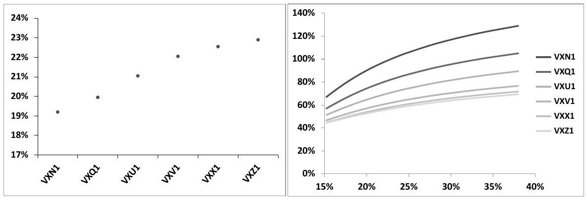
Figure 7.8: Left: VIX futures as of June 14, 2011 for expiries ranging from July (VXN1) to December (VXZ1). Right: Smiles of VIX futures.

### 7.7.1 Modeling VIX smiles in the two-factor model

Let $F_{t}^{i}$ be the VIX future for expiry $T_{i}$, observed at time $t$. At $t=T_{i}, F_{t}^{i}$ is equal to the VIX index, that is the 30 -day VS volatility observed at $T_{i}$ :

$$
\begin{equation*}
F_{t=T_{i}}^{i}=\widehat{\sigma}_{\mathrm{VIX}, T_{i}}\left(T_{i}\right) \tag{7.84}
\end{equation*}
$$
^eq7-84

where we denote by $\widehat{\sigma}_{\text {VIX }, T_{i}}$ the forward VS volatility corresponding to the VIX future expiring at $T_{i}-$ it is defined for $t<T_{i}$ :

$$
\begin{equation*}
\widehat{\sigma}_{\mathrm{VIX}, T_{i}}^{2}(t)=\frac{1}{\Delta} \int_{T_{i}}^{T_{i}+\Delta} \xi_{t}^{T} d T=E_{t}\left[\left(F_{T_{i}}^{i}\right)^{2}\right] \tag{7.85}
\end{equation*}
$$
^eq7-85

$F_{t}^{i}$ is the value of a future, hence it is driftless. For $t<T_{i}, F_{t}^{i}$ is thus given by:

$$
\begin{equation*}
F_{t}^{i}=E\left[F_{T_{i}}^{i}\right] \tag{7.86}
\end{equation*}
$$
^eq7-86

So far, we have modeled instantaneous forward variances as lognormal processes. While the resulting discrete forward variances are not exactly lognormal, they are close to lognormal - see for example swaption smiles in Figure 7.4. As is apparent in Figure 7.8, implied volatilities of VIX futures exhibit substantial smiles: we need to relax the lognormality of instantaneous forward variances, while preserving a Markov representation, if possible.

Let us start with the two-factor model specified in Section 7.4, page 226. Forward variances $\xi_{t}^{T}$ are given by (7.33) and (7.34):

$$
\begin{aligned}
\xi_{t}^{T} & =\xi_{0}^{T} f^{T}\left(t, x_{t}^{T}\right) \\
f^{T}(t, x) & =e^{\omega x-\frac{\omega^{2}}{2} \chi(t, T)}
\end{aligned}
$$

In the basic version of the two-factor model, the mapping function is an exponential, hence $\xi_{t}^{T}$ is lognormal.

## A Markov-functional model

More general forms for $f(t, x)$ can be considered. The condition that $\xi_{t}^{T}$ is driftless translates into the following PDE for $f^{T}(t, x)$ :

$$
\begin{equation*}
\frac{d f^{T}}{d t}+\frac{\eta^{2}(T-t)}{2} \frac{d^{2} f^{T}}{d x^{2}}=0 \tag{7.87}
\end{equation*}
$$
^eq7-87

where $\eta^{2}(T-t)$ is the instantaneous variance of $x_{t}^{T} \cdot \eta$ is given in (7.31b):

$$
\eta(u)=\alpha_{\theta} \sqrt{(1-\theta)^{2} e^{-2 k_{1} u}+\theta^{2} e^{-2 k_{2} u}+2 \rho_{12} \theta(1-\theta) e^{-\left(k_{1}+k_{2}\right) u}}
$$

Once a terminal condition at time $t=T, f^{T}(T, x)$ is chosen, the mapping function $f^{T}(t, x)$ is generated for dates $t<T$ by solving (7.87). Any solution of (7.87) needs to be suitably normalized so that the initial value of the forward variance $\xi_{t}^{T}$ is recovered at $t=0$, for $x=0$ - which is another way of saying that $E\left[\xi_{t}^{T}\right]=\xi_{0}^{T}$, $\forall t$ :

$$
f^{T}(0,0)=1
$$

The dynamics of $\xi^{T}$ reads:

$$
\frac{d \xi_{t}^{T}}{\xi_{t}^{T}}=\frac{d \ln f^{T}}{d x}\left(t, x_{t}^{T}\right) d x_{t}^{T}
$$

The instantaneous volatility of $\xi^{T}$ is thus given by:

$$
\begin{equation*}
\operatorname{vol}\left(\xi_{t}^{T}\right)=\eta(T-t)\left|\frac{d \ln f^{T}}{d x}\right|_{x=f^{T^{-1}}\left(\xi_{t}^{T}, t\right)} \tag{7.88}
\end{equation*}
$$
^eq7-88

$f^{T^{-1}}$ is well-defined only if $f^{T}$ is monotonic; this is verified in the parametric model used in the section that follows. The right-hand side of (7.88) is a function of $\xi_{t}^{T}$ and $t$, thus what we have is a local volatility model for $\xi_{t}^{T}$.

## A simple parametrization

Any linear combination of exponential solutions (7.34) solves (7.87) - using positive weights ensures that $f^{T}(t, x) \geq 0$, for all $t, x$. With such an ansatz for $f^{T}(t, x)$ smiles for $\xi^{T}$ are positively sloping, as for large values of $x$ the linear combination is dominated by terms with large values of $\omega$. This is not a serious limitation as VIX smiles for liquid strikes are usually positively sloping. Let us then use just two exponentials - this ansatz was proposed in [10]. We introduce the volatility-of-volatility smile parameters $\gamma_{T}, \beta_{T}, \omega_{T}$ and set:

$$
\begin{equation*}
f^{T}(t, x)=\left(1-\gamma_{T}\right) e^{\omega_{T} x-\frac{\omega_{T}^{2}}{2} \chi(t, T)}+\gamma_{T} e^{\beta_{T} \omega_{T} x-\frac{\left(\beta_{T} \omega_{T}\right)^{2}}{2} \chi(t, T)} \tag{7.89}
\end{equation*}
$$
^eq7-89

$\gamma_{T} \in[0,1]$ is a mixing parameter. For $\gamma_{T}=0$ or $\gamma_{T}=1, \xi^{T}$ is lognormal. $\beta_{T}$ is also chosen in $[0,1]$ - for $\beta_{T}=0, \xi^{T}$ is simply a displaced lognormal. The instantaneous volatility of $\xi_{T}$ is given by (7.88). Setting $t=0, x=0$ yields:

$$
\left.\operatorname{vol}\left(\xi_{t}^{T}\right)\right|_{t=0}=\omega_{T}\left(\left(1-\gamma_{T}\right)+\beta_{T} \gamma_{T}\right) \eta(T)
$$

Let us introduce the dimensionless parameter $\zeta^{T}$ and write $\omega_{T}$ as:

$$
\begin{equation*}
\omega_{T}=\frac{2 \nu}{\left(1-\gamma_{T}\right)+\beta_{T} \gamma_{T}} \zeta_{T} \tag{7.90}
\end{equation*}
$$
^eq7-90

The instantaneous volatility of $\xi_{t}^{T}$ at $t=0$ is then given by:

$$
\left.\operatorname{vol}\left(\xi_{t}^{T}\right)\right|_{t=0}=2 \nu \zeta_{T} \eta(T)
$$

$\zeta_{T}$ is thus simply a scale factor for the instantaneous volatility of $\xi_{t}^{T}$ at $t=0$. We now use parameters $\gamma^{T}, \beta^{T}, \zeta^{T}$ to adjust the smile of VIX futures, for a given set of parameters $\nu, \theta, k_{1}, k_{2}, \rho$.

## Calibration of VIX futures and options

We first choose a set of parameters $\nu, \theta, k_{1}, k_{2}, \rho$ to generate the underlying basic dynamics of our model - specifically one of the three sets in Table 7.1.

Then for each expiry $T_{i}$ we determine forward variances $\xi_{0}^{T}$ for $T \in\left[T_{i}, T_{i}+\Delta\right]$ as well as parameters $\gamma^{T}, \beta^{T}, \zeta^{T}$ so that market prices of (a) the VIX future $F_{t}^{i}$ expiring at $T_{i}$ and (b) VIX options maturing at $T_{i}$ are matched. ${ }^{31}$ Mathematically our model needs to ensure that:

$$
\begin{aligned}
E_{t}\left[\widehat{\sigma}_{\mathrm{VIX}, T_{i}}\left(T_{i}\right)\right] & =F_{t}^{i} \\
E_{t}\left[\left(\widehat{\sigma}_{\mathrm{VIX}, T_{i}}\left(T_{i}\right)-K\right)^{+}\right] & =\mathcal{C}_{t}^{K i}, \quad E_{t}\left[\left(K-\widehat{\sigma}_{\mathrm{VIX}, T_{i}}\left(T_{i}\right)\right)^{+}\right]=\mathcal{P}_{t}^{K i}
\end{aligned}
$$

where $\mathcal{C}_{t}^{K i}, \mathcal{P}_{t}^{K i}$ are, respectively, undiscounted market prices of call and put options with strike $K$, maturity $T_{i}$ on the VIX index, and $\widehat{\sigma}_{\text {VIX }, T_{i}}$ is given by (7.85) as a function of forward variances. We assume that within each interval [ $T_{i}, T_{i}+\Delta$ ] forward variances at $t=0$ are flat and denote them by $\xi_{0}^{i}$. Similarly we use constant values for $\gamma^{T}, \beta^{T}, \zeta^{T}$ over $\left[T_{i}, T_{i}+\Delta\right]-$ which we denote by $\gamma^{i}, \beta^{i}, \zeta^{i}$.

The forward variance for interval [ $T_{i}, T_{i+1}$ ] that underlies the VIX future expiring at $T_{i}$ is thus a function of $t, X_{t}^{1}, X_{t}^{2}$ given by:

$$
\begin{equation*}
\widehat{\sigma}_{\mathrm{VIX}, T_{i}}^{2}\left(t, X_{t}^{1}, X_{t}^{2}\right)=\xi_{0}^{i} \frac{1}{\Delta} \int_{T_{i}}^{T_{i+1}} f^{\tau}\left(t, x_{t}^{\tau}\right) d \tau \tag{7.91}
\end{equation*}
$$
^eq7-91

and both the VIX future and prices of options on $\widehat{\sigma}_{\text {VIX }, T_{i}}\left(T_{i}\right)$ are obtained through a two-dimensional Gaussian quadrature on $\left(X_{T_{i}}^{1}, X_{T_{i}}^{2}\right)$.

Figure 7.9 shows the values of parameters $\gamma^{i}, \beta^{i}, \zeta^{i}$ calibrated to the market smiles of VIX futures as of June 14, 2011 for strikes in the interval [ $15 \%, 40 \%$ ]. In this strike range the difference between market and calibrated implied volatilities lies well within the bid/offer spread which is about 3 points of volatility - the smiles

[^106]in Figure 7.8 are in fact those generated by our model with Set II parameters. ${ }^{32}$ Calibration is performed by least-squares minimization with a sufficiently large weight on the future itself that it is exactly calibrated. ${ }^{33}$

It should be mentioned that for very large strikes - that are much less liquid market implied volatilities fall off, a feature that our parametrization is unable to capture.

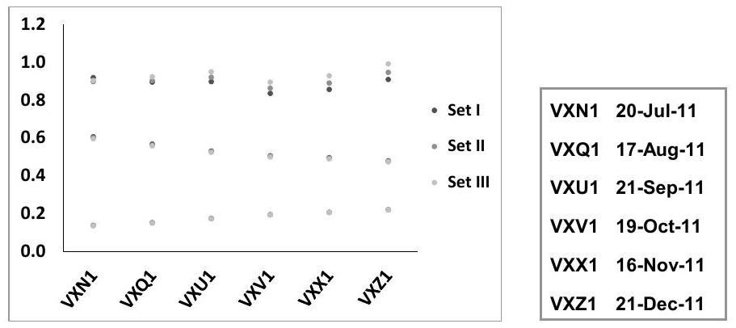
Figure 7.9: Left: values of $\gamma^{i}, \beta^{i}, \zeta^{i}$ calibrated on market smiles of VIX futures on June 14, 2011, using parameter sets in Table $7.1-$ bottom: $\beta^{i}$, middle: $\gamma^{i}$, top: $\zeta^{i}$. Right: expiries of VIX futures. The corresponding futures and their smiles appear in Figure 7.8.

Calibration has been performed using the three sets of parameters $\nu, \theta, k_{1}, k_{2}, \rho$ listed in Table 7.1, page 229. Figure 7.9 also lists the expiry dates of the corresponding VIX futures. ${ }^{34}$ Calibrated values of $\gamma^{i}, \beta^{i}, \zeta^{i}$ for the six futures considered are similar; moreover they hardly depend on which set is used: only $\zeta$ is appreciably larger in Set III than in Sets I and II. This is expected. Sets I, II, III generate almost identical term

[^107]structures for volatilities of spot-starting VS volatilities, however, as manifested in Figure 7.2, volatilities of forward volatilities are lowest in Set III - this is compensated for by an increase in $\zeta$.

Calibration is equally satisfactory for Sets I, II, III. Which set should one choose? Different sets for parameters $\nu, \theta, k_{1}, k_{2}, \rho$ generate different distributions of the realized variance of $F_{t}^{i}$, as well as different correlation structures for the $F_{t}^{i}$. Define $\sigma_{t}$ as the square root of the expected instantaneous variance of $F_{t}^{i}$ :

$$
\begin{equation*}
\sigma_{t}^{2}=E_{0}\left[\frac{\left\langle\left(d \ln F_{t}^{i}\right)^{2}\right\rangle}{d t}\right] \tag{7.92}
\end{equation*}
$$
^eq7-92

In our two-factor Markov-functional model, $F_{t}^{i}$ is a function of $X_{t}^{1}, X_{t}^{2}$, given by numerical evaluation of the expectation in (7.86). $\sigma_{t}$ is thus simply given by:

$$
\sigma_{t}=\sqrt{E\left[\alpha_{X^{1}}^{2}+\alpha_{X^{2}}^{2}+2 \rho_{12} \alpha_{X^{1}} \alpha_{X^{2}}\right]}
$$

where $\alpha_{X^{1}}, \alpha_{X^{2}}$ are the sensitivities of $\ln F_{t}^{i}$ with respect to $X_{t}^{1}, X_{t}^{2}$ and the expectation is taken over $X_{t}^{1}, X_{t}^{2}$ - this is efficiently evaluated through a two-dimensional Gaussian quadrature.

Figure 7.10 displays $\sigma_{t}$ for the VIX future expiring on December 21, 2011, for dates $t$ ranging from June 16, 2011 to the future's expiry.

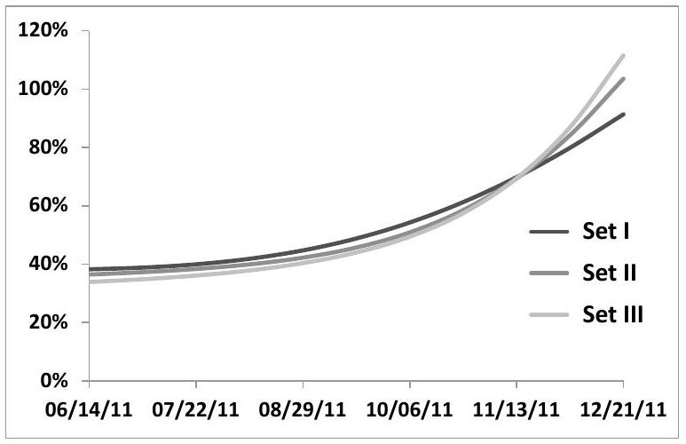
Figure 7.10: $\sigma_{t}$ - as defined in (7.92) - for VIX future VXZ1, for dates ranging from June 14 to its expiry date, in Sets I, II, III.

While the integrated value of $\sigma_{t}^{2}$ is identical in Sets I, II, III, the distribution is different. ${ }^{35}$

[^108]Controlling the term structure of the instantaneous volatilities of VIX futures is then the criterion for choosing one particular set for $\nu, \theta, k_{1}, k_{2}, \rho$.

While curves in Figure 7.10 are different, they are not terribly different; the reader may think that the range of volatility distributions of forward volatilities spanned by the two-factor model is limited.

That this is not the case is illustrated in the right-hand graph of Figure 7.13 below, where we use a one-factor model for simplicity and vary $k_{1}-$ still maintaining calibration to VIX smiles. Notice how different the volatility distributions are.

In Figure 7.10 parameters of Sets I, II, III have been used. They have the property that they generate approximately the same volatilities for spot-starting volatilities of all maturities. This additional constraint accounts for the narrower range of volatility distributions in Figure 7.10 than in Figure 7.13.

## Characterizing the dynamics in the model

What about the dynamics of VIX futures in our model? The variance curve observed at time $t$ is a function of $\left(X_{t}^{1}, X_{t}^{2}\right)$, however each instantaneous forward variance $\xi^{T}$ is a function of $x_{t}^{T}$. We have a one-factor Markov-functional model for each instantaneous forward variance $\xi^{T}$ - i.e. a local volatility model ${ }^{36}$ - whose local volatility function is given by (7.88).

Processes $x_{t}^{T}$ for $T \in\left[T_{i}, T_{i}+\Delta\right]$ are different linear combinations of $X_{t}^{1}, X_{t}^{2}$, thus, literally $F_{t}^{i}$ is a function of ( $X_{t}^{1}, X_{t}^{2}$ ); however since typically $\Delta \ll \frac{1}{k_{1}}, \frac{1}{k_{2}}$, $F_{t}^{i}$ can practically be considered a function of the single quantity $x_{t}^{T_{i}}$. We thus have essentially a multi-asset local volatility model for VIX futures.

### 7.7.2 Simulating VIX futures in the two-factor model

In the parametric model specified by (7.89), page 264, continuous forward variances $\xi_{t}^{T}$ are modeled as a function of $x_{t}^{T}$. Forward variances $\widehat{\sigma}_{\text {VIX }, T_{i}}^{2}(t)$ are explicitly known for all $t$.

Consider VIX future $F^{i}$. At $t=T_{i}, F_{T_{i}}^{i}=\sqrt{\widehat{\sigma}_{\text {VIX }, T_{i}}^{2}\left(T_{i}\right) \text { : the values of VIX }}$ futures at their settlement dates are readily available - this is sufficient for pricing VIX options.

Consider however a path-dependent payoff that depends on $F_{t}^{i}$ for $t<T_{i}$, for example an option on a VIX ETF or ETN - see Section 7.7.3 below. Pricing such an option requires simulation of $F_{t}^{i}$ at dates $t<T_{i}$. In the continuous forward variance model specified by (7.89), $F_{t=T_{i}}^{i}$ is a function of $X_{T_{i}}^{1}$ and $X_{T_{i}}^{2}$ given by (7.84). $F_{t}^{i}$ is given by:

$$
\begin{equation*}
F_{t}^{i}=E_{t}\left[F_{T_{i}}^{i}\left(X_{T_{i}}^{1}, X_{T_{i}}^{2}\right)\right] \tag{7.93}
\end{equation*}
$$
^eq7-93

[^109]While $\widehat{\sigma}_{\text {VIX }, T_{i}}^{2}(t)$ is readily available, $F_{t}^{i}$ for $t<T_{i}$ has to be computed by twodimensional quadrature on $X_{T_{i}}^{1}, X_{T_{i}}^{2} .{ }^{37}$

In case $F_{t}^{i}$ is needed for many dates - say on a daily basis - it is preferable to use a discrete forward variance model of the type discussed in Section 7.8.2 below. In these models VIX futures - rather than forward variances - are modeled directly.

### 7.7.3 Options on VIX ETFs/ETNs

VIX ETFs or ETNs typically maintain a rolling position in VIX futures. ${ }^{38}$ Denoting by $X_{t}$ the value of the ETF:

$$
\begin{equation*}
\frac{d X_{t}}{X_{t}}=r d t+\sum_{i, T_{i}>t} w_{t}^{i} \frac{d F_{t}^{i}}{F_{t}^{i}} \tag{7.94}
\end{equation*}
$$
^eq7-94

where the ETF's allocation strategy is expressed in the weight $w_{t}^{i}$. The VXX, one of the most popular ETNs, maintains a long position in the first and second nearby futures, so that the weighted duration of both futures is approximately 30 days. It would be most natural to set $w_{t}^{i} \equiv w\left(T_{i}-t\right)$ with $w(\tau)$ given by:

$$
\begin{cases}w(\tau)=\frac{\tau}{\Delta} &  \tag{7.95}\\ w(\tau)=2-\frac{\tau}{\Delta} & \\ w \in[\Delta, 2 \Delta] \\ w(\tau)=0 & \\ \tau>2 \Delta\end{cases}
$$
^eq7-95

where $\Delta$ is the interval between two VIX futures' expiries. $w(\tau)$ appears in Figure 7.11. This allocation strategy results in the following dynamics for the VXX:

$$
\frac{d X_{t}}{X_{t}}=r d t+\left[w\left(T^{1 \mathrm{st}}-t\right) \frac{d F_{t}^{1 \mathrm{st}}}{F_{t}^{1 \mathrm{st}}}+\left(1-w\left(T^{1 \mathrm{st}}-t\right)\right) \frac{d F_{t}^{2 \mathrm{nd}}}{F_{t}^{2 \mathrm{nd}}}\right]
$$

where $T^{1 \text { st }}(t)$ is the expiry of the first nearby future $F_{t}^{1 \text { st }}$, and $T^{2 \text { nd }}(t)$ that of the following future.

The VXX prospectus states that it is the number of futures that is proportional to $\tau$ and $\Delta-\tau$, rather than the notional invested in both futures: ${ }^{39}$

$$
\begin{aligned}
w_{1 \mathrm{st}} & =\frac{\left(T^{1 \mathrm{st}}-t\right) F_{t}^{1 \mathrm{st}}}{\left(T^{1 \mathrm{st}}-t\right) F_{t}^{1 \mathrm{st}}+\left(\Delta-\left(T^{1 \mathrm{st}}-t\right)\right) F_{t}^{2 \mathrm{nd}}} \\
w_{2 \mathrm{nd}} & =1-w_{1 \mathrm{st}}
\end{aligned}
$$

[^110]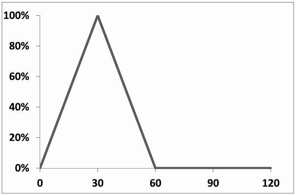
Figure 7.11: $w(\tau)$ for the VXX ETN, as a function of $\tau$ (days). We have made the simple assumption that VIX expiries are spaced 30 days apart.

If $F_{t}^{1 \mathrm{st}}=F_{t}^{2 \mathrm{nd}}$ the weights become identical to those given by expression (7.95) for $w(\tau)$, which is the convention we use in what follows for the sake of simplicity.

The VXX smiles in Figure 7.13 below are computed in a Monte Carlo simulation that uses the proper convention - using either convention generates very similar prices, unless the term structure of VIX futures is unreasonably steep.

Consider now options on the VXX, which are listed. Can VXX options be priced off VIX smiles?

VIX implied volatilities quantify the realized volatility of VIX futures up to their expiry date. In contrast, SDE (7.94) for the VXX and the profile of $w(\tau)$ in Figure 7.11 show that returns of the VXX are a weighted average of returns of two VIX futures that always have less than two months to expiry. Thus two natural questions arise:

- Assuming we are calibrated to VIX smiles, what is the impact of the distribution of the volatility of VIX futures?
- What is the impact of correlation between VIX futures?

## Volatilities of VIX futures

In what follows we use the parametric model of Section 7.8.2 where VIX futures are modeled directly. We wish to assess the effect of different distributions of the realized volatility of each future throughout its life. To this end we use a one-factor model $(\theta=0)$ so that the instantaneous correlation of VIX futures is constant, equal to $100 \%$, and vary the value of $k_{1}$ while remaining calibrated to VIX smiles.

We use VIX market data as of June 8, 2012; the calibrated smiles along with the levels of VIX futures appear in Figure 7.12. ${ }^{40}$

[^111]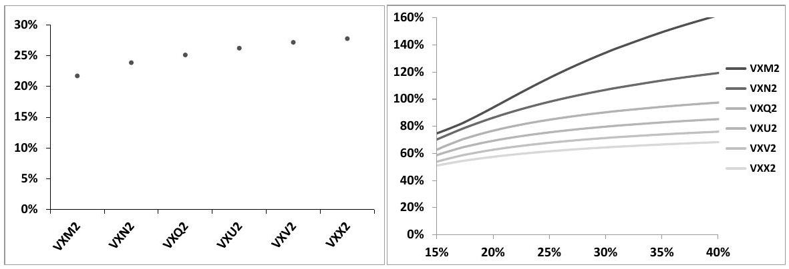
Figure 7.12: Left: VIX futures as of June 8, 2012 for expiries ranging from June 20 (VXM2) to November 21 (VXX2). Right: Smiles of VIX futures.

Figure 7.13 shows the VXX smiles generated by different values of $k_{1}$ for the listed maturity of December 21, 2012 - together with the market smile. ${ }^{41}$ It also shows the instantaneous volatility of VIX future VXV2, which expires on October 17, 2012. This instantaneous volatility, $\sigma_{t}$, is obtained as the square root of the expectation of the instantaneous variance: $\sigma_{t}^{2}=E\left[\left(\frac{d F_{t}^{i}}{F_{t}^{i}}\right)^{2}\right]$. This expectation is easily computed by Gaussian quadrature on $x_{t}^{T_{i}}$.

Figure 7.13: Left: VXX smiles as of June 8, 2012 for the December 21st maturity, for different values of $k_{1}$, compared to the market smile. Right: instantaneous volatility of the VIX future expiring on October 17, 2012 (VXV2) for different values of $k_{1}$.

Consider the case $k_{1}=1$. For this (low) value of $k_{1}$ the instantaneous volatilities of VIX futures have little term structure and are distributed more or less evenly over their lives (see Figure 7.13 for the case of the VXV2 future, whose ATM im-

[^112]plied volatility is $70 \%$ ) with no particular concentration on the final two months before expiry. The resulting VXX implied volatilities are lower than market implied volatilities, which is not surprising.

Conversely, consider the case $k_{1}=12$. As the graph in the right-hand side of Figure 7.13 shows, the volatility of VIX futures is now concentrated right before expiry. However, as is clear from Figure 7.11, this is where their weight in the VXX vanishes: again we expect low VXX implied volatilities, which the left-hand graph in Figure 7.13 confirms.

One can see that the highest implied volatilities are obtained for $k_{1} \simeq 6$, with $k_{1}=2, k_{1}=3$ generating VXX smiles that most closely approximate the market VXX smile. ${ }^{42}$

## Correlations of VIX futures

We have thus far used $100 \%$ correlation for simplicity. The realized correlation of the first two nearby futures typically ranges from $85 \%$ to $100 \%$. How does correlation impact VXX implied volatilities?

Let us make the simple assumption that the volatilities of the two nearby futures $F^{i}$ and $F^{i+1}$ are identical and constant, equal to $\sigma$, and that their correlation is constant, equal to $\rho$. The instantaneous volatility of the VXX, $\sigma_{X}(t)$, is given for $t \in\left[T_{i-1}, T_{i}\right]$ by:

$$
\sigma_{X}^{2}(t)=\sigma^{2}\left(w^{2}\left(T_{i}-t\right)+w^{2}\left(T_{i+1}-t\right)+2 \rho w\left(T_{i}-t\right) w\left(T_{i+1}-t\right)\right)
$$

where $w(\tau)$ appears in Figure 7.11. If weights $w\left(T_{i}-t\right)$ and $w\left(T_{i+1}-t\right)$ were constant, equal to $\frac{1}{2}$, we would get the standard formula for the volatility of an equally weighted basket: $\sigma_{X}^{2}=\frac{1+\rho}{2} \sigma^{2}$.

In our case the product $w\left(T_{i}-t\right) w\left(T_{i+1}-t\right)$ vanishes both for $t=T_{i-1}$ and for $t=T_{i}$ : the effect of the cross term will be comparatively smaller. Integrating $\sigma_{X}^{2}(t)$ over $\left[T_{i-1}, T_{i}\right]$ :

$$
\widehat{\sigma}_{X}^{2}=\frac{1}{\Delta} \int_{T_{i-1}}^{T_{i}} \sigma_{X}^{2}(t) d t=\frac{2+\rho}{3} \sigma^{2}
$$

Consider the two cases $\rho_{\text {min }}=80 \%, \rho_{\text {max }}=100 \%$. The ratio of implied volatilities $\frac{\widehat{\sigma}_{X}^{\text {max }}}{\widehat{\sigma}_{X}^{\text {min }}}$ is then equal to $\sqrt{\frac{2+\rho_{\text {max }}}{2+\rho_{\text {min }}}}=103.5 \%$ : a difference of correlation of 20 points gives rise to a variation of VXX implied volatilities of a few points only.

## Conclusion

In conclusion, VIX smiles do not provide enough information for confining prices of options on VIX ETF(N)s sufficiently. The example of the VXX demonstrates that, even though consistency with VIX smiles is enforced, implied volatilities of the VXX are very dependent on assumptions about how the volatility of each VIX future

[^113]is distributed throughout its life, and also depend moderately on the correlation structure of VIX futures.

Thus VXX options are not redundant instruments - they supply information on the volatility distribution of VIX futures. ${ }^{43}$

### 7.7.4 Consistency of S\&P 500 and VIX smiles

From market prices of VIX futures and options we can derive forward logcontract volatilities for the S\&P 500 index. The square of the forward volatility for time interval $\left[T_{i}, T_{i}+\Delta\right]$ is given by:

$$
\begin{equation*}
\widehat{\sigma}_{T_{i}, T_{i+\Delta}}^{2}(t)=E_{t}\left[\left(F_{T_{i}}^{i}\right)^{2}\right] \tag{7.96}
\end{equation*}
$$
^eq7-96

We know from Section 3.1.3 that any European payoff on $F_{T_{i}}^{i}$ can be replicated by a static position consisting of cash, forwards (or futures) and vanilla options on $F_{T_{i}}^{i}$. The decomposition in (3.6) applied to the function $f(S)=S^{2}$ reads:

$$
\begin{equation*}
S^{2}=S_{*}^{2}+2 S_{*}\left(S-S_{*}\right)+2 \int_{0}^{S_{*}}(K-S)^{+} d K+2 \int_{S_{*}}^{\infty}(S-K)^{+} d K \tag{7.97}
\end{equation*}
$$
^eq7-97

where $S_{*}$ is arbitrary. We now apply this identity to $S=F_{T_{i}}^{i}$ with $S_{*}=F_{t}^{i}$ and translate this equality of payoffs in an equality of prices.

Adding up the (undiscounted) prices of the different components in the righthand side of (7.97) yields the following consistency condition relating S\&P 500 forward volatilities to market prices of VIX futures and options:

$$
\begin{equation*}
\widehat{\sigma}_{T_{i}, T_{i+\Delta}}^{2}(t)=\left(F_{t}^{i}\right)^{2}+2 \int_{0}^{F_{t}^{i}} \mathcal{P}_{t}^{K i} d K+2 \int_{F_{t}^{i}}^{\infty} \mathcal{C}_{t}^{K i} d K \tag{7.98}
\end{equation*}
$$
^eq7-98

where $\mathcal{P}_{t}^{K i}$ (resp. $\mathcal{C}_{t}^{K i}$ ) are undiscounted market prices of put (resp. call) options on the VIX of maturity $T_{i}$. We have used the fact that the price of a payoff linear in $\left(F_{T}^{i}-F_{t}^{i}\right)$ - the second piece in (7.97) - vanishes. In contrast to the replication of the log contract, the densities of calls and puts on the VIX are constant, so that $\widehat{\sigma}_{T_{i}, T_{i+\Delta}}^{2}(t)$ has little dependence on the exact cutoff used in the integrals in the above expression.

## Log-contract versus VS volatility

Because of the definition of the settlement value of VIX futures, $\widehat{\sigma}_{T_{i}, T_{i+\Delta}}$ as defined in (7.96) is a log-contract volatility. (7.98) thus expresses an identity between market prices of VIX instruments and of log-contracts, which, unlike VSs, do not trade.

[^114]We will thus assume that the difference between $\widehat{\sigma}_{T}$ and $\widehat{\sigma}_{\mathrm{VS}, T}$ is small, so that we can use VSs in lieu of log contracts. ${ }^{44}$

Figure 7.14 shows $F_{t}^{i}, \widehat{\sigma}_{T_{i}, T_{i+\Delta}}(t)$ as given by replication on the VIX market through (7.98) and $\widehat{\sigma}_{T_{i}, T_{i+\Delta}}(t)$ as generated by interpolation of market quotes of S\&P 500 VS implied volatilities observed on January 14, 2011.

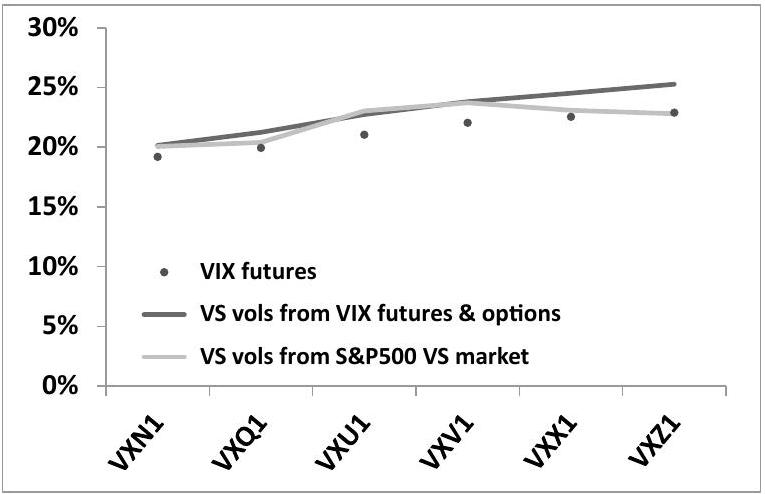
Figure 7.14: VIX futures, VS volatilities as generated by (7.98) and VS volatilities as derived from the S\&P 500 VS market, all in 365 convention.

The contribution from the time values of VIX calls and puts in (7.98) is of the order of one to two points of volatility. Notice how VS volatilities derived either from the S\&P 500 VS market or from the VIX market do not coincide. This suggests an arbitrage strategy: imagine that a particular forward VS volatility as derived from the VIX market through (7.98) lies higher than its counterpart derived from the regular S\&P 500 VS market. We sell VIX futures and options in the proportions expressed by (7.98) and buy a forward $\left[T_{i}, T_{i}+\Delta\right]$ VS. At $t=T_{i}$, upon settlement of VIX futures and options we unwind the regular VS position - which by then is a spot-starting VS - at an implied volatility equal to the settlement value of the expiring VIX future: the P\&L of this strategy is $\widehat{\sigma}_{T_{i}, T_{i+\Delta}}^{2}(t)_{\text {VIX mkt }}-\widehat{\sigma}_{T_{i}, T_{i+\Delta}}^{2}(t)_{\text {VS mkt }}$. Practically, however, setting up this strategy is not as straightforward:

- Short-maturity forward variance swaps on the S\&P 500 index are not liquid - they are built by combining a long position in a VS of maturity $T_{i}+\Delta$ with a short position in a VS of maturity $T_{i}$. Even though we may be charged a bid/offer spread on one leg only, the resulting spread for the $\left[T_{i}, T_{i}+\Delta\right]$ forward VS volatility will be sizeable. Moreover, S\&P 500 VS contracts only trade for maturities corresponding to the expiries of listed S\&P 500 options -

[^115]the third Friday of each month. While $T_{i}+\Delta$ is an S\&P 500 expiry by definition of the VIX index, $T_{i}$ is not as it falls 30 days before, on a Wednesday. Forward VS volatilities that can practically be traded on the VS market are either two days shorter or five days longer than the corresponding VS volatilities synthesized from the VIX market. Considering that a 30 -day interval comprises approximately 20 returns, carrying an open gamma position on two - or three ${ }^{45}$ - squared returns entails appreciable risk. It is then preferable to group together packages corresponding to several adjacent VIX futures - say three so that bid/offer costs and risks are mitigated.

- VIX options are only available for discrete strikes. The continuous portfolio of VIX call and put options in (7.98) is in practice replaced by a discrete portfolio. Quantities of VIX futures and options are then determined so as to achieve the most expensive sub-replication of the $\left(F_{T_{i}}^{i}\right)^{2}$ payoff - when the forward VS volatility derived from the VIX market is higher than that of the S\&P 500 VS market - or the cheapest super-replication of $\left(F_{T_{i}}^{i}\right)^{2}$ in the opposite case. ${ }^{46}$
- At $t=T_{i}$ we need to unwind the forward VS position at an implied VS volatility that is exactly equal to $\widehat{\sigma}_{\text {VIX }, T_{i}}$. This is achieved by selling vanilla options - which will subsequently be delta-hedged until $T_{i}+\Delta-$ on the S\&P 500 in exactly the same quantities and for the same prices used in the calculation of the settlement of $F^{i}$ by the CBOE. This is possible as VIX futures settle at the open of the S\&P 500 options' market: orders can be placed and are executed at the open at the same prices that are used for the calculation of $F_{T_{i}}^{i}$. Still we know from Section 5.3.7 that the package consisting of a VS together with its offsetting vanilla replication is not risk-free. It is thus best to unwind the arbitrage position before $T_{i}$, should an opportunity arise.

Violations of (7.98) can then only be arbitraged by S\&P 500 volatility market makers.

In the author's experience, arbitrage opportunities that used to arise involved, most often than not, VIX-synthesized VS volatilities lying higher than their S\&P 500 VS counterparts. As of the time of writing, these opportunities seem to hardly occur anymore.

Are there other structural connections between S\&P 500 and VIX smiles that could be practically arbitraged when violated? For examples are implied volatilities of (a) S\&P 500 put options, (b) VIX call options related?

In [36] Stefano de Marco and Pierre Henry-Labordère consider the sub- and super-replication of VIX options using VIX futures, the S\&P 500 index and S\&P 500 options. They derive optimality conditions, which can be solved numerically,

[^116]and also obtain analytical non-optimal upper and lower bounds; with the upper bound optimal under a condition involving the S\&P 500 smiles for maturities $T_{i}$ and $T_{i+1}$. These bounds are widely spaced, but more interestingly it does not seem that there is much more information to be extracted from the S\&P 500 smile, other than log-contract implied volatilities.

See also reference [77], where Andrew Papanicolaou derives a bound on the moment-generating function of a squared VIX future from prices of moments of the S\&P 500 index.

### 7.7.5 Correlation structure of VIX futures

How do correlations of VIX futures generated by the two-factor model compare with those observed in reality?

Consider the first 7 futures $F_{t}^{i}, i=1 \ldots 7$. Figure 7.15 shows instantaneous correlations $\rho\left(F_{t}^{1}, F_{t}^{i}\right)$ (left-hand graph) and $\rho\left(F_{t}^{i}, F_{t}^{i+1}\right)$ (right-hand graph) in the two-factor model, for an observation date $t$ that lies 15 days before the expiry of the first VIX future; this represents an "average" correlation level. The dots correspond to historical correlations evaluated from February 16, 2010 to February 15, 2012 from which we have excluded roll dates.

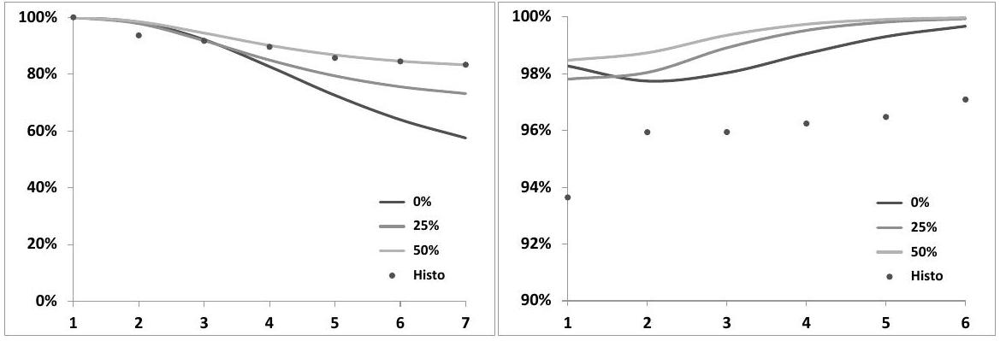
Figure 7.15: Left: correlations $\rho\left(F_{t}^{1}, F_{t}^{i}\right)$ of the first 7 VIX futures with the first future in the two-factor model for different values of the factor/factor correlation, and as observed in reality (dots), as a function of $i$. Right: correlations $\rho\left(F_{t}^{i}, F_{t}^{i+1}\right)$ of contiguous futures.

We have used three parameter sets for the two-factor model, all calibrated to the benchmark form (7.40) for $\nu_{T}^{\mathrm{B}}(t)$, page 228, with $\sigma_{0}=100 \%, \tau_{0}=3$ months, $\alpha=0.4$, characterized by different levels of correlation $\rho_{12}$ between the two factors: $\rho_{12}=0 \%, 25 \%, 50 \%$. The set with $\rho=0 \%$ is Set II in Table 7.1.

It is apparent that correlations of the first future with other futures are acceptably captured with $\rho_{12}=50 \%$. The right-hand side graph highlights however that correlations of adjacent futures are then systematically higher in the two-factor model than in reality. In the two-factor model, VIX futures with long expiries have almost $100 \%$ correlation.

This is due to the fact, already pointed out in Section 7.4.2, page 229, that in the two-factor model correlations between forward variances involve one time scale only: $\frac{1}{k_{1}-k_{2}}$.

We cannot realistically expect to achieve a good fit of historical correlations of VIX futures by employing one single time scale. Regaining some flexibility with respect to the correlation structure would be a valid motivation for introducing a third factor in the model.

### 7.7.6 Impact on smiles of options on realized variance

Consider an option on realized variance starting on June 14, 2011 and maturing in January 20, 2012, that is 30 days after the expiry of the VIXZ1 future, and let us price it using Set II parameters and the corresponding volatility-of-volatility smile parameters $\gamma^{i}, \beta^{i}, \zeta^{i}$ in Figure 7.9.

Figure 7.16 shows the implied volatility of this option as a function of volatility moneyness, computed by inverting the Black-Scholes formula with the (driftless) underlying equal to the square of the VS volatility for the option's maturity. These results are generated by a Monte Carlo simulation of the two-factor model with conditionally Gaussian returns for $\ln S$. Two other sets of implied volatilities are plotted as well - see caption.

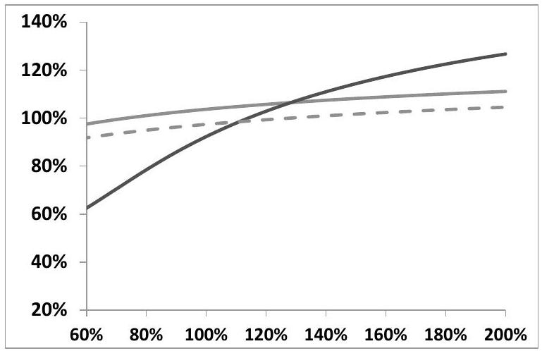
Figure 7.16: Implied volatilities of options on realized variance. The inception date is June 14, 2011 and the maturity is January 20, 2012. Implied volatilities of the realized variance are shown as a function of volatility moneyness using Set II parameters and three configurations for $\gamma^{i}, \beta^{i}, \zeta^{i}$ : dark line: values in Figure 7.9; light line: same but setting $\gamma^{i}=0$; dotted line: setting $\gamma^{i}=0, \zeta^{i}=1$.

Comparison of the dark and light curves in Figure 7.16 shows that the impact of the smile of forward variances is by no means small. The continuous light curve shows the implied volatilities as generated by Set II parameters with $\gamma^{i}=0$ : it incorporates the volatility-of-volatility adjustment factors $\zeta^{i}$ as derived from cali-
bration on the VIX smiles. The dotted line is obtained using Set II parameters only: $\gamma^{i}=0, \zeta^{i}=1$. Comparison of the light continuous and dotted lines indeed confirms that $\zeta$ is a simple adjustment factor for volatilities of forward variances: implied volatilities are altered approximately uniformly.

While Figure 7.16 is an indication of the effect of the smile of forward variances on the price of an option on realized variance, the size of this effect is highly modeldependent.

Calibration on the smiles of VIX options sets the value of the expected integrated variance of VIX futures, $\int_{t}^{T_{i}} \sigma_{u}^{2} d u$, but not its distribution. Furthermore, the correlation of VIX futures is left undetermined, yet it is instrumental in determining the volatility of VS volatilities for the option's maturity, which is the main determinant of its price.

### 7.7.7 Impact on the vanilla smile

The effect of VIX smiles on the vanilla smile of the underlying itself is covered in Section 8.10.

### 7.8 Discrete forward variance models

So far in this chapter we have modeled instantaneous forward variances $\xi_{t}^{T}$. We parametrize the two-factor model so that it generates:

- the desired term structure of volatilities of volatilities,
- the desired term structure of ATMF skew - this is discussed in Chapter 8 - or the desired level of future ATMF skew, if we have forward-start options in mind.

As we vary volatility-of-volatility parameter $\nu$, we alter volatilities of volatilities in the model, but also the ATMF skew of the vanilla smile, and also future ATMF skews.

Likewise, changing spot/volatility correlations alters both the ATMF skew of the vanilla smile, and the skew of forward-starting options. The fact that we do not have independent handles on:

- the vanilla smile,
- the smile of forward-start options,
- volatilities of volatilities,
is a typical shortcoming of continuous forward variance models, a particularly worrisome one when one needs to risk-manage complex path-dependent options that are subject to these three types of risk.

In what follows, we present models that allow for separation of these risks and permit an assessment of their individual impact on exotic option prices; they were first presented in [9]. ${ }^{47}$

We refer the reader to the discussion of the risks of forward-start options in Section 3.1.6 of Chapter 3, page 111, if she/he has not read it yet.

Most exotic payoffs that have forward-smile risk involve returns for a set time scale, for example monthly or quarterly returns. One typical example is an accumulator: take 12 monthly returns of the S\&P 500 index, cap them individually at, say $3 \%$, then sum them up and pay this sum, floored at zero, as an annual coupon.

A discrete forward variance model is tied to a particular schedule. The latter is defined in the term sheet of the exotic option at hand, thus dates $T_{i}$ in the schedule are typically uniformly spaced, say by a month or a quarter. Nonetheless, we assume an arbitrary schedule in what follows.

Our aim is to separately control the future smiles over each individual time interval [ $T_{i}, T_{i+1}$ ] and also the vanilla smile, in addition to the term structure of volatilities of volatilities.

The model is built in two stages:

- first define a dynamics for discrete forward variances over intervals [ $T_{i}, T_{i+1}$ ],
- then specify a dynamics for $S_{t}$ over each interval.

A benefit of discrete models is that VIX futures can be modeled directly, rather than forward variances - see Section 7.8.2 below. Our first step can be replaced with:

- first define a dynamics for VIX futures.

### 7.8.1 Modeling discrete forward variances

Let $\xi_{t}^{i}$ be the discrete forward VS variance for interval $\left[T_{i}, T_{i+1}\right]$. It is similar to the continuous forward variances employed so far, except it is defined as a finite difference rather than a derivative:

$$
\xi_{t}^{i} \equiv \widehat{\sigma}_{T_{i}, T_{i+1}}^{2}(t)=\frac{\left(T_{i+1}-t\right) \widehat{\sigma}_{T_{i+1}}^{2}(t)-\left(T_{i}-t\right) \widehat{\sigma}_{T_{i}}^{2}(t)}{T_{i+1}-T_{i}}
$$

[^117]where $\widehat{\sigma}_{T}(t)$ is the VS volatility for maturity $T$, and $\widehat{\sigma}_{T_{i}, T_{i+1}}(t)$ the forward VS volatility for interval $\left[T_{i}, T_{i+1}\right]$, observed at $t$. In the diffusive models we work with, implied volatilities of VSs and log-contracts are identical, thus $\widehat{\sigma}_{T_{i}, T_{i+1}}(t)$ is also the implied volatility at $t$ of the payoff that pays $\ln \left(\frac{S_{T_{i+1}}}{S_{T_{i}}}\right)$ at $T_{i+1}$.

As with continuous variance models, just because we use forward variances as basic building blocks does not mean we necessarily use VSs as hedge instruments. Our model can be calibrated to a term structure of implied volatilities for a given moneyness for maturities $T_{i}$ - for example ATMF volatilities.

The corresponding vanilla options are then our hedge instruments, along with the spot, and the carry P\&L of a hedged position is of the genuine gamma/theta form. We refer the reader to the discussion in Section 7.5 in the context of continuous models, whose conclusions apply to discrete models as well.

Just as their continuous counterparts, the $\xi_{T}^{i}$ are driftless. ${ }^{48}$ We can thus recycle the two-factor model and, mimicking (7.28), write the SDE of $\xi_{t}^{i}$ as:

$$
\begin{align*}
d \xi_{t}^{i} & =\left(2 \nu_{i}\right) \xi_{t}^{i} \alpha_{\theta_{i}}\left(\left(1-\theta_{i}\right) e^{-k_{1}\left(T_{i}-t\right)} d W_{t}^{1}+\theta_{i} e^{-k_{2}\left(T_{i}-t\right)} d W_{t}^{2}\right)  \tag{7.99}\\
\alpha_{\theta_{i}} & =1 / \sqrt{\left(1-\theta_{i}\right)^{2}+\theta_{i}^{2}+2 \rho_{12} \theta_{i}\left(1-\theta_{i}\right)}
\end{align*}
$$
^eq7-99

where index $i$ for parameters $\theta$ and $\nu$ keeps track of the forward variance $\xi^{i}$ they apply to.

While $\theta$ and $\nu$ depend on $i$, we use the same values for $k_{1}, k_{2}, \rho_{12}$ for all intervals - otherwise we lose the two-dimensional Markov representation of the $\xi_{t}^{i}$. We also use the same values as in the continuous model, so that discrete and continuous versions of the model can be mapped onto another - see below.

The solution of (7.99) reads:

$$
\begin{align*}
\xi_{t}^{i} & =\xi_{0}^{i} e^{\omega_{i} x_{t}^{T_{i}}-\frac{\omega_{i}^{2}}{2}} \chi\left(t, T_{i}\right)  \tag{7.100}\\
x_{t}^{T_{i}} & =\alpha_{\theta_{i}}\left[\left(1-\theta_{i}\right) e^{-k_{1}\left(T_{i}-t\right)} X_{t}^{1}+\theta_{i} e^{-k_{2}\left(T_{i}-t\right)} X_{t}^{2}\right]
\end{align*}
$$
^eq7-100

with $\omega_{i}=2 \nu_{i}$. The driftless processes $x_{t}^{T_{i}}$ are defined in (7.30) and $\chi(t, T)$ is defined in (7.35), page 227.

## Mapping a continuous to a discrete model

The spacing between two successive dates $T_{i}, T_{i+1}$ is specific to each exotic payoff - it is different for different payoffs. Still, risks of the same nature should be priced at the same level accross the book, for example volatility-of-volatility risk. We thus need to parametrize our discrete model so that some model features remain unchanged with respect to its continuous counterpart.

[^118]Consider the forward volatility $\widehat{\sigma}_{T_{i}, T_{i+1}}(t)$. It is given, in the discrete and continuous model, respectively, by:

$$
\left\{\begin{aligned}
\widehat{\sigma}_{T_{i}, T_{i+1}}(t) & =\sqrt{\xi_{t}^{i}} \\
\widehat{\sigma}_{T_{i}, T_{i+1}}(t) & =\sqrt{\frac{1}{T_{i+1}-T_{1}} \int_{T_{i}}^{T_{i+1}} \xi_{t}^{\tau} d \tau}
\end{aligned}\right.
$$

The SDE of forward variance $\widehat{\sigma}_{T_{i}, T_{i+1}}^{2}(t)$ is given, in both models, by:

$$
\begin{align*}
& \frac{d \widehat{\sigma}_{T_{i}, T_{i+1}}^{2}}{\widehat{\sigma}_{T_{i}, T_{i+1}}^{2}}=2 \nu_{i} \alpha_{\theta_{i}}\left(\left(1-\theta_{i}\right) e^{-k_{1}\left(T_{i}-t\right)} d W_{t}^{1}+\theta_{i} e^{-k_{2}\left(T_{i}-t\right)} d W_{t}^{2}\right)  \tag{7.101a}\\
& \frac{d \widehat{\sigma}_{T_{i}, T_{i+1}}^{2}}{\widehat{\sigma}_{T_{i}, T_{i+1}}^{2}}=2 \nu \alpha_{\theta}\left((1-\theta) A_{i}^{1}(t) e^{-k_{1}\left(T_{i}-t\right)} d W_{t}^{1}+\theta A_{i}^{2}(t) e^{-k_{2}\left(T_{i}-t\right)} d W_{t}^{2}\right) \tag{7.101b}
\end{align*}
$$
^eq7-101a
^eq7-101b

where $A_{i}^{n}(t)$ reads:

$$
A_{i}^{n}(t)=\frac{\int_{T_{i}}^{T_{i+1}} \xi_{t}^{\tau} e^{-k_{n}\left(\tau-T_{i}\right)} d \tau}{\int_{T_{i}}^{T_{i+1}} \xi_{t}^{\tau} d \tau}
$$

(7.101a) stems from (7.99) directly while (7.101b) is adapted from the corresponding expression (7.36), page 227, for a spot-starting VS volatility.

The two SDEs in (7.101) cannot be identical in both models, for all $t$, for all configurations of the forward variance curve $\xi_{t}^{\tau}$, but let us demand that they coincide for all $t$, for forward variances $\xi_{t}^{\tau}$ equal to their initial values $\xi_{0}^{\tau}$, that is with $A_{i}^{n}$ equal to $A_{i}^{n}(0)$.

A quick glance at the right-hand sides of (7.101a) and (7.101b) shows this is possible only if $k_{1}, k_{2}, \rho$ are identical in both models, where $\rho$ is the correlation between $W_{t}^{1}$ and $W_{t}^{2}$.

The conditions on $\nu_{i}, \theta_{i}$ read:

$$
\begin{aligned}
\nu_{i} \alpha_{\theta_{i}}\left(1-\theta_{i}\right) & =\nu \alpha_{\theta}(1-\theta) A_{i}^{1}(0) \\
\nu_{i} \alpha_{\theta_{i}} \theta_{i} & =\nu \alpha_{\theta} \theta A_{i}^{2}(0)
\end{aligned}
$$

This yields:

$$
\left\{\begin{align*}
\theta_{i} & =\frac{\theta A_{i}^{2}(0)}{\theta A_{i}^{2}(0)+(1-\theta) A_{i}^{1}(0)}  \tag{7.102}\\
\nu_{i} & =\nu \frac{\alpha_{\theta} \theta}{\alpha_{\theta_{i}} \theta_{i}} A_{i}^{2}(0)
\end{align*}\right.
$$
^eq7-102

Provided $\theta_{i}$ and $\nu_{i}$ are given by (7.102), the dynamics of forward volatilities $\widehat{\sigma}_{T_{i}, T_{i+1}}(t)$ is identical in the discrete and continuous versions of the model - for forward variances $\xi_{t}^{\tau}$ equal to their initial values $\xi_{0}^{\tau}$. Consequently:

- instantaneous volatilities of VS volatilities of maturities $T_{i}$
- instantaneous correlations of forward VS volatilities $\widehat{\sigma}_{T_{i}, T_{i+1}}$ and $\widehat{\sigma}_{T_{j} T_{j+1}}$ are identical as well, in both models, for forward variances $\xi_{t}^{\tau}$ equal to their initial values $\xi_{0}^{\tau}$.

Our criterion for mapping consists in requiring that the SDEs in (7.101) match $\forall t$ for $\xi_{t}^{\tau}=\xi_{0}^{\tau}$. We now give an illustration of the fact that, indeed, the dynamics of the $\xi^{i}$ in both discrete and continuous models is very similar.

## An example

Consider the case of a flat term structure of VS volatilities, equal to $20 \%$. In this case

$$
A_{i}^{n}(0)=\frac{1-e^{-k_{n}\left(T_{i+1}-T_{i}\right)}}{k_{n}\left(T_{i+1}-T_{i}\right)}
$$

$\theta_{i}$ and $\nu_{i}$ then only depend on $T_{i+1}-T_{i}$. They are shown in Figure 7.17.
Figure 7.17 also shows prices of a VS ATM swaption, whose payoff is

$$
\frac{1}{2 \widehat{\sigma}_{T, T+\Delta}(0)}\left(\widehat{\sigma}_{T, T+\Delta}^{2}(T)-\widehat{\sigma}_{T, T+\Delta}^{2}(0)\right)^{+}
$$

for various values of $\Delta$.
The expiry $T$ of the swaption is 1 year, and the discrete model is mapped for each value of $\Delta$ using (7.102) with $T_{i}=T, T_{i+1}=T+\Delta$.

Parameters of the continuous model appear in Table 7.7. They are chosen so as to generate a term-structure of VS volatilities that closely fits benchmark (7.51), page 239 , with $\alpha=0.6, \tau_{0}=3$ months, $\sigma_{0}=125 \%$.

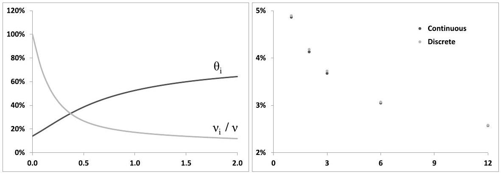
Figure 7.17: Left: $\theta_{i}$ and $\frac{\nu_{i}}{\nu}$ as a function of $\Delta$ (years). Right: prices of a 1 -year ATM VS swaption in both continuous and discrete models, as a function of the maturity of the underlying VS volatility (months).

Prices in both discrete and continuous models are very similar, thus illustrating that with mapping (7.102), both models generate very similar dynamics for discrete forward VS variances.

| $\nu$ | $\theta$ | $k_{1}$ | $k_{2}$ | $\rho_{12}$ |
| :---: | :---: | :---: | :---: | :---: |
| $310 \%$ | 0.139 | 8.59 | 0.47 | $0 \%$ |

Table 7.7: Parameters of the continuous two-factor forward variance model.

## Smiling discrete forward variances

With the dynamics in (7.99), forward volatilities $\widehat{\sigma}_{T_{i}, T_{i+1}}$ are lognormal, thus VS swaption smiles are flat. ${ }^{49}$ For the sake of generating upward-sloping smiles, we can use the same ansatz as in (7.89), page 264, and replace (7.100) with:

$$
\xi_{t}^{i}=\xi_{0}^{i}\left(\left(1-\gamma_{i}\right) e^{\omega_{i} x_{t}^{T_{i}}-\frac{\omega_{i}^{2}}{2} \chi\left(t, T_{i}\right)}+\gamma_{i} e^{\beta_{i} \omega_{i} x_{t}^{T_{i}}-\frac{\left(\beta_{i} \omega_{i}\right)^{2}}{2} \chi\left(t, T_{i}\right)}\right)
$$

with the normalization in (7.90):

$$
\omega_{i}=\frac{2 \nu_{i}}{\left(1-\gamma_{i}\right)+\beta_{i} \gamma_{i}} \zeta_{i}
$$

### 7.8.2 Direct modeling of VIX futures

VIX instruments are introduced in Section 7.7, in the context of the two-factor (continuous) forward variance model.

VIX futures $F_{t}^{i}$ at dates $t<T_{i}$ are accessible in the continuous model, at the cost of a two-dimensional quadrature - this is explained in Section 7.7.2. For payoffs requiring frequent observations of VIX futures, using a model where VIX futures rather than variances - are modeled directly is preferable.

We now discuss this particular breed of discrete forward variance models - they are Markov-functional models for VIX futures.

Denote by $T_{i}$ the expiry of future $F_{t}^{i}$. At expiry, a VIX future is equal to the log-contract implied volatility for maturity $T_{i}+\Delta$, where $\Delta=30$ days. Borrowing the notations of Section 7.7.1:

$$
F_{T_{i}}^{i}=\widehat{\sigma}_{\mathrm{VIX}, T_{i}}\left(T_{i}\right)=\widehat{\sigma}_{T_{i}, T_{i}+\Delta}\left(T_{i}\right)
$$

VIX futures expire on Wednesdays, 30 days before the expiry of listed S\&P 500 options, thus two consecutive VIX expiries are spaced either (a) 28 days or (b) 35 days apart. In case (a), $T_{i}+\Delta>T_{i+1}$ : the forward VS volatilities $\widehat{\sigma}_{T_{i}, T_{i}+\Delta}$ and $\widehat{\sigma}_{T_{i+1}, T_{i+1}+\Delta}$ that underlie, respectively, futures $F^{i}$ and $F^{i+1}$ overlap. In case (b), $T_{i}+\Delta<T_{i+1}$, and there is no overlap. We assume that $T_{i+1}-T_{i}=\Delta .^{50}$

[^119]
## A parametric form

Since VIX futures are driftless - just like forward variances $\xi^{\tau}$ - we can use the discrete two-factor model directly on VIX futures and, mirroring (7.99) write:

$$
\begin{align*}
d F_{t}^{i} & =\nu_{i} F_{t}^{i} \alpha_{\theta_{i}}\left(\left(1-\theta_{i}\right) e^{-k_{1}\left(T_{i}-t\right)} d W_{t}^{1}+\theta_{i} e^{-k_{2}\left(T_{i}-t\right)} d W_{t}^{2}\right)  \tag{7.103}\\
\alpha_{\theta_{i}} & =1 / \sqrt{\left(1-\theta_{i}\right)^{2}+\theta_{i}^{2}+2 \rho_{12} \theta_{i}\left(1-\theta_{i}\right)}
\end{align*}
$$
^eq7-103

where we use $\nu_{i}$ instead of $2 \nu_{i}$ since $F_{t}^{i}$ is a volatility rather than a variance.
The solution of (7.103) is given by:

$$
\begin{aligned}
F_{t}^{i} & =F_{0}^{i} e^{\omega_{i} x_{t}^{T_{i}}-\frac{\omega_{i}^{2}}{2} \chi\left(t, T_{i}\right)} \\
x_{t}^{T_{i}} & =\alpha_{\theta_{i}}\left[\left(1-\theta_{i}\right) e^{-k_{1}\left(T_{i}-t\right)} X_{t}^{1}+\theta_{i} e^{-k_{2}\left(T_{i}-t\right)} X_{t}^{2}\right]
\end{aligned}
$$

with $\omega_{i}=\nu_{i}$.
Upward-sloping smiles can be generated by using the same ansatz as in (7.89):

$$
\begin{equation*}
F_{t}^{i}=F_{0}^{i}\left(\left(1-\gamma_{i}\right) e^{\omega_{i} x_{t}^{T_{i}}-\frac{\omega_{i}^{2}}{2} \chi\left(t, T_{i}\right)}+\gamma_{i} e^{\beta_{i} \omega_{i} x_{t}^{T_{i}}-\frac{\left(\beta_{i} \omega_{i}\right)^{2}}{2} \chi\left(t, T_{i}\right)}\right) \tag{7.104}
\end{equation*}
$$
^eq7-104

with:

$$
\omega_{i}=\frac{\nu_{i}}{\left(1-\gamma_{i}\right)+\beta_{i} \gamma_{i}} \zeta_{i}
$$

VIX smiles generated with this parametrization are very similar to those generated by the equivalent parametrization for continuous forward variances in Section 7.7.1.

## A non-parametric form

While ansatz (7.104) is adequate for capturing VIX smiles, as a parametric form it only allows for certain types of smile shapes. We now build a model that can be calibrated to arbitrary VIX smiles, as long as they are non-arbitrageable; it is an example of the Markov-functional models discussed in Section 2.10.

Reasoning as in Section 7.7.1, let us write $F_{t}^{i}$ as:

$$
\begin{equation*}
F_{t}^{i}=F_{0}^{i} f^{i}\left(t, x_{t}^{T_{i}}\right) \tag{7.105}
\end{equation*}
$$
^eq7-105

Note that (7.104) is but a particular form of (7.105), with $f^{i}$ the sum of two exponentials.

The mapping function $f^{i}(t, x)$ has to be such that (a) at $t=T_{i}, F_{t=T_{i}}^{i}$ is distributed so that the corresponding VIX smile observed at $t=0$ is recovered, (b) $F_{t}^{i}$ is driftless.

Condition (b) implies that $f^{i}$ obeys PDE (7.87):

$$
\begin{equation*}
\frac{d f^{i}}{d t}+\frac{\eta_{i}^{2}\left(T_{i}-t\right)}{2} \frac{d^{2} f^{i}}{d x^{2}}=0 \tag{7.106}
\end{equation*}
$$
^eq7-106

where $\eta_{i}^{2}\left(T_{i}-t\right)$ is the instantaneous variance of $x_{t}^{T_{i}} \cdot \eta_{i}$ is given in (7.31b):

$$
\eta_{i}(u)=\alpha_{\theta_{i}} \sqrt{\left(1-\theta_{i}\right)^{2} e^{-2 k_{1} u}+\theta_{i}^{2} e^{-2 k_{2} u}+2 \rho_{12} \theta_{i}\left(1-\theta_{i}\right) e^{-\left(k_{1}+k_{2}\right) u}}
$$

Once the terminal profile $f^{i}\left(T_{i}, x\right)$ is specified, solving (7.106) produces $f^{i}(t, x)$ for all $t \leq T_{i}$.

The terminal condition for $f^{i}, f^{i}\left(T_{i}, x\right)$ must be such that the mapping $x_{T_{i}}^{T_{i}} \rightarrow f^{i}\left(T_{i}, x_{T_{i}}^{T_{i}}\right)$ generates the VIX market smile for maturity $T_{i}$.

Consider a VIX level $K$ and denote by $\mathcal{D}^{K}$ the undiscounted market price of a digital option of strike $K$, maturity $T_{i}$ that pays 1 if $F_{T_{i}}^{i}<K$ and zero otherwise. $\mathcal{D}^{K}$ is straightforwardly derived from the vanilla smile of future $F^{i}$, as a digital is essentially a narrow put spread: $\mathcal{D}^{K}=\frac{d \mathcal{P}^{K}}{d K}$. We have:

$$
\begin{aligned}
\mathcal{D}^{K} & =P\left(F_{T_{i}}^{i}<K\right)=P\left(f^{i}\left(T_{i}, x_{T_{i}}^{T_{i}}\right)<k\right) \\
& =\mathcal{N}_{i}\left(f^{i^{-1}}\left(T_{i}, k\right)\right)
\end{aligned}
$$

where $k$ is the moneyness: $k=K / F_{0}$ and $\mathcal{N}_{i}$ is the cumulative distribution function of the centered Gaussian random variable $x_{T_{i}}^{T_{i}}$, whose variance is known in closed form.

This yields $f^{i^{-1}}\left(T_{i}, k\right)=\mathcal{N}_{i}^{-1}\left(\mathcal{D}^{K}\right)$. By choosing a large number of values of moneyness $k$ we determine $f^{i^{-1}}$. Since $\mathcal{D}^{K}$ is an increasing function of $K$, so is $f^{i^{-1}} . f^{i^{-1}}$ is monotonic thus $f^{i}$ is well-defined and monotonic as well. ${ }^{51}$

## Characterizing the dynamics of VIX futures

What kind of dynamics does (7.105) generate for $F_{t}^{i}$ ? Making use of (7.106):

$$
\frac{d F_{t}^{i}}{F_{t}^{i}}=\frac{d \ln f^{i}}{d x}\left(t, x_{t}^{T_{i}}\right) d x_{t}^{T_{i}}
$$

The instantaneous volatility of $F^{i}$ is thus given by:

$$
\begin{equation*}
\operatorname{vol}\left(F^{i}\right)=\eta\left(T_{i}-t\right)\left|\frac{d \ln f^{i}}{d x}\right|_{x=f^{-1}\left(t, F_{t}^{i}\right)} \tag{7.107}
\end{equation*}
$$
^eq7-107

[^120]$f^{i}{ }^{-1}$ is well-defined only if $f^{i}$ is monotonic, which is the case. ${ }^{52}$ The right-hand side of (7.107) is a function of $F_{t}^{i}$ and $t$, thus what we have is really a local volatility model for $F_{t}^{i}$.

## What about forward VS volatilities?

The benefit of modeling VIX futures directly is that they are readily accessible in a simulation. Forward VS volatilities $\widehat{\sigma}_{T_{i}, T_{i}+\Delta}$ are directly accessible at $T_{i}$ since, by definition of the settlement value of VIX futures:

$$
F_{T_{i}}^{i}=\widehat{\sigma}_{T_{i}, T_{i}+\Delta}\left(T_{i}\right)
$$

What if we also need $\widehat{\sigma}_{T_{i}, T_{i}+\Delta}(t)$ for $t \leq T_{i}$ ?
VIX futures are given by:

$$
F_{T_{i}}^{i}=F_{0}^{i} f^{i}\left(t, x_{t}^{T_{i}}\right)
$$

Moreover, forward variances $\widehat{\sigma}_{T_{i}, T_{i}+\Delta}^{2}$ are driftless. We can thus represent $\widehat{\sigma}_{T_{i}, T_{i}+\Delta}$ as:

$$
\widehat{\sigma}_{T_{i}, T_{i}+\Delta}(t)=F_{0}^{i} \sqrt{g^{i}\left(t, x_{t}^{T_{i}}\right)}
$$

The terminal condition of $g^{i}$ is:

$$
g^{i}\left(T_{i}, x\right)=f^{i}\left(T_{i}, x\right)^{2}
$$

and $g^{i}(t, x)$ for $t \leq T_{i}$ is obtained by solving PDE (7.106):

$$
\frac{d g^{i}}{d t}+\frac{\eta_{i}^{2}\left(T_{i}-t\right)}{2} \frac{d^{2} g^{i}}{d x^{2}}=0
$$

In conclusion, we have a model calibrated to VIX smiles where all VIX futures and the corresponding forward VS volatilities are easily generated. We only need to simulate two Ornstein-Ühlenbeck processes: $X_{t}^{1}$ and $X_{t}^{2}$. ${ }^{53}$

[^121]
### 7.8.3 A dynamics for $S_{t}$

Having specified a dynamics for forward variances, we now define a dynamics for the underlying - how does the former constrain the latter?

As $t$ reaches date $T_{i}$ the VS volatility for interval $\left[T_{i}, T_{i+1}\right], \widehat{\sigma}_{T_{i}, T_{i+1}}\left(t=T_{i}\right)$ is known. The dynamics of $S_{t}$ for $t \in\left[T_{i}, T_{i+1}\right]$ has to comply with this value of $\widehat{\sigma}_{T_{i}, T_{i+1}}$.

We now specify an SDE for $S_{t}, t \in\left[T_{i}, T_{i+1}\right]$ that meets the three following requirements:

- The VS, or log-contract, implied volatility at $T_{i}$ for maturity $T_{i+1}$ is equal to $\widehat{\sigma}_{T_{i}, T_{i+1}}\left(T_{i}\right)$.
- The probability density of $\frac{S_{T_{i+1}}}{S_{T_{i}}}$ is independent on $S_{T_{i}}$. This is an essential condition for ensuring that future and spot-starting smiles are decoupled. With this provision, prices of cliquets of the form:

$$
\sum_{i} \omega_{i} f\left(\frac{S_{T_{i+1}}}{S_{T_{i}}}\right)
$$

have no sensitivity to correlations between the Brownian motion driving $S_{t}$ and those driving forward variances. While these correlations have zero impact on future smiles, they do impact spot-starting vanilla smiles - this is how we decouple spot and future smiles in the model.

- Scenarios of future smiles on $\left[T_{i}, T_{i+1}\right]$, as a function of $\widehat{\sigma}_{T_{i}, T_{i+1}}\left(T_{i}\right)$, should be set at will.

Consider a path-dependent local volatility dynamics for $S_{t}, t \in\left[T_{i}, T_{i+1}\right]$, given by:

$$
\begin{equation*}
d S_{t}=(r-q) S_{t} d t+\sigma^{i}\left(\frac{S_{t}}{S_{T_{i}}}\right) S_{t} d W_{t}^{S} \tag{7.108}
\end{equation*}
$$
^eq7-108

where the correlations of $W_{t}^{S}$ with $W_{t}^{1}$ and $W_{t}^{2}$ are denoted by $\rho_{S X^{1}}$ and $\rho_{S X^{2}}$. Setting $s_{t}=\frac{S_{t}}{S_{T_{i}}}$, we have:

$$
\begin{aligned}
d s_{t} & =(r-q) s_{t} d t+\sigma^{i}\left(s_{t}\right) s_{t} d W_{t}^{S} \\
s_{T_{i}} & =1
\end{aligned}
$$

thus the density of $s_{T_{i+1}}$ is indeed independent on $S_{T_{i}}$.
We choose the following expression for $\sigma^{i}$ :

$$
\begin{equation*}
\sigma^{i}(s)=\sigma_{0}^{i} \frac{n^{i}}{n^{i}-1} \frac{\left(n^{i}-1\right) s^{\beta^{i}-1}}{\left(n^{i}-1\right)+s^{\beta^{i}-1}} \tag{7.109}
\end{equation*}
$$
^eq7-109

which is parametrized by three numbers: $\sigma_{0}^{i}, \beta^{i}$ and $n^{i}$.

- $\sigma_{0}^{i}$ is the local volatility for $S=S_{T_{i}}$.
- $\beta^{i}$ controls the skew of maturity $\left.T_{i+1} \cdot \frac{d \sigma^{i}}{d \ln S}\right|_{S=S_{T_{i}}}=\sigma_{0}^{i} \frac{n^{i}-1}{n^{i}}\left(\beta^{i}-1\right)$. For ( $\beta^{i}-1$ ) small, assuming zero interest rate and repo, the ATM skew of maturity $T_{i+1}$ is given, at order one in ( $\beta^{i}-1$ ) by formula (2.50a), page 47:

$$
\begin{equation*}
\left.\left.\frac{d \widehat{\sigma}_{K, T_{i+1}}}{d \ln K}\right|_{S_{T_{i}}} \simeq \frac{1}{2} \frac{d \sigma^{i}}{d \ln S}\right|_{S_{T_{i}}}=\frac{\sigma_{0}^{i}}{2} \frac{n^{i}-1}{n^{i}}\left(\beta^{i}-1\right) \tag{7.110}
\end{equation*}
$$
^eq7-110

- $n^{i}$ prevents the divergence of $\sigma$ for small values of $S$; the maximum level of volatility is $n^{i} \sigma_{0}^{i}$. In practice, $n^{i}$ can be used to control other features of the smile, for example the difference between the VS volatility and the ATMF volatility of the smile of maturity $T_{i+1}$, observed at $T_{i}$.
$\sigma_{0}^{i}, \beta^{i}, n^{i}$ can be set at will, as a function of $\widehat{\sigma}_{T_{i}, T_{i+1}}\left(T_{i}\right)$, provided the logcontract implied volatility at $T_{i}$ for maturity $T_{i+1}$ is indeed equal to $\widehat{\sigma}_{T_{i}, T_{i+1}}\left(T_{i}\right)$.

How do we control the future ATMF skew scenarios generated by our model? This is done by expressing how the ATMF skew $\mathcal{S}_{T_{i+1}}\left(T_{i}\right)$ depends on the level of ATMF volatility. Two natural choices are:

- a fixed ATMF skew, irrespective of the level of ATMF volatility: $\mathcal{S}_{T_{i+1}}\left(T_{i}\right)=\mathcal{S}_{i}$, where we are free to choose the level of the ATMF skew $\mathcal{S}_{i}$ for each interval $\left[T_{i}, T_{i+1}\right]$.
- a specific dependence of the ATMF skew to the ATMF volatility, for example parametrized by a power-law:

$$
\begin{equation*}
\mathcal{S}_{T_{i+1}}\left(T_{i}\right)=\left(\frac{\widehat{\sigma}_{\mathrm{ATMF}, T_{i+1}}\left(T_{i}\right)}{\widehat{\sigma}_{\mathrm{ATMF}, \mathrm{ref}}^{i}}\right)^{\gamma^{i}} \mathcal{S}_{\mathrm{ref}}^{i} \tag{7.111}
\end{equation*}
$$
^eq7-111

where $\mathcal{S}_{\text {ref }}^{i}$ and $\widehat{\sigma}_{\text {ATMF, ref }}^{i}$ are reference levels for ATMF skew and volatility. $\gamma^{i}, \mathcal{S}_{\text {ref }}^{i}$ and $\widehat{\sigma}_{\text {ATMF, ref }}^{i}$ can be chosen differently for each interval $\left[T_{i}, T_{i+1}\right]$.

Once the type of dependence of $\mathcal{S}_{T_{i+1}}\left(T_{i}\right)$ on $\widehat{\sigma}_{\text {ATMF }, T_{i+1}}\left(T_{i}\right)$ is chosen, we need to determine two functions $\sigma_{0}^{i}(), \beta^{i}()$ for each interval $\left[T_{i}, T_{i+1}\right]$ such that setting $\sigma_{0}^{i}=\sigma_{0}^{i}\left(\widehat{\sigma}_{T_{i}, T_{i+1}}\left(T_{i}\right)\right)$ and $\beta^{i}=\beta^{i}\left(\widehat{\sigma}_{T_{i}, T_{i+1}}\left(T_{i}\right)\right)$ produces the desired behavior.

The ability to choose different fixed ATMF skew $\mathcal{S}_{i}$ or different values of $\gamma^{i}, \mathcal{S}_{\text {ref }}^{i}$ and $\widehat{\sigma}_{\text {ATMF, ref }}^{i}$ for different intervals $\left[T_{i}, T_{i+1}\right]$ is not superfluous.

It does not make sense to offset the sensistivity to the $\left[T_{i}, T_{i+1}\right]$ future skew with an opposite sensitivity to the future skew for a different interval. Thus, even in the unlikely case that the future skew $\mathcal{S}_{i}$ implied from market prices of cliquets happens to be constant, we still need to separately calculate and manage the sensitivities to parameters controlling the future skew of each interval $\left[T_{i}, T_{i+1}\right]$ - hence $\sigma_{0}^{i}$ and $\beta^{i}$.

## Two examples

Consider an interval $\left[T_{i}, T_{i+1}\right]$. Functions $\sigma_{0}\left(\widehat{\sigma}_{T_{i}, T_{i+1}}\left(T_{i}\right)\right)$ and $\beta\left(\widehat{\sigma}_{T_{i}, T_{i+1}}\left(T_{i}\right)\right)$ - we omit the $i$ index to lighten notation - are obtained as follows:

- Select discrete values $\sigma_{0}^{k}$ of $\sigma_{0}$ spanning a sufficiently wide range.
- For each value of $\sigma_{0}^{k}$ find the value $\beta^{k}$ of $\beta$ such that the ATMF skew has the desired value, either constant or specified by (7.111). For each trial value of $\beta$, the vanilla smile at $T_{i}$ for maturity $T_{i+1}$ is obtained by numerically solving the forward equation of the local volatility model (2.7), page 29.
- Numerically solve PDE (5.49), page 173, to generate the VS volatility for maturity $T_{i+1}: \widehat{\sigma}_{\mathrm{VS}}^{k}$.
- Store the couples $\left(\widehat{\sigma}_{\mathrm{VS}}^{k}, \sigma_{0}^{k}\right)$ and $\left(\widehat{\sigma}_{\mathrm{VS}}^{k}, \beta^{k}\right)$ and proceed to the next value of $\sigma_{0}$.
- Finally, interpolate the discrete couples $\left(\widehat{\sigma}_{\mathrm{VS}}^{k}, \sigma_{0}^{k}\right)$ to generate the function $\sigma_{0}\left(\widehat{\sigma}_{\mathrm{VS}}\right)$, and likewise for $\beta\left(\widehat{\sigma}_{\mathrm{VS}}\right)$.

Figure 7.18 shows functions $\sigma_{0}()$ and $\beta()$ such that the ATMF skew is fixed, equal to $5 \%$. We use the difference between implied volatilities of the $95 \%$ and $105 \%$ strikes rather than $\left.\frac{d \widehat{\sigma}_{K, T_{i+1}}}{d \ln K}\right|_{S_{T_{i}}}$ as a measure of ATMF skew. We have used zero interest rate and repo and a monthly schedule: $T_{i+1}-T_{i}=1$ month, and $n$ is set to 3.

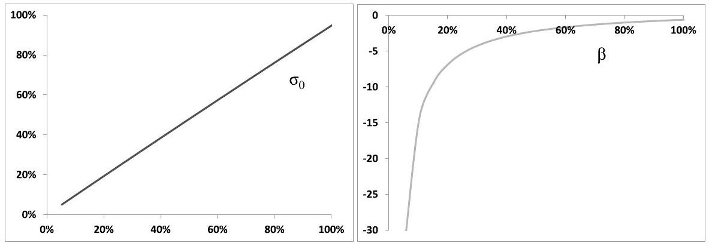
Figure 7.18: $\sigma_{0}$ (left) and $\beta$ (right) as a function of $\widehat{\sigma}_{T_{i}, T_{i+1}}\left(T_{i}\right)$, such that the difference of implied volatilities of the $95 \%$ and $105 \%$ strikes is equal to $5 \%$. We have taken $n_{i}=3$ and $T_{i+1}-T_{i}=1$ month.

Figure 7.19 shows functions $\sigma_{0}()$ and $\beta()$ such that the ATMF skew is of the form in (7.111) with $\gamma=1, \mathcal{S}_{\text {ref }}=5 \%, \widehat{\sigma}_{\text {ATMF, ref }}=20 \%$ : the ATMF skew is proportional to the ATMF volatility.

The shapes of $\beta\left(\widehat{\sigma}_{\mathrm{VS}}\right)$ are consistent with approximation (7.110) which implies that $\beta$ is constant for a skew that is proportional to the ATMF volatility while $(\beta-1)$

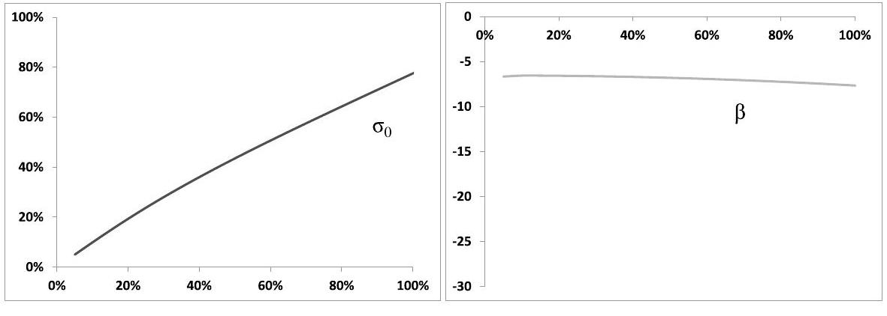
Figure 7.19: $\sigma_{0}$ (left) and $\beta$ (right) as a function of $\widehat{\sigma}_{T_{i}, T_{i+1}}\left(T_{i}\right)$, such that the ATMF skew is of the form in (7.111) with $\gamma=1, \mathcal{S}_{\text {ref }}=5 \%, \widehat{\sigma}_{\text {ATMF, ref }}=20 \%$. We have taken $n_{i}=3$ and $T_{i+1}-T_{i}=1$ month.

should be inversely proportional to the VS volatility in order to generate a skew that is independent on the level of volatility. ${ }^{54}$

- In the first situation, our discrete forward variance model mimics the twofactor continuous forward variance model, which generates an ATMF skew that is approximately independent on the level of VS volatility. See formula (8.55), page 330, for the ATMF skew at order one in volatility of volatility and Figure 8.4, page 331, for an illustration of the (in)dependence of the ATMF skew on the level of VS volatility.
- In the second situation, with an ATMF skew proportional to the ATMF volatility, we mimic, for short maturities, the behavior of the $\frac{3}{2}$ model. See the corresponding SDE in (8.45), with $\gamma=\frac{3}{2}$, and the short-maturity ATMF skew in (8.49), page 326.
- What if we make the ATMF skew inversely proportional to the ATMF volatility, by using (7.111) with $\gamma^{i}=-1$ ? We would then be mimicking, for short maturities, the behavior of the Heston model - see expression (6.18a), page 210.

Discrete forward variance models thus afford a great deal of flexibility as to the dependence of the short-maturity future skew to the short future ATMF volatility, while still leaving us the freedom of choosing spot/volatility correlations, which impact spot-starting smiles.

[^122]Two more aspects are worth commenting, before we turn to the vanilla smile.

- What if there are cash-amount dividends? In this case functions $\sigma_{0}\left(\xi_{T_{i}}^{i}\right)$ and $\beta\left(\xi_{T_{i}}^{i}\right)$ should also depend on $S_{T_{i}}$, if they are to ensure (a) that the VS volatility at $T_{i}$ for maturity $T_{i+1}$ is indeed $\xi_{T_{i}}^{i}$, (b) that the ATMF skew at $T_{i}$ for maturity $T_{i+1}$ still agrees with our specification.
The case of cash-amount dividends is taken care of economically by (a) making $\beta$ a function of $\sigma_{0}$, with the dependence obtained in the calibration of the $\sigma_{0}$ and $\beta$ functions with $S_{T_{i}}$ set to the forward for maturity $T_{i}$, (b) generating the mapping $\sigma_{0}\left(\xi^{i}\right)$ for a range of values of $S_{T_{i}}$, thus obtaining in effect a mapping $\sigma_{0}\left(\xi^{i}, S_{T_{i}}\right)$. While not exact, step (a) ensures, in practice, that the target forward skew scenarios are obtained with good accuracy. ${ }^{55}$
- While the local volatility function in (7.109) is adequate for generating the desired ATMF skew scenarios, it is not able to generate very large spreads between VS and ATMF volatilities. Also, as $t$ reaches $T_{i}$, forward-start options become in effect European options of maturity $T_{i+1}$; our local volatility function should be such that it is able to match the market smile for maturity $T_{i+1}$ observed at $T_{i}$. For these reasons it is a good idea to include an additional quadratic component $\alpha s^{2}$.

### 7.8.4 The vanilla smile

Two mechanisms contribute to the smile of discrete forward models:

- the correlations between the Brownian motions driving $S_{t}$ and the $\xi_{t}^{i}$
- the local volatility functions $\sigma^{i}(s)$, which generate the future skews for intervals $\left[T_{i}, T_{i+1}\right]$.

Consider a discrete model with lognormal dynamics (7.99), page 280, for $\xi^{i}$ and $\sigma^{i}(s)$ given by (7.109).

Setting $\nu_{i}=0$ and $\beta^{i}=1, \forall i$ turns our model into a Black-Scholes model with deterministic volatility: on each interval $\left[T_{i}, T_{i+1}\right], S_{t}$ is lognormal with constant volatility $\sqrt{\xi^{i}}$.

As $\nu_{i} \neq 0$ and $\left(\beta^{i}-1\right) \neq 0$ volatility becomes stochastic. We now derive an expression of the ATMF skew at order one in $\nu_{i}$ and in ( $\beta^{i}-1$ ).

We assume a constant tenor $\Delta$ so that our schedule is given by $T_{i}=i \Delta$. We also use the same values for $\nu_{i}, \theta_{i}, \alpha$. These numbers then only depend on tenor $\Delta$, through the mapping relationship (7.102), and we thus denote them by $\nu_{\Delta}, \theta_{\Delta}, \alpha_{\theta_{\Delta}}$. Likewise, we omit the $i$ index in $\sigma_{0}, \beta$.

We use a constant term structure of forward variances: $\xi_{0}^{i}=\widehat{\sigma}^{2}$, and functions $\sigma_{0}$ and $\beta$ are chosen so that the ATMF skew of maturity $\mathcal{S}_{T_{i+1}}\left(T_{i}\right)$ does not depend on $\widehat{\sigma}_{T_{i}, T_{i+1}}\left(T_{i}\right)$ and is equal to $\mathcal{S}_{\Delta}$.

[^123]We start from expression (8.29) of vanilla option prices derived in Section 8.4 of Chapter 8 and the resulting expression of the ATMF skew at order one in volatility of volatility (8.32), page 319 :

$$
\begin{equation*}
\mathcal{S}_{T}=\frac{1}{2 \widehat{\sigma}^{3} T} \int_{0}^{T} \frac{T-t}{T} \frac{\left\langle d \ln S_{t} d \widehat{\sigma}_{T}^{2}(t)\right\rangle_{0}}{d t} d t \tag{7.112}
\end{equation*}
$$
^eq7-112

where the 0 susbcript means the covariation is evaluated in the unperturbed state, that is with forward variances equal to their values at $t=0$ and with the instantaneous volatility of $S_{t}$ read off the initial term structure of VS volatilities. In our context, expanding at order one in volatility of volatility corresponds to expanding at order one both in $\nu$ and $(\beta-1)$.

We calculate $\mathcal{S}_{T}$ for maturities $T$ that are multiples of tenor $\Delta: T=N \Delta$. Using the definition of $\widehat{\sigma}_{T}(t),(T-t) \widehat{\sigma}_{T}^{2}(t)=\int_{t}^{T} \xi_{t}^{\tau} d \tau$, where $\xi_{t}^{\tau}$ is the instantaneous forward variance for date $\tau$. (7.112) can be rewritten as:

$$
\begin{aligned}
\mathcal{S}_{N \Delta} & =\frac{1}{2 \widehat{\sigma}^{3} T^{2}} \int_{0}^{T}\left\langle d \ln S_{t} d\left(\int_{t}^{T} \xi_{t}^{\tau} d \tau\right)\right\rangle_{0} \\
& =\frac{1}{2 \widehat{\sigma}^{3} T^{2}} \sum_{i=0}^{N-1} \int_{T_{i}}^{T_{i+1}}\left\langle d \ln S_{t} d\left(\int_{t}^{T_{N}} \xi_{t}^{\tau} d \tau\right)\right\rangle_{0}
\end{aligned}
$$

For $\tau \in\left[T_{k}, T_{k+1}\right], \xi_{t}^{\tau}=\xi_{t}^{k}$. Thus:

$$
\int_{t}^{T_{N}} \xi_{t}^{\tau} d \tau=\int_{t}^{T_{i+1}} \xi_{t}^{\tau} d \tau+\Delta \sum_{j=i+1}^{N-1} \xi_{t}^{j}=\left(T_{i+1}-t\right) \widehat{\sigma}_{T_{i+1}}^{2}(t)+\Delta \sum_{j=i+1}^{N-1} \xi_{t}^{j}
$$

$\mathcal{S}_{T}$ is given by:

$$
\begin{align*}
\mathcal{S}_{N \Delta}=\frac{1}{2 \widehat{\sigma}^{3} T^{2}}( & \Delta \sum_{i=0, j>i}^{N-1} \int_{T_{i}}^{T_{i+1}}\left\langle d \ln S_{t} d \xi_{t}^{j}\right\rangle_{0}  \tag{7.113}\\
& \left.\quad+\sum_{i=0}^{N-1} \int_{T_{i}}^{T_{i+1}}\left(T_{i+1}-t\right)\left\langle d \ln S_{t} d \widehat{\sigma}_{T_{i+1}}^{2}(t)\right\rangle_{0}\right)
\end{align*}
$$
^eq7-113

The derivation of (7.112) utilizes the assumption that $E\left[\left\langle d \ln S_{t} d \widehat{\sigma}_{T}^{2}(t)\right\rangle \mid \ln S\right]$ does not depend on $S$. We now verify that this holds at order one in $\nu$ and $(\beta-1)$.

- Consider the first line of (7.113). At order one in $\nu$ :

$$
d \xi_{t}^{j}=\left(2 \nu_{\Delta}\right) \xi_{0}^{j} \alpha_{\theta_{\Delta}}\left(\left(1-\theta_{\Delta}\right) e^{-k_{1}\left(T_{j}-t\right)} d W_{t}^{1}+\theta_{\Delta} e^{-k_{2}\left(T_{j}-t\right)} d W_{t}^{2}\right)
$$

For the sake of obtaining the covariation at order one in $\nu$ and $(\beta-1)$, we take $d S_{t}=(r-q) S_{t} d t+\widehat{\sigma} S_{t} d W_{t}^{S}$ and get:

$$
\begin{align*}
& \left\langle d \ln S_{t} d \xi_{t}^{j}\right\rangle_{0}= \\
& \quad\left(2 \nu_{\Delta}\right) \widehat{\sigma}^{3} \alpha_{\theta_{\Delta}}\left(\left(1-\theta_{\Delta}\right) e^{-k_{1}\left(T_{j}-t\right)} \rho_{S X^{1}}+\theta_{\Delta} e^{-k_{2}\left(T_{j}-t\right)} \rho_{S X^{2}}\right) d t \tag{7.114}
\end{align*}
$$
^eq7-114

where we have used that $\xi_{0}^{j}=\widehat{\sigma}^{2} \cdot\left\langle d \ln S_{t} d \xi_{t}^{j}\right\rangle_{0}$ does not depend on $\ln S_{t}$.

- Now turn to the second line of (7.113) and consider the contribution of interval $\left[T_{i}, T_{i+1}\right]$. Let us condition the expectation of the covariation with respect to $\xi_{T_{i}}^{i}$. At order one in $(\beta-1)$ :

$$
\sigma\left(\frac{S_{t}}{S_{T_{i}}}\right)=\sigma_{0}\left(\xi_{T_{i}}^{i}\right)\left(1+\frac{n-1}{n}\left(\beta\left(\xi_{T_{i}}^{i}\right)-1\right) \ln \frac{S_{t}}{S_{T_{i}}}\right)
$$

We can now employ results derived in the perturbative analysis of the local volatility model in Sections 2.4.5 and 2.5.7 of Chapter 2. The local volatility function is of the form (2.44):

$$
\begin{equation*}
\sigma(t, S)=\bar{\sigma}(t)+\alpha(t) \ln \frac{S_{t}}{F_{t}} \tag{7.115}
\end{equation*}
$$
^eq7-115

with:

$$
\begin{align*}
\bar{\sigma}(t) & =\sigma_{0}\left(\xi_{T_{i}}^{i}\right)\left(1+\frac{n-1}{n}\left(\beta\left(\xi_{T_{i}}^{i}\right)-1\right) \ln \frac{F_{t}}{S_{T_{i}}}\right)  \tag{7.116a}\\
\alpha(t) & =\sigma_{0}\left(\xi_{T_{i}}^{i}\right) \frac{n-1}{n}\left(\beta\left(\xi_{T_{i}}^{i}\right)-1\right) \tag{7.116b}
\end{align*}
$$
^eq7-116a
^eq7-116b

We know from Section 2.5.7 that, given a local volatility function of the form in (7.115), $\left\langle d \ln S_{t} d \widehat{\sigma}_{T_{j+1}}^{2}(t)\right\rangle_{0}$ does not depend on $S_{t}$, at order one in $\alpha(t)$.
This covariation is already of order one in $\left(\beta\left(\xi_{T_{i}}^{i}\right)-1\right)$ thus need to be calculated at order zero in $\nu$ : taking the expectation of $\left\langle d \ln S_{t} d \widehat{\sigma}_{T_{j+1}}^{2}(t)\right\rangle_{0}$ with respect to $\xi_{T_{i}}^{i}$ simply amounts to setting $\xi_{T_{i}}^{i}=\widehat{\sigma}^{2}$.
Thus the second contribution in (7.113) does not depend on $S$ either, at order one in $\nu$ and $(\beta-1)$.

Since for the sake of calculating the covariation in the second piece of (7.113) $\xi_{T_{i}}^{i}$ is frozen, equal to $\widehat{\sigma}$, we have, using identity (7.112) for the case of a local volatility function of type (7.115):

$$
\int_{T_{i}}^{T_{i+1}}\left(T_{i+1}-t\right)\left\langle d \ln S_{t} d \widehat{\sigma}_{T_{i+1}}^{2}(t)\right\rangle_{0}=2 \widehat{\sigma}^{3} \Delta^{2} \mathcal{S}_{\Delta}
$$

which allows us to rewrite (7.113) as:

$$
\begin{equation*}
\mathcal{S}_{N \Delta}=\frac{1}{N} \mathcal{S}_{\Delta}+\frac{1}{2 \widehat{\sigma}^{3} T^{2}} \Delta \sum_{i=0, j>i}^{N-1} \int_{T_{i}}^{T_{i+1}}\left\langle d \ln S_{t} d \xi_{t}^{j}\right\rangle_{0} \tag{7.117}
\end{equation*}
$$
^eq7-117

Using (7.114) we have:

$$
\begin{aligned}
& \frac{1}{2 \widehat{\sigma}^{3} T^{2}} \Delta \sum_{i=0, j>i}^{N-1} \int_{T_{i}}^{T_{i+1}}\left\langle d \ln S_{t} d \xi_{t}^{j}\right\rangle_{0} \\
& =\frac{1}{2 \widehat{\sigma}^{3} T^{2}} \Delta 2 \nu_{\Delta} \widehat{\sigma}^{3} \alpha_{\theta_{\Delta}} \sum_{i=0, j>i}^{N-1} \int_{T_{i}}^{T_{i+1}} \\
& \quad \times\left(\left(1-\theta_{\Delta}\right) e^{-k_{1}\left(T_{j}-t\right)} \rho_{S X^{1}}+\theta_{\Delta} e^{-k_{2}\left(T_{j}-t\right)} \rho_{S X^{2}}\right) d t \\
& =\nu_{\Delta} \alpha_{\theta_{\Delta}} \frac{1}{N^{2}} \sum_{i=0, j>i}^{N-1} \frac{1}{\Delta} \int_{T_{i}}^{T_{i+1}}\left(\left(1-\theta_{\Delta}\right) e^{-k_{1}\left(T_{j}-t\right)} \rho_{S X^{1}}+\theta_{\Delta} e^{-k_{2}\left(T_{j}-t\right)} \rho_{S X^{2}}\right) d t \\
& =\nu_{\Delta} \alpha_{\theta_{\Delta}}\left(\left(1-\theta_{\Delta}\right) \rho_{S X^{1}} \zeta\left(k_{1} \Delta, N\right)+\theta_{\Delta} \rho_{S X^{2}} \zeta\left(k_{2} \Delta, N\right)\right)
\end{aligned}
$$

where we have introduced function $\zeta(x, N)$ defined by:

$$
\begin{equation*}
\zeta(x, N)=\frac{1}{N^{2}} \sum_{i=0, j>i}^{N-1} \int_{i}^{i+1}\left(e^{-x}\right)^{j-u} d u=\frac{e^{x}-1}{x} \sum_{n=1}^{N-1} \frac{N-n}{N^{2}}\left(e^{-x}\right)^{n} \tag{7.118}
\end{equation*}
$$
^eq7-118

The final expression of the ATMF skew for maturity $T=N \Delta$, in the discrete two-factor model, at order one in $\nu$ and $(\beta-1)$ is thus:

$$
\begin{align*}
\mathcal{S}_{N \Delta} & =\frac{1}{N} \mathcal{S}_{\Delta}+\frac{1}{2 \widehat{\sigma}^{3} T^{2}} \Delta \sum_{i=0, j>i}^{N-1} \int_{T_{i}}^{T_{i+1}}\left\langle d \ln S_{t} d \xi_{t}^{j}\right\rangle_{0}  \tag{7.119a}\\
& =\frac{1}{N} \mathcal{S}_{\Delta}+\nu_{\Delta} \alpha_{\theta_{\Delta}}\left(\left(1-\theta_{\Delta}\right) \rho_{S X^{1}} \zeta\left(k_{1} \Delta, N\right)+\theta_{\Delta} \rho_{S X^{2}} \zeta\left(k_{2} \Delta, N\right)\right) \tag{7.119b}
\end{align*}
$$
^eq7-119a
^eq7-119b

- Expression (7.119) is an expansion of the ATMF skew at order one in ( $\beta-1$ ) (first piece in (7.119b)) and $\nu$ (second piece). Note that $(\beta-1)$ does not appear explicitly - only the ATMF future skew $\mathcal{S}_{\Delta}$ for tenor $\Delta$ appears in (7.119b). Indeed, from (7.116), the expansion at order one in ( $\beta-1$ ) is really an expansion at order one in $\alpha(t)$. Owing to the skew-averaging expression (2.48), page 46, relating $\mathcal{S}_{\Delta}$ to $\alpha(t)$, ours is equivalently an expansion at order one in $\mathcal{S}_{\Delta}$.
- The ATMF skew is the sum of two components: the forward-smile contribution and the volatility-of-volatility contribution, which can be separately switched on and off by setting $\mathcal{S}_{\Delta}$ or $\nu_{\Delta}$ equal to 0 .

When pricing a cliquet of period $\Delta, \mathcal{S}_{\Delta}$ controls the forward-smile adjustment $\delta P_{2}$ while $\nu$ controls the volatility-of-volatility adjustment $\delta P_{1}$ - see the discussion in Section 3.1.6 of Chapter 3.

- (7.119) makes it plain that the ATMF skew of discrete forward variance models is the sum of two contributions: the first piece in (7.119b) is contributed by the foward skew for tenor $\Delta, \mathcal{S}_{\Delta}$, while the covariance of $S_{t}$ with forward variances $\xi_{t}^{i}$ is the second source of skew. Imagine switching off volatility of volatility. We then have:

$$
\mathcal{S}_{N \Delta}=\frac{1}{N} \mathcal{S}_{\Delta}
$$

Thus the ATMF skew for maturity $T$ decays like $\frac{1}{T}$.
This is understood by noting that with $\nu=0$, log-returns $\ln \frac{S_{i \Delta}}{S_{(i-1) \Delta}}$ are independent, thus $\ln \frac{S_{N \Delta}}{S_{0}}$ is the sum of $N$ independent, identically distributed random variables. The skewness of $\ln \frac{S_{N \Delta}}{S_{0}}$ then scales like $\frac{1}{\sqrt{N}}$. In Appendix B of Chapter 5, it is shown that, at order one in the skewness $s$ of $\ln S_{T}$, the ATMF skew $\mathcal{S}_{T}$ for maturity $T$ is given by expression (5.93), page 194: $\mathcal{S}_{T}=\frac{s}{6 \sqrt{T}}$. We thus get: $\mathcal{S}_{N \Delta} \propto \frac{1}{N}$. Because these results are derived at order one in $\mathcal{S}_{\Delta}$, they only hold for small values of $S_{\Delta}$.

- Imagine taking the limit $\Delta \rightarrow 0$. Our model becomes a plain continuous forward variance model. There is only one source of skew: $\mathcal{S}_{N \Delta}$ is generated by the second piece in (7.119b). In expression (7.118) of $\zeta(x, N)$, take the limit $x \rightarrow 0, N \rightarrow \infty$ with $N x$ fixed, equal to, respectively, $k_{1} T$ or $k_{2} T$. Converting the sum in (7.118) in an integral, we get:

$$
\begin{aligned}
\lim _{\substack{x \rightarrow 0, N \rightarrow \infty \\
N x=k T}} \frac{e^{x}-1}{x} \sum_{n=1}^{N-1} \frac{N-n}{N^{2}}\left(e^{-x}\right)^{n} & =\int_{0}^{T} \frac{T-t}{T^{2}} e^{-k t} d t \\
& =\frac{k T-\left(1-e^{-k T}\right)}{(k T)^{2}}
\end{aligned}
$$

$S_{T}$ is then given at order one in $\nu$ by:

$$
\begin{equation*}
\mathcal{S}_{T}=\nu \alpha_{\theta}\left((1-\theta) \rho_{S X^{1}} \frac{k_{1} T-\left(1-e^{-k_{1} T}\right)}{\left(k_{1} T\right)^{2}}+\theta \rho_{S X^{2}} \frac{k_{2} T-\left(1-e^{-k_{2} T}\right)}{\left(k_{2} T\right)^{2}}\right) \tag{7.120}
\end{equation*}
$$
^eq7-120

where we have simply replaced $\nu_{\theta}, \theta_{\Delta}, \alpha_{\theta_{\Delta}}$ with $\nu, \theta, \alpha_{\theta}$.
We derive below, in Chapter 8, the expansion of implied volatilities in continuous forward variance models at order two in $\nu$. At order one in $\nu$, we unsurprisingly recover (7.120) - see formula (8.55), page 330.

## Numerical examples

The numerical results presented below are obtained with $\Delta=1$ month, and using:

- parameters in Table 7.8 for the (continuous) two-factor model, ${ }^{56}$ which are mapped according to (7.102)
- $\sigma_{0}()$ and $\beta()$ chosen so that future smiles of maturity $\Delta$ exhibit a fixed ATMF skew, with $\mathcal{S}_{\Delta}=-0.5-$ see Figure 7.18. The latter value of $\mathcal{S}_{\Delta}$ corresponds to a difference of 5 points of implied volatility for $95 \%$ and $105 \%$ strikes for maturity $\Delta$. We take $n_{i}=3, \forall i$.
- a flat VS volatility $\widehat{\sigma}$ equal to $20 \%$.

| $\nu$ | $\theta$ | $k_{1}$ | $k_{2}$ | $\rho_{12}$ | $\rho_{S X^{1}}$ | $\rho_{S X^{2}}$ |
| :---: | :---: | :---: | :---: | :---: | :---: | :---: |
| $174 \%$ | 0.245 | 5.35 | 0.28 | $0 \%$ | $-75.9 \%$ | $-48.7 \%$ |

Table 7.8: Parameters of the (continuous) two-factor model.

These parameter values are realistic - they are such that, in the continuous version of the two-factor model:

- volatilities of VS volatilities approximately decay like $\frac{1}{\sqrt{T}}$ with the volatility of a 3 -month VS volatility equal to $100 \%$ - see Figure 7.1, page 228.
- the ATMF skew approximately decays like $\frac{1}{\sqrt{T}}$ as well, with the $95 \% / 105 \%$ skew equal to 3 points of volatility for maturity 1 year - see Figures 8.3 and 8.5, pages 331 and 332.

In order to gauge the magnitudes of both contributions to the ATMF skew in (7.119b), let us turn off either the forward skew ( $\mathcal{S}_{\Delta}=0$ ) or volatility of volatility ( $\nu=0$ ).

The resulting ATMF skew, expressed as the difference of the implied volatilities for the $95 \%$ and $105 \%$ strikes, is shown in Figure 7.20, together with the approximate value in (7.119b) and the ATMF skew, when both forward smile and volatility of volatility are turned on.

It is apparent that the decay of the "forward smile" contribution agrees well with the $1 / T$ form in (7.119b). The agreement of approximate and actual values of the stochastic volatility components is somewhat less satisfactory, still the increase and subsequent decrease with maturity is well captured by function $\zeta(x, N)$.

While the "approx" curve in the bottom graph of Figure 7.20 is the sum of the components in the top graphs, this is not the case for the "actual" curve; the latter is obtained in a Monte Carlo simulation with both effects turned on. The good agreement of approximate and actual ATMF skews is testament to the fact that order- 2 cross terms of the type $(\beta-1) \nu$ contribute negligibly. $\mathcal{S}_{T}$ in Figure 7.20 is

[^124]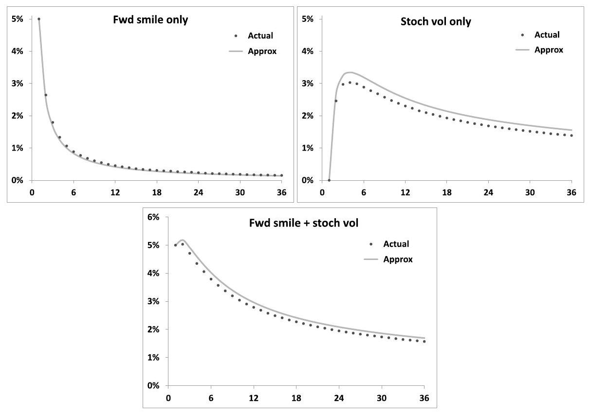
Figure 7.20: Top: $\mathcal{S}_{T}$, as the $95 \% / 105 \%$ skew, obtained either with $\nu=0$ (left) or with $\mathcal{S}_{\Delta}=0$ (right) as a function of $T$ (months), evaluated in a Monte-Carlo simulation of the discrete two-factor model with parameters in Table 7.8 (Actual) and as given by order-one formula (7.119b) (Approx). $\Delta=1$ month.
Bottom: $\mathcal{S}_{T}$ when both forward smile $\left(\mathcal{S}_{\Delta}=-0.5\right)$ and volatility of volatility $(\nu=174 \%)$ are switched on.

non-monotonic as a function of $T$, however this depends on the relative magnitude of $\mathcal{S}_{\Delta}$ and $\nu_{\Delta}$ - see Figure 7.21 where $\mathcal{S}_{T}$ is graphed for 3 different values of $\mathcal{S}_{\Delta}$.

This is illustrated also in Figure 7.22, which shows $\mathcal{S}_{T}$ for the same parameters as in Figure 7.8, except $\nu$ has been halved. For this smaller level of volatility of volatility, agreement with formula (7.119b) is excellent.

### 7.8.5 Conclusion

- With respect to their continuous counterparts, discrete forward variance models allow separation of the effects of (a) spot/volatility covariance, (b) future smile for a given time scale $\Delta$. In models thus specified, prices of cliquets of the form:

$$
\sum_{i} \omega_{i} f\left(\frac{S_{T_{i+1}}}{S_{T_{i}}}\right)
$$

where $T_{i}=i \Delta$, do not depend anymore on spot/volatility correlations.
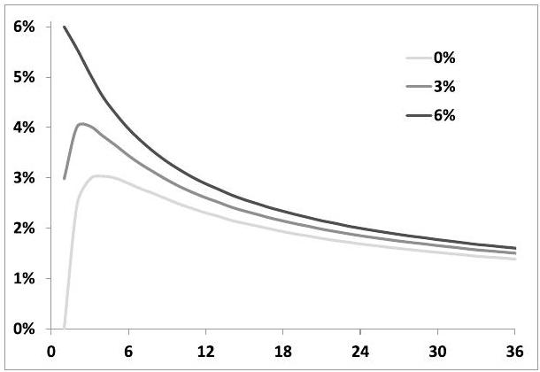

Figure 7.21: $\mathcal{S}_{T}$, as the $95 \% / 105 \%$ skew, as a function of $T$ (months), evaluated in a Monte-Carlo simulation of the discrete two-factor model with parameters in Table 7.8 for 3 different values of $\mathcal{S}_{\Delta}$, such that the 1 -month $95 \% / 105 \%$ ATMF skew is equal to $0,3 \%$ and $6 \%$.

Figure 7.22: $\mathcal{S}_{T}$, as the $95 \% / 105 \%$ skew, as a function of $T$ (months), evaluated in a Monte-Carlo simulation of the discrete two-factor model with the same parameters as in Figure 7.20 except $\nu$ has been halved.

One first sets future smiles for maturity $\Delta$, then chooses spot/volatility correlations so as to obtain desired levels of covariances of spot and forward VS/ATMF volatilities, or desired levels for the vanilla ATMF skew. Discrete forward variance models are thus naturally suited to the risk-management of cliquets, such as accumulators.

- For any choice of time scale $\Delta$, simple parameter mappings exist that ensure that instantaneous volatilities of spot or forward-starting VS volatilities in the discrete two-factor model match those of the continuous version of the model.
- Specification of future smiles is very flexible. We give an example of parametrization that allows the user to specify how the ATMF skew for matu-
rity $\Delta$ depends on the ATMF volatility for the same maturity. Once functions $\sigma_{0}()$ and $\beta()$ are tabulated, simulation of the discrete model is as uncomplicated as in the continuous model.
- Discrete forward variance models are also ideally suited to the risk management of payoffs involving both VIX futures and the S\&P 500 index. They can be calibrated exactly to VIX smiles, if one so desires, while preserving full flexibility as to forward smile scenarios for the S\&P 500 index.
- The vanilla smile of discrete forward variance models is produced by both forward-smile and volatility-of-volatility components. Order-one formula (7.119b) allows for an assessment of the contribution of each effect to the ATMF skew of vanilla options.

## Chapter's digest

### 7.1 Pricing equation

The pricing equation of forward variance models is obtained through a replication argument. It reads:

$$
\begin{aligned}
& \frac{d P}{d t}+(r-q) S \frac{d P}{d S}+\frac{\xi^{t}}{2} S^{2} \frac{d^{2} P}{d S^{2}} \\
& +\frac{1}{2} \int_{t}^{T} d u \int_{t}^{T} d u^{\prime} \nu\left(t, u, u^{\prime}, \xi\right) \frac{d^{2} P}{\delta \xi^{u} \delta \xi^{u^{\prime}}}+\int_{t}^{T} d u \mu(t, u, \xi) S \frac{d^{2} P}{d S \delta \xi^{u}}=r P
\end{aligned}
$$

This SDE admits a probabilistic interpretation. Its solution is given by:

$$
P=E\left[g\left(S_{T}\right) \mid S_{t}=S, \xi_{t}^{u}=\xi^{u}\right]
$$

under a dynamics for $S_{t}, \xi_{t}^{u}$ given by:

$$
\left\{\begin{aligned}
d S_{t} & =(r-q) S_{t} d t+\sqrt{\xi_{t}^{t}} S_{t} d W_{t}^{S} \\
d \xi_{t}^{u} & =\lambda_{t}^{u} d W_{t}^{u}
\end{aligned}\right.
$$

with $\lambda_{t}^{u}$ and correlations between $W_{t}^{S}$ and $W_{t}^{u}$ such that:

$$
\begin{aligned}
\lim _{d t \rightarrow 0} \frac{1}{d t} E_{t}\left[d \ln S_{t} d \xi_{t}^{u}\right] & =\sqrt{\xi_{t}^{t}} \lambda_{t}^{u} \frac{1}{d t} E_{t}\left[d W_{t}^{S} d W_{t}^{u}\right]=\mu(t, u, \xi) \\
\lim _{d t \rightarrow 0} \frac{1}{d t} E_{t}\left[d \xi_{t}^{u} d \xi_{t}^{u^{\prime}}\right] & =\lambda_{t}^{u} \lambda_{t}^{u^{\prime}} \frac{1}{d t} E_{t}\left[d W_{t}^{u} d W_{t}^{u^{\prime}}\right]=\nu\left(t, u, u^{\prime}, \xi\right)
\end{aligned}
$$

## τα τα τα τα τα

## $7.3 N$-factor models

- Markovian representations of forward variance models are economically obtained by choosing exponential weightings for the driving Brownian motions:

$$
d \xi_{t}^{T}=\omega \alpha_{w} \xi_{t}^{T} \sum_{i} w_{i} e^{-k_{i}(T-t)} d W_{t}^{i}
$$

- $N$-factor models are simulated by evolving, together with the spot process, $N$ Ornstein-Ühlenbeck processes, which are easily simulated exactly.
- The number of driving factors in a model bears no relationship to the number of hedging instruments required; it simply sets the structure and rank of the break-even covariance matrix of the gamma/theta $\mathrm{P} \& \mathrm{~L}$ of a hedged position.

### 7.4 A two-factor model

- Two factors afford sufficient flexibility as to volatilities and correlations of volatilities. The SDE of $\xi_{t}^{T}$ reads:

$$
\begin{aligned}
d \xi_{t}^{T} & =(2 \nu) \xi_{t}^{T} \alpha_{\theta}\left((1-\theta) e^{-k_{1}(T-t)} d W_{t}^{1}+\theta e^{-k_{2}(T-t)} d W_{t}^{2}\right) \\
\alpha_{\theta} & =1 / \sqrt{(1-\theta)^{2}+\theta^{2}+2 \rho_{12} \theta(1-\theta)}
\end{aligned}
$$

where $\nu$ is the volatility of a very short volatility. We introduce driftless processes $x_{t}^{T}$ :

$$
d x_{t}^{T}=\alpha_{\theta}\left[(1-\theta) e^{-k_{1}(T-t)} d W_{t}^{1}+\theta e^{-k_{2}(T-t)} d W_{t}^{2}\right]
$$

$\xi_{t}^{T}$ is given by:

$$
\begin{aligned}
\xi_{t}^{T} & =\xi_{0}^{T} f^{T}\left(t, x_{t}^{T}\right) \\
f^{T}(t, x) & =e^{\omega x-\frac{\omega^{2}}{2} \chi(t, T)}
\end{aligned}
$$

with $\omega=2 \nu$ and $\chi(t, T)$ given in (7.35).

- The two-factor model can be parametrized so that volatilities of spot-starting volatilities approximately match a power-law decay with maturity. We use the following benchmark:

$$
\nu_{T}^{\mathrm{B}}(t)=\sigma_{0}\left(\frac{\tau_{0}}{T-t}\right)^{\alpha}
$$

This benchmark form, for given values of $\sigma_{0}, \tau_{0}, \alpha$, can be approximately captured in the two-factor model with different sets of parameters.

This additional flexibility is utilized to generate different volatilities of forwardstarting volatilities.

- While instantaneous forward variances are lognormal, discrete forward variances are not, thus variance swaptions exhibit a slight positive skew.
- For set parameters, volatilities of volatilities depend on the shape of the variance curve: they are larger for decreasing term structures of VS volatilities.
- The correlation structure of forward volatilities in the two-factor model is poor, as it involves one single time scale: $\frac{1}{k_{1}-k_{2}}$. This could motivate the inclusion of additional factors.

### 7.6 Options on realized variance

- An option on realized variance of maturity $T$ pays a call or put on the realized variance over $[0, T]$, measured with daily log-returns.
- The natural hedge instrument is the VS for the residual maturity. A simple model (SM) is built by specifying the dynamics of $U_{t}$, defined by:

$$
U_{t}=\frac{Q_{t}+(T-t) \widehat{\sigma}_{T}^{2}(t)}{T}
$$

$Q_{t}$ is the quadratic variation at $t$, and $\widehat{\sigma}_{T}(t)$ is the VS volatility at $t$ for maturity $T$. $U_{t}$ has no drift.

Assuming a lognormal dynamics for $U_{t}$ given by:

$$
\frac{d U_{t}}{U_{t}}=2 R_{t} \frac{T-t}{T} \nu_{T}(t) d W_{t}
$$

yields the price of an option on realized variance, in the form of a simple BlackScholes formula, where $R_{t}=\frac{\widehat{\sigma}_{T}^{2}(t)}{U_{t}}$ has been take equal to 1 .

$$
\begin{aligned}
P(t, U) & =P_{\mathrm{BS}}\left(t, U, \sigma_{\mathrm{eff}}, T\right) \\
\sigma_{\mathrm{eff}}^{2} & =\frac{1}{T-t} \int_{t}^{T} 4\left(\frac{T-\tau}{T}\right)^{2} \nu_{T}^{2}(\tau) d \tau
\end{aligned}
$$

where $\nu_{T}^{2}(\tau)$ is the volatility at $\tau$ of a VS volatility of maturity $T$.
Numerical tests whereby the option price computed in the SM is compared to that produced by the two-factor model, parametrized so that the volatilities of volatilities it generates match $\nu_{T}(\tau)$, show that, for the case of a flat term-structure of VS volatilities, the approximation in the SM is adequate.

- When the term structure of VS volatilities is not flat, the approximation $R_{t}=1$ is replaced with $R_{t}=\frac{\widehat{\sigma}_{\tau T}^{2}(0)}{\widehat{\sigma}_{T}^{2}(0)}$, which produces the following amended expression for $\sigma_{\text {eff }}$, at inception:

$$
\sigma_{\mathrm{eff}}^{2}=\frac{4}{T} \int_{0}^{T}\left(\frac{T-\tau}{T}\right)^{2}\left(\frac{\widehat{\sigma}_{\tau T}^{2}(0)}{\widehat{\sigma}_{T}^{2}(0)}\right)^{2} \nu_{T}^{2}(\tau) d \tau
$$

- The vega-hedge portfolio of an option on realized variance comprises, in addition to a VS of maturity $T$, a continuum of VSs of intermediate maturities. This vega hedge also functions as a gamma hedge.
- This hedge portfolio can be benchmarked against that produced by the twofactor model. The two hedges are slightly different, because of the sensitivity of volatilities of volatilities to the term structure of VS volatilities, in the two-factor model.
- The fact that variance does not accrue continuously, but is measured using discrete returns, impacts the value of options on realized variance, especially for short maturities. In case volatilities of volatilities vanish, one is still exposed to the intrinsic variance of the variance estimator itself. This effect is taken care of by
using the following expression for $\sigma_{\text {eff }}$ where $\kappa$ is the (conditional) kurtosis of daily returns.

$$
\sigma_{\mathrm{eff}}^{2}=\frac{1}{T} \int_{0}^{T} 4\left(\frac{T-\tau}{T}\right)^{2}\left(\frac{\widehat{\sigma}_{\tau T}^{2}(0)}{\widehat{\sigma}_{T}^{2}(0)}\right)^{2} \nu_{T}^{2}(\tau) d \tau+\frac{2+\kappa}{N T}
$$

- Upper and lower bounds for prices of vanilla options on realized variance can be derived from the vanilla smile. If breached, a trading strategy consisting of a static position in a realized variance option and a portfolio of vanilla options, together with a dynamic delta position, nets a positive P\&L.
- Options on forward realized variance cannot be priced in the SM as the latter only takes as ingredient the term structure of volatilities of spot-starting VS volatilities. What is needed, in addition, is the volatility of forward-starting volatilities, which cannot be backed-out of volatilities of spot-starting volatilities, in model-independent fashion. This is illustrated by pricing these options in the two-factor model with parameter sets that generate almost identical prices for spotstarting options. Prices of forward-starting options are different. They are also higher than prices of variance swaptions.
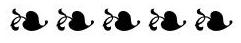

### 7.7 VIX futures and options

- The smile of VIX futures can be simply modeled by changing the function that maps processes $x_{t}^{T}$ into forward variances $\xi_{t}^{T}$. We introduce the following simple parametrization:

$$
f^{T}(t, x)=\left(1-\gamma_{T}\right) e^{\omega_{T} x-\frac{\omega_{T}^{2}}{2} \chi(t, T)}+\gamma_{T} e^{\beta_{T} \omega_{T} x-\frac{\left(\beta_{T} \omega_{T}\right)^{2}}{2}} \chi(t, T)
$$

Volatility-of-volatility smile parameters $\gamma^{T}, \beta^{T}, \zeta^{T}$, as well as forward variances $\xi_{0}^{T}$, are taken to be piecewise constant, with constant values for all forward variances that underlie a given VIX future. The model is calibrated by choosing $\gamma^{T}, \beta^{T}, \zeta^{T}$ and $\xi_{0}^{T}$ so that market values of (a) VIX futures, (b) VIX implied volatilities are matched. This is almost a local volatility model for forward variances.

- Different parameter sets of the two-factor model can be employed, resulting in very similar calibration accuracies. What distinguishes these different sets is the different distributions of volatility they generate for VIX futures.
- In case VIX futures are needed in the simulation of the two-factor model, they can be efficiently computed through a two-dimensional Gaussian quadrature. In case of very frequent observations, it is preferable to turn to the discrete forward variance models of Section 7.8.2.
- Options exist on ETNs whose investment strategies consists in maintaining a long position in the first two nearby VIX futures. These options cannot be priced
off VIX smiles in model-independent fashion, as they are very sensitive to the distribution of the volatility of VIX futures.
- Forward S\&P 500 VSs can be synthesized using VIX instruments: futures and options. It is possible to set up a trading strategy that arbitrages the difference of these VIX-synthesized forward VSs with respect to forward VSs derived from the S\&P 500 VS market.
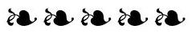

### 7.8 Discrete forward variance models

- Discrete variance models arise out of the need to control future smiles independently from the correlation of spot and volatilities, and also to model VIX futures directly.

The specification of these models starts with a schedule of discrete dates $T_{i}$, then the model is built in two stages. First, we define a dynamics for discrete forward variances $\xi_{t}^{i}=\widehat{\sigma}_{T_{i}, T_{i+1}}^{2}(t)$, then construct a dynamics for $S_{t}$ that complies with that of the $\xi_{t}^{i}$.

- Since the $\xi^{i}$ are driftless, as their continuous counterparts $\xi^{T}$, the two-factor model can be employed for the $\xi^{i}$.

When switching from the continuous to the discrete version of the model, we require that some features remain unchanged, so that volatility-of-volatility risks of different payoffs, calling for different schedules, are still priced at the same levels.

Starting from a parameter set for the continuous model, we generate parameters for the discrete model that ensure that instantaneous volatilities and correlations of spot-starting and forward VS volatilities for maturities $T_{i}$ match in both models, for forward variances equal to their initial values.

- A benefit of discrete forward variance models is that VIX futures can be directly modeled, thus are readily accessible in a simulation of the model. VIX smiles can be calibrated exactly - the resulting model is in fact a local volatility model.
- Next we specify a dynamics for $S_{t}$ that meets the following requirements: (a) the SDE for $S_{t}$ complies with the dynamics of the $\xi^{i}$, (b) the density of $\frac{S_{T_{i+1}}}{S_{T_{i}}}$ is independent on $S_{T_{i}}$ so that payoffs $\Sigma_{i} \omega_{i} f\left(\frac{S_{T_{i+1}}}{S_{T_{i}}}\right)$ have zero sensitivity to spot/volatility correlations, (c) the dependence of future skews over intervals $\left[T_{i}, T_{i+1}\right]$ on the corresponding VS volatilities can be set at will.
- This is achieved by using a path-dependent local volatility for $S_{t}$. We provide a simple parametrization of this local volatility function and give examples of two specifications corresponding to two typical future skew scenarios: future ATMF skews either independent on, or proportional to, ATMF volatilities.
- The ATMF skew of discrete forward variance models is generated by two mechanisms: (a) the local volatility functions $\sigma^{i}$, (b) the correlation of $S_{t}$ and forward variances $\xi^{i}$. Working at order one in both the slope of local volatility functions $\sigma^{i}$
and volatility of volatility, we express the ATMF skew for maturities $T_{i}$ as the sum of two contributions, generated by both effects.

The portion of the ATMF skew generated by local volatility functions $\sigma^{i}$ decays as $\frac{1}{T}$. Numerical tests confirm the accuracy of the order-one expansion.
