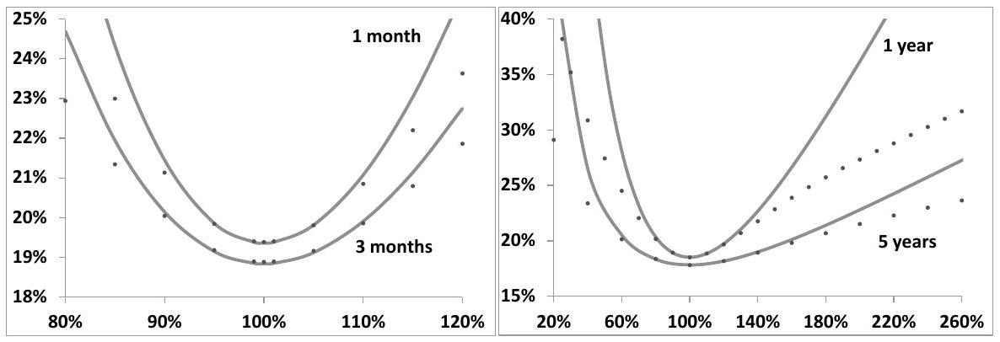
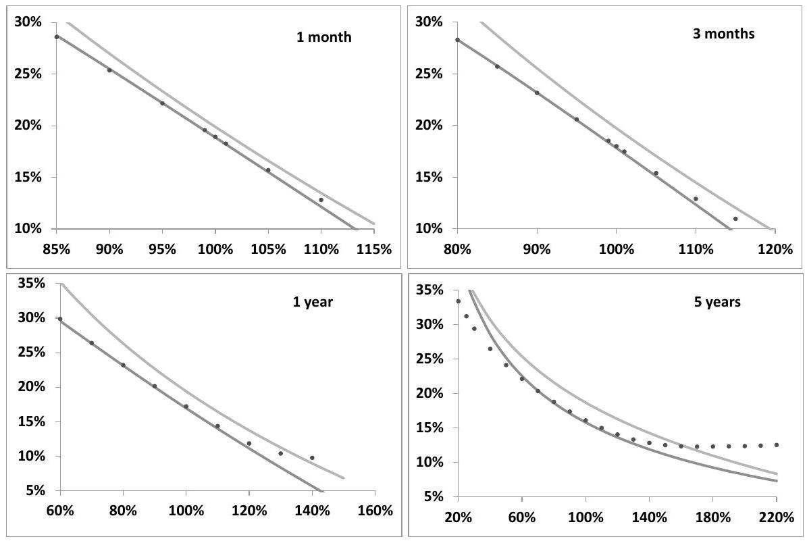
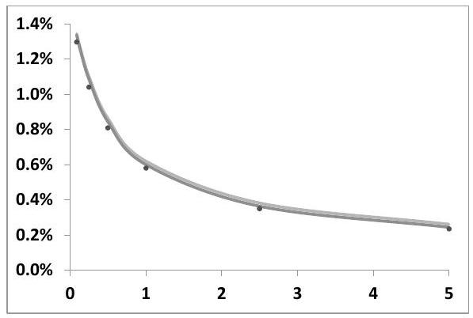
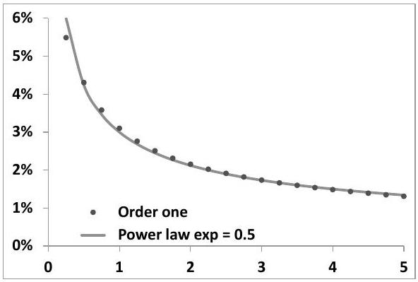
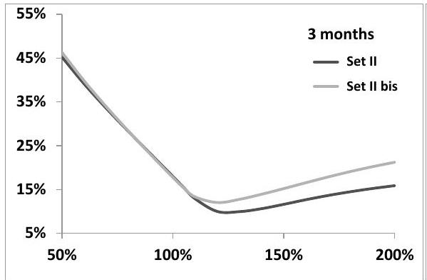
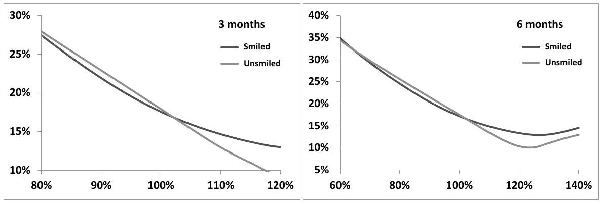
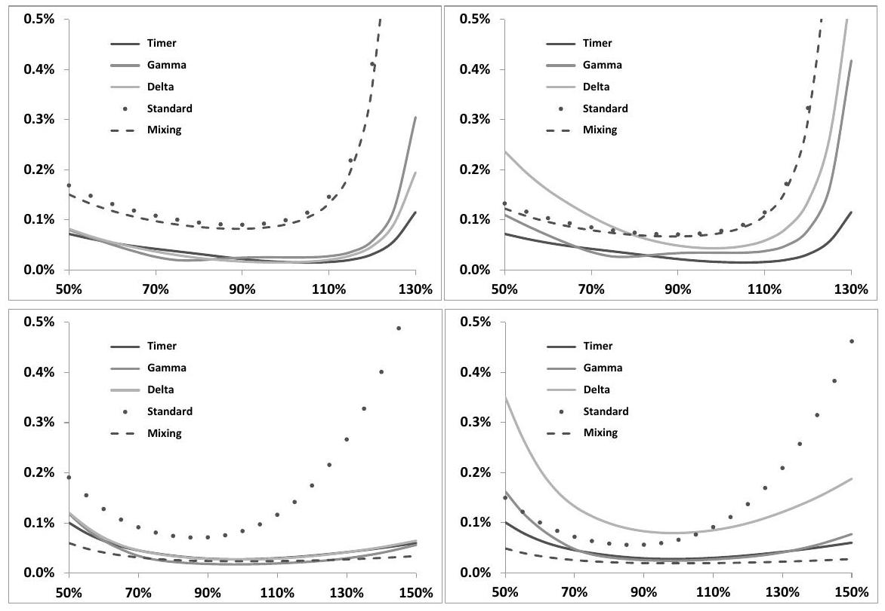
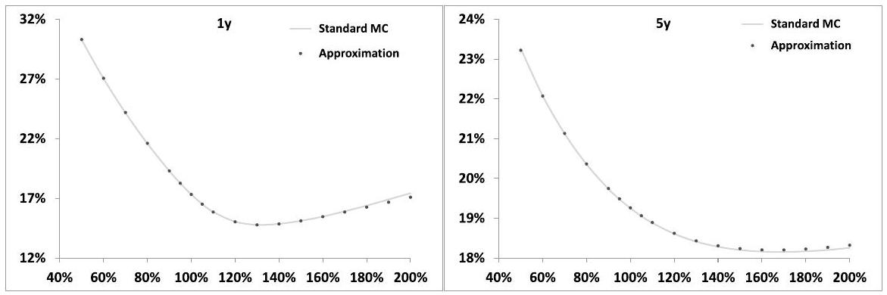
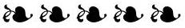

## Chapter 8

## The smile of stochastic volatility models

What is it that determines the shape of the smile generated by stochastic volatility models? We derive an expansion at order two in volatilities of volatilities, which is easily carried out in the forward variance framework introduced in Chapter 7, and characterize the smile near the money. ${ }^{1}$ We derive in particular a general approximate expression for the ATMF skew that is accurate and can be used in practice.

We also present an alternative derivation of the order-one correction based on a representation of European option prices in terms of spot/volatility and volatility/volatility gamma P\&Ls.

The characterization of the near-the-money smile in terms of the spot/variance and variance/variance covariance functions is used in Chapter 9 to establish a link between static and dynamic properties of stochastic volatility models.

Finally, efficient techniques for generating vanilla smiles in stochastic volatility models are explored in the appendix.

### 8.1 Introduction

Any stochastic volatility model - including models based on the dynamics of the instantaneous variance $V_{t}$ - can be written as a forward variance model. The corresponding pricing equation for a European payoff is given in (7.4), page 219:

$$
\begin{align*}
& \frac{d P}{d t}+(r-q) S \frac{d P}{d S}+\frac{\xi^{t}}{2} S^{2} \frac{d^{2} P}{d S^{2}} \\
& +\frac{1}{2} \int_{t}^{T} d u \int_{t}^{T} d u^{\prime} \nu\left(t, u, u^{\prime}, \xi\right) \frac{d^{2} P}{\delta \xi^{u} \delta \xi^{u^{\prime}}}+\int_{t}^{T} d u \mu(t, u, \xi) S \frac{d^{2} P}{d S \delta \xi^{u}}=r P \tag{8.1}
\end{align*}
$$
^eq8-1

[^125]where the spot/variance and variance/variance covariance functions $\mu, \nu$ are defined as:

$$
\begin{aligned}
\mu(t, u, \xi) & =\lim _{d t \rightarrow 0} \frac{1}{d t} E_{t}\left[d \ln S_{t} d \xi_{t}^{u}\right] \\
\nu\left(t, u, u^{\prime}, \xi\right) & =\lim _{d t \rightarrow 0} \frac{1}{d t} E_{t}\left[d \xi_{t}^{u} d \xi_{t}^{u^{\prime}}\right]
\end{aligned}
$$

Remember that $\mu$ and $\nu$ can depend on the variance curve $\xi$, but are not allowed to explicitly depend on $S$ : this excludes from our scope mixed local-stochastic volatility models.

Obviously the smile generated by a stochastic volatility model is a product of the joint dynamics of $S_{t}$ and forward variances $\xi_{t}^{T}$; is it possible to pinpoint precisely which functionals of the covariance functions $\mu$ and $\nu$ determine the shape of the vanilla smile?

We answer this question by deriving an expansion of vanilla option prices in powers of volatility of volatility. To this end we introduce a dimensionless parameter $\varepsilon$ which we use to scale $\mu$ and $\nu$ according to:

$$
\begin{aligned}
& \mu \rightarrow \varepsilon \mu \\
& \nu \rightarrow \varepsilon^{2} \nu
\end{aligned}
$$

Once the expansion at the desired order in $\varepsilon$ is obtained we set $\varepsilon=1$.

### 8.2 Expansion of the price in volatility of volatility

Consider a European option of maturity $T$ whose payoff is $g\left(S_{T}\right)$. With no loss of generality we take vanishing interest rate and repo. The option's price $P(t, S, \xi)$ solves the following backward equation:

$$
\begin{equation*}
\frac{d P}{d t}+H_{t} P=0 \tag{8.2}
\end{equation*}
$$
^eq8-2

$H_{t}$ is given by:

$$
H_{t}=H_{t}^{0}+\varepsilon \mathcal{W}_{t}^{1}+\varepsilon^{2} \mathcal{W}_{t}^{2}
$$

where operators $H_{t}^{0}, \mathcal{W}_{t}^{1}, \mathcal{W}_{t}^{2}$ read:

$$
\begin{align*}
H_{t}^{0} & =\frac{\xi^{t}}{2}\left(\partial_{x}^{2}-\partial_{x}\right)  \tag{8.3a}\\
\mathcal{W}_{t}^{1} & =\int_{t}^{T} d u \mu(t, u, \xi) \partial_{x \xi^{u}}^{2}  \tag{8.3b}\\
\mathcal{W}_{t}^{2} & =\frac{1}{2} \int_{t}^{T} d u \int_{t}^{T} d u^{\prime} \nu\left(t, u, u^{\prime}, \xi\right) \partial_{\xi^{u} \xi^{u^{\prime}}}^{2} \tag{8.3c}
\end{align*}
$$
^eq8-3a
^eq8-3b
^eq8-3c

where $x=\ln S$ and $\partial_{x}, \partial_{x \xi^{u}}^{2}, \partial_{\xi^{u} \xi^{u^{\prime}}}^{2}$ stand respectively for $\frac{d}{d x}, \frac{d^{2}}{d x \delta \xi^{u}}, \frac{d^{2}}{\delta \xi^{u} \delta \xi^{u^{\prime}}}-$ note that derivatives with respect to $\xi^{u}$ are functional derivatives. The terminal condition for $P$ is: $P(T, S, \xi)=g(S)$. Let us write the expansion of $P$ in powers of $\varepsilon$ as:

$$
\begin{equation*}
P=P_{0}+\varepsilon P_{1}+\varepsilon^{2} P_{2}+\cdots \tag{8.4}
\end{equation*}
$$
^eq8-4

Rather than inserting expression (8.4) in (8.2), deriving sequential PDEs for the $P_{i}$ by equating to zero the contribution of each order in $\varepsilon$, and computing the $P_{i}$ using the Feynman-Kac representation, we use the time-dependent perturbation technique. Integrating PDE (8.2), $P$ is given by:

$$
P(t, x, \xi)=U_{t T} g
$$

where operator $U_{s t}$ with $s \leq t$ is defined by:

$$
\begin{equation*}
U_{s t}=\lim _{n \rightarrow \infty}\left(1+\delta t H_{t_{0}}\right)\left(1+\delta t H_{t_{1}}\right) \cdots\left(1+\delta t H_{t_{n-1}}\right) \tag{8.5}
\end{equation*}
$$
^eq8-5

with $\delta t=\frac{t-s}{n}$ and $t_{i}=s+i \delta t$. $U_{s t}$ can be written as:

$$
U_{s t}=: \exp \left(\int_{s}^{t} H_{\tau} d \tau\right)
$$

where : : indicates that the operators inside the colons are time-ordered, as in (8.5). $U_{s t}$ satisfies the semi-group property - for $s \leq r \leq t$ :

$$
\begin{equation*}
U_{s t}=U_{s r} U_{r t} \tag{8.6}
\end{equation*}
$$
^eq8-6

Let us write $H_{t}=H_{t}^{0}+\delta H_{t}$ where $H_{t}^{0}$ is the unperturbed operator corresponding to the Black-Scholes model and $\delta H_{t}$ is a perturbation. From (8.5), the expansion of $U_{s t}$ in powers of $\delta H$ reads:

$$
\begin{equation*}
U_{s t}=U_{s t}^{0}+\int_{s}^{t} d \tau U_{s \tau}^{0} \delta H_{\tau} U_{\tau t}^{0}+\int_{s}^{t} d \tau_{1} \int_{\tau_{1}}^{t} d \tau_{2} U_{s \tau_{1}}^{0} \delta H_{\tau_{1}} U_{\tau_{1} \tau_{2}}^{0} \delta H_{\tau_{2}} U_{\tau_{2} t}^{0}+\cdots \tag{8.7}
\end{equation*}
$$
^eq8-7

$\delta H_{t}$ reads: $\delta H_{t}=\varepsilon \mathcal{W}_{t}^{1}+\varepsilon^{2} \mathcal{W}_{t}^{2}$. Inserting this expression in (8.7) and keeping terms up to order two in $\varepsilon$ yields:

$$
\begin{align*}
P_{0} & =U_{t T}^{0} g  \tag{8.8}\\
P_{1} & =\int_{t}^{T} d \tau U_{t \tau}^{0} \mathcal{W}_{\tau}^{1} U_{\tau T}^{0} g  \tag{8.9}\\
P_{2} & =\left(\int_{t}^{T} d \tau U_{t \tau}^{0} \mathcal{W}_{\tau}^{2} U_{\tau T}^{0}+\int_{t}^{T} d \tau_{1} \int_{\tau_{1}}^{T} d \tau_{2} U_{t \tau_{1}}^{0} \mathcal{W}_{\tau_{1}}^{1} U_{\tau_{1} \tau_{2}}^{0} \mathcal{W}_{\tau_{2}}^{1} U_{\tau_{2} T}^{0}\right) g \tag{8.10}
\end{align*}
$$
^eq8-8
^eq8-9
^eq8-10

The expression for $U_{s t}^{0}$ - the so-called free propagator - is:

$$
\begin{equation*}
U_{s t}^{0}=: \exp \left(\int_{s}^{t} H_{\tau}^{0} d \tau\right):=e^{\frac{1}{2}\left(\int_{s}^{t} \xi^{\tau} d \tau\right)\left(\partial_{x}^{2}-\partial_{x}\right)} \tag{8.11}
\end{equation*}
$$
^eq8-11

where we have removed the time-ordering symbol in the right-hand side as operators $H_{t}^{0}$ for different values of $t$ commute. $P_{0}$ in (8.8) is the standard Black-Scholes price: $P(t, x, \xi)=P_{B S}(t, S, \widehat{\sigma})$ with $S=e^{x}$ and $\widehat{\sigma}^{2}=\frac{1}{T-t} \int_{t}^{T} \xi^{\tau} d \tau$. Before computing $P_{1}$ and $P_{2}$ observe that:

- as is clear from expression (8.11) for $U_{s t}^{0}, \partial_{x}$ and $U_{s t}^{0}$ commute. This is equivalent to saying that $\partial_{x}^{n} P_{0}$ is a martingale for all $n$. Specializing to the cases $n=1,2$ this recovers the well-known property that the delta and dollar gammas $S \frac{d P}{d S}$ and $S^{2} \frac{d^{2} P}{d S^{2}}$ of a European option in the Black-Scholes model are martingales.
- likewise $\partial_{\xi^{u}}$ and $U_{s t}^{0}$ commute unless $u \in[s, t]$ :

$$
\begin{equation*}
\partial_{\xi^{u}} U_{s t}^{0}=U_{s t}^{0} \partial_{\xi^{u}}+\mathbf{1}_{u \in[s, t]} \frac{1}{2}\left(\partial_{x}^{2}-\partial_{x}\right) U_{s t}^{0} \tag{8.12}
\end{equation*}
$$
^eq8-12

Moreover, $\partial_{\xi^{u}}^{n} g=0$ as $g$ is a function of $x$ only. Applying relationship (8.12) on $g$ with $t=T$ and $s=t$ yields: $\partial_{\xi^{u}} U_{t T}^{0} g=\frac{1}{2}\left(\partial_{x}^{2}-\partial_{x}\right) U_{t T}^{0} g$. This expresses the already-mentioned property that, for a European option in the BlackScholes model, vega (left-hand side) and gamma (right-hand side) are related: $\frac{d P}{d\left(\sigma^{2}(T-t)\right)}=\frac{1}{2} S^{2} \frac{d^{2} P}{d S^{2}}$.

Using these two rules, the semi-group property (8.6), and the fact that $\mu$ does not depend on $x$, we get:

$$
\begin{aligned}
P_{1} & =\int_{t}^{T} d \tau U_{t \tau}^{0} \mathcal{W}_{\tau}^{1} U_{\tau T}^{0} g=\int_{t}^{T} d \tau U_{t \tau}^{0} \int_{\tau}^{T} d u \mu_{\tau, u} \partial_{x \xi^{u}}^{2} U_{\tau T}^{0} g \\
& =\int_{t}^{T} d \tau U_{t \tau}^{0} \int_{\tau}^{T} d u \mu_{\tau, u} \partial_{x} \frac{1}{2}\left(\partial_{x}^{2}-\partial_{x}\right) U_{\tau T}^{0} g \\
& =\int_{t}^{T} d \tau \int_{\tau}^{T} d u \mu_{\tau, u} \partial_{x} \frac{1}{2}\left(\partial_{x}^{2}-\partial_{x}\right) U_{t \tau}^{0} U_{\tau T}^{0} g \\
& =\frac{C_{t}^{x \xi}(\xi)}{2} \partial_{x}\left(\partial_{x}^{2}-\partial_{x}\right) P_{0}
\end{aligned}
$$

where we have used the more compact notation $\mu_{\tau, u} \equiv \mu(\tau, u, \xi)$. The dimensionless quantity $C_{t}^{x \xi}(\xi)$ is given by:

$$
\begin{align*}
C_{t}^{x \xi}(\xi) & =\int_{t}^{T} d \tau \int_{\tau}^{T} d u \mu(\tau, u, \xi)  \tag{8.13a}\\
& =\int_{t}^{T}(T-\tau)\left\langle d \ln S_{\tau} d \widehat{\sigma}_{T}^{2}(\tau)\right\rangle \tag{8.13b}
\end{align*}
$$
^eq8-13a
^eq8-13b

Likewise, the first contribution to $P_{2}$ in (8.10) is given by:

$$
\begin{aligned}
\int_{t}^{T} d \tau U_{t \tau}^{0} \mathcal{W}_{\tau}^{2} U_{\tau T}^{0} g & =\frac{1}{2} \int_{t}^{T} d \tau U_{t \tau}^{0} \int_{\tau}^{T} d u \int_{\tau}^{T} d u^{\prime} \nu_{\tau, u, u^{\prime}} \partial_{\xi^{u} \xi^{\prime}}^{2} U_{\tau T}^{0} g \\
& =\frac{1}{8} \int_{t}^{T} d \tau U_{t \tau}^{0} \int_{\tau}^{T} d u \int_{\tau}^{T} d u^{\prime} \nu_{\tau, u, u^{\prime}}\left(\partial_{x}^{2}-\partial_{x}\right)^{2} U_{\tau T}^{0} g \\
& =\frac{C_{t}^{\xi \xi}(\xi)}{8}\left(\partial_{x}^{2}-\partial_{x}\right)^{2} P_{0}
\end{aligned}
$$

where the dimensionless quantity $C_{t}^{\xi \xi}(\xi)$ reads:

$$
\begin{align*}
C_{t}^{\xi \xi}(\xi) & =\int_{t}^{T} d \tau \int_{\tau}^{T} d u \int_{\tau}^{T} d u^{\prime} \nu\left(\tau, u, u^{\prime}, \xi\right)  \tag{8.14a}\\
& =\int_{t}^{T}(T-\tau)^{2}\left\langle d \widehat{\sigma}_{T}^{2}(\tau) d \widehat{\sigma}_{T}^{2}(\tau)\right\rangle \tag{8.14b}
\end{align*}
$$
^eq8-14a
^eq8-14b

The second contribution to $P_{2}$ involves the spot/variance operator $\mathcal{W}^{1}$ twice:

$$
\begin{align*}
& \int_{t}^{T} d \tau_{1} \int_{\tau_{1}}^{T} d \tau_{2} U_{t \tau_{1}}^{0} \mathcal{W}_{\tau_{1}}^{1} U_{\tau_{1} \tau_{2}}^{0} \mathcal{W}_{\tau_{2}}^{1} U_{\tau_{2} T}^{0} g \\
& =\int_{t}^{T} d \tau_{1} U_{t \tau_{1}}^{0} \int_{\tau_{1}}^{T} d \tau_{2} \int_{\tau_{1}}^{T} d u \mu_{\tau_{1}, u} \partial_{x \xi^{u}}^{2} U_{\tau_{1} \tau_{2}}^{0} \int_{\tau_{2}}^{T} d u^{\prime} \mu_{\tau_{2}, u^{\prime}} \partial_{x \xi^{u}}^{2} U_{\tau_{2} T}^{0} g \\
& =\frac{1}{2} \int_{t}^{T} d \tau_{1} U_{t \tau_{1}}^{0} \int_{\tau_{1}}^{T} d u \mu_{\tau_{1}, u} \int_{\tau_{1}}^{T} d \tau_{2} \partial_{x \xi^{u}}^{2} U_{\tau_{1} \tau_{2}}^{0} \int_{\tau_{2}}^{T} d u^{\prime} \mu_{\tau_{2}, u^{\prime}} \partial_{x}\left(\partial_{x}^{2}-\partial_{x}\right) U_{\tau_{2} T}^{0} g \\
& =\frac{1}{2} \int_{t}^{T} d \tau_{1} U_{t \tau_{1}}^{0} \int_{\tau_{1}}^{T} d u \mu_{\tau_{1}, u} \partial_{x \xi^{u}}^{2} \int_{\tau_{1}}^{T} d \tau_{2} \int_{\tau_{2}}^{T} d u^{\prime} \mu_{\tau_{2}, u^{\prime}} \partial_{x}\left(\partial_{x}^{2}-\partial_{x}\right) U_{\tau_{1} T}^{0} g \\
& =\frac{1}{2} \partial_{x}^{2}\left(\partial_{x}^{2}-\partial_{x}\right) \int_{t}^{T} d \tau_{1} U_{t \tau_{1}}^{0} \int_{\tau_{1}}^{T} d u \mu_{\tau_{1}, u} \partial_{\xi^{u}} C_{\tau_{1}}^{x \xi}(\xi) U_{\tau_{1} T}^{0} g \\
& =\frac{1}{4} \partial_{x}^{2}\left(\partial_{x}^{2}-\partial_{x}\right)^{2} \int_{t}^{T} d \tau_{1} \int_{\tau_{1}}^{T} d u \mu_{\tau_{1}, u} C_{\tau_{1}}^{x \xi}(\xi) U_{t T}^{0} g  \tag{8.15}\\
& \quad+\frac{1}{2} \partial_{x}^{2}\left(\partial_{x}^{2}-\partial_{x}\right)\left(\int_{t}^{T} d \tau_{1} \int_{\tau_{1}}^{T} d u \mu_{\tau_{1}, u} \frac{\delta C_{\tau_{1}}^{x \xi}(\xi)}{\delta \xi^{u}}\right) U_{t T}^{0} g \\
& =\frac{C_{t}^{x \xi}(\xi)^{2}}{8} \partial_{x}^{2}\left(\partial_{x}^{2}-\partial_{x}\right)^{2} P_{0}+\frac{D_{t}(\xi)}{2} \partial_{x}^{2}\left(\partial_{x}^{2}-\partial_{x}\right) P_{0} \tag{8.16}
\end{align*}
$$
^eq8-15
^eq8-16

The dimensionless quantity $D_{t}(\xi)$ reads:

$$
\begin{align*}
D_{t}(\xi) & =\int_{t}^{T} d \tau \int_{\tau}^{T} d u \mu_{\tau u} \frac{\delta C_{\tau}^{x \xi}(\xi)}{\delta \xi^{u}}  \tag{8.17a}\\
& =\int_{t}^{T} d \tau \lim _{d \tau \rightarrow 0} \frac{1}{d \tau} E_{\tau}\left[d \ln S_{\tau} d C_{\tau}^{x \xi}\right]  \tag{8.17b}\\
& =\int_{t}^{T} d \tau \int_{\tau}^{T} d u(T-u) \frac{1}{d \tau}\left\langle d \ln S_{\tau} d\left[\frac{\left\langle d \ln S_{u} d \widehat{\sigma}_{T}^{2}(u)\right\rangle}{d u}\right]\right\rangle \tag{8.17c}
\end{align*}
$$
^eq8-17a
^eq8-17b
^eq8-17c

The alternative expressions in (8.17) for $D_{t}(\xi)$ follow from the fact that $C_{\tau}^{x \xi}(\xi)$ is a functional of the variance curve. Indeed, using the definition of $\mu_{\tau u}$ :

$$
\begin{aligned}
\int_{\tau}^{T} d u \mu_{\tau u} \frac{\delta C_{\tau}^{x \xi}(\xi)}{\delta \xi^{u}} & =\int_{\tau}^{T} d u \lim _{d \tau \rightarrow 0} \frac{1}{d \tau} E_{\tau}\left[d \ln S_{\tau} d \xi^{u}\right] \frac{\delta C_{\tau}^{x \xi}(\xi)}{\delta \xi^{u}} \\
& =\lim _{d \tau \rightarrow 0} \frac{1}{d \tau} E_{\tau}\left[d \ln S_{\tau} d C_{\tau}^{x \xi}\right] \\
& =\int_{\tau}^{T} d u \int_{u}^{T} d u^{\prime} \lim _{d \tau \rightarrow 0} \frac{1}{d \tau} E_{\tau}\left[d \ln S_{\tau} d \mu_{u u^{\prime}}\right]
\end{aligned}
$$

Note that the definition of $C_{\tau_{1}}^{x \xi}(\xi)$ in (8.13) has allowed for the following simplification in (8.15):

$$
\int_{t}^{T} d \tau_{1} \int_{\tau_{1}}^{T} d u \mu_{\tau_{1}, u} C_{\tau_{1}}^{x \xi}(\xi)=-\int_{t}^{T} d \tau_{1} \frac{d C_{\tau_{1}}^{x \xi}(\xi)}{d \tau_{1}} C_{\tau_{1}}^{x \xi}(\xi)=\frac{1}{2} C_{t}^{x \xi}(\xi)^{2}
$$

The final expression of $P$ at order two in $\varepsilon$ at $t=0$ is thus:

$$
\begin{align*}
& P=\left[1+\varepsilon \frac{C_{0}^{x \xi}\left(\xi_{0}\right)}{2} \partial_{x}\left(\partial_{x}^{2}-\partial_{x}\right)\right. \\
& \left.+\varepsilon^{2}\left(\frac{C_{0}^{\xi \xi}\left(\xi_{0}\right)}{8}\left(\partial_{x}^{2}-\partial_{x}\right)^{2}+\frac{C_{0}^{x \xi}\left(\xi_{0}\right)^{2}}{8} \partial_{x}^{2}\left(\partial_{x}^{2}-\partial_{x}\right)^{2}+\frac{D_{0}\left(\xi_{0}\right)}{2} \partial_{x}^{2}\left(\partial_{x}^{2}-\partial_{x}\right)\right)\right] P_{0} \tag{8.18}
\end{align*}
$$
^eq8-18

The subscript 0 in $\xi_{0}$ indicates that $C_{0}^{x \xi}, C_{0}^{\xi \xi}, D_{0}$ are evaluated in the unperturbed state, that is using the variance curve observed at time $t=0$.

## Discussion

- The corrections to the Black-Scholes price $P_{0}$ are obtained in terms of derivatives of $P_{0}$ with respect to $x=\ln S$. One can check on (8.18) that the contributions at order 1 and 2 in $\varepsilon$ are of the form:

$$
\begin{equation*}
\sum_{n=3}^{\infty} \alpha_{n}\left(\partial_{x}^{n}-\partial_{x}^{2}\right) P_{0} \tag{8.19}
\end{equation*}
$$
^eq8-19

which is in agreement with expression (5.88), page 193, for general perturbations of the lognormal density of $S_{T}$ that leave the implied volatility of the log contract unchanged.

In our expansion in powers of $\varepsilon$, forward variances $\xi^{T}$ are driftless: $E\left[\xi_{T}^{T}\right]= \xi_{0}^{T}$ at each order. Thus VS implied volatilities - equal to log contract implied volatilities since we are in a diffusive setting - stay fixed as $\varepsilon$ is varied. This stands in contrast with other types of expansions whose accuracy is marred by the fact that the overall level of implied volatilities in the model shifts as the volatility-of-volatility parameter is increased.

- We have already derived the order-one expansion in the special case of the Heston model - see equation (6.15), page 209 - it is exactly as in (8.18).
- At second order in volatility of volatility, $P$ only depends on 3 dimensionless model-dependent numbers: $C_{0}^{x \xi}\left(\xi_{0}\right), C_{0}^{\xi \xi}\left(\xi_{0}\right)$ and $D_{0}^{\mu}\left(\xi_{0}\right)$ summarize the joint spot/variance dynamics of the model at hand. While $C_{0}^{x \xi}\left(\xi_{0}\right)$ and $C_{0}^{\xi \xi}\left(\xi_{0}\right)$ are integrals of the spot/variance and variance/variance covariance functions evaluated on the initial variance curve, $D_{0}^{\mu}\left(\xi_{0}\right)$ involves an extra degree of model-dependence as it depends on the derivative of $C_{t}^{x \xi}(\xi)$ with respect to $\xi^{u}$ : it incorporates the additional information of how $\mu(t, u, \xi)$ changes as the variance curve changes.
- Comparison of expression (8.18) with expression (5.88), page 193, shows that the correction to $P_{0}$ at order 1 in $\varepsilon$ is of the same form as that generated at order one by the third order cumulant of the distribution of $\ln S_{T}$. Indeed, the expansion at order one in volatility of volatility can be derived by direct calculation of the third-order cumulant $\kappa_{3}$ of $\ln S_{T}$, at this order. The interested reader will find the derivation in [11].
- The observant reader will have spotted in (8.18) what looks like the beginning of the expansion of $\exp \left(\varepsilon \frac{C_{0}^{x \xi}\left(\xi_{0}\right)}{2} \partial_{x}\left(\partial_{x}^{2}-\partial_{x}\right)\right)$. This is not fortuitous - more on this in Appendix C, page 347.

### 8.3 Expansion of implied volatilities

We now convert the expansion for the price (8.18) into an expansion for implied volatilities - the (tedious but straightforward) derivation can be found in [13].

Remarkably, at order $\varepsilon^{2}$, implied volatilities are exactly quadratic in log-moneyness: ${ }^{2}$

$$
\begin{equation*}
\widehat{\sigma}(K, T)=\widehat{\sigma}_{F_{T} T}+\mathcal{S}_{T} \ln \left(\frac{K}{F_{T}}\right)+\frac{\mathcal{C}_{T}}{2} \ln ^{2}\left(\frac{K}{F_{T}}\right)+O\left(\varepsilon^{3}\right) \tag{8.20}
\end{equation*}
$$
^eq8-20

The ATMF volatility $\widehat{\sigma}_{F_{T} T}$, the ATMF skew $\mathcal{S}_{T}$ and curvature $\mathcal{C}_{T}$ are given by:

$$
\begin{align*}
\widehat{\sigma}_{F_{T} T}= & \hat{\sigma}_{T}\left[1+\frac{\varepsilon}{4 Q} C^{x \xi}\right.  \tag{8.21a}\\
& \left.+\frac{\varepsilon^{2}}{32 Q^{3}}\left(12\left(C^{x \xi}\right)^{2}-Q(Q+4) C^{\xi \xi}+4 Q(Q-4) D\right)\right] \\
\mathcal{S}_{T}= & \hat{\sigma}_{T}\left[\frac{\varepsilon}{2 Q^{2}} C^{x \xi}+\frac{\varepsilon^{2}}{8 Q^{3}}\left(4 Q D-3\left(C^{x \xi}\right)^{2}\right)\right]  \tag{8.21b}\\
\mathcal{C}_{T}= & \hat{\sigma}_{T} \frac{\varepsilon^{2}}{4 Q^{4}}\left(4 Q D+Q C^{\xi \xi}-6\left(C^{x \xi}\right)^{2}\right) \tag{8.21c}
\end{align*}
$$
^eq8-21a
^eq8-21b
^eq8-21c

where $\widehat{\sigma}_{T}$ is the VS volatility for maturity $T, Q=\widehat{\sigma}_{T}^{2} T$ and $C^{x \xi}, C^{\xi \xi}, D$ are compact notations for $C_{0}^{x \xi}\left(\xi_{0}\right), C_{0}^{\xi \xi}\left(\xi_{0}\right)$ and $D_{0}\left(\xi_{0}\right)$ defined in (8.13), (8.14), (8.17). As we use these formulas further below, we will set $\varepsilon=1$.

- At order one in $\varepsilon$, from (8.21b), the ATMF skew is given by

$$
\begin{equation*}
\mathcal{S}_{T}=\hat{\sigma}_{T} \frac{C^{x \xi}}{2\left(\hat{\sigma}_{T}^{2} T\right)^{2}} \tag{8.22}
\end{equation*}
$$
^eq8-22

where we have set $\varepsilon=1$. Whenever spot and variances are uncorrelated $\mathcal{S}_{T}$ vanishes both at order $\varepsilon$ and $\varepsilon^{2}$, and at all orders - as it should, since it is a well-known result that the smile is symmetric in log-moneyness for uncorrelated spot and variances. ${ }^{3}$

- At order one in $\varepsilon, \mathcal{S}_{T}$ is simply proportional to the doubly-integrated spot/variance covariance function. At this order, one recovers the correction at order one in the cumulant expansion in Appendix B of Chapter 5, contributed by the third-order cumulant, or equivalently the skewness $s_{T}$ of $\ln S_{T}$. The interested reader will find in [11] the derivation of $s_{T}$ at order one in $\varepsilon$ :

$$
s_{T}=\frac{3 C^{x \xi}}{\left(\widehat{\sigma}_{T}^{2} T\right)^{\frac{3}{2}}}
$$

Using then formula (5.93) relating the skewness of $\ln S_{T}$ to the ATMF skew:

$$
\begin{equation*}
\mathcal{S}_{T}=\frac{s_{T}}{6 \sqrt{T}} \tag{8.23}
\end{equation*}
$$
^eq8-23

yields (8.22).

[^126]- Using expression (8.13) for $C^{x \xi}$, (8.22) can be rewritten, more meaningfully, as:

$$
\begin{equation*}
\mathcal{S}_{T}=\frac{1}{2 \widehat{\sigma}_{T}^{3} T} \int_{0}^{T} \frac{T-\tau}{T} \frac{\left\langle d \ln S_{\tau} d \widehat{\sigma}_{T}^{2}(\tau)\right\rangle_{0}}{d \tau} d \tau \tag{8.24}
\end{equation*}
$$
^eq8-24

where the 0 subscript indicates that the instantaneous covariation is evaluated with the initial VS term structure. The ATMF skew is the weighted average of the instantaneous covariance of the spot and the VS volatility for the residual maturity at future dates.

The sagacious reader will remember that this exact same relationship was derived in the context of the local volatility model - see formula (2.89), page 62. We show in the following section that (8.24) follows naturally from a representation of option prices in terms of expectations of spot/volatility and volatility/volatility gamma P\&Ls.
Specializing to the case of a flat term structure of VS volatilities equal to $\widehat{\sigma}_{T}$ :

$$
\begin{equation*}
\mathcal{S}_{T}=\frac{1}{\widehat{\sigma}_{T}^{2} T} \int_{0}^{T} \frac{T-\tau}{T} \frac{\left\langle d \ln S_{\tau} d \widehat{\sigma}_{T}(\tau)\right\rangle_{0}}{d \tau} d \tau \tag{8.25}
\end{equation*}
$$
^eq8-25

- At order one the ATMF volatility is given by:

$$
\begin{equation*}
\widehat{\sigma}_{F_{T} T}=\hat{\sigma}_{T}+\frac{Q}{2} \mathcal{S}_{T} \tag{8.26}
\end{equation*}
$$
^eq8-26

In (8.26) we recover, at order one in $\varepsilon$, the relationship between ATMF and VS volatilities that we had already derived in (3.30) at order one in $\mathcal{S}_{T}$.

- While the exact smile is arbitrage-free by construction, approximate prices (8.18) or implied volatilities (8.20) are not. Expression (8.20), which is quadratic in log-moneyness, is bound to generate arbitrage for very large or small strikes. Indeed we know from [67] that asymptotically $\widehat{\sigma}^{2}(K, T)$ is at most an affine function of log-moneyness - see Section 4.3.1. The presence of arbitrage for far-away strikes can also be assessed on the density of $\ln S_{T}$ directly.

Consider the expansion of $P$ in (8.18). As mentioned in the discussion above, the correction to $P_{0}$ is exactly of the form (5.88), obtained in a cumulant expansion of the Gaussian density of $x=\ln \frac{S_{T}}{F_{T}}$. This corresponds to a perturbation of the density of $x, \delta \rho(x)$, given by (5.85), which, using (5.83), can also be written as:

$$
\frac{\delta \rho(x)}{\rho_{0}(x)}=\sum_{n=3}^{6} \frac{\delta \kappa_{n}}{\left(\hat{\sigma}_{T} \sqrt{T}\right)^{n} \sqrt{n!}} H_{n}\left(\frac{x+\frac{\hat{\sigma}_{T}^{2} T}{2}}{\hat{\sigma}_{T} \sqrt{T}}\right)
$$

where $\rho_{0}$ is the unperturbed Gaussian density with volatility $\hat{\sigma}_{T}$ and $H_{n}$ is the Hermite polynomial of degree $n$, defined in (5.84).

Expression (8.18) for $P$ thus corresponds to a density for $\ln \frac{S_{T}}{F_{T}}$ which is the unperturbed Gaussian density multiplied by 1 plus a linear combination of Hermite polynomials in $\ln \frac{S_{T}}{F_{T}}$ of order up to 6 .
For sufficiently large values of $S_{T}$ this density may - and will - be negative. As we will see shortly, approximation (8.20) is most accurate for strikes near the money. The good agreement of (8.20) with the exact result implies that, in practice, arbitrage in this range of strikes is unlikely.

### 8.4 A representation of European option prices in diffusive models

We now give an alternative derivation of the order-one expansion that uses a representation of European option prices in general diffusive models in terms of spot/volatility and volatility/volatility gamma P\&Ls.

In Section 2.4.1, page 39, we expressed the price of an option in a model with instantaneous volatility $\sigma_{2}$ as the sum of (a) the price in a base model with instantaneous volatility $\sigma_{1}$, (b) the expectation of the integral over the option's lifetime of the option's dollar gamma multiplied by the difference $\left(\sigma_{2}^{2}-\sigma_{1}^{2}\right)$.

Imagine however that, in addition to delta-hedging, gamma risk is hedged away by dynamically trading vanilla options - or VSs. Our P\&L now arises from the spot/volatility cross-gamma and the volatility gamma, and it should be possible to express the price of a European option as the cost of these two gammas. We now make this notion explicit, for general diffusive models, for European options.

Consider the process $Q_{t}$ defined by:

$$
\begin{aligned}
Q_{t} & =Q\left(t, S_{t}, \omega_{t}=\frac{1}{T-t} \int_{t}^{T} \xi^{\tau} d \tau\right) \\
Q(t, S, \omega) & =e^{-r t} P_{\mathrm{BS}}(t, S, \omega)
\end{aligned}
$$

where $P_{\mathrm{BS}}(t, S, \omega)$ is the option's price in a Black-Scholes model where we use variance $\omega$ rather than volatility, and $\xi^{\tau}$ are VS forward variances. With respect to the reasoning in Section 2.4.1, this amounts to using the VS of maturity $T$ as a hedge instrument, in addition to $S$.
$Q(t, S, \omega)$ is the undiscounted price in a Black-Scholes model with constant variance $\omega$, thus obeys the following PDE:

$$
\begin{equation*}
\frac{d Q}{d t}+(r-q) S \frac{d Q}{d S}+\frac{\omega}{2} S^{2} \frac{d^{2} Q}{d S^{2}}=0 \tag{8.27}
\end{equation*}
$$
^eq8-27

Moreover, the relationship between vega and gamma in the Black-Scholes model see Appendix A of Chapter 5 - reads, in our context:

$$
\begin{equation*}
\frac{d Q}{d \omega}=\frac{T-t}{2} S^{2} \frac{d^{2} Q}{d S^{2}} \tag{8.28}
\end{equation*}
$$
^eq8-28

During $d t$ the variation of $Q_{t}$ is given by:

$$
\begin{aligned}
d Q_{t}= & \frac{d Q}{d t} d t+\frac{d Q}{d S} d S_{t}+\frac{d Q}{d \omega}\left(\int_{t}^{T} \frac{\delta \omega}{\delta \xi^{\tau}} d \xi_{t}^{\tau} d \tau+\frac{d \omega}{d t} d t\right)+\frac{1}{2} \frac{d^{2} Q}{d S^{2}}\left\langle d S_{t}^{2}\right\rangle \\
& +\frac{d^{2} Q}{d S d \omega}\left\langle d S_{t} d \omega_{t}\right\rangle+\frac{1}{2} \frac{d^{2} Q}{d \omega^{2}}\left\langle d \omega_{t}^{2}\right\rangle
\end{aligned}
$$

where all derivatives are evaluated at $t, S_{t}, \xi_{t}$.
From the definition of $\omega, \frac{d \omega}{d t}=\frac{\omega-\xi^{t}}{T-t} d t$. We then have, using (8.28):

$$
\frac{d Q}{d \omega} \frac{d \omega}{d t}=\frac{d Q}{d \omega} \frac{\omega-\xi_{t}^{t}}{T-t}=\frac{\omega-\xi_{t}^{t}}{2} S^{2} \frac{d^{2} Q}{d S^{2}}
$$

Using now (8.27), we have:

$$
\begin{aligned}
& \frac{d Q}{d t} d t+\frac{d Q}{d S} d S_{t}+\frac{d Q}{d \omega}\left(\int_{t}^{T} \frac{\delta \omega}{\delta \xi^{\tau}} d \xi_{t}^{\tau} d \tau+\frac{d \omega}{d t}\right)+\frac{1}{2} \frac{d^{2} Q}{d S^{2}}\left\langle d S_{t}^{2}\right\rangle \\
& =-(r-q) S_{t} \frac{d Q}{d S} d t+\frac{d Q}{d S} d S_{t}+\frac{d Q}{d \omega} \int_{t}^{T} \frac{\delta \omega}{\delta \xi^{\tau}} d \xi_{t}^{\tau} d \tau \\
& \quad+\frac{1}{2} S^{2} \frac{d^{2} Q}{d S^{2}}\left(\left(\omega-\xi_{t}^{t}\right) d t-\omega d t+\frac{\left\langle d S_{t}^{2}\right\rangle}{S_{t}^{2}}\right) \\
& =\frac{d Q}{d S}\left(d S_{t}-(r-q) S_{t} d t\right)+\frac{d Q}{d \omega} \int_{t}^{T} \frac{\delta \omega}{\delta \xi^{\tau}} d \xi_{t}^{\tau} d \tau
\end{aligned}
$$

where we have used that $\frac{\left\langle d S_{t}^{2}\right\rangle}{S_{t}^{2}}=\xi_{t}^{t}$, a property of diffusive models.
The spot/gamma P\&L has cancelled out. This is normal; because of the vega/gamma relationship for European options in the Black-Scholes model, the VS used as vega hedge also functions as a gamma hedge. We then have:

$$
\begin{aligned}
d Q_{t}= & \frac{d Q}{d S}\left(d S_{t}-(r-q) S d t\right)+\frac{d Q}{d \omega} \int_{t}^{T} \frac{\delta \omega}{\delta \xi^{\tau}} d \xi_{t}^{\tau} d \tau \\
& +\frac{d^{2} Q}{d S d \omega}\left\langle d S_{t} d \omega_{t}\right\rangle+\frac{1}{2} \frac{d^{2} Q}{d \omega^{2}}\left\langle d \omega_{t}^{2}\right\rangle
\end{aligned}
$$

Let us now take the expectation of $d Q_{t}$. The first two contributions vanish as $E\left[d S_{t}-(r-q) S_{t} d t\right]=0$ and the $\xi_{t}^{\tau}$ are martingales:

$$
E\left[d Q_{t} \mid S_{t}, \xi_{t}\right]=\frac{d^{2} Q}{d S d \omega}\left\langle d S_{t} d \omega_{t}\right\rangle+\frac{1}{2} \frac{d^{2} Q}{d \omega^{2}}\left\langle d \omega_{t}^{2}\right\rangle
$$

Integrating now this expression on $[0, T]$ :

$$
E\left[Q_{T}\right]=Q_{0}+E\left[\int_{0}^{T} e^{-r t}\left(\frac{d^{2} P_{\mathrm{BS}}}{d S d \omega}\left\langle d S_{t} d \omega_{t}\right\rangle+\frac{1}{2} \frac{d^{2} P_{\mathrm{BS}}}{d \omega^{2}}\left\langle d \omega_{t}^{2}\right\rangle\right)\right]
$$

At $t=T, Q_{T}=e^{-r T} P\left(T, S_{T}, \omega_{T}\right)=e^{-r T} f\left(S_{T}\right)$ where $f$ is the option's payoff. $E\left[Q_{T}\right]$ is thus simply the option's price.

We then have our final representation of the price of a European option in a diffusive model as the sum of the Black-Scholes price with the initial VS volatility, augmented by the expectation of the sum of spot/volatility and volatility/volatility gamma P\&Ls, the volatility being the VS volatility for the residual maturity:

$$
\begin{align*}
P= & P_{B S}\left(0, S_{0}, \widehat{\sigma}_{T}^{2}(0)\right) \\
& +E\left[\int_{0}^{T} e^{-r t}\left(\frac{d^{2} P_{\mathrm{BS}}}{d S d\left(\widehat{\sigma}_{T}^{2}\right)}\left\langle d S_{t} d \widehat{\sigma}_{T}^{2}(t)\right\rangle+\frac{1}{2} \frac{d^{2} P_{\mathrm{BS}}}{\left(d\left(\widehat{\sigma}_{T}^{2}\right)\right)^{2}}\left\langle d \widehat{\sigma}_{T}^{2}(t) d \widehat{\sigma}_{T}^{2}(t)\right\rangle\right)\right] \tag{8.29}
\end{align*}
$$
^eq8-29

where $\widehat{\sigma}_{T}^{2}(t)=\omega_{t}$ is the square of the VS volatility of maturity $T$ at time $t$.
Unlike representation (2.30), page 40 , based on spot/spot gamma P\&L, (8.29) involves spot/volatility and volatility/volatility gamma P\&Ls.

The above derivation is equivalent to considering the P\&L of a delta-hedged, vega-hedged (and also gamma-hedged) position, the vega-hedge instruments being VSs.

Can we obtain a similar formula using implied volatilities of other payoffs, for example ATMF options rather than VSs? The answer is no, the reason being that the square of the VS implied volatility is what comes closest to a price - it has zero drift.

### 8.4.1 Expansion at order one in volatility of volatility

With volatility of volatility switched off, the $\xi^{\tau}$ are frozen, and $\widehat{\sigma}_{T}^{2}$ has only a drift: $\left\langle d S_{t} d \widehat{\sigma}_{T}^{2}\right\rangle=\left\langle d \widehat{\sigma}_{T}^{2} d \widehat{\sigma}_{T}^{2}\right\rangle=0$.

Imagine scaling the volatilities of the $\xi^{\tau}$ by a factor $\varepsilon$. Then $\left\langle d S_{t} d \widehat{\sigma}_{T}^{2}\right\rangle$ is of order one in $\varepsilon$, and $\left\langle d \widehat{\sigma}_{T}^{2} d \widehat{\sigma}_{T}^{2}\right\rangle$ is of order two. At order one in $\varepsilon, P$ is thus given by:

$$
\begin{equation*}
P=P_{0}+E\left[\int_{0}^{T} e^{-r t} \frac{d^{2} P_{\mathrm{BS}}}{d S d\left(\widehat{\sigma}_{T}^{2}\right)}\left\langle d S_{t} d \widehat{\sigma}_{T}^{2}(t)\right\rangle\right] \tag{8.30}
\end{equation*}
$$
^eq8-30

where the expectation is taken with respect to the density at order zero - that is the lognormal density of a Black-Scholes model with instantaneous volatility $\sqrt{\xi_{0}^{t}}$ and $P_{0}=P_{B S}\left(0, S_{0}, \omega_{0}=\widehat{\sigma}_{0}^{2}\right)$.

Using $x=\ln S$ the vega/gamma relationship (8.28) reads:

$$
\frac{d P_{\mathrm{BS}}}{d\left(\widehat{\sigma}_{T}^{2}\right)}=\frac{T-t}{2}\left(\frac{d^{2} P_{\mathrm{BS}}}{d x^{2}}-\frac{d P_{\mathrm{BS}}}{d x}\right)
$$

Switching from $S_{t}$ to $\ln S_{t}$ :

$$
\begin{aligned}
P & =P_{0}+E\left[\int_{0}^{T} e^{-r t} \frac{d^{2} P_{\mathrm{BS}}}{d \ln S d\left(\widehat{\sigma}^{2}\right)}\left\langle d \ln S_{t} d \widehat{\sigma}_{T}^{2}\right\rangle\right] \\
& =P_{0}+E\left[\int_{0}^{T} e^{-r t} \frac{T-t}{2}\left(\frac{d^{3} P_{\mathrm{BS}}}{d x^{3}}-\frac{d^{2} P_{\mathrm{BS}}}{d x^{2}}\right)\left\langle d \ln S_{t} d \widehat{\sigma}_{T}^{2}\right\rangle\right]
\end{aligned}
$$

Let us assume that $E\left[\left\langle d \ln S_{t} d \widehat{\sigma}_{T}^{2}\right\rangle \mid x\right]$ does not depend on $x$.
We can then use the property - see Appendix A of Chapter 5 - that, in the Black-Scholes model $E\left[e^{-r t} \frac{d^{n} P}{d x^{n}}\right]=\frac{d^{n} P_{0}}{d x^{n}}$ and we get:

$$
\begin{equation*}
P=P_{0}+\frac{1}{2} E\left[\int_{0}^{T}(T-t)\left\langle d \ln S_{t} d \widehat{\sigma}_{T}^{2}\right\rangle\right]\left(\frac{d^{3} P_{\mathrm{BS}}}{d x^{3}}-\frac{d^{2} P_{\mathrm{BS}}}{d x^{2}}\right) \tag{8.31}
\end{equation*}
$$
^eq8-31

This recovers the expansion at order one in (8.18) - we refer the reader to the expression of $C^{x \xi}$ in (8.13). We can then immediately write down the formula for the ATMF skew:

$$
\begin{equation*}
\mathcal{S}_{T}=\frac{1}{2 \widehat{\sigma}_{T}^{3}(0) T} \int_{0}^{T} \frac{T-t}{T} \frac{\left\langle d \ln S_{t} d \widehat{\sigma}_{T}^{2}(t)\right\rangle_{0}}{d t} d t \tag{8.32}
\end{equation*}
$$
^eq8-32

where the subscript 0 signals that the instantaneous covariation, as a function of forward variances, is evaluated using initial values for the latter. This is exactly formula (8.24). Note that we can substitute in (8.32) the VS volatility with the ATMF volatility as they are identical at order one in volatility of volatility.

It is now clear why, in the derivation of the expansion at order two in Section 8.2, we needed the assumption that $\mu$ does not depend on $S$.

## Local volatility

We have already encountered formula (8.32) in the context of local volatility in Chapter 2 - see Section 2.5.7, page 61. In that context, $\widehat{\sigma}_{T}(t)$ is the ATMF volatility, rather than the VS volatility, but that is fine, as at order zero in volatility of volatility they are identical.

The reason (8.32) holds in the local volatility model is we have used a local volatility function of type:

$$
\sigma(t, S)=\sigma_{0}+\alpha(t) \ln \frac{S}{F_{t}}
$$

From equation (2.88), page 61, at order one in $\alpha(t)$, the covariance of $\widehat{\sigma}_{F_{T} T}^{2}$ with $\ln S$ is:

$$
\left\langle d \ln S_{t} d \widehat{\sigma}_{T}^{2}\right\rangle=2 \sigma_{0}^{2}\left(\frac{1}{T-t} \int_{t}^{T} \alpha(\tau) d \tau\right) d t
$$

It is independent of $S$, hence (8.32) applies.

### 8.4.2 Materializing the spot/volatility cross-gamma P\&L

At order one in volatility of volatility, and assuming that the covariance of $\ln S$ and $\widehat{\sigma}_{T}^{2}$ does not depend on $S$, the price of a European payoff is given by (8.31). While $\frac{d^{3} P_{\mathrm{BS}}}{d x^{3}}-\frac{d^{2} P_{\mathrm{BS}}}{d x^{2}}$ is payoff-dependent, the prefactor involving the weighted average of the spot/volatility covariance is not. Thus, at order one in volatility of volatility, this quantity could be read off any European payoff's market price.

Practically however, backing out of option prices an implied value for the integrated spot/volatility covariance is useful only if the latter can be materialized as a cross-gamma P\&L. Does there exist a payoff such that by delta-hedging it and vegahedging it with VSs we generate as a cross-gamma P\&L the integrated spot/volatility covariance in (8.31)? In other words, which is the payoff out of which a measure of the implied integrated spot/volatility covariance can be extracted?

This payoff is $\ln ^{2}\left(S / S_{0}\right)$. In the Black-Scholes model the price of payoff $\ln ^{2}\left(S_{T} / S_{0}\right)$ is given by:

$$
P_{\mathrm{BS}}=e^{-r \tau}\left[\ln ^{2} \frac{S}{S_{0}}+\left(r-q-\frac{\sigma^{2}}{2}\right)^{2} \tau^{2}+2\left(r-q-\frac{\sigma^{2}}{2}\right) \tau \ln \frac{S}{S_{0}}+\sigma^{2} \tau\right]
$$

where $\tau=T-t$. The derivative with respect to $\sigma^{2}$ is given by:

$$
\frac{d P_{\mathrm{BS}}}{d\left(\sigma^{2}\right)}=-e^{-r(T-t)}(T-t)\left[\ln \frac{S}{S_{0}}+\left(r-q-\frac{\sigma^{2}}{2}\right)(T-t)-1\right]
$$

By choosing $S_{0}=S_{t=0} e^{\left(r-q-\frac{\hat{\sigma}_{T}^{2}(0)}{2}\right) T}$, the VS hedge ratio at $t=0$ vanishes. The cross-derivative with respect to $\ln S$ and $\sigma^{2}$ is given by:

$$
\frac{d^{2} P_{\mathrm{BS}}}{d\left(\sigma^{2}\right) d \ln S}=-e^{-r(T-t)}(T-t)
$$

Consider now delta-hedging and vega-hedging with VSs a short position in this payoff. Summing spot/volatility cross-gamma P\&Ls and discounting them to $t=0$ yields the following expression for our $P \& L$ over $[0, T]$ :

$$
\begin{equation*}
P \& L=e^{-r T} \sum_{i}\left(T-t_{i}\right) \delta \ln S_{i} \delta\left(\widehat{\sigma}_{T}^{2}\left(t_{i}\right)\right) \tag{8.33}
\end{equation*}
$$
^eq8-33

Up to factor $e^{-r T}$, this is exactly the prefactor in (8.31).

At order one in volatility of volatility the market price of payoff $\ln ^{2}\left(S_{T} / S_{0}\right)$ minus its Black-Scholes price calculated with the VS volatility at $t=0$ thus provides a measure of the implied value of the integrated spot/volatility covariance. ${ }^{4}$

As a European payoff, $\ln ^{2}\left(S / S_{0}\right)$ can be replicated with vanilla options. The density $\rho(K)$ of vanilla options of strike $K$ is given by the second derivative of the payoff with respect to $S$ :

$$
\rho(K)=\frac{2}{K^{2}}\left(1-\ln \frac{K}{S_{0}}\right)
$$

$\rho(K)$ is positive for $K \ll S_{0}$ and negative for $K \gg S_{0}$; the price of $\ln ^{2}\left(S_{T} / S_{0}\right)$ is a global measure of the slope of the smile.

### 8.5 Short maturities

We resume now our discussion of expansion (8.21) and first consider the limit of vanishing maturities. This special case is worth investigating as the variance curve then collapses to a single object - the instantaneous variance - whose dynamics determines the smile. This allows for a particularly simple characterization of the smile at order two in volatility of volatility.

In addition, while $\widehat{\sigma}_{F_{T} T}, \mathcal{S}_{T}, \mathcal{C}_{T}$ in (8.21) have been derived in an expansion at order two in volatility of volatility, it turns out that the expressions they provide for the ATM volatility, skew and curvature are exact in the limit $T \rightarrow 0$.

Let us take the limit $T \rightarrow 0$ in equations (8.21). We assume that the covariance functions $\mu$ and $\nu$ are smooth in $t=0$. From their expressions in (8.13), (8.14), (8.17), $C^{x \xi}$ is of order $T^{2}, C^{\xi \xi}$ of order $T^{3}$ and $D$ of order $T^{3} .^{5}$ At leading order in $T$ :

$$
\begin{aligned}
C^{x \xi} & =\frac{T^{2}}{2} \mu_{0} \\
C^{\xi \xi} & =\frac{T^{3}}{3} \nu_{0} \\
D & =\frac{T^{3}}{6} \mu_{0} \frac{d \mu_{0}}{d \xi_{0}^{0}}
\end{aligned}
$$

where we have used the compact notation: $\mu_{0}=\mu\left(0,0, \xi_{0}^{0}\right), \nu_{0}=\nu\left(0,0,0, \xi_{0}^{0}\right)$.

[^127]- In stochastic volatility models - in contrast with jump/Lévy models - the drivers in the dynamics of $S_{t}$ are Brownian motions: the non-Gaussian character of $\ln S_{T}$ is only generated by the volatility of volatility. As $T \rightarrow 0$ the distribution of $\ln S_{T}$ does become Gaussian, but exactly how fast it becomes Gaussian determines the behavior of the smile for short maturities. Consider the skewness $s_{T}$ of $\ln S_{T}$ and the ATMF skew $\mathcal{S}_{T}$, which are related at order one in volatility of volatility. Using (8.23), (8.21b) and the above expression for $C^{x \xi}$ we get the following expression for $s_{T}$, at order one in volatility of volatility:

$$
\begin{equation*}
s_{T}=\frac{3}{2} \frac{\mu_{0}}{\hat{\sigma}_{T}^{3}} \sqrt{T} \tag{8.34}
\end{equation*}
$$
^eq8-34

This expression is instructive: as $T \rightarrow 0, s_{T}$ vanishes like $\sqrt{T}$. (8.23) then implies that $\mathcal{S}_{T}$ tends to a constant. Only if the skewness vanishes faster than $\sqrt{T}$ does the short-maturity ATMF skew tend to zero.

Keeping only terms at leading order in $T$ and setting $\varepsilon=1$ we get:

$$
\begin{align*}
\widehat{\sigma}_{S, T=0} & =\hat{\sigma}_{0}  \tag{8.35a}\\
\mathcal{S}_{0} & =\hat{\sigma}_{0} \frac{1}{4\left(\xi_{0}^{0}\right)^{2}} \mu_{0}  \tag{8.35b}\\
\mathcal{C}_{0} & =\hat{\sigma}_{0} \frac{1}{4\left(\xi_{0}^{0}\right)^{4}}\left(\frac{2}{3} \xi_{0}^{0} \mu_{0} \frac{d \mu_{0}}{d \xi_{0}^{0}}+\frac{1}{3} \xi_{0}^{0} \nu_{0}-\frac{3}{2} \mu_{0}^{2}\right) \tag{8.35c}
\end{align*}
$$
^eq8-35a
^eq8-35b
^eq8-35c

where $\widehat{\sigma}_{0}=\sqrt{\xi_{0}^{0}}$.

- In the limit $T \rightarrow 0$ the ATM volatility is equal to the VS volatility.
- Remembering that $\mu_{0}=\frac{\left\langle d \ln S_{0} d \xi_{0}^{0}\right\rangle}{d t}$ we see from (8.35b) that, as $T \rightarrow 0$, the short ATM skew tends to a finite value, which is a direct measure of the instantaneous covariance at $t=0$ of $\ln S_{t}$ and the instantaneous variance. Thus, the short spot/variance covariance can be read off the smile in model-independent fashion. Using volatilities rather than variances yields the following expression:

$$
\begin{equation*}
\mathcal{S}_{0}=\frac{1}{2 \hat{\sigma}_{0}^{2}} \frac{\left\langle d \ln S d \hat{\sigma}_{0}\right\rangle}{d t} \tag{8.36}
\end{equation*}
$$
^eq8-36

where, from (8.35a), $\hat{\sigma}_{0}$ is the short ATM volatility. Anticipating on the following chapter and using the general definition of the SSR: $\mathcal{R}_{T}= \frac{1}{\mathcal{S}_{T}} \frac{E\left[d \ln S d \widehat{\sigma}_{F_{T}(S) T}\right]}{E\left[(d \ln S)^{2}\right]}$ - see page 358 - (8.36) is equivalent to the property:

$$
\mathcal{R}_{0}=2
$$

- The short curvature $\mathcal{C}_{0}$, on the other hand, depends not only on $\mu_{0}$ and $\nu_{0}$, but also involves the quantity $\frac{d \mu_{0}}{d \xi_{0}^{0}}$, which quantifies how the short skew varies as the instantaneous variance changes. $\mu_{0} \frac{d \mu_{0}}{d \xi_{0}^{0}}$ can be written in terms of the covariance of $\ln S$ and the short ATMF skew. Using the definition of $\nu_{0}$ and expressing everything in terms of volatilities, we get:

$$
\begin{equation*}
\mathcal{C}_{0}=\frac{1}{4 \hat{\sigma}_{0}}\left(\frac{8}{3} \frac{\left\langle d \ln S d \mathcal{S}_{0}\right\rangle}{\hat{\sigma}_{0} d t}+\frac{4}{3} \frac{\left\langle d \hat{\sigma}_{0} d \hat{\sigma}_{0}\right\rangle}{\hat{\sigma}_{0}^{2} d t}-8 \mathcal{S}_{0}^{2}\right) \tag{8.37}
\end{equation*}
$$
^eq8-37

While the short spot/variance covariance can be read off the market smile directly, inverting equation (8.37) does not provide a model-independent value for the short variance of volatility $\left\langle d \hat{\sigma}_{0} d \hat{\sigma}_{0}\right\rangle$. In other words it is not possible to read the level of volatility of volatility off the market smile in modelindependent fashion. One needs to make an assumption on how the short skew changes as the spot moves; this is quantified in $\left\langle d \ln S d \mathcal{S}_{0}\right\rangle / d t$.

Results (8.36) and (8.37) are practically useful as they characterize near-themoney implied volatilities of general stochastic volatility models in terms of the joint dynamics of financial observables such as $\ln S$, the ATM - or VS - volatility $\widehat{\sigma}_{0}$, and the short ATMF skew $\mathcal{S}_{0}$.

These relationships are specific to the case of vanishing maturities. They are very general as they also hold for local volatility or mixed local-stochastic volatility models. They can be derived many other ways - see for example [43], [44], [76]. One can in fact get exact expressions for short-dated smiles in general stochastic volatility models at order zero in $T$ - see [7] - and at order one in $T$ - see [56].

Equation (8.36) which relates the spot/short ATMF volatility covariance to the ATMF skew in model-independent fashion is equivalent to the statement that

$$
\mathcal{R}_{T=0}=2
$$

in diffusive models. See Section 9.11.1 for a comparison of the SSR in local volatility and stochastic volatility models.

We now consider two examples of volatility dynamics.

### 8.5.1 Lognormal ATM volatility - SABR model

Assume that the short ATM volatility $\widehat{\sigma}_{0}$ is lognormal; denote by $\nu$ its volatility and $\rho$ its correlation with $S$ :

$$
\begin{align*}
d S & =\widehat{\sigma}_{0} S d W^{S}  \tag{8.38a}\\
d \widehat{\sigma}_{0} & =\bullet d t+\nu \widehat{\sigma}_{0} d W^{\widehat{\sigma}_{0}} \tag{8.38b}
\end{align*}
$$
^eq8-38a
^eq8-38b

where we leave the drift unspecified as they are immaterial for $T \rightarrow 0$. Using expressions (8.36) and (8.37) we get for $T \rightarrow 0$ :

$$
\begin{align*}
\mathcal{S}_{0} & =\frac{\rho}{2} \nu  \tag{8.39a}\\
\mathcal{C}_{0} & =\frac{1}{6 \hat{\sigma}_{0}}\left(2-3 \rho^{2}\right) \nu^{2} \tag{8.39b}
\end{align*}
$$
^eq8-39a
^eq8-39b

- In a model where the short ATM volatility $\hat{\sigma}_{0}$ is lognormal - such as the lognormal model for forward variances of Section 7.4 - the short skew is constant, independent on $\hat{\sigma}_{0}$, and the curvature is inversely proportional to $\hat{\sigma}_{0}$.
- This has important implications for the pricing of cliquets. In a model with lognormal instantaneous variances/volatilities, while the short forward ATM volatility at time $t, \hat{\sigma}_{0}(t)$, is random, the level of short forward skew $\mathcal{S}_{0}(t)$ is fixed: prices of narrow forward ATM call spreads with short maturities are approximately independent on the level of volatility of volatility.
- The relationship between skew, curvature and volatility of volatility reads:

$$
\begin{equation*}
\nu^{2}=3 \hat{\sigma}_{0} \mathcal{C}_{0}+6 \mathcal{S}_{0}^{2} \tag{8.40}
\end{equation*}
$$
^eq8-40

The dynamics in (8.38) is the short-maturity limit of the SABR model with $\beta=1$. We leave it to the reader to check that the ATM skew and curvature obtained from the well-known SABR formula for $T \rightarrow 0$ indeed yield (8.39a) and (8.39b) - see [55].

### 8.5.2 Normal ATM volatility - Heston model

Consider now the case of a normal ATM volatility - to avoid any confusion with the lognormal case denote by $\sigma$ the normal volatility of volatility:

$$
\begin{align*}
d S & =\widehat{\sigma}_{0} S d W^{S}  \tag{8.41a}\\
d \widehat{\sigma}_{0} & =\bullet d t+\sigma d W^{\widehat{\sigma}_{0}} \tag{8.41b}
\end{align*}
$$
^eq8-41a
^eq8-41b

Using (8.36), (8.37) we now get for $T \rightarrow 0$ :

$$
\begin{align*}
\mathcal{S}_{0} & =\frac{\rho}{2} \frac{\sigma}{\hat{\sigma}_{0}}  \tag{8.42a}\\
\mathcal{C}_{0} & =\frac{1}{6 \hat{\sigma}_{0}}\left(2-5 \rho^{2}\right)\left(\frac{\sigma}{\hat{\sigma}_{0}}\right)^{2} \tag{8.42b}
\end{align*}
$$
^eq8-42a
^eq8-42b

- If the short ATM volatility $\hat{\sigma}_{0}$ is normal then the short skew is inversely proportional to $\hat{\sigma}_{0}$ and the curvature is inversely proportional to $\hat{\sigma}_{0}^{3}$.
- $\mathcal{S}_{0}, \mathcal{C}_{0}, \sigma$ are related through:

$$
\begin{equation*}
\left(\frac{\sigma}{\hat{\sigma}_{0}}\right)^{2}=3 \hat{\sigma}_{0} \mathcal{C}_{0}+10 \mathcal{S}_{0}^{2} \tag{8.43}
\end{equation*}
$$
^eq8-43

Compare results in the normal model with those in the lognormal model; imagine that $\nu$ and $\sigma$ are such that the instantaneous volatility of $\hat{\sigma}_{0}$ at $t=0$ is identical in both models: $\nu=\frac{\sigma}{\hat{\sigma}_{0}}$. Comparison of (8.39a, 8.39b) and (8.42a, 8.42b), shows that, while the values of $\mathcal{S}_{0}$ in both models are identical, values of $\mathcal{C}_{0}$ are not: the smile curvature depends not only on the spot/variance covariances at $t=0$ but also on their dependence on the level of volatility. As mentioned in the comment that follows (8.37), extracting the level of volatility of volatility out of market smiles requires a modeling assumption. This is clearly demonstrated in the comparison of (8.40) and (8.43).

- The dynamics in (8.41) is in fact the short-maturity limit of the Heston model - the reader can check that expression (8.42a) for $\mathcal{S}_{0}$ agrees with (6.18b). Note that $\sigma$ in Section 6.1 denotes the normal volatility of the instantaneous variance - twice the volatility of the instantaneous volatility. (8.42a) shows that the Heston model embeds a structural connection between the level of short forward ATM volatility and skew: cliquets of narrow forward ATM call spreads will exhibit a non-vanishing vega. This only occurs because of the hard-wired relationship $\mathcal{S}_{0}(t) \propto \frac{1}{\hat{\sigma}_{0}(t)}$.

### 8.5.3 Vanishing correlation - a measure of volatility of volatility

Imagine there is no correlation between $S$ and the short ATM volatility. Then the ATM skew vanishes $-\mathcal{S}_{0}=0$ - and from (8.37) the smile curvature is given by:

$$
\begin{equation*}
\mathcal{C}_{0}=\frac{1}{3 \hat{\sigma}_{0}} \frac{\left\langle d \hat{\sigma}_{0} d \hat{\sigma}_{0}\right\rangle}{\hat{\sigma}_{0}^{2} d t} \tag{8.44}
\end{equation*}
$$
^eq8-44

This is correct at second order in volatility of volatility - the first non-trivial contribution when the spot/volatility correlation vanishes. The ATM smile curvature is then a direct measure of the volatility of the short-maturity ATM volatility. Since the spot/volatility correlation vanishes, $\mu(t, u, \xi)=0$ and the condition that $\mu$ not depend on $S$ is not needed anymore.
(8.44) is thus general - it holds in all diffusive models - no assumption has been made about $\nu\left(t, u, u^{\prime}, \xi\right)$.

### 8.6 A family of one-factor models - application to the Heston model

Here, we illustrate how our framework equally applies to first-generation models built on the dynamics of the instantaneous variance $V_{t}$ - such as those examined in
[69]. Consider a one-factor mean-reverting model of the following type:

$$
\left\{\begin{align*}
d S_{t} & =\sqrt{V_{t}} S_{t} d W_{t}^{S}  \tag{8.45}\\
d V_{t} & =-k\left(V_{t}-V^{0}\right) d t+\sigma V_{t}^{\varphi} d W_{t}^{V}
\end{align*}\right.
$$
^eq8-45

where the correlation between the Brownian motions $W^{S}$ and $W^{V}$ is $\rho$.
The Heston model, covered in Chapter 6, corresponds to $\varphi=\frac{1}{2}$.
Forward variance $\xi_{t}^{T}$ is given by: $\xi_{t}^{T}=E_{t}\left[V_{T}\right]$. Taking the conditional expectation of both sides of (8.45) and integrating with respect to $t$ yields:

$$
\begin{equation*}
\xi_{t}^{T}=E_{t}\left[V_{T}\right]=V^{0}+\left(V_{t}-V^{0}\right) e^{-k(T-t)} \tag{8.46}
\end{equation*}
$$
^eq8-46

The (driftless) dynamics of $\xi_{t}^{T}$ is:

$$
\begin{equation*}
d \xi_{t}^{T}=e^{-k(T-t)} \sigma \xi_{t}^{t \varphi} d W_{t}^{V} \tag{8.47}
\end{equation*}
$$
^eq8-47

As is typical of first-generation stochastic volatility models, $k$ determines both the term structure of forward variances (8.46) and their volatilities (8.47).

The spot/variance and variance/variance covariance functions are given by:

$$
\begin{align*}
\mu(t, u, \xi) & =\rho \sigma e^{-k(u-t)} \xi_{t}^{t \varphi+\frac{1}{2}}  \tag{8.48a}\\
\nu\left(t, u, u^{\prime}, \xi\right) & =\sigma^{2} e^{-k(u-t)} e^{-k\left(u^{\prime}-t\right)} \xi_{t}^{t^{2 \varphi}} \tag{8.48b}
\end{align*}
$$
^eq8-48a
^eq8-48b

From these expressions $C^{x \xi}, C^{\xi \xi}, D$ are easily computed and can be inserted in (8.21) to obtain the smile at order two in $\sigma$ : the reader can check that one recovers the expressions derived in [69]. In particular, using (8.35b), the short ATMF skew is given by:

$$
\begin{equation*}
\mathcal{S}_{0}=\frac{\rho \sigma}{4} V_{t=0}^{(\varphi-1)} \tag{8.49}
\end{equation*}
$$
^eq8-49

Take the particular case of the Heston model $-\varphi=\frac{1}{2}-$ and consider the expansion of the option price at order one. From (8.18), it is given by:

$$
P=P_{0}+\varepsilon \frac{C_{0}^{x \xi}\left(\xi_{0}\right)}{2}\left(\partial_{x}^{3}-\partial_{x}^{2}\right) P_{0}
$$

Going back to expression (6.15) in Chapter 6, the interpretation of the prefactor is now clear: it is the doubly-integrated spot/variance covariance function $C_{0}^{x \xi}$.

### 8.7 The two-factor model

We now consider the model introduced in Section 7.4, defined by the following SDEs:

$$
\left\{\begin{array}{l}
d S_{t}=\sqrt{\xi_{t}^{t}} S_{t} d W_{t}^{S} \\
d \xi_{t}^{T}=2 \nu \xi_{t}^{T} \alpha_{\theta}\left((1-\theta) e^{-k_{1}(T-t)} d W_{t}^{1}+\theta e^{-k_{2}(T-t)} d W_{t}^{2}\right)
\end{array}\right.
$$

where $\nu$ is the volatility of a VS volatility of vanishing maturity, $\alpha_{\theta}= 1 / \sqrt{(1-\theta)^{2}+\theta^{2}+2 \rho_{12} \theta(1-\theta)}$ and $\rho_{12}$ is the correlation between $W^{1}$ and $W^{2}$. We denote by $\rho_{S X^{1}}\left(\rho_{S X^{2}}\right)$ the correlation between $W^{S}$ and $W^{1}\left(W^{2}\right)$. We would like to answer the following questions:

- Is the accuracy of the order-two approximation (8.21) sufficient for practical purposes?
- Does the two-factor model afford sufficient flexibility as to the type of smiles it is able to generate? Can we obtain a term-structure of ATMF skews that is consistent with typical index smiles? ${ }^{6}$

Among the parameters of the two-factor model, the subset $\nu, \theta, k_{1}, k_{2}, \rho_{12}$ determines the dynamics of the VS volatilities in the model. Once these parameters are set, the dynamics of VS volatilities is set; we can then select the additional parameters $\rho_{S X^{1}}$ and $\rho_{S X^{2}}$ to generate the desired spot/volatility dynamics and the ensuing vanilla smile. We use in our tests below Set II parameters - see Table 8.1.

| $\nu$ | $\theta$ | $k_{1}$ | $k_{2}$ | $\rho_{12}$ |
| :---: | :---: | :---: | :---: | :---: |
| $174 \%$ | 0.245 | 5.35 | 0.28 | $0 \%$ |

Table 8.1: Numerical values of parameters used in tests of the two-factor model.

Set II generates a term structure of instantaneous volatilities of VS volatilities displayed in Figure 7.1, page 228, which reproduces with good accuracy the powerlaw dependence (7.40) with $\alpha=0.4$ and a volatility of a 3 -month VS volatility equal to $100 \%$. Volatilities of VS volatilities in the two-factor model are given by (7.39), page 227.
$\mu(t, u, \xi)$ and $\nu\left(t, u, u^{\prime}, \xi\right)$ are given by:

$$
\begin{align*}
\mu(t, u, \xi)= & 2 \nu \xi^{u} \sqrt{\xi^{t}} \alpha_{\theta}\left[\rho_{S X^{1}}(1-\theta) e^{-k_{1}(u-t)}+\rho_{S X^{2}} \theta e^{-k_{2}(u-t)}\right]  \tag{8.50}\\
\nu\left(t, u, u^{\prime}, \xi\right)= & 4 \nu^{2} \xi^{u} \xi^{u^{\prime}} \alpha_{\theta}^{2}\left[(1-\theta)^{2} e^{-k_{1}\left(u+u^{\prime}-2 t\right)}+\theta^{2} e^{-k_{2}\left(u+u^{\prime}-2 t\right)}\right. \\
& \left.+\rho_{12} \theta(1-\theta)\left(e^{-k_{1}(u-t)} e^{-k_{2}\left(u^{\prime}-t\right)}+e^{-k_{2}(u-t)} e^{-k_{1}\left(u^{\prime}-t\right)}\right)\right] \tag{8.51}
\end{align*}
$$
^eq8-50
^eq8-51

$C^{x \xi}, C^{\xi \xi}, D$ which are multiple integrals of $\mu$ and $\nu$ can be efficiently calculated numerically by Gaussian quadrature. ${ }^{7}$ Because $\mu$ and $\nu$ are smooth functions of $t, u, u^{\prime}$, very few points are needed. In the special case of a flat term structure of VS

[^128]volatilities, $\xi_{t}^{u}$ does not depend on $u$ and the integrations can be done analytically. The analytical expressions of $C^{x \xi}, C^{\xi \xi}, D$ - which we use in our tests below - can be found in [13].

### 8.7.1 Uncorrelated case

Consider first the case when the correlation of forward variances $\xi_{t}^{u}$ with $S_{t}$ vanishes: $\rho_{S X^{1}}=\rho_{S X^{2}}=0$, thus $\mu(\tau, u, \xi)=0$ and $C^{x \xi}=D=0$. Expressions (8.21) become:

$$
\begin{aligned}
\widehat{\sigma}_{F_{T} T} & =\hat{\sigma}_{T}\left(1-\frac{\varepsilon^{2}}{32 Q^{2}}(Q+4) C^{\xi \xi}\right) \\
\mathcal{S}_{T} & =0 \\
\mathcal{C}_{T} & =\hat{\sigma}_{T} \frac{\varepsilon^{2}}{4 Q^{3}} C^{\xi \xi}
\end{aligned}
$$

As mentioned before, $\mathcal{S}_{T}$ vanishes both at order one and two in $\varepsilon-$ as it should: it is well known that for uncorrelated spot and variances, the smile is symmetric in log-moneyness. ${ }^{8}$ Besides, the order-one contributions to $\widehat{\sigma}_{F_{T} T}$ and $\mathcal{C}_{T}$ vanish altogether.

Figure 8.1 shows a comparison of exact and approximate smiles for four different maturities, for a flat term structure of VS volatilities at $20 \%$. "Exact" smiles are obtained by Monte Carlo simulation using the gamma/theta technique - see Section 8.10, page 336. As already mentioned, the order-two approximation is bound to differ markedly from the exact result for far-away strikes. Note however how accurate it is for near-the-money strikes.

### 8.7.2 Correlated case - the ATMF skew and its term structure

We now test the order-two approximation in the correlated case. We still use Set II parameters and take $\rho_{S X^{1}}=-75.9 \%, \rho_{S X^{2}}=-48.7 \%$ - more on the choice of these correlations below. The full list of parameters appears in Table 8.2 below.

This exact same set has been used in the tests of Section 7.8.4 of Chapter 7, devoted to the vanilla smile of discrete forward variance models.

Exact and approximate smiles at order one and two in volatility of volatility are shown in Figure 8.2. As is apparent, while smiles at order one and two in $\varepsilon$ have

[^129]
Figure 8.1: Exact (dots) and approximate (continuous line) smiles of the two-factor model with Set II parameters and uncorrelated spot and variances, for four different maturities: 1 month, 3 months, 1 year, 5 years. The term structure of VS volatilities is flat at $20 \%$. The algorithm used is that in Section A. 2 of Appendix A.

| $\nu$ | $\theta$ | $k_{1}$ | $k_{2}$ | $\rho_{12}$ | $\rho_{S X^{1}}$ | $\rho_{S X^{2}}$ |
| :---: | :---: | :---: | :---: | :---: | :---: | :---: |
| $174 \%$ | 0.245 | 5.35 | 0.28 | $0 \%$ | $-75.9 \%$ | $-48.7 \%$ |

Table 8.2: Numerical values of parameters of the two-factor model.

similar shapes, the overall volatility level - and especially the ATMF volatility - is much better captured at order two in $\varepsilon$.

The accuracy of expression (8.21b) for the ATMF skew $\mathcal{S}_{T}$, however, is excellent already at order one in $\varepsilon$ - as highlighted in [9]. At this order (8.21b) simplifies to:

$$
\begin{equation*}
\mathcal{S}_{T}^{\text {order 1 }}=\hat{\sigma}_{T} \frac{\varepsilon}{2 Q^{2}} C^{x \xi} \tag{8.52}
\end{equation*}
$$
^eq8-52

In the two-factor model, for a flat term structure of forward variances equal to $\xi_{0}$, $\mu(t, u, \xi)$ is given by:

$$
\begin{equation*}
\mu(t, u, \xi)=2 \nu \xi_{0}^{\frac{3}{2}} \alpha_{\theta}\left[(1-\theta) \rho_{S X^{1}} e^{-k_{1}(u-t)}+\theta \rho_{S X^{2}} e^{-k_{2}(u-t)}\right] \tag{8.53}
\end{equation*}
$$
^eq8-53

where $\alpha_{\theta}=\left((1-\theta)^{2}+\theta^{2}+2 \rho_{12} \theta(1-\theta)\right)^{-\frac{1}{2}}$. Plugging this in expression (8.13) for $C^{x \xi}$ yields, after setting $\varepsilon=1$ :

$$
\begin{equation*}
\mathcal{S}_{T}^{\text {order 1 }}=\frac{\nu \alpha_{\theta}}{\widehat{\sigma}_{T}^{3} T^{2}} \int_{0}^{T} d t \sqrt{\xi_{0}^{t}} \int_{t}^{T} d u \xi_{0}^{u}\left[(1-\theta) \rho_{S X^{1}} e^{-k_{1}(u-t)}+\theta \rho_{S X^{2}} e^{-k_{2}(u-t)}\right] \tag{8.54}
\end{equation*}
$$
^eq8-54

where $\widehat{\sigma}_{T}=\sqrt{\frac{1}{T} \int_{0}^{T} \xi_{0}^{t} d t}$.
In the case a flat term structure of forward variances/VS volatilities, the double integrals in (8.54) can be done analytically and we get:

Figure 8.2: Exact (dots) as well as approximate smiles at order one (light line) and order two (dark line) in $\varepsilon$, for parameters in Table 8.2, and a flat term structure of VS volatilities at $20 \%$. The algorithm used is that in Section A. 2 of Appendix A.

$$
\begin{equation*}
\mathcal{S}_{T}^{\text {order 1 }}=\nu \alpha_{\theta}\left[(1-\theta) \rho_{S X^{1}} \frac{k_{1} T-\left(1-e^{-k_{1} T}\right)}{\left(k_{1} T\right)^{2}}+\theta \rho_{S X^{2}} \frac{k_{2} T-\left(1-e^{-k_{2} T}\right)}{\left(k_{2} T\right)^{2}}\right] \tag{8.55}
\end{equation*}
$$
^eq8-55

The exact ATMF skew, together with the order-two (8.21b) and order-one expression (8.55) is displayed in Figure 8.3. Figure 8.3 actually shows the difference of the implied volatilities for strikes $0.99 F_{T}$ and $1.01 F_{T}$, approximately equal to $-0.02 \mathcal{S}_{T}$. The order-two contribution only marginally improves on the order-one result, which is remarkably accurate.

Observe that in the two-factor model, expression (8.55) for $\mathcal{S}_{T}{ }^{\text {order } 1}$ does not involve the level of VS volatility: at order one in $\varepsilon$, the ATMF skew is unchanged if VS volatilities are rescaled by a common factor. ${ }^{9}$ This can be traced to the fact that forward variances in the two-factor model are lognormal. We have already observed this property in the short-maturity limit - see expression (8.39a) for $\mathcal{S}_{0}$. Because of

[^130]
Figure 8.3: Exact (dots) and approximate values of $\widehat{\sigma}_{0.99 F_{T}}-\widehat{\sigma}_{1.01 F_{T}}$ at order one (light line) and two (dark line) in $\varepsilon$, for maturities from 1 month to 5 years. Parameters in Table 8.2 have been used, with a flat term structure of VS volatilities at $20 \%$.

Figure 8.4: Smiles for various levels of VS volatilities, for a one-year maturity, computed in a Monte Carlo simulation of the two-factor model. The term structure of VS volatilities is flat and parameters are those of Table 8.2. As is manifest, ATMF skew levels are practically independent on the level of VS volatility.

the accuracy of $\mathcal{S}_{T}^{\text {order } 1}$ we expect this behavior to persist in the exact smile: this is illustrated in Figure 8.4, which shows implied volatilities for different levels of VS volatilities, for a one-year maturity.

Figure 8.4 should be contrasted with Figure 6.4, page 211, for the case of the Heston model. As already mentioned, the fact that VS volatilities are approximately normal - rather than lognormal - in the Heston model implies that, at order one in $\varepsilon$, the short ATMF skew is inversely proportional to the short VS volatility.

## Term structure of the ATMF skew

How should we choose $\rho_{S X^{1}}, \rho_{S X^{2}}$ ? Once other parameters are set, $\rho_{S X^{1}}, \rho_{S X^{2}}$ will determine both the vanilla smile and future smiles. It is necessary that the twofactor model be at least able to generate smiles that are comparable to historically
observed smiles, in particular with respect to the term structure of the ATMF skew. This is especially important when pricing cliquets: see the discussion in Section 3.1. Typically equity index smiles display a term structure of the ATMF skew that is well approximated by a power law with an exponent usually around $\frac{1}{2}$ - see examples in Figure 6.5.

The values for $\rho_{S X^{1}}, \rho_{S X^{2}}$ in Table 8.2 are such that they generate a term structure for the ATMF skew that is approximately a power law with exponent $\frac{1}{2}$, with $\widehat{\sigma}_{0.95 F_{T}}-\widehat{\sigma}_{1.05 F_{T}}=3 \%$ for $T=1$ year. This is illustrated in Figure 8.5.

Figure 8.5: The ATMF skew measured as the difference of implied volatilities for strikes $0.95 F_{T}$ and $1.05 F_{T}$ given by expression (8.55) for $\mathcal{S}_{T}{ }^{\text {order } 1}$ (continuous line) and by a power law benchmark with exponent $\frac{1}{2}$ and $\widehat{\sigma}_{0.95 F_{T}}-\widehat{\sigma}_{1.05 F_{T}}=3 \%$ for $T=1$ year (dots), as a function of maturity (years). Maturities run from 3 months to 5 years. Parameters are those of Table 8.2.

We could as well have chosen other values for $\rho_{S X^{1}}, \rho_{S X^{2}}$ such that the ATMF skew in the two-factor model generates a power-law-like dependence with a different exponent.

Our freedom is however limited. Indeed, the other parameters in the model notably $k_{1}, k_{2}, \rho_{12}$ - are already set and the triplet $\rho_{12}, \rho_{S X^{1}}, \rho_{S X^{2}}$ must make up a valid correlation matrix. This is the case if $\rho_{S X^{2}}$ is defined as:

$$
\begin{equation*}
\rho_{S X^{2}}=\rho_{12} \rho_{S X^{1}}+\chi \sqrt{1-\rho_{12}^{2}} \sqrt{1-\rho_{S X^{1}}^{2}} \tag{8.56}
\end{equation*}
$$
^eq8-56

where $\chi \in[-1,1]$.
Still, it is usually possible to cover the range of skew decays that are observed practically. For example, taking $\rho_{S X^{1}}=-56 \%, \rho_{S X^{2}}=-68 \%$ (resp. $\rho_{S X^{1}}=-95 \%$, $\rho_{S X^{2}}=-31 \%$ ) approximately generates a power law decay for $\mathcal{S}_{T}$ with an exponent 0.4 (resp. 0.6 ), with $\widehat{\sigma}_{0.95 F_{T}}-\widehat{\sigma}_{1.05 F_{T}}=3 \%$ for $T=1$ year.

### 8.8 Conclusion

The expansion of implied volatilities at order two is accurate for near-the-money strikes. It can be used for calibrating near-the-money implied volatilities or whenever vanilla implied volatilities are needed as observables, for example in LongstaffSchwartz algorithms.

Its accuracy deteriorates for longer maturities and larger volatilities of volatilities - note in this respect that we have used realistic levels of volatility of volatility in our tests. The term structure of volatilities of VS volatilities generated by Set II appears in Figure 7.1: a 3 -month volatility has a (lognormal) volatility of about $100 \%$ while volatilities of 1 -year and 5 -year VS volatilities are about $50 \%$ and $30 \%$, respectively.

With parameters in Table 8.2, 5-year ATMF implied volatilities for a flat VS term structure at $20 \%$, which appear in Figure 8.2, are $16.0 \%$ (Monte Carlo simulation) and $15.6 \%$ (order two expansion). If we now double $\nu$, the 5 -year ATMF volatilities are now $9.8 \%$ (Monte Carlo simulation) and $5.1 \%$ (order two expansion) - these are however unreasonably large levels of volatility of volatility. ${ }^{10}$

Finally, expression (8.55) for the ATMF skew at order one in $\varepsilon$ is remarkably accurate. Values of $\rho_{S X^{1}}, \rho_{S X^{2}}$ can be chosen so that the term structure of the ATMF skew is consistent with actual term structures of ATMF skews of equity indexes.

In (8.55) the ATMF skew is given by the product of volatility of volatility and spot/volatility correlations. Rescaling $\rho_{S X^{1}}, \rho_{S X^{2}}$ by the same constant and adjusting $\nu$ so that products $\rho_{S X^{1}} \nu, \rho_{S X^{2}} \nu$ are unchanged leaves the ATMF skew unchanged.

One expects the two smiles to differ only by their ATMF volatility and curvature. This is true locally, but not for the global smile.

This is illustrated in Figure 8.6; we have generated smiles for the 3-month and 1-year maturities in the two-factor model with Set II parameters, and with Set II parameters, but with $\rho_{S X^{1}}, \rho_{S X^{2}}$ multiplied by $90 \%$ and $\nu$ divided by $90 \%$ (Set II bis). This rescaling of $\rho_{S X^{1}}, \rho_{S X^{2}}, \nu$ indeed leaves the ATMF skew unchanged, but affects out-of-the-money volatilities asymmetrically .

### 8.9 Forward-start options - future smiles

So far we have considered spot-starting smiles. Consider the simple case of an option paying at time $T_{1}$ a payout $f\left(\frac{S_{T_{2}}}{S_{T_{1}}}\right)$. As explained in Sections 3.1.5 and 3.1.6

[^131]
Figure 8.6: 3-month and 1-year smiles in the two-factor model with Set II parameters - see Table 8.2, page 329 - and Set II parameters with $\rho_{S X^{1}}, \rho_{S X^{2}}$ multiplied by 0.9 and $\nu$ divided by 0.9 (Set II bis). The algorithm used is that in Section A. 2 of Appendix A.

Figure 8.6: 3-month and 1-year smiles in the two-factor model with Set II parameters - see Table 8.2, page 329 - and Set II parameters with $\rho_{S X^{1}}, \rho_{S X^{2}}$ multiplied by 0.9 and $\nu$ divided by 0.9 (Set II bis). The algorithm used is that in Section A. 2 of Appendix A.

the price of such an option incorporates a volatility-of-volatility contribution, $\delta P_{1}$ and forward smile contribution $\delta P_{2}$.
$\delta P_{2}$ quantifies the forward-smile risk. It prices the difference of the market price at $t=T_{1}$ of the then-vanilla payoff $f$ of maturity $T_{2}$ and its price as given in the Black-Scholes model with the log-contract implied volatility $\widehat{\sigma}_{T_{1} T_{2}}\left(T_{1}\right)$.

In Section 3.2 we have analyzed how the local volatility models handles forwardsmile risk. Calibration of the local volatility model on the market smile at $t=0$ likely results in a mispricing of $\delta P_{2}-$ and of $\delta P_{1}$ as well. What about stochastic volatility models?

Typically - that is unless we make model parameters explicitly time-dependent stochastic volatility models are time-homogeneous, thus the instantaneous volatility of $\widehat{\sigma}_{T_{1} T_{2}}(t)$ is a function of $T_{1}-t$ : if our model is properly parametrized, $\delta P_{1}$ is priced correctly. Note in that respect that, already with the simple two-factor model, because a given term-structure of instantaneous volatilities of sport-starting volatilities can be matched with different sets of parameters - see Figure 7.1, page 228- we can use this flexibility to adjust the level of volatilities of forward volatilities somewhat.

Future smiles in stochastic volatility models are similar to spot-starting smiles, but may depend on volatility levels prevailing at future dates. For example, in the Heston model, the short ATMF skew is inversely proportional to the short ATMF volatility. Generally, for the sake of pricing $\delta P_{2}$ - and unless we have strong reasons not to do so - it is preferable not to hard-wire in the model dependencies between risks of a different nature, for example forward volatility and forward-smile risks.

In this respect, the two-factor model is attractive: future ATMF skews do not depend on the level of VS volatilities. ${ }^{11}$ For flat future term-structures of VS volatili-

[^132]ties, at order one in volatility of volatility, they are given by (8.55) where $T$ is the residual maturity.

Finally, we refer the reader to the discussion on page 104 for why we do not use the notion of "forward smile".

### 8.10 Impact of the smile of volatility of volatility on the vanilla smile

Imagine we use the two-factor model in the version of Section 7.7.1 with piecewise-constant volatility-of-volatility parameters $\gamma_{T}, \beta_{T}, \zeta_{T}$ calibrated so that market VIX smiles are matched. How does the smile of volatility of volatility impact the vanilla smile?

The expressions of implied volatilities in the order-two expansion (8.21) involve $C_{0}^{x \xi}\left(\xi_{0}\right), C_{0}^{\xi \xi}\left(\xi_{0}\right), D_{0}\left(\xi_{0}\right) . C_{0}^{x \xi}\left(\xi_{0}\right)$ and $C_{0}^{\xi \xi}\left(\xi_{0}\right)$, defined in (8.13) and (8.14), only depend on the covariance functions $\mu$ and $\nu$ evaluated on the initial variance curve $\xi_{0}$. In contrast, $D_{0}\left(\xi_{0}\right)$ - defined in (8.17) - depends on the derivative of $\mu$ with respect to $\xi$, hence is sensitive to the smile of volatility of volatility. $D_{0}\left(\xi_{0}\right)$ contributes at order $\varepsilon^{2}$ : at order one in volatility of volatility the vanilla smile is unaffected by the smile of volatility of volatility.

VIX smiles are positively sloping: a model calibrated to VIX smiles will generate lower (more negative) values for $\frac{\delta \mu}{\delta \xi^{T}}$, hence a larger (more positive) value for $D_{0}\left(\xi_{0}\right)$ - remember that $\mu$ is negative. From (8.21) we then expect that the ATMF skew will be weaker (less negative) while the ATMF curvature will be larger. This is demonstrated in Figure 8.7.

Figure 8.7: Vanilla smiles produced by the two-factor model for different values of the volatility-of-volatility parameters.

We have used Set II parameters along with the following constant values for $\gamma_{T}, \beta_{T}, \zeta_{T}$ :

$$
\begin{equation*}
\gamma_{T}=50 \%, \beta_{T}=15 \%, \zeta_{T}=100 \% \tag{8.57}
\end{equation*}
$$
^eq8-57

These values are typical of VIX smiles - see the values of $\gamma_{T}, \beta_{T}, \zeta_{T}$ calibrated on the VIX smile of June 14, 2011 in Figure 7.9. We have chosen $\zeta_{T}=100 \%$ so that instantaneous volatilities of forward variances at $t=0$ match those of the lognormal version of the model ( $\gamma^{T}=\beta^{T}=0, \zeta_{T}=100 \%$ ): the difference in the vanilla smile is then only generated by the smile of volatility of volatility.

Figure 8.7 shows the vanilla smile for 3 -month and 6 -month maturities both in the smiled (parameters in (8.57)) and unsmiled ( $\gamma^{T}=\beta^{T}=0, \zeta_{T}=100 \%$ ) version of the two-factor model. The predictions from the order-two expansion regarding ATMF skew and curvature are indeed verified.

## Appendix A - Monte Carlo algorithms for vanilla smiles

The "exact" results in Figures 8.1 and 8.2 are computed with a Monte Carlo simulation: time is discretized, $S_{t}$ is simulated with a simple Euler scheme and $X_{t}^{1}, X_{t}^{2}$ are simulated exactly - see Section 7.3.1.

The standard technique of averaging vanilla option's payoffs over all Monte Carlo paths produces price estimates that are in practice too noisy. We now present more efficient techniques.

## A. 1 The mixing solution

Consider an $N$-factor stochastic volatility model of type (7.11) - the spot/volatility joint dynamics reads:

$$
\left\{\begin{aligned}
d S_{t} & =(r-q) S_{t} d t+\sqrt{\xi_{t}^{t}} S_{t} d W_{t}^{S} \\
d \xi_{t}^{T} & =\omega \xi_{t}^{T} \sum_{i} w_{i} e^{-k_{i}(T-t)} d W_{t}^{i}
\end{aligned}\right.
$$

where we have assumed zero interest rate and repo without loss of generality otherwise simply replace $S_{0}$ with the forward for maturity $T$ in what follows.

Assume first that $W^{S}$ is uncorrelated with the $W^{i}$. We can simulate the $W^{i}$ first, thus generating $\xi_{t}^{t}$ for $t \in[0, T]$, then simulate $S_{t}$ independently. Conditional on the path of $\xi_{t}^{t}, S_{t}$ is lognormal with deterministic instantaneous volatility $\sqrt{\xi_{t}^{t}}$.

Rather than simulating $S_{t}$ we can thus compute analytically the expectation on $W^{S}$ :

$$
E_{W^{S}}\left[f\left(S_{T}\right) \mid W^{i}\right]=P_{B S}\left(0, S_{0}, \widehat{\sigma}^{\star}\right)
$$

where $f(S)$ is the payoff of our vanilla option and $P_{B S}(t, S, \widehat{\sigma})$ is the corresponding Black-Scholes formula for maturity $T$. The effective volatility $\widehat{\sigma}^{\star}$ is a function of the
path of $\xi_{t}^{t}$ - that is of the $W^{i}$ - and is defined by:

$$
\widehat{\sigma}^{\star}=\sqrt{\frac{1}{T} \int_{0}^{T} \xi_{t}^{t} d t}
$$

The price $P$ of the vanilla option in the stochastic volatility model is thus given by:

$$
\begin{equation*}
P=E_{W^{i}, W^{S}}\left[f\left(S_{T}\right)\right]=E_{W^{i}}\left[P_{B S}\left(0, S_{0}, \widehat{\sigma}^{\star}\right)\right] \tag{8.58}
\end{equation*}
$$
^eq8-58

Consider now the correlated case. We split $W_{t}^{S}$ into two pieces: a portion $\lambda W_{t}^{\|}$ that is correlated with the $W_{t}^{i}$ and an uncorrelated portion $\sqrt{1-\lambda^{2}} W_{t}^{\perp}$ :

$$
\begin{equation*}
W_{t}^{S}=\lambda W_{t}^{\|}+\sqrt{1-\lambda^{2}} W_{t}^{\perp} \tag{8.59}
\end{equation*}
$$
^eq8-59

We have:

$$
\begin{aligned}
d \ln S_{t} & =-\frac{\xi_{t}^{t}}{2} d t+\sqrt{\xi_{t}^{t}} d W_{t}^{S} \\
& =\left[-\frac{\lambda^{2}}{2} \xi_{t}^{t} d t+\lambda \sqrt{\xi_{t}^{t}} d W_{t}^{\|}\right]+\left[-\frac{1-\lambda^{2}}{2} \xi_{t}^{t} d t+\sqrt{1-\lambda^{2}} \sqrt{\xi_{t}^{t}} d W_{t}^{\perp}\right]
\end{aligned}
$$

Conditional on the paths of Brownian motions $W_{t}^{i}, S_{T}$ can be rewritten as:

$$
\begin{equation*}
S_{T}=S_{0}^{\star} e^{-\frac{\left(\sigma^{\star}\right)^{2} T}{2}+\widehat{\sigma}^{\star} \sqrt{T} Z} \tag{8.60}
\end{equation*}
$$
^eq8-60

where $Z$ is a standard normal variable and the effective initial spot $S_{0}^{\star}$ and effective volatility $\sigma^{\star}$ are a function of the paths of the $W^{i}$ :

$$
\begin{align*}
\ln S_{0}^{\star} & =\ln S_{0}-\frac{\lambda^{2}}{2} \int_{0}^{T} \xi_{t}^{t} d t+\lambda \int_{0}^{T} \sqrt{\xi_{t}^{t}} d W_{t}^{\|}  \tag{8.61a}\\
\widehat{\sigma}^{\star 2} & =\left(1-\lambda^{2}\right) \frac{1}{T} \int_{0}^{T} \xi_{t}^{t} d t \tag{8.61b}
\end{align*}
$$
^eq8-61a
^eq8-61b

$P$ is computed as:

$$
P=E_{W^{i}}\left[P_{B S}\left(0, S_{0}^{\star}, \widehat{\sigma}^{\star}\right)\right]
$$

Thus, in the mixing solution we only need to:

- simulate the variance degrees of freedom
- accrue the two integrals $\int_{0}^{T} \xi_{t}^{t} d t$ and $\lambda \int_{0}^{T} \sqrt{\xi_{t}^{t}} d W_{t}^{\|}$

The mixing technique was originally published by G.A. Willard - see [85]. See also [79] for the uncorrelated case. We borrow the "mixing solution" denomination from Alan Lewis - see [69].

## The two-factor model

Specializing to our two-factor model, we have:

$$
\begin{align*}
\lambda W_{t}^{\|} & =\frac{\rho_{S X^{1}}-\rho_{12} \rho_{S X^{2}}}{1-\rho_{12}^{2}} W_{t}^{1}+\frac{\rho_{S X^{2}}-\rho_{12} \rho_{S X^{1}}}{1-\rho_{12}^{2}} W_{t}^{2}  \tag{8.62a}\\
\lambda & =\sqrt{\frac{\rho_{S X^{1}}^{2}+\rho_{S X^{2}}^{2}-2 \rho_{12} \rho_{S X^{1}} \rho_{S X^{2}}}{1-\rho_{12}^{2}}} \tag{8.62b}
\end{align*}
$$
^eq8-62a
^eq8-62b

The mixing solution consists in analytically integrating on $W_{t}^{\perp}$. We thus expect maximum efficiency when spot and forward variances have low correlation - see Section A. 4 below for practical tests.

## A. 2 Gamma/theta P\&L accrual

We now examine techniques that involve the simulation of $S_{t}$. As mentioned above, simply evaluating the vanilla option's payoff produces a noisy estimate of the price.

One can use the final spot price $S_{T}$ as a control variate. Still a better idea would be to use as control variate the sum of delta P\&Ls

$$
\begin{equation*}
\sum_{i} \frac{d P_{B S}}{d S}\left(t_{i}, S_{i}, \widehat{\sigma}\right)\left(S_{i+1}-e^{(r-q)\left(t_{i+1}-t_{i}\right)} S_{i}\right) \tag{8.63}
\end{equation*}
$$
^eq8-63

where delta is computed in the Black-Scholes model, with an arbitrary implied volatility $\widehat{\sigma}$ - after all, delta-hedging aims at reducing the variance of the final P\&L by neutralizing the order-one contribution of the spot variation. ${ }^{12}$ While efficient, this solution is costly as computing $\frac{d P_{B S}}{d S}$ entails evaluating the cumulative distribution function of the standard normal distribution at each step of the simulation.

The technique we use is based on representation (2.30), page 40. There, local volatility is used as a base model for computing the price $P_{2}$ of a European option in a model whose instantaneous volatility is $\sigma_{2}$. Here we choose as base model the Black-Scholes model with volatility $\widehat{\sigma}$; (2.30) becomes:

$$
\begin{equation*}
P_{2}\left(0, S_{0}, \bullet\right)=P_{B S}\left(0, S_{0}, \widehat{\sigma}\right)+E_{2}\left[\int_{0}^{T} e^{-r t} \frac{S_{t}^{2}}{2} \frac{d^{2} P_{B S}}{d S^{2}}\left(\sigma_{2 t}^{2}-\widehat{\sigma}^{2}\right) d t\right] \tag{8.64}
\end{equation*}
$$
^eq8-64

where $E_{2}$ denotes that the expectation is taken with respect to the dynamics generated by the stochastic volatility model at hand, whose instantaneous volatility process is $\sigma_{2}$.

Equation (8.64) expresses the price of a European option in an arbitrary stochastic volatility model as its price in the Black-Scholes model with implied volatility $\widehat{\sigma}$ augmented by the (discounted) expectation of the integrated gamma/theta P\&L evaluated with the Black-Scholes gamma - a natural representation from a trading

[^133]point of view. We call $\widehat{\sigma}$ the risk-management volatility. We still need to simulate the spot process, but $S_{t}$ is only used to compute the Black-Scholes gamma.

Expression (8.64) is practically useful as computing gamma in the Black-Scholes model amounts to evaluating one exponential:

$$
\begin{aligned}
S^{2} \frac{d^{2} P_{B S}}{d S^{2}} & =S e^{-q(T-t)} \frac{1}{\sqrt{2 \pi \widehat{\sigma}^{2}(T-t)}} e^{-\frac{d_{1}^{2}}{2}} \\
d_{1} & =\frac{1}{\widehat{\sigma} \sqrt{T-t}} \ln \frac{S e^{(r-q)(T-t)}}{K}+\frac{\widehat{\sigma} \sqrt{T-t}}{2}
\end{aligned}
$$

This cost is more than offset by the increased accuracy brought about by what is, in effect, a perfect delta hedge.

In our simulations we use for $\widehat{\sigma}$ the VS volatility for maturity $T . X_{t}^{1}, X_{t}^{2}, S_{t}$ are simulated at discrete times $t_{i}$ : over each path, the second piece in the right-hand side of (8.64) is evaluated as:

$$
\begin{equation*}
\sum_{i} e^{-r t_{i}} \frac{S_{i}^{2}}{2} \frac{d^{2} P_{B S}}{d S^{2}}\left(t_{i}, S_{i}, \widehat{\sigma}\right)\left(\xi_{t_{i}}^{t_{i}}-\widehat{\sigma}^{2}\right) \Delta \tag{8.65}
\end{equation*}
$$
^eq8-65

where $\Delta$ is the time step. Observe that (8.65) involves the instantaneous implied quadratic variation $\xi_{t_{i}}^{t_{i}} \Delta$ rather than its realized value $\left(S_{i+1} / S_{i}-1\right)^{2}$ - this also contributes to the accuracy of this technique.

## Dynamic adjustment of the implied volatility

Choosing for $\widehat{\sigma}$ the VS volatility of maturity $T$ is somewhat arbitrary. We could choose a value for $\widehat{\sigma}$ so that, on average, the difference $\xi_{t_{i}}^{t_{i}}-\widehat{\sigma}^{2}$ is as small as possible. Still, on each path $\xi_{t}^{t}$ may be very different from $\widehat{\sigma}^{2}$, resulting in large gamma/theta P\&Ls and consequently a large variance for (8.65), if $S_{t}$ happens to be in the vicinity of the option's strike.

Trading intuition suggests that we should dynamically readjust our implied volatility $\widehat{\sigma}$ so that $\widehat{\sigma}^{2}$ remains close enough to $\xi_{t}^{t}$. Imagine switching at time $t$ from $\widehat{\sigma}_{1}$ to $\widehat{\sigma}_{2}$. Write equation (8.64) at time $t$ for volatilities $\widehat{\sigma}_{1}$ and $\widehat{\sigma}_{2}$ and subtract one from the other. $P_{\bar{\sigma}}(t)$ cancels out and we get:

$$
\begin{aligned}
& E_{\bar{\sigma}_{t}}\left[\int_{t}^{T} e^{-r(u-t)} \frac{S_{u}^{2}}{2} \frac{d^{2} P_{B S}}{d S^{2}}\left(u, S_{u}, \widehat{\sigma}_{1}\right)\left(\bar{\sigma}_{u}^{2}-\widehat{\sigma}_{1}^{2}\right) d u\right] \\
& =E_{\bar{\sigma}_{t}}\left[\int_{t}^{T} e^{-r(u-t)} \frac{S_{u}^{2}}{2} \frac{d^{2} P_{B S}}{d S^{2}}\left(u, S_{u}, \widehat{\sigma}_{2}\right)\left(\bar{\sigma}_{u}^{2}-\widehat{\sigma}_{2}^{2}\right) d u\right] \\
& \quad+\left[P_{B S}\left(t, S_{t}, \widehat{\sigma}_{2}\right)-P_{B S}\left(t, S_{t}, \widehat{\sigma}_{1}\right)\right]
\end{aligned}
$$

This equation expresses that we are allowed to switch at time $t$ from $\widehat{\sigma}_{1}$ to $\widehat{\sigma}_{2}$, provided we supplement the gamma/theta P\&L with the difference $P_{B S}\left(t, S_{t}, \widehat{\sigma}_{2}\right)- P_{B S}\left(t, S_{t}, \widehat{\sigma}_{1}\right)$, which, from a trading point of view, is the P\&L generated by remarking our vanilla option to volatility $\widehat{\sigma}_{2}$.

Denote by $\tau_{k}, k=1 \ldots n$, the dates at which we switch from volatility $\widehat{\sigma}_{k-1}$ to volatility $\widehat{\sigma}_{k}$ - these dates can be set path by path dynamically, in the course of the simulation. Set $\tau_{n+1}=T$. The final expression for the option's price in our stochastic volatility model then reads:

$$
\begin{aligned}
P_{\bar{\sigma}}(t=0)= & P_{B S}\left(0, S_{0}, \widehat{\sigma}_{0}\right) \\
& +\sum_{k=1}^{n} E_{\bar{\sigma}_{t}}\left[\int_{\tau_{k}}^{\tau_{k+1}} e^{-r u} \frac{S_{u}^{2}}{2} \frac{d^{2} P_{B S}}{d S^{2}}\left(u, S_{u}, \widehat{\sigma}_{k}\right)\left(\bar{\sigma}_{u}^{2}-\widehat{\sigma}_{k}^{2}\right) d u\right] \\
& +\sum_{k=1}^{n} e^{-r \tau_{k}}\left[P_{B S}\left(\tau_{k}, S_{\tau_{k}}, \widehat{\sigma}_{k}\right)-P_{B S}\left(\tau_{k}, S_{\tau_{k}}, \widehat{\sigma}_{k-1}\right)\right]
\end{aligned}
$$

What is the optimal strategy for choosing times $\tau_{k}$ ? As the computational cost of evaluating $P_{B S}$ is appreciable, we should readjust our risk-management volatility only when (a) the instantaneous volatility $\bar{\sigma}_{t}$ is significantly different from $\widehat{\sigma}_{k}$, (b) the dollar gamma is large.

For vanilla options, the dollar gamma becomes largest near the option's maturity, for spot values in the neighborhood of the option's strike. As we near the option's maturity it is probably preferable to risk-manage the option at zero implied volatility, so that contributions are only generated by returns that cross the option's strike.

## A. 3 Timer option-like algorithm

With respect to straight evaluation of the final payoff, accruing the gamma/theta P\&L produces a less noisy estimate as it corresponds to delta-hedging our option. Can we take this idea one step further and get rid of the gamma/theta P\&L as well? This is achieved by risk-managing our option in timer-wise fashion - we kindly ask the reader to read Appendix A of Chapter 5, page 180, before proceeding further.

Start at time $t_{0}=0$ with a quadratic variation budget $\mathcal{Q}_{0}$ and zero initial quadratic variation of $\ln S_{t}: Q_{t=0}=0$. As time advances $\mathcal{Q}_{0}-Q_{t}$ decreases. When, at time $t=\tau_{1} \mathcal{Q}_{0}-Q_{t}$ falls below a set threshold we add to the initial budget $\mathcal{Q}_{0}$ so that at $t=\tau_{1}^{+}$it is equal to $\mathcal{Q}_{1}$. Remarking our budget from $\mathcal{Q}_{0}$ to $\mathcal{Q}_{1}$ generates negative mark-to-market P\&L for us.

We proceed likewise, incrementing the quadratic variation budget at (random) times $\tau_{i}, i=1 \ldots n$, whenever $\mathcal{Q}_{i-1}-Q_{\tau_{i}}$ falls below the threshold, and recording the corresponding mark-to-market P\&Ls, until maturity. At $T$, we pay to the client the option's intrinsic value; any remaining quadratic variation budget generates positive P\&L for us.
$P_{\bar{\sigma}}(t=0)$ is thus given by:

$$
\begin{align*}
& P_{\bar{\sigma}}(t=0)=e^{-r T} \mathcal{P}_{B S}\left(S_{0} e^{(r-q)(T-t)}, 0 ; \mathcal{Q}_{0}\right) \\
& \quad+e^{-r T} \sum_{i=1}^{n} E_{\bar{\sigma}_{t}}\left[\mathcal{P}_{B S}\left(F_{\tau_{i}}^{T}\left(S_{\tau_{i}}\right), Q_{\tau_{i}} ; \mathcal{Q}_{i}\right)-\mathcal{P}_{B S}\left(F_{\tau_{i}}^{T}\left(S_{\tau_{i}}\right), Q_{\tau_{i}} ; \mathcal{Q}_{i-1}\right)\right] \\
& \quad-e^{-r T} E_{\bar{\sigma}_{t}}\left[\mathcal{P}_{B S}\left(S_{T}, Q_{T} ; \mathcal{Q}_{n}\right)-f\left(S_{T}\right)\right] \tag{8.66}
\end{align*}
$$
^eq8-66

where $F_{\tau_{i}}^{T}\left(S_{\tau_{i}}\right)=S_{\tau_{i}} e^{r\left(T-\tau_{i}\right)}$ is the forward for maturity $T$ at time $\tau_{i}$ for spot $S_{\tau_{i}}$, $\mathcal{Q}_{i}$ is the quadratic variation budget at $t=\tau_{i}$ and $f(S)$ is the option's payoff.
$\mathcal{P}_{B S}(S, Q ; \mathcal{Q})$, defined in (5.68), page 183, is the Black-Scholes price of our European option, with vanishing interest rate and repo, as a function of the quadratic variation budget $\mathcal{Q}$ and quadratic variation $Q$ :

$$
\mathcal{P}_{B S}(S, Q ; \mathcal{Q})=E\left[f\left(S e^{-\frac{\mathcal{Q}-\mathcal{Q}}{2}+\sqrt{\mathcal{Q}-Q} Z}\right)\right]
$$

where $Z$ is a standard normal variable.
Let us prove that (8.66) is indeed correct. We show on page 186 that $P\left(t, S_{t}, Q_{t}\right)$, given by:

$$
P\left(t, S_{t}, Q_{t}\right)=e^{-r(T-t)} \mathcal{P}_{B S}\left(S_{t} e^{(r-q)(T-t)}, Q_{t} ; \mathcal{Q}\right)
$$

is, by construction, a discounted martingale. Indeed:

$$
\begin{equation*}
E[d P]=\left(\frac{d P}{d t}+(r-q) S \frac{d P}{d S}\right) d t+\left(\frac{S^{2}}{2} \frac{d^{2} P}{d S^{2}}+\frac{d P}{d Q}\right) \bar{\sigma}_{t}^{2} d t \tag{8.67}
\end{equation*}
$$
^eq8-67

Condition (5.72a) ensures that the second piece in the right-hand side of (8.67) vanishes, thus $P$ is not sensitive to realized volatility. Condition (5.72b) then implies that $E[d P]=r P d t: P\left(t, S_{t}, Q_{t}\right)$ is a discounted martingale. Thus

$$
\mathcal{P}_{B S}\left(F^{T}\left(S_{t}\right), Q_{t} ; \mathcal{Q}\right)=e^{r(T-t)} P\left(t, S_{t}, Q_{t}\right)
$$

is a martingale.
In our algorithm $\mathcal{Q}$ is a process that starts from $\mathcal{Q}_{0}$ at $t=0$ and is piecewise constant, jumping from $\mathcal{Q}_{i-1}$ to $\mathcal{Q}_{i}$ at times $\tau_{i}$. Define $\mathcal{P}_{t}$ as: $\mathcal{P}_{t}= \mathcal{P}_{B S}\left(F^{T}\left(S_{t}\right), Q_{t} ; \mathcal{Q}_{t}\right): \mathcal{P}_{t}$ is a martingale on each interval $] \tau_{i-1, \tau_{i}}[$ and its discontinuity at times $\tau_{i}$ is :

$$
\mathcal{P}_{\tau_{i}^{+}}-\mathcal{P}_{\tau_{i}^{-}}=\mathcal{P}_{B S}\left(F^{T}\left(S_{\tau_{i}}\right), Q_{\tau_{i}} ; \mathcal{Q}_{i}\right)-\mathcal{P}_{B S}\left(F^{T}\left(S_{\tau_{i}}\right), Q_{\tau_{i}} ; \mathcal{Q}_{i-1}\right)
$$

Taking expectations, we get the identity:
$\mathcal{P}_{0}=E_{\bar{\sigma}_{t}}\left[\mathcal{P}_{T}\right]-\sum_{i=1}^{n} E_{\bar{\sigma}_{t}}\left[\mathcal{P}_{B S}\left(F^{T}\left(S_{\tau_{i}}\right), Q_{\tau_{i}} ; \mathcal{Q}_{i}\right)-\mathcal{P}_{B S}\left(F^{T}\left(S_{\tau_{i}}\right), Q_{\tau_{i}} ; \mathcal{Q}_{i-1}\right)\right]$
This, together with the identity $P_{\bar{\sigma}}(t=0)=e^{-r T} E_{\bar{\sigma}_{t}}\left[f\left(S_{T}\right)\right]$ yields (8.66).

The algorithm that (8.66) expresses is very simple: simulate paths of $S$, keeping track of the realized quadratic variation, accumulating the Black-Scholes mark-tomarket P\&Ls in the second line of (8.66) as they occur, as well as the final P\&L at maturity.

The strategy for setting the threshold level and the budget increment when it is hit can be optimized. On one hand, incrementing the budget by small quantities will generate small P\&Ls at times $\tau_{k}$ and also a small P\&L at maturity. On the other hand too many evaluations of these P\&Ls slow down the algorithm.

Even without any optimization, this is a very efficient algorithm for computing smiles in stochastic volatility models.

## A. 4 A comparison

The relative accuracies of the techniques discussed above are illustrated in Figure 8.8, where we have used Set II parameters - see Table 8.2, page 329 - which were used to generate smiles in Figure 8.2. The bottom graphs use Set II parameters, but with $\rho_{S X^{1}}=\rho_{S X^{2}}=0$. The VS volatilities are flat at $20 \%$.

Figure 8.8: Errors in implied volatilities of 1 -year vanilla options, in the two-factor model with Set II parameters (top) and Set II parameters with $\rho_{S X^{1}}=\rho_{S X^{2}}=0$ (bottom), for different Monte Carlo algorithms. A VS volatility at $20 \%$ has been used.

The left-hand graphs show the errors of one-year implied volatilities, computed as one standard deviation of Monte Carlo prices of vanilla options, divided by the options' vegas to convert the errors in volatility units, with 100000 paths.
"Mixing" denotes the mixing solution, "Standard" denotes the standard technique of evaluating the final payoff, "Delta" refers to the same technique, but where the option is delta-hedged with the Black-Scholes delta computed with $\widehat{\sigma}=20 \%$, "Gamma" denotes the estimator in (8.64) where we use $\widehat{\sigma}=20 \%$. "Timer" denotes the estimator (8.66); we use as initial budget $\mathcal{Q}_{0}=\frac{1}{2} \widehat{\sigma}^{2} T$; and budgets $\mathcal{Q}_{k}$ are a function of the VS volatility for the residual maturity: $\mathcal{Q}_{k}=\frac{1}{2} \widehat{\sigma}_{T}^{2}\left(\tau_{k}\right)\left(T-\tau_{k}\right) . \mathcal{Q}$ is readjusted at time $\tau_{k}$ when the remaining budget falls below $0.03 \bullet \xi_{\tau_{k}}^{\tau_{k}}$.

Since the computational costs of these algorithms are different, the same errors appear in the right-hand graphs, rescaled according to $\varepsilon_{\text {rescaled }}=\varepsilon \sqrt{\frac{T}{T_{\text {timer }}}}$, where $\varepsilon$ is error of the algorithm considered and $T$ is its computational cost. The rescaled errors then correspond to a fixed computational cost - equal to that of the "Timer" algorithm - rather than a fixed number of Monte Carlo simulations. ${ }^{13}$

As expected, the mixing solution outperforms other techniques in the case of vanishing spot/volatility correlation (bottom graphs). Its effectiveness is greatly reduced in the correlated case (top graphs) to the point where it is barely more accurate than the standard technique, even though spot/volatility correlation levels can hardly be considered extreme. The value of $\lambda$ in (8.62b) is $90.2 \%$.

As is clear from the left-hand graphs the "Gamma" and "Timer" algorithms outperform the standard technique and have comparable accuracies for near-themoney strikes. The "Delta" technique, though roughly as accurate as the "Gamma" algorithm, is hampered by its computational cost.

It should be mentioned that this discussion is relevant to situations when standard random numbers are used in our Monte Carlo simulation. In this case, the standard deviation of our Monte Carlo estimator is indeed related to the second moment of the random variable whose expectation we are evaluating.

This relationship no longer holds when one uses quasi-random sequences which is usually the case in practice. It becomes then difficult to assess the accuracy of our Monte Carlo estimate; one typically compares the estimate at hand with a benchmark obtained with a very large number of paths.

The mixing solution produces, by construction, a price estimate for each path that is strictly positive. It is thus possible to imply for all strikes strictly positive and arbitrage-free volatilities - a valuable benefit, even though these volatilities may be inaccurate. This is not the case for other techniques. For example, for faraway strikes, in the "Standard" technique, path contributions vanish, while with the "Timer" and "Gamma" techniques, they may even be negative. Despite this, the "Gamma" and "Timer" algorithms as well as the mixing solution are all good default algorithms for generating vanilla smiles.

[^134]
## A. 5 Dividends

In the presence of cash-amount dividends, both the "Timer", "Gamma" and mixing solution techniques cannot be used as is, as they make use of the Black-Scholes formula for the vanilla option's price and gamma.

The "Gamma" and "Timer" algorithms can be amended so that they still work with cash dividends. Take as base model the Black-Scholes model with no dividends better, take as base model a Black-Scholes model with effective proportional dividends such that forwards for all maturities are matched.

Denote by $d_{k}$ the dividend falling at time $t_{k}$, which may generally be a function of $S_{t_{k}^{-}}$, and $y_{k}^{*}$ the corresponding effective yield such that forwards for all maturities are matched. $y_{k}^{*}$ is defined by:

$$
y_{k}^{*} F^{\tau_{k}^{-}}\left(S_{0}\right)=F^{\tau_{k}^{-}}\left(S_{0}\right)-F^{\tau_{k}^{+}}\left(S_{0}\right)
$$

where $F^{\tau}(S)$ is the forward for maturity $\tau$, for the initial spot value $S$. We denote by $P_{B S}^{\star}$ prices computed in the Black-Scholes model with proportional dividends $y_{k}^{*}$ - they are still given by the standard Black-Scholes formula.

Going through the derivation on page 40 that led to (2.30) we get an additional contribution to the right-hand side of (8.64), generated by jumps of $S_{t}$ at dividend dates:

$$
\begin{aligned}
& E_{\bar{\sigma}_{t}}\left[\sum_{k} e^{-r t_{k}}\left(P_{B S}^{\star}\left(t_{k}^{+}, S_{t_{k}^{-}}-d_{k}\left(S_{t_{k}^{-}}\right)\right)-P_{B S}^{\star}\left(t_{k}^{+},\left(1-y_{k}^{*}\right) S_{t_{k}^{-}}\right)\right)\right] \\
& =E_{\bar{\sigma}_{t}}\left[\sum_{k} e^{-r t_{k}}\left(P_{B S}^{\star}\left(t_{k}^{-}, \frac{S_{t_{k}^{-}}-d_{k}\left(S_{t_{k}^{-}}\right)}{1-y_{k}^{*}}\right)-P_{B S}^{\star}\left(t_{k}^{-}, S_{t_{k}^{-}}\right)\right)\right]
\end{aligned}
$$

where the second line follows from the fact that $P_{B S}^{\star}(t, S)$ is such that $P_{B S}^{\star}\left(t_{k}^{+},(1-\right. \left.\left.y_{k}^{*}\right) S_{t_{k}^{-}}\right)=P_{B S}^{\star}\left(t_{k}^{-}, S_{t_{k}^{-}}\right)$by construction.

Thus, in the "Gamma" algorithm, (8.65) is supplemented with :

$$
\sum_{k} e^{-r t_{k}}\left[P_{B S}^{\star}\left(t_{k}^{-}, \frac{S_{t_{k}^{-}}-d_{k}\left(S_{t_{k}^{-}}\right)}{1-y_{k}^{*}}, \sigma_{0}\right)-P_{B S}^{\star}\left(t_{k}^{-}, S_{t_{k}^{-}}, \sigma_{0}\right)\right]
$$

while in the "Timer" algorithm, (8.66) is supplemented with:

$$
\sum_{k} e^{-r t_{k}}\left[\mathcal{P}_{B S}^{*}\left(F_{t_{k}^{-}}^{T}\left(\frac{S_{t_{k}^{-}}-d_{k}\left(S_{t_{k}^{-}}\right)}{1-y_{k}^{*}}\right), Q_{t_{k}} ; \mathcal{Q}\left(t_{k}\right)\right)-\mathcal{P}_{B S}^{*}\left(F_{t_{k}^{-}}^{T}\left(S_{t_{k}^{-}}\right), Q_{t_{k}} ; \mathcal{Q}\left(t_{k}\right)\right)\right]
$$

where $\mathcal{Q}\left(t_{k}\right)$ is the quadratic variation budget at time $t_{k}$ and $F_{t}^{T}(S)$ is the forward at time $t$, spot $S$, for maturity $T$, in the proportional dividend model.

The computational cost of evaluating a Black-Scholes price is equivalent to computing two deltas. This technique can thus be employed when there are few dividends, that is for stocks. What should we do when there are numerous dividends, as in indexes?

## A.5.1 An efficient approximation

We now make use of an approximation for vanilla option prices in the BlackScholes model introduced in Section 2.3.1, page 34, published by Michael Bos and Stephen Vandermark - see [16].

In this approximation dividends are converted into two effective dividends falling at $t=0$ and at maturity, thus resulting in a negative adjustment of the initial spot value and a positive adjustment of the strike.

For the sake of pricing a vanilla option of strike $K$, maturity $T$ in the BlackScholes model, the regular Black-Scholes formula is used, with $S, K$ replaced with $\alpha(T) S-\delta S(T)$ and $K+\delta K(T)$.

We recall here the expressions of $\alpha(T), \delta S(T), \delta K(T)$ already given on page 37. Let $y_{i}$ and $c_{i}$ be the yield and cash-amount of the dividend falling at time $t_{i}: S_{t_{i}^{+}}=\left(1-y_{i}\right) S_{t_{i}^{-}}-c_{i} . \alpha(T), \delta S(T), \delta K(T)$ read:

$$
\left\{\begin{aligned}
\alpha(T) & =\prod_{t_{i}<T}\left(1-y_{i}\right) \\
\delta S(T) & =\sum_{t_{i}<T} \frac{T-t_{i}}{T} c_{i}^{*} e^{-(r-q) t_{i}} \\
\delta K(T) & =\sum_{t_{i}<T} \frac{t_{i}}{T} c_{i}^{*} e^{(r-q)\left(T-t_{i}\right)}
\end{aligned}\right.
$$

where the effective cash amounts $c_{i}^{*}$ are given by: $c_{i}^{*}=c_{i} \prod_{t_{i}<t_{j}<T}\left(1-y_{j}\right)$.
Our (heuristic) recipe is:

- price vanilla options in the stochastic volatility model using effective spot and strike values $\alpha(T) S-\delta S(T)$ and $K+\delta K(T)$ and no dividends,
- imply Black-Scholes volatilities using these effective values as well.

As there are no cash-amount dividends anymore, both the mixing solution, gamma/theta and "Timer" algorithms can be used with no alteration. This approximation for implied volatilities is accurate, both for stock and index smiles - see Figure 8.9 for an example. ${ }^{14}$

## Appendix B - local volatility function of stochastic volatility models

Given the smile of a stochastic volatility model, one may need to determine the corresponding local volatility function, for example for the sake of comparing

[^135]
Figure 8.9: 1-year and 5-year smiles as generated by the two-factor model, either in a standard Monte Carlo simulation or using the approximation in Section A.5.1. Market data for the Euro Stoxx 50 index as of October 1, 2014 have been used, with zero repo and interest rate. The two-factor model parameters are: $\nu=263 \%, \theta= 11.5 \%, k_{1}=10.28, k_{2}=0.42, \rho=40 \%, \rho_{S X^{1}}=-71.8 \%, \rho_{S X^{2}}=-21.1 \%$.

option prices computed with a stochastic volatility model and a local volatility model calibrated to the same smile. We carry out such a test in Chapter 11.

One may of course generate a vanilla smile using one of the techniques presented above, and then determine the local volatility function with the Dupire formula (2.3) using prices or with (2.19) using implied volatilities.

The local volatility function can however be obtained directly. From (2.6), page 28, the square of the local volatility function is equal to the expectation of the instantaneous variance conditional on the spot value:

$$
\begin{equation*}
\sigma(t, S)^{2}=E\left[\xi_{t}^{t} \mid S_{t}=S\right]=\frac{E\left[\xi_{t}^{t} \delta\left(S_{t}-S\right)\right]}{E\left[\delta\left(S_{t}-S\right)\right]} \tag{8.68}
\end{equation*}
$$
^eq8-68

From Section A.1, conditional on the paths of the Brownian motions driving the instantaneous variance $\xi_{t}^{t}, S_{t}$ is lognormally distributed. From equations (8.60) and (8.61):

$$
S_{t}=S_{0}^{\star} e^{-\frac{\widehat{\sigma}_{t}^{\star 2} t}{2}+\widehat{\sigma}^{\star} \sqrt{t} Z}
$$

where $Z$ is a standard normal variable and the effective spot and volatility $S_{0}^{\star}, \sigma^{\star}$ are given by:

$$
\begin{aligned}
\ln S_{0 t}^{\star} & =\ln S_{0}-\frac{\lambda^{2}}{2} \int_{0}^{t} \xi_{u}^{u} d u+\lambda \int_{0}^{t} \sqrt{\xi_{u}^{u}} d W_{u}^{\|} \\
\widehat{\sigma}_{t}^{\star 2} & =\left(1-\lambda^{2}\right) \frac{1}{t} \int_{0}^{t} \xi_{u}^{u} d u
\end{aligned}
$$

where $\lambda, W_{u}^{\|}$are defined in (8.59). We use $t$ subscripts for $S_{0 t}^{\star}$ and $\widehat{\sigma}_{t}^{\star}$ as they are processes. Conditional on the paths of Brownian motions driving the instantaneous
variance, the density $\rho^{*}$ of $S_{t}$ is thus given by:

$$
\rho^{*}\left(S_{t}\right)=\frac{1}{S_{t}} \frac{1}{\sqrt{2 \pi \widehat{\sigma}_{t}^{\star 2} t}} e^{-\frac{1}{2 \widehat{\sigma}_{t}^{\star 2} t}\left(\ln \frac{S_{t}}{S_{0 t}^{\star}}+\frac{\widehat{\sigma}_{t}^{\star 2} t}{2}\right)^{2}}
$$

Calculating the expectations in the right-hand side in (8.68) yields:

$$
\begin{equation*}
\sigma(t, S)^{2}=\frac{E_{\xi}\left[\xi_{t}^{t} \frac{1}{\sqrt{2 \pi \widehat{\sigma}_{t}^{\star 2} t}} e^{-\frac{1}{2 \widehat{\sigma}_{t}^{\star 2} t}\left(\ln \frac{S}{S_{0}^{\star} t}+\frac{\widehat{\sigma}_{t}^{\star 2} t}{2}\right)^{2}}\right]}{E_{\xi}\left[\frac{1}{\sqrt{2 \pi \widehat{\sigma}_{t}^{\star 2} t}} e^{-\frac{1}{2 \widehat{\sigma}_{t}^{\star 2} t}\left(\ln \frac{S}{S_{0}^{\star}}+\frac{\widehat{\sigma}_{t}^{\star 2} t}{2}\right)^{2}}\right]} \tag{8.69}
\end{equation*}
$$
^eq8-69

where the $\xi$ subscripts denote that the expectations are taken with respect to the variance degrees of freedom only.

The recipe for computing $\sigma(t, S)$ in a Monte Carlo simulation is thus:

- Simulate paths for the instantaneous variance, accruing the integrals $\int_{0}^{t} \xi_{u}^{u} d u$ and $\int_{0}^{t} \sqrt{\xi_{u}^{u}} d W_{u}^{\|}$. For each path, store the triplet $\left(\xi_{t}^{t}, S_{0 t}^{\star}, \widehat{\sigma}_{t}^{\star}\right)$ at times $t$ of interest.
- Compute the expectations in (8.69) as averages over these paths for values of $S$ of interest.

Formula (8.69) was published in [66].

## Appendix C - partial resummation of higher orders

Carrying out expansion (8.18) to higher orders in $\varepsilon$ is tedious but straightforward. Can we identify, at each order in $\varepsilon$, a subset of terms that could be analytically calculated and resummed? A hint that this may be possible is provided by the contribution of the spot/volatility covariance function evaluated on the initial variance curve, $C_{0}^{x \xi}\left(\xi_{0}\right)$, to the second-order expansion (8.18):

$$
\begin{equation*}
\left(\varepsilon \frac{C_{0}^{x \xi}\left(\xi_{0}\right)}{2} \partial_{x}\left(\partial_{x}^{2}-\partial_{x}\right)+\varepsilon^{2} \frac{C_{0}^{x \xi}\left(\xi_{0}\right)^{2}}{8} \partial_{x}^{2}\left(\partial_{x}^{2}-\partial_{x}\right)^{2}\right) P_{0} \tag{8.70}
\end{equation*}
$$
^eq8-70

This looks like the beginning of the expansion of $\exp \left(\varepsilon \frac{C_{0}^{x \xi}\left(\xi_{0}\right)}{2} \partial_{x}\left(\partial_{x}^{2}-\partial_{x}\right)\right) P_{0}$. The term in $\varepsilon^{2}$ in (8.70) is generated by the order-two contribution from $\mathcal{W}^{1}$ :

$$
\int_{t}^{T} d \tau_{1} \int_{\tau_{1}}^{T} d \tau_{2} U_{t \tau_{1}}^{0} \mathcal{W}_{\tau_{1}}^{1} U_{\tau_{1} \tau_{2}}^{0} \mathcal{W}_{\tau_{2}}^{1} U_{\tau_{2} T}^{0} g
$$

with $\mathcal{W}_{t}^{1}$ given by:

$$
\mathcal{W}_{t}^{1}=\int_{t}^{T} d u \mu(t, u, \xi) \partial_{x \xi^{u}}^{2}
$$

where operator $\partial_{x \xi^{u}}^{2}$ in $\mathcal{W}_{\tau_{1}}^{1}$ is not allowed to act on $\mu\left(\tau_{2}, u, \xi\right) .{ }^{15}$ This amounts to replacing the spot/variance covariance function with its value computed on the initial variance curve: $\mu(t, u, \xi) \equiv \mu\left(t, u, \xi_{0}\right)$.

Let us do the same with the variance/variance covariance function:
$\nu\left(t, u, u^{\prime}, \xi\right) \equiv \nu\left(t, u, u^{\prime}, \xi_{0}\right)$. Since covariance functions do not depend on forward variances anymore, operator $\partial_{\xi^{u}}$ can be replaced with $\frac{1}{2}\left(\partial_{x}^{2}-\partial_{x}\right)$ and the pricing equation (8.1) is replaced with:

$$
\begin{align*}
& \partial_{t} P+\frac{\xi^{t}}{2}\left(\partial_{x}^{2}-\partial_{x}\right) P \\
& \quad+\frac{\varepsilon}{2} \int_{t}^{T} d u \mu_{t}^{u} \partial_{x}\left(\partial_{x}^{2}-\partial_{x}\right) P+\frac{\varepsilon^{2}}{8} \int_{t}^{T} \int_{t}^{T} d u d u^{\prime} \nu_{t}^{u u^{\prime}}\left(\partial_{x}^{2}-\partial_{x}\right)^{2} P=0 \tag{8.71}
\end{align*}
$$
^eq8-71

where we assume zero rates and repo, we use the compact notation $\mu_{t}^{u} \equiv \mu\left(t, u, \xi_{0}\right)$, $\nu_{t}^{u u^{\prime}}=\nu\left(t, u, u^{\prime}, \xi_{0}\right)$, and $\mu_{t}^{u}$ and $\nu_{t}^{u u^{\prime}}$ have been rescaled respectively by $\varepsilon$ and $\varepsilon^{2}$. The solution of (8.71) reads:

$$
\begin{align*}
P= & \exp \left(\frac{1}{2}\left[\int_{0}^{T} \xi_{0}^{t} d t\right]\left(\partial_{x}^{2}-\partial_{x}\right)+\frac{\varepsilon}{2}\left[\int_{0}^{T} d t \int_{t}^{T} d u \mu_{t}^{u}\right] \partial_{x}\left(\partial_{x}^{2}-\partial_{x}\right)\right. \\
& \left.\quad+\frac{\varepsilon^{2}}{8}\left[\int_{0}^{T} d t \int_{t}^{T} \int_{t}^{T} d u d u^{\prime} \nu_{t}^{u u^{\prime}}\right]\left(\partial_{x}^{2}-\partial_{x}\right)^{2}\right) g \\
= & e^{\frac{Q}{2}\left(\partial_{x}^{2}-\partial_{x}\right)+\varepsilon \frac{C_{0}^{x \xi}\left(\xi_{0}\right)}{2} \partial_{x}\left(\partial_{x}^{2}-\partial_{x}\right)+\varepsilon^{2} \frac{C_{0}^{\xi \xi}\left(\xi_{0}\right)}{8}\left(\partial_{x}^{2}-\partial_{x}\right)^{2}} g  \tag{8.72}\\
= & e^{\varepsilon \frac{C_{0}^{x \xi}\left(\xi_{0}\right)}{2} \partial_{x}\left(\partial_{x}^{2}-\partial_{x}\right)+\varepsilon^{2} \frac{C_{0}^{\xi \xi}\left(\xi_{0}\right)}{8}\left(\partial_{x}^{2}-\partial_{x}\right)^{2}} P_{0} \tag{8.73}
\end{align*}
$$
^eq8-72
^eq8-73

where $Q=\int_{0}^{T} \xi^{t} d t$. The reader can check by direct substitution that $P$ in (8.72) indeed solves the PDE:

$$
\begin{align*}
& \frac{d P}{d t}+\frac{\xi^{t}}{2} S^{2} \frac{d^{2} P}{d S^{2}} \\
& +\frac{1}{2} \int_{t}^{T} d u \int_{t}^{T} d u^{\prime} \nu\left(t, u, u^{\prime}, \xi_{0}\right) \frac{d^{2} P}{\delta \xi^{u} \delta \xi^{u^{\prime}}}+\int_{t}^{T} d u \mu\left(t, u, \xi_{0}\right) S \frac{d^{2} P}{d S \delta \xi^{u}}=0 \tag{8.74}
\end{align*}
$$
^eq8-74

Expanding (8.73) at order two in $\varepsilon$, we recover (8.18) but for the last term, which involves the derivative of $\mu$ with respect to forward variances - see the definition of $D_{0}\left(\xi_{0}\right)$ in (8.17).

[^136]$P$ is easily computed through a Laplace transform. Define

$$
x=\ln \frac{S}{K}+(r-q)(T-t)
$$
set $P=S e^{-q(T-t)} f(t, x)$ and introduce the Laplace transform $F(t, p)$ of $f:$

$$
F(t, p)=\int_{-\infty}^{+\infty} e^{-p x} f(x, t) d x
$$

The Laplace transform $G(p)$ of $g$ is given, for a call option by:

$$
G(p)=\int_{-\infty}^{+\infty} e^{-p x}\left(1-e^{-x}\right)^{+} d x=\int_{0}^{\infty} e^{-p x}\left(1-e^{-x}\right) d x=\frac{1}{p(p+1)}
$$

It is defined for $\operatorname{Re}(p)>0$. For a put option $G(p)$ is identical, except it is defined for $\operatorname{Re}(p)<-1$. From expression (8.72) $F(t=0, p)$ is then given by:

$$
\begin{equation*}
F(0, p)=\frac{1}{p(p+1)} e^{\frac{Q}{2} p(1+p)+\varepsilon \frac{C_{0}^{x \xi}\left(\xi_{0}\right)}{2} p(1+p)^{2}+\varepsilon^{2} \frac{C_{0}^{\xi \xi}\left(\xi_{0}\right)}{8} p^{2}(1+p)^{2}} \tag{8.75}
\end{equation*}
$$
^eq8-75

Inverting $F(0, p)$ then yields $P$.
It turns out that, practically, this approximation does not work well and is worse than the order-two expansion in $\varepsilon$. In other words, resumming analytically all terms in the expansion of $P$ in $\varepsilon$ that do not involve derivatives of $\mu$ and $\nu$ with respect to forward variances is not sufficiently accurate. This is probably due to the fact that expression (8.75) for $F(0, p)$ does not correspond to a legitimate density.

Consider a level $S_{T}$ for the spot at time $T$ and define the log-return

$$
z=\ln \frac{S_{T}}{S}-(r-q)(T-t)
$$

The density $\rho\left(S_{T}\right)$ is given by $\rho\left(S_{T}\right)=\left.e^{r(T-t)} \frac{d^{2} P}{d K^{2}}\right|_{K=S_{T}}$. Using that $P(t, S)= S e^{-q(T-t)} f(t, x)$ and the definition of $z$ we get:

$$
\rho_{z}(z)=\left(e^{x}\left(\partial_{x}+\partial_{x}^{2}\right) f\right)_{x=-z}
$$

where $\rho_{z}(z)$ is the density of $z$. Let us introduce the cumulant-generating function $L(q)$ of $\rho_{z}$ :

$$
\begin{aligned}
e^{L(q)} & =\int_{-\infty}^{+\infty} e^{-q z} \rho_{z}(z) d z=\int_{-\infty}^{+\infty} e^{-q z}\left(e^{x}\left(\partial_{x}+\partial_{x}^{2}\right) f\right)_{x=-z} d z \\
& =q(1+q) F(0,-(1+q))
\end{aligned}
$$

We thus get:

$$
L(q)=\frac{Q}{2} q(1+q)-\varepsilon \frac{C_{0}^{x \xi}\left(\xi_{0}\right)}{2} q^{2}(1+q)+\varepsilon^{2} \frac{C_{0}^{\xi \xi}\left(\xi_{0}\right)}{8} q^{2}(1+q)^{2}
$$

The conditions that:

- $\rho_{z}$ integrate to one $(L(0)=0)$,
- the forward for maturity $T$ is matched: $E\left[S_{T}\right]=S_{0}(L(-1)=0)$
- the VS volatility for maturity $T$ be matched $\left(\left.\frac{d L}{d q}\right|_{q=0}=\frac{Q}{2}\right)$
are obviously satisfied. ${ }^{16}$
The fact that $L$ is a polynomial is a problem, however: a theorem by Marcinkiewicz [72] states that if a cumulant-generating function is a polynomial, its order cannot be greater than 2 : the density corresponding to solutions of (8.74) is not positive. ${ }^{17}$

[^137]
## Chapter's digest

### 8.2 Expansion of the price in volatility of volatility

- We consider forward variance models and derive the following expansion of vanilla option prices at order two in volatility of volatility:

$$
\begin{aligned}
& P=\left[1+\varepsilon \frac{C_{0}^{x \xi}\left(\xi_{0}\right)}{2} \partial_{x}\left(\partial_{x}^{2}-\partial_{x}\right)\right. \\
+ & \left.\varepsilon^{2}\left(\frac{C_{0}^{\xi \xi}\left(\xi_{0}\right)}{8}\left(\partial_{x}^{2}-\partial_{x}\right)^{2}+\frac{C_{0}^{x \xi}\left(\xi_{0}\right)^{2}}{8} \partial_{x}^{2}\left(\partial_{x}^{2}-\partial_{x}\right)^{2}+\frac{D_{0}\left(\xi_{0}\right)}{2} \partial_{x}^{2}\left(\partial_{x}^{2}-\partial_{x}\right)\right)\right] P_{0}
\end{aligned}
$$

in terms of three dimensionless quantities that are readily calculated in any model of interest:

$$
\begin{aligned}
C_{t}^{x \xi}(\xi) & =\int_{t}^{T}(T-\tau)\left\langle d \ln S_{\tau} d \widehat{\sigma}_{T}^{2}(\tau)\right\rangle \\
C_{t}^{\xi \xi}(\xi) & =\int_{t}^{T}(T-\tau)^{2}\left\langle d \widehat{\sigma}_{T}^{2}(\tau) d \widehat{\sigma}_{T}^{2}(\tau)\right\rangle \\
D_{t}(\xi) & =\int_{t}^{T} d \tau \int_{\tau}^{T} d u(T-u) \frac{1}{d \tau}\left\langle d \ln S_{\tau} \frac{\left\langle d \ln S_{u} d \widehat{\sigma}_{T}^{2}(u)\right\rangle}{d u}\right\rangle
\end{aligned}
$$

Our derivation requires that spot/volatility covariances not depend on $S$.

১২০ ১০ ১০ ১০ ১০.

### 8.3 Expansion of implied volatilities

This expansion translates into the following expansion of implied volatilities:

$$
\widehat{\sigma}(K, T)=\widehat{\sigma}_{F_{T} T}+\mathcal{S}_{T} \ln \left(\frac{K}{F_{T}}\right)+\frac{\mathcal{C}_{T}}{2} \ln ^{2}\left(\frac{K}{F_{T}}\right)
$$

with:

$$
\begin{aligned}
\widehat{\sigma}_{F_{T} T} & =\hat{\sigma}_{T}\left[1+\frac{\varepsilon}{4 Q} C^{x \xi}+\frac{\varepsilon^{2}}{32 Q^{3}}\left(12\left(C^{x \xi}\right)^{2}-Q(Q+4) C^{\xi \xi}+4 Q(Q-4) D\right)\right] \\
\mathcal{S}_{T} & =\hat{\sigma}_{T}\left[\frac{\varepsilon}{2 Q^{2}} C^{x \xi}+\frac{\varepsilon^{2}}{8 Q^{3}}\left(4 Q D-3\left(C^{x \xi}\right)^{2}\right)\right] \\
\mathcal{C}_{T} & =\hat{\sigma}_{T} \frac{\varepsilon^{2}}{4 Q^{4}}\left(4 Q D+Q C^{\xi \xi}-6\left(C^{x \xi}\right)^{2}\right)
\end{aligned}
$$

where $\widehat{\sigma}_{T}$ is the VS volatility for maturity $T, Q=\widehat{\sigma}_{T}^{2} T, C^{x \xi} \equiv C_{0}^{x \xi}\left(\xi_{0}\right), C^{\xi \xi} \equiv C_{0}^{\xi \xi}\left(\xi_{0}\right), D=D_{0}\left(\xi_{0}\right)$.

- At order one in volatility of volatility, the ATMF skew is given by:

$$
\begin{aligned}
\mathcal{S}_{T}= & \hat{\sigma}_{T} \frac{C^{x \xi}}{2\left(\hat{\sigma}_{T}^{2} T\right)^{2}} \\
= & \frac{1}{2 \widehat{\sigma}_{T}^{3} T} \int_{0}^{T} \frac{T-\tau}{T} \frac{\left\langle d \ln S_{\tau} d \widehat{\sigma}_{T}^{2}(\tau)\right\rangle_{0}}{d \tau} d \tau \\
& \quad \quad \text { th }
\end{aligned}
$$

### 8.4 A representation of European option prices in diffusive models

- The expression of the ATMF skew at order one in volatility of volatility can also be obtained from the following general expression of European option prices in diffusive models:

$$
\begin{aligned}
P= & P_{B S}\left(0, S_{0}, \widehat{\sigma}_{T}^{2}(0)\right) \\
& +E\left[\int_{0}^{T} e^{-r t}\left(\frac{d^{2} P_{\mathrm{BS}}}{d S d\left(\widehat{\sigma}_{T}^{2}\right)}\left\langle d S_{t} d \widehat{\sigma}_{T}^{2}(t)\right\rangle+\frac{1}{2} \frac{d^{2} P_{\mathrm{BS}}}{\left(d\left(\widehat{\sigma}_{T}^{2}\right)\right)^{2}}\left\langle d \widehat{\sigma}_{T}^{2}(t) d \widehat{\sigma}_{T}^{2}(t)\right\rangle\right)\right]
\end{aligned}
$$

- The European payoff that materializes the uniformly weighted spot/volatility covariance, at order one in volatility of volatility, is $\ln ^{2}\left(S / S_{0}\right)$.

### 8.5 Short maturities

At short maturities, the ATMF skew and curvature are given, at leading order, by the following general expressions:

$$
\begin{aligned}
\mathcal{S}_{0} & =\frac{1}{2 \hat{\sigma}_{0}^{2}} \frac{\left\langle d \ln S d \hat{\sigma}_{0}\right\rangle}{d t} \\
\mathcal{C}_{0} & =\frac{1}{4 \hat{\sigma}_{0}}\left(\frac{8}{3} \frac{\left\langle d \ln S d \mathcal{S}_{0}\right\rangle}{\hat{\sigma}_{0} d t}+\frac{4}{3} \frac{\left\langle d \hat{\sigma}_{0} d \hat{\sigma}_{0}\right\rangle}{\hat{\sigma}_{0}^{2} d t}-8 \mathcal{S}_{0}^{2}\right)
\end{aligned}
$$

where $\hat{\sigma}_{0}$ is the short ATM volatility, $\mathcal{S}_{0}$ the short ATM skew, and $\mathcal{C}_{0}$ the short ATM curvature. While the short ATM skew is a model-independent measure of the instantaneous covariance of spot and ATM volatility, the short curvature is not a direct measure of volatility of volatility, as the covariance of spot and ATM skew contributes as well.

Consider a lognormal model for the short ATM volatility, whose lognormal volatility of volatility is $\nu$. We have:

$$
\begin{aligned}
\mathcal{S}_{0} & =\frac{\rho}{2} \nu \\
\mathcal{C}_{0} & =\frac{1}{6 \hat{\sigma}_{0}}\left(2-3 \rho^{2}\right) \nu^{2}
\end{aligned}
$$

The short ATM skew is independent on the level of ATM volatility, while the curvature is inversely proportional to the ATM volatility.

This behavior is typical of the SABR model.

- Consider a normal model for the short ATM volatility, whose normal volatility of volatility is $\sigma$. We have:

$$
\begin{aligned}
\mathcal{S}_{0} & =\frac{\rho}{2} \frac{\sigma}{\hat{\sigma}_{0}} \\
\mathcal{C}_{0} & =\frac{1}{6 \hat{\sigma}_{0}}\left(2-5 \rho^{2}\right)\left(\frac{\sigma}{\hat{\sigma}_{0}}\right)^{2}
\end{aligned}
$$

The short ATM skew is inversely proportional to the ATM volatility, while the curvature is inversely proportional to the cube of the ATM volatility.

This behavior is typical of the Heston model.

- In case the short ATM volatility is uncorrelated with $S$, the ATM skew vanishes and the ATM curvature is given by:

$$
\mathcal{C}_{0}=\frac{1}{3 \hat{\sigma}_{0}} \frac{\left\langle d \hat{\sigma}_{0} d \hat{\sigma}_{0}\right\rangle}{\hat{\sigma}_{0}^{2} d t}
$$

### 8.7 The two-factor model

At order one in volatility of volatility, the ATMF skew of the two-factor model is given by:

$$
\mathcal{S}_{T}^{\text {order 1 }}=\frac{\nu \alpha_{\theta}}{\widehat{\sigma}_{T}^{3} T^{2}} \int_{0}^{T} d t \sqrt{\xi_{0}^{t}} \int_{t}^{T} d u \xi_{0}^{u}\left[(1-\theta) \rho_{S X^{1}} e^{-k_{1}(u-t)}+\theta \rho_{S X^{2}} e^{-k_{2}(u-t)}\right]
$$

which, for a flat term structure of VS volatilities, translates into:

$$
\mathcal{S}_{T}^{\text {order 1 }}=\nu \alpha_{\theta}\left[(1-\theta) \rho_{S X^{1}} \frac{k_{1} T-\left(1-e^{-k_{1} T}\right)}{\left(k_{1} T\right)^{2}}+\theta \rho_{S X^{2}} \frac{k_{2} T-\left(1-e^{-k_{2} T}\right)}{\left(k_{2} T\right)^{2}}\right]
$$

$\mathcal{S}_{T}^{\text {order } 1}$ does not depend on the level of VS volatility. These approximate expressions for the ATMF skew are accurate and can be used for choosing $\rho_{S X^{1}}$ and $\rho_{S X^{2}}$ so as to generate the desired decay for the ATMF skew. In particular, it is possible to approximately produce the typical power-law decay of equity index skews.

### 8.8 Conclusion

- The expansion at order two in volatility of volatility is adequate for near-themoney strikes. Its accuracy deteriorates as one moves to out-of-the-money strikes and longer maturities.

While the order-one expansion is sufficient, in the two-factor model, for generating an accurate estimation of the ATMF skew, for the sake of approximating the ATMF volatility, the second order is needed.

At order one in volatility of volatility, the ATMF skew is determined by the covariance of spot and VS volatilities; changing the spot/volatility correlation while rescaling accordingly volatilities of volatilities so that spot/volatility covariances are unchanged indeed leaves the ATMF skew unchanged.

The effect on out-of-the-money implied volatilities is asymmetrical. Typically, for equity index smiles, implied volatilities for low strikes are roughly unchanged, while those of high strikes are impacted.

### 8.9 Forward-start options - future smiles

- Unlike the local volatility model, stochastic volatility models afford more control on the pricing of the risks of forward-start options: volatility-of-volatility and forward-smile risks. In time-homogeneous stochastic volatility models, future smiles are predictable and similar to spot-starting smiles. In the two-factor model, the level of ATMF skew, be it spot-starting of future, is approximately fixed, independent on the level of ATMF volatility.

### 8.10 Impact of the smile of volatility of volatility on the vanilla smile

- We use volatility-of-volatility smile parameters derived from calibration on VIX smiles. An upward-sloping volatility-of-volatility smile makes the vanilla smile of the underlying more convex near the money and less steep. This numerical result is supported by the order-two expansion.

## Appendix A - Monte Carlo algorithms for vanilla smiles

- We provide three efficient techniques for generating vanilla smiles in stochastic volatility models.
- The Brownian motion driving $S_{t}$ can be written as $W_{t}^{S}=\lambda W_{t}^{\|}+ \sqrt{1-\lambda^{2}} W_{t}^{\perp}$, where $W_{t}^{\perp}$ is uncorrelated to the Brownian motions driving forward variances.

The mixing solution consists in conditioning with respect to the Brownian motions driving forward variances: integration on $W_{t}^{\perp}$ is analytic.

In the Monte Carlo simulation, forward variances are simulated and two integrals are accrued: $I_{1}=\int_{0}^{T} \xi_{t}^{t} d t$ and $I_{2}=\int_{0}^{T} \sqrt{\xi_{t}^{t}} \lambda d W_{t}^{\|}$. The vanilla option price is obtained as: $P=E_{W^{i}}\left[P_{B S}\left(0, S_{0}^{\star}, \widehat{\sigma}^{\star}\right)\right]$ where the expectation is taken on the
paths of the Brownian motions driving forward variances, where the effective spot and volatility $S_{0}^{\star}$ and $\widehat{\sigma}^{\star}$ are given by:

$$
\begin{aligned}
\ln S_{0}^{\star} & =\ln S_{0}-\frac{\lambda^{2}}{2} I_{1}+I_{2} \\
\widehat{\sigma}^{\star 2} & =\left(1-\lambda^{2}\right) I_{1}
\end{aligned}
$$

For the two-factor model, we have:

$$
\begin{aligned}
\lambda W_{t}^{\|} & =\frac{\rho_{S X^{1}}-\rho_{12} \rho_{S X^{2}}}{1-\rho_{12}^{2}} W_{t}^{1}+\frac{\rho_{S X^{2}}-\rho_{12} \rho_{S X^{1}}}{1-\rho_{12}^{2}} W_{t}^{2} \\
\lambda & =\sqrt{\frac{\rho_{S X^{1}}^{2}+\rho_{S X^{2}}^{2}-2 \rho_{12} \rho_{S X^{1}} \rho_{S X^{2}}}{1-\rho_{12}^{2}}}
\end{aligned}
$$

A set of maturities can be priced at once, by storing the values of $I_{1}, I_{2}$ for maturities of interest.

- In the gamma/theta accrual method, the spot and forward variances are simulated, but rather than evaluating the vanilla payoff, one accrues the gamma/theta P\&L, calculated with a chosen risk-management volatility $\widehat{\sigma}$. This corresponds in essence to using the delta P\&L as a control variate - without calculating delta.

The contribution of a given path to the vanilla price estimator is:

$$
P_{B S}\left(0, S_{0}, \widehat{\sigma}\right)+\sum_{i} e^{-r t_{i}} \frac{S_{i}^{2}}{2} \frac{d P_{B S}}{d S}\left(t_{i}, S_{i}, \widehat{\sigma}\right)\left(\xi_{t_{i}}^{t_{i}}-\widehat{\sigma}^{2}\right) \Delta
$$

This algorithm can be optimized by dynamically adjusting the risk-management volatility $\widehat{\sigma}$ to match current levels of realized volatility, in the course of the simulation.

In the timer-like algorithm, we get rid of the gamma/theta P\&L altogether. We start at time $t_{0}=0$ with a quadratic variation budget $\mathcal{Q}_{0}$ which gets eroded by the realized quadratic variation along the simulated path.

Whenever the remaining budget falls below a given threshold, we add to it and the path estimator accrues a mark-to-market P\&L given by the difference of two Black-Scholes prices. At maturity, the remaining time value is subtracted from the path estimator.

The resulting path estimator only involves mark-to-market P\&Ls.

## Appendix B - local volatility function of stochastic volatility models

- The local volatility function corresponding to the vanilla smile of a given stochastic volatility model can be very efficiently obtained in a Monte Carlo simulation, without calculating vanilla option prices.

This page intentionally left blank
