## Chapter 9

## Linking static and dynamic properties of stochastic volatility models

A stochastic volatility model can be assessed by studying its dynamic properties: the volatilities and correlations of volatilities, be they spot-starting or forward-starting and their joint dynamics with the spot. One can also choose to focus on the (static) smile it produces and examine the strike and maturity dependence of the implied volatilities it generates.

While static and dynamic features of a model are both determined by the joint dynamics of spot and forward variances in the model, how strong is the relationship between both? Which elements of this connection are specific to stochastic volatility models? Would it be possible to parametrize differently a given model so that the vanilla smile is (approximately) unchanged while the dynamics is different?

We establish a link between the rate at which the ATMF skew decays with maturity and the SSR, already introduced in the context of the local volatility model, whose definition we extend to the case of stochastic volatility models. Our analysis will allow us to split stochastic volatility models into two classes. ${ }^{1}$

### 9.1 The ATMF skew

The ATMF skew vanishes for vanishing volatility of volatility. At order one it is given by (8.52). Setting $\varepsilon=1$ and using the definition of $C^{x \xi}$ in (8.13) yields:

$$
\begin{equation*}
\mathcal{S}_{T}=\frac{1}{2 \sqrt{T}} \frac{1}{\left(\int_{0}^{T} \xi_{0}^{\tau} d \tau\right)^{3 / 2}} \int_{0}^{T} d \tau \int_{\tau}^{T} \mu\left(\tau, u, \xi_{0}\right) d u \tag{9.1}
\end{equation*}
$$
^eq9-1

which can be rewritten as in (8.24), page 315:

$$
\begin{equation*}
\mathcal{S}_{T}=\frac{1}{2 \widehat{\sigma}_{T}^{3} T} \int_{0}^{T} \frac{T-\tau}{T} \frac{\left\langle d \ln S_{\tau} d \widehat{\sigma}_{T}^{2}(\tau)\right\rangle_{0}}{d \tau} d \tau \tag{9.2}
\end{equation*}
$$
^eq9-2

[^138]
### 9.2 The Skew Stickiness Ratio (SSR)

The dynamics of a given model is reflected in the covariance of the spot and forward variances. Conditional on a move of the spot, different models generate different scenarios for implied volatilities. This can be quantified by focusing on the ATMF volatility and computing the regression coefficient of $\delta \widehat{\sigma}_{F_{T} T}$ with respect to $\delta \ln S$.

It seems reasonable and natural to normalize this regression coefficient by the ATMF skew. We thus introduce the Skew Stickiness Ratio (SSR) $\mathcal{R}_{T}$, defined by:

$$
\begin{equation*}
\mathcal{R}_{T}=\frac{1}{\mathcal{S}_{T}} \frac{E\left[d \ln S d \widehat{\sigma}_{F_{T}(S) T}\right]}{E\left[(d \ln S)^{2}\right]} \tag{9.3}
\end{equation*}
$$
^eq9-3

where the notation $\widehat{\sigma}_{F_{T}(S) T}$ emphasizes that the strike whose implied volatility we consider is not fixed. Unless necessary we will use the lighter notation $\widehat{\sigma}_{F_{T} T}$.
$\mathcal{R}_{T}$ is dimensionless - its value is known for some classes of models:

- In jump-diffusion or Lévy models with independent stationary increments for $\ln S$ - such as the model used in Section 5.3.2 - implied volatilities are a function of moneyness $\frac{K}{S}$ only: as $S$ moves $\widehat{\sigma}_{F_{T} T}$ is unchanged: $\mathcal{R}_{T}=0, \forall T$.
- We have already encountered the SSR in the context of the local volatility model. Because implied volatilities are functions of $(t, S)$, formula (9.3) simplifies to:

$$
\mathcal{R}_{T}=\frac{1}{\mathcal{S}_{T}} \frac{d \widehat{\sigma}_{F_{T}(S) T}}{d \ln S}=\frac{1}{\mathcal{S}_{T}}\left(\left.\frac{d \widehat{\sigma}_{K T}}{d \ln K}\right|_{F_{T}}+\left.\frac{d \widehat{\sigma}_{K T}}{d \ln S}\right|_{K=F_{T}}\right)
$$

which agrees with the definition used for the SSR in Section 2.5.2. We know from Sections 2.5.3.1 and 2.4.6 that for time-independent local volatility functions for all maturities, or for general local volatility functions in the limit $T \rightarrow 0, \mathcal{R}_{T}=2$. For equity index smiles, $\mathcal{R}_{T}$ starts from 2 for short maturities and typically reaches values above 2 for long maturities - see for example Figure 2.4, page 59, and Figure 9.9, page 380.

We now compute $\mathcal{R}_{T}$ in a general stochastic volatility model at lowest order in volatility of volatility. $\mathcal{S}_{T}$ vanishes for vanishing volatility of volatility and starts with a term of order one. To get $\mathcal{R}_{T}$ at lowest order we thus need to compute the covariance $E\left[d S d \widehat{\sigma}_{F_{T} T}\right]$ at order one. From (8.21a), the difference between ATMF and VS volatilities is of order one. For the purpose of computing $E\left[d S d \widehat{\sigma}_{F_{T} T}\right]$ at order one, we can thus conveniently replace the ATMF volatility with the VS volatility:

$$
E\left[d S d \widehat{\sigma}_{F_{T} T}\right] \simeq E\left[d S d \widehat{\sigma}_{T}\right]
$$

From the definition of the VS volatility $\widehat{\sigma}_{T}^{2}(t)=\frac{1}{T-t} \int_{t}^{T} \xi_{t}^{u} d u$ we have:

$$
\begin{aligned}
E\left[d \ln S_{t} d \widehat{\sigma}_{T}(t)\right] & =\frac{1}{2(T-t) \widehat{\sigma}_{T}(t)} \int_{t}^{T} E\left[d \ln S_{t} d \xi_{t}^{u}\right] d u \\
& =\frac{1}{2(T-t) \widehat{\sigma}_{T}(t)} \int_{t}^{T} \mu\left(t, u, \xi_{0}\right) d u d t
\end{aligned}
$$

Setting $t=0$ and dividing by $E\left[(d \ln S)^{2}\right]$ which is equal to $\xi_{0}^{0} d t$, and by $\mathcal{S}_{T}$, we get the following expression for $\mathcal{R}_{T}$ at lowest non-trivial order in volatility of volatility:

$$
\begin{equation*}
\mathcal{R}_{T}=\frac{\int_{0}^{T} \xi_{0}^{\tau} d \tau}{T \xi_{0}^{0}} \frac{T \int_{0}^{T} \mu\left(0, u, \xi_{0}\right) d u}{\int_{0}^{T} d \tau \int_{\tau}^{T} \mu\left(\tau, u, \xi_{0}\right) d u} \tag{9.4}
\end{equation*}
$$
^eq9-4

### 9.3 Short-maturity limit of the ATMF skew and the SSR

Let us take the limit $T \rightarrow 0$ in expression (9.1). We get:

$$
\mathcal{S}_{0}=\lim _{T \rightarrow 0} \frac{1}{2 \sqrt{T}} \frac{1}{\left(\int_{0}^{T} \xi_{0}^{\tau} d \tau\right)^{3 / 2}} \int_{0}^{T} d \tau \int_{\tau}^{T} \mu\left(\tau, u, \xi_{0}\right) d u=\frac{\mu\left(0,0, \xi_{0}\right)}{4\left(\xi_{0}^{0}\right)^{3 / 2}}
$$

This recovers (8.36): at order one in volatility of volatility the short ATMF skew is a direct measure of the instantaneous spot/volatility covariance. Turning now to the SSR:

$$
\begin{aligned}
\mathcal{R}_{0} & =\lim _{T \rightarrow 0} \frac{\int_{0}^{T} \xi_{0}^{\tau} d \tau}{T \xi_{0}^{0}} \frac{T \int_{0}^{T} \mu\left(0, u, \xi_{0}\right) d u}{\int_{0}^{T} d \tau \int_{\tau}^{T} \mu\left(\tau, u, \xi_{0}\right) d u}=\lim _{T \rightarrow 0} \frac{T \int_{0}^{T} d u}{\int_{0}^{T} d \tau \int_{\tau}^{T} d u} \\
& =2
\end{aligned}
$$

Thus, in stochastic volatility models, the short limit of the SSR is 2 , as in the local volatility model. This " 2 " is the 2 in the denominator of (8.36).

### 9.4 Model-independent range of the SSR

Let us assume that the term structure of VS volatilities is flat $-\xi_{0}^{\tau} \equiv \xi_{0}$ - and that the model at hand is time-homogeneous, that is the spot/variance covariance function $\mu(\tau, u, \xi)$ only depends on $u-\tau$. We now use the economical notation $\mu(u-\tau)$ :

$$
\mu\left(\tau, u, \xi_{0}\right)=\lim _{d \tau \rightarrow 0} \frac{1}{d \tau} E\left[d \ln S_{\tau} d \xi_{\tau}^{u}\right] \equiv \mu(u-\tau)
$$

One of the integrals in (9.1) can be done analytically and we get the following simple expressions for $\mathcal{S}_{T}$ and $\mathcal{R}_{T}$ :

$$
\begin{align*}
\mathcal{S}_{T} & =\frac{1}{2 \xi_{0}^{3 / 2} T^{2}} \int_{0}^{T}(T-t) \mu(t) d t  \tag{9.5}\\
\mathcal{R}_{T} & =\frac{\int_{0}^{T} \mu(t) d t}{\int_{0}^{T}\left(1-\frac{t}{T}\right) \mu(t) d t} \tag{9.6}
\end{align*}
$$
^eq9-5
^eq9-6

These expressions for $\mathcal{S}_{T}$ and $\mathcal{R}_{T}$ only involve the spot/variance covariance function $\mu-$ can we derive general properties without assuming a specific form for $\mu(t)$ ?

Let us make the natural assumption that $\mu(t)$ decays monotonically towards zero as $t \rightarrow \infty$. Define $g(\tau)$ as:

$$
\begin{equation*}
g(\tau)=\int_{0}^{\tau} \mu(t) d t \tag{9.7}
\end{equation*}
$$
^eq9-7

$\mathcal{S}_{T}$ and $\mathcal{R}_{T}$ can be rewritten as:

$$
\begin{equation*}
\mathcal{S}_{T}=\frac{1}{2 \xi_{0}^{3 / 2} T^{2}} \int_{0}^{T} g(\tau) d \tau \quad \mathcal{R}_{T}=\frac{g(T)}{\frac{1}{T} \int_{0}^{T} g(\tau) d \tau} \tag{9.8}
\end{equation*}
$$
^eq9-8

$g(\tau)=0$ for $\tau=0$ and is either increasing concave if $\mu(t) \geq 0$, or decreasing convex if $\mu(t) \leq 0$.

- $\mathcal{R}_{T}$ is the ratio of $g(T)$ to its average value over $[0, T]$, thus $\mathcal{R}_{T} \geq 1$.
- $g(\tau)$ is either positive and concave, or negative and convex. Thus, $\frac{g(\tau)}{g(T)} \geq \frac{\tau}{T}$. This yields: $\mathcal{R}_{T}=\frac{1}{\left.\frac{1}{T} \int_{0}^{T} \frac{g(\tau)}{g(T)}\right) d \tau} \leq \frac{1}{\frac{1}{T} \int_{0}^{T} \frac{\tau}{T} d \tau}=2$.

Thus, for a time-homogeneous model such that its spot/variance covariance function decays monotonically, and for a flat term structure of VS volatilities, we get, at order one in volatility of volatility, the following model-independent range for $\mathcal{R}_{T}$ :

$$
\begin{equation*}
\mathcal{R}_{T} \in[1,2] \tag{9.9}
\end{equation*}
$$
^eq9-9

In diffusive stochastic volatility models - with the assumptions we have made the SSR cannot go below 1 . To get lower values for $\mathcal{R}_{T}$ one presumably needs to incorporate a jump or Lévy component in the process for $\ln S_{t}$.
(9.9) strictly holds for a flat term structure of VS volatilities. Glancing again at the definition of the SSR in (9.3) we can see that the numerator is proportional to the
instantaneous volatility of $S_{t}$ while the denominator is proportional to its square, thus the SSR is inversely proportional to the short VS volatility.

It can be made artificially small or large by shifting the short end of the variance curve - one should bear this in mind when assessing the SSR of a given market smile.

An example of the impact of the term structure of VS volatilities is discussed on page 366.

For $T \rightarrow 0$, assuming that $\mu(t)$ is smooth as $t \rightarrow 0, g(\tau)=\tau \mu(0)$ : expression (9.8) for $\mathcal{R}_{T}$ again yields:

$$
\mathcal{R}_{0}=2
$$

### 9.5 Scaling of ATMF skew and SSR - a classification of models

To investigate further the connection between $\mathcal{S}_{T}$ and $\mathcal{R}_{T}$ we need a characterization of the rate of decay of $\mu(t)$. Let us assume that for $t \rightarrow \infty \mu(t)$ decays with a characteristic exponent $\gamma$ :

$$
\begin{equation*}
\mu(t) \propto \frac{1}{t^{\gamma}} \tag{9.10}
\end{equation*}
$$
^eq9-10

Consider $g(\tau)=\int_{0}^{\tau} \mu(t) d t$. For large $\tau$, it is equal to $C+\alpha \tau^{1-\gamma}$, where $C$, $\alpha$ are constants. If $\gamma>1$ it tends towards $C$ while for $\gamma<1$ it is equivalent to $\alpha \tau^{1-\gamma}$.

Now turn to $\int_{0}^{T} g(\tau) d \tau$ : for large $T$ it is equal to $B+C T+\frac{\alpha}{2-\gamma} T^{2-\gamma}$. For $T \rightarrow \infty$ this quantity is equivalent to $C T$ if $\gamma>1$ while it is equivalent to $\frac{\alpha}{2-\gamma} T^{2-\gamma}$ if $\gamma<1$. As a result we get, using formulas (9.8), two types of behavior for $\mathcal{S}_{T}$ and $\mathcal{R}_{T}$, which leads to a division of stochastic volatility models into two classes.

For long maturities:

- (Type I) If $\gamma>1$ :

$$
\begin{equation*}
\mathcal{S}_{T} \propto \frac{1}{T} \text { and } \lim _{T \rightarrow \infty} \mathcal{R}_{T}=1 \tag{9.11}
\end{equation*}
$$
^eq9-11

- (Type II) If $\gamma<1$ :

$$
\begin{equation*}
\mathcal{S}_{T} \propto \frac{1}{T^{\gamma}} \text { and } \lim _{T \rightarrow \infty} \mathcal{R}_{T}=2-\gamma \tag{9.12}
\end{equation*}
$$
^eq9-12

We leave it to the reader to check that exponential decay of $\mu(t)$ produces Type I behavior.

Both Type I and Type II scalings are compactly summarized in the following relationship. For $T \rightarrow \infty$ :

$$
\begin{equation*}
\mathcal{S}_{T} \propto \frac{1}{T^{2-\mathcal{R}_{\infty}}} \tag{9.13}
\end{equation*}
$$
^eq9-13

### 9.6 Type I models - the Heston model

The fact that for a fast-decaying spot/variance covariance function $\mathcal{S}_{T}$ decays like $\frac{1}{T}$ is not unexpected. Indeed in this case, in the limit of long time intervals, increments of $\ln S_{t}$ become independent and identically distributed. Cumulants of $\ln S_{t}$ then scale linearly with $T$, thus the skewness $s_{T}$ of $\ln S_{T}$ scales like $\frac{1}{\sqrt{T}}$. Consequently, at order one in volatility of volatility, or equivalently at order one in $s_{T}$, the skew/skewness relationship (8.23) implies that the ATMF skew scales like $\frac{1}{T} .^{2}$

The Heston model provides an example of Type I behavior. $\mu(t)$ is exponentially decaying - see expressions (8.48) - hence we expect Type I scaling (9.35). Let us verify this by using expressions (6.19) for $\widehat{\sigma}_{F_{T} T}$ and $\mathcal{S}_{T}$ at order one in volatility of volatility for long maturities.

The ATMF skew is given by (6.19a):

$$
\begin{equation*}
\mathcal{S}_{T}=\frac{\rho \sigma}{2 k T} \frac{1}{\sqrt{V^{0}}} \tag{9.14}
\end{equation*}
$$
^eq9-14

$\mathcal{S}_{T}$ indeed has Type I scaling. Consider now the SSR. $\widehat{\sigma}_{F_{T} T}$ in (6.19a) is a function of $V$ - its covariance with $d \ln S$ is thus given by:

$$
\begin{align*}
\frac{E\left[d \widehat{\sigma}_{F_{T} T} d \ln S_{t}\right]}{E\left[\left(d \ln S_{t}\right)^{2}\right]} & =\frac{\partial \widehat{\sigma}_{F_{T} T}}{\partial V} \frac{E[d V d \ln S]}{V d t} \\
& =\frac{1}{2 k T \sqrt{V^{0}}} \frac{E[d V d \ln S]}{V d t} \\
& =\frac{1}{2 k T \sqrt{V^{0}}} \rho \sigma \tag{9.15}
\end{align*}
$$
^eq9-15

where in $\frac{\partial \widehat{\sigma}_{F_{T} T}}{\partial V}$ we have kept the contribution at zeroth order in volatility of volatility to get the covariance of $d \widehat{\sigma}_{F_{T} T}$ and $d \ln S_{t}$ at order one. Dividing (9.14) by (9.15) yields $\mathcal{R}_{T}=1$ : we have confirmed by hand that the Heston model is indeed of Type I - this was already observed in [8].

[^139]
### 9.7 Type II models

In Type I models, the long-maturity scaling of the ATMF skew and the limit of the SSR are fixed and do not depend on $\gamma$. Depending on the size of $\gamma$, the long-maturity regime sets in for shorter or longer maturities, but the limiting behavior of the ATMF skew and of the SSR is universal and bears no trace of the precise underlying dynamics.

Type II models are richer as both the scaling of $\mathcal{S}_{T}$ and the limit of $\mathcal{R}_{T}$ are non-trivial and reflect the characteristic exponent of the decay of the spot/variance covariance function $\mu(t)$.

Moreover, the ATMF skew of market smiles typically decays algebraically, with an exponent around $-\frac{1}{2}$. This calls for a Type II model; hence the following natural questions:

- Is it practically possible to build a Type II model?
- Is the dynamics of market smiles consistent with Type II?

## Type II scaling in the two-factor model

Consider an $N$-factor model of the type studied in Section 7.3:

$$
\left\{\begin{array}{l}
d S_{t}=(r-q) S_{t} d t+\sqrt{\xi_{t}^{t}} S_{t} d W_{t}^{S} \\
d \xi_{t}^{T}=\omega \xi_{t}^{T} \sum_{i} w_{i} e^{-k_{i}(T-t)} d W_{t}^{i}
\end{array}\right.
$$

Assuming a flat term structure of VS volatilities the model is time-homogeneous and the spot/variance covariance function reads:

$$
\mu(\tau)=\omega \xi_{0}^{\frac{3}{2}} \sum_{i} w_{i} \rho_{i S} e^{-k_{i} \tau}
$$

where $\rho_{i S}$ is the correlation between $W^{S}$ and $W^{i}$. Inserting this expression into formulas (9.5) and (9.6) yields the following expressions for the ATMF skew and the SSR:

$$
\begin{align*}
\mathcal{S}_{T} & =\frac{\omega}{2} \sum_{i} w_{i} \rho_{i S} \frac{k_{i} T-\left(1-e^{-k_{i} T}\right)}{\left(k_{i} T\right)^{2}}  \tag{9.16a}\\
\mathcal{R}_{T} & =\frac{\sum_{i} w_{i} \rho_{i S} \frac{1-e^{-k_{i} T}}{k_{i} T}}{\sum_{i} w_{i} \rho_{i S} \frac{k_{i} T-\left(1-e^{-k_{i} T}\right)}{\left(k_{i} T\right)^{2}}} \tag{9.16b}
\end{align*}
$$
^eq9-16a
^eq9-16b

$\mu(\tau)$ is a linear combination of exponentials. As $\tau \rightarrow \infty, \mu(\tau) \propto e^{-\min _{i} k_{i} T}$. Thus for $T \rightarrow \infty$ this model is of type I: $\mathcal{S}_{T} \propto \frac{1}{T}$ and $\lim _{T \rightarrow \infty} \mathcal{R}_{T}=1$; this can be
checked explicitly on expressions (9.16). The fact that $\mu(\tau)$ is a linear combination of exponentials is dictated by the property that this form allows for a Markov representation of the model with a number of state variables - besides $S_{t}-$ equal to the number of exponentials - see Section 7.1.

We could try and use a model whose dynamics for forward variances reads:

$$
\begin{equation*}
d \xi_{t}^{T}=\omega \xi_{t}^{T} \frac{1}{(T-t+\theta)^{\gamma}} d W \tag{9.17}
\end{equation*}
$$
^eq9-17

where $\theta$ is a (small) offset parameter. In this model $\mu(\tau)$ has the desired power law scaling for large $\tau: \mu(\tau) \propto \frac{1}{\tau^{\gamma}}$. Unfortunately we lose the Markov representation: it is no longer possible to express the set of forward variances $\xi^{T}$ as a function of a finite number of state variables. Such a model is not usable in practice.

Luckily, by suitably choosing model parameters it is possible to get Type II scaling in an $N$-factor model - in fact a two-factor model - over a range of maturities that is sufficient for practical purposes, even though Type I scaling eventually kicks in for (very) long maturities.

Let us use the two-factor model of Section 8.7 with the parameters listed in Table 8.2, page 329. Remember that (a) $\nu, \theta, k_{1}, k_{2}, \rho$ have been selected so that the volatilities of VS volatilities decay approximately as a power law with exponent 0.4 , (b) $\rho_{S X^{1}}$ and $\rho_{S X^{2}}$ have been chosen so that the ATMF skew decays approximately as a power law with exponent $\frac{1}{2}$. This is illustrated in Figure 8.5.

At order one in volatility of volatility the ATMF skew is given by expression (8.54), page 329. The SSR is calculated using expression (9.4) and we have:

$$
\begin{align*}
& \mathcal{S}_{T}=\frac{\nu \alpha_{\theta}}{\widehat{\sigma}_{T}^{3} T^{2}} \int_{0}^{T} d t \sqrt{\xi_{0}^{t}} \int_{t}^{T} \xi_{0}^{u}\left[(1-\theta) \rho_{S X^{1}} e^{-k_{1}(u-t)}+\theta \rho_{S X^{2}} e^{-k_{2}(u-t)}\right] d u \\
& \mathcal{R}_{T}=\frac{1}{\sqrt{\xi_{0}^{0}}} \frac{\widehat{\sigma}_{T}^{2} T \int_{0}^{T} \xi_{0}^{t}\left[(1-\theta) \rho_{S X^{1}} e^{-k_{1} t}+\theta \rho_{S X^{2}} e^{-k_{2} t}\right] d t}{\xi_{0}^{t}\left(\int_{t}^{T} \xi_{0}^{u}\left[(1-\theta) \rho_{S X^{1}} e^{-k_{1}(u-t)}+\theta \rho_{S X^{2}} e^{-k_{2}(u-t)}\right] d u\right)} \tag{9.18}
\end{align*}
$$
^eq9-18

For a flat term structure of VS volatilities:

$$
\begin{align*}
\mathcal{S}_{T} & =\nu \alpha_{\theta}\left[(1-\theta) \rho_{S X^{1}} \frac{k_{1} T-\left(1-e^{-k_{1} T}\right)}{\left(k_{1} T\right)^{2}}+\theta \rho_{S X^{2}} \frac{k_{2} T-\left(1-e^{-k_{2} T}\right)}{\left(k_{2} T\right)^{2}}\right] \\
\mathcal{R}_{T} & =\frac{(1-\theta) \rho_{S X^{1}} \frac{1-e^{-k_{1} T}}{k_{1} T}+\theta \rho_{S X^{2}} \frac{1-e^{-k_{2} T}}{k_{2} T}}{(1-\theta) \rho_{S X^{1}} \frac{k_{1} T-\left(1-e^{-k_{1} T}\right)}{\left(k_{1} T\right)^{2}}+\theta \rho_{S X^{2}} \frac{k_{2} T-\left(1-e^{-k_{2} T}\right)}{\left(k_{2} T\right)^{2}}} \tag{9.20}
\end{align*}
$$
^eq9-20

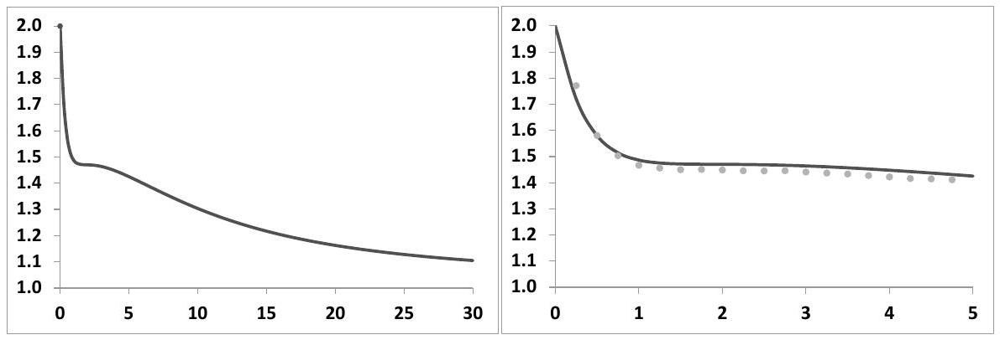
Figure 9.1: The SSR of the two-factor model, computed with formula (9.20) and parameters in Table 8.2, page 329. Left: maturities up to 30 years - right: zoom on maturities less than 5 years. The dots are the result of a Monte Carlo evaluation of the SSR - see Section 9.8 below.

$\mathcal{R}_{T}$, computed using (9.21), appears in Figure 9.1, as a function of $T$.
Consider first the left-hand graph. The short-maturity limit of the SSR is 2 , as shown in Section 9.3. As $T \rightarrow \infty$, the SSR tends to 1 - as it should. Notice however the shoulder for a value of the SSR around 1.5, which appears in more detail in the right-hand graph. The SSR for maturities from 1 to 5 years is stable around 1.5. For this range of maturities, the model obeys the Type II scaling rules in (9.36): the value of the SSR is 2 minus the characteristic exponent of the decay of the ATMF skew in our case $\frac{1}{2}$.

Note in the right-hand graph how the approximate expression (9.16b), obtained at order one in volatility of volatility, agrees well with the actual value of the SSR.

Another example is shown in Figure 9.2: here we have chosen $\rho_{S X^{1}}, \rho_{S X^{2}}$ so that the ATMF skew decays approximately with a characteristic exponent equal to 0.3 for maturities up to 5 years (left-hand graph). As the right-hand side graph shows, we get an SSR around 1.7, i.e. $2-0.3$ over this range. ${ }^{3}$

Formula (9.16b) for the SSR has been derived for a flat term structure of VS volatilities. When this is not the case, the prefactor $\xi^{u} \sqrt{\xi^{t}}$ in expression (8.50), page 327, for $\mu(t, u, \xi)$ in the two-factor model is not constant and, at order one in volatility of volatility, both the numerator and denominator of $\mathcal{R}_{T}$ have to be calculated by numerical integration.

The SSR thus depends on the term structure of VS volatilities. For example, for a VS term structure that increases (decreases) from $20 \%$ to $25 \%$ for $T=1$ year, the SSR for this maturity is 1.46 (1.50). Let us take $T=5$ years; for a VS term structure that increases (decreases) from $20 \%$ to $30 \%$, the SSR is 1.43 (1.49). These values

[^140]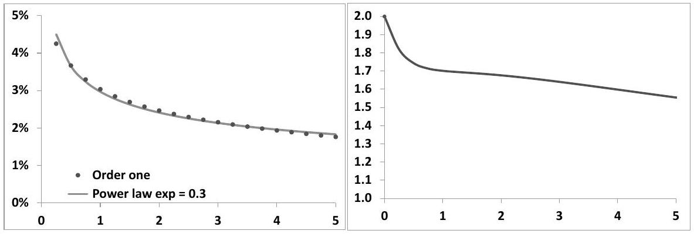
Figure 9.2: Left: The ATMF skew measured as the difference of implied volatilities for strikes $0.95 F_{T}$ and $1.05 F_{T}$ at order one in volatility of volatility (dots, formula (9.16a)) and a power law benchmark with exponent 0.3 (line). Right: the SSR at order one for maturities up to 5 years computed with expression (9.16b). The parameters are those of Table 8.1, with $\rho_{S X^{1}}=-35 \%, \rho_{S X^{2}}=-83 \%$.

are obtained in a Monte Carlo simulation of the two-factor model - see Section 9.8 below - with the same parameters as in Figure 9.1. For all practical purposes, the accuracy of formula (9.16b) for $\mathcal{R}_{T}$ is thus adequate as long as VS term structures are not too steep.

The definition of the SSR in (9.3) involves in the denominator the instantaneous variance of $S$ at $t=0$. In case short VS volatilities are, say, substantially larger than longer-dated ones, we get a smaller value for the SSR than that given by expression (9.16b). For the purpose of evaluating the SSR at $t=0$, approximation (9.16b) is thus incorrect.

However, it is the average level of spot/volatility covariance generated by the model up to the maturity of our exotic option, rather than its particular value at $t=0$, that is practically relevant. It is then advisable to replace the short-dated variance in the denominator of (9.3) with the square of the VS volatility for maturity $T$. Approximation (9.16b) is then almost exact.

In conclusion, while the two-factor model is strictly speaking a Type I model, by suitably choosing parameters we obtain Type II scaling for a range of maturities that is practically relevant. For these maturities we are able to generate a decay of the ATMF skew with an exponent less than 1 and the relationship between $\mathcal{S}_{T}$ and $\mathcal{R}_{T}$ in (9.13) is approximately obeyed.

## Type II scaling in reality

We are able to obtain Type II scaling in a two-factor model, but are actual market smiles consistent with Type II behavior? This is characterized in (9.36) by two features: one static, one dynamic:

- The ATMF skew decays with a non-trivial exponent: $\mathcal{S}_{T} \propto \frac{1}{T^{\gamma}}$ with $\gamma<1$
- The SSR is different than 1 and is related to $\gamma$ : for long maturities $\mathcal{R}_{T} \rightarrow 2-\gamma$

The decay of the ATMF skew of market smiles is consistent with Type II, but what about the SSR? From the expression of the SSR in (9.3) we define the realized SSR as:

$$
\begin{equation*}
\mathcal{R}_{T}^{r}=\frac{\sum_{i} \ln \frac{S_{i+1}}{S_{i}}\left(\widehat{\sigma}_{T, i+1}-\widehat{\sigma}_{T, i}\right)}{\sum_{i} \mathcal{S}_{T, i}\left(\ln \frac{S_{i+1}}{S_{i}}\right)^{2}} \tag{9.22}
\end{equation*}
$$
^eq9-22

where $\widehat{\sigma}_{T, i}$ (resp. $\mathcal{S}_{T, i}$ ) is the ATMF implied volatility (resp. ATMF skew) at time $i$ for residual maturity $T$.
$\mathcal{R}_{T}^{r}$ for $T=2$ years is shown in Figure 9.3 for the Euro Stoxx 50 and S\&P 500 indexes. We have used for simplicity ATM rather than ATMF volatilities.

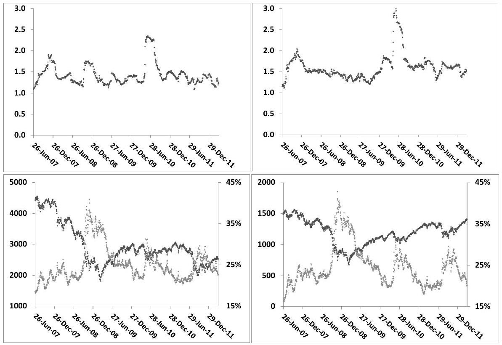
Figure 9.3: Top: 3-months realized SSR $\left(\mathcal{R}_{T}^{r}\right)$ for the Euro Stoxx 50 (left) and S\&P 500 (right) indexes, for $T=2$ years. Bottom: the underlying (dark dots, left axis) and 2-year ATM implied volatility (lighter dots, right axis).

For both indexes, the realized SSR hovers around 1.5, with occasional spikes generated by simultaneous and opposite moves of $S$ and $\widehat{\sigma}_{F_{T}(S) T}$. The magnitude of the spikes and of the fluctuations around 1.5 is not relevant; it would be larger (resp. smaller) had we estimated $\mathcal{R}_{T}^{r}$ on a shorter (resp. longer) window than 3 months the duration of the spikes is indeed about 3 months. Notice also how similar ATM implied volatilities are for both indexes. Realized values for the SSR for longer-dated maturities - say $T=5$ years - are comparable to the 2 -year case.

In conclusion, the dynamics of equity market smiles is consistent with Type II behavior: $\mathcal{S}_{T} \propto \frac{1}{T^{\gamma}}$ with $\gamma<1$ and for large $T, \gamma+\mathcal{R}_{T}$ is approximately equal to 2 .

### 9.8 Numerical evaluation of the SSR

At order one in volatility of volatility, for the sake of computing the SSR the ATMF volatility can be substituted with the VS volatility and this leads to the analytic expression (9.16a) for a flat term structure of VS volatilities.

Generally, however, the SSR can be easily computed numerically. In the twofactor model, the ATMF volatility is a function of $X^{1}, X^{2}$. At $t=0$ :

$$
\widehat{\sigma}_{F_{T} T} \equiv \widehat{\sigma}_{F_{T} T}\left(X_{0}^{1}, X_{0}^{2}\right)
$$

Expanding at first order in $d X^{1}, d X^{2}$ :

$$
d \widehat{\sigma}_{F_{T} T}=\frac{d \widehat{\sigma}_{F_{T} T}}{d X^{1}} d X^{1}+\frac{d \widehat{\sigma}_{F_{T} T}}{d X^{2}} d X^{2}
$$

From the definition of the SSR in (9.3) and using that $E\left[\left(d \ln S_{t}\right)^{2}\right]=\xi_{0}^{0} d t$, $E\left[d \ln S_{t} d X_{t}^{1}\right]=\rho_{S X^{1}} \sqrt{\xi_{0}^{0}} d t$ and likewise for $X^{2}$, we get:

$$
\mathcal{R}_{T}=\frac{1}{\mathcal{S}_{T}} \frac{E\left[d \ln S d \widehat{\sigma}_{F_{T} T}\right]}{E\left[(d \ln S)^{2}\right]}=\frac{1}{\mathcal{S}_{T}} \frac{1}{\sqrt{\xi_{0}^{0}}}\left(\frac{d \widehat{\sigma}_{F_{T} T}}{d X^{1}} \rho_{S X^{1}}+\frac{d \widehat{\sigma}_{F_{T} T}}{d X^{2}} \rho_{S X^{2}}\right)
$$

Thus $\mathcal{R}_{T}$ can be simply evaluated numerically by computing $\widehat{\sigma}_{F_{T} T}$ with two different initial values for $(X, Y)$ :

$$
\mathcal{R}_{T} \simeq \frac{1}{\mathcal{S}_{T}} \frac{1}{\sqrt{\xi_{0}^{0}}} \frac{\widehat{\sigma}_{F_{T} T}\left(X_{0}^{1}+\varepsilon \rho_{S X^{1}}, X_{0}^{2}+\varepsilon \rho_{S X^{2}}\right)-\widehat{\sigma}_{F_{T} T}\left(X_{0}^{1}, X_{0}^{2}\right)}{\varepsilon}
$$

with $\varepsilon$ a small offset. Typically we take $X_{0}^{2}=X_{0}^{1}=0$.
In stochastic volatility models defined by the dynamics of the instantaneous variance $V_{t}$, the SSR is simply computed by shifting $V$ as volatilities for a fixed moneyness are a function of $V$. For example, in the Heston model, using the notations of Chapter 6, $\mathcal{R}_{T}$ is simply given by:

$$
\mathcal{R}_{T} \simeq \frac{1}{\mathcal{S}_{T}} \frac{\widehat{\sigma}_{F_{T} T}(V+\varepsilon \rho \sigma)-\widehat{\sigma}_{F_{T} T}(V)}{\varepsilon}
$$

### 9.9 The SSR for short maturities

In both Type I and Type II models the short-maturity limit of the SSR is 2 .

In a stochastic volatility model, in the limit $T \rightarrow 0$, the VS and ATM volatilities are identical. We will thus use the notation $\widehat{\sigma}_{0}$ for both.

From the expression of the SSR in (9.3), in the special case of vanishing maturities, we can derive two definitions of the realized SSR according to whether we choose:

- the realized value of the instantaneous variance $\left(\ln \frac{S_{i+1}}{S_{i}}\right)^{2}$
- or the implied value of the realized variance $\widehat{\sigma}_{T, i}^{2} \Delta t$
in the denominator of (9.3).
For reasons that will be clearer shortly, we choose the second convention. For small $T$ we define $\mathcal{R}_{T}^{r \text {,short }}$ as:

$$
\begin{equation*}
\mathcal{R}_{T}^{r, \text { short }}=\frac{\sum_{i} \ln \frac{S_{i+1}}{S_{i}}\left(\widehat{\sigma}_{T, i+1}-\widehat{\sigma}_{T, i}\right)}{\Delta t \sum_{i} \mathcal{S}_{T, i} \widehat{\sigma}_{T, i}^{2}} \tag{9.23}
\end{equation*}
$$
^eq9-23

where $\Delta t$ is the duration of one (trading) day.
$\mathcal{R}_{T}^{r}$ for $T=1$ month is shown in Figure 9.4 for the Euro Stoxx 50 and S\&P 500 indexes.

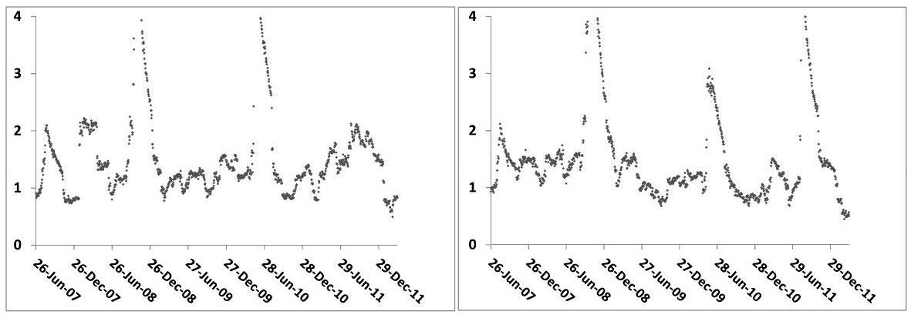
Figure 9.4: 3-months realized SSR $\left(\mathcal{R}_{T}^{r}\right)$ for the Euro Stoxx 50 (left) and S\&P 500 (right) indexes, for $T=1$ month.

The average value of $\mathcal{R}_{T}^{r}$ is substantially lower than the model-independent "implied" value of 2 . Does this point to a discrepancy between the dynamics of stochastic models and the dynamics of market smiles?

Consider the example of realized and implied volatilities - typically, for equity indexes, VS implied volatilities are systematically higher on average than realized volatilities. This in itself does not signal a modeling inconsistency. What is important is that the difference between both volatilities can be materialized as the P\&L of an option position - here a VS.

The natural question is thus: is it possible to materialize the difference $2-\mathcal{R}_{T}^{r}$ as the P\&L of an option position?

### 9.10 Arbitraging the realized short SSR

The SSR expresses the implied spot/volatility covariance in units of the ATMF skew. Arbitraging $\mathcal{R}_{T}^{r, \text { short }}$ entails being able to materialize this covariance as a P\&L. In what follows we set $T=1$ month and assume zero interest rate and repo for simplicity.

To single out the realized spot/volatility covariance as a carry P\&L we riskmanage our option position using the lognormal model of Section 8.5.1. In the limit $T \rightarrow 0$ the variance curve collapses to a single volatility $\widehat{\sigma}_{0}$.

Since any stochastic volatility model calibrated to the market smile yields the same implied value for the instantaneous covariance of $S$ and $\widehat{\sigma}_{0}$ we could use any dynamics for $\widehat{\sigma}_{0}$. However, in the lognormal model the short ATM skew is independent on $\widehat{\sigma}_{0}$, a property that is also approximately shared by market smiles.

Choosing the lognormal model for risk-managing our option position then reduces chances that the mark-to-market P\&L generated by remarking the ATM skew to market is large.

### 9.10.1 Risk-managing with the lognormal model

Consider the limit $T \rightarrow 0$ in the pricing equation (8.1): $P$ becomes a function of $t, S, \widehat{\sigma}_{0}: P(t, S, \xi) \equiv P\left(t, S, \widehat{\sigma}_{0}\right)$. In the lognormal model for the instantaneous volatility the pricing equation is given by:

$$
\begin{equation*}
\frac{d P}{d t}+\frac{\widehat{\sigma}_{0}^{2}}{2} S^{2} \frac{d^{2} P}{d S^{2}}+\frac{\nu^{2}}{2} \widehat{\sigma}_{0}^{2} \frac{d^{2} P}{d \widehat{\sigma}_{0}^{2}}+\rho \nu \widehat{\sigma}_{0}^{2} S \frac{d^{2} P}{d S d \widehat{\sigma}_{0}}=0 \tag{9.24}
\end{equation*}
$$
^eq9-24

where $\nu$ is the (lognormal) volatility of $\widehat{\sigma}_{0}$ and $\rho$ the correlation of $\widehat{\sigma}_{0}$ with $S$.
We have derived in Section 8.5.1 the smile at order two in volatility of volatility, in the limit $T \rightarrow 0$. At this order, expressions (8.39a) and (8.39b) for the ATM skew and curvature yield the following expression for the price of a vanilla option of strike $K$, maturity $T$ :

$$
\begin{align*}
P & =P_{B S}(t, S, \widehat{\sigma}(x), K, T)  \tag{9.25a}\\
\widehat{\sigma}(x) & =\widehat{\sigma}_{0}+\mathcal{S} x+\frac{\mathcal{C}}{2} x^{2} \tag{9.25b}
\end{align*}
$$
^eq9-25a
^eq9-25b

where $P_{B S}$ is the Black-Scholes formula, $x=\ln \left(\frac{K}{S}\right)$ and $\mathcal{S}, \mathcal{C}$ are given by:

$$
\mathcal{S}=\frac{\rho \nu}{2} \quad \mathcal{C}=\frac{2-3 \rho^{2}}{6 \widehat{\sigma}_{0}} \nu^{2}
$$

For a market smile of the form (9.25b) $\rho, \nu$ are given by:

$$
\begin{equation*}
\rho=\frac{2 \mathcal{S}}{\sqrt{3 \hat{\sigma}_{0} \mathcal{C}+6 \mathcal{S}^{2}}} \quad \nu=\sqrt{3 \hat{\sigma}_{0} \mathcal{C}+6 \mathcal{S}^{2}} \tag{9.26}
\end{equation*}
$$
^eq9-26

In the limit $T \rightarrow 0, \mathcal{S}$ and $\mathcal{C}$, derived at order two in volatility of volatility, do not depend on $T$ and the ATM implied volatility is identical to the VS volatility. This identity is exact; indeed consider a diffusive model whose instantaneous volatility at $t=0$ is $\sigma$. Using expression (8.64) with $\widehat{\sigma}=0$, the price of a European option whose payoff is $f(S)$ is given, at order one in $T$ by: $P=f\left(S_{0}\right)+\frac{\sigma^{2} T}{2} S_{0}^{2} \frac{d^{2} f}{d S_{0}^{2}}$ where $S_{0}$ is the spot value at $t=0$. Denote now by $\widehat{\sigma}$ the implied volatility of this option. At order one in $T, \widehat{\sigma}$ is such that $P=f\left(S_{0}\right)+\frac{\widehat{\sigma}^{2} T}{2} S_{0}^{2} \frac{d^{2} f}{d S_{0}^{2}}$. This yields $\widehat{\sigma}=\sigma$ : the implied volatilities of all European payoffs $f$ such that $\frac{d^{2} f}{d S_{0}^{2}} \neq 0$ are identical, and equal to the instantaneous volatility. ${ }^{4}$

Consider now a long position in a delta-hedged European option, risk-managed with the lognormal model. We will calibrate $\mathcal{S}, \mathcal{C}$ - or equivalently $\rho, \nu-$ to the market smile near the money on a daily basis. Denote by $\Pi\left(t, S, \widehat{\sigma}_{0}, \mathcal{S}, \mathcal{C}\right)$ the value of our European option position. We do not consider for now the mark-to-market $\mathrm{P} \& \mathrm{~L}$ generated by a change of $\mathcal{S}, \mathcal{C}$ - or equivalently of $\rho, \nu-$ and instead focus on the carry P\&L. This P\&L during $\delta t$, at order one in $\delta t$ and two in $\delta S$ and $\delta \widehat{\sigma}_{0}$, is given by:

$$
\begin{equation*}
P \& L=\frac{d \Pi}{d t} \delta t+\frac{d \Pi}{d \widehat{\sigma}_{0}} \delta \widehat{\sigma}_{0}+\frac{1}{2} \frac{d^{2} \Pi}{d S^{2}} \delta S^{2}+\frac{1}{2} \frac{d^{2} \Pi}{d \widehat{\sigma}_{0}^{2}}\left(\delta \widehat{\sigma}_{0}\right)^{2}+\frac{d^{2} \Pi}{d S d \widehat{\sigma}_{0}} \delta S \delta \widehat{\sigma}_{0} \tag{9.27}
\end{equation*}
$$
^eq9-27

While the delta hedge removes the term in $\delta S$, there remains a contribution in $\delta \widehat{\sigma}_{0}$ as we are not vega-hedged.

Using (9.24), at order one in $\delta t$ and two in $\delta S$ and $\widehat{\sigma}_{0}$ our $\mathrm{P} \& \mathrm{~L}$ is given by:

$$
\begin{align*}
P \& L= & \frac{d \Pi}{d \widehat{\sigma}_{0}} \delta \widehat{\sigma}_{0}  \tag{9.28a}\\
& +\frac{1}{2} S^{2} \frac{d^{2} \Pi}{d S^{2}}\left(\left(\frac{\delta S}{S}\right)^{2}-\widehat{\sigma}_{0}^{2} \delta t\right)+\frac{1}{2} \widehat{\sigma}_{0}^{2} \frac{d^{2} \Pi}{d \widehat{\sigma}_{0}^{2}}\left(\left(\frac{\delta \widehat{\sigma}_{0}}{\widehat{\sigma}_{0}}\right)^{2}-\nu^{2} \delta t\right)  \tag{9.28b}\\
& +S \widehat{\sigma}_{0} \frac{d^{2} \Pi}{d S d \widehat{\sigma}_{0}}\left(\frac{\delta S}{S} \frac{\delta \widehat{\sigma}_{0}}{\widehat{\sigma}_{0}}-\rho \nu \widehat{\sigma}_{0} \delta t\right) \tag{9.28c}
\end{align*}
$$
^eq9-28a
^eq9-28b
^eq9-28c

From (9.25b) the ATMF skew $\mathcal{S}$ is $\frac{\rho \nu}{2}$ - this is equivalent to the statement $\mathcal{R}_{T=0}=2$. The last piece ( 9.28 c ) can thus be rewritten as:

$$
\begin{align*}
S \widehat{\sigma}_{0} \frac{d^{2} \Pi}{d S d \widehat{\sigma}_{0}}\left(\frac{\delta S}{S} \frac{\delta \widehat{\sigma}_{0}}{\widehat{\sigma}_{0}}-\rho \nu \widehat{\sigma}_{0} \delta t\right) & =S \widehat{\sigma}_{0} \frac{d^{2} \Pi}{d S d \widehat{\sigma}_{0}}\left(\frac{\delta S}{S} \frac{\delta \widehat{\sigma}_{0}}{\widehat{\sigma}_{0}}-2 \mathcal{S} \widehat{\sigma}_{0} \delta t\right) \\
& =S \widehat{\sigma}_{0}^{2} \mathcal{S} \frac{d^{2} \Pi}{d S d \widehat{\sigma}_{0}}\left(\frac{\frac{\delta S}{S} \delta \widehat{\sigma}_{0}}{\mathcal{S} \widehat{\sigma}_{0}^{2} \delta t}-2\right) \delta t  \tag{9.29a}\\
& =S \widehat{\sigma}_{0}^{2} \mathcal{S} \frac{d^{2} \Pi}{d S d \widehat{\sigma}_{0}}\left(\mathcal{R}_{T=0}^{r, \text { short }}-2\right) \delta t \tag{9.29b}
\end{align*}
$$
^eq9-29a
^eq9-29b

[^141]From (9.29a) it is apparent that, in defining the realized SSR, the short implied - rather than the realized - variance should be used in the denominator, in the definition of $\mathcal{R}_{T}^{r \text {,short }}$, hence expression (9.23) for $\mathcal{R}_{T}^{r \text {,short }}$.

### 9.10.2 The realized skew

The P\&L above can be equivalently expressed as a difference between the implied skew $\mathcal{S}$ and the instantaneous realized skew $\mathcal{S}^{r}$ which we define as:

$$
\begin{equation*}
\mathcal{S}^{r}=\frac{1}{2 \widehat{\sigma}_{0} \delta t} \frac{\delta S}{S} \frac{\delta \widehat{\sigma}_{0}}{\widehat{\sigma}_{0}}=\left(\frac{\mathcal{R}_{T=0}^{r, \text { short }}}{2}\right) \mathcal{S} \tag{9.30}
\end{equation*}
$$
^eq9-30

Expression (9.30) shows that the relative mismatch of realized to implied skew is equal to that of realized to implied SSR. The cross gamma/theta P\&L 9.29b reads:

$$
\begin{equation*}
2 S \widehat{\sigma}_{0}^{2} \frac{d^{2} \Pi}{d S d \widehat{\sigma}_{0}}\left(\mathcal{S}^{r}-\mathcal{S}\right) \delta t \tag{9.31}
\end{equation*}
$$
^eq9-31

Note that the P\&L in (9.28) is not the total P\&L incurred on our option position. Additional P\&L is generated by daily recalibration of $\mathcal{S}$ and $\mathcal{C}$. Only if this P\&L is small and if the contributions in (9.28a) and (9.28b) are vanishing or negligible are we able to isolate the P\&L of interest (9.29b) or equivalently (9.31).

### 9.10.3 Splitting the theta into three pieces

Expression (9.25a) for $P$ is correct at order two in volatility of volatility: $P$ does not exactly solve (9.24). Can we still use (9.25a) for P\&L accounting? (9.24) expresses that the theta $\frac{d P}{d t}$ can be broken up in three pieces which match each of the second-order gamma contributions in (9.28).

In our model theta is equal to the Black-Scholes theta since $\widehat{\sigma}(x)$ in (9.25b) does not depend on $T$. In the Black-Scholes model all of the theta is ascribed to the spot gamma - the second piece in the right-hand side of (9.28) - with a break-even level, the implied volatility, which is strike-dependent. In contrast, in the stochastic volatility model we are using, this theta is distributed across three gammas with break-even levels that are not strike-dependent. Checking whether (9.24) holds amounts to checking how well the following equality holds

$$
\begin{equation*}
\frac{\widehat{\sigma}(x)^{2}}{2} S^{2} \frac{d^{2} P_{B S}}{d S^{2}}=\frac{\widehat{\sigma}_{0}^{2}}{2} S^{2} \frac{d^{2} P}{d S^{2}}+\frac{\nu^{2}}{2} \widehat{\sigma}_{0}^{2} \frac{d^{2} P}{d \widehat{\sigma}_{0}^{2}}+\rho \nu \widehat{\sigma}_{0}^{2} S \frac{d^{2} P}{d S d \widehat{\sigma}_{0}} \tag{9.32}
\end{equation*}
$$
^eq9-32

where the three contributions in the right-hand side are called, respectively: spot theta, vol theta, cross theta.

Let us take the typical example of a one-month maturity smile with $\widehat{\sigma}_{0}= 20 \%, \mathcal{S}=-0.7, \mathcal{C}=0.4$. With these parameters, the implied volatilities of the $90 \%, 100 \%, 110 \%$ strikes are, respectively, $27.6 \%, 20 \%, 13.5 \%$. From (9.26) we have: $\rho=-78.5 \%, \nu=178.3 \%$.

Figure 9.5 shows on the left the three thetas as a function of $K$, for $S=100$. The sum of these three thetas, along with the Black-Scholes theta - the left-hand side of (9.32) where a different implied volatility is used for each strike - is shown on the right.

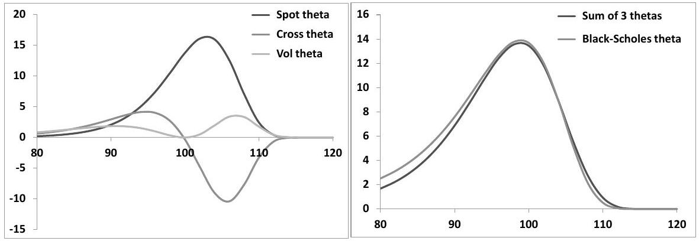
Figure 9.5: Left: the three terms in the right-hand side of (9.32) as a function of $K$, for $S=100$. Right: the sum of the three thetas compared to the Black-Scholes theta $\frac{\widehat{\sigma}(x)^{2}}{2} S^{2} \frac{d^{2} P_{B S}}{d S^{2}}$.

As we can see our approximation applied to the lognormal model does a decent job at splitting the Black-Scholes theta in three pieces, whose break-even levels are independent on the option's strike. The three thetas do not exactly add up to the Black-Scholes theta for strikes far out of the money, but the agreement is satisfactory for strikes between $95 \%$ and $105 \%$, which is the range we use in our tests.

As is clear from Figure 9.5, the spot theta dominates by far - as our objective is to isolate the cross theta, we need to ensure that the spot theta of our position vanishes. The vol theta, on the other hand, is much smaller and almost cancels for a spread position.

### 9.10.4 Backtesting on the Euro Stoxx 50 index

We now use historical implied volatilities of the Euro Stoxx 50 index from April 2007 to March 2012 to backtest the following dynamical option trading strategy. We sell one-month options of strike $95 \%$ and buy the appropriate number of onemonth options of strike $105 \%$ so that the spot gamma vanishes. We delta-hedge this position until the next (trading) day, when it is unwound and a new position is started. In order to approximately maintain a constant level of cross-gamma, we trade a constant notional - $100 €-$ of the $95 \%$-strike option. For typical levels of 1 -month market skew, for one $95 \%$ option sold, we need to buy about 0.5 options of strike $105 \%$.

We use daily one-month implied volatilities for strikes $95 \%, 100 \%, 105 \%$ to determine the skew $\mathcal{S}$ and curvature $\mathcal{C}$ and back out $\rho$ and $\nu$ using (9.26). These, together with the ATM volatility $\widehat{\sigma}_{0}$, are fed to the lognormal model which we use
(a) to determine the ratio of the $105 \%$ options to $95 \%$ options, (b) to compute the delta.

Calibrated values of $\mathcal{S}$ (multiplied by -10 ) and $\mathcal{C}$ appear in the left-hand graph of Figure 9.6. $\mathcal{C}$ is very noisy - indeed over the strike range [ $95 \%, 105 \%$ ], the one-month smile is almost a straight line: in our tests we thus set the product $\mathcal{C}$ equal to $\frac{2}{\widehat{\sigma}_{0}}-$ the precise value of $\mathcal{C}$ used hardly affects our results since we only use $95 \%$ and 105\% strikes.

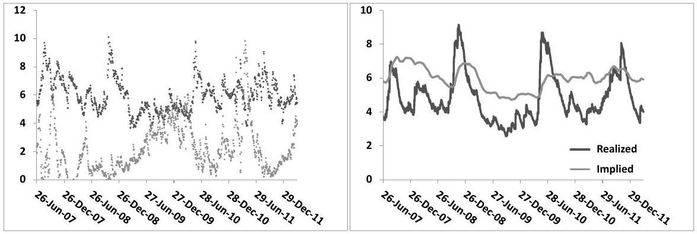
Figure 9.6: Left: daily values of skew $\mathcal{S}$ (darker dots) and curvature $\mathcal{C}$ (lighter dots) of one-month smiles of the Euro Stoxx 50 index. Right: 3-months exponentially weighted moving averages of the implied ATM skew $\mathcal{S}$ and its realized counterpart $\mathcal{S}^{\text {real }}$ for a one-month maturity - see (9.30). Values of $\mathcal{S}$ in both graphs, and of $\mathcal{S}^{\text {real }}$ have been multiplied by -10 to correspond approximately to the $95 \% / 105 \%$ skew in volatility points.

The right-hand graph shows the implied and realized 1 -month skew for the Euro Stoxx 50 index. In our historical sample, the average value of the implied $95 \% / 105 \%$ skew is 6 points of volatility, while the average value of its realized counterpart defined in (9.30) - is 4.8 points; this is $20 \%$ less than its implied counterpart.

Consequently, from (9.30), the average value of the realized SSR is about $20 \%$ lower than its implied value of 2 ; this agrees with the average value of realized SSR in Figure 9.4.

Our daily P\&L between day $i$ and day $i+1$ is very plainly given by:

$$
\begin{aligned}
P \& L_{\text {Total }} & =\left[\Pi_{i}\left(t_{i+1}, S_{i+1}, \widehat{\sigma}_{0 i+1}, \mathcal{S}_{i+1}, \mathcal{C}_{i+1}\right)-\Pi_{i}\left(t_{i}, S_{i}, \widehat{\sigma}_{0 i}, \mathcal{S}_{i}, \mathcal{C}_{i}\right)\right] \\
& -\frac{d \Pi_{i}}{d S_{i}}\left(S_{i+1}-S_{i}\right)
\end{aligned}
$$

where $\Pi_{i}$ is the market value of the option portfolio purchased at time $t_{i}$. This P\&L can be broken down in three contributions:

$$
P \& L_{\text {Total }}=P \& L_{\text {Carry }}^{\text {vega-hedged }}+P \& L_{\text {Vega }}+P \& L_{\text {MtM }}^{\mathcal{S}, \mathcal{C}}
$$

where:

$$
\begin{aligned}
P \& L_{\text {Carry }}^{\text {vega-hedged }} & =\left[\Pi_{i}\left(t_{i+1}, S_{i+1}, \widehat{\sigma}_{0 i+1}, \mathcal{S}_{i}, \mathcal{C}_{i}\right)-\Pi_{i}\left(t_{i}, S_{i}, \widehat{\sigma}_{0 i}, \mathcal{S}_{i}, \mathcal{C}_{i}\right)\right] \\
& -\frac{d \Pi_{i}}{d S_{i}}\left(S_{i+1}-S_{i}\right)-\frac{d \Pi_{i}}{d \widehat{\sigma}_{0 i}}\left(\widehat{\sigma}_{0 i+1}-\widehat{\sigma}_{0 i}\right) \\
P \& L_{\text {Vega }} & =\frac{d \Pi_{i}}{d \widehat{\sigma}_{0 i}}\left(\widehat{\sigma}_{0 i+1}-\widehat{\sigma}_{0 i}\right) \\
P \& L_{\text {MtM }}^{\mathcal{S}, \mathcal{C}} & =\Pi_{i}\left(t_{i+1}, S_{i+1}, \widehat{\sigma}_{0 i+1}, \mathcal{S}_{i+1}, \mathcal{C}_{i+1}\right)-\Pi_{i}\left(t_{i+1}, S_{i+1}, \widehat{\sigma}_{0 i+1}, \mathcal{S}_{i}, \mathcal{C}_{i}\right)
\end{aligned}
$$

$P \& L_{\mathrm{MtM}}^{\mathcal{S}, \mathcal{C}}$ is the mark-to-market $\mathrm{P} \& \mathrm{~L}$ generated by recalibrating $\mathcal{S}$ and $\mathcal{C}$ to the market smile at time $t_{i+1}$.

At order one in ( $t_{i+1}-t_{i}$ ) and order two in ( $S_{i+1}-S_{i}$ ) and ( $\widehat{\sigma}_{0 i+1}-\widehat{\sigma}_{0 i}$ ), $P \& L_{\text {Carry }}^{\text {Vega-hedged }}$ is the sum of the three gamma/theta contributions in (9.28b) and $(9.28 \mathrm{c})$.

Our option position has vanishing spot gamma by construction. Moreover, inspection of the left-hand graph of Figure 9.5 suggests that the volatility gamma/theta P\&L is small: ideally P\&L (9.28b) will be negligible so that $P \& L_{\text {Carry }}^{\text {Vega-hedged }}$ closely tracks the quantity of interest, that is the cross-gamma/theta P\&L (9.28c) which we aim to single out. Our $\mathrm{P} \& \mathrm{~L}$ is however polluted by the contributions of $P \& L_{\mathrm{MtM}}^{\mathcal{S}, \mathcal{C}}$ and $P \& L_{\text {Vega }}$.

How well $\left(P \& L_{\text {Carry }}^{\text {vega-hedged }}+P \& L_{\text {MtM }}^{\mathcal{S}, \mathcal{C}}\right)$, that is $\left(P \& L_{\text {Total }}-P \& L_{\text {Vega }}\right)$ correlates to the cross-gamma/theta $\mathrm{P} \& \mathrm{~L}$ is assessed in the left-hand graph of Figure 9.7.

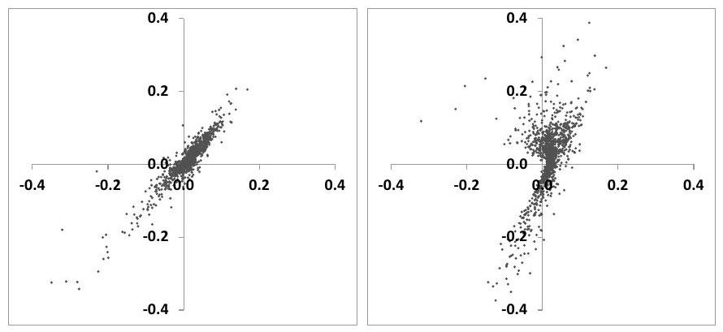
Figure 9.7: Scatter plots of daily values of $P \& L_{\text {Total }}-P \& L_{\text {Vega }}$ (left-hand graph) and $P \& L_{\text {Total }}$ (right-hand graph) as a function of $\mathrm{P} \& \mathrm{~L}(9.28 \mathrm{c})$.

$P \& L_{\mathrm{MtM}}^{\mathcal{S}, \mathcal{C}}$ contributes in fact little noise; the reason we do not get a straight line is mostly due to higher-order terms in $P \& L_{\text {Carry }}^{\text {vega-hedged }}$. Still, the total daily P\&L corrected for the vega contribution captures the daily cross gamma/theta P\&L with acceptable accuracy.

Inclusion of the vega contribution - see right-hand graph - reduces the correlation of both P\&Ls but, as we will now see, the cumulative vega P\&L is small enough that our strategy's P\&L is still mostly attributable to the cross gamma/theta P\&L.

Figure 9.8 shows the cumulative P\&Ls of our arbitrage strategy. That the bulk of the P\&L is contributed by the cross gamma/theta P\&L is manifest.

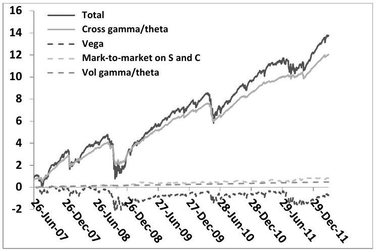
Figure 9.8: Cumulative P\&Ls of the realized skew arbitrage strategy.

The volatility gamma/theta $\mathrm{P} \& \mathrm{~L}$, as well $P \& L_{\mathrm{MtM}}^{\mathcal{S}, \mathcal{C}}$ and $P \& L_{\mathrm{Vega}}$, are both small, even though the latter is very noisy. As a rule, sharp market moves generate simultaneous downward moves of the spot and upward moves of implied volatilities. Our gamma-neutral position has negative vega. On these days, our option position loses money both because of our positive cross-gamma and negative vega positions: this is confirmed by the simultaneous drops in the cumulative cross gamma/theta and vega P\&Ls in Figure 9.8. These drops indeed coincide with peaks of the realized skew seen in Figure 9.6.

Remember that in our historical sample the realized ATM skew is on average $20 \%$ lower than the implied ATM skew - or equivalently that the realized SSR is $20 \%$ lower than its model-independent value of 2 . Our position has vanishing spot gamma; moreover Figure 9.8 shows that the volatility gamma/theta P\&L is small. Thus, almost all of the theta is generated by the cross theta. The cumulative theta P\&L of our strategy is $45.7 € .20 \%$ of this, that is about $9 €$ is a number that is indeed consistent with the cumulative cross gamma/theta P\&L.

### 9.10.5 The "fair" ATMF skew

In conclusion, just as the difference between realized and implied volatility can be arbitraged - that is materialized as the P\&L of an option strategy - for short maturities, the difference between the realized value of the SSR and its modelindependent value of 2 - or equivalently the difference between the realized ATM skew and the implied ATM skew - can be materialized, to a good approximation, as the P\&L of a dynamical option strategy. ${ }^{5}$

[^142]There is then no inconsistency in the fact that $\mathcal{R}^{\text {real }}<2$. The short ATM skew quantifies the implied value of the instantaneous spot/volatility covariance, which may differ from its realized value. In our sample, it is on average $20 \%$ lower than its implied counterpart. Our trading strategy approximately materializes this difference as a P\&L.

We have shown that this is equivalent to materializing as a P\&L the difference between implied skew and realized skew:

$$
\mathcal{S}^{r}=\frac{1}{2 \widehat{\sigma}_{0} \delta t}\left\langle\frac{\delta S}{S} \frac{\delta \widehat{\sigma}_{0}}{\widehat{\sigma}_{0}}\right\rangle
$$

Note that the fair level of the ATM skew is not determined by the covariance of the spot and realized volatility; rather it is given by the covariance of spot and ATM implied volatility, a circumstance that may surprise at first.

Imagine there is no options' market - our only hedge instrument is the underlying itself - and we are asked to quote "fair" vanilla option prices, "fair" meaning that we do not make or lose money on average. We then need to model the process of the instantaneous historical realized variance - or equivalently the process of expected future historical variances, that is forward variances. We use pricing equation (7.4), which expresses that, on average no money is made or lost as we delta-hedge our option. The only difference now is that $\xi^{\tau}$ is no longer a market VS forward variance, but instead the expected future realized instantaneous variance. ${ }^{6}$

The results of Chapter 8 apply: at order one in volatility of volatility the "fair" ATM skew is given by the weighted integral of the historical covariance of spot and future (expected) realized variance. ${ }^{7}$

Now assume that there exists instead a market of ATM options - or variance swaps. Just as in the above backtest, we use these options to cancel the spot gamma, thus removing the sensitivity to realized volatility.

Since the vanilla hedge has to be dynamically readjusted, our position becomes sensitive to the joint dynamics of the spot and implied volatilities. Practically, this is

[^143]materialized, at order one in volatility of volatility, as the cross gamma of spot and implied volatility.

### 9.10.6 Relevance of model-independent properties

It is not clear that other model-independent properties can be established, without resorting to more or less reasonable additional assumptions. For example, Peter Carr and Roger Lee show in [27] that if implied volatilities of power payoffs ${ }^{8}$ are uncorrelated with the spot process, the density of the realized quadratic variation up to $T$ can be extracted from the vanilla smile of maturity $T$, hence payoffs on realized variance can be replicated by dynamical trading in vanilla options.

Are these model-independent rules practically relevant? This is assessed by studying whether a violation of these rules can be arbitraged, i.e. materialized as a P\&L. It is not clear in particular that a violation of (9.13) could be practically arbitraged.

This issue is connected to the general question of the practical relevance of calibration. Our study of the arbitrage of the short SSR is a sobering illustration of how difficult it can be to lock the value of a model parameter - in our case the covariance of spot and ATM implied volatility - by dynamically trading vanilla options.

Only when one is able to do so does it make sense to entrust a model with the task of backing the value of a dynamical parameter out of the vanilla smile.

### 9.11 Conclusion

Because the skew in stochastic volatility models is generated by the covariance of spot and forward variances, some features of the underlying spot/variance dynamics can be recovered from the resulting smile. Provided some reasonable assumptions hold - in particular time homogeneity - for a flat term structure of VS volatilities, at order one in the volatility of volatility, the Skew Stickiness ratio is bounded above and below:

$$
\mathcal{R}_{T} \in[1,2]
$$

We also show that $\mathcal{R}_{T}-$ a quantity that characterizes the model's dynamics - is related to the scaling of the ATMF skew $\mathcal{S}_{T}$ with maturity a static property of the smile. For short maturities, $\mathcal{R}_{T}$ tends to the universal value of 2 . For long maturities its scaling depends on the characteristic exponent $\gamma$ of the underlying

[^144]spot/variance covariance function. Stochastic volatility models fall into one of two classes depending on the value of $\gamma$.

- Type I models are such that $\gamma>1$ : for large $T$, $\mathcal{S}_{T} \propto \frac{1}{T}$ and $\mathcal{R}_{T} \rightarrow 1$
- Type II models are such that $\gamma<1$ : for large $T \mathcal{S}_{T} \propto \frac{1}{T^{\gamma}}$ and $\mathcal{R}_{T} \rightarrow 2-\gamma$

Thus, Type II models allow for a slower decay of the ATMF skew - which is consistent with market skews, for which $\gamma \simeq \frac{1}{2}-$ and a non-trivial value of the longmaturity limit of the SSR, which, again, is compatible with the observed dynamics of market smiles. Moreover, the characteristic exponent of the spot/variance covariance function can be backed out of the scaling of $\mathcal{S}_{T}$ and the long-maturity limit of $\mathcal{R}_{T}$.

This connection between $\mathcal{S}_{T}$ and $\mathcal{R}_{T}$ is a distinguishing feature of timehomogeneous stochastic volatility models - it is summarized by the following formula: for long maturities,

$$
\mathcal{S}_{T} \propto \frac{1}{T^{2-\mathcal{R}_{\infty}}}
$$

In time-homogeneous Jump-Lévy models, by contrast, while for long maturities $\mathcal{S}_{T} \propto \frac{1}{T}, \mathcal{R}_{T}$ vanishes for all $T$.

While putting together a genuine Type II model is difficult - because one needs to reconcile a non-trivial scaling of the spot/variance covariance function with the requirement of a low-dimensional Markov representation - Type II behavior can be achieved for a decent range of maturities in a model driven by simple OrnsteinÜhlenbeck processes.

We have provided evidence that suitable parametrization of a simple two-factor model generates Type II scaling for a range of maturities that is practically relevant - while also enforcing the desired scaling of volatilities of volatilities.

Having analyzed how dynamical properties of spot and time-homogeneous stochastic volatility models are related to the smile they produce, the following questions naturally arise:

- How do they compare with dynamical properties of a local volatility model calibrated to the same smile?
- How do they compare with the realized behavior of spot and implied volatilities?

### 9.11.1 SSR in local and stochastic volatility models - and in reality

The behavior of $\mathcal{R}_{T}$ as a function of $T$ is structurally different in stochastic volatility models than in the local volatility model. In either Type I or Type II stochastic volatility models, the SSR starts from 2, then decreases either towards 1 or towards a non-trivial value in $[1,2]$. In the local volatility model, instead, the SSR

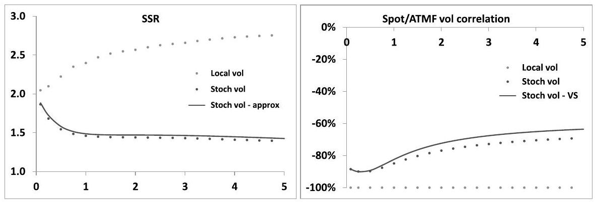
Figure 9.9: Left: the SSR as a function of maturity (years) in the two-factor stochastic volatility model (dark dots) and in the local volatility model (light dots) calibrated on the smile generated by the stochastic volatility model. Parameters in Table 8.2, page 329, have been used. The solid line corresponds to the SSR of the stochastic volatility model calculated using expression (9.21), at order one in volatility of volatility. Right: correlation of spot and ATMF volatilities. The solid line corresponds to the correlation of spot and VS - rather than ATMF - volatilities in the two-factor model, which is easily evaluated exactly.

starts from 2 for short maturities, then increases for longer maturities, for typical equity index smiles - see Figure 2.4, page 59.

This is illustrated in Figure 9.9 We have used the parameters in Table 8.2 and a flat term structure of VS volatilities at $20 \%$ (same parameters as those used in Figure 9.1). The curves in Figure 9.9 are thus obtained with the same vanilla smile - shown in Figure 8.2, page 330, for select maturities.

In both models the SSR starts from the model-independent value of 2 for short maturities. Equivalently, the implied regression coefficient of the short ATMF volatility on the spot is model-independent and given by the ATMF skew.

Parameters in Table 8.2 are such that the ATMF skew approximately decays with the characteristic exponent $\gamma=\frac{1}{2}$. For the longer maturities in our graph, the SSR tends to 1.5 in the stochastic volatility model (approximately $2-\gamma$ ), while for the local volatility model it tends to a value close to 3 .

For a smile such that the ATMF skew decays as a power law, the approximate expression (2.81), page 56, of $\mathcal{R}_{\infty}$ in the local volatility model:

$$
\mathcal{R}_{\infty}=\frac{2-\gamma}{1-\gamma}
$$

indeed yields $\mathcal{R}_{\infty}=3$ for $\gamma=\frac{1}{2}$.

## The spot/ATMF volatility covariance

The SSR is a useful indicator as it measures the implied covariance of $\ln S$ and the ATMF volatility $\widehat{\sigma}_{F_{T} T}$ - in units of the ATMF skew - generated by the pricing
model. Spot/volatility cross-gammas are one of the main risks of exotic equity payoffs. ${ }^{9}$ Rather than directly comparing the implied spot/volatility covariance with its realized counterpart, we can convert the realized covariance of $\ln S$ and $\widehat{\sigma}_{F_{T} T}$ into a realized SSR.

Model-generated and realized SSR can then be compared to assess whether the pricing model is sufficiently conservative.

The realized SSR for the Euro Stoxx 50 and S\&P 500 indexes, for $T=2$ years appear in Figure 9.3 - the estimator for the realized SSR is given by expression (9.22). For both indexes, the average realized SSR is around 1.5. For other indexes, the realized SSR can be very different. Figure 9.10 shows historical values of the realized 6-month value of $\mathcal{R}_{T}$ for $T=1$ year, for the S\&P 500 and Nikkei indexes. While the SSR for the S\&P 500 is fairly stable around 1.5, for the Nikkei it reaches at times very negative values.

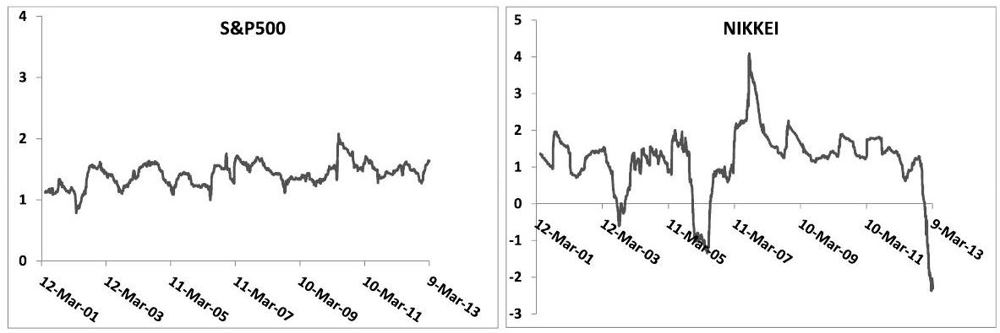
Figure 9.10: The sliding 6-month realized SSR for $T=1$ year, for the S\&P 500 (left) and Nikkei (right) indexes.

The large negative dip of the SSR of the Nikkei at the end of 2012 can be traced to the impact of the vega hedging of autocalls on the liquidity of the Nikkei vanilla option market.

Autocalls ${ }^{10}$ provide the buyer a negative volatility exposure which vanishes when the spot price goes above an upper thereshold, whereupon the option expires. Upon selling an autocall the dealer hedges his/her vega position by selling vanilla

[^145]options. The presence of the upper threshold generates a large spot/volatility crossgamma: as the spot moves up, the dealer needs to buy back vanilla options. In normal circumstances, as the spot moves up, implied volatilities decrease, and the unwinding of the vega hedge should generate on average positive cross-gamma P\&L. This cross-gamma P\&L is offset by a theta contribution which is quantified by the SSR of the pricing model:

$$
\begin{align*}
P \& L & =-S \widehat{\sigma}_{T} \frac{d^{2} \Pi}{d S d \widehat{\sigma}_{T}}\left(\frac{\delta S}{S} \frac{\delta \widehat{\sigma}_{T}}{\widehat{\sigma}_{T}}-\mathcal{R}_{T} \mathcal{S}_{T} \frac{\sigma^{2}}{\widehat{\sigma}_{T}} \delta t\right)  \tag{9.33}\\
& =-S \mathcal{S}_{T} \frac{d^{2} \Pi}{d S d \widehat{\sigma}_{T}}\left(\mathcal{R}_{T}^{r} \sigma_{r}^{2}-\mathcal{R}_{T} \sigma^{2}\right) \delta t
\end{align*}
$$
^eq9-33

Figure 9.9 illustrates how different the SSR of the local volatility model and the SSR of a stochastic volatility model are. When carrying a long spot/volatility crossgamma position, it thus seems preferable to price with the local volatility model, while with a short spot/volatility cross-gamma position, a stochastic volatility model should be used.

We refer the reader to a similar discussion in Section 12.6 of Chapter 12, page 482, in the more general context of mixed local-stochastic volatility models.

### 9.11.2 Volatilities of volatilities

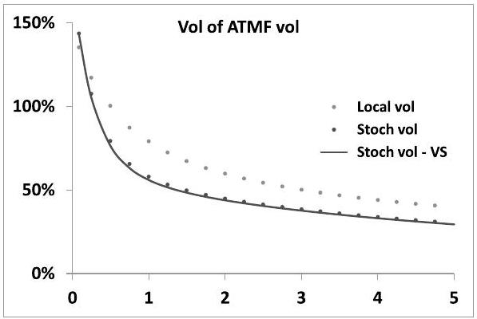
Figure 9.11: Volatility of ATMF volatilities as a function of maturity (years) in the two-factor stochastic volatility model (dark dots) and in the local volatility model (light dots) calibrated on the smile generated by the stochastic volatility twofactor model. Parameters in Table 8.2 have been used. The solid line corresponds to volatilities of VS - rather than ATMF - volatilities in the two-factor model calculated exactly using expression (7.39), page 227.

What about volatilities of volatilities? Volatilities of ATMF volatilities for both models appear in Figure 9.11. The term structure of volatilities of volatilities of the two-factor stochastic volatility model has been examined in Section 7.4. As for the
local volatility model, because $\widehat{\sigma}_{F_{T} T}$ is a function of $S$, the volatility of $\widehat{\sigma}_{F_{T} T}$ can be expressed using the SSR. The instantaneous lognormal volatility of $\widehat{\sigma}_{F_{T} T}$ is given by (see Section 2.5.5):

$$
\operatorname{vol}\left(\widehat{\sigma}_{F_{T} T}\right)=\mathcal{R}_{T} \mathcal{S}_{T} \frac{\widehat{\sigma}_{F_{0} 0}}{\widehat{\sigma}_{F_{T} T}}
$$

where the short ATMF volatility $\widehat{\sigma}_{F_{0} 0}$ is also equal to the instantaneous volatility of $S$.

For $T \rightarrow 0 \mathcal{R}_{T}$ tends to 2 and the volatility of the short ATMF volatility is twice the ATMF skew - we recover result (2.85) of Section 2.5.5.

For longer maturities, one can use the approximate expression (2.83):

$$
\operatorname{vol}\left(\widehat{\sigma}_{F_{T} T}\right) \simeq\left(\mathcal{S}_{T}+\frac{1}{T} \int_{0}^{T} \mathcal{S}_{\tau} d \tau\right) \frac{\widehat{\sigma}_{F_{0} 0}}{\widehat{\sigma}_{F_{T} T}}
$$

which only involves the term structure of the ATMF skew.

Again, in contrast with the two-factor model, the local volatility model is not time-homogeneous; volatilities of volatilities depend not only on $T-t$, but also on $t$. Typically, volatilities of volatilities in the local volatility model are larger for small $t$ /smaller for large $t$, compared with those of a time-homogeneous stochastic volatility model calibrated on the same smile.

### 9.11.3 Carry P\&L of a partially vega-hedged position

Consider a delta- and vega-hedged option position. Assume that there is only one implied volatility $\widehat{\sigma}$, in addition to $S$. The gamma/theta $\mathrm{P} \& \mathrm{~L}$ of the hedged position reads: ${ }^{11}$

$$
P \& L=-\frac{1}{2} \frac{d^{2} P}{d S^{2}}\left(\delta S^{2}-\bullet \delta t\right)-\frac{1}{2} \frac{d^{2} P}{d \widehat{\sigma}^{2}}\left(\delta \widehat{\sigma}^{2}-\bullet \delta t\right)-\frac{d^{2} P}{d S d \widehat{\sigma}}(\delta S \delta \widehat{\sigma}-\bullet \delta t)
$$

The suitability of the model parametrization is assessed by comparing the modelgenerated values of the spot/volatility and volatility/volatility covariances - denoted by $\bullet \delta t$ - with their realized counterparts, the latter evaluated using historical data for $S$ and $\widehat{\sigma}$.

In practice delta-hedging is performed daily - and delta is calculated using current market implied volatilities - but vega-hedging may not, because of larger bid/offer costs. Vega-hedging and delta-hedging occur asynchronously. Which second order spot gamma, spot/volatility cross-gamma and volatility/volatility cross-gamma P\&Ls does one then materialize? ${ }^{12}$

[^146]Imagine we vega-hedge our option position periodically every $n$ days - say one week $(n=5)$. We make the reasonable assumption that gammas and cross-gammas are constant during this period.

Rather than plodding through the calculation of this P\&L, we choose a more enlightening route: start from the P\&L generated by hedging once per period, then remove terms that can be offset by daily delta-hedging. We denote by $\delta \widehat{\sigma}_{i}$ and $\delta S_{i}$ the respective daily increments over $\left[t_{i-1}, t_{i}\right]$.

## Spot gamma

Assuming we delta-hedge only once per period, the spot gamma P\&L reads:

$$
\begin{aligned}
\frac{1}{2} \frac{d^{2} P}{d S^{2}}\left(\Sigma_{i} \delta S_{i}\right)^{2} & =\frac{1}{2} \frac{d^{2} P}{d S^{2}}\left(\Sigma_{i} \delta S_{i}\right)\left(\Sigma_{j} \delta S_{j}\right) \\
& =\frac{1}{2} \frac{d^{2} P}{d S^{2}}\left(\Sigma_{i} \delta S_{i}^{2}\right)+\frac{d^{2} P}{d S^{2}} \Sigma_{i}\left(\Sigma_{j<i} \delta S_{j}\right) \delta S_{i}
\end{aligned}
$$

The prefactor in front of $\delta S_{i}$ in the second piece involves spot increments that precede $\delta S_{i}$, thus are known at time $t_{i-1}$. This P\&L linear in $\delta S_{i}$ can then be cancelled by a delta strategy $\Delta_{t_{i-1}} \delta S_{i}$ with $\Delta_{t_{i-1}}=\frac{1}{2} \frac{d^{2} P}{d S^{2}}\left(\Sigma_{j<i} \delta S_{j}\right)$. Only the first piece remains and we get the usual result for the spot gamma P\&L over one period:

$$
\frac{1}{2} \frac{d^{2} P}{d S^{2}}\left(\Sigma_{i} \delta S_{i}^{2}\right)
$$

It involves the spot variance, measured using daily increments - as expected.

## Volatility gamma

Since no vega-hedging happens during the $n$-day period, the volatility gamma P\&L is simply:

$$
\frac{1}{2} \frac{d^{2} P}{d \widehat{\sigma}^{2}}\left(\Sigma_{i} \delta \widehat{\sigma}_{i}\right)^{2}
$$

that is, the variance of volatility is sampled according to our weekly schedule - as expected.

## Spot/volatility cross-gamma

The spot/volatility cross-gamma P\&L reads:

$$
\frac{d^{2} P}{d S d \widehat{\sigma}}\left(\Sigma_{i} \delta S_{i}\right)\left(\Sigma_{j} \delta \widehat{\sigma}_{j}\right)=\frac{d^{2} P}{d S d \widehat{\sigma}} \Sigma_{i}\left(\Sigma_{j<i} \delta \widehat{\sigma}_{j}\right) \delta S_{i}+\frac{d^{2} P}{d S d \widehat{\sigma}} \Sigma_{i}\left(\Sigma_{j \geq i} \delta \widehat{\sigma}_{j}\right) \delta S_{i}
$$

The first portion of the right-hand side can be offset by a delta position; our final P\&L over one period reads:

$$
\begin{equation*}
\frac{d^{2} P}{d S d \widehat{\sigma}} \Sigma_{i}\left(\Sigma_{j \geq i} \delta \widehat{\sigma}_{j}\right) \delta S_{i} \tag{9.34}
\end{equation*}
$$
^eq9-34

which involves the product of spot increments and all subsequent volatility increments.

The spot/volatility estimator in (9.34) is what should be used to measure realized spot/volatility covariance, for the sake of comparing realized and model-implied levels. How does it differ from the usual estimator that applies to the situation of synchronous delta and vega-hedging?

Imagine that during the vega-hedging period $S$ and $\widehat{\sigma}$ vary by $\delta S, \delta \widehat{\sigma}$ and that both experience a trend: $\delta S_{i}=\frac{\delta S}{n}, \delta \widehat{\sigma}_{i}=\frac{\delta \widehat{\sigma}}{n}$.

Then, using the above expressions, the spot gamma $\mathrm{P} \& \mathrm{~L}$ is equal to $\frac{1}{n}\left(\frac{1}{2} \frac{d^{2} P}{d S^{2}} \delta S^{2}\right)$ - that is delta-hedging has reduced it by a factor $\frac{1}{n}$ - and the volatility gamma P\&L is $\frac{1}{2} \frac{d^{2} P}{d \widehat{\sigma}^{2}} \delta \widehat{\sigma}^{2}$.

As for the cross-gamma $\mathrm{P} \& \mathrm{~L}$, it is equal to $\frac{n+1}{2 n}\left(\frac{d^{2} P}{d S d \widehat{\sigma}} \delta S \delta \widehat{\sigma}\right) \simeq \frac{1}{2} \frac{d^{2} P}{d S d \widehat{\sigma}} \delta S \delta \widehat{\sigma}$, for $n$ large.

Thus, using current implied volatilities in the calculation of the delta - even without trading any intermediate vega hedges - has reduced the realized crossgamma P\&L by a factor $\simeq \frac{1}{2}$.

## Chapter's digest

### 9.1 The ATMF skew

At order one in volatility of volatility, the ATMF skew is given, as a function of the spot/variance covariance function by:

$$
\mathcal{S}_{T}=\frac{1}{2 \sqrt{T}} \frac{1}{\left(\int_{0}^{T} \xi_{0}^{\tau} d \tau\right)^{3 / 2}} \int_{0}^{T} d \tau \int_{\tau}^{T} \mu\left(\tau, u, \xi_{0}\right) d u
$$

### 9.2 The Skew Stickiness Ratio (SSR)

The SSR is defined as the instantaneous regression coefficient of the ATMF volatility on $\ln S$, in units of the ATMF skew:

$$
\mathcal{R}_{T}=\frac{1}{\mathcal{S}_{T}} \frac{E\left[d \ln S d \widehat{\sigma}_{F_{T}(S) T}\right]}{E\left[(d \ln S)^{2}\right]}
$$

In jump-diffusion models $\mathcal{R}_{T}=0, \forall T$. In the local volatility model, since the ATMF volatility is a function of $S: \mathcal{R}_{T}=\frac{1}{\mathcal{S}_{T}} \frac{d \widehat{\sigma}_{F_{T}(S) T}}{d \ln S}$.

- At order one in volatility of volatility, $\mathcal{R}_{T}$ is given, as a function of the spot/variance covariance function, by:

$$
\mathcal{R}_{T}=\frac{\int_{0}^{T} \xi_{0}^{\tau} d \tau}{T \xi_{0}^{0}} \frac{T \int_{0}^{T} \mu\left(0, u, \xi_{0}\right) d u}{\int_{0}^{T} d \tau \int_{\tau}^{T} \mu\left(\tau, u, \xi_{0}\right) d u}
$$

### 9.3 Short-maturity limit of the ATMF skew and the SSR

For $T \rightarrow 0, \mathcal{S}_{0}=\frac{\mu\left(0,0, \xi_{0}\right)}{4\left(\xi_{0}^{0}\right)^{3 / 2}}$ and $\mathcal{R}_{0}=2$. The short-maturity limit of the SSR is 2 , as in the local volatility model.

## ১৫ ১৫ ১৫ ১৫ ১০

### 9.4 Model-independent range of the SSR

Assuming the VS term structure is flat and the spot/variance covariance function is time homogeneous $-\mu\left(\tau, u, \xi_{0}\right) \equiv \mu(u-\tau)-$ one derives the following
expressions for ATMF skew and SSR:

$$
\begin{aligned}
\mathcal{S}_{T} & =\frac{1}{2 \xi_{0}^{3 / 2} T^{2}} \int_{0}^{T}(T-t) \mu(t) d t \\
\mathcal{R}_{T} & =\frac{\int_{0}^{T} \mu(t) d t}{\int_{0}^{T}\left(1-\frac{t}{T}\right) \mu(t) d t}
\end{aligned}
$$

Making the asumption that $\mu(t)$ decays monotonically towards zero as $t \rightarrow \infty$, we get model-independent lower and upper bounds on $\mathcal{R}_{T}$ :

$$
\mathcal{R}_{T} \in[1,2]
$$

Because of its definition the SSR is inversely proportional to the short VS volatility. One should bear in mind this dependence when assessing SSRs of market smiles.

### 9.5 Scaling of ATMF skew and SSR - a classification of models

Depending on the rate of decay of $\mu(t)$ for $t \rightarrow \infty$, two long-maturity regimes for the ATMF skew and SSR can be defined, which lead to the division of stochastic volatility models into two classes. Assuming that $\mu(t) \propto \frac{1}{t^{\gamma}}$ for $t \rightarrow \infty$, for long maturities:

- (Type I) If $\gamma>1$ :

$$
\begin{equation*}
\mathcal{S}_{T} \propto \frac{1}{T} \text { and } \lim _{T \rightarrow \infty} \mathcal{R}_{T}=1 \tag{9.35}
\end{equation*}
$$
^eq9-35

- (Type II) If $\gamma<1$ :

$$
\begin{equation*}
\mathcal{S}_{T} \propto \frac{1}{T^{\gamma}} \text { and } \lim _{T \rightarrow \infty} \mathcal{R}_{T}=2-\gamma \tag{9.36}
\end{equation*}
$$
^eq9-36

Exponential decay of $\mu(t)$ produces Type I behavior. In Type I models, in the long-maturity regime, $\mathcal{S}_{T}$ and $\mathcal{R}_{T}$ bear no signature of the rate of decay of $\mu$.

For both types of models, the long-maturity ATMF skew and SSR are related through:

$$
\mathcal{S}_{T} \propto \frac{1}{T^{2-\mathcal{R}_{\infty}}}
$$

### 9.6 Type I models - the Heston model

- The Heston model produces Type I behavior. Its long-maturity SSR is 1, which can be checked using the order-one expansion of the ATMF skew in Chapter 6.

### 9.7 Type II models

- Even though the two-factor model is strictly of Type 1 , since $\mu(t)$ decays exponentially for large $t$, we can still achieve Type II scaling of the ATMF skew and the corresponding value of the SSR - on a range of maturities that is practically relevant.

For a flat term-structure of VS volatilities, at order one in volatility of volatility, both quantities are given by:

$$
\begin{aligned}
\mathcal{S}_{T} & =\nu \alpha_{\theta}\left[(1-\theta) \rho_{S X^{1}} \frac{k_{1} T-\left(1-e^{-k_{1} T}\right)}{\left(k_{1} T\right)^{2}}+\theta \rho_{S X^{2}} \frac{k_{2} T-\left(1-e^{-k_{2} T}\right)}{\left(k_{2} T\right)^{2}}\right] \\
\mathcal{R}_{T} & =\frac{(1-\theta) \rho_{S X^{1}} \frac{1-e^{-k_{1} T}}{k_{1} T}+\theta \rho_{S X^{2}} \frac{1-e^{-k_{2} T}}{k_{2} T}}{(1-\theta) \rho_{S X^{1}} \frac{k_{1} T-\left(1-e^{-k_{1} T}\right)}{\left(k_{1} T\right)^{2}}+\theta \rho_{S X^{2}} \frac{k_{2} T-\left(1-e^{-k_{2} T}\right)}{\left(k_{2} T\right)^{2}}}
\end{aligned}
$$

- The realized behavior of equity index smiles is consistent with Type II.

১০ ১০ ১০ ১০ ১০.

### 9.8 Numerical evaluation of the SSR

- The SSR of the two-factor model is easily evaluated numerically in a Monte Carlo simulation by simply shifting the initial values of processes $X_{t}$ and $Y_{t}$.

### 9.9 The SSR for short maturities

- The value of the realized SSR of short-maturity equity index smiles is usually substantially lower than the model-independent value of stochastic volatility models. Can this difference be materialized as the P\&L of a trading strategy?

### 9.10 Arbitraging the realized short SSR

- We use a lognormal model for the short ATM volatility. In our two assetmodel - spot and short ATM volatility - the difference between the realized SSR and its model-independent value of 2 is materialized as a cross-gamma/theta P\&L.
- We backtest a dynamical delta-hedged option strategy on the Euro Stoxx 50 index that consists in maintaining a short-skew position around the money. The resulting P\&L approximately captures the cross-gamma/theta P\&L corresponding to the difference between implied and realized skew, even though the residual vega of our position impacts the cumulative P\&L negatively on large downward moves of the spot.

## ১৫ ১০ ১০ ১০ ১০.

### 9.11 Conclusion

- The behavior of $\mathcal{R}_{T}$ as a function of $T$ is structurally different in stochastic volatility models than in the local volatility model. In the local volatility model, for typical equity index smiles, the SSR starts from 2 for short maturities, then increases for longer maturities.

For an ATMF skew that decays algebraically with exponent $\gamma$, in the local volatility model $\mathcal{R}_{\infty}=\frac{2-\gamma}{1-\gamma}$, while in a stochastic volatility model, $\mathcal{R}_{\infty}=2-\gamma$. For the typical value $\gamma=\frac{1}{2}$, the SSR of the local volatility model for long maturities is $\mathcal{R}_{\infty}=3$, compared to $\mathcal{R}_{\infty}=1.5$ for a stochastic volatility model.

- Instantaneous volatilities of volatilities of long-dated vanilla options are also larger in the local volatility model than in a stochastic volatility model.
- In practice, vega hedging occurs less frequently than delta hedging, thus the spot/volatility cross/gamma-theta P\&L is not materialized exactly. Assuming that deta-hedging is performed daily, using actual implied volatilities, while vegahedging is performed less frequently, we obtain the approximate result that, in case of a trend in both spot and implied volatility in between two vega rehedges, half of the cross-gamma P\&L is materialized.
