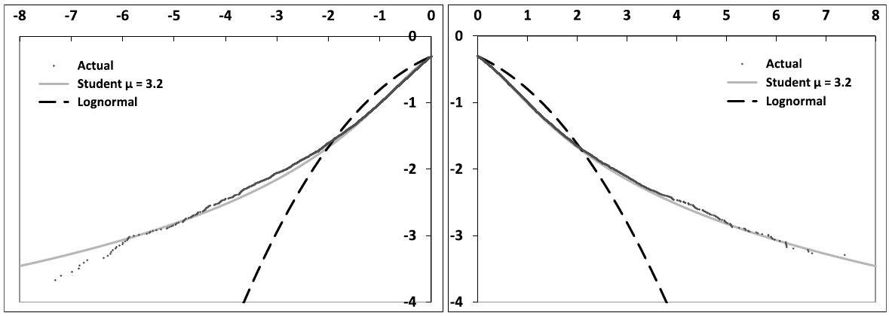
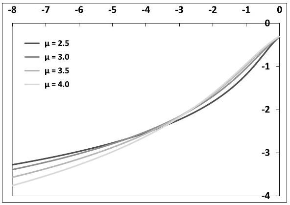
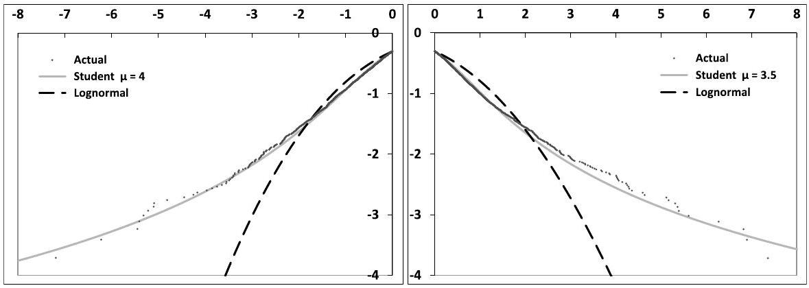
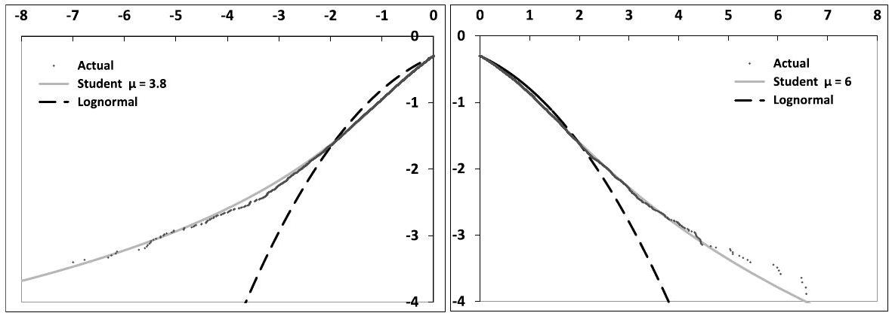
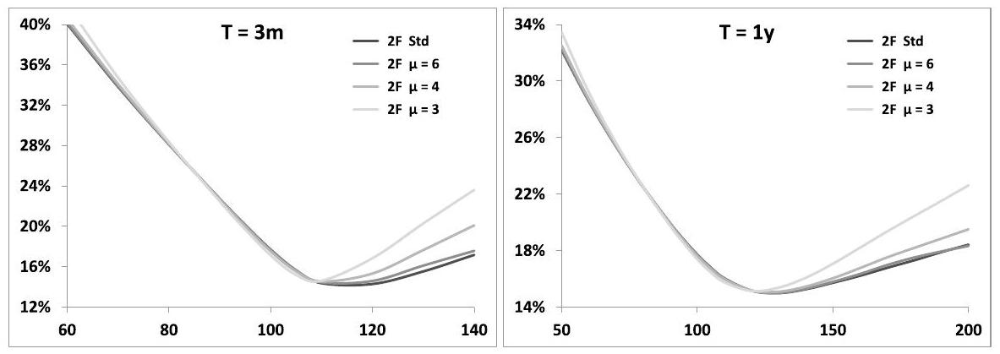
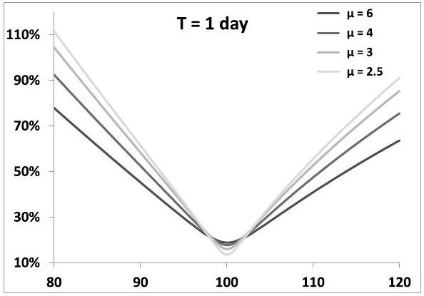
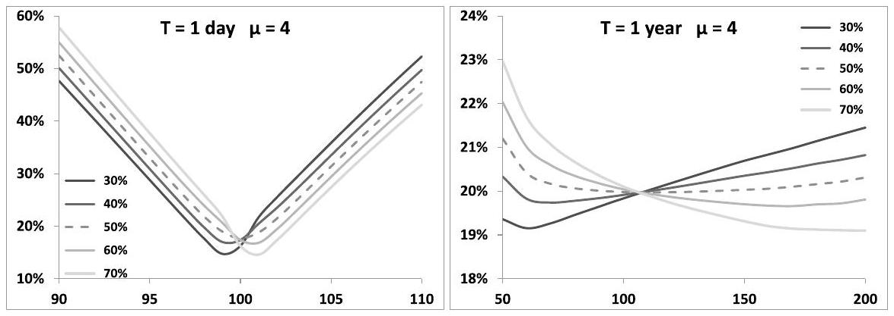
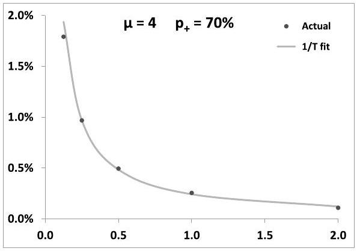
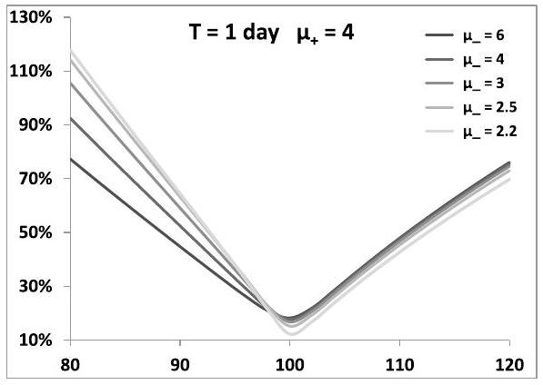

## Chapter 10

## What causes equity smiles?

In Chapter 8 we have characterized stochastic volatility smiles and how they are related to the model's specification: where do skew and curvature come from and how we can compute them approximately?

Then in Chapter 9 we have focused on dynamical aspects of smiles in stochastic volatility models: how do ATMF volatilities move in these models? From the bare knowledge of the smile generated by a stochastic volatility model can we say anything about the joint dynamics of spot and implied volatilities in the model?
"But what about actual equity smiles?" is the restive reader bound to ask. What is it that is responsible for their skew and curvature? Large historical drawdowns in equity indexes are often purported to be responsible for the strong negative skew of implied index smiles. Is this correct? Are vanilla smiles in any way related to statistical properties of historical returns? Which payoffs do the latter impact? These are the questions we address.

The (un)related topic of jump-diffusion and Lévy models is dealt with in Appendix A.

### 10.1 The distribution of equity returns

Figure 10.1 shows the cumulative distribution of normalized negative and positive returns of the Dow Jones index. We have used daily closing quotes from January 1, 1900 to July 20, 2014. ${ }^{1}$

We compute daily returns $r_{i}=\frac{S_{i+1}}{S_{i}}-1$. The square root of the second moment of non-centered negative returns is $1.15 \%$ and that of non-centered positive returns is $1.08 \%$. We separately normalize negative and positive returns by the square roots of second-order moments so that the non-centered second moment of normalized positive returns $\bar{r}_{i}$ equals 1 , as does that of negative returns. The lowest (normalized) negative return in our sample is -19.6 and the highest positive return is $14.3 .^{2}$

[^147]
Figure 10.1: $\operatorname{Logarithm}\left(\log _{10}\right)$ of the empirical distribution function of normalized negative (left-hand graph) and positive (right-hand graph) returns of the Dow Jones index, together with the lognormal and Student distribution functions.

We then rank negative returns and define the empirical distribution function of normalized negative returns $\bar{r}$ as:

$$
P\left[\bar{r} \leq \bar{r}_{i}\right]=\frac{1}{2} \frac{i}{N^{-}}
$$

where $N^{-}$is the number of negative returns in our sample ( $N^{-}=14103$ ) and the normalization factor $\frac{1}{2}$ ensures that $P[\bar{r} \leq 0]=\frac{1}{2}$. We do the same for positive returns $\left(N^{+}=15657\right)$. In Figure 10.1, $\log _{10}(P[\bar{r} \leq r])$ (left-hand graph) and $\log _{10}(P[\bar{r} \geq r])$ (right-hand graph) are graphed as a function of $r$.

Together with the empirical distribution, we show two distributions: (a) the lognormal distribution function, (b) the Student distribution function with $\mu=3.2$.

The Student distribution is well-suited to the modeling of fat-tailed random variables; its density is defined by:

$$
\begin{equation*}
\rho_{\mu}(x)=\frac{\Gamma\left(\frac{1+\mu}{2}\right)}{\sqrt{\mu \pi} \Gamma\left(\frac{\mu}{2}\right)} \frac{1}{\left(1+\frac{x^{2}}{\mu}\right)^{\frac{1+\mu}{2}}} \tag{10.1}
\end{equation*}
$$
^eq10-1

where $\mu$ is customarily called "number of degrees of freedom".
The smaller $\mu$ the thicker the tails. For large values of $x$ the density scales like $\frac{1}{x^{1+\mu}}$, thus the one-sided cumulative distribution function scales like $\frac{1}{x^{\mu}}$. Only moments of order smaller than $\mu$ exist.

The variance of a Student random variable is $\frac{\mu}{\mu-2}$ and its kurtosis is $\frac{6}{\mu-4}$. For $\mu \leq 4$ the fourth moment diverges and so does the second moment for $\mu \leq 2$; for $\mu \rightarrow \infty$ the Student density converges to the Gaussian density.

The value $\mu=3.2$ is obtained by least-square minimization of the difference of the logarithms of the empirical and Student distributions. When comparing empirical and Student distributions in Figure 10.1, one should observe that while the empirical
curve for negative returns consists of more than 14000 points, only a hundred of them correspond to values of $\bar{r} \leq-4$.

Student distribution functions for different values of $\mu$ are shown in Figure 10.2. Any value in the interval [3,4] provides an acceptable fit to empirical data. ${ }^{3}$

Figure 10.2: Logarithm $\left(\log _{10}\right)$ of the left tail of the distribution function of a Student random variable, normalized so that its variance is 1 , for different values of $\mu$.

Thus our preliminary conclusions are:

- The empirical distribution of realized equity index returns is well approximated by a Student distribution with $\mu$ typically in the interval [3,4], with tail probabilities much larger than those of a lognormal distribution. Figure 10.1 shows that the lognormal density underestimates the probability of a move larger than 4 standard deviations by a factor of 100 .
- Negative and positive returns have very similar second-order moments and tail parameters. In contrast with what is frequently heard, there is no evidence that negative returns have thicker tails than positive ones.

These conclusions are by no means specific to the Dow Jones index, they apply broadly to all equity indexes. Figure 10.3 shows another example; a Hong Kong-based index - the Hang Seng China Enterprises Index (HSCEI), which is roughly twice as volatile as the Dow Jones index, using data from 1993 to 2014.

[^148]
Figure 10.3: $\operatorname{Logarithm}\left(\log _{10}\right)$ of the empirical distribution function of normalized negative (left-hand graph) and positive (right-hand graph) returns of the HSCEI index, together with the lognormal and Student distribution functions.

### 10.1.1 The conditional distribution

Even though empirical curves in Figure 10.1 are remarkably smooth, one could question the pertinence of fitting a single distribution to one century worth of data, during which very dissimilar volatility regimes have existed.

In the analysis of the P\&L of a delta-hedged option position in Chapter 1, daily returns $r_{i}$ are modeled as:

$$
\begin{equation*}
r_{i}=\sigma_{i} \sqrt{\delta t} z_{i} \tag{10.2}
\end{equation*}
$$
^eq10-2

where $\sigma_{i}$ is the instantaneous volatility and $z_{i}$ are iid random variables with unit variance.

The rationale for this ansatz is that the variability of the probability distribution of $r_{i}$ is condensed in that of the scale factor $\sigma_{i}$ - the $z_{i}$ are identically distributed.

When $\sigma_{i}$ is stochastic the resulting distribution of the $r_{i}$ is non-Gaussian even though the $z_{i}$ may be. How much of the thickness of the tails of daily returns is generated by (a) the randomness of $\sigma_{i}$, (b) the distribution of $z_{i}$ ?
(10.2) is a natural ansatz but accessing $\sigma_{i}$ is difficult in practice. Figure 10.4 shows the same graphs as in Figure 10.1, except each return is normalized by the historical volatility calculated using the 200 previous returns, rather than that evaluated over the whole historical sample.

As expected, normalizing returns by an (heuristic) estimate of $\sigma_{i}$ reduces the tail thickness, which is manifested in larger values for $\mu$. A least-squares fit produces $\mu=3.8$ for negative returns - a modest increase with respect to $\mu=3.2$ - while we get $\mu=6$ for positive returns. ${ }^{4}$

[^149]
Figure 10.4: Logarithm $\left(\log _{10}\right)$ of the empirical distribution function of conditional normalized negative (left-hand graph) and positive (right-hand graph) returns of the Dow Jones index, together with the lognormal and Student distribution functions.

### 10.2 Impact of the distribution of daily returns on derivative prices

Empirical distributions of returns - even conditional ones - have substantially fatter tails than the lognormal distribution. This has prompted some to argue that using lognormal models - or more generally diffusive stochastic volatility models for pricing derivatives is inappropriate. Others have claimed that it is precisely the fat-tailed/non-lognormal nature of returns that accounts for the volatility smile. Is either of these statements correct?

Remember we have argued in Chapters 8 and 9 - see in particular the discussion in Section 9.10.5, page 376 - that the ATMF skew of the volatility smile is generated by the covariance of spot and implied volatilities. Do fat-tailed returns alter this picture?

We now investigate the following questions:

- Is the fat-tailed nature of returns manifested in any way in equity smiles? Stated differently, is there any trace of the one-day smile in smiles of standard maturities?
- Which payoffs are specifically sensitive to tails of daily returns/the one-day smile?

We answer these questions by using a model that enables us to separate the effects of (a) the distribution of daily returns, (b) the effect of stochastic (implied) volatilities.

### 10.2.1 A stochastic volatility model with fat-tailed returns

We use the two-factor model introduced in Section 7.4, page 226. While the model for forward variances $\xi_{t}^{\tau}$ is continuous, the spot returns are discrete and are simulated over one-day time intervals.

We cannot use a Student distribution for $\ln \left(\frac{S_{t+\Delta}}{S_{t}}\right)$, as $E_{t}\left[S_{t+\Delta}\right]$ would be infinite, thus we use the Student distribution for $\frac{S_{t+\Delta}}{S_{t}}-1$ and set:

$$
\begin{equation*}
S_{t+\Delta}=S_{t}\left[1+(r-q) \Delta+\sigma_{t} \delta Z\right] \tag{10.3}
\end{equation*}
$$
^eq10-3

where $\sigma_{t}$ is given by:

$$
\sigma_{t}=\sqrt{\frac{1}{\Delta} \int_{t}^{t+\Delta} \xi_{t}^{\tau} d \tau}
$$

and the dynamics of forward variances $\xi^{\tau}$ in the two-factor model is given by equation (7.28), page $226:^{5}$

$$
d \xi_{t}^{\tau}=2 \nu \xi_{t}^{\tau} \alpha_{\theta}\left((1-\theta) e^{-k_{1}(\tau-t)} d W_{t}^{1}+\theta e^{-k_{2}(\tau-t)} d W_{t}^{2}\right)
$$

whose solution is given in equation (7.33), page 227, in terms of two OrnsteinÜhlenbeck processes $X^{1}, X^{2}$, whose increments over $[t, t+\Delta]$ are given by:

$$
\delta X^{i}=\int_{t}^{t+\Delta} e^{-k_{i}(t+\Delta-u)} d W_{u}^{i}
$$

In (10.3) $\delta Z$ is a random variable with mean 0 and variance $\Delta$. In the standard version of the two-factor model $\delta Z$ is simply replaced by: $\delta Z \equiv \delta W^{S}=\int_{t}^{t+\Delta} d W_{u}^{S}$ and the covariances of the Gaussian random variables $\delta W^{S}$ and $\delta X^{i}$ are given by:

$$
E\left[\delta X^{i} \delta X^{j}\right]=\rho_{i j} \frac{1-e^{-\left(k_{i}+k_{j}\right) \Delta}}{k_{i}+k_{j}} \quad E\left[\delta X^{i} \delta W^{S}\right]=\rho_{i S} \frac{1-e^{-k_{i} \Delta}}{k_{i}}
$$

Here we need to draw $\delta Z$ from a two-sided Student distribution with different values of $\mu$ for the left and right tails.

While in empirical distributions, probabilities for negative and positive returns are almost exactly equal to $\frac{1}{2}$, we would like to be able to set these probabilities, or in other words the price of the one-day at-the-money digital option: $E\left[\mathbf{1}_{\delta Z \geq 0}\right]$, that is, have a handle on the one-day ATM skew - see the discussion in Section 10.2.2 below.

Let us call $p_{+}, p_{-}$the probabilities of positive and negative returns, and $\mu_{+}, \mu_{-}$ the parameters of the corresponding Student distributions. We define $\delta Z$ as:

$$
\begin{cases}\delta Z=\sigma_{+} \sqrt{\Delta}\left|X_{\mu_{+}}\right| & \text {with probability } p_{+} \\ \delta Z=-\sigma_{-} \sqrt{\Delta}\left|X_{\mu_{-}}\right| & \text {with probability } p_{-}\end{cases}
$$

[^150]where $X_{\mu}$ denotes a Student random variable with $\mu$ degrees of freedom. The density of $\delta Z$ is given by:

$$
\begin{cases}\rho(\delta Z)=\frac{2 p_{+}}{\sigma_{+\sqrt{\Delta}}} \rho_{\mu_{+}}\left(\frac{\delta Z}{\sigma_{+} \sqrt{\Delta}}\right) & \text { with probability } p_{+} \\ \rho(\delta Z)=\frac{2 p_{-}}{\sigma_{-} \sqrt{\Delta}} \rho_{\mu-}\left(\frac{\delta Z}{\sigma_{-} \sqrt{\Delta}}\right) & \text { with probability } p_{-}\end{cases}
$$

The values of $\sigma_{+}, \sigma_{-}$must be such that:

$$
\begin{equation*}
E[\delta Z]=0 \quad E\left[(\delta Z)^{2}\right]=\Delta \tag{10.4}
\end{equation*}
$$
^eq10-4

Since the standard deviation of a Student random variable is $\sqrt{\frac{\mu}{\mu-2}}$ it is more natural to rewrite $\sigma_{+}, \sigma_{-}$as:

$$
\sigma_{+}=\sqrt{\frac{\mu_{+}-2}{\mu_{+}}} \zeta_{+} \quad \sigma_{-}=\sqrt{\frac{\mu_{-}-2}{\mu_{-}}} \zeta_{-}
$$

The conditions in (10.4) read:

$$
\begin{array}{r}
p_{+} \zeta_{+} \alpha_{+}-p_{-} \zeta_{-} \alpha_{-}=0 \\
p_{+} \zeta_{+}^{2}+p_{-} \zeta_{-}^{2}=1
\end{array}
$$

where $\alpha_{+}=\frac{2}{\sqrt{\pi}} \frac{\sqrt{\mu_{+}-2}}{\mu_{+}-1} \frac{\Gamma\left(\frac{1+\mu_{+}}{2}\right)}{\Gamma\left(\frac{\mu_{+}}{2}\right)}$ and likewise for $\alpha_{-}$. The solution is:

$$
\zeta_{+}=\frac{p_{-} \alpha_{-}}{\sqrt{p_{+}\left(p_{-} \alpha_{-}\right)^{2}+p_{-}\left(p_{+} \alpha_{+}\right)^{2}}} \quad \zeta_{-}=\frac{p_{+} \alpha_{+}}{\sqrt{p_{+}\left(p_{-} \alpha_{-}\right)^{2}+p_{-}\left(p_{+} \alpha_{+}\right)^{2}}}
$$

and $\delta Z$ is given by:

$$
\begin{cases}\delta Z=\zeta_{+} \sqrt{\frac{\mu_{+}-2}{\mu_{+}}} \sqrt{\Delta}\left|X_{\mu_{+}}\right| & \text {with probability } p_{+} \\ \delta Z=-\zeta_{-} \sqrt{\frac{\mu_{-}-2}{\mu_{-}}} \sqrt{\Delta}\left|X_{\mu_{-}}\right| & \text {with probability } p_{-}\end{cases}
$$

Student random variables can be generated in a number of ways. In our setting, we need (a) to correlate $\delta Z$ with $\delta X^{1}, \delta X^{2}$ and (b) to be able to degenerate $\delta Z$ into a Gaussian random variable to recover the standard form of the two-factor model.

It is then simpler to start with the Brownian increments $\delta W^{S}$ supplied by the Monte Carlo engine of our standard two-factor model and map them into $\delta Z$ according to:

$$
\begin{equation*}
\delta Z=\sqrt{\Delta} f\left(\frac{\delta W^{S}}{\sqrt{\Delta}}\right) \tag{10.5}
\end{equation*}
$$
^eq10-5

with $f$ given by:

$$
\begin{cases}x \leq \mathcal{N}_{G}^{-1}\left(p_{-}\right) & f(x)=\zeta_{-} \sqrt{\frac{\mu_{-}-2}{\mu_{-}}} \mathcal{N}_{\mu_{-}}^{-1}\left(\frac{\mathcal{N}_{G}(x)}{2 p_{-}}\right)  \tag{10.6}\\ x \geq \mathcal{N}_{G}^{-1}\left(p_{-}\right) & f(x)=\zeta_{+} \sqrt{\frac{\mu_{+}-2}{\mu_{+}}} \mathcal{N}_{\mu+}^{-1}\left(\frac{1}{2}+\frac{\mathcal{N}_{G}(x)-p_{-}}{2 p_{+}}\right)\end{cases}
$$
^eq10-6

where $\mathcal{N}_{G}$ is the cumulative distribution function of the standard normal variable, $\mathcal{N}_{G}^{-1}$ its inverse, and $\mathcal{N}_{\mu}^{-1}$ is the inverse cumulative distribution function of a Student random variable with $\mu$ degrees of freedom. ${ }^{6}$

Note that if $p_{+}=p_{-}=\frac{1}{2}, \lim _{\mu_{+}, \mu_{-} \rightarrow \infty} \delta Z=\delta W$, as expected.

## Rescaling spot/volatility correlations

We can now simulate the joint dynamics of $S_{t}$ and forward variances using the Monte Carlo engine of our two-factor model and are one step away from vanilla smiles.

As we vary $\mu_{+}, \mu_{-}$to assess the influence of the one-day smile we must ensure that other features of the model are unchanged. As we replace $\delta W^{S}$ with $\delta Z$ in (10.3) the instantaneous volatilities of VS volatilities are unaffected, as is the instantaneous volatility of $S$, but spot/volatility covariances are altered.

We thus need to define new rescaled correlations $\rho_{1 S}^{*}, \rho_{2 S}^{*}$ so that the instantaneous correlations - or covariances - of $\delta Z$ and $\delta X^{1}$ and of $\delta Z$ and $\delta X^{2}$ using $\rho_{1 S}^{*}, \rho_{2 S}^{*}$ are identical to the covariances in the standard two-factor model parametrized with $\rho_{1 S}, \rho_{2 S}$, that is $E\left[\delta W^{S} \delta X^{1}\right]$ and $E\left[\delta W^{S} \delta X^{2}\right]$ :

$$
E_{*}\left[\delta Z \delta X^{i}\right]=E\left[\delta W^{S} \delta X^{i}\right]
$$

where $E_{*}$ denotes the expectation evaluated using the new correlations. The formula for rescaling correlations is easily obtained. Spot/volatility correlations are rescaled uniformly, according to:

$$
\begin{equation*}
\frac{\rho_{i S}^{*}}{\rho_{i S}}=\frac{\Delta}{E\left[\delta Z \delta W^{S}\right]}=\frac{1}{\int_{-\infty}^{+\infty} \phi(x) x f(x) d x} \tag{10.7}
\end{equation*}
$$
^eq10-7

where $f$ is the mapping function in (10.6) and $\phi$ is the probability density of the standard normal variable.

The integral in the denominator of (10.7) is evaluated numerically once. We have $\rho_{i S}^{*} \geq \rho_{i S} .^{7}$

[^151]
### 10.2.2 Vanilla smiles

We now use the model described above to assess the impact of the one-day smile on the vanilla smile.

Smiles are obtained by straight pricing of vanilla payoffs. None of the techniques mentioned in Appendix A of Chapter 8 can be used here - be they the mixing solution, gamma/theta or timer techniques - as they rely on the assumption of a diffusion for $S_{t}$ that is on the fact that the expansion of the $\mathrm{P} \& \mathrm{~L}$ at order 2 in $\delta S$ is exact for short time intervals - see the discussion below.

We use throughout a flat variance curve: $\xi_{0}^{\tau}=\xi_{0}=20 \%^{2}$ and parameters in Table 10.1. ${ }^{8}$

| $\nu$ | $\theta$ | $k_{1}$ | $k_{2}$ | $\rho$ | $\rho_{S X^{1}}$ | $\rho_{S X^{2}}$ |
| :---: | :---: | :---: | :---: | :---: | :---: | :---: |
| $257 \%$ | 0.151 | 8.96 | 0.46 | $40 \%$ | $-74.6 \%$ | $-13.7 \%$ |

Table 10.1: Parameters of the two-factor model

We first start with identical probabilities for positive and negative returns ( $p_{+}= p_{-}=\frac{1}{2}$ ) and use identical values for tail parameters: $\mu_{+}=\mu_{-}=\mu$.

Figure 10.5 displays three-month and one-year smiles in the standard and fattailed version of the two-factor model.

Figure 10.5: Smiles in the two-factor model with Student-distributed returns for different values of $\mu, p_{+}=p_{-}=1 / 2$ and parameters in Table 10.1 along with the smile in the standard version of the model ( $\mu=\infty$ ).

The near-ATMF smile is hardly affected by tails of daily returns, which mostly impact far out-of-the-money calls. The effect of $\mu$ is better appreciated by turning off stochastic volatility: the smile for maturity $T$ is then generated by the 1-day smile only. The latter, together with the 1-year smile, is shown in Figure 10.6.

[^152]
Figure 10.6: 1-day (left) and 1-year (right) smile for different values of $\mu=\mu_{+}=\mu_{-}$ with $p_{+}=p_{-}=1 / 2$ and $\sigma=20 \%-$ no stochastic volatility ( $\nu=0$ ).

We now keep identical values for $\mu_{+}$and $\mu_{-}$but use different values for $p_{+}, p_{-}$ so that the ATM skew of the 1 -day smile is non-vanishing. The resulting 1 -year smile appears in Figure 10.7 for $p_{+}=30 \%, 40 \%, 50 \%, 60 \%, 70 \%$.

Again let us turn off stochastic volatility; the 1-day and 1-year smiles are shown in Figure 10.8.

Figure 10.7: Smile in the two-factor model with Student-distributed returns for different values of $p_{+}$, with $\mu_{+}=\mu_{-}=4$ and parameters in Table 10.1.

It is apparent that the difference $p_{+}-p_{-}$drives the ATM skew of the 1 -day smile, which almost vanishes for $p_{+}=p_{-}=\frac{1}{2}$. The fact that the one-day ATM skew steepens - and implied volatilities for strikes larger than 100 become lower for larger values of $p_{+}$is understood by noting that $p_{+}$is the (undiscounted) price of a one-day digital that pays 1 if tomorrow's spot value is larger than today's.

Denoting by $\mathcal{C}_{K}$ the undiscounted price of a call option of strike $K$, we have $\mathcal{C}_{K}=\mathcal{C}_{K}^{B S}\left(\widehat{\sigma}_{K}\right)$ where $\mathcal{C}_{K}^{B S}$ is the Black-Scholes price and $\widehat{\sigma}_{K}$ the implied volatility

Figure 10.8: 1-day (left) and 1-year (right) smile for different values of $p_{+}$, with $\mu_{+}=\mu_{-}=4$ and $\sigma=20 \%$ - no stochastic volatility ( $\nu=0$ ).

of strike $K$. Thus:

$$
\begin{aligned}
p_{+} & =-\frac{d C_{K}}{d K} \\
& =-\left.\frac{d \mathcal{C}_{K}^{B S}}{d K}\right|_{\widehat{\sigma}_{K}}-\left.\frac{d \mathcal{C}_{K}^{B S}}{d \widehat{\sigma}}\right|_{\widehat{\sigma}_{K}} \frac{d \widehat{\sigma}_{K}}{d K}
\end{aligned}
$$

According to this formula, increasing $p_{+}$with $\xi_{0}^{\tau}=\xi_{0}$ unchanged - thus leaving the ATM volatility almost unchanged - has the effect that $\frac{d \widehat{\sigma}_{K}}{d K}$ decreases $\left(\frac{d \mathcal{C}_{K}^{B S}}{d \widehat{\sigma}}\right.$ is positive), which is indeed what occurs in the left-hand graph of Figure 10.8. Note we have deliberately used an unrealistically wide range for $p_{+} .{ }^{9}$

How does the contribution of the 1-day ATMF skew to the ATMF skew of maturity $T$ scale with $T$ ? Figure 10.9 shows the $95 / 105$ skew as a function of $T$, together with a $\frac{1}{T}$ fit, with $\nu=0$ : the only source of smile is the 1 -day smile.

The observant reader will remember coming across this scaling before, in the context of discrete forward variance models, in Section 7.8 of Chapter 7 - consider expression (7.119b), page 294, of the ATMF skew for maturity $N \Delta$, where $\Delta$ is the time scale of the discrete model.

These models generate the ATMF skew through two mechanisms: (a) the ATMF skew for time scale $\Delta$, (b) the covariance of spot and forward variances - not unlike our fat-tailed stochastic volatility model.

See also Appendix A for more on this scaling.

### 10.2.3 Discussion

Let us assume no additional degrees of freedom besides $S$, and vanishing interest rate and repo without loss of generality. The P\&L of a short delta-hedged option

[^153]
Figure 10.9: Difference of the $95 \%$ and $105 \%$ implied volatilities, as a function of maturity - in years - (dots) along with a $1 / T$ fit (line), in the two-factor model with $\nu=0$ (no stochastic volatility) with $\mu_{+}=\mu_{-}=4$ and $p_{+}=70 \%$.

position during $\delta t=\Delta$ is:

$$
\begin{equation*}
P \& L=-(P(t+\Delta, S+\delta S)-P(t, S))+\frac{d P}{d S} \delta S \tag{10.8}
\end{equation*}
$$
^eq10-8

where $P(t, S)$ is our pricing function. In the models used so far $P$ can be expressed as an expectation, thus :

$$
P(t, S)=E\left[P\left(t+\Delta, S_{t+\Delta}\right) \mid S_{t}=S\right]
$$

$\Delta$ is assumed sufficiently small that the normal/lognormal distinction is not practically relevant. We then have:

$$
\begin{equation*}
P(t, S)=E[P(t+\Delta, S(1+\sigma \delta Z))] \tag{10.9}
\end{equation*}
$$
^eq10-9

where $\delta Z$ is a random variable with vanishing mean and variance $\Delta$, and $\sigma$ is the instantaneous volatility. Inserting expression (10.9) into (10.8) and expanding in powers of $\delta Z$ yields:

$$
\begin{align*}
P \& L & =-\left(P(t+\Delta, S+\delta S)-E_{t, S}[P(t+\Delta, S(1+\sigma \delta Z))]\right)+\frac{d P}{d S} \delta S \\
& =-\frac{S^{2}}{2} \frac{d^{2} P}{d S^{2}}\left(\frac{\delta S^{2}}{S^{2}}-\sigma^{2} \Delta\right)-\sum_{k>2} \frac{S^{k}}{k!} \frac{d^{k} P}{d S^{k}}\left(\left(\frac{\delta S}{S}\right)^{k}-\sigma^{k} E\left[\delta Z^{k}\right]\right) \tag{10.10}
\end{align*}
$$
^eq10-10

In (10.10) we single out the order-two contribution in $\delta S$, as when we take the limit of short time intervals between successive delta rehedges, only this term survives in the cumulative P\&L. Indeed consider an option of maturity $T$; the cumulative P\&L over the option's lifetime is the sum of $\frac{T}{\Delta} \mathrm{P} \& \mathrm{Ls}$ of the form (10.10). In the
continuous-time diffusive models considered so far $\frac{\delta S}{S} \propto \sqrt{\Delta}$, thus the order-two contribution in (10.10) is of order $\Delta$, hence generates a cumulative P\&L that is finite. The $k$ th contribution in (10.10), however, is of order $\Delta^{\frac{k}{2}}$, generating a cumulative P\&L that scales like $\frac{T}{\Delta} \Delta^{\frac{k}{2}}$, hence tends to zero as $\Delta \rightarrow 0$.

- In previous chapters we have implicitly assumed that $\Delta$ was sufficiently small that the $\Delta \rightarrow 0$ limit was relevant, hence typical P\&L expressions so far only included the first term in (10.10). ${ }^{10}$
- When $\Delta>0$ this is no longer the case, as terms of order $k>2$ contribute. These involve the quantity $E\left[\delta Z^{k}\right]$ which depends on the particular distribution of $\delta Z$. The dependence of vanilla option's prices to the latter is illustrated in figures 10.6 and 10.8 without stochastic volatility, that is with a constant $\sigma$, and in figures 10.5 and 10.7 with stochastic volatility. ${ }^{11}$

The conclusion from figures 10.5 and 10.7 is that, except for exaggerate values of tail parameters, and possibly very short maturities, the impact of the conditional one-day smile on smiles for standard maturities is small. In particular the ATMF skew is predominantly generated by the covariance of spot and forward variances. Only a minute portion of it can be traced to the one-day smile or, equivalently, the conditional distribution of daily returns.

Moreover, high-strike - rather than low-strike - implied volatilities seem to be impacted the most.

The steep ATMF skews observed for equity indexes for typical maturities have thus nothing to do with the fact that historical distributions of daily equity returns may or may not exhibit large drawdowns. Rather, they supply an estimate of the implied level of spot/volatility covariances, just like VS implied volatilities supply an estimate of the implied level of spot volatility.

Recall expression (8.24), page 315, relating the ATMF skew to the integrated covariance of spot and VS volatility for the residual maturity, at order one in volatility of volatility:

$$
\mathcal{S}_{T}=\frac{1}{2 \widehat{\sigma}_{T}^{3} T} \int_{0}^{T} \frac{T-\tau}{T} \frac{\left\langle d \ln S_{\tau} d \widehat{\sigma}_{T}^{2}(\tau)\right\rangle}{d \tau} d \tau
$$

What about very short maturities? Smiles in figures 10.5 and 10.7 imply that vanilla smiles for maturities of the order of a few days will exhibit a large sensitivity

[^154]to the one-day smile. Beside very short-dated vanilla options, are there other, longerdated, options that are sensitive to the one-day smile?

Path-dependent options that involve daily returns are the natural candidates. One such payoff is the variance swap - see Chapter 5 for an introduction.

### 10.2.4 Variance swaps

In Section 5.3.4, page 162, we have compared the P\&L of a delta-hedged log contract with the payoff of the VS and have shown that the difference is generated by terms $\delta S^{k}$ with $k>2$.

In the limit of short returns, in diffusive models, the implied volatilities $\widehat{\sigma}_{\mathrm{VS}, T}$ of the VS and $\widehat{\sigma}_{T}$ of the log contract coincide. For daily returns, in a diffusive model, the difference $\widehat{\sigma}_{\mathrm{VS}, T}-\widehat{\sigma}_{T}$ should still be negligible, while it is expected to be sizeable in fat-tailed models. Formula (5.38), page 162, for example, expresses the difference between $\widehat{\sigma}_{\mathrm{VS}, T}$ and $\widehat{\sigma}_{T}$ generated by terms of order 3 in $\delta S$ as a function of the (unconditional) skewness of daily returns.

Table 10.2 lists the values of $\widehat{\sigma}_{\mathrm{VS}, T}-\widehat{\sigma}_{T}$ in our fat-tailed two-factor model, for different parameter configurations, for a 1 -year VS.

|  | $\mu$ | $\infty$ | 6 | 4 | 3 |
| :--- | :---: | :---: | :---: | :---: | :---: |
|  | $\nu=0$ | $0 \%$ | $0 \%$ | $0.02 \%$ | $0.16 \%$ |
|  | $\nu=257 \%$ | $0.02 \%$ | $0.04 \%$ | $0.10 \%$ | $0.29 \%$ |
|  |  | $30 \%$ | $40 \%$ | $50 \%$ | $60 \%$ |
| $p_{+}$ |  |  | $70 \%$ |  |  |
| $\mu=4, \nu=257 \%$ | $-0.11 \%$ | $0 \%$ | $0.10 \%$ | $0.23 \%$ | $0.40 \%$ |

Table 10.2: Top: $\left(\widehat{\sigma}_{\mathrm{VS}, T}-\widehat{\sigma}_{T}\right)$ for $T=1$ year as a function of $\mu$ for $p_{+}=p_{-}=1 / 2$ with $\nu=0$ (no stochastic volatility) and $\nu=257 \%$ - corresponds to smiles in Figure 10.5. Bottom: $\left(\widehat{\sigma}_{\mathrm{VS}, T}-\widehat{\sigma}_{T}\right)$ as a function of $p_{+}$for $\mu=4, \nu=257 \%-$ these parameters correspond to smiles in Figure 10.7.

We can see in the top section of Table 10.2 that for $\mu=\infty$ - which corresponds to the standard version of the two-factor model - even for a large volatility of volatility, VS and log-contract volatilities are essentially identical. They become appreciably different as we widen the tails of returns (we decrease $\mu$ ), and as we vary $p^{+}$, thus increasing the ATMF skew (bottom section of table). ${ }^{12}$

The relative difference between log-contract and VS volatilities produced by our model for values of $\mu$ and $p^{+}$that are consistent with historical distributions of daily returns ( $\mu \simeq 4, p^{+}=50 \%$ ) is $0.1 \% / 20 \%=0.5 \%$.

[^155]This is roughly the order of magnitude of the realized value of $\widehat{\sigma}_{\mathrm{VS}, T}-\widehat{\sigma}_{T}$ in the backtest of Chapter 5 - see Figure 5.1, page 166.

### 10.2.5 Daily cliquets

Daily cliquets are cliquets written on daily returns. An example is a one-year option on the Euro Stoxx 50 index that pays a daily coupon equal to the put payoff $\left(k-\frac{S_{i+1}}{S_{i}}\right)^{+}$where $S_{i}, S_{i+1}$ are two consecutive daily closing values of the index.

Typical strikes for these daily puts are in the range of $75 \%$ to $90 \%$. Daily cliquets are also typically of the knock-out type - the option expires once one coupon has paid off and the premium is paid on a quarterly basis - making them very similar to CDS contracts.

Some popular variants involve put spreads - daily cliquets whose coupons are capped at some specified level.

Table 10.3 shows prices for a 1 -year cliquet of daily puts struck at $80 \%$ (no knockout feature) for various values of $\mu_{-}$with no stochastic volatility ( $\nu=0$ ). We have taken $\mu_{+}=4$ and $p_{+}=p_{-}=\frac{1}{2}$ as well as $\sigma=20 \%$. The resulting one-day smiles appear in Figure 10.10.

| $\mu_{-}$ | $\infty$ | 6 | 4 | 3 | 2.5 | 2.2 |
| :---: | :---: | :---: | :---: | :---: | :---: | :---: |
|  | $0.00 \%$ | $0.00 \%$ | $0.02 \%$ | $0.15 \%$ | $0.43 \%$ | $0.62 \%$ |

Table 10.3: Prices for a 1 -year daily cliquet struck at $80 \%$ as a function of $\mu_{-}$with $\mu_{+}=4, p_{+}=p_{-}=\frac{1}{2}, \sigma=20 \%$ and no volatility of volatility.

Figure 10.10: 1 -day smile for different values of $\mu_{-}$for $\mu_{+}=4$, $p_{+}=p_{-}=1 / 2$, $\sigma=20 \%$.

Obviously, daily cliquets are worthless unless very large daily returns can be generated in the model. We have included in Table 10.3 the value $\mu_{-}=2.2$ as values of $\mu_{-}$this low are typically needed to match market prices.

This implied value of $\mu_{-}$is thus much lower than its historical counterpart, which lies in the range [3,4]. However, there is good reason for pricing daily cliquets very conservatively. Daily cliquets can be vega-hedged but cannot be replicated by delta and gamma-hedging as each coupon's maturity is one day. This leaves the seller saddled with the risk of a potentially very large negative unhedgeable daily P\&L. Daily cliquets are in fact insurance-type products that enable trading desks to exchange and mitigate stress-test risk.

Prices in Table 10.3 are calculated with $\nu=0$. Once stochastic volatility is switched on prices of daily cliquets increase, but are still mostly dependent on $\mu_{-}$. For example, setting $\nu=257 \%$ increases the rightmost price in Table 10.3 by about 5 bps. ${ }^{13}$

### 10.3 Conclusion

- While historical (unconditional) distribution densities of equity returns exhibit fat tails, much thicker than can be achieved with typical diffusive models, the skew of vanilla smiles is overwhelmingly generated by the covariance of the spot with the implied volatility of the residual maturity, rather than the one-day smile.
- Unlike vanilla options, path-dependent options that involve daily returns do exhibit some sensitivity to the one-day smile, modest in the case of VSs, strong for daily cliquets.
- These results have been obtained using a fat-tailed version of the two-factor stochastic volatility model. This is the two-factor forward variance model of Chapter 7, minimally adjusted so that:
- daily returns are drawn with a two-sided Student distribution, rather than a Gaussian distribution. $\mu_{+}, \mu_{-}$along with $p_{+}$afford good control of the one-day conditional smile.
- spot/volatility covariances remain unchanged. This is achieved by uniformly rescaling the native spot/volatility correlations.

[^156]
## Appendix A - jump-diffusion/Lévy models

This section is devoted to jump-diffusion/Lévy models - when are they called for and what do they do that stochastic volatility doesn't?

## A. 1 A stress-test reserve/remuneration policy

In the P\&L of a delta-hedged option position, the order-one contribution in $\delta S$ is cancelled by the delta, so the $\mathrm{P} \& \mathrm{~L}$ starts with a $\delta S^{2}$ term. The first step in model building focuses on terms of order $\delta S^{2}$ - the gamma P\&L. The essence of the Black-Scholes pricing equation lies in the provision of a deterministic theta term to offset the gamma $\mathrm{P} \& \mathrm{~L}$, given a break-even volatility $\sigma$ :

$$
\begin{equation*}
P \& L=-\frac{1}{2} S^{2} \frac{d^{2} P}{d S^{2}}\left(\frac{\delta S^{2}}{S^{2}}-\sigma^{2} \delta t\right) \tag{10.11}
\end{equation*}
$$
^eq10-11

Mathematically, the solution $P$ of the (parabolic) pricing equation has a probabilistic interpretation as the expectation of the payoff under a dynamics for $S_{t}$ which is a diffusion. When other assets beside $S_{t}$ - for example variances - are modeled as diffusive processes, other contributions to the P\&L arise, of the same form as (10.11). ${ }^{14}$

As discussed in Section 1.2 of Chapter 1, the risk associated with gamma P\&L is still sizeable and needs to be hedged away. This is done by dynamically trading vanilla options. With regard to $\delta S$, the residual risk is thus contributed by terms of order 3 and above.

Section 10.2.1 above has been devoted to the construction of a model that allows us to price these terms by separating the effect of the scale of $\delta S$ from that of its distribution. We first choose a time scale - in our case one day - and write the return as:

$$
\frac{\delta S}{S}=\sigma \delta Z
$$

The instantaneous volatility $\sigma$ - the scale of the return - is modeled with a two-factor forward variance model, and the distribution of $\delta Z$ - or equivalently the conditional distribution of $\delta S-$ is taken care of by the one-day smile parameters of the model.

Imagine we do not require this much sophistication and are looking for a way of pricing the effect of large returns using very simple assumptions. For example, we wish to assess the overall impact of typical adverse scenarios, or stress tests, on our hedged option position - that is the exotic option together with its vanilla hedge and adjust the exotic option's price accordingly or set aside a reserve.

[^157]This reserve is either (a) intended to offset on average the impact of the adverse scenarios and is released gradually to the trading desk or (b) charged by the bank to the trading desk on an ongoing basis to pay for the cost of allocating capital against adverse scenarios.

We already considered such a simple adjustment for variance swaps in Chapter 5 - see equation (5.42), page 166, for a VS together with its vanilla hedge.

Consider then a shock of fixed relative magnitude $J$ on our underlying:

$$
S \rightarrow S(1+J)
$$

The P\&L it generates on a short delta-hedged option position is:

$$
\begin{equation*}
P \& L=-(P(t, S(1+J))-P(t, S))+J S \frac{d P}{d S} \tag{10.12}
\end{equation*}
$$
^eq10-12

where $P(t, S)$ is our pricing function, and the second piece in (10.12) the contribution of our delta hedge. Expanding in powers of $J$ :

$$
P \& L=-\frac{1}{2} S^{2} \frac{d^{2} P}{d S^{2}} J^{2}-\frac{1}{6} S^{3} \frac{d^{3} P}{d S^{3}} J^{3}+\cdots
$$

Note that this $\mathrm{P} \& \mathrm{~L}$ includes a $\delta S^{2}$ portion, which acts as an extra contribution to the volatility of $S$. Let us now assign an annualized frequency $\lambda$ to our stress test. There occur on average $\lambda \delta t$ shocks during the time interval $[t, t+\delta t]$, whose P\&L impact will be offset, on average, by a reserve given by:

$$
\begin{equation*}
\lambda \delta t\left[(P(t, S(1+J))-P(t, S))-J S \frac{d P}{d S}\right] \tag{10.13}
\end{equation*}
$$
^eq10-13

(10.13) can be interpreted in three ways:

- either as a theta contribution to offset on average the P\&L generated by the stress-test scenario, which is assumed to occur with intensity $\lambda$.
- or as a tax levied on the trading desk by the bank to pay for the cost of capital allocated to stress-test risk. Assuming this capital is proportional to the stress-test P\&L, with a proportionality coefficient $\beta$, and that the rate of return required by the bank on its capital is $\mu$, the amount charged to the desk is then of the form (10.13) with $\lambda=\beta \mu ; \lambda$ is no longer interpreted as an intensity. Depending on the sign of its contribution to the overall stress-test P\&L, a trading desk would thus be either taxed or rewarded.
- or as a minimal return we require on our consumption of stress-test limit. Trading desks are usually not charged directly for stress-test P\&L, but are assigned stress-test P\&L limits. This limit can be managed at the desk level by requiring that, for a given consumption of stress-test budget, commensurate revenue be generated. This amounts to demanding that our carry P\&L comprises, on top of the usual gamma/theta P\&L, a piece given by (10.13) with $\lambda$ the (annualized) rate of remuneration of stress-test-budget usage.

Consider an option of maturity $T$. To calculate a reserve policy we use the initial estimate at time $t$, spot value $S$, of the P\&L impact of a shock to compute an adjustment $\Delta P$ to the option price. $\Delta P$ is given by:

$$
\begin{equation*}
\Delta P(t, S)=\lambda(T-t)\left[(P(t, S(1+J))-P(t, S))-J S \frac{d P}{d S}\right] \tag{10.14}
\end{equation*}
$$
^eq10-14

The price we quote at time $t$ for our derivative is:

$$
P+\Delta P
$$

$\Delta P$ is proportional to $T-t$ : at time passes the reserve is released and converges to 0 at $t=T$.
$\Delta P(t, S)$ is a reserve policy evaluated at $t$ with the initial spot value $S$. Consider a move $\delta S$. While we started out with an amount $\Delta P(t, S)$, the new reserve we should now be holding is $\Delta P(t, S+\delta S)$. To generate this extra cash, we need to delta-hedge $\Delta P$.
$\Delta P$ however includes no provision for the financing cost of its own delta hedge, and no theta to offset its own gamma.

These limitations are typical when one uses an ad-hoc reserve policy rather than a full-blown model. We now derive a pricing equation that takes care of these issues.

## A. 2 Pricing equation

We would like our P\&L during two delta rehedges to read as in (10.11), but with an additional theta contribution given by (10.13):

$$
\begin{equation*}
P \& L=-\frac{1}{2} S^{2} \frac{d^{2} P}{d S^{2}}\left(\frac{\delta S^{2}}{S^{2}}-\sigma^{2} \delta t\right)+\lambda\left[(P(t, S(1+J))-P(t, S))-J S \frac{d P}{d S}\right] \delta t \tag{10.15}
\end{equation*}
$$
^eq10-15

Proceeding as in Section 1.1, page 2, we can write down the corresponding pricing equation at once:

$$
\begin{equation*}
\frac{d P}{d t}+(r-q) S \frac{d P}{d S}+\frac{\sigma^{2}}{2} S^{2} \frac{d^{2} P}{d S^{2}}+\lambda\left[(P(t, S(1+J))-P(t, S))-J S \frac{d P}{d S}\right]=r P \tag{10.16}
\end{equation*}
$$
^eq10-16

With respect to the Black-Scholes equation, the last piece in the left-hand side provides for an additional theta to offset, on average, the P\&L impact of our stress-test scenario.

Mathematically, the solution of (10.16) can be expressed as the expectation of the option's payoff under a dynamics for $S_{t}$ that consists of a diffusion together with Poisson jumps:

$$
\begin{equation*}
d S_{t}=(r-q) S_{t} d t+\sigma S_{t} d W_{t}+J S_{t}\left(d N_{t}-\lambda d t\right) \tag{10.17}
\end{equation*}
$$
^eq10-17

where $N_{t}$ is a counting process. Unlike the pricing equations we have encountered so far, (10.16) involves non-local terms: $\frac{d P}{d t}$ is a function not only of derivatives of $P$
with respect to $S$, which characterize $P$ in the vicinity of $S$, but also on the value of $P$ for $S(1+J)$.

The amplitude $J$ of the stress-test scenario can be made a random variable. Let us call $\rho(J)$ its distribution. Our pricing equation becomes:

$$
\begin{align*}
\frac{d P}{d t} & +(r-q) S \frac{d P}{d S}+\frac{\sigma^{2}}{2} S^{2} \frac{d^{2} P}{d S^{2}} \\
& +\lambda \int_{-1}^{\infty} \rho(J)\left[(P(t, S(1+J))-P(t, S))-J S \frac{d P}{d S}\right] d J=r P \tag{10.18}
\end{align*}
$$
^eq10-18

## Solving it

For a constant volatility $\sigma$ and vanilla option payoffs (10.18) can be solved easily since it is homogeneous in $\ln S$. The procedure is similar to that in Appendix A of Chapter 8, page 347.

Define $\tau=T-t$ and:

$$
x=\ln \frac{S}{K}+(r-q) \tau
$$

where $K$ is the strike of the vanilla option, set $P(t, S)=S e^{-q \tau} f(\tau, x)$ and introduce the Laplace transform $F(\tau, p)$ of $f$ :

$$
F(\tau, p)=\int_{-\infty}^{+\infty} e^{-p x} f(\tau, x) d x
$$

Replacing $P$ by $S e^{-q \tau} f(\tau, x)$ in (10.18) yields:

$$
\begin{aligned}
-\frac{d f}{d \tau}+ & \frac{\sigma^{2}}{2}\left(\frac{d f}{d x}+\frac{d^{2} f}{d x^{2}}\right) \\
& +\lambda \int_{-\infty}^{+\infty} \rho^{*}(u)\left(e^{u} f(x+u, \tau)-f-\left(e^{u}-1\right)\left(f+\frac{d f}{d x}\right)\right) d u=0
\end{aligned}
$$

where $\rho^{*}(u)$ is the density of

$$
u=\ln (1+J)
$$

Taking now the Laplace transform of both sides leads to the following ODE for $F(\tau, p)$ :

$$
\begin{equation*}
-\frac{d F}{d \tau}+\left[\frac{\sigma^{2}}{2} p(1+p)+\lambda(\psi(p)-(1+p) \psi(0))\right] F=0 \tag{10.19}
\end{equation*}
$$
^eq10-19

where $\phi(p)$ is defined as:

$$
\psi(p)=\int_{-\infty}^{+\infty} \rho^{*}(u)\left(e^{(1+p) u}-(1+p) u-1\right) d u
$$

The initial condition for $F$ for $\tau=0$, that is $t=T$, is provided by the option's payoff. For a call option $f(0, x)=\left(1-e^{-x}\right)^{+}$thus:

$$
F(0, p)=\int_{-\infty}^{+\infty} e^{-p x}\left(1-e^{-x}\right)^{+} d x=\frac{1}{p(1+p)}
$$

$F(0, p)$ is defined for $\operatorname{Re}(p)>0$. For a put option $F(0, p)$ is identical except the condition is $\operatorname{Re}(p)<-1$.

Integrating (10.19) we then get:

$$
\begin{align*}
F(\tau, p) & =\frac{1}{p(1+p)} e^{\tau H(p)}  \tag{10.20}\\
H(p) & =\frac{\sigma^{2}}{2} p(1+p)+\lambda(\psi(p)-(1+p) \psi(0))
\end{align*}
$$
^eq10-20

Inverting $F(\tau, p)$ yields option prices.

Using as pricing function the solution $P$ of (10.18) rather than $P^{0}+\Delta P$ ensures that:

- the additional theta the model pays us in between two delta rehedges is exactly (10.13)
- $\frac{d P}{d S}$ incorporates the delta hedge of the reserve policy
- the P\&L generated by jumps on the reserve policy itself is accounted for

One can back Black-Scholes implied volatilities out of $P(t, S)$ - what does the resulting smile look like? We now briefly analyze its ATMF skew.

## A. 3 ATMF skew

In order to use the perturbative result of Appendix B of Chapter 5 we need the density $\rho_{z}$ of $z_{T}$, defined by:

$$
z_{T}=\ln \frac{S_{T}}{S}-(r-q)(T-t)
$$

The density of $S_{T}$ is given by: $\rho\left(S_{T}\right)=\left.e^{r(T-t)} \frac{d^{2} P}{d K^{2}}\right|_{K=S_{T}}$. Using that $P(t, S)= S e^{-q(T-t)} f(t, x)$ and the definition of $z$ we get:

$$
\rho_{z}(z)=\left(e^{x}\left(\partial_{x}+\partial_{x}^{2}\right) f\right)_{x=-z}
$$

The cumulant-generating function of $\rho_{Z}, L(\tau, q)$, which is the logarithm of the characteristic function of $\rho_{z}$, is given by:

$$
\begin{align*}
e^{L(\tau, q)} & =\int_{-\infty}^{+\infty} e^{-q z} \rho_{z}(z) d z  \tag{10.21}\\
& =\int_{-\infty}^{+\infty} e^{-q z}\left(e^{x}\left(\partial_{x}+\partial_{x}^{2}\right) f(\tau, x)\right)_{x=-z} d z \\
& =q(1+q) F(\tau,-(1+q))
\end{align*}
$$
^eq10-21

In what follows we will be sitting at $t=0$; we thus set $\tau \equiv T$. From expression (10.20) we thus get $L(T, q)=T H(p=-(1+q))$.

$$
\begin{align*}
L(T, q) & =T\left(\frac{\sigma^{2}}{2} q(1+q)+\lambda(\psi(-(1+q))+q \psi(0))\right) \\
& =T(\phi(q)+q \phi(-1)) \tag{10.22}
\end{align*}
$$
^eq10-22

where $\phi(q)$ is given by:

$$
\begin{align*}
\phi(q) & =\frac{\sigma^{2}}{2} q^{2}+\psi(-(1+q)) \\
& =\frac{\sigma^{2}}{2} q^{2}+\int_{-\infty}^{+\infty} \lambda \rho^{*}(u)\left(e^{-q u}+q u-1\right) d u \tag{10.23}
\end{align*}
$$
^eq10-23

Using $J$ rather than $u, L(T, q)$ equivalently reads:

$$
\begin{equation*}
L(T, q)=T\left(\frac{\sigma^{2}}{2} q(1+q)+\int_{-1}^{\infty} \lambda \rho(J)\left((1+J)^{-q}-1+q J\right) d J\right) \tag{10.24}
\end{equation*}
$$
^eq10-24

Note that $L(T, q)$ scales linearly with $T$ : this is true of all processes for $\ln S$ with independent stationary increments, which is obviously the case for process (10.17).

As already mentioned in Appendix C of Chapter 8, and using equation (5.82), page 191, $L(T, q)$ has the following properties:

- the condition that the density of $z_{T}$ integrate to 1 is $L(T, 0)=0$
- the condition that the forward of $S_{T}$ be $S e^{(r-q) T}$ is $L(T,-1)=0$
- the log-contract implied volatility is given by: $\widehat{\sigma}_{T}^{2}=\left.\frac{2}{T} \frac{d L}{d q}\right|_{q=0}$

By construction, as can be checked using expression (10.22) for $L$, the two conditions are satisfied. When using an approximate form for $L$ we need to make sure they still hold. Using (10.22) we get:

$$
\widehat{\sigma}_{T}^{2}=\sigma^{2}+2 \lambda \overline{e^{u}-u-1}=\sigma^{2}+2 \lambda \overline{J-\ln (1+J)}
$$

where $\bar{X}$ stands for the mean of random variable $X$.

The VS implied volatility, $\widehat{\sigma}_{\mathrm{VS}, T}$, on the other hand, is simply given by the quadratic variation of $\ln S:^{15}$

$$
\widehat{\sigma}_{\mathrm{VS}, T}^{2}=\sigma^{2}+\lambda \overline{\ln (1+J)^{2}}
$$

For $J=0$, the jump-diffusion model reduces to the Black-Scholes model and $L(q)$ is a polynomial of order 2 . To analyze the ATMF skew of jump-diffusion models, let us assume that $J$ is small and let us expand $L$ in powers of $J$, stopping at the lowest non-trivial order. We get from (10.24):

$$
\begin{equation*}
L(T, q)=T\left(\frac{\sigma^{2}+\lambda \overline{J^{2}}}{2} q(1+q)-\frac{\lambda \overline{J^{3}}}{6} q(1+q)(2+q)\right) \tag{10.25}
\end{equation*}
$$
^eq10-25

The contribution of order 2 in $J$ merely shifts the volatility level: $\sigma^{2} \rightarrow \sigma^{2}+\lambda \overline{J^{2}}$, but the model remains of the Black-Scholes type - we need to go to order 3 in $J$. $L(T, q)$ in (10.25) complies with the two conditions above. The log-contract implied volatility, at this order, is:

$$
\widehat{\sigma}_{T}^{2}=\left.\frac{2}{T} \frac{d L}{d q}\right|_{q=0}=\sigma^{2}+\lambda \overline{J^{2}}
$$

For small values of $J$ the ATMF skew $\mathcal{S}_{T}$, at order one in $s$, is given by (5.93), page 194:

$$
\mathcal{S}_{T}=\frac{s}{6 \sqrt{T}}
$$

$s$ is the skewness of $\ln S_{T}$, that is $s=\frac{\kappa_{3}}{\left(\widehat{\sigma}_{T}^{2} T\right)^{3 / 2}}$ where $\kappa_{3}$ is the cumulant of order 3 . Cumulants are defined through the expansion of $L(q)$ in powers of $q$ :

$$
L(T, q)=\sum_{n=1}^{\infty} \frac{(-1)^{n}}{n!} \kappa_{n}(T) q^{n}
$$

From (10.25), $\kappa_{3}=\lambda \overline{J^{3}} T$, thus $s=\frac{\lambda \overline{J^{3}} T}{\left(\sigma^{2}+\lambda \overline{J^{2}}\right)^{3 / 2} T^{3 / 2}}$. We thus get the following approximate formula for $\mathcal{S}_{T}$ :

$$
\begin{equation*}
\mathcal{S}_{T}=\frac{\lambda \overline{J^{3}}}{6\left(\sigma^{2}+\lambda \overline{J^{2}}\right)^{3 / 2} T}=\frac{\lambda \overline{J^{3}}}{6 \widehat{\sigma}_{T}^{3} T} \tag{10.26}
\end{equation*}
$$
^eq10-26

Thus, for small jump sizes, the ATMF skew of jump-diffusion models decays like $\frac{1}{T}$.

This scaling is illustrated in Figure 10.9, page 402. While data in Figure 10.9 are obtained with the fat-tailed two-factor model of Section 10.2.1, which moreover is a discrete model, because stochastic volatility is turned off, it generates independent stationary (discrete) increments for $\ln S$, hence the $\frac{1}{T}$ scaling of the ATMF skew. ${ }^{16}$

[^158]
## A. 4 Jump scenarios in calibrated models

By using equation (10.16) to risk-manage the exotic option at hand, we obtain a price and a delta-hedging strategy so that the P\&L of our short option position together with its delta hedge in between two delta rehedges reads as in (10.15). In addition to the usual second-order gamma/theta P\&L, we have an extra theta contribution, which corresponds to a regular release of the stress-test reserve policy where the stress test is specified by the frequency and distribution of the jumps in our model.

This would be fine if we were just delta-hedging our option: we quote as initial price $P\left(t=0, S_{0}\right)$, the solution of (10.16), run our delta hedge and we are done.

In reality we use other derivatives - typically vanilla options - as hedge instruments, thus the price charged to the client needs to incorporate a stress-test reserve policy that offsets on average the stress-test P\&L

$$
P \& L=-(P(t, S(1+J))-P(t, S))+J S \frac{d P}{d S}
$$

of the global position, rather than that of the naked exotic option: $P$ is the value of the hedged position. Consequently the hedging vanilla options need to be risk-managed using the same model.

Assume we are using a market model, for example the local volatility model, or one of the admissible local-stochastic volatility models of Chapter 12 . We start with the pricing equation of one such model and insert in it the contribution from jumps - the last term in the left-hand sides of equation (10.16) or (10.18).

Is the resulting carry P\&L still of the standard gamma/theta form typical of diffusive market models, with an additonal theta corresponding to our stress-test/jump scenario? Let us assume here that we are using the local volatility model.

The pricing equation for $P^{\mathrm{LV}}(t, S, \sigma)$ is (10.16) with $\sigma$ replaced with the local volatility $\sigma(t, S)$, chosen so that market prices of vanilla options are recovered. ${ }^{17}$

With respect to the original pricing equation (2.102), page 68, of the local volatility model, we have an extra contribution to $\frac{d P^{\mathrm{LV}}}{d t}$ coming from jumps.
amounts to perturbing $\rho_{z}$ around a Gaussian density with Hermite polynomials - see expression (5.83), page 191. The coefficient of $H_{n}$ is $\frac{\delta \kappa_{n}}{\Sigma^{n} \sqrt{n!}}$, which in our case is proportional to $T / T^{\frac{n}{2}}=T^{1-\frac{n}{2}}$, i.e. diverges for $n=3$ : this is no longer a small perturbation.
${ }^{17}$ Space prevents us from discussing here the calibration of such a model. In the presence of jumps, we can carry out the same derivation as in Section 2.2.1, page 27, to generate the following forward equation for vanilla option prices, which replaces (2.7):

$$
\begin{aligned}
& \frac{d C}{d T}+(r-q-\lambda J) K \frac{d C}{d K}-\frac{\sigma^{2}(T, K)}{2} K^{2} \frac{d^{2} C}{d K^{2}}-\lambda\left[(1+J) C\left(\frac{K}{1+J}, T\right)-C(K, T)\right] \\
& =-(q+\lambda J) C
\end{aligned}
$$

From this we get the expression for $\sigma^{2}(T, K)$ :

$$
\begin{equation*}
\sigma^{2}(T, K)=\sigma_{\text {loc }}^{2}(K, T)-2 \lambda \frac{\left[(1+J) C_{K /(1+J), T}-C_{K, T}\right]-J C+\lambda J K \frac{d C}{d K}}{K^{2} \frac{d^{2} C}{d K^{2}}} \tag{10.27}
\end{equation*}
$$
^eq10-27

In Section 2.7 of Chapter 2 we have analyzed the carry P\&L of a delta-hedged/vega-hedged position and have shown that it has the usual gamma/theta form.

In a local volatility model with jumps, implied volatilities are still a function of $t, S$ and $\sigma(t, S): \widehat{\sigma}_{K T}=\Sigma_{K T}^{\mathrm{LV}}(t, S, \sigma)$, except $\Sigma_{K T}^{\mathrm{LV}}$ is a different function than in Section 2.7 as jumps are taken into account.

Going back to page 67, the reader can check that the derivation in the jump case is identical, except we have the following additional term in the right-hand side of equation (2.105), page 69:

$$
+\lambda\left[\left(P^{\mathrm{LV}}(t, S(1+J), \sigma)-P^{\mathrm{LV}}(t, S, \sigma)\right)-J S \frac{P^{\mathrm{LV}}}{d S}\right] \delta t
$$

Expressing everything in terms of $P\left(t, S, \widehat{\sigma}_{K T}\right)=P^{\mathrm{LV}}\left(t, S, \sigma\left[t, S, \widehat{\sigma}_{K T}\right]\right)$, using (2.99), this P\&L can be rewritten as:

$$
\begin{align*}
+\lambda & {\left[\left(P\left(t, S(1+J), \widehat{\sigma}_{K T}+\Delta \Sigma_{K T}^{\mathrm{LV}}(t, S)\right)-P\left(t, S, \widehat{\sigma}_{K T}\right)\right)\right.} \\
& \left.-J S\left(\frac{d P}{d S}+\frac{d P}{d \widehat{\sigma}_{K T}} \bullet \frac{d \Sigma_{K T}^{\mathrm{LV}}}{d S}\right)\right] \delta t \tag{10.28}
\end{align*}
$$
^eq10-28

where $\Sigma_{K T}^{\mathrm{LV}}(t, S)$ is the (additive) jump of implied volatility $\widehat{\sigma}_{K T}$ generated at time $t$, spot $S$, by a relative jump of $S$ of magnitude $J$, keeping the local volatility function - equal to $\sigma\left[t, s, \widehat{\sigma}_{K T}\right]$ - unchanged:

$$
\Delta \widehat{\sigma}_{K T}(t, S)=\Sigma_{K T}^{\mathrm{LV}}\left(t, S(1+J), \sigma\left[t, s, \widehat{\sigma}_{K T}\right]\right)-\widehat{\sigma}_{K T}
$$

The additional theta (10.28) is thus proportional to the P\&L generated by joint jumps in spot and implied volatilities, minus the contribution from the delta-hedge.

The conclusion of this section is that, depending on the model we start with, adding jumps on $S$ in the pricing equation results in general in a stress-test scenario that involves jumps not only on $S$ but also on implied volatilities. In the local volatility model, the jump in implied volatilities is dictated by the jump scenario for $S$ and the smile used for calibration. ${ }^{18}$
where $\sigma_{\text {loc }}(K, T)$ is the local volatility in the case with no jumps, given by the Dupire formula (2.3), page 26 . We can check that, expanding the right-hand side of (10.27) at order two in $J$, we get:

$$
\sigma^{2}(T, K)=\sigma_{\mathrm{loc}}^{2}(K, T)-\lambda J^{2}
$$

For numerical aspects related to (a) the calibration of the local volatility model with jumps, and (b) pricing in jump/diffusion models, we refer the reader to [2] and [82].
${ }^{18}$ How do we gain leverage on the jump scenario for implied volatilities? This is a hard question. We would need to define a set of local volatilities $\sigma_{n}(t, S)$ where $n$ is the number of jumps before $t$. Denote by $P_{n}(t, S)$ the option price. $P_{n}$ solves equation (10.16) or (10.18) with $\sigma(t, S)$ replaced by $\sigma_{n}(t, S)$

## A. 5 Lévy processes

Imagine we add up different independent Poisson processes, each with its own intensity $\lambda_{i}$ and jump density $\rho_{i}^{*}$. In expression (10.23) for $\phi(q), \lambda \rho^{*}(u)$ is replaced with:

$$
\lambda \rho^{*}(u) \rightarrow \sum_{i} \lambda_{i} \rho_{i}^{*}(u)
$$

There are two situations:

- uninteresting: if $\Sigma_{i} \lambda_{i}$ is finite, this boils down to an effective Poisson process with intensity $\lambda=\Sigma_{i} \lambda_{i}$ and jump density $\rho^{*}=\frac{\Sigma_{i} \lambda_{i} \rho_{i}^{*}}{\Sigma_{i} \lambda_{i}}$.
- interesting: $\Sigma_{i} \lambda_{i}$ is infinite - jumps occur infinitely frequently. The expression of $\phi(q)$ is:

$$
\begin{equation*}
\phi(q)=\frac{\sigma^{2}}{2} q^{2}+\int_{-\infty}^{+\infty}\left(e^{-q u}+q u-1\right) k(u) d u \tag{10.29}
\end{equation*}
$$
^eq10-29

The process for $z_{t}$ is a non-trivial Lévy process and (10.29) is a particular form of the Lévy-Khinchine representation, with $k(u)=\Sigma_{i} \lambda_{i} \rho_{i}^{*}(u)$.

Mathematically, a Lévy process is a process with stationary independent increments. As such, the class of Lévy processes trivially contains Brownian motion and Poisson processes, but includes many other processes. We refer the interested reader to the many textbooks on this topic - see [33] for applications to derivatives pricing.

## A. 6 Conclusion

Jump-diffusion - and more generally Lévy - processes are useful tools for embedding in derivatives' prices a stress-test reserve policy corresponding to the scenarios that these processes express. As tools for modeling the actual dynamics of securities or for pricing derivatives, they are, in the author's view, not adequate, for mostly two reasons:

- the assumption of independent increments is violated in historical returns, and in models as well, in the latter because instantaneous volatility - which sets the scale of returns - is stochastic and needs to be so. As a representation of actual returns, jump/Lévy processes are a fairly unrealistic construct.

[^159]- jump processes are much more difficult to correlate than diffusions, except for those Lévy processes that have a representation in terms of time-changed Brownian motion.

Jump-diffusion models should then not be considered a bona fide characterization of the actual or implied dynamics of real securities but viewed as a means of calculating - and releasing - a reserve policy based on ad-hoc stress-test scenarios.

Using a diffusive process for pricing does not mean we actually assume that securities behave as diffusions. A diffusive pricing equation is merely a technical device for embedding in a derivative's price the time value needed to offset second order gamma P\&Ls with given break-even levels.

Practically, properly offsetting a trading book's second-order sensitivities is already quite a challenge. Hedging P\&Ls generated by higher-order moments is in practice hardly possible. The best we can hope for is either:

- (a) price them in a model that realistically models the tail behavior of actual returns
- or (b) estimate them using ad-hoc stress-test scenarios.

Case (b) is taken care of by jump/Lévy models.
As for case (a), we have explained in Section 10.2.1 above how to economically adjust an existing stochastic volatility model, with the benefit that the richness of the dynamics of volatilities is preserved - while achieving a realistic modeling of tail behavior.

## Chapter's digest

### 10.1 The distribution of equity returns

- Unconditional distributions of daily returns of equity indexes exhibit fat tails that are well-approximated with a Student distribution, with similar parameters for left and right tail distributions in the range [3,4].
- Conditional distributions, whereby returns are rescaled by an estimate of realized volatility, still exhibit fat-tailed distributions, with somewhat thinner tails still much thicker than in the lognormal distribution.

### 10.2 Impact of the distribution of daily returns on derivative prices

- To study the effect of fat tails of daily returns - or equivalently the effect of the one-day smile - we develop a fat-tailed version of the two-factor model. The conditional distribution of daily returns is a two-sided Student distribution. The one-day smile is parametrized by (a) the parameters of the left and right tails, (b) the probability that returns are positive, which sets the one-day ATM skew.
- Forward variances are simulated in the two-factor model, as usual, and so are increments $\delta W^{S}$ for the Brownian motion that drives $S_{t} . S_{t}$ is simulated on a daily schedule according to:

$$
S_{t+\Delta}=S_{t}\left[1+(r-q) \Delta+\sigma_{t} \delta Z\right]
$$

where $\delta Z=\sqrt{\Delta} f\left(\frac{\delta W^{S}}{\sqrt{\Delta}}\right)$. The mapping function is given by:

$$
\begin{cases}x \leq \mathcal{N}_{G}^{-1}\left(p_{-}\right) & f(x)=\zeta_{-} \sqrt{\frac{\mu_{-}-2}{\mu_{-}}} \mathcal{N}_{\mu_{-}}^{-1}\left(\frac{\mathcal{N}_{G}(x)}{2 p_{-}}\right) \\ x \geq \mathcal{N}_{G}^{-1}\left(p_{-}\right) & f(x)=\zeta_{+} \sqrt{\frac{\mu_{+}-2}{\mu_{+}}} \mathcal{N}_{\mu+}^{-1}\left(\frac{1}{2}+\frac{\mathcal{N}_{G}(x)-p_{-}}{2 p_{+}}\right)\end{cases}
$$

- Spot/volatility correlations need to be rescaled so that covariances of spot and implied volatilities remain identical in both standard and fat-tailed versions of the two-factor model. This rescaling is uniform with the ratio of correlations in the fat-tailed model to those in the standard model given by:

$$
\frac{\rho_{i S}^{*}}{\rho_{i S}}=\frac{1}{\int_{-\infty}^{+\infty} \phi(x) x f(x) d x}
$$

where $\phi(x)$ is the probability density of the standard normal variable.

- Vanilla smiles exhibit little sensitivity to the fat tails of daily returns, except for short maturities and out-of-the-money volatilities - mostly for high strikes. ATMF skews are hardly affected.

The one-day ATM skew does impact vanilla smiles, but the size of its contribution decays as $\frac{1}{T}$.

- The conclusion is that, for standard maturities, the fat-tailed nature of the conditional distribution of daily returns hardly impacts the ATMF skew, which is predominantly the product of the covariance of spot and implied volatilities.
- Derivatives whose payoffs involve daily returns are sensitive to the effect of the one-day smile - typical examples include variance swaps and daily cliquets.

## ১০ ১০ ১০ ১০ ১০.

## Appendix A - jump-diffusion/Lévy models

- Pricing equations based on jump-diffusion processes naturally arise when one needs to factor in the price of a derivative (a) the average impact of specific stresstest scenarios on the portfolio of the derivative together with its delta (and possibly its vega) hedge, (b) the cost of capital set aside to cover for the P\&L generated by stress-test scenarios, (c) a minimal rate of return on the consumption of stress-test limits.

Jumps increase the volatility in the model but also generate a smile. At the lowest non-trivial order in jump size - order 3 - the ATMF skew is given by:

$$
\mathcal{S}_{T}=\frac{\lambda \overline{J^{3}}}{6 \widehat{\sigma}_{T}^{3} T}
$$

thus decays as $\frac{1}{T}$.

- Jump-diffusion and Lévy models are natural tools for embedding in the price of a derivative - and releasing it as time elapses - a reserve policy reflecting the average cost of specific stress-test scenarios.
- They are ill-suited to the modeling of the one-day smile as (a) their scale is fixed, (b) they cannot be easily correlated with other processes.
