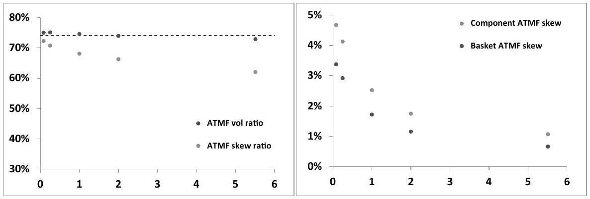
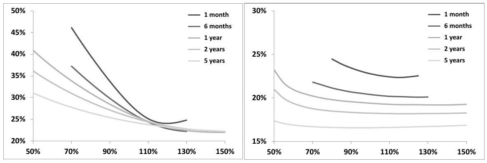
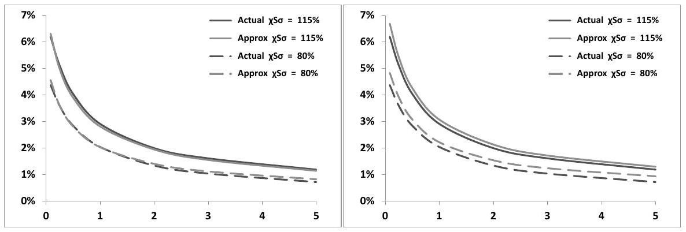
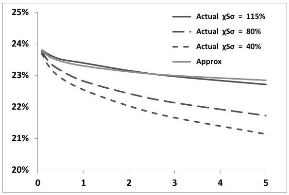
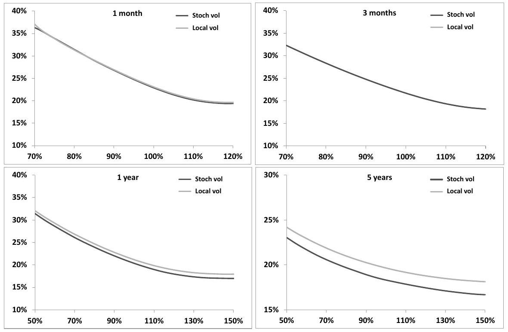
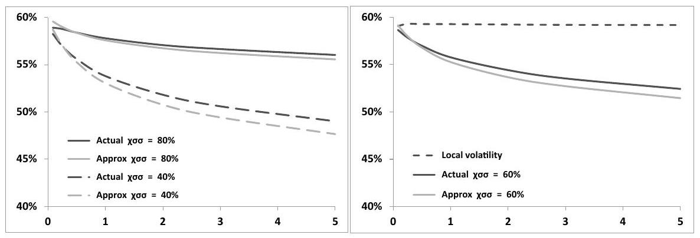
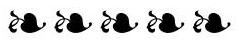

## Chapter 11

## Multi-asset stochastic volatility

Multi-asset stochastic volatility models are not mere juxtapositions of single-asset models. Obviously we need to specify an asset/asset correlation matrix, just as in a multi-asset Black-Scholes model.

In addition to the individual spot/volatility and volatility/volatility covariance functions whose role we have examined in Chapter 8, multi-asset stochastic volatility models involve cross spot/volatility and volatility/volatility correlations. What is the effect of these new parameters?

We propose a parametrization of the global correlation matrix based on observable physical quantities, study the ATMF skew of a basket and the correlation swap.

In the course of our discussion we use the example of the multi-asset local volatility model, the most popular multi-asset stochastic volatility model.

### 11.1 The short ATMF basket skew

This section focuses on the short-maturity ATMF basket skew. Consider a basket $B$ consisting of $n$ assets, with weights $\alpha_{i}$ :

$$
B=\sum_{i} \alpha_{i} S_{i}
$$

and let us define relative weights $w_{i}=\frac{\alpha_{i} S_{i}}{B}: \Sigma_{i} w_{i}=1$. The variation of $B$ is:

$$
\begin{equation*}
\frac{d B}{B}=\sum_{i} w_{i} \frac{d S_{i}}{S_{i}} \tag{11.1}
\end{equation*}
$$
^eq11-1

While the $\alpha_{i}$ are fixed, the $w_{i}$ are not; as we will be studying the short-maturity case we will make the approximation that the $w_{i}$ are constant. From the results of Section 8.5, the short ATMF implied volatility $\widehat{\sigma}_{B}$ and skew $\mathcal{S}_{B}$ are given by - see formula (8.36), page 322:

$$
\begin{align*}
\widehat{\sigma}_{B} & =\sigma_{B}  \tag{11.2a}\\
\mathcal{S}_{B} & =\frac{1}{2 \widehat{\sigma}_{B}^{2}} \frac{\left\langle d \ln B d \widehat{\sigma}_{B}\right\rangle}{d t} \tag{11.2b}
\end{align*}
$$
^eq11-2a
^eq11-2b

where $\sigma_{B}$ is the instantaneous volatility of the basket which, from (11.1) is given by:

$$
\sigma_{B}^{2}=\sum_{i j} w_{i} w_{j} \rho_{i j} \sigma_{i} \sigma_{j}
$$

$\sigma_{i}$ is the instantaneous volatility of asset $i-$ equal to the short ATMF volatility $\widehat{\sigma}_{i}-$ and $\rho_{i j}$ is the correlation of $S_{i}$ and $S_{j}$. The relationship between the short ATMF basket volatility and the short ATMF volatilities of the constituents reads:

$$
\begin{equation*}
\widehat{\sigma}_{B}=\sqrt{\sum_{i j} w_{i} w_{j} \rho_{i j} \sigma_{i} \sigma_{j}}=\sqrt{\sum_{i j} w_{i} w_{j} \rho_{i j} \widehat{\sigma}_{i} \widehat{\sigma}_{j}} \tag{11.3}
\end{equation*}
$$
^eq11-3

$d \widehat{\sigma}_{B}$ is given by:

$$
d \widehat{\sigma}_{B}=\frac{1}{\widehat{\sigma}_{B}} \sum_{i j} w_{i} w_{j} \rho_{i j} \widehat{\sigma}_{i} d \widehat{\sigma}_{j}
$$

and we get:

$$
\begin{aligned}
& \frac{1}{2 \widehat{\sigma}_{B}^{2}} \frac{\left\langle d \ln B d \widehat{\sigma}_{B}\right\rangle}{d t}=\frac{1}{2 \widehat{\sigma}_{B}^{3}} \sum_{i j k} w_{i} w_{j} w_{k} \rho_{i j} \widehat{\sigma}_{i} \frac{\left\langle d \ln S_{k} d \widehat{\sigma}_{j}\right\rangle}{d t} \\
& \quad=\frac{1}{2 \widehat{\sigma}_{B}^{3}} \sum_{i j} w_{i} w_{j}^{2} \rho_{i j} \widehat{\sigma}_{i} \frac{\left\langle d \ln S_{j} d \widehat{\sigma}_{j}\right\rangle}{d t}+\frac{1}{2 \widehat{\sigma}_{B}^{3}} \sum_{i j \neq k} w_{i} w_{j} w_{k} \rho_{i j} \widehat{\sigma}_{i} \frac{\left\langle d \ln S_{k} d \widehat{\sigma}_{j}\right\rangle}{d t}
\end{aligned}
$$

The basket skew is thus given by:

$$
\begin{equation*}
\mathcal{S}_{B}=\frac{1}{\widehat{\sigma}_{B}^{3}} \sum_{i j} w_{i} w_{j}^{2} \rho_{i j} \widehat{\sigma}_{i} \widehat{\sigma}_{j}^{2} \mathcal{S}_{j}+\frac{1}{2 \widehat{\sigma}_{B}^{3}} \sum_{i j \neq k} w_{i} w_{j} w_{k} \rho_{i j} \widehat{\sigma}_{i} \frac{\left\langle d \ln S_{k} d \widehat{\sigma}_{j}\right\rangle}{d t} \tag{11.4}
\end{equation*}
$$
^eq11-4

where we have separated terms involving the covariance on an asset with its own volatility and have used (11.2b) to relate $\left\langle d \ln S_{j} d \widehat{\sigma}_{j}\right\rangle$ to $\mathcal{S}_{j}$, the ATMF skew of basket component $S_{j}$. Expression (11.4) shows that the basket ATMF skew is generated partly by the ATMF skew of the basket components and partly by the covariance of each component with other components' ATMF volatilities.

### 11.1.1 The case of a large homogeneous basket

Assume that all volatilities and correlations are equal and that the $n$ components of the basket are equally weighted: $\widehat{\sigma}_{i} \equiv \widehat{\sigma}, \rho_{i j} \equiv \rho_{S S}, \mathcal{S}_{i}=\mathcal{S}, w_{i}=\frac{1}{n}$. Expressions (11.3) and (11.4) for the basket ATMF volatility and skew simplify to:

$$
\begin{align*}
\widehat{\sigma}_{B} & =\sqrt{\frac{1+(n-1) \rho_{S S}}{n}} \widehat{\sigma}  \tag{11.5a}\\
\mathcal{S}_{B} & =\frac{1+(n-1) \rho_{S S}}{n} \frac{\widehat{\sigma}^{3}}{\widehat{\sigma}_{B}^{3}}\left[\frac{\mathcal{S}}{n}+\frac{n-1}{n} \frac{1}{2 \widehat{\sigma}^{2}} \frac{\langle d \ln S d \widehat{\sigma}\rangle_{\text {cross }}}{d t}\right] \tag{11.5b}
\end{align*}
$$
^eq11-5a
^eq11-5b

where $\langle d \ln S d \widehat{\sigma}\rangle_{\text {cross }}$ denotes the instantaneous covariation of a basket component with another component's ATMF volatility. Observe that the portion contributed to $\mathcal{S}_{B}$ by each component's ATMF skew scales like $\frac{1}{n}$, hence goes to zero for a large basket.

For a large basket $(n \gg 1)$ - which is the case of most equity indexes - we get the following simpler formulas:

$$
\begin{align*}
& \widehat{\sigma}_{B} \simeq \sqrt{\rho_{S S}} \widehat{\sigma}  \tag{11.6a}\\
& \mathcal{S}_{B} \simeq \frac{1}{\sqrt{\rho_{S S}}} \frac{1}{2 \widehat{\sigma}^{2}} \frac{\langle d \ln S d \widehat{\sigma}\rangle_{\text {cross }}}{d t} \tag{11.6b}
\end{align*}
$$
^eq11-6a
^eq11-6b

Equation (11.6b) makes it clear that the short ATMF skew of a large basket only depends on cross-asset spot-volatility covariances. Consider the following opposite cases:

- $\langle d \ln S d \widehat{\sigma}\rangle_{\text {cross }}=0$ : a component's volatility is uncorrelated with other components. In this case $\mathcal{S}_{B}=0$.
- $\langle d \ln S d \widehat{\sigma}\rangle_{\text {cross }}=\langle d \ln S d \widehat{\sigma}\rangle_{\text {diag }}$ where $\langle d \ln S d \widehat{\sigma}\rangle_{\text {diag }}$ is the instantaneous covariation of a basket component with its own implied volatility. This situation is obtained for example by assuming that volatilities of all assets are driven by a single Brownian motion: the $\widehat{\sigma}_{i}$ are $100 \%$ correlated. Using:

$$
\begin{equation*}
\mathcal{S}=\frac{1}{2 \widehat{\sigma}^{2}} \frac{\langle d \ln S d \widehat{\sigma}\rangle_{\mathrm{diag}}}{d t} \tag{11.7}
\end{equation*}
$$
^eq11-7

we get:

$$
\begin{equation*}
\mathcal{S}_{B} \simeq \frac{1}{\sqrt{\rho_{S S}}} \mathcal{S} \tag{11.8}
\end{equation*}
$$
^eq11-8

The basket skew is larger than the component's skew.
Before turning to the real case, we examine the prediction of the local volatility model.

### 11.1.2 The local volatility model

A multi-asset local volatility model is a peculiar stochastic volatility model in that it only takes as inputs asset-asset correlations. Implied volatilities are functions of spot and time: $\widehat{\sigma}=\widehat{\sigma}(t, S)$, thus are driven by the same Brownian motion as the spot process. For a homogeneous basket, such that the local volatility functions of all components are identical, this entails that:

$$
\langle d \ln S d \widehat{\sigma}\rangle_{\text {cross }}=\rho_{S S}\langle d \ln S d \widehat{\sigma}\rangle_{\text {diag }}
$$

Using again (11.7), expressions (11.5) become:

$$
\begin{align*}
\widehat{\sigma}_{B} & =\sqrt{\frac{1+(n-1) \rho_{S S}}{n}} \widehat{\sigma} \simeq \sqrt{\rho_{S S}} \widehat{\sigma}  \tag{11.9a}\\
\mathcal{S}_{B} & =\sqrt{\frac{1+(n-1) \rho_{S S}}{n}} \mathcal{S} \simeq \sqrt{\rho_{S S}} \mathcal{S} \tag{11.9b}
\end{align*}
$$
^eq11-9a
^eq11-9b

One consequence of (11.9) is that, in the local volatility model, for short maturities, the ratios of ATMF basket skew to ATMF component skew and of ATMF basket volatility to ATMF component volatility are identical and equal to $\sqrt{\rho_{S S}}$.

$$
\begin{equation*}
\frac{\mathcal{S}_{B}}{\mathcal{S}} \simeq \frac{\widehat{\sigma}_{B}}{\widehat{\sigma}} \simeq \sqrt{\rho_{S S}} \tag{11.10}
\end{equation*}
$$
^eq11-10

Figure 11.1 provides an illustration of how well relationship (11.10) is actually obeyed, for a range of maturities. We have taken $n=10, \rho_{S S}=50 \%$, and have used for the 10 components the same smile. ${ }^{1}$

Observe how $\frac{\widehat{\sigma}_{B}}{\widehat{\sigma}}$ stays remarkably close to its theoretical value $\sqrt{\frac{1+(n-1) \rho_{S S}}{n}}= 74.2 \%$, even for long maturities. $\frac{\mathcal{S}_{B}}{\mathcal{S}}$, on the other hand, is in fact lower than its short-maturity value (11.9b).

Figure 11.1: Left: ratios $\frac{\widehat{\sigma}_{B}}{\widehat{\sigma}}$ and $\frac{\mathcal{S}_{B}}{\mathcal{S}}$ as a function of maturity (years) in the local volatility model for an equally weighted basket of 10 assets with the same smile. The dashed line indicates the theoretical short-maturity value $\sqrt{\frac{1+(n-1) \rho_{S S}}{n}}$. Right: the ATMF skew expressed as the difference of the implied volatilities of the $95 \%$ and 105\% strikes.

### 11.1.3 The basket skew in reality

Typically, implied correlations levels for equity indexes - derived from (11.6a) are $\rho_{S S} \simeq 60 \%$ : ATMF index implied volatilities are about $25 \%$ lower than stock implied volatilities. Market ATMF skews of indexes are stronger than stock skews. They are typically about $25 \%$ larger - this is in fact roughly what formula (11.8) for the case of $100 \%$ correlated volatilities yields.

This stands in stark contrast with the prediction of the local volatility model: the short-maturity approximate formula (11.10) implies that the index skew should be about $20 \%$ lower than the stock skew; values of $\frac{\mathcal{S}_{B}}{\mathcal{S}}$ in Figure 11.1 - obtained with $\rho_{S S}=50 \%$ - show that the actual ratio in the local volatility model is lower still.

[^160]
### 11.1.4 Digression - how many stocks are there in an index?

Formulas (11.5a) and (11.5b) for $\widehat{\sigma}_{B}$ and $\mathcal{S}_{B}$ apply to the case of an equally weighted basket; the large-basket regime is reached when $n \gg 1$. Equity indexes are not equally weighted baskets. Given a particular index, which value of $n$ should be used in (11.5a) and (11.5b) for assessing whether the asymptotic regime is applicable?

Let us assume that the volatilities of the index components are all equal to $\sigma .^{2} \sigma_{B}^{2}$ is given by:

$$
\begin{equation*}
\sigma_{B}^{2}=\sigma^{2} \sum_{i j} w_{i} w_{j} \rho_{i j}=\sigma^{2}\left(\sum_{i} w_{i}^{2}+\rho_{S S} \sum_{i \neq j} w_{i} w_{j}\right) \tag{11.11}
\end{equation*}
$$
^eq11-11

Comparing this formula with (11.5a), we see that the effective number of components of an index, $n^{\star}$, should be defined as: ${ }^{3}$

$$
\begin{equation*}
n^{\star}=\frac{1}{\Sigma_{i} w_{i}^{2}} \tag{11.12}
\end{equation*}
$$
^eq11-12

Table 11.1 lists the value of $n$ and $n^{\star}$ for a few equity indexes; $n^{\star}$ can be sizeably smaller than $n$.

|  | S\&P 500 | Euro Stoxx 50 | NIKKEI | KOSPI | FTSE | SMI | CAC | Russell 2000 |
| :--- | :---: | :---: | :---: | :---: | :---: | :---: | :---: | :---: |
| $n$ | 500 | 50 | 225 | 200 | 101 | 20 | 40 | 2000 |
| $n^{\star}$ | 143 | 37 | 47 | 17 | 36 | 8 | 20 | 1056 |

Table 11.1: Actual ( $n$ ) and effective ( $n^{\star}$ ) number of components of some equity indexes. In (11.12) values of $w_{i}$ as of August 6, 2013 have been used.

### 11.2 Parametrizing multi-asset stochastic volatility models

Given a set of single-asset models, we need to define (a) correlations for the spot processes, (b) a parametrization of cross spot/volatility and volatility/volatility correlations.

Rather than directly parametrizing cross factor/factor and spot/factor correlations, whose significance depends on the specifics of the factor structure, we aim for a parsimonious parametrization of "physical" quantities.

Such parametrization can be used regardless of the particular factor structure of the model at hand.

[^161]We know from Chapter 8 that, at order two in volatilities of volatilities, the smile is determined by the spot/variance and variance/variance covariance functions $\mu(t, u, \xi)=\frac{\left\langle d \ln S_{t} d \xi_{t}^{u}\right\rangle}{d t}$ and $\nu\left(t, u, u^{\prime}, \xi\right)=\frac{\left\langle d \xi_{t}^{u} d \xi_{t}^{u^{\prime}}\right\rangle}{d t}$. We then focus on these objects and define cross spot/factor and factor/factor correlations so that crosscovariance functions are related simply to their diagonal counterparts.

### 11.2.1 A homogeneous basket

Consider the case a basket of $n$ assets, each driven by the two-factor model of Section 7.4 with identical parameters $\nu, \theta, k_{1}, k_{2}, \rho_{X_{1} X_{2}}$ (previously noted $\left.\rho_{12}\right), \rho_{S X_{1}}, \rho_{S X_{2}}$. For the sake of readability, we decide to carry the factor indices as subscripts rather than superscripts, in the present section.

The instantaneous spot/variance and variance/variance covariance functions of an asset $S_{t}$ and its forward variances $\xi_{t}^{u}$ are given by expressions (8.50) and (8.51), page 327:

$$
\begin{equation*}
\mu^{\operatorname{diag}}(t, u, \xi)=2 \nu \alpha_{\theta} \sqrt{\xi^{t}} \xi^{u}\left((1-\theta) \rho_{S X_{1}}^{\operatorname{diag}} e^{-k_{1}(u-t)}+\theta \rho_{S X_{2}}^{\operatorname{diag}} e^{-k_{2}(u-t)}\right) \tag{11.13}
\end{equation*}
$$
^eq11-13

$$
\begin{align*}
\nu^{\operatorname{diag}}\left(t, u, u^{\prime}, \xi\right) & =4 \nu^{2} \xi^{u} \xi^{u^{\prime}} \alpha_{\theta}^{2}\left[(1-\theta)^{2} \rho_{X_{1} X_{1}}^{\operatorname{diag}} e^{-k_{1}\left(u+u^{\prime}-2 t\right)}\right.  \tag{11.14}\\
& +\theta^{2} \rho_{X_{2} X_{2}}^{\operatorname{diag}} e^{-k_{2}\left(u+u^{\prime}-2 t\right)} \\
& \left.+\rho_{X_{1} X_{2}}^{\operatorname{diag}} \theta(1-\theta)\left(e^{-k_{1}(u-t)} e^{-k_{2}\left(u^{\prime}-t\right)}+e^{-k_{2}(u-t)} e^{-k_{1}\left(u^{\prime}-t\right)}\right)\right]
\end{align*}
$$
^eq11-14

where the diag subscript indicates that these covariance functions apply to spot and variances of the same asset. For the diagonal case, we have:

$$
\rho_{S X_{1}}^{\text {diag }}=\rho_{S X_{1}}, \quad \rho_{S X_{2}}^{\text {diag }}=\rho_{S X_{2}}, \quad \rho_{X_{1} X_{1}}^{\text {diag }}=1, \quad \rho_{X_{2} X_{2}}^{\text {diag }}=1, \quad \rho_{X_{1} X_{2}}^{\text {diag }}=\rho_{X_{1} X_{2}}
$$

Upon replacing diag with cross superscripts, $\mu_{\text {cross }}, \nu_{\text {cross }}$ are given by expressions (11.13) and (11.14) as well, except the diag superscript is replaced with cross.

Correlations $\rho_{X_{1} X_{2}}, \rho_{S X_{1}}, \rho_{S X_{2}}$ are set. We need to define $\rho_{S X_{1}}^{\text {cross }}, \rho_{S X_{2}}^{\text {cross }}, \rho_{X_{1} X_{1}}^{\text {cross }}$, $\rho_{X_{2} X_{2}}^{\text {cross }}, \rho_{X_{1} X_{2}}^{\text {cross }}$ as well as the asset-asset correlation $\rho_{S S}$.

Our aim is to parametrize the multi-asset model so that $\mu^{\text {cross }}$ and $\nu^{\text {cross }}$ are defined in terms of their diagonal counterparts. Specifically, we require that the term structure of $\mu^{\text {cross }}$ and $\nu^{\text {cross }}$ - that is their dependency on $u-t$ and $u^{\prime}-t-$ match that of $\mu^{\text {diag }}$ and $\nu^{\text {diag }}$, once corrected for the effect of the term structure of forward variances. Note that prefactors $\sqrt{\xi^{t}} \xi^{u}$ and $\xi^{u} \xi^{u^{\prime}}$ in (11.13) and (11.14) would no longer appear if we worked with instantaneous spot/variance and variance/variance correlations rather than covariances.

We introduce parameter $\chi_{S \sigma}$ and define cross-correlations $\rho_{S X_{1}}^{\text {cross }}, \rho_{S X_{2}}^{\text {cross }}$ through:

$$
\left\{\begin{array}{l}
\rho_{S X_{1}}^{\text {cross }}=\chi_{S \sigma} \rho_{S X_{1}}^{\text {diag }} \\
\rho_{S X_{2}}^{\text {cros }}=\chi_{S \sigma} \rho_{S X_{2}}^{\text {diag }}
\end{array}\right.
$$

$\chi_{S \sigma}$ simply measures how much larger or smaller cross spot/volatility correlations are with respect to their diagonal counterparts. Using (11.13) we can check that, for a flat term structure of VS volatilities: $\mu^{\text {cross }}(t, u, \xi)=\chi_{S \sigma} \mu^{\text {diag }}(t, u, \xi)$ or, equivalently:

$$
\rho^{\operatorname{cross}}\left(S, \widehat{\sigma}_{T}\right)=\chi_{S \sigma} \rho^{\operatorname{diag}}\left(S, \widehat{\sigma}_{T}\right)
$$

where $\rho^{\operatorname{diag}}\left(S, \widehat{\sigma}_{T}\right)$ is the instantaneous correlation between $S$ and its implied VS volatility of maturity $T$ and $\rho^{\text {cross }}\left(S, \widehat{\sigma}_{T}\right)$ is its cross-counterpart.

Turning now to $\nu$, we similarly introduce coefficient $\chi_{\sigma \sigma}$ and define $\rho_{X_{1} X_{1}}^{\text {cross }}, \rho_{X_{2} X_{2}}^{\text {cross }}, \rho_{X_{1} X_{2}}^{\text {cross }}$ as:

$$
\left\{\begin{array}{l}
\rho_{X_{1} X_{1}}^{\text {cross }}=\chi_{\sigma \sigma} \rho_{X_{1} X_{1}}^{\text {diag }} \\
\rho_{X_{2} X_{2}}^{\text {cros }}=\chi_{\sigma \sigma} \rho_{X_{2} X_{2}}^{\text {diag }} \\
\rho_{X_{1} X_{2}}^{\text {cross }}=\chi_{\sigma \sigma} \rho_{X_{1} X_{2}}^{\text {diag }}
\end{array}\right.
$$

Thus,

$$
\rho_{X_{1} X_{1}}^{\mathrm{cross}}=\chi_{\sigma \sigma}, \rho_{X_{2} X_{2}}^{\mathrm{cross}}=\chi_{\sigma \sigma}, \rho_{X_{1} X_{2}}^{\mathrm{cross}}=\chi_{\sigma \sigma} \rho_{X_{1} X_{2}}
$$

One can check on (11.14) that with this parametrization, the instantaneous correlation between $\xi_{i}^{u}$ and $\xi_{j}^{u^{\prime}}$ where $i, j$ denote different assets is equal to $\chi_{\sigma \sigma}$ times the correlation of $\xi_{i}^{u}$ and $\xi_{i}^{u^{\prime}}$. For a flat term structure of VS volatilities $\nu^{\text {cross }}\left(t, u, u^{\prime}, \xi\right)=\chi_{\sigma \sigma} \nu^{\text {diag }}\left(t, u, u^{\prime}, \xi\right)$ or, equivalently:

$$
\rho^{\operatorname{cross}}\left(\widehat{\sigma}_{T}, \widehat{\sigma}_{T^{\prime}}\right)=\chi_{\sigma \sigma} \rho^{\operatorname{diag}}\left(\widehat{\sigma}_{T}, \widehat{\sigma}_{T^{\prime}}\right)
$$

where $\rho^{\operatorname{diag}}\left(\widehat{\sigma}_{T}, \widehat{\sigma}_{T^{\prime}}\right)$ is the instantaneous correlation between VS volatilities of maturities $T, T^{\prime}$ of the same underlying and $\rho^{\text {cross }}\left(\widehat{\sigma}_{T}, \widehat{\sigma}_{T^{\prime}}\right)$ is a similarly-defined quantity for correlations of VS volatilities of different underlyings.

Finally we introduce the (uniform) correlation between spot processes, $\rho_{S S}$. Each asset is associated to 3 Brownian motions: $W_{i}^{S}, W_{i}^{1}, W_{i}^{2}$. The global correlation matrix is thus of dimension $3 n \times 3 n$. What are the conditions on $\rho_{S S}, \chi_{\sigma \sigma}, \chi_{S \sigma}$ so that it is positive?

Conditions on $\rho_{S S}, \chi_{\sigma \sigma}, \chi_{S \sigma}$
Let us compute the eigenvalues of matrix $\Omega$, defined by: $\Omega=\frac{1}{d t}\left\langle d U d U^{\top}\right\rangle$ where $U^{\top}=\left(W_{1}^{S} \cdots W_{n}^{S}, W_{1}^{1} \cdots W_{n}^{1}, W_{1}^{2} \cdots W_{n}^{2}\right)$.

Let $\lambda$ be an eigenvalue of $\Omega$, associated to the eigenvector $T$, whose components we write $T^{\top}=\left(s_{1} \cdots s_{n}, x_{1} \cdots x_{n}, y_{1} \cdots y_{n}\right)$. Expressing that $\Omega T=\lambda T$ we get, for $1 \leq i \leq n$ :
$\left\{\begin{array}{c}\left(s_{i}+\rho_{S S} \bar{\Sigma}_{j} s_{j}\right)+\rho_{S X_{1}}\left(x_{i}+\chi_{S \sigma} \bar{\Sigma}_{j} x_{j}\right)+\rho_{S X_{2}}\left(y_{i}+\chi_{S \sigma} \bar{\Sigma}_{j} y_{j}\right)=\lambda s_{i} \\ \rho_{S X_{1}}\left(s_{i}+\chi_{S \sigma} \bar{\Sigma}_{j} s_{j}\right)+\left(x_{i}+\chi_{\sigma \sigma} \bar{\Sigma}_{j} x_{j}\right)+\rho_{X_{1} X_{2}}\left(y_{i}+\chi_{\sigma \sigma} \bar{\Sigma}_{j} y_{j}\right)=\lambda x_{i} \\ \rho_{S X_{2}}\left(s_{i}+\chi_{S \sigma} \bar{\Sigma}_{j} s_{j}\right)+\rho_{X_{1} X_{2}}\left(x_{i}+\chi_{\sigma \sigma} \bar{\Sigma}_{j} x_{j}\right)+\left(y_{i}+\chi_{\sigma \sigma} \bar{\Sigma}_{j} y_{j}\right)=\lambda y_{i}\end{array}\right.$
where $\bar{\Sigma}_{j}$ is a shorthand notation for $\Sigma_{j \neq i}$ and we have removed the diag superscripts in $\rho_{X_{1} X_{2}}^{\text {diag }}, \rho_{S X_{1}}^{\text {diag }}, \rho_{S X_{2}}^{\text {diag }}$ for notational economy. The correlation structure is invariant under permutation of the $i, j$ indices and in particular under translation: $\rho\left(W_{i}^{\circ}, W_{j}^{\bullet}\right)=\rho\left(W_{i+k \bmod n}^{\circ}, W_{j+k \bmod n}^{\bullet}\right) \forall k$ where $\circ, \bullet$ stand for $S, 1,2$.

We thus diagonalize $\Omega$ in the basis of eigenvectors of the discrete translation operator. $T$ is parametrized with the 4 numbers $\theta_{k}, s, x, y$ :

$$
T^{\boldsymbol{\top}}=\left(s e^{\boldsymbol{i} \theta_{k}} \cdots s e^{\boldsymbol{i n} \theta_{k}}, x e^{\boldsymbol{i} \theta_{k}} \cdots x e^{\boldsymbol{i n} \theta_{k}}, y e^{\boldsymbol{i} \theta_{k}} \cdots y e^{\boldsymbol{i n} \theta_{k}}\right)
$$

with $\theta_{k}=\frac{2 k \pi}{n}$ where $k=0 \cdots n-1$ and $\boldsymbol{i}=\sqrt{-1}$. We have:

$$
\sum_{j=0, j \neq i}^{n-1} e^{i j \theta_{k}}=\sum_{j=i+1}^{n-1+i} e^{i j \theta_{k}}=e^{i i \theta_{k}} \sum_{j=1}^{n-1} e^{i j \theta_{k}}= \begin{cases}(n-1) e^{i i \theta_{k}} & k=0 \\ -e^{i i \theta_{k}} & k \neq 0\end{cases}
$$

We thus define $A_{S S}(k)$ by:

$$
A_{S S}(k)=\left(1+\rho_{S S} \Sigma_{j=1}^{j=n-1} e^{i j \theta_{k}}\right)= \begin{cases}1+(n-1) \rho_{S S} & k=0  \tag{11.15}\\ 1-\rho_{S S} & k \neq 0\end{cases}
$$
^eq11-15

$A_{\sigma \sigma}(k), A_{S \sigma}(k)$ are defined similarly in terms of $\chi_{\sigma \sigma}, \chi_{S \sigma}$. We have:

$$
\left\{\begin{array} { l } 
{ A _ { \sigma \sigma } ( k = 0 ) = 1 + ( n - 1 ) \chi _ { \sigma \sigma } } \\
{ A _ { \sigma \sigma } ( k \neq 0 ) = 1 - \chi _ { \sigma \sigma } }
\end{array} \quad \text { and } \quad \left\{\begin{array}{l}
A_{S \sigma}(k=0)=1+(n-1) \chi_{S \sigma} \\
A_{S \sigma}(k \neq 0)=1-\chi_{S \sigma}
\end{array}\right.\right.
$$

The resulting system for $s, x, y$ is:

$$
\left\{\begin{aligned}
A_{S S} s+\rho_{S X_{1}} A_{S \sigma} x+\rho_{S X_{2}} A_{S \sigma} y & =\lambda s \\
\rho_{S X_{1}} A_{S \sigma} s+A_{\sigma \sigma} x+\rho_{X_{1} X_{2}} A_{\sigma \sigma} y & =\lambda x \\
\rho_{S X_{2}} A_{S \sigma} s+\rho_{X_{1} X_{2}} A_{\sigma \sigma} x+A_{\sigma \sigma} y & =\lambda y
\end{aligned}\right.
$$

The condition is thus that the following symmetric matrix

$$
\omega(k)=\left(\begin{array}{ccc}
A_{S S} & \rho_{S X_{1}} A_{S \sigma} & \rho_{S X_{2}} A_{S \sigma} \\
\rho_{S X_{1}} A_{S \sigma} & A_{\sigma \sigma} & \rho_{X_{1} X_{2}} A_{\sigma \sigma} \\
\rho_{S X_{2}} A_{S \sigma} & \rho_{X_{1} X_{2}} A_{\sigma \sigma} & A_{\sigma \sigma}
\end{array}\right)
$$

be positive. This implies in particular that $A_{S S}(k) \geq 0, A_{\sigma \sigma}(k) \geq 0 \forall k$, which places the following bounds on $\rho_{S S}, \chi_{\sigma \sigma}$ :

$$
-\frac{1}{n-1} \leq \rho_{S S}, \chi_{\sigma \sigma} \leq 1
$$

These conditions, in the equity context, are not very restrictive.
We now define a "correlation matrix" $\rho(k)$ obtained by rescaling the symmetric matrix $\omega(k)$ : $\rho_{i j}(k)=\frac{\omega_{i j}(k)}{\sqrt{\omega_{i i}(k) \omega_{j j}(k)}}$ :

$$
\rho(k)=\left(\begin{array}{ccc}
1 & \zeta \rho_{S X_{1}} & \zeta \rho_{S X_{2}}  \tag{11.16}\\
\zeta \rho_{S X_{1}} & 1 & \rho_{X_{1} X_{2}} \\
\zeta \rho_{S X_{2}} & \rho_{X_{1} X_{2}} & 1
\end{array}\right)
$$
^eq11-16

where $\zeta(k)$ is given by:

$$
\zeta(k)=\frac{A_{S \sigma}(k)}{\sqrt{A_{S S}(k) A_{\sigma \sigma}(k)}}= \begin{cases}\frac{1+(n-1) \chi_{S \sigma}}{\sqrt{\left(1+(n-1) \rho_{S S}\right)\left(1+(n-1) \chi_{\sigma \sigma}\right)}} & k=0 \\ \frac{1-\chi_{S \sigma}}{\sqrt{\left(1-\rho_{S S}\right)\left(1-\chi_{\sigma \sigma}\right)}} & k \neq 0\end{cases}
$$

$\rho(k)$ in (11.16) is in fact the correlation matrix of the single-asset case, but with spot/volatility correlations rescaled by the factor $\zeta(k)$, which may be smaller or larger than 1 depending on the values of $\rho_{S S}, \chi_{\sigma \sigma}, \chi_{S \sigma}$.
$\chi_{S \sigma}$ is allowed to be larger than 1 , unlike $\rho_{S S}$ and $\chi_{\sigma \sigma}$. This will be needed in situations when the index skew is much steeper than the component skew - see the discussion in Section 11.1.1.

The case $\zeta(k) \equiv 1$ is obtained by taking $\chi_{S \sigma}=\chi_{\sigma \sigma}=\rho_{S S} . \rho(k)$ is then equal to the single-asset correlation matrix thus the positivity of the $3 n \times 3 n$ global covariance matrix is ensured. In this model, cross-correlations (spot/spot, spot/volatility, volatility/volatility) are all equal to $\rho_{S S}$ times their diagonal counterparts. This is the case of the multi-asset local volatility model. ${ }^{4}$

## Conclusion

Given correlations $\rho_{S X_{1}}, \rho_{S X_{1}}, \rho_{X_{1} X_{2}}$ for the single-asset case, we parametrize the $3 n \times 3 n$ global correlation matrix of the multi-asset case by introducing three additional parameters: $\rho_{S S}, \chi_{\sigma \sigma}, \chi_{S \sigma}$.
$\rho_{S S}$ is the spot/spot correlation. $\chi_{\sigma \sigma}, \chi_{S \sigma}$ define cross spot/volatility and volatility/volatility covariance functions in terms of their diagonal counterparts.
$\rho_{S S}$ and $\chi_{\sigma \sigma}$ are restricted to the interval $\left[-\frac{1}{n-1}, 1\right]$. The necessary and sufficient condition on $\rho_{S S}, \chi_{\sigma \sigma}, \chi_{S \sigma}$ for the global correlation matrix to be positive is that the following effective correlation matrix for the single-asset case:

$$
\left(\begin{array}{ccc}
1 & \zeta \rho_{S X_{1}} & \zeta \rho_{S X_{2}} \\
\zeta \rho_{S X_{1}} & 1 & \rho_{X_{1} X_{2}} \\
\zeta \rho_{S X_{2}} & \rho_{X_{1} X_{2}} & 1
\end{array}\right)
$$

be positive for the two following values of $\zeta$ :

$$
\begin{align*}
\zeta & =\frac{1+(n-1) \chi_{S \sigma}}{\sqrt{\left(1+(n-1) \rho_{S S}\right)\left(1+(n-1) \chi_{\sigma \sigma}\right)}}  \tag{11.17a}\\
\zeta & =\frac{1-\chi_{S \sigma}}{\sqrt{\left(1-\rho_{S S}\right)\left(1-\chi_{\sigma \sigma}\right)}} \tag{11.17b}
\end{align*}
$$
^eq11-17a
^eq11-17b

in addition to the $\zeta=1$ case. This is the case if $\left|\zeta \rho_{S X_{1}}\right| \leq 1,\left|\zeta \rho_{S X_{2}}\right| \leq 1$ and:

$$
-1 \leq \frac{\rho_{X_{1} X_{2}}-\zeta^{2} \rho_{S X_{1}} \rho_{S X_{2}}}{\sqrt{1-\zeta^{2} \rho_{S X_{1}}^{2}} \sqrt{1-\zeta^{2} \rho_{S X_{2}}^{2}}} \leq 1
$$

[^162]It is easy to check, going backwards through the derivation in Section 11.2.1, that these necessary conditions are also sufficient: we have effectively built the $3 n$ eigenvectors of $\Omega .^{5}$

While in what follows we will be using a homogeneous model, in practice, parameters $\nu, \theta, k_{1}, k_{2}, \rho_{X_{1} X_{2}}, \rho_{S X_{1}}, \rho_{S X_{2}}$ are different for different components. In particular, even though we typically use identical values for $\nu, \theta, k_{1}, k_{2}, \rho_{X_{1} X_{2}}$ so that volatilities of volatilities are identical, we may use different values for $\rho_{S X_{1}}^{\text {diag }}, \rho_{S X_{2}}^{\text {diag }}$. Consider two components $S_{i}, S_{j}$. Should we set $\rho_{S^{i} X_{1}^{j}}^{\text {cross }}=\chi_{S \sigma} \rho_{S^{j} X_{1}^{j}}^{\text {diag }}$ or $\rho_{S^{i} X_{1}^{j}}^{\text {cross }}= \chi_{S \sigma} \rho_{S^{i} X_{1}^{i}}^{\text {diag }}$ ?

When setting the cross spot/volatility correlations of $S_{i}$ and $\widehat{\sigma}_{j}^{T}$, it is more reasonable to derive the $T$-dependence of $\rho\left(S_{i}, \widehat{\sigma}_{j}^{T}\right)$ from the term-structure of $\rho\left(S_{j}, \widehat{\sigma}_{j}^{T}\right)$ rather than that of $\rho\left(S_{i}, \widehat{\sigma}_{i}^{T}\right)$. We would thus set:

$$
\rho_{S^{i} X_{1}^{j}}^{\text {cross }}=\chi_{S \sigma} \rho_{S^{j} X_{1}^{j}}^{\text {diag }}
$$

and likewise for $\rho_{S^{i} X_{2}^{j}}^{\text {cross }}$. Going back to implied volatilities, this is equivalent to setting:

$$
\rho\left(S^{i}, \widehat{\sigma}_{T}^{j}\right)=\chi_{S \sigma} \rho\left(S^{j}, \widehat{\sigma}_{T}^{j}\right)
$$

Likewise, with respect to volatility/volatility correlations, we could set

$$
\begin{aligned}
\text { either } \rho\left(\widehat{\sigma}_{T}^{i}, \widehat{\sigma}_{T^{\prime}}^{j}\right) & =\chi_{\sigma \sigma} \rho\left(\widehat{\sigma}_{T}^{i}, \widehat{\sigma}_{T^{\prime}}^{i}\right) \\
\text { or } \rho\left(\widehat{\sigma}_{T}^{i}, \widehat{\sigma}_{T^{\prime}}^{j}\right) & =\chi_{\sigma \sigma} \rho\left(\widehat{\sigma}_{T}^{j}, \widehat{\sigma}_{T^{\prime}}^{j}\right)
\end{aligned}
$$

In practice, volatility/volatility correlations are sufficiently similar across underlyings that either choice results in very similar values of $\chi_{\sigma \sigma}$ - see the examples in Table 11.2 below.

The global correlation matrix we thus build for a non-homogeneous basket is not guaranteed to be positive - but is not expected to be very negative either; in case it is we use the algorithm proposed in [61] to generate the closest positive correlation matrix. ${ }^{6}$

### 11.2.2 Realized values of $\chi_{S \sigma}$ and $\chi_{\sigma \sigma}$

Typical realized values of $\chi_{S \sigma}$ and $\chi_{\sigma \sigma}$ for indexes appear in Table 11.2. For each pair of underlyings ( $S^{1}, S^{2}$ ), two values of $\chi_{S \sigma}$ and $\chi_{\sigma \sigma}$ have been computed, obtained by averaging respectively either $\rho\left(\widehat{\sigma}_{T}^{1}, S^{2}\right) / \rho\left(\widehat{\sigma}_{T}^{1}, S^{1}\right)$ or

[^163]$\rho\left(\widehat{\sigma}_{T}^{2}, S^{1}\right) / \rho\left(\widehat{\sigma}_{T}^{2}, S^{2}\right)$ over several maturities. Likewise, for the determination of $\chi_{\sigma \sigma}$, two values are obtained by averaging either $\rho\left(\widehat{\sigma}_{T}^{1}, \widehat{\sigma}_{T^{\prime}}^{2}\right) / \rho\left(\widehat{\sigma}_{T}^{1}, \widehat{\sigma}_{T^{\prime}}^{1}\right)$ or $\rho\left(\widehat{\sigma}_{T}^{1}, \widehat{\sigma}_{T^{\prime}}^{2}\right) / \rho\left(\widehat{\sigma}_{T}^{2}, \widehat{\sigma}_{T^{\prime}}^{2}\right)$, for all $\left(T, T^{\prime}\right)$ couples.

Note that it is important to use asynchronous estimators - lest we underestimate correlations; see [12].

| $\rho$   $\mathrm{X}_{\mathrm{S} \sigma}$ | June 2008 - June 2013 |  |  |  |  | June 2003 - June 2008 |  |  |  |  |
| :--- | :--- | :--- | :--- | :--- | :--- | :--- | :--- | :--- | :--- | :--- |
|  | S\&P500 Stoxx50 | Stoxx50 FTSE | S\&P500 NIKKEI | Stoxx50 NIKKEI | NIKKEI KOSPI | S\&P500 Stoxx50 | Stoxx50 FTSE | S\&P500 NIKKEI | Stoxx50 NIKKEI | NIKKEI KOSPI |
|  | 83\% | 89\% | 55\% | 60\% | 67\% | 71\% | 86\% | 45\% | 59\% | 66\% |
|  | 87\% | 95\% | 59\% | 63\% | 85\% | 78\% | 89\% | 56\% | 61\% | 108\% |
| $\mathrm{X}_{\mathrm{S} \sigma}$ | 86\% | 93\% | 71\% | 78\% | 78\% | 75\% | 91\% | 53\% | 77\% | 65\% |
| $\chi_{\sigma \sigma}$ | 84\% | 92\% | 54\% | 60\% | 72\% | 72\% | 85\% | 31\% | 40\% | 50\% |
| $\chi_{\sigma \sigma}$ | 84\% | 92\% | 55\% | 61\% | 73\% | 71\% | 85\% | 31\% | 41\% | 50\% |

Table 11.2: Historical spot/spot correlations and values of $\chi_{S \sigma}$ and $\chi_{\sigma \sigma}$ for different pairs of indexes, measured on two 5 -year samples. $\chi_{S \sigma}$ and $\chi_{\sigma \sigma}$ are evaluated by averaging pairwise ratios of spot/volatility and volatility/volatility correlations using implied ATMF volatilities with maturities 3 months, 6 months, 1 year, 2 years. The asynchronous estimator in [12] has been used.

Empirically, diagonal volatility/volatility correlations across indexes are very similar, thus the two ways of estimating $\chi_{\sigma \sigma}$ yield very similar value; we can thus use an average of the two estimates.

This is less the case for $\chi_{S \sigma}$. Indeed, historical regimes of spot/volatility correlations for the Nikkei index, for example, can be quite different from those of the S\&P 500 and Euro Stoxx 50 indexes. This is also reflected in the different behavior of their SSRs - see Figure 9.10, page 381.

### 11.3 The ATMF basket skew

After focusing in Section 11.1 on short maturities, we derive now an approximation of the basket ATMF skew at order one in volatility of volatility by using expression (8.22) which involves the spot/variance covariance function evaluated at order one in volatility of volatility. We use the notation $\hat{\sigma}_{T}^{B}$ and $\mathcal{S}_{T}^{B}$ for the basket VS volatility and ATMF skew and denote basket forward variances by $\zeta_{t}^{u}$.

We will assume that the underlying model is time-homogeneous and that the VS term structures of all components are flat and identical.

From equation (8.22), page $314, \mathcal{S}_{T}^{B}$ is given by:

$$
\begin{equation*}
\mathcal{S}_{T}^{B}=\hat{\sigma}_{T}^{B} \frac{C_{B}^{x \xi}(T)}{2\left(\left(\hat{\sigma}_{T}^{B}\right)^{2} T\right)^{2}} \tag{11.18}
\end{equation*}
$$
^eq11-18

where $C_{B}^{x \xi}(T)$ is the doubly-integrated spot/variance covariance function:

$$
\begin{align*}
C_{B}^{x \xi}(T) & =\int_{0}^{T} d t \int_{t}^{T} d u \mu_{B}(t, u)  \tag{11.19}\\
\mu_{B}(t, u) & =\lim _{d t \rightarrow 0} \frac{1}{d t} E_{t}\left[d \ln B_{t} d \zeta_{t}^{u}\right] \tag{11.20}
\end{align*}
$$
^eq11-19
^eq11-20

where $B_{t}=\Sigma_{i} w_{i} S_{i t} . \mu_{B}(t, u)$ is evaluated at order one in volatility of volatility on the initial basket variance curve.

Let us assume that the basket is homogeneous and equally weighted; spot correlations $\rho_{i j}, i \neq j$ are all identical, equal to $\rho$ and we use the correlation parametrization of Section 11.2.1.

We also make the approximation that weights are frozen, equal to their initial values, which we denote by $w_{i 0}$. Basket forward variances $\zeta_{t}^{T}$ are given by:

$$
\begin{align*}
\zeta_{t}^{u} & =E_{t}\left[\sum_{i j} w_{i} w_{j} \rho_{i j} \sqrt{\xi_{i u}^{u}} \sqrt{\xi_{j u}^{u}}\right]  \tag{11.21}\\
& =\sum_{i j} \rho_{i j} w_{i 0} w_{j 0} E_{t}\left[\sqrt{\xi_{i u}^{u}} \sqrt{\xi_{j u}^{u}}\right] \tag{11.22}
\end{align*}
$$
^eq11-21
^eq11-22

Thus

$$
d \zeta_{t}^{u}=\sum_{i j} w_{i 0} w_{j 0} \rho_{i j} E_{t}\left[\frac{\sqrt{\xi_{j u}^{u}}}{\sqrt{\xi_{i u}^{u}}} d \xi_{i u}^{u}\right]
$$

At order one in volatility of volatility, it is sufficient to replace the prefactor inside the expectation with its value in the unperturbed state, that is using forward variances values at $t=0$. At this order:

$$
d \zeta_{t}^{u}=\sum_{i j} w_{i 0} w_{j 0} \rho_{i j} \frac{\sqrt{\xi_{j 0}^{u}}}{\sqrt{\xi_{i 0}^{u}}} E_{t}\left[d \xi_{i u}^{u}\right]=\sum_{i j} w_{i 0} w_{j 0} \rho_{i j} \frac{\sqrt{\xi_{j 0}^{u}}}{\sqrt{\xi_{i 0}^{u}}} d \xi_{i t}^{u}
$$

Let us now compute $\mu_{B}(t, u)$. We have:

$$
\frac{d B_{t}}{B_{t}}=\sum_{i} w_{k 0} \frac{d S_{k, t}}{S_{k, t}}
$$

We then get the expression of $\mu_{B}(t, u)$ as a function of the diagonal spot/variance covariance function, which we denote compactly by $\mu(u-t)=\frac{1}{d t}\left\langle d \ln S_{i t} d \xi_{i t}^{u}\right\rangle$, as
we have assumed a time-homogeneous model:

$$
\begin{aligned}
\mu_{B}(t, u) & =\frac{1}{d t}\left\langle d \ln B_{t} d \zeta_{t}^{u}\right\rangle=\sum_{i j k} w_{i 0} w_{j 0} w_{k 0} \rho_{i j} \frac{\sqrt{\xi_{j 0}^{u}}}{\sqrt{\xi_{i 0}^{u}}} \frac{\left\langle d \ln S_{k t} d \xi_{i t}^{u}\right\rangle}{d t} \\
& =\sum_{i j} w_{i 0}^{2} w_{j 0} \rho_{i j} \frac{\sqrt{\xi_{j 0}^{u}}}{\sqrt{\xi_{i 0}^{u}}} \mu(u-t)+\chi_{S \sigma} \sum_{i \neq k, j} w_{i 0} w_{j 0} w_{k 0} \rho_{i j} \frac{\sqrt{\xi_{j 0}^{u}}}{\sqrt{\xi_{i 0}^{u}}} \mu(u-t)
\end{aligned}
$$

For a homogeneous basket with flat and identical term structures of VS volatilities, this simplifies to:

$$
\mu_{B}(t, u)=\frac{1+(n-1) \chi_{S \sigma}}{n} \frac{1+(n-1) \rho_{S S}}{n} \mu(u-t)
$$

Using expression (11.19) for $C_{B}^{x \xi}(T)$ :

$$
C_{B}^{x \xi}(T)=\left[\frac{1+(n-1) \chi_{S \sigma}}{n}\right]\left[\frac{1+(n-1) \rho_{S S}}{n}\right] \int_{0}^{T} d t \int_{0}^{T} d u \mu(u-t)
$$

Finally, the ATMF skew of a homogeneous basket is given, at order one in volatility of volatility, by:

$$
\begin{equation*}
\mathcal{S}_{T}^{B}=\frac{\hat{\sigma}_{0 T}^{B}}{2\left(\left(\hat{\sigma}_{0 T}^{B}\right)^{2} T\right)^{2}}\left[\frac{1+(n-1) \chi_{S \sigma}}{n}\right]\left[\frac{1+(n-1) \rho_{S S}}{n}\right] \int_{0}^{T} d t \int_{t}^{T} d u \mu(u-t) \tag{11.23}
\end{equation*}
$$
^eq11-23

where $\hat{\sigma}_{0 T}^{B}$ is the basket VS volatility at order zero in volatility of volatility, that is with zero volatility of volatility. Assuming that the VS term structures of all components are flat, and equal to $\widehat{\sigma}^{2}$, and that the basket is equally weighted, $\hat{\sigma}_{0 T}^{B}$ is given by:

$$
\left(\hat{\sigma}_{0 T}^{B}\right)^{2}=\frac{1+(n-1) \rho_{S S}}{n} \widehat{\sigma}^{2}
$$

Using this expression of $\hat{\sigma}_{0 T}^{B}$ in (11.23) and remembering that the single-asset skew is given by expression (8.22), page 314, with $C^{x \xi}$ given by (8.13):

$$
\mathcal{S}_{T}=\frac{\widehat{\sigma}}{2\left(\widehat{\sigma}^{2} T\right)^{2}} \int_{0}^{T} d t \int_{t}^{T} d u \mu(u-t)
$$

we get our final expression for the basket skew, as a function of the components' skew:

$$
\begin{equation*}
\mathcal{S}_{T}^{B}=\mathcal{S}_{T} \sqrt{\frac{n}{1+(n-1) \rho_{S S}}}\left[\frac{1+(n-1) \chi_{S \sigma}}{n}\right] \tag{11.24}
\end{equation*}
$$
^eq11-24

Thus an implied value for $\chi_{S \sigma}$ can be backed out of the ratio of basket skew to component skew.

Let us check that in the limit $T \rightarrow 0$, (11.24) yields back the short-maturity result (11.5b) for $\mathcal{S}_{T}^{B}$. Using the fact that $\int_{0}^{T} d t \int_{t}^{T} d u=\frac{T^{2}}{2}$ and that $\mathcal{S}_{T=0}=\frac{\mu(0)}{4 \hat{\sigma}_{T=0}^{3}}$, expression (11.23) for $\mathcal{S}_{T}^{B}$ yields:

$$
\begin{align*}
\mathcal{S}_{T=0}^{B} & =\frac{1}{4\left(\hat{\sigma}_{T=0}^{B}\right)^{3}}\left[\frac{1+(n-1) \chi_{S \sigma}}{n}\right]\left[\frac{1+(n-1) \rho_{S S}}{n}\right] \mu(0) \\
& =\frac{1}{4\left(\hat{\sigma}_{T=0}^{B}\right)^{3}}\left[\frac{1+(n-1) \chi_{S \sigma}}{n}\right]\left[\frac{1+(n-1) \rho_{S S}}{n}\right] 4 \widehat{\sigma}_{T=0}^{3} \mathcal{S}_{T=0} \\
& =\mathcal{S}_{T=0}\left(\frac{\widehat{\sigma}_{T=0}}{\hat{\sigma}_{T=0}^{B}}\right)^{3}\left[\frac{1+(n-1) \chi_{S \sigma}}{n}\right]\left[\frac{1+(n-1) \rho_{S S}}{n}\right] \tag{11.25}
\end{align*}
$$
^eq11-25

where we have omitted the 0 subscript in $\hat{\sigma}_{0 T}^{B}$, as, for $T=0, \hat{\sigma}_{0 T}^{B}=\hat{\sigma}_{T}^{B}$. (11.25) is identical to (11.5b) for $T=0$.

Again, expression (11.24) for $\mathcal{S}_{T}^{B}$ involves the factor $\frac{1+(n-1) \chi_{S \sigma}}{n}$ : the portion contributed to the basket skew by the components' skew scales like $\frac{1}{n}$ and the bulk of the basket skew is generated by cross spot/volatility correlations.

### 11.3.1 Application to the two-factor model

In the two-factor model the dynamics of each component reads:

$$
\left\{\begin{aligned}
d S_{t} & =\sqrt{\xi_{t}^{t}} S_{t} d W_{t}^{S} \\
d \xi_{t}^{T} & =2 \nu \xi_{t}^{T} \alpha_{\theta}\left((1-\theta) e^{-k_{1}(T-t)} d W_{t}^{1}+\theta e^{-k_{2}(T-t)} d W_{t}^{2}\right)
\end{aligned}\right.
$$

where $\nu$ is the lognormal volatility of a very short-dated implied VS volatility, and $\alpha_{\theta}=\left((1-\theta)^{2}+\theta^{2}+2 \rho_{X_{1} X_{2}} \theta(1-\theta)\right)^{-1 / 2}$. The cross spot/variance and variance/variance correlations are parametrized using $\chi_{S \sigma}$ and $\chi_{\sigma \sigma}$ defined in Section 11.2.1 and the correlations between the $S_{i}$ are equal to $\rho$.

For a flat term structure of VS volatilities equal to $\widehat{\sigma}$, the spot/variance covariance function $\mu(\tau)$ is given by:

$$
\begin{equation*}
\mu(\tau)=(2 \nu) \hat{\sigma}^{3} \alpha_{\theta}\left((1-\theta) \rho_{S X_{1}} e^{-k_{1} \tau}+\theta \rho_{S X_{2}} e^{-k_{2} \tau}\right) \tag{11.26}
\end{equation*}
$$
^eq11-26

and the component's ATMF skew at order one in volatility of volatility is given by expression (8.55):

$$
\begin{equation*}
\mathcal{S}_{T}=\nu \alpha_{\theta}\left[(1-\theta) \rho_{S X^{1}} \frac{k_{1} T-\left(1-e^{-k_{1} T}\right)}{\left(k_{1} T\right)^{2}}+\theta \rho_{S X^{2}} \frac{k_{2} T-\left(1-e^{-k_{2} T}\right)}{\left(k_{2} T\right)^{2}}\right] \tag{11.27}
\end{equation*}
$$
^eq11-27

Using (11.24) the basket skew - at order one in volatility of volatility - is given by:

$$
\begin{align*}
\mathcal{S}_{T}^{B} & =\nu \alpha_{\theta} \sqrt{\frac{n}{1+(n-1) \rho_{S S}}}\left[\frac{1+(n-1) \chi_{S \sigma}}{n}\right] \\
& \times\left[(1-\theta) \rho_{S X^{1}} \frac{k_{1} T-\left(1-e^{-k_{1} T}\right)}{\left(k_{1} T\right)^{2}}+\theta \rho_{S X^{2}} \frac{k_{2} T-\left(1-e^{-k_{2} T}\right)}{\left(k_{2} T\right)^{2}}\right] \tag{11.28}
\end{align*}
$$
^eq11-28

While, for the sake of calculating $\mathcal{S}_{T}^{B}$ we have needed $\hat{\sigma}_{T}^{B}$ at order zero in volatility of volatility only, it can be calculated exactly - with the assumption of frozen weights:

$$
\begin{aligned}
\left(\hat{\sigma}_{T}^{B}\right)^{2} & =\frac{1}{T} \int_{0}^{T} \sum_{i j} w_{i 0} w_{j 0} \rho_{i j} E\left[\sqrt{\xi_{i t}^{t}} \sqrt{\xi_{j t}^{t}}\right] d t \\
& =\frac{1}{T} \int_{0}^{T} \sum_{i j} w_{i 0} w_{j 0} \rho_{i j} \sqrt{\xi_{i 0}^{t}} \sqrt{\xi_{j 0}^{t}} h_{i j}(t) d t
\end{aligned}
$$

with $h_{i j}(\tau)$ given by: $h_{i i}(\tau)=1, h_{i \neq j}(\tau)=h(\tau)$, where $h(\tau)$ reads:

$$
\begin{equation*}
h(\tau)=e^{-\nu^{2} \alpha_{\theta}^{2}\left(1-\chi_{\sigma \sigma}\right)\left((1-\theta)^{2} \frac{1-e^{-2 k_{1} \tau}}{2 k_{1}}+\theta^{2} \frac{1-e^{-2 k_{2} \tau}}{2 k_{2}}+2 \theta(1-\theta) \rho_{X_{1} X_{2}} \frac{1-e-\left(k_{1}+k_{2}\right) \tau}{k_{1}+k_{2}}\right)} \tag{11.29}
\end{equation*}
$$
^eq11-29

For flat and identical term-structures of VS volatilities:

$$
\begin{equation*}
\left(\hat{\sigma}_{T}^{B}\right)^{2}=\widehat{\sigma}^{2} \frac{1+(n-1) \rho_{S S} \frac{1}{T} \int_{0}^{T} h(\tau) d \tau}{n} \tag{11.30}
\end{equation*}
$$
^eq11-30

### 11.3.2 Numerical examples

We now test the accuracy of formulas (11.24), (11.30) for $\mathcal{S}_{T}^{B}, \hat{\sigma}_{T}^{B}$ with the twofactor model.

To generate stock-like parameters, we start from the index-like parameters in Table 8.2, page 329, and reduce $\rho_{S X^{1}}, \rho_{S X^{2}}$ by about $30 \%$ so as to reduce the ATMF skew by the same relative amount. The other parameters are left unchanged. The basket component's parameters we obtain appear in Table 11.3.

| $\nu$ | $\theta$ | $k_{1}$ | $k_{2}$ | $\rho_{X^{1} X^{2}}$ | $\rho_{S X^{1}}$ | $\rho_{S X^{2}}$ |
| :---: | :---: | :---: | :---: | :---: | :---: | :---: |
| $174 \%$ | 0.245 | 5.35 | 0.28 | $0 \%$ | $-53.0 \%$ | $-33.9 \%$ |

Table 11.3: Basket component's parameters in the two-factor model.

The component's term-structure of volatilities of volatilities is that corresponding to Set II in Figure 7.2, page 229. The VS term structure of volatilities is flat at $30 \%$. We take $n=10$ components and will use $\rho_{S S}=60 \%$ for the component's correlations. We use vanishing rate and repo.

Let us first set $\chi_{S \sigma}=0$. The basket smile - with $\chi_{\sigma \sigma}=0$ - is shown in Figure 11.2, along with the component's smile for comparison. The basket ATMF skew almost vanishes - a reflection of the fact that the basket ATMF skew is mostly generated by cross spot/volatility correlations.

We now use more reasonable values for $\chi_{S \sigma}$. Figure 11.3 shows basket smiles generated with ( $\chi_{S \sigma}=80 \%, \chi_{\sigma \sigma}=80 \%$ ) and ( $\chi_{S \sigma}=115 \%, \chi_{\sigma \sigma}=80 \%$ ).

Figure 11.2: Left: component's smile with parameters of Table 11.3. Right: basket smile with $\rho_{S S}=60 \%, \chi_{S \sigma}=0$ and $\chi_{\sigma \sigma}=0$.

Figure 11.3: Basket smile with: $\rho_{S S}=60 \%, \chi_{\sigma \sigma}=80 \%$. Left: $\chi_{S \sigma}=80 \%$. Right: $\chi_{S \sigma}=115 \%$.

Comparing with the left-hand graph in Figure 11.2 it is apparent that the basket ATMF skew with $\left(\chi_{S \sigma}=115 \%, \chi_{\sigma \sigma}=80 \%\right)$ is now steeper than the component's ATMF skew.

How accurate are formulas for (11.24),(11.30) for $\mathcal{S}_{T}^{B}, \hat{\sigma}_{T}^{B}$ ?

## Basket ATMF skew

Figure (11.4) shows the 95/105 ATMF basket skew ( $\hat{\sigma}_{K=0.95 S_{0}, T}^{B}-\hat{\sigma}_{K=1.05 S_{0}, T}^{B}$ ), either calculated in a Monte Carlo simulation, or evaluated using (11.24), with $\mathcal{S}_{T}$ given either by the actual component's ATMF skew, or given by (11.27), for two different values of $\chi_{S \sigma}$. The left-hand graph confirms that expression (11.24) is very accurate. The small overestimation of $\mathcal{S}_{T}^{B}$ in the right-hand graph is due to the slight overestimation of the component's skew in (11.27), evidenced in Figure 8.3, page 331.

Figure (11.5) provides another confirmation that the basket ATMF skew is controlled by $\chi_{S \sigma}$. Here we have varied $\chi_{\sigma \sigma}$ while keeping $\rho_{S S}=60 \%$ and $\chi_{S \sigma}=80 \%$ fixed. The ATMF skew hardly changes when $\chi_{\sigma \sigma}$ is varied. For the three values

Figure 11.4: Left: basket $95 / 105$ skew in volatility points (Actual) compared to formula (11.24) (Approx) where the actual component's 95/105 skew has been used. Right: basket $95 / 105$ skew (Actual) compared to formula (11.28) (Approx). Maturities are in years. The two values of $\chi_{S \sigma}=80 \%, 115 \%$ have been used. All other parameters are kept constant, including $\chi_{\sigma \sigma}=80 \%$.

Figure 11.5: One-year basket smiles for different values of $\chi_{\sigma \sigma}$. All other parameters are kept constant: $\rho_{S S}=60 \%$ and $\chi_{S \sigma}=80 \%$.

of $\chi_{\sigma \sigma}$ used: $40 \%, 80 \%, 95 \%$, the 95/105 one-year skew values are respectively: $2.01 \%, 2.05 \%, 2.06 \%$.

Using identical and flat term structures of VS volatilities for the basket components, as well as identical sets of parameters, leads to the particularly simple formulas (11.24) and (11.28) but the derivation of $\mathcal{S}_{T}^{B}$ in the general case presents no particular difficulty. One only needs to express $\mu_{B}(t, u)$ as a function of the component's spot/volatility covariance functions $\mu(t, u, \xi)$, which are given by expression (8.50) in the two-factor model.

## Basket VS volatility

$\hat{\sigma}_{T}^{B}$, either evaluated in a Monte Carlo simulation or given by (11.30), is graphed in Figure 11.6 for different values of $\chi_{S \sigma}$. In expression (11.30), with the approximation

Figure 11.6: $\hat{\sigma}_{T}^{B}$, either evaluated in a Monte Carlo simulation of the two-factor model, for three values of $\chi_{S \sigma}: 40 \%, 80 \%, 115 \%$, or given by expression (11.30). Maturities are in years. The component's parameters are listed in Table 11.3 and $\rho_{S S}=60 \%, \chi_{\sigma \sigma}=80 \%$.

of frozen weights, only spot/spot ( $\rho_{S S}$ ) and volatility/volatility ( $\chi_{\sigma \sigma}$ ) correlations appear.

Figure 11.6 makes it clear that this assumption is not adequate: $\hat{\sigma}_{T}^{B}$ does depend on cross spot/volatility correlations.

### 11.3.3 Mimicking the local volatility model

Can our two-factor stochastic volatility model mimic a multi-asset local volatility model? In the local volatility model, $\rho^{\text {cross }}\left(S, \widehat{\sigma}_{T}\right)=-\rho_{S S}$ and $\rho^{\text {cross }}\left(\widehat{\sigma}_{T}, \widehat{\sigma}_{T^{\prime}}\right)= \rho_{S S}$. We have: $\rho^{\operatorname{diag}}\left(S, \widehat{\sigma}_{T}\right)=-1$ and $\rho^{\operatorname{diag}}\left(\widehat{\sigma}_{T}, \widehat{\sigma}_{T^{\prime}}\right)=1 .{ }^{7}$ Thus, in the local volatility model:

$$
\begin{aligned}
\rho^{\operatorname{cross}}\left(S, \widehat{\sigma}_{T}\right) & =\rho_{S S} \rho^{\operatorname{diag}}\left(S, \widehat{\sigma}_{T}\right) \\
\rho^{\operatorname{cross}}\left(\widehat{\sigma}_{T}, \widehat{\sigma}_{T^{\prime}}\right) & =\rho_{S S} \rho^{\operatorname{diag}}\left(\widehat{\sigma}_{T}, \widehat{\sigma}_{T^{\prime}}\right)
\end{aligned}
$$

Thus, with regard to spot/volatility and volatility/volatility correlations, the local volatility model can be viewed as a particular breed of multi-asset stochastic volatility with $\chi_{S \sigma}, \chi_{\sigma \sigma}$ given by:

$$
\begin{align*}
& \chi_{S \sigma}=\rho_{S S}  \tag{11.31a}\\
& \chi_{\sigma \sigma}=\rho_{S S} \tag{11.31b}
\end{align*}
$$
^eq11-31a
^eq11-31b

With this choice of cross-parametrization the values of $\zeta$ in (11.17) are both equal to 1 , thus positivity conditions are satisfied.

[^164]It is easy to check that in case spot/spot correlations are not all equal, the correlation structure of the multi-asset local volatility model is still given by (11.31) with $\rho_{S S}, \chi_{S \sigma}, \chi_{\sigma \sigma}$ adorned with $i j$ superscripts, as $\rho^{\text {cross }}\left(S^{i}, \widehat{\sigma}_{T}^{j}\right)=-\rho_{S S}^{i j}$ and $\rho^{\text {cross }}\left(\widehat{\sigma}_{T}^{i}, \widehat{\sigma}_{T^{\prime}}^{j}\right)=\rho_{S S}^{i j}$.

We now test this mapping with the same parameter values used in Section 11.3.2; $\rho_{S S}=60 \%$. We use two-factor-model parameters in Table 11.3 to generate a vanilla smile. Using this as the component's vanilla smile, we calibrate the component's local volatility function and price the basket smile using $\rho_{S S}=60 \%$.

We then compare the resulting basket smile with that produced by our multiasset two-factor model with $\chi_{\sigma \sigma}=\chi_{S \sigma}=\rho_{S S}=60 \%$. Results appear in Figure 11.7.

It is apparent that the mapping (11.31) is accurate for short maturities; for longer maturities implied volatilities in the stochastic volatility model are lower than in the local volatility model. This is not surprising: because volatilities - especially forward volatilities - are more volatile in the stochastic volatility model than in the local volatility model: the level of "effective" spot/spot correlation is lower than $\rho_{S S}$. This affects all multi-asset products, including the correlation swap which we now study.

Figure 11.7: Comparison of basket smiles in local volatility and stochastic volatility models, for several maturities. The mapping of local to stochastic volatility is obtained with $\chi_{\sigma \sigma}=\chi_{S \sigma}=\rho_{S S}=60 \%$. The basket consists of $n=10$ components, with identical smiles given by parameters in Table 11.3.

### 11.4 The correlation swap

Consider a basket of stocks or indexes. A correlation swap of maturity $T$ pays at $T$ the average pairwise realized correlation of the basket components minus a fixed strike $\widehat{\rho}$

$$
\begin{equation*}
\frac{1}{n(n-1)} \sum_{i \neq j} \rho_{i j}-\widehat{\rho} \tag{11.32}
\end{equation*}
$$
^eq11-32

where $\widehat{\rho}$ is set so that the swap's initial value vanishes. Correlation $\rho_{i j}$ of $S_{i}, S_{j}$ is defined with the standard realized correlation estimator, using daily log-returns:

$$
\begin{equation*}
\rho_{i j}=\frac{\Sigma r_{k}^{i} r_{k}^{j}}{\sqrt{\Sigma r_{k}^{i 2}} \sqrt{\Sigma r_{k}^{j^{2}}}} \tag{11.33}
\end{equation*}
$$
^eq11-33

where $r_{k}^{i}=\ln \left(S_{k}^{i} / S_{k-1}^{i}\right)$ and the sums runs from $k=1$ to $k=N$, where $N$ is the number of returns used for estimating covariances and variances in (11.33).
$n$ is the number of securities: 2 or 3 when the components are indexes and up to 50 for a correlation swap on the constituents of the Euro Stoxx 50 index. We have used in (11.32) the typical equal weighting.

Strike $\widehat{\rho}$ is also called the implied correlation of the swap. Indeed, in a constant volatility model, for daily returns, with all spot/spot correlations $\rho_{S S}$ equal and a large number of returns - thus a long maturity - $\widehat{\rho}=\rho_{S S}$.

For shorter maturities, (11.33) is biased. Let us make the assumption of centered log-returns: $r_{k}^{i}=\sigma^{i} \sqrt{\Delta t} Z_{k}^{i}$, where $\sigma^{i}$ is the (constant) volatility of asset $i, \Delta t$ the interval between two spot observations - here one day, and the $Z_{k}^{i}$ are iid standard normal random variables.

The bias and standard deviation of the correlation estimator are derived in Appendix A, at lowest order in $\frac{1}{N}$ :

$$
\begin{align*}
E\left[\rho_{i j}\right] & =\rho_{S S}\left(1-\frac{1-\rho_{S S}^{2}}{2 N}\right)  \tag{11.34}\\
\operatorname{Stdev}\left(\rho_{i j}\right) & =\frac{1}{\sqrt{N}}\left(1-\rho_{S S}^{2}\right) \tag{11.35}
\end{align*}
$$
^eq11-34
^eq11-35

where $N$ is the number of returns in the historical sample. Typically the bias in $E\left[\rho_{i j}\right]$ is about one point of correlation for $\rho_{S S}=60 \%$ and $T=1$ month.

Correlation swaps were introduced as a means of trading correlation and making implied correlation an observable parameter.

As a measure of correlation, however, averaging pairwise correlations results in a poorly defined estimator.

One would expect of an adequately defined estimator that its standard deviation vanishes either in the limit of a large sample size ( $N \rightarrow \infty$ ) or as the number of
basket constituents is increased ( $n \rightarrow \infty$ ). This is not the case for the correlation swap estimator.

Making the same assumption of constant volatility centered log-returns as above, the bias and standard deviation of the correlation swap estimator in the limit $n \rightarrow \infty$ are given, at lowest order in $\frac{1}{N}$, by:

$$
\begin{align*}
\lim _{n \rightarrow \infty} E\left[\frac{1}{n(n-1)} \sum_{i \neq j} \rho_{i j}\right] & =\rho_{S S}\left(1-\frac{1-\rho_{S S}^{2}}{2 N}\right) \\
\lim _{n \rightarrow \infty} \operatorname{Stdev}\left(\frac{1}{n(n-1)} \sum_{i \neq j} \rho_{i j}\right) & =\frac{1}{\sqrt{N}}\left(1-\rho_{S S}^{2}\right) \frac{\sqrt{2}\left|\rho_{S S}\right|}{1+\rho_{S S}} \tag{11.36}
\end{align*}
$$
^eq11-36

Observe that the right-hand side of (11.36) ( $n=\infty$ ) is only marginally smaller than that of (11.35) $(n=2)$. For the sake of creating an estimator of average realized correlation, it would have been more judicious to average covariances and divide them by the average of variances - the standard deviation of the resulting correlation estimator tends to zero as the number of constituents is increased.

One would hope that the correlation swap is the perfect instrument for calibrating spot/spot correlation levels, but it is not so. Let us assume that our basket is homogeneous and let $\sigma_{t}^{i}$ be the instantaneous (lognormal) volatility of $S_{t}^{i}$. In the limit of short returns, $\widehat{\rho}$ is given by:

$$
\begin{equation*}
\widehat{\rho}(T)=E\left[\rho_{i j}\right]=\rho_{S S} E\left[\frac{\int_{0}^{T} \sigma_{t}^{i} \sigma_{t}^{j} d t}{\sqrt{\int_{0}^{T} \sigma_{t}^{i 2} d t} \sqrt{\int_{0}^{T} \sigma_{t}^{j^{2}} d t}}\right] \tag{11.37}
\end{equation*}
$$
^eq11-37

where we explicitly keep track of the maturity dependence of $\widehat{\rho}$.
In case instantaneous volatilities $\sigma_{t}^{i}$ and $\sigma_{t}^{j}$ are collinear $-\sigma_{t}^{j}=\lambda \sigma_{t}^{i}-$ then $\hat{\rho}$ is indeed equal to $\rho_{S S}$. In all other cases, $\widehat{\rho} \leq \rho_{S S}$, and the amount by which $\widehat{\rho}$ differs from $\rho_{S S}$ depends on volatilities and correlations of instantaneous volatilities. Instantaneous volatilities are unobservable quantities - how does this manifest itself practically?

## Risk-managing the correlation swap in the Black-Scholes model

Consider risk-managing a correlation swap on two underlyings $S^{1}, S^{2}$ with the Black-Scholes model. Since the dollar gammas and vegas of the correlation swap do not depend on $S^{1}, S^{2}$, it is natural to use variance swaps as hedge instruments.

Denote by $\sigma_{1 t}, \sigma_{2 t}, \rho_{t}$ the realized volatilities and correlation of log returns over $[0, t]$ and $\widehat{\sigma}_{1 t}, \widehat{\sigma}_{2 t}$ implied VS volatilities at time $t$ for maturity $T$, which we are using as implied volatilities in our Black-Scholes model. Denote by $\widehat{\rho}_{0}$ the (implied) correlation level at which we are risk-managing the correlation swap, which we keep constant.

The value at $t$ of the correlation swap in the Black-Scholes model is given by: ${ }^{8}$

$$
P=\frac{t \rho_{t} \sigma_{1 t} \sigma_{2 t}+(T-t) \widehat{\rho}_{0} \widehat{\sigma}_{1 t} \widehat{\sigma}_{2 t}}{\sqrt{t \sigma_{1 t}^{2}+(T-t) \widehat{\sigma}_{1 t}^{2}} \sqrt{t \sigma_{2 t}^{2}+(T-t) \widehat{\sigma}_{2 t}^{2}}}
$$

At $t=0, P=\widehat{\rho}_{0}$ and $\frac{d P}{d\left(\widehat{\sigma}_{1 t}^{2}\right)}=\frac{d P}{d\left(\widehat{\sigma}_{2 t}\right)}=0$ : the correlation swap has no sensitivity to implied volatilities at inception. We use variances rather than volatilities as state variables, since variance swaps provide perfect delta hedges with respect to variances. Let us now examine the correlation swap's sensitivities at later times.

Consider a short position in a correlation swap vega-hedged with variance swaps of maturity $T$. Let us calculate the $P \& L$ over [ $t, t+\delta t$ ] generated by variations $\delta\left(\widehat{\sigma}_{1 t}^{2}\right), \delta\left(\widehat{\sigma}_{2 t}^{2}\right)$ of implied VS variances, at order two. Computing second derivatives of $P$ with respect to $\widehat{\sigma}_{1 t}^{2}, \widehat{\sigma}_{2 t}^{2}$ is straightforward.

Consider the particular situation when realized volatilities and correlation over $[0, t]$ match the implied values at time $t: \sigma_{1 t}=\widehat{\sigma}_{1 t}, \sigma_{2 t}=\widehat{\sigma}_{2 t}, \rho_{t}=\widehat{\rho}_{0}-$ this allows for a more compact expression or the P\&L. The P\&L at order two in $\widehat{\sigma}_{1 t}^{2}, \widehat{\sigma}_{2 t}^{2}$ - for a short position - reads:

$$
\begin{align*}
P \& L & =\frac{\widehat{\rho}_{0}}{8} \frac{t(T-t)}{T^{2}}\left(\frac{\left(\delta\left(\widehat{\sigma}_{1 t}^{2}\right)\right)^{2}}{\left(\widehat{\sigma}_{1 t}^{2}\right)^{2}}+\frac{\left(\delta\left(\widehat{\sigma}_{2 t}^{2}\right)\right)^{2}}{\left(\widehat{\sigma}_{2 t}^{2}\right)^{2}}-2 \frac{\delta\left(\widehat{\sigma}_{1 t}^{2}\right) \delta\left(\widehat{\sigma}_{2 t}^{2}\right)}{\widehat{\sigma}_{1 t}^{2} \widehat{\sigma}_{2 t}^{2}}\right) \\
& =\frac{\widehat{\rho}_{0}}{8} \frac{t(T-t)}{T^{2}}\left(\frac{\delta\left(\widehat{\sigma}_{1 t}^{2}\right)}{\widehat{\sigma}_{1 t}^{2}}-\frac{\delta\left(\widehat{\sigma}_{2 t}^{2}\right)}{\widehat{\sigma}_{2 t}^{2}}\right)^{2} \tag{11.38}
\end{align*}
$$
^eq11-38

Had we used different values for $\sigma_{1 t}, \sigma_{2 t}, \rho_{t}$, (11.38) would have been replaced with a more complicated quadratic form of $\delta\left(\widehat{\sigma}_{1 t}^{2}\right), \delta\left(\widehat{\sigma}_{2 t}^{2}\right)$, but the prefactor $\frac{t(T-t)}{T^{2}}$ would have remained.
(11.38) confirms - for the special case of realized volatilities and correlations at time $t$ matching their implied values - that if $\frac{\delta \widehat{\sigma}_{1 t}}{\widehat{\sigma}_{1 t}}=\frac{\delta \widehat{\sigma}_{2 t}}{\widehat{\sigma}_{2 t}}$ no $\mathrm{P} \& \mathrm{~L}$ is generated by the variation of VS volatilities. ${ }^{9}$

Correlation swaps are thus exotic volatility instruments that depend on the dynamics of forward variances. Practically, this manifests itself through volatility/volatility cross-gamma P\&Ls.

### 11.4.1 Approximate formula in the two-factor model

We now compute $\hat{\rho}(T)$ in (11.37) at order two in volatility of volatility in the two-factor model, for two underlyings with the same parameters, with a flat VS term

[^165]structure, in the limit of short returns. The instantaneous variance $\xi_{t}^{t}$ is given by:

$$
\xi_{t}^{t}=\xi_{0}^{t} e^{2 \nu x_{t}^{t}-2 \nu^{2} E\left[\left(x_{t}^{t}\right)^{2}\right]}
$$
where $x_{t}^{T}$ has been defined in (7.30), page 226. For $T=t$ :

$$
\begin{equation*}
x_{t}^{t}=\alpha_{\theta}\left[(1-\theta) X_{t}^{1}+\theta X_{t}^{2}\right] \tag{11.39}
\end{equation*}
$$
^eq11-39
and $\alpha_{\theta}=\left((1-\theta)^{2}+\theta^{2}+2 \rho_{X_{1} X_{2}} \theta(1-\theta)\right)^{-1 / 2}$. Remember $\nu$ is the volatility of a very short volatility. Expanding at order two in $\nu$ :

$$
\begin{equation*}
\xi_{t}^{t}=\xi_{0}^{t}\left(1+2 \nu x_{t}^{t}+2 \nu^{2}\left[\left(x_{t}^{t}\right)^{2}-E\left[\left(x_{t}^{t}\right)^{2}\right]\right]\right) \tag{11.40}
\end{equation*}
$$
^eq11-40

In an expansion of $\widehat{\rho}(T)$ at order two in $\nu$, the $\nu^{2}$ term in (11.40) is multiplied by a constant: when evaluating its expectation its contribution vanishes. For the sake of calculating $\widehat{\rho}(T)$ at order two in $\nu$, the expansion of $\xi_{t}^{t}$ at order one is thus sufficient:

$$
\xi_{t}^{t}=\xi_{0}^{t}\left(1+2 \nu x_{t}^{t}\right)
$$

We consider two underlyings each with a flat VS term structure and denote by $x_{t}, y_{t}$ the $x_{t}^{t}$ processes for, respectively, the first and second underlying. At second order in $\nu, \widehat{\rho}(T)$ reads:

$$
\widehat{\rho}(T)=\rho_{S S} E\left[\frac{\int_{0}^{T} \sqrt{1+2 \nu x_{t}} \sqrt{1+2 \nu y_{t}} d t}{\sqrt{\int_{0}^{T}\left(1+2 \nu x_{t}\right) d t} \sqrt{\int_{0}^{T}\left(1+2 \nu y_{t}\right) d t}}\right]
$$

Working out the expansion at order two in $\nu$ we get:

$$
\begin{aligned}
\widehat{\rho}(T) & =\rho_{S S} E\left[\frac{1+\nu(\bar{x}+\bar{y})-\frac{\nu^{2}}{2} \overline{(x-y)^{2}}}{1+\nu(\bar{x}+\bar{y})-\frac{\nu^{2}}{2}(\bar{x}-\bar{y})^{2}}\right] \\
& =\rho_{S S} E\left[1-\frac{\nu^{2}}{2}\left(\overline{(x-y)^{2}}-\overline{x-y}^{2}\right)\right]
\end{aligned}
$$

which at order two in $\nu$ can be rewritten as:

$$
\begin{equation*}
\widehat{\rho}(T)=\rho_{S S} e^{-\frac{\nu^{2}}{2} E\left[\overline{(x-y)^{2}}-\overline{x-y}^{2}\right]} \tag{11.41}
\end{equation*}
$$
^eq11-41

where:

$$
\begin{aligned}
\bar{x} & =\frac{1}{T} \int_{0}^{T} x_{t} d t \\
\overline{(x-y)^{2}} & =\frac{1}{T} \int_{0}^{T}\left(x_{t}-y_{t}\right)^{2} d t \\
\overline{x-y}^{2} & =\left(\frac{1}{T} \int_{0}^{T}\left(x_{t}-y_{t}\right) d t\right)^{2}
\end{aligned}
$$

Using the exponential in (11.41) ensures that for large values of $\nu, \widehat{\rho}$ at most vanishes, but does not become negative. From the definitions above we have the pathwise inequality $\overline{(x-y)^{2}} \geq \overline{x-y}^{2}$ thus $E\left[\overline{(x-y)^{2}}\right] \geq E\left[\overline{x-y}^{2}\right]$.
(11.41) thus also ensures that the property $\widehat{\rho} \leq \rho_{S S}$ that expression (11.37) for $\widehat{\rho}(T)$ implies, is obeyed in our expansion at second order in $\nu$. If forward variances for the two underlyings are collinear processes $-x_{t}=y_{t}-$ we recover that $\widehat{\rho}=\rho_{S S}$.

Carrying out the computation for the two-factor model with $x_{t}^{t}$ given by (11.39) yields:

$$
\begin{equation*}
\hat{\rho}(T)=\rho_{S S} e^{-\left(1-\chi_{\sigma \sigma}\right)\left(\nu^{2} T\right) \frac{1}{T} \int_{0}^{T} f(t) d t} \tag{11.42}
\end{equation*}
$$
^eq11-42

with the dimensionless $f(t)$ given by:

$$
\begin{aligned}
& f(t)=\alpha_{\theta}^{2}\left[(1-\theta)^{2} \frac{1-e^{-2 k_{1} t}}{2 k_{1} T}\left(1-2 \frac{1-e^{-k_{1}(T-t)}}{k_{1} T}\right)\right. \\
& \quad+\theta^{2} \frac{1-e^{-2 k_{2} t}}{2 k_{2} T}\left(1-2 \frac{1-e^{-k_{2}(T-t)}}{k_{2} T}\right) \\
& \left.+2 \rho_{X_{1} X_{2}} \theta(1-\theta) \frac{1-e^{-\left(k_{1}+k_{2}\right) t}}{\left(k_{1}+k_{2}\right) T}\left(1-\frac{1-e^{-k_{1}(T-t)}}{k_{1} T}-\frac{1-e^{-k_{2}(T-t)}}{k_{2} T}\right)\right]
\end{aligned}
$$

### 11.4.2 Examples

We use parameter values in Table 11.3, page 435, for each of our two underlyings, which correspond to the smiles in Figure 11.2. We take $\rho_{S S}=60 \%$ and use three different values for $\chi_{\sigma \sigma}: 40 \%, 60 \%, 80 \%$.
$\widehat{\rho}(T)$ appears in Figure 11.8, both evaluated numerically in a Monte Carlo simulation, and as given by formula (11.42). The right-hand side of Figure 11.8 shows the same curves for $\chi_{\sigma \sigma}=60 \%$, together with the values generated by a local volatility model parametrized as in the previous section, that is calibrated on the smile generated by the two-factor model, and with $\rho_{S S}=60 \%$.

Observe first that the accuracy of the second-order expansion in volatility of volatility is satisfactory, even though it is systematically biased low, except for short maturities. For short maturities $\widehat{\rho}(T)$ in (11.42) surges above the exact value: this is due to the fact that we have carried out our expansion in the continuous-time version of the correlation swap.

Thus $\widehat{\rho}(T)$ in (11.42) is not subject to the bias in (11.34), which instead affects the actual Monte Carlo estimation - as it uses discrete daily returns - and is material for small values of $N$, that is short maturities.

The right-hand graph is a compelling illustration of how different a local volatility and a stochastic volatility model can be, even though they are calibrated on the same smile.

In the local volatility model, $\hat{\rho}(T)$ hardly depends on $T$ : this is likely due to the fact that forward variances - especially long-dated ones - have very little volatility.

Figure 11.8: Left: $\widehat{\rho}(T)$ for maturities $T=1$ month to 5 years, evaluated in a Monte Carlo simulation (Actual) and with formula (11.42) at second order in volatility of volatility (Approx), for $\chi_{\sigma \sigma}=80 \%$ and $\chi_{\sigma \sigma}=40 \%$. Right: same curves for $\chi_{\sigma \sigma}=60 \%$, along with $\widehat{\rho}(T)$ given by the local volatility model, calibrated on the smile generated by the two-factor model with parameters in Table 11.3.

Contrast this with the graphs in Figure 11.7. While for the basket smile the mapping $\chi_{\sigma \sigma}=\chi_{S \sigma}=\rho_{S S}=60 \%$ makes both models equivalent, they are not with respect to the correlation swap.

Figure 11.8 shows that the longer the maturity, the larger the impact of volatility of volatility, thus the lower $\widehat{\rho}(T)$. This deviates from market practice: typically the term structure of implied correlation swap correlations rises, rather than decreasing.

Finally, we have taken $\chi_{S \sigma}=80 \%$ in our numerical tests; using different values results, as expected, in no change of the actual and approximate values of $\widehat{\rho}(T)$.

### 11.5 Conclusion

- Life in the multi-asset local volatility framework used to be simple. Say we chose $\rho_{S S}=60 \%$ as correlation for the driving Brownian motions, priced multi-asset options and backed out the implied correlation in a multi-asset Black-Scholes model. Depending on the payoff at hand - say, an ATM basket call option, a VS on the basket, a correlation swap, a forward on the worstperforming asset - we would get different numbers, but clustered within a small range below $60 \%$.
- This is not so with multi-asset stochastic volatility: exotic payoffs are sensitive to spot/volatility and volatility/volatility correlation levels, which, unlike in the local volatility model, can now be set separately. The richness of correlation risks manifests itself in the fact that implied spot/spot correlations backed
out in a multi-asset Black-Scholes model for different payoffs will now vary widely.
- In our simple parametrization, in addition to $\rho_{S S}$, we introduce two quantities: $\chi_{S \sigma}$ and $\chi_{\sigma \sigma}$. By choosing $\chi_{\sigma \sigma}=\chi_{S \sigma}=\rho_{S S}$ we are able to mimic the local volatility model, for basket European payoffs, for short maturities.
- Do $\chi_{S \sigma}$ and $\chi_{\sigma \sigma}$ have implied counterparts? We have shown that only a small fraction of the basket skew is contributed by the components' skew; the bulk of it is determined by $\chi_{S \sigma}$. Thus, the ratio of basket-to-component skew is a measure of the implied value of $\chi_{S \sigma}$, once $\rho_{S S}$ has been set. Similarly $\chi_{\sigma \sigma}$ determines the strike of the correlation swap, again once $\rho_{S S}$ has been set.

It would be useful to have good approximations for the basket VS and ATMF volatilities. It doesn't help that baskets are typically of the arithmetic - rather than geometric - type: the weights of each asset's return in the basket's return are not constant. Thus even simple objects such as basket VS and ATMF volatilities depend in a complicated way on $\rho_{S S}, \chi_{S \sigma}, \chi_{\sigma \sigma}$, let alone payoffs on worst-ofs.

## Appendix A - bias/standard deviation of the correlation estimator

We present here the derivation of formulas (11.34) and (11.35), for the case of Gaussian-distributed returns with constant volatility. Since volatility is constant, we can normalize returns by their standard deviation and evaluate correlations with normalized returns. Consider the $i$-th and $j$-th underlyings and denote by $x_{i}^{\tau}$, $x_{j}^{\tau}$ their $\tau$-th daily return. $x_{i}^{\tau}, x_{j}^{\tau}$ are assumed to be iid standard normal random variables with $\left\langle x_{i}^{\tau} x_{j}^{\tau}\right\rangle=\rho$ if $i \neq j$ and $\left\langle x_{i}^{\tau} x_{i}^{\tau}\right\rangle=1$ where $\rho$ is the correlation between the two underlyings.

The correlation estimator for the $(i, j)$ couple is:

$$
\widehat{\rho}_{i j}=\frac{C_{i j}}{\sqrt{C_{i i} C_{j j}}}
$$

with

$$
C_{i j}=x_{i} . x_{j} \equiv \frac{1}{N} \Sigma_{\tau} x_{i}^{\tau} x_{j}^{\tau}
$$

where $N$ is the number of returns in our historical sample. $C_{i j}$ is the average of independent random variables $x_{i}^{\tau} x_{j}^{\tau}$. As $N \rightarrow \infty$, fluctuations around its mean $\left\langle C_{i j}\right\rangle=\rho$ tend to zero, so let us write

$$
\begin{aligned}
C_{i \neq j} & =\rho+\varepsilon_{i j} \quad \varepsilon_{i j}=x_{i} \cdot x_{j}-\rho \\
C_{i i} & =1+\varepsilon_{i i} \quad \varepsilon_{i j}=x_{i} \cdot x_{i}-1
\end{aligned}
$$

We have:

$$
\widehat{\rho}_{i j}=\frac{\rho+\varepsilon_{i j}}{\sqrt{1+\varepsilon_{i i}} \sqrt{1+\varepsilon_{j j}}}
$$

We now expand $\widehat{\rho}_{i j}$ in powers of fluctuations $\varepsilon_{i j}$. By construction the $\varepsilon_{i j}$ are centered: $\left\langle\varepsilon_{i j}\right\rangle=0$. The first non-trivial contribution to the bias of $\widehat{\rho}_{i j}$ is thus generated by second-order terms. At second order in the $\varepsilon_{i j}$ we have:

$$
\begin{equation*}
\widehat{\rho}_{i j}=\rho-\left(\rho \frac{\varepsilon_{i i}+\varepsilon_{j j}}{2}-\varepsilon_{i j}\right)-\left(\varepsilon_{i j} \frac{\varepsilon_{i i}+\varepsilon_{j j}}{2}-\rho\left(\frac{3}{8}\left(\varepsilon_{i i}^{2}+\varepsilon_{j j}^{2}\right)+\frac{1}{4} \varepsilon_{i i} \varepsilon_{j j}\right)\right) \tag{11.43}
\end{equation*}
$$
^eq11-43

At this order, the expectation of the correlation estimator is given by:

$$
\left\langle\widehat{\rho}_{i j}\right\rangle=\rho-\left\langle\varepsilon_{i j} \frac{\varepsilon_{i i}+\varepsilon_{j j}}{2}-\rho\left(\frac{3}{8}\left(\varepsilon_{i i}^{2}+\varepsilon_{j j}^{2}\right)+\frac{1}{4} \varepsilon_{i i} \varepsilon_{j j}\right)\right\rangle
$$

This formula involves moments of Gaussian variables $x_{i}^{\tau}, x_{j}^{\tau}$. The Wick theorem yields the following expressions for 4th order moments:

$$
\begin{array}{lll}
\left\langle\varepsilon_{i i}^{2}\right\rangle=\frac{2}{N} & \left\langle\varepsilon_{i i} \varepsilon_{j j}\right\rangle=\frac{2 \rho^{2}}{N} & \left\langle\varepsilon_{i i} \varepsilon_{i j}\right\rangle=\frac{2 \rho}{N}
\end{array} \quad\left\langle\varepsilon_{i j}^{2}\right\rangle=\frac{1+\rho^{2}}{N}
$$

where indices $i, j, k, l$ are all different.
We then get, from (11.43):

$$
\begin{aligned}
\left\langle\widehat{\rho}_{i j}\right\rangle & =\rho-\left(\frac{2 \rho}{N}-\rho\left(\frac{3}{8} \frac{4}{N}+\frac{1}{4} \frac{2 \rho^{2}}{N}\right)\right) \\
& =\rho\left(1-\frac{1-\rho^{2}}{2 N}\right)
\end{aligned}
$$

which is the result in (11.34).
We now turn to the variance of $\widehat{\rho}_{i j}$. The first non-trivial contribution is generated by the square of the order-one correction to $\rho$ in (11.43), and is of order $\frac{1}{N}$. For the sake of calculating the variance of $\widehat{\rho}_{i j}$ we can then ignore the bias just derived, which generates a contribution of order $\frac{1}{N^{2}}$. Using the expressions of 4 th order moments above, we have:

$$
\left\langle\left(\rho \frac{\varepsilon_{i i}+\varepsilon_{j j}}{2}-\varepsilon_{i j}\right)^{2}\right\rangle=\frac{1}{N}\left(1-\rho^{2}\right)^{2}
$$

from which (11.35) follows.
Consider now the correlation estimator used in the definition of the correlation swap, namely the average of all pairwise correlation estimators:

$$
\widehat{\rho}=\frac{1}{n(n-1)} \sum_{i \neq j} \widehat{\rho}_{i j}
$$

Assuming all pairwise correlations are equal to $\rho$, at order one in the fluctuations $\varepsilon_{i j}$ :

$$
\begin{equation*}
\widehat{\rho}=\rho-\frac{1}{n(n-1)} \sum_{i \neq j}\left(\rho \frac{\varepsilon_{i i}+\varepsilon_{j j}}{2}-\varepsilon_{i j}\right) \tag{11.44}
\end{equation*}
$$
^eq11-44

Calculating now the expectation of the square of the right-hand side of (11.44) and taking the limit $n \rightarrow \infty$ yields expression (11.36) for the standard deviation of $\widehat{\rho}$.

## Chapter's digest

### 11.1 The short ATMF basket skew

- We consider the case of an equally weighted basket of $n$ components. Assuming identical correlations $\rho_{S S}$ among components, the ATM implied volatility and skew of the basket are given, for short maturities, by:

$$
\begin{aligned}
\widehat{\sigma}_{B} & =\sqrt{\frac{1+(n-1) \rho_{S S}}{n}} \widehat{\sigma} \\
\mathcal{S}_{B} & =\frac{1+(n-1) \rho_{S S}}{n} \frac{\widehat{\sigma}^{3}}{\widehat{\sigma}_{B}^{3}}\left[\frac{\mathcal{S}}{n}+\frac{n-1}{n} \frac{1}{2 \widehat{\sigma}^{2}} \frac{\langle d \ln S d \widehat{\sigma}\rangle_{\text {cross }}}{d t}\right]
\end{aligned}
$$

where $\widehat{\sigma}$ and $\mathcal{S}$ are the components' ATMF volatility and skew, assumed to be identical for all components, and $\langle d \ln S d \widehat{\sigma}\rangle_{\text {cross }}$ is the cross spot/volatility covariance.

Only a fraction $\frac{1}{n}$ of the basket ATMF skew is contributed by the ATMF skew of the components. The bulk of the basket skew is generated by cross spot/volatility correlations.

- Specializing to the case of a large homogeneous basket:

$$
\begin{aligned}
& \widehat{\sigma}_{B} \simeq \sqrt{\rho_{S S}} \widehat{\sigma} \\
& \mathcal{S}_{B} \simeq \frac{1}{\sqrt{\rho_{S S}}} \frac{1}{2 \widehat{\sigma}^{2}} \frac{\langle d \ln S d \widehat{\sigma}\rangle_{\text {cross }}}{d t}
\end{aligned}
$$

- For vanishing cross spot/volatility correlations, the basket skew vanishes.
- If cross spot/volatility covariances are identical to their diagonal counterparts, $\mathcal{S}_{B} \simeq \frac{1}{\sqrt{\rho_{S S}}} \mathcal{S}$ : the basket skew is larger than the component's.
- In the local volatility model:

$$
\begin{aligned}
& \widehat{\sigma}_{B} \simeq \sqrt{\rho_{S S}} \widehat{\sigma} \\
& \mathcal{S}_{B} \simeq \sqrt{\rho_{S S}} \mathcal{S}
\end{aligned}
$$

The basket skew is smaller than the component's skew.

### 11.2 Parametrizing multi-asset stochastic volatility models

- We wish to parametrize a multi-asset stochastic volatility model (a) with few additional parameters, (b) in a manner that does not depend on the model's factor structure. We introduce dimensionless numbers $\chi_{S \sigma}$ and $\chi_{\sigma \sigma}$ to specify the
cross spot/volatility and volatility/volatility covariance functions, in terms of their diagonal counterparts:

$$
\begin{aligned}
\rho^{\operatorname{cross}}\left(S, \widehat{\sigma}_{T}\right) & =\chi_{S \sigma} \rho^{\operatorname{diag}}\left(S, \widehat{\sigma}_{T}\right) \\
\rho^{\operatorname{cross}}\left(\widehat{\sigma}_{T}, \widehat{\sigma}_{T^{\prime}}\right) & =\chi_{\sigma \sigma} \rho^{\operatorname{diag}}\left(\widehat{\sigma}_{T}, \widehat{\sigma}_{T^{\prime}}\right)
\end{aligned}
$$

For a homogeneous basket, the conditions on $\chi_{S \sigma}, \chi_{\sigma \sigma}$ so that the global correlation matrix is positive are easily expressed. While $\chi_{\sigma \sigma} \leq 1, \chi_{S \sigma}$ can go above 1 .

- Realized values of $\chi_{S \sigma}$ and $\chi_{\sigma \sigma}$ can be measured using historical data for spot and implied volatilities.

### 11.3 The ATMF basket skew

- At order one in volatility of volatility, for a homogeneous basket, the ATMF skew is given by:

$$
\mathcal{S}_{T}^{B}=\mathcal{S}_{T} \sqrt{\frac{n}{1+(n-1) \rho_{S S}}}\left[\frac{1+(n-1) \chi_{S \sigma}}{n}\right]
$$

where $\rho_{S S}$ is the correlation among basket components and $\mathcal{S}_{T}$ their ATMF skew.

- Numerical experiment show that this formula for the basket skew is accurate, and that the latter hardly depends on $\chi_{\sigma \sigma}$.
- The approximate expression for the basket VS volatility derived, as is the case for $\mathcal{S}_{T}^{B}$, with the assumption of frozen weights, is, on the other hand, not accurate. In reality it does depend on $\chi_{S \sigma}$.
- The multi-asset local volatility model is mimicked by setting $\chi_{S \sigma}$ and $\chi_{\sigma \sigma}$ equal to the spot/spot correlation.

In practice, while the shape of the resulting smile indeed matches that of the multi-asset local volatility model, the level of basket ATMF volatility is shifted downwards, especially for long maturities.

## ১৫ ১৫ ১০ ১৫ ১০

### 11.4 The correlation swap

- The correlation swap is an exotic volatility instrument. It is very sensitive to the correlation of the volatility processes of the basket's components, thus to parameter $\chi_{\sigma \sigma}$.

At lowest order in volatility of volatility, the fair strike of the correlation swap, for the case of a homogeneous pair of underlyings, is given by:

$$
\hat{\rho}(T)=\rho_{S S} e^{-\left(1-\chi_{\sigma \sigma}\right)\left(\nu^{2} T\right) \frac{1}{T} \int_{0}^{T} f(t) d t}
$$

where $f(t)$ is a simple function that involves model parameters.

Numerical experiments show that the accuracy of our approximate formula is acceptable. For long maturities, the correlation swap's fair strike lies much lower than the correlation of spot processes. This contrasts with the behavior in the local volatility model, which yields a fair strike almost equal to the correlation of spot processes.
