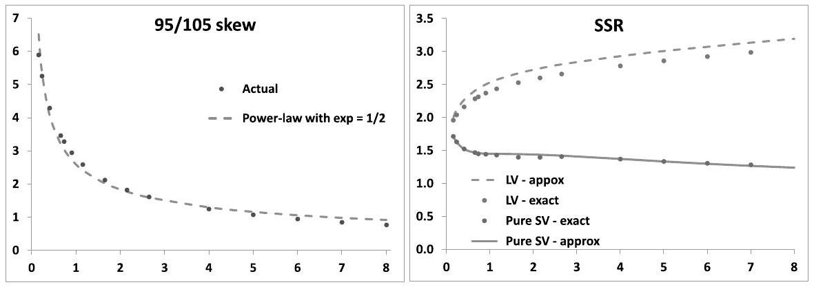
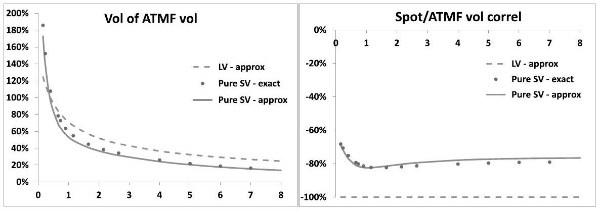
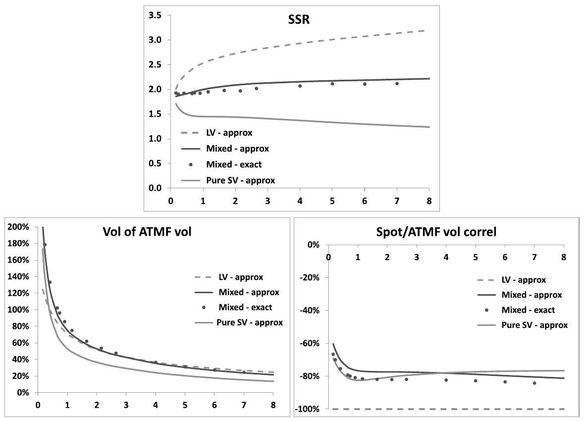
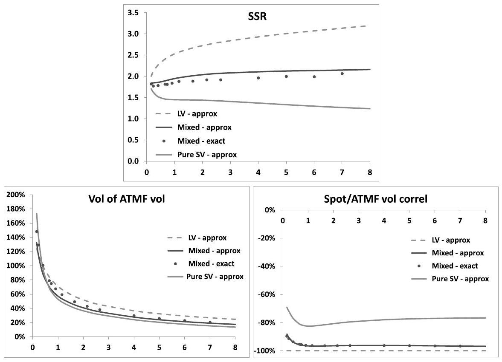
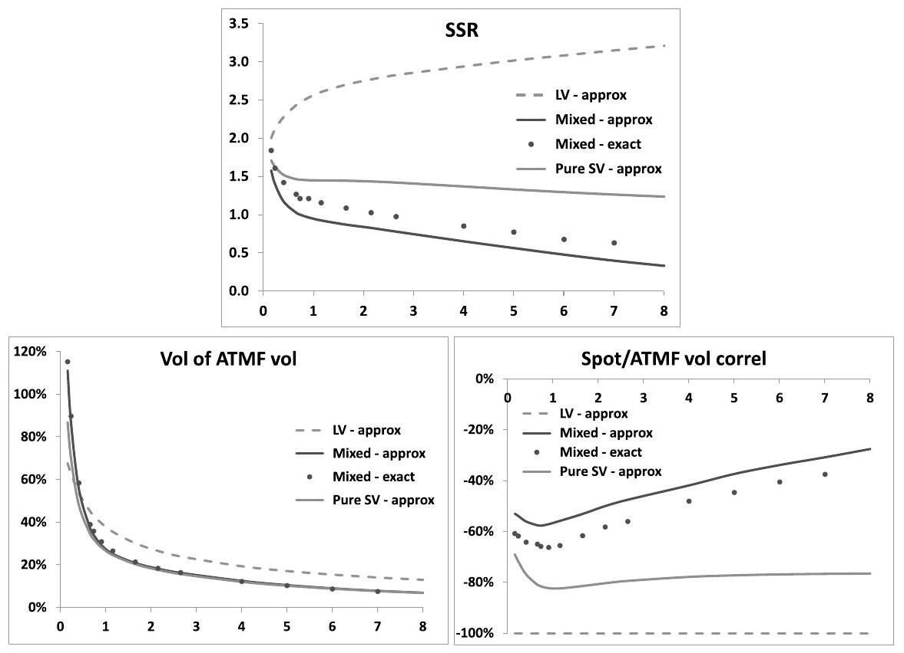
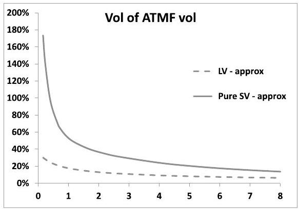
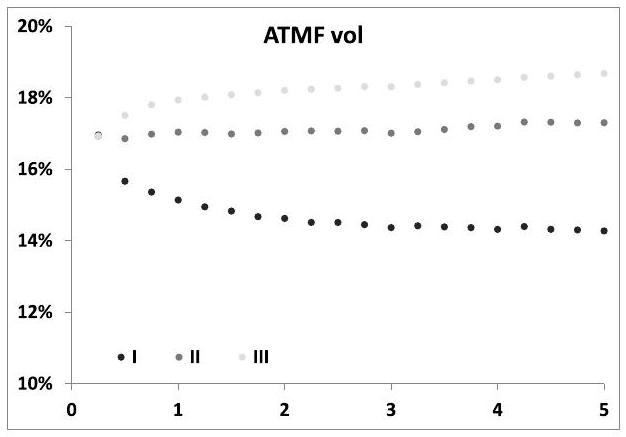
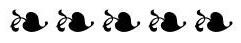
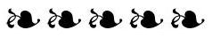

## Chapter 12

## Local-stochastic volatility models

This chapter should be considered as a natural sequel to Chapter 2 on the local volatility model - which we urge the reader to read if she or he has not done so and Chapter 7 on forward variance models.

Local-stochastic volatility models are market models that possess a Markovian representation in terms of $t, S$ plus a few additional state variables.

We begin by motivating their study, then cover their calibration to market smiles before we get to practical modeling issues: what does the carry P\&L look like in these models? Which models can be used in trading applications? How can we adjust spot/volatility and volatility/volatility break-even levels?

### 12.1 Introduction

The local volatility model is a market model for the spot and vanilla options, or, equivalently, implied volatilities $\widehat{\sigma}_{K T}$ - it is covered in detail in Chapter 2. A market model takes as inputs any non-arbitrageable configuration of all hedging instruments - spot and vanilla options - generates a delta on each of them, and is characterized by the covariance structure it generates for the assets it models. The latter translates into a genuine gamma/theta analysis of the carry P\&L.

The local volatility model is the simplest of all market models for vanilla options, as all instruments have a one-dimensional Markovian representation in terms of $t, S$. With this frugality comes, however, a total lack of control on the dynamics of implied volatilities generated by the model.

Forward variance models are surveyed in Chapter 7. They are market models for $S$ together with a (one-dimensional) term structure of implied volatilities, for example VS or ATMF implied volatilities. Unlike local volatility, forward variance models afford a great deal of flexibility as to the dynamics of implied volatilities they are able to generate. However, while their parameters - volatilities of volatilities and spot/volatility correlations - can be chosen so as to best match a given market smile, they typically cannot be calibrated exactly to the full set of implied volatilities $\widehat{\sigma}_{K T}$.

What we are really aiming for is a market model that lets us specify - at least partially and posssibly indirectly - the joint dynamics of the spot and implied volatilities. Local-stochastic volatility models are a modest step in that direction.

There is a natural reason for considering them. In practice, only models having a low-dimensional Markovian representation can be employed. Starting with the simplest, the local volatility model, which is Markovian in $t, S$, which model is next in the hierarchy of market models? The answer is local-stochastic volatility models. They can be defined as market models that possess a Markovian representation in terms of $t, S$ plus a few additional state variables, for example the factors $X_{t}^{1}, X_{t}^{2}$ of the two-factor model of Chapter 7.

We only consider diffusive models, which, practically, means that their carry P\&L is characterized by their break-even levels for gammas and cross-gammas.

### 12.2 Pricing equation and calibration

### 12.2.1 Pricing

In local-stochastic volatility models - which we also call mixed models - we choose the following ansatz for the instantaneous volatility of $S_{t}$ :

$$
\begin{equation*}
\sigma_{t}=\sqrt{\zeta_{t}^{t}} \sigma\left(t, S_{t}\right) \tag{12.1}
\end{equation*}
$$
^eq12-1

$\zeta_{t}^{t}$ is a positive process that has a Markovian representation in terms of a small number of factors. ${ }^{1}$

Let us assume that $\zeta_{t}^{t}$ is a process driven by the two-factor model of Section 7.4. From equation (7.28), page 226, the SDEs for $S_{t}$ and $\zeta_{t}^{T}$ read:

$$
\left\{\begin{align*}
d S_{t} & =(r-q) S_{t} d t+\sigma\left(t, S_{t}\right) \sqrt{\zeta_{t}^{t}} S_{t} d W_{t}^{S}  \tag{12.2}\\
d \zeta_{t}^{T} & =2 \nu \zeta_{t}^{T} \alpha_{\theta}\left((1-\theta) e^{-k_{1}(T-t)} d W_{t}^{1}+\theta e^{-k_{2}(T-t)} d W_{t}^{2}\right)
\end{align*}\right.
$$
^eq12-2

where $\alpha_{\theta}=1 / \sqrt{(1-\theta)^{2}+\theta^{2}+2 \rho_{12} \theta(1-\theta)}$. We use the notation $\zeta_{t}^{T}$ rather than $\xi_{t}^{T}$, as $\zeta_{t}^{T}$ is no longer a forward variance. In the mixed model forward variances are given by:

$$
\xi_{t}^{T}=E_{t}\left[\sigma_{T}^{2}\right]=E_{t}\left[\zeta_{T}^{T} \sigma\left(T, S_{T}\right)^{2}\right]
$$

They are not known analytically.

[^166]The pricing equation in the mixed model is almost identical to that of the underlying stochastic volatility model, but for the local volatility component. Starting from equation (7.4), page 219, for the $n$-factor model, we get the pricing equation for the mixed model:

$$
\begin{align*}
& \frac{d P}{d t}+(r-q) S \frac{d P}{d S}+\frac{\zeta^{t} \sigma(t, S)^{2}}{2} S^{2} \frac{d^{2} P}{d S^{2}} \\
+ & \frac{1}{2} \int_{t}^{T} d u \int_{t}^{T} d u^{\prime} \nu\left(t, u, u^{\prime}, \zeta\right) \frac{d^{2} P}{\delta \zeta^{u} \delta \zeta^{u^{\prime}}}+S \sigma(t, S) \int_{t}^{T} d u \mu(t, u, \zeta) \frac{d^{2} P}{d S \delta \zeta^{u}}=r P \tag{12.3}
\end{align*}
$$
^eq12-3

with $\nu\left(t, u, u^{\prime}, \zeta\right)$ and $\mu(t, u, \zeta)$ given by expressions (8.50) and (8.51), page 327, for the special case of the two-factor model:

$$
\begin{align*}
\mu(t, u, \xi)= & 2 \nu \xi^{u} \sqrt{\xi^{t}} \alpha_{\theta}\left[\rho_{S X^{1}}(1-\theta) e^{-k_{1}(u-t)}+\rho_{S X^{2}} \theta e^{-k_{2}(u-t)}\right]  \tag{12.4}\\
\nu\left(t, u, u^{\prime}, \xi\right)= & 4 \nu^{2} \xi^{u} \xi^{u^{\prime}} \alpha_{\theta}^{2}\left[(1-\theta)^{2} e^{-k_{1}\left(u+u^{\prime}-2 t\right)}+\theta^{2} e^{-k_{2}\left(u+u^{\prime}-2 t\right)}\right. \\
& \left.+\rho_{12} \theta(1-\theta)\left(e^{-k_{1}(u-t)} e^{-k_{2}\left(u^{\prime}-t\right)}+e^{-k_{2}(u-t)} e^{-k_{1}\left(u^{\prime}-t\right)}\right)\right]
\end{align*}
$$
^eq12-4

$\nu$ - which we term "volatility of volatility" - is the volatility of a VS volatility with vanishing maturity. Practically, it functions as a scale factor of volatilities of volatilities.

### 12.2.2 Is it a price?

Equation (12.3) is derived from the corresponding pricing equation (7.4) of forward variance models through the ansatz:

$$
\begin{equation*}
\sqrt{\zeta_{t}^{t}} \rightarrow \sqrt{\zeta_{t}^{t}} \sigma\left(t, S_{t}\right) \tag{12.5}
\end{equation*}
$$
^eq12-5

The pricing equation of forward variance models arises from a replication analysis - see Section 7.1, page 217 - hence the P\&L of a delta-hedged position has the usual gamma/theta expression, with well-defined break-even levels.

In local-stochastic volatility models, we use the seemingly innocuous ansatz (12.5). However, equation (12.3) does not arise from a replication-based argument, thus there is no reason that solving it produces a price - that is that the P\&L of a hedged position is of the usual gamma/theta form.

If it is not, what will it be, may the reader ask? The carry P\&L could include, in addition to gamma/theta terms, additional contributions that cause P\&L leakage. This happens for example if we use an arbitrary pricing function $P\left(t, S, \widehat{\sigma}_{K T}\right)$; in this case the model is not usable.

This will need to be assessed a posteriori - in Section 12.3. As it turns out, most local-stochastic volatility models are not usable models.

## Simulation

In the original version of the underlying stochastic volatility model, initial values of forward variances are analytically calibrated to the term structure of log-contract volatilities: $\xi_{t=0}^{T}=\frac{d}{d T}\left(T \widehat{\sigma}_{T}^{2}\right)$, or numerically to the term structure of ATMF volatilities, or the term structure of implied volatilities for a given moneyness.

Because the underlying stochastic volatility model has a Markovian representation in terms of two factors, solving SDE (12.2) or PDE (12.3) boils down to the simulation of 3 processes: $S_{t}, X_{t}^{1}, X_{t}^{2}$.

The SDE for $S_{t}, X_{t}^{1}, X_{t}^{2}$ are:

$$
\left\{\begin{align*}
d S_{t} & =(r-q) S_{t} d t+\sqrt{\zeta_{t}^{t}} \sigma\left(t, S_{t}\right) S_{t} d W_{t}^{S}  \tag{12.6}\\
d X_{t}^{1} & =-k_{1} X_{t}^{1} d t+d W_{t}^{1} \\
d X_{t}^{2} & =-k_{2} X_{t}^{2} d t+d W_{t}^{2}
\end{align*}\right.
$$
^eq12-6

with $X_{t=0}^{1}=X_{t=0}^{2}=0 . X_{t}^{1}, X_{t}^{2}$ are Ornstein-Ühlenbeck processes that are easily simulated exactly - see Section 7.3.1, page 222.
$\zeta_{t}^{t}$ in (12.6) is given by:

$$
\left\{\begin{array}{l}
\zeta_{t}^{t}=\zeta_{0}^{t} f\left(t, X_{t}^{1}, X_{t}^{2}\right)  \tag{12.7}\\
f\left(t, x_{1}, x_{2}\right)=e^{2 \nu \alpha_{\theta}\left[(1-\theta) x_{1}+\theta x_{2}\right]-\frac{(2 \nu)^{2}}{2}} \chi(t, t)
\end{array}\right.
$$
^eq12-7

where $\chi(t, T \geq t)$ is given by expression (7.35), page 227.
The only remaining task left is calibration of the local volatility function $\sigma(t, S)$.

### 12.2.3 Calibration to the vanilla smile

Consider a diffusive model and $\sigma_{t}$ the instantaneous volatility in that model; the condition that vanilla option prices be matched at $t=0$ is given in (2.6), page 28:

$$
\begin{equation*}
E\left[\sigma_{t}^{2} \mid S_{t}=S\right]=\left.2 \frac{\frac{d C}{d T}+q C+(r-q) K \frac{d C}{d K}}{K^{2} \frac{d^{2} C}{d K^{2}}}\right|_{\substack{K=S \\ T=t}}=\sigma_{\mathrm{Mkt}}(t, S)^{2} \tag{12.8}
\end{equation*}
$$
^eq12-8

where $C(K, T)$ is the market price for a call option of strike $K$, maturity $T$, and $\sigma_{\mathrm{MkT}}(t, S)$ is the local volatility function associated to the market smile.

The simplest way of complying with (12.8) is to choose $\sigma_{t} \equiv \sigma_{\mathrm{MkT}}(t, S)$ - this is the local volatility model.

In mixed models, (12.8) translates into:

$$
E\left[\zeta_{t}^{t} \sigma(t, S)^{2} \mid S_{t}=S\right]=\sigma_{\mathrm{Mkt}}(t, S)^{2}
$$

thus $\sigma(t, S)$ is given by:

$$
\begin{equation*}
\sigma(t, S)^{2}=\frac{\sigma_{\mathrm{Mkt}}(t, S)^{2}}{E\left[\zeta_{t}^{t} \mid S_{t}=S\right]} \tag{12.9}
\end{equation*}
$$
^eq12-9

This is a self-consistent equation for $\sigma(t, S)$ : the unknown local volatility function appears both explicitly in the left-hand side, and implicitly in the right-hand side, in the expectation in the denominator. It is not clear how the solution (12.9) should be approached.

Algorithms for solving (12.9) start with the discretization of time and proceed forward, starting from $t=0$. Imagine the density $\varphi(t, S, X)$ is known at time $t$, where $S$ is the underlying and $X$ represents the state variables of the underlying stochastic volatility model. We use $\varphi(t, S, X)$ to calculate the conditional expectation in the denominator of (12.9). (12.9) then yields the time- $t$ slice of the local volatility function, which we use to build the density $\varphi(t+\delta t, S, X)$, and so on.

How should $\varphi$ be calculated practically? It can be done in two ways, depending on the dimensionality of the underlying stochastic volatility model.

- For a (very) small number of factors one can use the PDE technique described below - it is really usable for a one-factor model and consists in solving the (two-dimensional) forward equation for the joint density $\varphi(t, S, X)$.
- For a larger number of factors, the method of choice is the particle method, which we outline next, first introduced by Pierre Henry-Labordère and Julien Guyon in [52]. This algorithm is much more straightforward than the PDE technique and is immune to the curse of dimensionality.

### 12.2.4 PDE method

Let us assume that $\zeta_{t}$ is driven by a one-factor model - typically, through a Markovian representation as a function of an Ornstein-Ühlenbeck (OU) process $X_{t}$ :

$$
\left\{\begin{array}{l}
\zeta_{t}^{t}=\zeta_{0}^{t} f\left(t, X_{t}\right) \\
d X_{t}=-k X_{t} d t+d Z_{t}, X_{0}=0
\end{array}\right.
$$

The SDE for $S_{t}$ is:

$$
\begin{equation*}
d S_{t}=(r-q) S_{t} d t+\sqrt{\zeta_{0}^{t}} f\left(t, X_{t}\right) \sigma\left(t, S_{t}\right) S_{t} d W_{t} \tag{12.10}
\end{equation*}
$$
^eq12-10

and we denote by $\rho$ the correlation between $Z_{t}$ and $W_{t}$.
Consider the density $\varphi(t, S, X)=E\left[\delta\left(S-S_{t}\right) \delta\left(X-X_{t}\right)\right]$. Equation (12.9) for $\sigma(t, S)$ can be rewritten as:

$$
\begin{equation*}
\sigma(t, S)^{2}=\frac{\sigma_{\mathrm{Mkt}}(t, S)^{2}}{\zeta_{0}^{t}} \frac{\int_{-\infty}^{+\infty} \varphi(t, S, X) d X}{\int_{-\infty}^{+\infty} \varphi(t, S, X) f(t, X) d X} \tag{12.11}
\end{equation*}
$$
^eq12-11

$\varphi(t \geq 0, S, X)$ is obtained by solving the forward Kolmogorov equation:

$$
\begin{align*}
\frac{d \varphi}{d t} & =\mathcal{L} \varphi  \tag{12.12a}\\
\mathcal{L} & =\mathcal{L}_{S}+\mathcal{L}_{X}+\mathcal{L}_{S X} \tag{12.12b}
\end{align*}
$$
^eq12-12a
^eq12-12b

with the initial condition:

$$
\varphi(t=0, S, X)=\delta\left(S-S_{0}\right) \delta\left(X-X_{0}\right)
$$

Linear operators $\mathcal{L}_{S}, \mathcal{L}_{X}, \mathcal{L}_{S X}$ are defined by their action on a function $\psi$ :

$$
\begin{align*}
\mathcal{L}_{S} \psi & =-(r-q) \frac{d}{d S}(S \psi)+\frac{1}{2} \frac{d^{2}}{d S^{2}}\left(f(t, X) \sigma(t, S)^{2} S^{2} \psi\right)  \tag{12.13a}\\
\mathcal{L}_{X} \psi & =k \frac{d}{d X}(X \psi)+\frac{1}{2} \frac{d^{2} \psi}{d X^{2}}  \tag{12.13b}\\
\mathcal{L}_{S X} \psi & =\frac{d^{2}}{d S d X}(\rho \sqrt{f(t, X)} \sigma(t, S) S \psi) \tag{12.13c}
\end{align*}
$$
^eq12-13a
^eq12-13b
^eq12-13c

$\mathcal{L}_{S}, \mathcal{L}_{S X}$ involve the local volatility function $\sigma(t, S)$, thus (12.12) has to be solved self-consistently with (12.11). The idea of calibrating $\sigma(t, S)$ via a forward PDE-based algorithm was first proposed by Alex Lipton in [70].

## Finite-difference algorithm

(12.12) is usually solved with a finite-difference algorithm. We assume that the reader has some familiarity with the numerical solution of parabolic equations - see [83] for an introduction. $X$ and $S$ - or more typically $\ln S$ - are discretized on a two-dimensional grid $\left(S_{i}, X_{j}\right) ; i=0 \ldots n_{S}-1, j=0 \ldots n_{X}-1$, with uniform spacings $\delta S$ and $\delta X: S_{i+1}-S_{i}=\delta S$ and $X_{i+1}-X_{i}=\delta X$. Density $\varphi$ is replaced with a vector of dimension $n_{S} n_{X}: \varphi_{i+n_{S} j}=\varphi\left(S_{i}, X_{j}\right)$.

Derivatives are replaced by their centered finite-difference approximations:

$$
\begin{align*}
\frac{d f}{d x} & \simeq \frac{f_{i+1}-f_{i-1}}{2 \delta x}, \quad \frac{d^{2} f}{d x^{2}} \simeq \frac{f_{i+1}+f_{i-1}-2 f_{i}}{\delta x^{2}}  \tag{12.14a}\\
\frac{d^{2} f}{d x d y} & \simeq \frac{f_{i+1, j+1}-f_{i-1, j+1}-f_{i+1, j-1}+f_{i-1, j-1}}{4 \delta x \delta y} \tag{12.14b}
\end{align*}
$$
^eq12-14a
^eq12-14b

whose errors are of order two in $\delta x, \delta y$. Action of operators $\mathcal{L}_{S}, \mathcal{L}_{X}, \mathcal{L}_{S X}$ on $\varphi$ in the right-hand side of (12.12) thus becomes a matrix/vector multiplication.

In what follows, we use the same notation for operators $\mathcal{L}_{S}, \mathcal{L}_{X}, \mathcal{L}_{S X}$ or their discretized version, and likewise for $\varphi .^{2}$ Let us first assume for simplicity that

[^167]$\mathcal{L}_{S}, \mathcal{L}_{X}, \mathcal{L}_{S X}$ do not depend explicitly on time. The formal solution of (12.12) over $[t, t+\delta t]$ reads:

$$
\varphi(t+\delta t)=e^{\left(\mathcal{L}_{S}+\mathcal{L}_{X}+\mathcal{L}_{S X}\right) \delta t} \varphi(t)
$$
where the exponential of operator $\mathcal{O}$ is defined by: $e^{\mathcal{O}} \varphi=\Sigma_{0}^{\infty} \frac{\mathcal{O}^{n}}{n!} \varphi$.

## Vanishing correlation

Assume that $\rho=0$ so that $\mathcal{L}_{S X}$ vanishes.
Several numerical schemes exist that approximate $e^{\left(\mathcal{L}_{S}+\mathcal{L}_{X}+\mathcal{L}_{S X}\right) \delta t}$ up to second order in $\delta t$. The most popular is the Peaceman-Rachford (PR) algorithm, which consists in the following sequence and makes use of the intermediate vector $\varphi^{*}$ :

$$
\begin{align*}
\left(1-\frac{\delta t}{2} \mathcal{L}_{X}\right) \varphi^{*} & =\left(1+\frac{\delta t}{2} \mathcal{L}_{S}\right) \varphi(t)  \tag{12.15a}\\
\left(1-\frac{\delta t}{2} \mathcal{L}_{S}\right) \varphi(t+\delta t) & =\left(1+\frac{\delta t}{2} \mathcal{L}_{X}\right) \varphi^{*} \tag{12.15b}
\end{align*}
$$
^eq12-15a
^eq12-15b

Each step involves the inversion of a block-diagonal matrix (this is the so-called implicit sub-step), which as mentioned above, is computationally economical and a multiplication of a block-diagonal matrix on a vector (the so called explicit sub-step), which is computationally frugal as well. Expressing $\varphi(t+\delta t)$ directly in terms of $\varphi(t)$ :

$$
\begin{aligned}
\varphi(t+\delta t) & =\mathcal{U}_{t, t+\delta t} \varphi(t) \\
\mathcal{U}_{t, t+\delta t} & =\left(1-\frac{\delta t}{2} \mathcal{L}_{S}\right)^{-1}\left(1+\frac{\delta t}{2} \mathcal{L}_{X}\right)\left(1-\frac{\delta t}{2} \mathcal{L}_{X}\right)^{-1}\left(1+\frac{\delta t}{2} \mathcal{L}_{S}\right)
\end{aligned}
$$

One can check by hand that $\mathcal{U}_{t, t+\delta t}$ approximates $e^{\left(\mathcal{L}_{S}+\mathcal{L}_{X}\right) \delta t}$ up to order two in $\delta t$.

$$
\mathcal{U}_{t, t+\delta t}=1+\delta t\left(\mathcal{L}_{S}+\mathcal{L}_{X}\right)+\frac{\delta t^{2}}{2}\left(\mathcal{L}_{S}+\mathcal{L}_{X}\right)^{2}+o\left(\delta t^{2}\right)
$$

Note that no assumption is made regarding the commutation of $\mathcal{L}_{S}, \mathcal{L}_{X}$.
Let us introduce operators/matrices $\mathcal{E}_{S}$ (standing for explicit) and $\mathcal{I}_{S}$ (standing for implicit):

$$
\mathcal{E}_{S}=\left(1+\frac{\delta t}{2} \mathcal{L}_{S}\right) \quad \mathcal{I}_{S}=\left(1-\frac{\delta t}{2} \mathcal{L}_{S}\right)^{-1}
$$

and likewise for $\mathcal{E}_{X}$ and $\mathcal{I}_{X}$. With these notations the PR algorithm simply reads:

$$
\begin{equation*}
\varphi(t+\delta t)=\mathcal{I}_{S} \mathcal{E}_{X} \mathcal{I}_{X} \mathcal{E}_{S} \varphi(t) \tag{12.16}
\end{equation*}
$$
^eq12-16

$\mathcal{E}$ and $\mathcal{I}$ commute; moreover:

$$
\begin{equation*}
\mathcal{E} \mathcal{I}=\mathcal{I} \mathcal{E}=2 \mathcal{I}-1 \tag{12.17}
\end{equation*}
$$
^eq12-17

thus there exist different equivalent implementations of the PR algorithm, for example:

$$
\varphi(t+\delta t)=\mathcal{I}_{S}\left(2 \mathcal{I}_{X}-1\right) \mathcal{E}_{S} \varphi(t)
$$

which is implemented through the following sequence:

$$
\begin{aligned}
\varphi^{*} & =\mathcal{E}_{S} \varphi(t) \\
\mathcal{I}_{X}^{-1} \varphi^{* *} & =\varphi^{*} \\
\mathcal{I}_{S}^{-1} \varphi(t+\delta t) & =\left(2 \varphi^{* *}-\varphi^{*}\right)
\end{aligned}
$$

## Non-vanishing correlation

If $\rho \neq 0, \mathcal{L}_{S X}$ does not vanish. An algorithm that is correct up to order two in $\delta t$ is the so-called predictor-corrector algorithm, which consists in two successive iterations of the PR algorithm, where $\mathcal{L}_{S X}$ is always treated explicitly - see footnote 2 on page 458. This is the well-known Craig-Sneyd algorithm.

The predictor step reads:

$$
\begin{align*}
\mathcal{I}_{X}^{-1} \varphi^{* *} & =\mathcal{E}_{S} \varphi(t)+\frac{\delta t}{2} \mathcal{L}_{S X} \varphi(t)  \tag{12.18a}\\
\mathcal{I}_{S}^{-1} \varphi^{\star}(t+\delta t) & =\mathcal{E}_{X} \varphi^{* *}+\frac{\delta t}{2} \mathcal{L}_{S X} \varphi(t) \tag{12.18b}
\end{align*}
$$
^eq12-18a
^eq12-18b

and generates $\varphi^{\star}(t+\delta t)$. The corrector step is similar, except $\mathcal{L}_{S X}$ is applied to the average of $\varphi(t)$ and $\varphi^{*}(t+\delta t)$. Define $\bar{\varphi}$ as:

$$
\bar{\varphi}=\frac{1}{2}\left(\varphi(t)+\varphi^{\star}(t+\delta t)\right)
$$

The corrector step reads:

$$
\begin{align*}
\mathcal{I}_{X}^{-1} \varphi^{* *} & =\mathcal{E}_{S} \varphi(t)+\frac{\delta t}{2} \mathcal{L}_{S X} \bar{\varphi}  \tag{12.19a}\\
\mathcal{I}_{S}^{-1} \varphi(t+\delta t) & =\mathcal{E}_{X} \varphi^{* *}+\frac{\delta t}{2} \mathcal{L}_{S X} \bar{\varphi} \tag{12.19b}
\end{align*}
$$
^eq12-19a
^eq12-19b

We use the same notation $\varphi^{* *}$ for the intermediate results in (12.18) and (12.19) - they are different vectors. The predictor step (12.18) reads:

$$
\begin{equation*}
\varphi^{\star}(t+\delta t)=\mathcal{I}_{S} \mathcal{I}_{X}\left[\mathcal{E}_{X} \mathcal{E}_{S}+\delta t \mathcal{L}_{S X}\right] \varphi(t) \tag{12.20}
\end{equation*}
$$
^eq12-20

where we have used (12.17). The full scheme is compactly expressed through:

$$
\begin{align*}
\varphi(t+\delta t) & =\mathcal{U}_{t, t+\delta t} \varphi(t) \\
\mathcal{U}_{t, t+\delta t} & =\mathcal{I}_{S} \mathcal{I}_{X}\left(\mathcal{E}_{X} \mathcal{E}_{S}+\delta t \mathcal{L}_{S X}\left(\frac{1}{2}+\frac{1}{2} \mathcal{I}_{S} \mathcal{I}_{X}\left(\mathcal{E}_{X} \mathcal{E}_{S}+\delta t \mathcal{L}_{S X}\right)\right)\right) \tag{12.21}
\end{align*}
$$
^eq12-21

While the predictor step is of order one in $\delta t, \mathcal{U}_{t, t+\delta t}$ is correct up to second order in $\delta t$. The reader is invited to check that indeed:

$$
\mathcal{U}_{t, t+\delta t}=1+\delta t\left(\mathcal{L}_{S}+\mathcal{L}_{X}+\mathcal{L}_{S X}\right)+\frac{\delta t^{2}}{2}\left(\mathcal{L}_{S}+\mathcal{L}_{X}+\mathcal{L}_{S X}\right)^{2}+o\left(\delta t^{2}\right)
$$

Again, there exist different corrector/predictor sequences implementing (12.21).

When $\mathcal{L}_{S}, \mathcal{L}_{X}, \mathcal{L}_{S X}$ explicitly depend on $t-$ which is the case in practice, if only because $\sigma(t, S)$ enters $\mathcal{L}_{S}$ and $\mathcal{L}_{S X}$, and also because of the presence of $f(t, X)$ - then in (12.18) and (12.19) $\mathcal{L}_{S}$ and $\mathcal{L}_{S X}$ have to be evaluated at time $t+\frac{\delta t}{2}$ to preserve the order-two accuracy of our numerical scheme. Thus, over each interval $[t, t+\delta t]$ the local volatility is needed - and is determined - in $t+\frac{\delta t}{2}$.

## Implementation

In practice, $\ln S$, rather than $S$, is used - we still use $S$ in the discussion as there is no difference in implementation. The local volatility $\sigma(t, S)$ is discretized on the same spot grid as $\varphi$. The algorithm is started with the initial condition $\varphi(t=0, S, X)=\delta\left(S-S_{0}\right) \delta\left(X-X_{0}\right)$, where $S_{0}$ is the initial spot value and we take $X_{t=0}=0$. In our discretized grid this translates into the following initial condition $\varphi_{i \neq i_{0}, j \neq j_{0}}=0, \varphi_{i_{0}, j_{0}}=\frac{1}{\delta S} \frac{1}{\delta X}$ where $i_{0}, j_{0}$ are the indexes for the initial values of $S, X: S_{i_{0}}=S_{t=0}$ and $X_{j_{0}}=0 . \sigma\left(\frac{\delta t}{2}, S\right)$ is simply initialized as: $\sigma\left(\frac{\delta t}{2}, S\right) \equiv \widehat{\sigma}\left(K=S, T=\frac{\delta t}{2}\right) /\left(\zeta_{0}^{0} f(0,0)\right)$.

Time is discretized with a step $\delta t$. Application of the finite difference algorithm generates the density $\varphi$ at times $t_{k}=k \delta t$.

Assume we have the density $\varphi$ at time $t$ and the local volatility at time $t-\frac{\delta t}{2}$. Generation of $\varphi(t+\delta t)$ and $\sigma\left(t+\frac{\delta t}{2}, S\right)$ involves the following steps:

- Run the predictor-corrector scheme, where the local volatility $\sigma\left(t+\frac{\delta t}{2}, S\right)$ in $\mathcal{L}_{S}, \mathcal{L}_{S X}$ is taken equal to that determined in the previous step: $\sigma\left(t-\frac{\delta t}{2}, S\right)$. This generates $\varphi(t+\delta t)$.
- Compute $\sigma(t+\delta t, S)$ using (12.11) applied at time $t+\delta t$, using $\varphi(t+\delta t)$, then average the values at $t$ and $\tau+\delta t$ :

$$
\begin{equation*}
\sigma\left(t+\frac{\delta t}{2}, S\right)^{2}=\frac{1}{2}\left(\sigma(t, S)^{2}+\sigma(t+\delta t, S)^{2}\right) \tag{12.22}
\end{equation*}
$$
^eq12-22

- Run the predictor-corrector scheme over $[t, t+\delta t]$ again, this time using this final value for $\sigma\left(t+\frac{\delta t}{2}, S\right)$ in $\mathcal{L}_{S}, \mathcal{L}_{S X}$. This generates our final estimate for $\varphi(t+\delta t)$. This step guarantees that our scheme is overall of order two in time - in practice, though, this does not seem necessary.

Some additional points are worthy of note:

- The width of the grids in $S$ (or $\ln S$ ) and $X$ is defined by choosing a percentile $\varepsilon$ and setting $S_{\min }, S_{\max }$ and $X_{\min }, X_{\max }$ so that $p\left(S_{t} \leq S_{\min }\right) \leq \varepsilon$, $p\left(S_{t} \geq S_{\max }\right) \leq \varepsilon$ and $p\left(X_{t} \leq X_{\min }\right) \leq \varepsilon, p\left(X_{t} \geq X_{\max }\right) \leq \varepsilon$ for all $t \in [0, T]$. Typically, setting $S_{\min }, S_{\max }$ and $X_{\min }, X_{\max }$ so that $p\left(S_{T} \leq S_{\min }\right)= p\left(S_{T} \geq S_{\max }\right)=\varepsilon$ and $p\left(X_{T} \leq X_{\min }\right)=p\left(X_{T} \geq X_{\max }\right)=\varepsilon$ for the furthest maturity of interest $T$ is adequate. Finding $X_{\min }, X_{\max }$ is easy as $X_{T}$ is Gaussian, thus its cumulative density is known in closed form. $S_{\text {min }}, S_{\text {max }}$ are also easily found, since $p\left(S_{T} \leq S_{\min }\right), p\left(S_{T} \geq S_{\max }\right)$ are undiscounted prices of European digital options of maturity $T$, thus can be read off the market smile directly - see equation 1.24, page 21 .
- Boundary conditions for $\varphi$ need to be specified for $S=S_{0}, S_{n_{S}}$ and $X= X_{0}, X_{n_{X}}$. Non-trivial boundary conditions for the density are not easy to derive. Typically, one takes wide grids in $S$ (or $\ln S$ ) and $X$ and imposes that $\varphi$ vanishes on the edges of the grid. $\varphi(t)$ is a density so should integrate to one for all $t$; this is not guaranteed by the algorithm above. Once $\varphi(t+\delta t)$ is determined, one typically rescales it so that it integrates (numerically) to one. We refer the reader to Appendix A for an implementation that ensures that $\varphi$ integrates to one and such that boundary conditions are automatically taken care of.
- For very small/large values of $S$, the density is small, thus the denominator in the right-hand side of (12.11) is small and subject to numerical noise. It is preferable to extrapolate $\sigma(t, S)$ starting from values of $S$ for which the denominator in (12.11) is still appreciable.

### 12.2.5 Particle method

The PDE technique outlined in the previous section can in practice only be used for one-factor stochastic volatility models. For models with more than one stochastic volatility factor, the PDE is of dimension three or higher. It is then best to calibrate $\sigma(t, S)$ using the particle method, a Monte Carlo algorithm first published by Pierre Henry-Labordère and Julien Guyon in [52].

The particle algorithm is general, does not depend on the dimensionality of the process driving $\zeta_{t}$ and can also be used to calibrate the local volatility function in a hybrid local-stochastic volatility/stochastic interest rate model, or to calibrate the local correlation of a cross-FX rate or of a basket of equity underlyings to an index smile.

As the particle method is documented in Pierre Henry-Labordère and Julien Guyon's book [53], we only sketch it. The particle method is a Monte Carlo algorithm based on simultaneous simulation of interacting paths.

Time is discretized and we set up a grid of spot values $S^{*}$ for which the local volatility function will be determined.

- Draw $N$ paths for the pair $\left(S_{t}, \zeta_{t}\right)$ - we denote them by $\left(S_{t}^{k}, \zeta_{t}^{k}\right), k=1 \ldots N$, starting from $S_{t=0}^{k}=S_{0}, \zeta_{t=0}^{k}=\zeta_{0}$. Each pair $\left(S_{t}^{k}, \zeta_{t}^{k}\right)$ obeys the model's SDE and the Brownian motions driving different pairs are all independent.
- Assume that the local volatility function is known at $t_{i}$. Use it to propagate the particles until $t_{i+1}$. At $t_{i+1}$ use the empirical density defined by:

$$
\begin{equation*}
\varphi_{e m}\left(t_{i+1}, S, \zeta\right)=\frac{1}{N} \Sigma_{k} \delta\left(S-S_{t_{i+1}}^{k}\right) \delta\left(\zeta-\zeta_{t_{i+1}}^{k}\right) \tag{12.23}
\end{equation*}
$$
^eq12-23

to evaluate the conditional expectation $E\left[\zeta_{t} \mid S_{t}=S\right]$ for spot values $S^{*}$. Rather than straight Dirac peaks on $S$ one uses in (12.23) a smoother kernel $\phi$ :

$$
\varphi_{e m}\left(t_{i+1}, S, \zeta\right)=\frac{1}{N} \Sigma_{k} \phi\left(S-S_{t_{i+1}}^{k}\right) \delta\left(\zeta-\zeta_{t_{i+1}}^{k}\right)
$$

Efficient operation of the particle algorithm depends in fact on a proper choice of $\phi$. Using expression (12.9) the local volatility at time $t_{i+1}$ is thus given by:

$$
\sigma\left(t_{i+1}, S^{*}\right)^{2}=\sigma_{\mathrm{Mkt}}\left(t_{i+1}, S^{*}\right)^{2} \frac{\Sigma_{k} \phi\left(S^{*}-S_{t_{i+1}}^{k}\right)}{\Sigma_{k} \zeta_{t_{i+1}}^{k} \phi\left(S^{*}-S_{t_{i+1}}^{k}\right)}
$$

Interpolate/extrapolate local volatilities calculated on spot values $S^{*}$ of the grid to obtain $\sigma\left(t_{i+1}, S\right)$. Store this $t_{i+1}$ slice of the local volatility function and simulate the particles until $t_{i+2}$.

Calibration of the local volatility function and pricing can be performed in one single simulation, using the same paths.

### 12.3 Usable models

We're now fully equipped for calibrating a mixed model and pricing exotic options. Before we do this, we need to address a concern expressed in Section 12.2.2: are the resulting numbers prices?

The reason for using local-stochastic volatility models is that they are calibrated, by construction, to the vanilla smile. When we build them what we are really trying to do is build a market model for spot and vanilla options.

In such a market model, the hedge instruments are the spot and vanilla options. The price of a derivative is a function of the values of these hedge instruments, and the P\&L of a delta-hedged, vega-hedged position is the sum of cross-gamma contributions involving second-order moments of variations of the spot and implied volatilities, accompanied by matching thetas defined by a break-even covariance matrix.

Do mixed models indeed supply a genuine gamma/theta breakdown of the carry P\&L? Provided they do, what are the implied break-even volatilities of volatilities and the break-even spot/volatility and volatility/volatility correlations?

We have already carried out such an analysis for the local volatility model, in Section 2.7, page 66. We ask the reader to read that portion of Chapter 2.

As will be made clear shortly, unlike the local volatility model, most mixed models are not market models for spot and implied volatilities. Only particular types of mixed models, which we now characterize, give rise to a genuine theta/gamma breakdown of the carry P\&L.

### 12.3.1 Carry P\&L

Consider the general case of a mixed model and denote by $P^{\mathrm{M}}(t, x)$ the price of a derivative. $x$ is the vector of inputs: $x_{1}$ is the spot price, $x_{2}$ the local volatility
function, $x_{3} \cdots x_{n}$ are state variables of the underlying stochastic volatility model. For example, if the underlying stochastic volatility model is the two-factor forward variance model, the dynamics of the mixed model is given by (12.2) and $P^{\mathrm{M}}$ reads:

$$
P^{\mathrm{M}}(t, x) \equiv P^{\mathrm{M}}\left(t, S, \sigma, \zeta^{u}\right)
$$

where the $\zeta^{u}$ make up a curve.
Consider instead a local-stochastic volatility model built on the Heston model:

$$
\left\{\begin{array}{l}
d S_{t}=(r-q) S_{t} d t+\sigma\left(t, S_{t}\right) \sqrt{V_{t}} S_{t} d W_{t}^{S} \\
d V_{t}=-k\left(V_{t}-V^{0}\right) d t+\nu \sqrt{V_{t}} d W_{t}^{V}
\end{array}\right.
$$

Here:

$$
P^{\mathrm{M}}(t, x) \equiv P^{\mathrm{M}}(t, S, \sigma, V)
$$

$P^{\mathrm{M}}(t, x)$ takes as input the local volatility function. Consider now the pricing function $P(t, \widehat{x})$ which takes the set of implied volatilities as an input, rather than the local volatility function; $\widehat{x}_{1}$ is the spot price, $\widehat{x}_{2}$ the set of implied volatilities $\widehat{\sigma}_{K T}, \widehat{x}_{3} \cdots \widehat{x}_{n}$ are again the state variables of the underlying stochastic volatility model.
$P(t, \widehat{x})$ is the pricing function we use in trading applications as it takes as inputs market observables, in addition to the state variables of the underlying stochastic volatility model. For the two-factor model:

$$
\begin{aligned}
P^{\mathrm{M}}(t, x) & \equiv P^{\mathrm{M}}\left(t, S, \sigma, \zeta^{u}\right) \\
P(t, \widehat{x}) & \equiv P\left(t, S, \widehat{\sigma}_{K T}, \zeta^{u}\right)
\end{aligned}
$$

The reason why we explicitly include the local volatility function $\sigma$ as an argument of $P^{\mathrm{M}}$ is that $\sigma$ is not frozen. Indeed, $P\left(t, S, \widehat{\sigma}_{K T}, \zeta^{u}\right)$ implicitly involves recalibration of $\sigma$ whenever the arguments of $P$ change; as we risk-manage our exotic option using the pricing function $P, \sigma$ will change and our carry $\mathrm{P} \& \mathrm{~L}$ accounts for these changes as well.

In the mixed model, for a set local volatility function, implied volatilities are a function of time, spot value, local volatility function and other state variables: $\widehat{x} \equiv \widehat{x}(t, x)$ and we have:

$$
P^{\mathrm{M}}(t, x)=P(t, \widehat{x}(t, x))
$$

For example, if we use the two-factor model as the underlying stochastic volatility model, we have:

$$
\widehat{\sigma}_{K T} \equiv \Sigma_{K T}^{M}\left(t, S, \sigma, \zeta^{u}\right)
$$

and the following relationship between $P^{\mathrm{M}}$ and $P$ :

$$
P^{\mathrm{M}}\left(t, S, \sigma, \zeta^{u}\right)=P\left(t, S, \Sigma_{K T}^{M}\left(t, S, \sigma, \zeta^{u}\right), \zeta^{u}\right)
$$

In a trading context, $\mathrm{P} \& \mathrm{~L}$ accounting is done with $P$ and involves derivatives of $P$ with respect to $t, S, \widehat{\sigma}_{K T}$. The pricing equation (12.3), however, involves $P^{\mathrm{M}}$ and its derivatives.

Let us thus change variables from $(t, x)$ to $(t, \widehat{x})$ :

$$
(t, x) \rightarrow(t, \widehat{x}(t, x))
$$

The pricing equation (12.3), page 455, of the mixed model - with a set local volatility function - reads:

$$
\begin{equation*}
\frac{d P^{\mathrm{M}}}{d t}+\left(\Sigma_{k} \mu_{k} \frac{d}{d x_{k}}+\frac{1}{2} \Sigma_{k l} a_{k l} \frac{d^{2}}{d x_{k} d x_{l}}\right) P^{\mathrm{M}}=0 \tag{12.24}
\end{equation*}
$$
^eq12-24

where we assume zero interest rates without loss of generality - otherwise consider that $P$ is the undiscounted price.

Switching now to variables $\widehat{x}$, the pricing equation reads:

$$
\begin{equation*}
\frac{d P}{d t}+\left(\Sigma_{i} \widehat{\mu}_{i} \frac{d}{d \widehat{x}_{i}}+\frac{1}{2} \Sigma_{i j} \widehat{a}_{i j} \frac{d^{2}}{d \widehat{x}_{i} d \widehat{x}_{j}}\right) P=0 \tag{12.25}
\end{equation*}
$$
^eq12-25

with:

$$
\left\{\begin{array}{l}
\widehat{\mu}_{i}=\frac{d \widehat{x}_{i}}{d t}+\Sigma_{k} \mu_{k} \frac{d \widehat{x}_{i}}{d x_{k}}+\frac{1}{2} \Sigma_{k l} a_{k l} \frac{d^{2} \widehat{x}_{i}}{d x_{k} d x_{l}}  \tag{12.26}\\
\widehat{a}_{i j}=\Sigma_{k l} a_{k l} \frac{d \widehat{x}_{i}}{d x_{k}} \frac{d \widehat{x}_{j}}{d x_{l}}
\end{array}\right.
$$
^eq12-26

$\widehat{\mu}_{i}$ is the drift of $\widehat{x}_{i}$ and $\widehat{a}_{i j}$ is the covariance matrix of $\widehat{x}_{i}$ and $\widehat{x}_{j}-$ as generated by the mixed model with a fixed local volatility function.

Derivatives $\frac{d \widehat{x}_{i}}{d x_{k}}$ are calculated keeping the local volatility function constant; in the two-factor model they involve derivatives $\frac{d \Sigma_{K T}^{M}}{d t}, \frac{d \Sigma_{K T}^{M}}{d S}, \frac{d \Sigma_{K T}^{M}}{d \zeta^{u}}$.

While the differential operator in (12.24) does not involve derivatives with respect to the local volatility function, the operator in (12.25) does involve derivatives with respect to implied volatilities.

### 12.3.2 P\&L of a hedged position

Consider the P\&L of a short option position - unhedged for now - during $\delta t$ :

$$
P \& L=-P(t+\delta t, \widehat{x}+\delta \widehat{x})+P(t, \widehat{x})
$$

Remember that as $t, S, \widehat{\sigma}_{K T}$ move by $\delta t, \delta S$ and $\delta \widehat{\sigma}_{K T}$, the local volatility function of our mixed model is recalibrated.

Expand at order two in $\delta \widehat{x}$ and one in $\delta t$, and use (12.25) to express $\frac{d P}{d t}$ in terms of derivatives with respect to the $\widehat{x}_{i}$ :

$$
\begin{aligned}
P \& L & =-\frac{d P}{d t} \delta t-\Sigma_{i} \frac{d P}{d \widehat{x}_{i}} \delta \widehat{x}_{i}-\frac{1}{2} \Sigma_{i j} \frac{d^{2} P}{d \widehat{x}_{i} d \widehat{x}_{j}} \delta \widehat{x}_{i} \delta \widehat{x}_{j} \\
& =-\Sigma_{i} \frac{d P}{d \widehat{x}_{i}}\left(\delta \widehat{x}_{i}-\widehat{\mu}_{i} \delta t\right)-\frac{1}{2} \Sigma_{i j} \frac{d^{2} P}{d \widehat{x}_{i} d \widehat{x}_{j}}\left(\delta \widehat{x}_{i} \delta \widehat{x}_{j}-\widehat{a}_{i j} \delta t\right)
\end{aligned}
$$

Among components of $\widehat{x}$ we now make a distinction between those that correspond to market observables - $S, \widehat{\sigma}_{K T}$ - which we denote by $O_{i}$, and those corresponding to state variables of the underlying stochastic volatility model, which we denote by $\lambda_{k}: \widehat{x} \equiv(O, \lambda)$.

$$
\begin{align*}
P \& L= & -\Sigma_{i} \frac{d P}{d O_{i}}\left(\delta O_{i}-\widehat{\mu}_{i} \delta t\right)-\frac{1}{2} \Sigma_{i j} \frac{d^{2} P}{d O_{i} d O_{j}}\left(\delta O_{i} \delta O_{j}-\widehat{a}_{i j} \delta t\right) \\
& -\Sigma_{k} \frac{d P}{d \lambda_{k}}\left(\delta \lambda_{k}-\widehat{\mu}_{k} \delta t\right) \\
& -\frac{1}{2} \Sigma_{k l} \frac{d^{2} P}{d \lambda_{k} d \lambda_{l}}\left(\delta \lambda_{k} \delta \lambda_{l}-\widehat{a}_{k l} \delta t\right)-\Sigma_{i k} \frac{d^{2} P}{d O_{i} d \lambda_{k}}\left(\delta O_{i} \delta \lambda_{k}-\widehat{a}_{i k} \delta t\right) \tag{12.27}
\end{align*}
$$
^eq12-27

Consider now a delta and vega-hedged position, so that order-one contributions in $\delta O_{i}$ vanish. Because equation (12.27) for the P\&L during $\delta t$ obviously also holds for (a) the underlying itself, (b) vanilla options, cancelling the $\delta O_{i}$ terms also cancels the $\widehat{\mu}_{i} \delta t$ contributions. We denote by $P_{\mathrm{H}}$ the value of the delta-hedged, vega-hedged, position.

## Using implied volatilities or option prices

Parameters $O_{i}$ reflect the values of hedge instruments. For the spot we use the spot value itself, but for vanilla options we may use straight option prices, or their implied volatilities, or yet a different parametrization. For the sake of the present discussion, we treat the spot separately from vanilla options. The value of the hedged position is:

$$
P_{\mathrm{H}}=P-\Delta_{S} S-\sum_{i} \Delta_{i} f_{i}\left(t, S, O_{i}\right)
$$

where the sum runs over vanilla options used as hedges and $f_{i}$ is the value of a vanilla option as a function of parameter $O_{i}$. The delta is $\Delta_{S}=\left.\frac{d P}{d S}\right|_{\lambda, O}$. The vega hedge ratios $\Delta_{i}$ are given by: $\Delta_{i}=\frac{d P}{d O_{i}}\left(\frac{d f_{i}}{d O_{i}}\right)^{-1}$.

- If $O_{i}$ is an implied volatility $\widehat{\sigma}_{K T}$ then $f_{i}$ is the value of a delta-hedged vanilla option in the Black-Scholes model and $P_{\mathrm{H}}$ reads:

$$
\begin{equation*}
P_{\mathrm{H}}=P-\left.\frac{d P}{d S}\right|_{\lambda, \widehat{\sigma}_{K T}} S-\sum_{K T} \Delta_{K T}\left(P_{K T}-\frac{d P_{K T}^{B S}}{d S} S\right) \tag{12.28}
\end{equation*}
$$
^eq12-28

with $\Delta_{K T}=\left.\frac{d P}{d \widehat{\sigma}_{K T}}\right|_{\lambda, S}\left(\frac{d P_{K T}^{B S}}{d \widehat{\sigma}_{K T}}\right)^{-1}$.

- If instead $O_{i}$ is the vanilla option price $P_{K T}, \Delta_{K T}=\left.\frac{d P}{d P_{K T}}\right|_{\lambda, S}$ and $P_{\mathrm{H}}$ reads:

$$
\begin{equation*}
P_{\mathrm{H}}=P-\left.\frac{d P}{d S}\right|_{\lambda, P_{K T}} S-\sum_{K T} \Delta_{K T} P_{K T} \tag{12.29}
\end{equation*}
$$
^eq12-29

There is no inconsistency in these two expressions of $P_{\mathrm{H}}$. Obviously, the composition of the hedge portfolio cannot depend on how we decide to represent option prices, either using straight option prices or Black-Scholes implied volatilities: canceling at order one (a) the sensitivity to $S$ and vanilla option prices, or (b) the sensitivity to $S$ and Black-Scholes implied volatilities, is equivalent.

Thus, $\Delta_{K T}$ in (12.28) and (12.29) are identical, and so are the deltas in both portfolios:

$$
\left.\frac{d P}{d S}\right|_{\lambda, \widehat{\sigma}_{K T}}-\sum_{K T} \Delta_{K T} \frac{d P_{K T}^{B S}}{d S}=\left.\frac{d P}{d S}\right|_{\lambda, P_{K T}}
$$

We refer the reader to a similar discussion of market-model and sticky-strike deltas in the local volatility model in Section 2.7, page 66.

## Splitting the P\&L of a hedged position

The P\&L of the hedged position reads:

$$
\begin{align*}
P \& L_{\mathrm{H}}= & -\frac{1}{2} \Sigma_{i j} \frac{d^{2} P_{\mathrm{H}}}{d O_{i} d O_{j}}\left(\delta O_{i} \delta O_{j}-\widehat{a}_{i j} \delta t\right)  \tag{12.30a}\\
& -\Sigma_{k} \frac{d P_{\mathrm{H}}}{d \lambda_{k}}\left(\delta \lambda_{k}-\widehat{\mu}_{k} \delta t\right)  \tag{12.30b}\\
& -\frac{1}{2} \Sigma_{k l} \frac{d^{2} P_{\mathrm{H}}}{d \lambda_{k} d \lambda_{l}}\left(\delta \lambda_{k} \delta \lambda_{l}-\widehat{a}_{k l} \delta t\right)-\Sigma_{i k} \frac{d^{2} P_{\mathrm{H}}}{d O_{i} d \lambda_{k}}\left(\delta O_{i} \delta \lambda_{k}-\widehat{a}_{i k} \delta t\right) \tag{12.30c}
\end{align*}
$$
^eq12-30a
^eq12-30b
^eq12-30c

- By construction, the mixed model is calibrated to the market values of hedge instruments $\forall t$, thus we have: $\frac{d O_{i}}{d \lambda_{k}}=0, \forall i, \forall k$. This implies that $\frac{d P_{\mathrm{H}}}{d \lambda_{k}}= \frac{d P}{d \lambda_{k}}, \forall k$ and $\frac{d^{2} P_{\mathrm{H}}}{d \lambda_{k} d \lambda_{l}}=\frac{d^{2} P}{d \lambda_{k} d \lambda_{l}}$ as well as $\frac{d^{2} P_{\mathrm{H}}}{d O_{i} d \lambda_{k}}=\frac{d^{2} P}{d O_{i} d \lambda_{k}}$ : all sensitivities of the hedged position involving $\lambda_{k}$ are those of the unhedged position. $P \& L_{\mathrm{H}}$ can be rewritten as:

$$
\begin{align*}
P \& L_{\mathrm{H}}= & -\frac{1}{2} \Sigma_{i j} \frac{d^{2} P_{\mathrm{H}}}{d O_{i} d O_{j}}\left(\delta O_{i} \delta O_{j}-\widehat{a}_{i j} \delta t\right)  \tag{12.31a}\\
& -\Sigma_{k} \frac{d P}{d \lambda_{k}}\left(\delta \lambda_{k}-\widehat{\mu}_{k} \delta t\right)  \tag{12.31b}\\
& -\frac{1}{2} \Sigma_{k l} \frac{d^{2} P}{d \lambda_{k} d \lambda_{l}}\left(\delta \lambda_{k} \delta \lambda_{l}-\widehat{a}_{k l} \delta t\right)-\Sigma_{i k} \frac{d^{2} P}{d O_{i} d \lambda_{k}}\left(\delta O_{i} \delta \lambda_{k}-\widehat{a}_{i k} \delta t\right) \tag{12.31c}
\end{align*}
$$
^eq12-31a
^eq12-31b
^eq12-31c

- Contribution (12.31a) to $P \& L_{\mathrm{H}}$ is the regular theta/gamma P\&L involving second-order moments of the variations of market instruments. The matching deterministic terms $\widehat{a}_{i j} \delta t$ are genuine thetas, as $\widehat{a}$ is a valid (positive) covariance matrix - this is obvious from its definition in (12.26). The break-even covariances $\widehat{a}_{i j}$ are those generated by the model with a fixed local volatility function.
- (12.31b) and (12.31c) are unwanted contributions to the P\&L, generated by variations of the $\lambda_{k}$ state variables, that have no financial significance: $V$ for the Heston model, the $\zeta^{u}$ for the two-factor model. These terms were absent from P\&L expression (2.105), page 69, in the local volatility model.
- Note that the $\delta \lambda_{k}$ are fully in our control. Imagine setting $\delta \lambda_{k}=\widehat{\mu}_{k} \delta t$ so that (12.31b) cancels out. There remain the theta and gamma terms in (12.30c).

The conclusion is that, generally, when using a local-stochastic volatility model, a hedged position will generate spurious P\&L leakage that does not correspond to any regular gamma/theta P\&L. ${ }^{3,4}$

The contribution from $\delta \lambda_{k}$ obviously vanishes if (a) $\delta \lambda_{k}=0$, (b) $\widehat{\mu}_{k}=0$ and $\widehat{a}_{k l}=\widehat{a}_{i k}=0, \forall i, \forall l$. This is the case if $\lambda_{k}$ is frozen - in other words if $\lambda_{k}$ is a constant parameter, for example the long-run variance $V^{0}$ in the Heston model, or constants $k_{1}, k_{2}, \theta, \rho_{12}$ in the two-factor model.

### 12.3.3 Characterizing usable models

Are there instances of mixed models that lead to regular theta/gamma P\&L accounting without P\&L leakage? The answer is yes.

All we need is for $P$ to not depend on $\lambda_{k}:{ }^{5}$

$$
\begin{equation*}
\left.\frac{d P}{d \lambda_{k}}\right|_{S, \widehat{\sigma}_{K T}}=0, \forall k \tag{12.32}
\end{equation*}
$$
^eq12-32

[^168]Our P\&L then simply reads:

$$
\begin{equation*}
P \& L_{\mathrm{H}}=-\frac{1}{2} \Sigma_{i j} \frac{d^{2} P_{\mathrm{H}}}{d O_{i} d O_{j}}\left(\delta O_{i} \delta O_{j}-\widehat{a}_{i j} \delta t\right) \tag{12.33}
\end{equation*}
$$
^eq12-33

and we have indeed a market model for spot and vanilla options - see our discussion in Section 1.1 of Chapter 1.

Condition (12.32) happens to be fulfilled for the two-factor model. Indeed, consider pricing equations (12.6) together with (12.7), page 456 , for the mixed model. Perform the following transformation on the $\zeta^{u}$ and the local volatility function:

$$
\begin{aligned}
\zeta_{0}^{u} & \rightarrow \varphi^{u} \zeta_{0}^{u} \\
\sigma(u, S) & \rightarrow \sqrt{\frac{1}{\varphi^{u}}} \sigma(u, S)
\end{aligned}
$$

where $\varphi^{u}$ are arbitrary constants. One can see from (12.6) and (12.7) that this leaves the process for $S_{t}$ and its instantaneous volatility unchanged, thus:

$$
\frac{\delta}{\delta \zeta^{u}} P\left(t, S, \widehat{\sigma}_{K T}, \zeta^{u}\right)=0, \forall u
$$

This also holds in the version of the two-factor model that generates volatility-of-volatility smile: $f$ in (12.7) is then the sum of two exponentials - see Section 7.7.1, page 263.

- Condition (12.32) does not hold if we use the Heston model as the underlying model since:

$$
\frac{d}{d V} P\left(t, S, \widehat{\sigma}_{K T}, V\right) \neq 0
$$

- It does not hold in the Bloomberg model either, defined by the following SDEs - see [45]:

$$
\left\{\begin{align*}
d S_{t} & =(r-q) S_{t} d t+\sigma\left(t, S_{t}\right) \lambda_{t} S_{t} d W_{t}^{S}  \tag{12.34}\\
d \lambda_{t} & =-k\left(\lambda_{t}-\theta\right) d t+\xi(t) \lambda_{t} d W_{t}^{\lambda}
\end{align*}\right.
$$
^eq12-34

where $\xi(t)$ is a deterministic function of $t$.

- Condition (12.32) does hold if the instantaneous volatility of the underlying stochastic volatility model is lognormal, as in the SABR model:

$$
\left\{\begin{align*}
d S_{t} & =(r-q) S_{t} d t+\sigma\left(t, S_{t}\right) \lambda_{t} S_{t} d W_{t}^{S}  \tag{12.35}\\
d \lambda_{t} & =\nu \lambda_{t} d W_{t}^{\lambda}
\end{align*}\right.
$$
^eq12-35

## Discussion

We are aiming for a market model that takes as inputs the spot and implied volatilities. In case we make option prices dependent on additional non-financial state variables, ${ }^{6}$ it is not surprising that there is P\&L leakage, as the model allocates part of its theta as compensation - on average - for second-order contributions from these extra state variables as well.
$\frac{d P}{d V} \neq 0$ is a signal that prices depend on more state variables than hedge instruments, hence the inconsistency in P\&L accounting and the fact that the model is unsuitable for trading purposes.

This dependence is of a different nature than the dependence on model parameters, such as $V^{0}$ in the Heston model, or $k_{1}, k_{2}, \theta, \rho_{12}$ in the two-factor model. Model parameters do not generate any P\&L leakage, and only give rise to discrete P\&Ls when they are changed and the option position is remarked with new parameter values.

In the case of the Heston model used as underlying stochastic volatility model, the "solution" to the P\&L leakage - if it can be called a solution - is to include one additional hedge instrument, to which $V$ is then calibrated - say a barrier or forward-start option. We then have as many hedge instruments as there are state variables in our model, and the carry P\&L of a hedged option position is again of the genuine gamma/theta form, provided we dynamically trade this additional instrument.

The interesting aspect of models in the admissible class is that the underlying stochastic volatility model does affect the dynamics of spot and option prices; yet these additional degrees of freedom do not require any additional hedge instruments, and only impact the covariance structure of hedge instruments. ${ }^{7}$

The carry P\&L is of the regular gamma/theta form and involves hedge instruments only.

### 12.4 Dynamics of implied volatilities

Having derived expression (12.33) of the P\&L in an admissible model, we now need to size up covariances $\widehat{a}_{i j}^{*}$ to assess the suitability of our model's break-even levels.

[^169]The $\widehat{a}_{i j}$ are model-generated covariances for spot and implied volatilities for fixed strikes and maturities. With regard to the task of calculating realized covariances, however, working with floating strikes corresponding to a set moneyness - for example ATMF - and relative maturities, is much more convenient.

In what follows, we derive approximations of model-generated variances and covariances of spot and ATMF volatilities. Spot/volatility covariances can equivalently be quantified using the SSR.

In practice, bid/offer costs on options are such that vega hedging is performed less frequently than delta hedging. The resulting carry P\&L is different than (12.33) - see the discussion in Section 9.11.3, page 383.

We use the two-factor model as underlying stochastic volatility model and derive expressions of the SSR and the volatility of the ATMF volatility at lowest order, both in:

- the local volatility function - as in Section 2.5
- the volatility of volatility of the underlying two-factor model - as in the expansion of Section 8.2

### 12.4.1 Components of the ATMF skew

Consider SDE (12.6) for $S_{t}$ in the mixed two-factor model. Since the two-factor model is in the admissible class, we have $\frac{d P}{d \zeta^{\tau}}=0 \forall \tau$, thus we can take $\zeta^{\tau}=1, \forall \tau$. The SDE for $S_{t}$ is:

$$
\begin{equation*}
d S_{t}=(r-q) S_{t} d t+\sigma\left(t, S_{t}\right) \sqrt{f\left(t, X_{t}^{1}, X_{t}^{2}\right)} S_{t} d W_{t}^{S} \tag{12.36}
\end{equation*}
$$
^eq12-36

where $f$ is defined in (12.7).
We now perform an expansion by writing the local volatility function as:

$$
\sigma(t, S)=\bar{\sigma}(t)+\delta \sigma(t, S)
$$

with $\delta \sigma(t, S)$ given by:

$$
\delta \sigma(t, S)=\alpha(t) x, x=\ln \frac{S}{F_{t}}
$$

This is the form we use in (2.44), page 46, where we derive the approximate expression of the ATMF skew in the local volatility model. With respect to Section 2.4.5, here we perform the expansion in $\delta \sigma$ around $\bar{\sigma}(t)$ rather than a constant volatility $\sigma_{0}$.

We now turn to $f$ and expand it at order one in $\nu$. For $\nu=0, f=1$; at order one in volatility of volatility $\nu$,

$$
\sqrt{f\left(t, X_{t}^{1}, X_{t}^{2}\right)}=1+\frac{\nu}{2} g\left(t, X_{t}^{1}, X_{t}^{2}\right)
$$

SDE (12.36) now reads:

$$
\begin{equation*}
d S_{t}=(r-q) S_{t} d t+\left(\bar{\sigma}(t)+\delta \sigma\left(t, S_{t}\right)\right)\left(1+\frac{\nu}{2} g\left(t, X_{t}^{1}, X_{t}^{2}\right)\right) S_{t} d W_{t}^{S} \tag{12.37}
\end{equation*}
$$
^eq12-37

Write $S_{t}$ as:

$$
\begin{equation*}
S_{t}=S_{t}^{0}+\delta S_{t}^{\mathrm{LV}}+\delta S_{t}^{\mathrm{SV}} \tag{12.38}
\end{equation*}
$$
^eq12-38

where $\delta S_{t}^{\mathrm{LV}}$ and $\delta S_{t}^{\mathrm{SV}}$ are, respectively, the order-one corrections in $\delta \sigma$ and in $\nu$. Inserting this expression in SDE (12.37) and equating terms linear in $\delta \sigma$ and $\nu$ yields the following SDEs for $S_{t}^{0}, \delta S_{t}^{\mathrm{LV}}, \delta S_{t}^{\mathrm{SV}}$ :

$$
\left\{\begin{aligned}
d S_{t}^{0} & =(r-q) S_{t}^{0} d t+\bar{\sigma}(t) S_{t}^{0} d W_{t}^{S} & & S_{t=0}^{0}=S_{0} \\
d \delta S_{t}^{\mathrm{LV}} & =(r-q) \delta S_{t}^{\mathrm{LV}} d t+\delta \sigma\left(t, S_{t}^{0}\right) S_{t}^{0} d W_{t}^{S} & & \delta S_{t=0}^{\mathrm{LV}}=0 \\
d \delta S_{t}^{\mathrm{SV}} & =(r-q) \delta S_{t}^{\mathrm{SV}} d t+\bar{\sigma}(t) \frac{\nu}{2} g S_{t}^{0} d W_{t}^{S} & & \delta S_{t=0}^{\mathrm{SV}}=0
\end{aligned}\right.
$$

Expansion (12.38) translates into an expansion of option prices:

$$
\begin{equation*}
P=P_{0}+\delta P_{\mathrm{LV}}+\delta P_{\mathrm{SV}} \tag{12.39}
\end{equation*}
$$
^eq12-39

where $P_{0}$ is the price generated by $S_{t}^{0}$, that is the Black-Scholes price with timedeterministic volatility $\bar{\sigma}(t)$, that is with implied volatilities $\widehat{\sigma}_{\tau}$ defined by:

$$
\widehat{\sigma}_{\tau}=\sqrt{\frac{1}{\tau} \int_{0}^{\tau} \bar{\sigma}_{u}^{2} d u}
$$

(12.39) in turn translates into the following expansion of implied volatilities and of the ATMF skew $\mathcal{S}_{T}=\left.\frac{d \widehat{\sigma}_{K T}}{d \ln K}\right|_{F_{T}}$ :

$$
\begin{align*}
\widehat{\sigma}_{K T} & =\widehat{\sigma}_{T}+\delta \widehat{\sigma}_{K T}^{\mathrm{LV}}+\delta \widehat{\sigma}_{K T}^{\mathrm{SV}}  \tag{12.40a}\\
\mathcal{S}_{T} & =\mathcal{S}_{T}^{\mathrm{LV}}+\mathcal{S}_{T}^{\mathrm{SV}} \tag{12.40b}
\end{align*}
$$
^eq12-40a
^eq12-40b

where the two order-one contributions to $\widehat{\sigma}_{K T}$ have been calculated already: $\delta \widehat{\sigma}_{K T}^{\mathrm{LV}}$ in Chapter 2 - see equation (2.40), page 44; $\delta \widehat{\sigma}_{K T}^{\mathrm{SV}}$ in Chapter 8 - see equation (8.20), page 314.

- $\mathcal{S}_{T}^{\mathrm{LV}}$ is generated by $\delta S_{t}^{\mathrm{LV}}$, which, according to its SDE, corresponds to the perturbation at order one of the Black-Scholes model with deterministic volatility $\bar{\sigma}(t)$ by a local volatility function $\delta \sigma(t, S)$. We can use the skew-averaging expression (2.60), page 51, and get:

$$
\begin{equation*}
\mathcal{S}_{T}^{\mathrm{LV}}=\frac{1}{T} \int_{0}^{T} \frac{\widehat{\sigma}_{t}^{2} t}{\widehat{\sigma}_{T}^{2} T} \frac{\bar{\sigma}(t)}{\widehat{\sigma}_{T}} \alpha(t) d t \tag{12.41}
\end{equation*}
$$
^eq12-41

If we expand around a constant volatility $\sigma_{0}$, rather than a deterministic volatility $\bar{\sigma}(t)$ we get - replacing $\sigma(t), \widehat{\sigma}_{t}^{2}$ and $\widehat{\sigma}_{T}$ with $\sigma_{0}-$ expression (2.48), page 46:

$$
\begin{equation*}
\mathcal{S}_{T}^{\mathrm{LV}}=\frac{1}{T} \int_{0}^{T} \frac{t}{T} \alpha(t) d t \tag{12.42}
\end{equation*}
$$
^eq12-42

- Likewise, $\delta S_{t}^{\mathrm{SV}}$ is generated by the perturbation at order one in volatility of volatility in a two-factor forward variance model with an initial variance curve given by:

$$
\xi_{0}^{\tau}=\bar{\sigma}^{2}(\tau)
$$

We can readily recycle expression (8.54), page 329, of the ATMF skew in the two-factor model:

$$
\begin{equation*}
\mathcal{S}_{T}^{\mathrm{SV}}=\frac{\nu \alpha_{\theta}}{\widehat{\sigma}_{T}^{3} T^{2}} \int_{0}^{T} d t \bar{\sigma}(t) \int_{t}^{T} d u \bar{\sigma}^{2}(u)\left[(1-\theta) \rho_{S X^{1}} e^{-k_{1}(u-t)}+\theta \rho_{S X^{2}} e^{-k_{2}(u-t)}\right] \tag{12.43}
\end{equation*}
$$
^eq12-43

where $\widehat{\sigma}_{T}=\sqrt{\frac{1}{T} \int_{0}^{T} \xi_{0}^{t} d t}=\sqrt{\frac{1}{T} \int_{0}^{T} \bar{\sigma}^{2}(t) d t}$. Expanding around a constant volatility $\sigma_{0}$ leads to the simpler expression (8.55), page 330:

$$
\begin{equation*}
\mathcal{S}_{T}^{\mathrm{SV}}=\nu \alpha_{\theta}\left[(1-\theta) \rho_{S X^{1}} \frac{k_{1} T-\left(1-e^{-k_{1} T}\right)}{\left(k_{1} T\right)^{2}}+\theta \rho_{S X^{2}} \frac{k_{2} T-\left(1-e^{-k_{2} T}\right)}{\left(k_{2} T\right)^{2}}\right] \tag{12.44}
\end{equation*}
$$
^eq12-44

Summing both contributions, the ATMF skew in the mixed model at order one both in the local volatility component and in volatility of volatility is thus:

$$
\begin{align*}
\mathcal{S}_{T}= & \frac{1}{T} \int_{0}^{T} \frac{\widehat{\sigma}_{t}^{2} t}{\widehat{\sigma}_{T}^{2} T} \frac{\bar{\sigma}(t)}{\widehat{\sigma}_{T}} \alpha(t) d t  \tag{12.45}\\
& +\frac{\nu \alpha_{\theta}}{\widehat{\sigma}_{T}^{3} T^{2}} \int_{0}^{T} d t \bar{\sigma}(t) \int_{t}^{T} d u \bar{\sigma}^{2}(u)\left[(1-\theta) \rho_{S X^{1}} e^{-k_{1}(u-t)}+\theta \rho_{S X^{2}} e^{-k_{2}(u-t)}\right]
\end{align*}
$$
^eq12-45

which, when taking $\bar{\sigma}(t)$ constant, equal to $\sigma_{0}$, simplifies to:

$$
\begin{aligned}
\mathcal{S}_{T}= & \frac{1}{T} \int_{0}^{T} \frac{t}{T} \alpha(t) d t \\
& +\nu \alpha_{\theta}\left[(1-\theta) \rho_{S X^{1}} \frac{k_{1} T-\left(1-e^{-k_{1} T}\right)}{\left(k_{1} T\right)^{2}}+\theta \rho_{S X^{2}} \frac{k_{2} T-\left(1-e^{-k_{2} T}\right)}{\left(k_{2} T\right)^{2}}\right]
\end{aligned}
$$

Note that the latter expression of $\mathcal{S}_{T}$ does not depend on the value of $\sigma_{0}$, the constant volatility around which the order-one expansion is performed.

Expression (12.45) of $\mathcal{S}_{T}$ is, in itself, useless, as our model is calibrated to market, thus $\mathcal{S}_{T}$ can be read off the market smile. The expression of $\mathcal{S}_{T}^{\mathrm{SV}}$, though, will come in handy in what follows.

How should $\bar{\sigma}(t)$ be chosen? We can simply take it constant, equal to the ATMF volatility of the maturity $T$ of interest.

For smiles with a marked term structure, it is preferable to calibrate $\bar{\sigma}(t)$ to the term structure of ATMF volatilities, which are readily read off the market smile, or VS volatilities.

In what follows, we make the former choice. $\widehat{\sigma}_{T}$ denotes the ATMF volatility of maturity $T: \widehat{\sigma}_{T}=\widehat{\sigma}_{F_{T} T}$.

### 12.4.2 Dynamics of ATMF volatilities

We now focus on the ATMF volatility $\widehat{\sigma}_{T}$.
From (12.40) the variation during $d t$ of $\widehat{\sigma}_{T}$, at order one in $\alpha(t)$ and $\nu$ consists of two pieces:

$$
d \widehat{\sigma}_{T}=d \delta \widehat{\sigma}_{T}^{\mathrm{LV}}+d \delta \widehat{\sigma}_{T}^{\mathrm{SV}}
$$

For the sake of calculating covariances, we are only interested in the diffusive portion of $d \widehat{\sigma}_{T}-$ not in its drift. Thus, in what follows, only the diffusive contributions appear in the expressions of $d \delta \widehat{\sigma}_{T}^{\mathrm{LV}}$ and $d \delta \widehat{\sigma}_{T}^{\mathrm{SV}}$.

- $d \delta \widehat{\sigma}_{T}^{\mathrm{LV}}$ is generated by the local volatility component of the mixed model. From (2.82), page 57, we have:

$$
d \widehat{\sigma}_{T}^{\mathrm{LV}}=\mathcal{R}_{T}^{\mathrm{LV}} \mathcal{S}_{T}^{\mathrm{LV}} d \ln S
$$

where $\mathcal{R}_{T}^{\mathrm{LV}}$ is the SSR of the local volatility component, given by expression (2.65), page 52:

$$
\begin{equation*}
\mathcal{R}_{T}^{\mathrm{LV}}=1+\frac{1}{T} \int_{0}^{T} \frac{\bar{\sigma}^{2}(t)}{\widehat{\sigma}_{t} \widehat{\sigma}_{T}} \frac{\mathcal{S}_{t}^{\mathrm{LV}}}{\mathcal{S}_{T}^{\mathrm{LV}}} d t \tag{12.46}
\end{equation*}
$$
^eq12-46

Thus:

$$
d \widehat{\sigma}_{T}^{\mathrm{LV}}=\left(\mathcal{S}_{T}^{\mathrm{LV}}+\frac{1}{T} \int_{0}^{T} \frac{\bar{\sigma}^{2}(t)}{\widehat{\sigma}_{t} \widehat{\sigma}_{T}} \mathcal{S}_{t}^{\mathrm{LV}} d t\right) d \ln S
$$

- $d \delta \widehat{\sigma}_{K T}^{\mathrm{SV}}$ is given by expression (7.36), page 227:

$$
d \delta \widehat{\sigma}_{T}^{\mathrm{SV}}=\nu \alpha_{\theta} \widehat{\sigma}_{T}\left((1-\theta) A_{1} d W^{1}+\theta A_{2} d W^{2}\right)
$$

with $A_{i}$ given by:

$$
\begin{equation*}
A_{i}=\frac{\int_{0}^{T} \xi_{0}^{\tau} e^{-k_{i} \tau} d \tau}{\int_{0}^{T} \xi_{0}^{\tau} d \tau}=\frac{\int_{0}^{T} \bar{\sigma}^{2}(\tau) e^{-k_{i} \tau} d \tau}{\int_{0}^{T} \bar{\sigma}^{2}(\tau) d \tau} \tag{12.47}
\end{equation*}
$$
^eq12-47

$\delta \widehat{\sigma}_{K T}^{\mathrm{SV}}$ can be calculated from knowledge of the term-structure of ATMF volatilities - to which $\bar{\sigma}(t)$ is calibrated - and the parameters of the two-factor model.
$d \delta \widehat{\sigma}_{T}^{\mathrm{LV}}$ on the other hand depends on $\mathcal{S}_{t}^{\mathrm{LV}}$, that is the ATMF skew generated by the local volatility component of our model, which we do not know explicitly. This is readily taken care of by using (12.40): $\mathcal{S}_{t}^{\mathrm{LV}}=\mathcal{S}_{t}-\mathcal{S}_{t}^{\mathrm{SV}}$.

- Bringing now everything together:

$$
\begin{align*}
d \widehat{\sigma}_{T}= & \left(\left(\mathcal{S}_{T}-\mathcal{S}_{T}^{\mathrm{SV}}\right)+\frac{1}{T} \int_{0}^{T} \frac{\bar{\sigma}^{2}(t)}{\widehat{\sigma}_{t} \widehat{\sigma}_{T}}\left(\mathcal{S}_{t}-\mathcal{S}_{t}^{\mathrm{SV}}\right) d t\right) d \ln S  \tag{12.48}\\
& +\nu \alpha_{\theta} \widehat{\sigma}_{T}\left((1-\theta) A_{1} d W^{1}+\theta A_{2} d W^{2}\right)
\end{align*}
$$
^eq12-48

where $\mathcal{S}_{t}^{\mathrm{SV}}$ is given by (12.43).

- If instead we expand around a constant volatility, equal to the ATMF volatility of the maturity $T$ of interest: $\sigma_{0}=\widehat{\sigma}_{T}$, (12.48) simplifies to:

$$
\begin{align*}
d \widehat{\sigma}_{T}= & \left(\left(\mathcal{S}_{T}-\mathcal{S}_{T}^{\mathrm{SV}}\right)+\frac{1}{T} \int_{0}^{T}\left(\mathcal{S}_{t}-\mathcal{S}_{t}^{\mathrm{SV}}\right) d t\right) d \ln S  \tag{12.49}\\
& +\nu \alpha_{\theta} \widehat{\sigma}_{T}\left((1-\theta) \frac{1-e^{-k_{1} T}}{k_{1} T} d W^{1}+\theta \frac{1-e^{-k_{2} T}}{k_{2} T} d W^{2}\right)
\end{align*}
$$
^eq12-49

where $\mathcal{S}_{T}^{\mathrm{SV}}$ is given by (12.44).

### 12.4.2.1 SSR

Recall the definition of the SSR:

$$
\begin{equation*}
\mathcal{R}_{T}=\frac{1}{\mathcal{S}_{T}} \frac{\left\langle d \widehat{\sigma}_{T} d \ln S\right\rangle}{\left\langle(d \ln S)^{2}\right\rangle} \tag{12.50}
\end{equation*}
$$
^eq12-50

Writing $d \widehat{\sigma}_{T}$ as $d \delta \widehat{\sigma}_{T}^{\mathrm{LV}}+d \delta \widehat{\sigma}_{T}^{\mathrm{SV}}$ we have:

$$
\begin{equation*}
\mathcal{R}_{T}=\frac{\mathcal{R}_{T}^{\mathrm{LV}} \mathcal{S}_{T}^{\mathrm{LV}}+\mathcal{R}_{T}^{\mathrm{SV}} \mathcal{S}_{T}^{\mathrm{SV}}}{\mathcal{S}_{T}^{\mathrm{LV}}+\mathcal{S}_{T}^{\mathrm{SV}}} \tag{12.51}
\end{equation*}
$$
^eq12-51

where $\mathcal{R}_{T}^{\mathrm{LV}}$ is the SSR generated by the local volatility component, at order one in $\delta \sigma$ and $\mathcal{R}_{T}^{\text {SV }}$ the SSR generated by the stochastic volatility component, at order one in $\nu$.

Using formula (12.46) for the SSR in the local volatility model and the fact that $\mathcal{S}_{t}^{\mathrm{LV}}=\mathcal{S}_{t}-\mathcal{S}_{t}^{\mathrm{SV}}:$

$$
\mathcal{R}_{T}^{\mathrm{LV}} \mathcal{S}_{T}^{\mathrm{LV}}=\mathcal{R}_{T}^{\mathrm{LV}}(\mathrm{Mkt}) \mathcal{S}_{T}-\mathcal{R}_{T}^{\mathrm{LV}}(\mathrm{SV}) \mathcal{S}_{T}^{\mathrm{SV}}
$$

where $\mathcal{R}_{T}^{\mathrm{LV}}(\mathrm{Mkt})$ (resp. $\mathcal{R}_{T}^{\mathrm{LV}}(\mathrm{SV})$ ) are the SSRs of the local volatility model calibrated to the market smile (resp. to the smile generated by the stochastic volatility component), that is given by (12.46) with $\mathcal{S}_{t}^{\mathrm{LV}}$ replaced with $\mathcal{S}_{t}$ (resp.with $\mathcal{S}_{t}^{\mathrm{SV}}$ ).

Inserting this in (12.51) yields:

$$
\mathcal{R}_{T}=\frac{\mathcal{R}_{T}^{\mathrm{LV}}(\mathrm{Mkt}) \mathcal{S}_{T}-\mathcal{R}_{T}^{\mathrm{LV}}(\mathrm{SV}) \mathcal{S}_{T}^{\mathrm{SV}}+\mathcal{R}_{T}^{\mathrm{SV}} \mathcal{S}_{T}^{\mathrm{SV}}}{\mathcal{S}_{T}}
$$

which supplies our final expression for the SSR of the mixed model:

$$
\begin{equation*}
\mathcal{R}_{T}=\mathcal{R}_{T}^{\mathrm{LV}}(\mathrm{Mkt})+\frac{\mathcal{S}_{T}^{\mathrm{SV}}}{\mathcal{S}_{T}}\left[\mathcal{R}_{T}^{\mathrm{SV}}-\mathcal{R}_{T}^{\mathrm{LV}}(\mathrm{SV})\right] \tag{12.52}
\end{equation*}
$$
^eq12-52

Let us recall the expressions of $\mathcal{R}_{T}^{\mathrm{LV}}(\mathrm{Mkt}), \mathcal{R}_{T}^{\mathrm{LV}}(\mathrm{SV}), \mathcal{R}_{T}^{\mathrm{SV}}$ for the case of the two-factor model.

## No term structure

$$
\begin{gather*}
\mathcal{R}_{T}^{\mathrm{LV}}(\mathrm{Mkt})=1+\frac{1}{T} \int_{0}^{T} \frac{\mathcal{S}_{t}}{\mathcal{S}_{T}} d t  \tag{12.53}\\
\mathcal{R}_{T}^{\mathrm{LV}}(\mathrm{SV})=1+\frac{1}{T} \int_{0}^{T} \frac{\mathcal{S}_{t}^{\mathrm{SV}}}{\mathcal{S}_{T}^{\mathrm{SV}}} d t  \tag{12.54}\\
\mathcal{S}_{T}^{\mathrm{SV}}=\nu \alpha_{\theta}\left[(1-\theta) \rho_{S X^{1}} \frac{k_{1} T-\left(1-e^{-k_{1} T}\right)}{\left(k_{1} T\right)^{2}}+\theta \rho_{S X^{2}} \frac{k_{2} T-\left(1-e^{-k_{2} T}\right)}{\left(k_{2} T\right)^{2}}\right]
\end{gather*}
$$
^eq12-53
^eq12-54

$\mathcal{R}_{T}^{\text {SV }}$ is given by expression (9.21), page 364:

$$
\begin{equation*}
\mathcal{R}_{T}^{\mathrm{SV}}=\frac{(1-\theta) \rho_{S X^{1}} \frac{1-e^{-k_{1} T}}{k_{1} T}+\theta \rho_{S X^{2}} \frac{1-e^{-k_{2} T}}{k_{2} T}}{(1-\theta) \rho_{S X^{1}} \frac{k_{1} T-\left(1-e^{-k_{1} T}\right)}{\left(k_{1} T\right)^{2}}+\theta \rho_{S X^{2}} \frac{k_{2} T-\left(1-e^{-k_{2} T}\right)}{\left(k_{2} T\right)^{2}}} \tag{12.55}
\end{equation*}
$$
^eq12-55

## Using the term structure of ATMF volatilities

$$
\begin{gathered}
\mathcal{R}_{T}^{\mathrm{LV}}(\mathrm{Mkt})=1+\frac{1}{T} \int_{0}^{T} \frac{\bar{\sigma}^{2}(t)}{\widehat{\sigma}_{t} \widehat{\sigma}_{T}} \frac{\mathcal{S}_{t}}{\mathcal{S}_{T}} d t \\
\mathcal{R}_{T}^{\mathrm{LV}}(\mathrm{SV})=1+\frac{1}{T} \int_{0}^{T} \frac{\bar{\sigma}^{2}(t)}{\widehat{\sigma}_{t} \widehat{\sigma}_{T}} \frac{\mathcal{S}_{t}^{\mathrm{SV}}}{\mathcal{S}_{T}^{\mathrm{SV}}} d t \\
\mathcal{S}_{T}^{\mathrm{SV}}=\frac{\nu \alpha_{\theta}}{\widehat{\sigma}_{T}^{3} T^{2}} \int_{0}^{T} d t \bar{\sigma}(t) \int_{t}^{T} d u \bar{\sigma}^{2}(u)\left[(1-\theta) \rho_{S X^{1}} e^{-k_{1}(u-t)}+\theta \rho_{S X^{2}} e^{-k_{2}(u-t)}\right]
\end{gathered}
$$

$\mathcal{R}_{T}^{\text {SV }}$ is given by expression (9.19), page 364, with $\xi_{0}^{t}=\bar{\sigma}^{2}(t)$ :

$$
\mathcal{R}_{T}^{\mathrm{SV}}=\frac{1}{\bar{\sigma}(0)} \frac{\widehat{\sigma}_{T}^{2} T \int_{0}^{T} \bar{\sigma}^{2}(t)\left[(1-\theta) \rho_{S X^{1}} e^{-k_{1} t}+\theta \rho_{S X^{2}} e^{-k_{2} t}\right] d t}{\int_{0}^{T} d t \bar{\sigma}(t)\left(\int_{t}^{T} \bar{\sigma}^{2}(u)\left[(1-\theta) \rho_{S X^{1}} e^{-k_{1}(u-t)}+\theta \rho_{S X^{2}} e^{-k_{2}(u-t)}\right] d u\right)}
$$

As observed in Section 9.4, page 359, in the discussion on the bounds of the SSR for a stochastic volatility model, $\mathcal{R}_{T}$ is very sensitive to the short end of the term structure of ATMF volatilities, that is $\bar{\sigma}(0)$.

## A sanity check

- If the market smile happens to be that generated by the underlying stochastic volatility model of our mixed model, so that the local volatility component is a constant, then $\mathcal{S}_{T}=\mathcal{S}_{T}^{\mathrm{SV}}, \mathcal{R}_{T}^{\mathrm{LV}}(\mathrm{SV})=\mathcal{R}_{T}^{\mathrm{LV}}(\mathrm{Mkt})$. We recover $\mathcal{R}_{T}=\mathcal{R}_{T}^{\mathrm{SV}}$.
- If volatility of volatility is switched off so that we are really using a local volatility model, $\mathcal{S}_{T}^{\mathrm{SV}}=0$. We recover $\mathcal{R}_{T}=\mathcal{R}_{T}^{\mathrm{LV}}(\mathrm{Mkt})$.
To gain accuracy on $\mathcal{R}_{T}$, as given by (12.52), it is preferable to calculate $\mathcal{S}_{T}^{\text {SV }}$ numerically. This ensures that, were the input smile generated by the underlying stochastic volatility model, we would have $\frac{\mathcal{S}_{T}^{\mathrm{sv}}}{\mathcal{S}_{T}}=1$ in (12.52) thus would exactly get back the SSR of the stochastic volatility model. Computing $\mathcal{S}_{T}^{\mathrm{SV}}$ numerically can be done very efficiently in a Monte Carlo simulation; see the examples below.

### 12.4.2.2 Volatilities of volatilities

Using (12.49) or (12.48), the instantaneous volatility of $\widehat{\sigma}_{T}$ is readily evaluated, as well as its covariance with $S_{t}$, hence all volatility/volatility correlations and spot/volatility correlations, at order one in $\alpha(t)$ and in $\nu$.

### 12.4.3 Numerical evaluation of the SSR and volatilities of volatilities

How do we calculate numerically the exact values of SSR and volatilities of volatilities?

They can be evaluated in a Monte Carlo simulation of the mixed model, without any recalibration, as the gamma/theta break-even levels are those generated by the model with a fixed local volatility function - see Section 12.3.2.

Our derivation is similar to that in the pure two-factor model, in Section 9.8, page 368.

In the mixed two-factor model, with a fixed local volatility function, the ATMF volatility $\widehat{\sigma}_{T}$ is a function of $S, X^{1}, X^{2}$ :

$$
\widehat{\sigma}_{T} \equiv \widehat{\sigma}_{F_{T} T}\left(\ln S, X^{1}, X^{2}\right)
$$

Expanding at first order in $d \ln S, d X^{1}, d X^{2}$ :

$$
\begin{equation*}
d \widehat{\sigma}_{T}=\frac{d \widehat{\sigma}_{T}}{d \ln S} d \ln S+\frac{d \widehat{\sigma}_{T}}{d X^{1}} d X^{1}+\frac{d \widehat{\sigma}_{T}}{d X^{2}} d X^{2} \tag{12.56}
\end{equation*}
$$
^eq12-56

From the definition of the SSR in (12.50) and using that

$$
E\left[\left(d \ln S_{t}\right)^{2}\right]=\sigma_{0}^{2} d t, \quad E\left[d \ln S_{t} d X_{t}^{1}\right]=\rho_{S X^{1}} \sigma_{0} d t, \quad E\left[d \ln S_{t} d X_{t}^{2}\right]=\rho_{S X^{2}} \sigma_{0} d t
$$

we get:

$$
\mathcal{R}_{T}=\frac{1}{\mathcal{S}_{T}} \frac{E\left[d \ln S d \widehat{\sigma}_{T}\right]}{E\left[(d \ln S)^{2}\right]}=\frac{1}{\mathcal{S}_{T}} \frac{1}{\sigma_{0}}\left(\frac{d \widehat{\sigma}_{T}}{d \ln S} \sigma_{0}+\frac{d \widehat{\sigma}_{T}}{d X^{1}} \rho_{S X^{1}}+\frac{d \widehat{\sigma}_{T}}{d X^{2}} \rho_{S X^{2}}\right)
$$

where $\sigma_{0}$ is the instantaneous volatility:

$$
\sigma_{0}=\sigma\left(0, S_{0}\right)
$$

Thus $\mathcal{R}_{T}$ can be simply evaluated numerically by computing $\widehat{\sigma}_{T}$ with one repricing:

$$
\mathcal{R}_{T} \simeq \frac{1}{\mathcal{S}_{T}} \frac{1}{\sigma_{0}} \frac{\widehat{\sigma}_{T}\left(\ln S_{0}+\varepsilon \sigma_{0}, X_{0}^{1}+\varepsilon \rho_{S X^{1}}, X_{0}^{2}+\varepsilon \rho_{S X^{2}}\right)-\widehat{\sigma}_{T}\left(\ln S_{0}, X_{0}^{1}, X_{0}^{2}\right)}{\varepsilon}
$$

where $\varepsilon$ is a small offset. Typically we take $X_{0}^{2}=X_{0}^{1}=0$.
As for volatilities of volatilities, $\operatorname{vol}\left(\widehat{\sigma}_{F_{T} T}\right)$ is obtained by squaring (12.56) and taking its expectation. We have:

$$
\begin{array}{rlrl}
E\left[d \ln S^{2}\right] & =\sigma_{0}^{2} d t & E\left[\left(d X^{1}\right)^{2}\right]=E\left[\left(d X^{2}\right)^{2}\right]=d t \\
E\left[d \ln S d X^{1}\right] & =\rho_{S X^{1}} \sigma_{0} d t & E\left[d \ln S d X^{2}\right]=\rho_{S X^{2}} \sigma_{0} d t
\end{array}
$$

We need $\frac{d \widehat{\sigma}_{F_{T} T}}{d \ln S}, \frac{d \widehat{\sigma}_{F_{T} T}}{d X}, \frac{d \widehat{\sigma}_{F_{T} T}}{d Y}$. Each derivative is obtained with one Monte Carlo simulation (or two when using centered differences). Numerical evaluation of a volatility of volatility thus requires three repricings (or six).

While the order-one approximations in the previous section only apply to ATMF (or VS) volatilities, one can of course numerically compute volatilities of volatilities of arbitrary strikes.

### 12.5 Numerical examples

We now test our approximations for SSR, volatility of volatility and spot/volatility correlation in a mixed model whose underlying stochastic volatility model is the two-factor model.

We use as market smile a smile generated by the two-factor model, rather than a real market smile, so that the case of pure stochastic volatility is attainable in the mixed model. The parameters we use generate a typical index smile - say, of the Euro Stoxx 50 index; our conclusions hold for general market smiles as well.

The "market smile" is generated with flat VS volatilities equal to $20 \%$ and the parameters in Table 12.1, using the mixing-solution technique of Section A.1, Chapter 8.
$\rho_{12}$ is taken equal to zero. Parameters $\nu, \theta, k_{1}, k_{2}$ are chosen so that volatilities of VS volatilities best match the benchmark form (7.40): ${ }^{8}$

$$
\nu_{T}^{\mathrm{B}}(t)=\sigma_{0}\left(\frac{\tau_{0}}{T-t}\right)^{\alpha}
$$

[^170]| $\nu$ | $\theta$ | $k_{1}$ | $k_{2}$ | $\rho_{12}$ | $\rho_{S X^{1}}$ | $\rho_{S X^{2}}$ |
| :---: | :---: | :---: | :---: | :---: | :---: | :---: |
| $310 \%$ | 0.139 | 8.59 | 0.47 | $0 \%$ | $-54.0 \%$ | $-62.3 \%$ |

Table 12.1: Parameters of the two-factor model used for generating the "market smile".

with $\alpha=0.6, \tau_{0}=3$ months and the (lognormal) volatility of the VS volatility for a 3 -month VS volatility is $\sigma_{0}=125 \%$. Correlations $\rho_{S X^{1}}$ and $\rho_{S X^{2}}$ are chosen so as to generate an ATMF skew that approximately decays like $\frac{1}{\sqrt{T}}$, a typical scaling of index smiles. We use zero rate and repo for simplicity.

The ATMF skew of the "market smile" as well as the SSR of the pure two-factor stochastic volatility model are shown in Figure 12.1. In the expansion that produces the approximate formulas of Section 12.4.1 and 12.4.2, $\widehat{\sigma}_{T}$ has been taken equal to the VS volatility for maturity $T$, here $20 \%$.

Figure 12.1: Left: term structure of the ATMF skew of the "market smile" expressed as the difference of implied volatilities of the $95 \%$ and $105 \%$ strikes in volatility points as a function of maturity (years) together with a power-law fit $\frac{1}{T^{\gamma}}$ with $\gamma=\frac{1}{2}$. Right: SSR of (a) the two-factor model, (b) the local volatility model calibrated on the smile of the former, as a function of maturity (years), either calculated in a Monte Carlo simulation (exact) or using, respectively, approximate formulas (12.55) and (12.53) (approx).

Notice how approximate values for (a) the SSR of the two-factor model and (b) the SSR of the local volatility model agree with actual values.

Both values of the SSR start from the value of 2 for very short maturities. Since the ATMF skew decays approximately like $\frac{1}{\sqrt{T}}$, that is with an exponent $\frac{1}{2}$, we expect that, for long maturities, approximately:

- the SSR of the stochastic volatility model tends to $2-\frac{1}{2}=1.5$
- the SSR of the local volatility model tends to the value of $\frac{2-\frac{1}{2}}{1-\frac{1}{2}}=3$

This is indeed observed in Figure 12.1. ${ }^{9}$ Volatilities of ATMF volatilities and spot/ATMF volatility correlations in both models appear in Figure 12.2.

Figure 12.2: Volatilities of ATMF volatilities in the two-factor model and in the local volatility model calibrated on the same smile (left), and spot/ATMF volatility correlation (right) as a function of maturity (years).

Unsurprisingly, spot/volatility correlations in the local volatility model are equal to -1 . The approximate values derived from expression (12.48) for $d \widehat{\sigma}_{T}$ agree well with "exact" values calculated in a Monte Carlo simulation.

## Halving spot/volatility correlations - Figure 12.3

Using the same "market smile", we still use the two-factor model as underlying stochastic volatility model, but halve the values of $\rho_{S X^{1}}$ and $\rho_{S X^{2}}$. Roughly half of the skew now needs to be generated by the local volatility component and we expect the SSR of the mixed model to lie in between the two curves in the right-hand graph of Figure 12.1. Figure 12.3 - where those two curves are shown for reference shows that it is indeed the case, and that formula (12.52) works well.

The "exact" values in figure 12.3 is obtained in a Monte Carlo simulation, with the local volatility component calibrated using the particle method.

## Halving volatilities of volatilities - Figure 12.4

Rather than halving $\rho_{S X^{1}}$ and $\rho_{S X^{2}}$ we now halve $\nu$. Again, about half of the ATMF skew now needs to be generated by the local volatility component. The SSR, volatilities of ATMF volatilities and spot/ATMF volatility correlation appear in Figure 12.4. Again, the curves for the case of a pure stochastic volatility model and local volatility model, graphed in Figure 12.2, are shown for reference.

[^171]
Figure 12.3: Top: SSR of the mixed model, compared to that generated by (a) the local volatility model, (b) the two-factor model used to generate the "market smile", as a function of maturity (years). In the mixed model, $\rho_{S X^{1}}$ and $\rho_{S X^{2}}$ are halved. Bottom: volatilities of ATMF volatilities (left) and spot/ATMF volatility correlations (right) in (a) the two-factor model, (b) the local volatility model calibrated to the smile of the former, (c) the mixed model.

## Raising volatilities of volatilities - Figure 12.5

What if we increase $\nu$ so that the underlying stochastic volatility model generates a steeper smile than the input smile, with the effect that the local volatility component now generates positive skew?

We could use as market smile that produced by the two-factor model with parameters in Table 12.1 and raise $\nu-$ say by $50 \%$. With such high level of volatility of volatility, however, calibration by the particle method does not function well anymore. ${ }^{10}$

To circumvent this difficulty, we generate a different "market smile" using parameters in Table 12.1, but with $\nu$ halved $-\nu=155 \%-$ and then use $\nu=232.5 \%$ in the mixed model. Numerical results are reported in Figure 12.5.

[^172]
Figure 12.4: Top: SSR of the mixed model, compared to that generated by (a) the local volatility model, (b) the two-factor model used to generate the "market smile", as a function of maturity (years). In the mixed model $\nu$ is halved.
Bottom: volatilities of ATMF volatilities (left) and spot/ATMF volatility correlations (right) in (a) the two-factor model, (b) the local volatility model calibrated to the smile of the former, (c) the mixed model.

While qualitatively correct, our expansion at order one in (a) volatility of volatility, (b) local volatility is, in this situation, less accurate, especially for the SSR and the spot/ATMF correlation.

Observe that, by parametrizing the underlying stochastic volatility model so that the ATMF skew it generates is stronger than in the "market smile", the SSR is lower than that of the stochastic volatility model used for generating the "market smile". For sufficiently long maturities, $\mathcal{R}_{T} \leq 1$.

### 12.6 Discussion

Graphs in figures 12.3, 12.4, 12.5 confirm that our objective in developing localstochastic volatility models was reached. Mixed models - in the admissible class

Figure 12.5: Top: SSR of the mixed model, compared to that generated by (a) the local volatility model, (b) the two-factor model used to generate the "market smile", as a function of maturity (years). In the mixed model $\nu$ is multiplied by 1.5 .
Bottom: volatilities of ATMF volatilities (left) and spot/ATMF volatility correlations (right) in (a) the two-factor model, (b) the local volatility model calibrated to the smile of the former, (c) the mixed model.

- do afford some flexibility as to the SSR, volatility of volatility and spot/volatility correlation.

While our examples seem to show that levels of volatility of volatility in the mixed model vary minimally in figures 12.3 and 12.4, this is due to our choice of parameters: volatilities of volatilities in the two-factor model used to generate the "market smile" and the local volatility model are very similar, in the first place.

This is apparent in the left-hand graph of Figure 12.2. Had we chosen vanishing values of $\rho_{S X^{1}}$ and $\rho_{S X^{2}}$ to generate the "market smile", the latter would have been U-shaped with the effect that volatilities of volatilities in the local volatility model would have been almost vanishing.

For example, start from parameters in Table 12.1 and reduce correlations by a factor of 4: $\rho_{S X^{1}}=-13.5 \%$ and $\rho_{S X^{2}}=-15.6 \%$. Figure 12.6 shows volatilities of ATMF volatilities in the two-factor model and in the local volatility model - it is apparent that the difference between volatility-of-volatility levels is larger than in Figure 12.2.

Figure 12.6: Volatilities of ATMF volatilities in the two-factor model and in the local volatility model calibrated on the same smile of the latter, as a function of maturity (years). The parameters of the two-factor model are those of Table 12.1, page 479, except $\rho_{S X^{1}}=-13.5 \%$ and $\rho_{S X^{2}}=-15.6 \%$.

How can the different SSRs in figures 12.1, 12.3, 12.4 be reconciled with the fact that the corresponding vanilla smiles are all identical? The same can be asked of the SSRs in Figure 9.9, page 380.

Recall expression (8.32), page 319, relating the ATMF skew to the weighted average of instantaneous covariances of $S$ and the square of the ATMF volatility for the residual maturity $\widehat{\sigma}_{F_{T} T}$ :

$$
\begin{equation*}
\mathcal{S}_{T}=\frac{1}{2 \widehat{\sigma}_{T}^{3}(0) T} \int_{0}^{T} \frac{T-t}{T} \frac{\left\langle d \ln S_{t} d \widehat{\sigma}_{F_{T} T}^{2}(t)\right\rangle}{d t} d t \tag{12.57}
\end{equation*}
$$
^eq12-57

This general expression is correct at order one in volatility of volatility and holds as long as $\left\langle d \ln S_{t} d \widehat{\sigma}_{F_{T} T}^{2}(t)\right\rangle$ does not depend on $S_{t}$.

In our analysis above, $\widehat{\sigma}_{F_{T} T}^{2}$ is the sum of three pieces. From (12.40):

$$
\widehat{\sigma}_{F_{T} T}=\widehat{\sigma}_{T}+\delta \widehat{\sigma}_{F_{T} T}^{\mathrm{LV}}+\delta \widehat{\sigma}_{F_{T} T}^{\mathrm{SV}}
$$

where $\widehat{\sigma}_{T}$ is the order-zero contribution, which is static, and $\delta \widehat{\sigma}_{F_{T} T}^{\mathrm{LV}}$ and $\delta \widehat{\sigma}_{F_{T} T}^{\mathrm{SV}}$ are respectively the contribution of the local volatility and stochastic volatility components, at order one in $\alpha(t)$ and $\nu$. At order one in $\alpha(t)$ and $\nu$, we can rewrite (12.57) as:

$$
\begin{equation*}
\mathcal{S}_{T}=\frac{1}{\widehat{\sigma}_{T}^{3}(0) T} \int_{0}^{T} \frac{T-t}{T} \widehat{\sigma}_{T}(t) \frac{\left\langle d \ln S_{t} d \widehat{\sigma}_{F_{T} T}(t)\right\rangle}{d t} d t \tag{12.58}
\end{equation*}
$$
^eq12-58

where $\widehat{\sigma}_{T}(t)=\sqrt{\frac{1}{T-t} \int_{t}^{T} \bar{\sigma}^{2}(u) d u}$. The local volatility function is given by:

$$
\sigma(t, S)=\bar{\sigma}(t)+\alpha(t) \ln \frac{S}{F_{t}}
$$

Its contribution to the covariance in (12.58) is:

$$
\begin{aligned}
\left\langle d \ln S_{t} d \delta \widehat{\sigma}_{F_{T} T}^{\mathrm{LV}}(t)\right\rangle & =\left\langle\frac{d \delta \widehat{\sigma}_{F_{T} T}^{\mathrm{LV}}}{d \ln S}\left(d \ln S_{t}\right)^{2}\right\rangle \\
& =\left(\frac{1}{T-t} \int_{t}^{T} \frac{\bar{\sigma}(u)}{\widehat{\sigma}_{T}(u)} \alpha(u) d u\right) \bar{\sigma}^{2}(t) d t
\end{aligned}
$$

where we have made use of expression (2.60c), page 51, for $\frac{d \delta \widehat{\sigma}_{F_{T} T}^{\mathrm{LV}}}{d \ln S}$. Thus $\left\langle d \ln S_{t} d \delta \widehat{\sigma}_{F_{T} T}^{\mathrm{LV}}(t)\right\rangle$ does not depend on $S_{t}$. From (12.49) $d \delta \widehat{\sigma}_{F_{T} T}^{\mathrm{SV}}$ is given by:

$$
d \delta \widehat{\sigma}_{F_{T} T}^{\mathrm{SV}}=\nu \alpha_{\theta} \widehat{\sigma}_{T}\left((1-\theta) A_{1} d W^{1}+\theta A_{2} d W^{2}\right)
$$

thus $\left\langle d \ln S_{t} d \delta \widehat{\sigma}_{F_{T} T}^{\mathrm{SV}}(t)\right\rangle$ does not depend on $S_{t}$ either.
The conclusion is that expression (12.57) for $\mathcal{S}_{T}$ holds in our mixed model, at order one in $\alpha(t)$ and $\nu$.

Consider two models generating the same smile - say the two-factor stochastic volatility model and a local volatility model calibrated on the smile of the former. From (12.57), the ATMF skew of the smile used for calibration sets the value of the integrated spot/volatility covariance, for all $T$.

## Time-homogeneous models

If the model were time-homogeneous, that is if $\left\langle d \ln S_{t} d \widehat{\sigma}_{T}^{2}(t)\right\rangle$ were a function of $T-t$, knowledge of $\mathcal{S}_{T}$ for all $T$ would determine $\left\langle d \ln S_{t} d \widehat{\sigma}_{T}^{2}(t)\right\rangle$ and in particular its value for $t=0$ : the instantaneous covariance of $\ln S$ with the ATMF volatility of maturity $T$.

Two time-homogeneous models calibrated to the same smile would generate identical SSRs - provided the assumptions needed for (12.57) hold - and also the same future ATMF skews.

The reason why the local volatility model generates a different SSR than a timehomogeneous stochastic volatility model is due to the non-homogeneity of the former. The larger SSRs generated by the local volatility model in Figure 9.9 point to the fact that, in the integral in (12.57), the contribution from covariances for $t$ near 0 to the integral in (12.57) is larger in the local volatility model than in the two-factor model.

### 12.6.1 Future smiles in mixed models

The implication of the larger SSRs in the local volatility model is that future spot/volatility covariances are lower in the local volatility model; thus accounting for weaker future skews. Mixed models parametrized such that their SSR is lower than that of the local volatility model will thus produce larger future skews. Because, as seen in Section 2.6, page 63, future skews generated by the local volatility component
quickly die off, future skews for far-away forward dates are predominantly generated by the stochastic volatility component of the mixed model.

We illustrate these properties using the example of foward-start call spreads struck at $K_{\mathrm{lo}}=95 \%$ and $K_{\mathrm{hi}}=105 \%$ with maturity 3 months. The payoff of each forward-start option is

$$
\left(\frac{S_{T+\Delta}}{S_{T}}-K_{\mathrm{lo}}\right)^{+}-\left(\frac{S_{T+\Delta}}{S_{T}}-K_{\mathrm{hi}}\right)^{+}
$$

where $\Delta=3$ months and the forward-start dates $T$ are quarterly dates, from $T=0$ to $T=4$ years and 9 months. We thus have 20 such options.

We take vanishing rate and repo, use as "market smile" the smile generated by the two-factor model, parametrized as in Table 12.1, page 479, and a term structure of VS volatilities flat at $20 \%$.

We price our 20 forward-start options in four different models. ${ }^{11}$
I the two-factor model thus parametrized.
II a mixed model calibrated to the "market smile", with the underlying two-factor model having a value of $\nu$ halved - this is the model that was used to produce Figure 12.4.

III the local volatility model calibrated to the "market smile".
IV the two-factor model parametrized as in I, but with $\nu$ halved. This is the stochastic volatility portion of model II.

For each foward-start date $T$, we also price the forward-start ATM option that pays $\left(\frac{S_{T+\Delta}}{S_{T}}-1\right)^{+}$and imply a Black-Scholes volatility. These implied volatilities appear in Figure 12.7.

Observe that for $T=0$, our forward option is simply a vanilla option of maturity 3 months, thus has identical prices in models I, II, III as they generate the same vanilla smile. Thus the three curves collapse onto the same value for the first option.

For further-away forward-start dates, implied volatilities - hence prices - are lower in model I. This can be traced mainly to the higher volatility of volatility in model I. We refer the reader to the discussion of forward-start options in Section 3.1.6 of Chapter 3, page 111. For a forward-start ATM call option, adjustment $\delta P_{1}$ is negative and more so when volatility of volatility is higher.

We now turn to the foward call spreads. From the price of each call spread we imply a forward skew $\mathcal{S}$ by equating the model price to a Black-Scholes price calculated using implied volatilities $\widehat{\sigma}_{A T M}+\mathcal{S} \ln \left(K_{\mathrm{lo}}\right)$ for strike $K_{\mathrm{lo}}$, and $\widehat{\sigma}_{A T M}+ \mathcal{S} \ln \left(K_{\mathrm{hi}}\right)$ for strike $K_{\mathrm{hi}} \cdot \widehat{\sigma}_{A T M}$ is the ATM implied volatility of the corresponding

Figure 12.7: Implied volatilities of forward-start ATM options of maturity as a function of their maturities $T+\Delta$.

Figure 12.8: Prices (left) and implied skews (right, multiplied by -1 ) of forward-start 95/105 call spreads as a function of their maturities $T+\Delta$.

ATM call option. Prices and forward skews (multiplied by -1 ) are shown in Figure 12.8.

- First note the similarity of both graphs in Figure 12.8: the price of a narrow call spread centered on the money directly reflect the ATM skew.
- Then observe how the forward skew in mixed model II is lower than that of the pure stochastic volatility model I, while the forward skew in local volatility model IV is lower still. This confirms what we mentioned above, based on formula (12.58) for the SSR: higher SSRs translate into lower forward skews.
- Finally observe how prices - and implied skews - in model II tend towards those of model IV, for far-away forward dates. Model IV is in fact the stochastic volatility component of model II. This confirms that, indeed, the local volatility

[^173]component of mixed model II hardly generates any forward skew far into the future.

Thus parameters of the underlying two-factor model can be chosen to control the forward skew of the mixed model. Long-dated cliquets hardly have any sensitivity to the local volatility component.

### 12.7 Conclusion

- Provided condition (12.32) holds, local-stochastic volatility models are legitimate models that can be used in trading applications. They are market models for the spot and vanilla options that possess a Markovian representation in terms of the spot price and the state variables of the underlying stochastic volatility model.
Unlike the local volatility model - also a market model for the same instru-ments-local-stochastic volatility models afford some control on spot/volatility and volatility/volatility break-even levels, while maintaining calibration to the vanilla smile. This is achieved by appropriately choosing the parameters of the underlying stochastic volatility model.
- The approximate expressions for $d \widehat{\sigma}_{T}$ in Section 12.4.1 and the resulting approximate formulas for SSR, volatilities of volatilities and spot/volatility correlations allow for a quick assessment of the model's break-even levels for a given market smile, and how the latter vary if the market smile changes which of course is bound to happen as we risk-manage a derivative position through time.
- In practice, unlike delta hedging, vega hedging is typically not performed on a daily basis, because of larger bid/offer costs. See the discussion in Section 9.11.3, page 383, regarding the carry P\&L of a delta-hedged, vega-hedged position when vega and delta rehedging frequencies differ.
- A lower SSR than in the local volatility model also translates into stronger future skews. Future smiles in mixed models are mostly generated by the stochastic volatility component. Thus, mixed models can be parametrized so as to achieve given levels of future skews - which are related to future break-even levels for the spot/volatility covariance - rather than choosing parameters to achieve desired present break-even levels.
- Local-stochastic volatility models can be used to price and risk-manage pathdependent payoffs that involve spot observations.
Unlike the forward variances models of Chapter 7, they are not well-suited to options involving VIX observations, as forward variances - let alone VIX futures - are not directly accessible in the model.

Whenever one needs to (a) have a handle on future skews, (b) have explicit access to VIX futures or forward variances, the discrete forward variance models of Chapter 7 should be employed.

## Appendix A - alternative schemes for the PDE method

We present here a technique for deriving schemes for the forward equation (12.12) for the density from schemes for the backward equation for prices - this idea was first proposed by Jesper Andreasen and Brian Huge - see [1]. We use here the notations of Section 12.2.4. While the density $\varphi(t, S, X)=E\left[\delta\left(S-S_{t}\right) \delta\left(X-X_{t}\right)\right]$ obeys the forward equation (12.12), the undiscounted price $P(t, S, X)$ of a European option satisfies the usual backward equation:

$$
\begin{align*}
\frac{d P}{d t} & =-L P  \tag{12.59a}\\
L & =L_{S}+L_{X}+L_{S X} \tag{12.59b}
\end{align*}
$$
^eq12-59a
^eq12-59b

with terminal condition $P(t=T, S, X)=g(S)$ where $T$ is the option's maturity and $g$ is the option's payoff. Operators $L_{S}, L_{X}, L_{S X}$ read:

$$
\begin{aligned}
L_{S} & =(r-q) S \frac{d}{d S}+\frac{1}{2} f(t, X) \sigma(t, S)^{2} S^{2} \frac{d^{2}}{d S^{2}} \\
L_{X} & =-k X \frac{d}{d X}+\frac{1}{2} \frac{d^{2}}{d X^{2}} \\
L_{S X} & =\rho \sqrt{f(t, X)} \sigma(t, S) S \frac{d^{2}}{d S d X}
\end{aligned}
$$

Assume we have $\varphi$ and $P$ at time $t$. Then the price at $t=0$, $p_{0}=P\left(t=0, S_{0}, X_{0}\right)$ can be written as:

$$
\begin{equation*}
p_{0}=\iint \varphi(t, S, X) P(t, S, X) d S d X \tag{12.60}
\end{equation*}
$$
^eq12-60

Since this holds for any $t \in[0, T]$, the derivative with respect to $t$ of the right-hand side vanishes:

$$
\begin{equation*}
\iint\left(\frac{d \varphi}{d t} P+\varphi \frac{d P}{d t}\right) d S d X=0 \tag{12.61}
\end{equation*}
$$
^eq12-61

(12.61) is a consistency condition relating the forward PDE (12.12) for $\varphi$ and the backward PDE (12.59) for $P$.

Given operator $L$ for the backward equation, the forward operator $\mathcal{L}$ is such that:

$$
\begin{equation*}
\iint(\mathcal{L} \varphi) P d S d X=\iint \varphi(L P) d S d X \tag{12.62}
\end{equation*}
$$
^eq12-62

(12.62) can be considered a definition of $\mathcal{L}$. ${ }^{12}$

Consider now a discretization of $\varphi$ and $P$ on the same ( $S, X$ ) grid with spacings $\delta S, \delta X$. As we did in Section 12.2.4 we now use the notation $\varphi$ and $P$ to also denote their discretized version $-\varphi$ and $P$ are then vectors of size $n_{S} n_{X}$; similarly, $L, L$ will also designate matrices, generated by replacing differential operators with their discretized versions in (12.14).

Consider a discrete time step $\delta t$ and assume we have a scheme - i.e. a matrix $U_{t, t+\delta t}$ - for the backward evolution of $P$ over $[t, t+\delta t]$ :

$$
\begin{equation*}
P(t)=U_{t, t+\delta t} P(t+\delta t) \tag{12.63}
\end{equation*}
$$
^eq12-63

In the discretized version of our problem, integrals are converted into sums, and equation (12.60) giving the price at $t=0$ - a scalar - translates into:

$$
p_{0}=\mathcal{N} \varphi(t)^{\top} P(t)
$$

where $\varphi(t)^{\top}$ denotes the transpose of vector $\varphi(t)$ and $N$ is a normalization constant: $N=\delta S \delta X$. Now use (12.63):

$$
\begin{align*}
p_{0} & =\mathcal{N} \varphi(t)^{\top} U_{t, t+\delta t} P(t+\delta t) \\
& =\mathcal{N}\left(U_{t, t+\delta t}^{\top} \varphi(t)\right)^{\top} P(t+\delta t) \tag{12.64}
\end{align*}
$$
^eq12-64

Identifying the right-hand side of (12.64) with $N \varphi(t+\delta t)^{\top} P(t+\delta t)$ yields the following relationship between $\varphi(t)$ and $\varphi(t+\delta t)$ :

$$
\begin{equation*}
\varphi(t+\delta t)=U_{t, t+\delta t}^{\top} \varphi(t) \tag{12.65}
\end{equation*}
$$
^eq12-65

The upshot is that we can obtain a numerical scheme for the forward equation for $\varphi$ by simply taking the transpose of a scheme for the backward equation for prices - the boundary conditions are automatically taken care of.

Imagine the terminal payoff $g(S)$ is a constant $g$ - then $P(t, S, X)=g \forall t, S, X$. The condition that our numerical scheme for $P$ complies with this requirement reads:

$$
\begin{equation*}
U_{t, t+\delta t} \mathbf{1}=\mathbf{1} \tag{12.66}
\end{equation*}
$$
^eq12-66

where vector 1 has its $n_{S} n_{X}$ components all equal to $1 . U_{t, t+\delta t}= e^{\delta t\left(L_{S}+L_{X}+L_{S X}\right)}$. The matrices representing $L_{S}, L_{X}$ and $L_{S X}$, must thus be such that when acting on vector 1 , whose $n_{S} n_{X}$ components are all equal to 1 , the resulting vector vanishes - equivalently the components of each line of $L_{S}, L_{X}, L_{S X}$ add

[^174]up to zero. Consider for example the operator $\frac{d^{2}}{d S^{2}}$. Owing to (12.14) the non-zero matrix elements of line $i$ of its discretized version are given for $i>0$ by:

$$
{\frac{d^{2}}{d S^{2}}}_{i, i-1}=\frac{1}{\delta S^{2}},{\frac{d^{2}}{d S^{2}}}_{i, i}=-{\frac{2}{\delta S^{2}}}^{,}{\frac{d^{2}}{d S^{2}}}_{i, i+1}=\frac{1}{\delta S^{2}}
$$
and sum up to zero. For $i=0$ and $i=n_{S}-1$ we can enforce the typical boundary condition $\frac{d^{2} P}{d S^{2}}=0$ - which is natural for vanilla payoffs, whose asymptotic profiles are affine, which translates into all elements of the first line ( $i=0$ ) and last line ( $i=n_{S}-1$ ) vanishing. The same conditions we impose in the $X$ directions. With regard to $L_{S X}$ conditions on edges and corners have to be such that each line sums up to zero.

Multiplying each side of (12.65) on the left by $1^{\top}$ yields:

$$
\begin{equation*}
\mathbf{1}^{\boldsymbol{\top}} \varphi(t+\delta t)=\mathbf{1}^{\boldsymbol{\top}} U_{t, t+\delta t}^{\boldsymbol{\top}} \varphi(t)=\mathbf{1}^{\boldsymbol{\top}} \varphi(t) \tag{12.67}
\end{equation*}
$$
^eq12-67

$1^{\top} \varphi(t)$ is the sum of the elements of $\varphi(t)$ - up to the normalizing constant $N$, the integral $\iint \varphi(t, S, X) d S d X$ evaluated numerically. Thus, using $U_{t, t+\delta t}^{\top}$ as a scheme for $\varphi(t)$ ensures that the numerical integral of the probability density $\varphi(t, S, X)$ is conserved in the forward scheme: starting with an initial density that integrates to one, further densities do so as well.

Besides taking care of boundary conditions, this is another attractive feature of using the transpose of the backward scheme. Note though, that generally it will not be possible to ensure that elements of $\varphi(t)$ are all positive.

The final recipe is simple: choose a scheme for the backward equation and transpose it.

## Vanishing correlation

The backward equation is identical to the forward equation, except the initial vector is $P(t+\delta t)$ and the final one is $P(t)$; we can recycle the schemes used in Section 12.2.4.

If $\rho$ vanishes the Peaceman-Rachford algorithm, expressed by (12.16) for the forward equation, reads - for $P$ :

$$
\begin{equation*}
P(t)=I_{S} E_{X} I_{X} E_{S} P(t+\delta t) \tag{12.68}
\end{equation*}
$$
^eq12-68

where $E_{S}, I_{S}$ are given by

$$
E_{S}=1+\frac{\delta t}{2} L_{S} \quad I_{S}=\left(1-\frac{\delta t}{2} L_{S}\right)^{-1}
$$

and likewise for $E_{X}, I_{X}$. To get the numerical algorithm for $\varphi$, simply transpose (12.68):

$$
\varphi(t+\delta t)=E_{S}^{\top} I_{X}^{\top} E_{X}^{\top} I_{S}^{\top} \varphi(t)
$$

which is implemented, for example, through the following sequence:

$$
\begin{aligned}
\left(1-\frac{\delta t}{2} L_{S}^{\top}\right) \varphi^{*} & =\varphi(t) \\
\left(1-\frac{\delta t}{2} L_{X}^{\top}\right) \varphi^{* *} & =\left(1+\frac{\delta t}{2} L_{X}^{\top}\right) \varphi^{*} \\
\varphi(t+\delta t) & =\left(1+\frac{\delta t}{2} L_{S}^{\top}\right) \varphi^{* *}
\end{aligned}
$$

It entails the same number of multiplications/inversions of tridiagonal matrices as in (12.15).

## Non-vanishing correlation

Take the predictor-corrector scheme (12.21), express it using backward, rather than forward, operators, and transpose it:

$$
\begin{equation*}
\varphi(t+\delta t)=\left(E_{S}^{\boldsymbol{\top}} E_{X}^{\boldsymbol{\top}}+\frac{\delta t}{2} L_{S X}^{\boldsymbol{\top}}+\frac{\delta t}{2}\left(E_{S}^{\boldsymbol{\top}} E_{X}^{\boldsymbol{\top}}+\delta t L_{S X}^{\boldsymbol{\top}}\right) I_{X}^{\boldsymbol{\top}} I_{S}^{\boldsymbol{\top}} L_{S X}^{\boldsymbol{\top}}\right) I_{X}^{\boldsymbol{\top}} I_{S}^{\boldsymbol{\top}} \varphi(t) \tag{12.69}
\end{equation*}
$$
^eq12-69

This can be implemented through the following sequence consisting of a "predictor" step:

$$
\begin{aligned}
\left(1-\frac{\delta t}{2} L_{S}^{\top}\right) \varphi^{0} & =\varphi(t) \\
\left(1-\frac{\delta t}{2} L_{X}^{\top}\right) \varphi^{*} & =\varphi^{0} \\
\widetilde{\varphi} & =\delta t L_{S X}^{\top} \varphi^{*}
\end{aligned}
$$

a "corrector" step:

$$
\begin{aligned}
\left(1-\frac{\delta t}{2} L_{S}^{\top}\right) \varphi^{1} & =\widetilde{\varphi} \\
\left(1-\frac{\delta t}{2} L_{X}^{\top}\right) \varphi^{2} & =\varphi^{1} \\
\bar{\varphi} & =\left(1+\frac{\delta t}{2} L_{S}^{\top}\right)\left(1+\frac{\delta t}{2} L_{X}^{\top}\right) \varphi^{2}+\delta t L_{S X}^{\top} \varphi^{2}
\end{aligned}
$$

and a final step:

$$
\varphi(t+\delta t)=\left(1+\frac{\delta t}{2} L_{S}^{\top}\right)\left(1+\frac{\delta t}{2} L_{X}^{\top}\right) \varphi^{*}+\frac{1}{2}(\widetilde{\varphi}+\bar{\varphi})
$$

Again, (12.69) can be implemented in multiple manners.

## Chapter's digest

### 12.2 Pricing equation and calibration

In local-stochastic volatility models, the instantaneous volatility of the underlying is written as the product of a local volatility component and a stochastic volatility component, generated by an underlying stochastic volatility model: $\sigma_{t}=\sqrt{\zeta_{t}^{t}} \sigma\left(t, S_{t}\right)$.

- The local volatility component is calibrated so that the vanilla smile is recovered. Two methods can be used: (a) a PDE-based method based on the solution of the forward equation for the density, practically applicable to the one-factor case only, (b) the particle method, a general Monte Carlo technique that can be used regardless of the dimensionality of the underlying stochastic volatility model.

### 12.3 Usable models

- Local-stochastic volatility models are calibrated to the spot value and the vanilla smile. Are they market models for these assets - that is can they be used for trading purposes? Can the P\&L of a delta-hedged, vega-hedged position be written as the sum of gamma/theta contributions involving all hedging instruments, with well-defined and payoff-independent break-even levels?
- The condition for a local-stochastic volatility model to be usable is that prices should not depend on the state variables of the underlying stochastic volatility model. Otherwise, spurious contributions to the P\&L appear, that have no financial meaningfulness, causing P\&L leakage. This condition is not met for most models proposed in the literature.
- The two-factor model satisfies the admissibility condition. The Heston model does not; neither does the Bloomberg model. A model whose underlying stochastic volatility model has a lognormal instantaneous volatility meets the admissibility criterion.

### 12.4 Dynamics of implied volatilities

- Models belonging to the admissible class possess well-defined break-even gamma/theta levels for the spot and vanilla implied volatilities. The latter can be computed in a Monte Carlo simulation of the model, but it is useful to have approximate values for volatilities of volatilities, spot/volatility correlations, and SSR, for the sake of sizing up model-generated break-even levels, and choosing parameters of the underlying stochastic volatility model.
- We derive approximate levels of volatilities of ATMF volatilities, spot/ATMF volatility correlations, and SSR in an expansion at order one in the volatility of volatility of the underlying stochastic volatility model, and in the local volatility component. We obtain expressions that only involve the market smile and parameters of the underlying stochastic volatility model. The (calibrated) local volatility does not appear explicitly.

### 12.6 Discussion

- We run numerical tests using as market smile that generated by the underlying stochastic volatility model, so that the case of pure stochastic volatility can be spanned.
- The accuracies of volatilities of ATMF volatilities, spot/ATMF volatility correlations, and SSR obtained in the order-one expansion are sufficient for choosing the parameters of the underlying two-factor model so as to generate the desired level of SSR.
- By selecting the level of volatility of volatility of the underlying stochastic volatility model, it is possible to cover the range of SSRs from that of the pure stochastic volatility to that of the pure local volatility, and also to explore SSRs outside of this range.
- A local volatility model calibrated to the smile of a stochastic volatility model produces higher SSRs. This is consistent with the fact that future smiles are weaker in the local volatility model. Future smiles in local-stochastic volatility models are mostly generated by the stochastic volatility component of the model.
