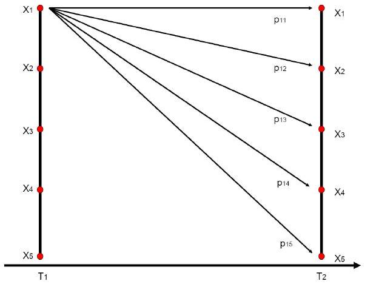
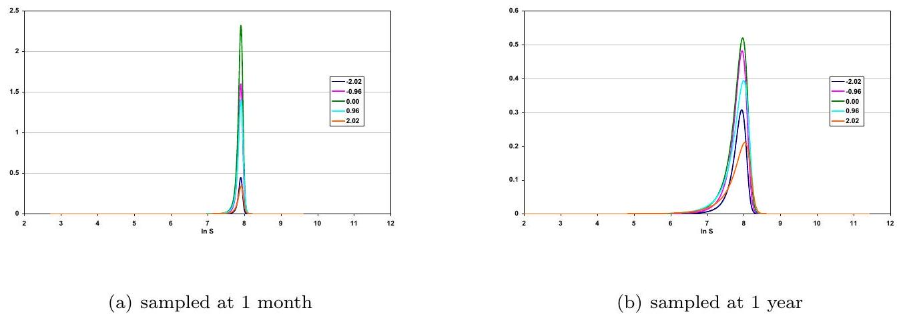
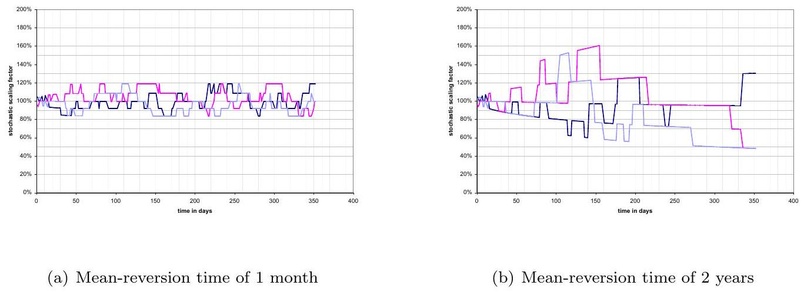
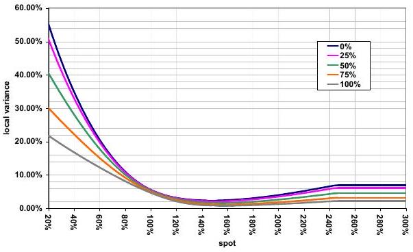
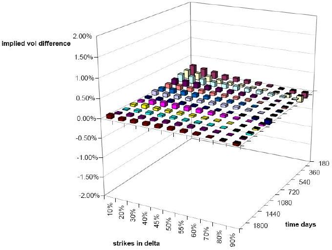
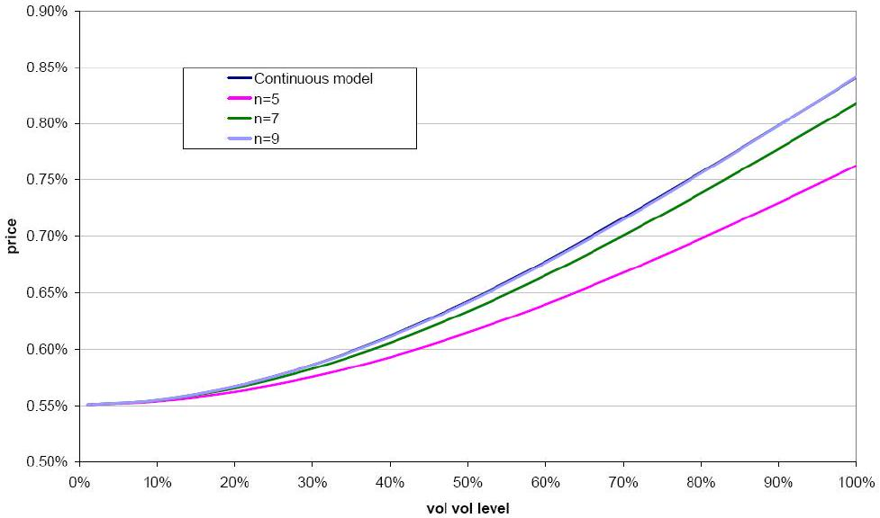
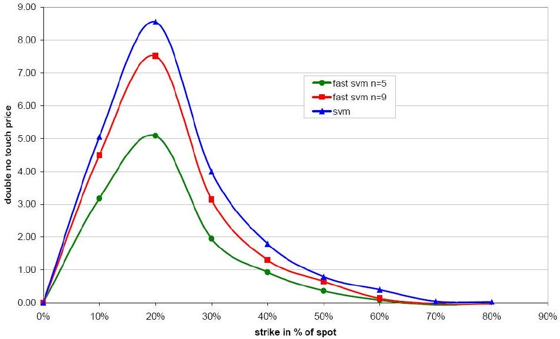

# TURBO-CHARGED LOCAL STOCHASTIC VOLATILITY MODELS

**GHISLAIN VONG**

> [!ABSTRACT]
> This article presents an alternative formulation of the standard Local Stochastic Volatility model (LSV) widely used for the pricing and risk-management of FX derivatives and to a lesser extent of equity derivatives. In the standard model, calibration is achieved by solving a non-linear two-factor Kolmogorov forward PDE, where a minimum number of vol points is required to achieve convergence of a finite difference implementation. In contrast, we propose to model the volatility process by a Markov chain defined over an arbitrary small number of states, so that calibration and pricing are achieved by solving a coupled system of one-factor PDEs. The practical benefits are twofolds: existing one-factor PDE solvers can be recycled to model stochastic volatility, while the reduction in number of discretisation points implies a speedup in execution time that enables real-time risk-management of large derivatives position.

## 1. Local Stochastic Volatility

Perfect calibration of a pure stochastic volatility model to the market of vanilla options cannot be achieved in practice. Besides the calibration is most often unstable, since different parameters may reproduce the same set of prices, while implying different greeks. The matter is made worse, when one attempts to fit the whole term-structure of the smile by introducing time-dependent parameters. To overcome this obstacle local stochastic volatility models have been proposed by [Jex99]: given any parameters of the stochastic volatility model, a local volatility factor will achieve calibration to the vanillas. The benefits are twofolds:

- (1) perfect fit of the vanillas
- (2) separation of the specification of the joint dynamic between the spot and the volatility and of the constraint of fitting the vanillas and calculation of the hedging parameters in agreement with the chosen view on the spot/vol dynamic

As it will be detailed further down, LSV models rely heavily on the availability of a pure local volatility model, which could be constructed following a Dupire-style approach.
The model is defined via the following system of SDEs:

$$
\begin{aligned}
\frac{d S_{t}}{S_{t}} & =(r-q) d t+A\left(t, S_{t}\right) \sigma_{t} d W_{t} \\
\frac{d \sigma}{\sigma} & =\mu(t, \sigma) d t+\gamma \nu(t, \sigma) d W_{t}^{\prime}
\end{aligned}
$$

The stochastic volatility and the stock level are correlated as: $<d W_{t}, d W_{t}^{\prime}>=\rho d t$. The factor $A(t, S)$ denotes the local adjustment so that we fit the vanilla call options. The parameter $\gamma$ denotes the mixing weight and controls the stochastic volatility contribution to the spot distribution: setting $\gamma=1$ corresponds to a pure stochastic volatility model, while with $\gamma=0$ the model reverts

> Date: February 4, 2010.
E-mail address: ghislain.vong01@alumni.imperial.ac.uk.
back to a pure local volatility model. The local volatility model is therefore a special case of our model.
1.1. Local volatility calibration. As mentionned in [Piterbarg05], for a given stochastic volatility model, the local volatility term $A(t, S)$ can theoretically be calculated using the Gyöngy theorem:

$$
\mathbb{E}\left[A\left(T, S_{T}\right) \sigma_{T}^{2} \mid S_{T}=K\right]=\sigma_{\text {Dupire }}^{2}(T, K)
$$

henceforth:

$$
A^{2}(T, K)=\frac{\sigma_{\text {Dupire }}^{2}(T, K)}{\mathbb{E}\left[\sigma_{T}^{2} \mid S_{T}=K\right]}
$$

Note that the scaling factor $A$ is constructed from a pure local volatility process that could be implied by a Dupire-style approach.

To solve the denominator in the right-hand side of equation (2), the following fact is used:

$$
\begin{aligned}
\mathbb{E}\left[\sigma_{T}^{2} \mid S_{T}=K\right] & =\frac{\mathbb{E}\left[\sigma_{T}^{2} \delta\left(S_{T}-K\right)\right]}{\mathbb{E}\left[\delta\left(S_{T}-K\right)\right]} \\
& =\frac{\int_{-\infty}^{\infty} y^{2} \phi(T, K, y) d y}{\int_{-\infty}^{\infty} \phi(T, K, y) d y}
\end{aligned}
$$

This equation is expressed in terms of $\phi$, the joint probability distribution function of the stock and the volatility at a fixed horizon time $T$. It can be solved numerically once the pure stochastic volatility model parameters (scaled by the mixing parameter) and the correlation have been chosen either using an risk-neutral approach (e.g. calibration to option on realised variance in equity markets) or a historical one. [Waldteufel03] suggests to compute the joint pdf by solving the two-dimensional Fokker-Planck forward PDE:

$$
\left\{\begin{array}{l}
\partial_{T} \phi=\mathcal{L}^{*} \phi \\
\phi(S, \sigma, 0)=\delta_{S=S_{0}} \delta_{\sigma=\sigma_{0}}
\end{array}\right.
$$

where $\mathcal{L}^{*}$ is the adjoint of the infinitesimal generator of the diffusion process defined in equation (1).

$$
\begin{aligned}
\mathcal{L}^{*} \phi= & \frac{1}{2} \partial_{x x}\left(A^{2}(T, x) x^{2} y^{2} \phi(T, x, y)\right) \\
& +\frac{1}{2} \partial_{y y}\left(\gamma^{2} \nu^{2}(t, y) y^{2} \phi(T, x, y)\right) \\
& +\rho \partial_{x y}(A(T, x) x y \gamma \nu(T, y) \phi(T, x, y)) \\
& -\partial_{x}((r-q) x \phi(T, x, y))-\partial_{y}(\mu(T, y) y(T, x, y))
\end{aligned}
$$

1.2. Numerical resolution. The computation of the local volatility requires solving a two-dimensional forward PDE which solution is a probability function. This is prone to various numerical difficulties, that we address in this section.
1.2.1. Forward induction calibration. Firstly the local volatility computation relies on the joint pdf of the spot and volatility process. But solving for the pdf requires the knowledge of the local volatility. To circumvent this seemingly circular argument we suggest the following calibration strategy: suppose resolution is performed on a refined time grid $\left(t_{i}\right)_{0 \leq i \leq N}$ with $t_{i}=i \Delta t$. Then the piece-wise local volatility function $A$ is written as:

$$
i=0 . . N \quad A(t, S)=A_{i}(S) \quad \forall t \in\left[t_{i}, t_{i+1}[\right.
$$

The calibration of the $N$ curves $A_{i}$ follows the steps below:

- initialisation stage: the local volatility over $[0, \Delta t]$ is calculated from the deterministic version of the Dupire formula using the short expiry call options:

$$
A^{0}(x, t) \sim \text { Short-maturity Dupire local volatility }{ }^{1}
$$

- iteration stage: for $i=1 . . N$

- i. solve the forward PDE (4) over time step $[(i-1) \Delta t, i \Delta t]$ with the local volatility curve $A^{i-1}(S)$
- ii. apply the solution $\phi(i \Delta t, x, y)$ in formulas (3) to calculate the local volatility $A^{i}(S)$ that will be used for the next time step

1.2.2. Discretisation of the Dirac function. The theoretical initial condition is a Dirac delta function defined at the initial spot and vol value. The discretisation of such non-smooth function will lead to spurious oscillations in the solution. To remedy this problem, we suggest to start the numerical resolution at $t=\tau>0$ instead of $t=0$. The solution at time $t=\tau$ would then be approximated as the product of the distribution of the equity underlying and the stochastic volatility. The former one can implied by the implied volatility surface, while the latter is known analytically. By doing so, we ignore the effect of spot/vol correlation and assume that the local volatility is the same as the pure local vol model during the initial period from 0 to $\tau$. In practice, these approximations have a negligible effect on the accuracy of the calibration provided $\tau$ is kept to a small value, e.g. 5 days. Besides, to smear out spurious oscillations due to the solution being highly peaked around the initial point, Rannacher time stepping must be applied in conjunction with smaller time step size to maintain a high level of accuracy. From [Giles05], it is optimal to replace the first Cranck-Nicholson time step by four quarter-timesteps of implicit scheme.

The computation burden involved in the resolution of the 2D PDE is likely to make the model inefficient for the purpose of risk management. While it is possible to overcome the numerical obstacles, the computation cost is a real issue that leads us to look for a more tractable alternative.

## 2. Fast LSV

Section 1 showed that calibration of the local volatility requires solving a bidimensional forward PDE. This may be cumbersome from a computational point of view, while robust implementation requires an extra-amount of care and expertise. The aim of this section is to propose a more tractable version of the model. We depart from a particular version of the local stochastic volatility dynamic expressed in equation (1):

$$
\left\{\begin{aligned}
\frac{d S_{t}}{S_{t}} & =\left(r_{t}-q_{t}\right) d t+A\left(t, S_{t}\right) \sigma^{2}\left(t, X_{t}\right) d W_{t} \\
d X_{t} & =-\kappa X_{t}+\nu d W_{t}^{\prime}
\end{aligned}\right.
$$

where $\sigma$ is a deterministic function of time and the state variable $X$. The stochastic volatility and the stock level are assumed uncorrelated: $\left\langle d W_{t}, d W_{t}^{\prime}\right\rangle=0$. Note that the leveraging effect of the stock on the instantanenous volatility is still captured thanks to the local factor $A\left(t, S_{t}\right)$.

To allow a use in a production context while preserving the main effect of a full stochastic volatility model, the volatility process $X$ is replaced by a continuous time Markov chain $\hat{X}$ with a low a number of states. The dimension reduction will enable a speed up of the model both in calibration and pricing.

*Figure 1. Representation of the volatility process with a Markov chain*

Let us denote the generator of the Markov chain with $\Lambda$ and the state values with $\left\{x_{i}, 1 \leq i \leq N\right\}$. Let $\mathcal{L}_{s}$ denote the infinitesimal generator of the diffusion process of $S$. The forward PDE governing the joint pdf $\phi(T, S, x)$ for the spot and the stochastic volatility Markov chain writes as:

$$
\frac{\partial \phi}{\partial T}=\left(\mathcal{L}_{s}^{*}+\Lambda^{*}\right) \phi
$$

where $\Lambda^{*}$ denotes the transpose of the Markov chain's transition matrix:

$$
\begin{aligned}
\mathcal{L}_{s}^{*} \phi(T, s, x) & =\frac{1}{2} \partial_{s s}\left\{A^{2}(T, s) \sigma^{2}(T, x) s^{2} \phi(T, s, x)\right\}-\partial_{s}\{\mu s \phi(T, s, x)\} \\
\Lambda^{*} \phi(T, s, x) & =\sum_{i=1}^{N} \delta_{x-x_{i}} \sum_{j=1}^{N} \lambda_{j i} \phi\left(T, s, x_{j}\right)
\end{aligned}
$$

The calibration of the model is achieved by adapting the equation (3) to the case where the stochastic volatility is represented as a continuous-time Markov chain:

$$
\mathbb{E}\left[\sigma^{2}\left(T, X_{T}\right) \mid S_{T}=K\right]=\frac{\sum_{i=1}^{N} \sigma^{2}\left(T, x_{i}\right) \phi\left(T, K, x_{i}\right)}{\sum_{i=1}^{N} \phi\left(T, K, x_{i}\right)}
$$

so that the adjustment function writes as:

$$
A^{2}(T, K)=\sigma_{\text {Dupire }}^{2}(T, K) \frac{\sum_{i=1}^{N} \phi\left(T, K, x_{i}\right)}{\sum_{i=1}^{N} \sigma^{2}\left(T, x_{i}\right) \phi\left(T, K, x_{i}\right)}
$$

The resulting non-linear PDE is solved in practice by applying the same forward calibration algorithm described earlier.
2.1. Construction of the Markov chain. We aim at finding a Markov chain that approximates an Ornstein-Uhlenbeck process:

$$
d X=-\kappa X d t+\nu d W
$$

We provide two approximations for the construction of a valid transition probability matrix. Firstly, we discretise the infinitesimal generator of the original diffusion process by finite difference after having carefully setting up the state domain. An identical approach is suggested in [Chourdakis02]. An alternative technique relies on approximating a standard normal gaussian process with a given auto-correlation structure: the transition probabilities are obtained by matching the conditional expectation of some simple basis functions applied to the random variable. The Gauss-Hermite abscissas then emerge as the natural state domain. Let us now describe each method in details.
2.1.1. Discretisation of the infinitesimal generator. The state domain $\Omega$ of the Markov chain is inferred from the asymptotic distribution of the Ornstein-Uhlenbeck process $X$. Indeed when $t \rightarrow+\infty$, one has:

$$
X_{t} \sim \mathcal{N}\left(0, \frac{\nu^{2}}{2 \kappa}\right)
$$

Then the states of the Markov chain $\hat{X}$ are derived as:

$$
x_{i}=\frac{\nu}{\sqrt{2 \kappa}} \mathcal{N}^{-1}\left(\frac{i+1}{N+1}\right) \quad i=0 . . N-1
$$

The generator needs to satisfy the following elementary properties for any $i \in[0, N-1]$ :

$$
\left\{\begin{array}{lll}
\sum_{j=0}^{N-1} \lambda_{i j} & = & 0 \\
\sum_{j=0}^{N-1} \lambda_{i j}\left(x_{j}-x_{i}\right) & = & \mu\left(x_{i}\right), \\
\sum_{j=0}^{N-1} \lambda_{i j}\left(x_{j}-x_{i}\right)^{2} & =\gamma^{2}\left(x_{i}\right), & \mu(x)=-\kappa x
\end{array}\right.
$$

The first condition secures probability conservation over an infinitesimal time step. The second and third condition respectively ensures that the first and second moment of the diffusion are matched over an infinitesimal time step. Besides, the Markov generator needs to be somewhat related to the infinitesimal generator of the diffusion process it aims at approximating. First let us recall that the infinitesimal generator of a diffusion process $X$

$$
d X=\mu(X) d t+\sigma(X) d W
$$

write as:

$$
\mathcal{L} V=\mu(x) \frac{\partial V}{\partial x}+\frac{1}{2} \sigma^{2}(x) \frac{\partial^{2} V}{\partial x^{2}}
$$

The implied Markov generator is then obtained by applying the usual finite difference approximation of the infinitesimal generator $\mathcal{L}$ on the discrete state domain $\Omega$.

$$
\Lambda=\left(\begin{array}{cccccc}
b_{0} & c_{0} & a_{0} & 0 & \ldots & 0 \\
a_{1} & b_{1} & c_{1} & 0 & \ldots & 0 \\
0 & \ddots & \ddots & \ddots & 0 & 0 \\
0 & 0 & \ddots & \ddots & \ddots & 0 \\
0 & \ldots & 0 & a_{N-2} & b_{N-2} & c_{N-2} \\
0 & 0 & 0 & c_{N-1} & a_{N-1} & b_{N-1}
\end{array}\right)
$$

Note that the first and last line of the matrix are treated apart. For example a reflecting boundary condition may be implemented with only two non-zero coefficients. In that case we content ourselves with matching asymptotically the second-moment of the real Markov diffusion.

The resulting approximation is a time-homogenous Markov chain. This is attractive from a computational point of view, since a single transition probability matrix is cached and used at any time step in both forward and backward techniques. However, the approximation may suffer from lack of accuracy if the original Ornstein-Uhlenbeck process is not fast-mean reverting. To overcome this obstacle, we provide an alternative approximation.
2.1.2. Non-time-homogenous Markov chain. In this section, the original stochastic volatility process is equivalently formulated as a function of a standard normal gaussian process:

$$
\sigma_{t}^{2}=\exp \left(v_{t} X_{t}-\frac{v_{t}^{2}}{2}\right)
$$

where

$$
\left\{\begin{aligned}
X_{t} & \sim \mathcal{N}(0,1) \\
v_{t} & =\sqrt{\int_{0}^{t} e^{-2 \kappa(t-u)} \nu_{u}^{2} d u} \\
\operatorname{Cov}\left(X_{t}, X_{t+h}\right) & =\rho(t, t+h)
\end{aligned}\right.
$$

The vol $v_{t}$ is derived from the Ornstein-Uhlenbeck process. Similarly the auto-correlation function $\rho(t, t+h)$ is given as

$$
\rho(t, t+h)=e^{-\kappa h} \frac{v_{t}}{v_{t+h}}
$$

We aim at finding a continuous-time Markov chain $\hat{X}$ such that the original process model described in equation (5) is well-approximated by the following dynamic:

$$
\left\{\begin{aligned}
\frac{d S_{t}}{S_{t}} & =\left(r_{t}-q_{t}\right) d t+A\left(t, S_{t}\right) \sigma_{t} d W_{t} \\
\sigma_{t}^{2} & =\exp \left(v_{t} \hat{X}_{t}-\frac{v_{t}^{2}}{2}\right)
\end{aligned}\right.
$$

Ideally the Markov chain should be constructed such that conditional expectations of the above process are matched for any smooth function. Firstly, since gaussian variables are involved, the Gauss-Hermite abscissas arise as a natural set of values for the state domain of the Markov chain. Secondly, we propose to simplify the problem by approximating any smooth function by its projection on the linear Lagrange basis functions denoted by $\left(L_{i}\right)_{1 \leq i \leq n}$. The basis is defined with respect to the Markov chain's variable set $\left(x_{i}\right)_{(1 \leq i \leq n)}$. For a given smooth function $F$, we then write the conditional expectation:

$$
\mathbb{E}\left[F ( X _ { t + h } | X _ { t } = x _ { i } ] \approx \sum _ { j } ^ { n } F ( x _ { j } ) \mathbb { E } \left[L_{j}\left(X_{t+h} \mid X_{t}=x_{i}\right]\right.\right.
$$

Recall that the projection of $F$ on the linear Lagrange basis is merely the function obtained by linear interpolation of $F$ valued at the abscissas $\left(x_{i}\right)_{(1 \leq i \leq n)}$. Besides we have:

$$
X_{t+h}=\rho(t, t+h) X_{t}+\sqrt{1-\rho^{2}(t, t+h)} Z, Z \sim \mathcal{N}(0,1), Z \perp X_{t}
$$

The conditional expectation of the Lagrange basis function applied to the process can eventually be computed by means of a Gauss-Hermite quadrature:

$$
\mathbb{E}\left[L_{j}\left(X_{t+h} \mid X_{t}=x_{i}\right)\right]=\sum_{k=1}^{n} w_{k} L_{j}\left(\rho(t, t+h) x_{i}+\sqrt{1-\rho^{2}(t, t+h)} x_{k}\right)
$$

On the other hand, the conditional expectation (11) can be expressed in terms of the Markov transition probability matrix:

$$
\mathbb{E}\left[F\left(\hat{X}_{t+h} \mid \hat{X}_{t}=x_{i}\right] \approx \sum_{j}^{n} F\left(x_{j}\right) Q_{i j}(t, t+h)\right.
$$

where $Q_{i j}(t, t+h)$ denotes the transition probability from state $i$ to state $j$ between time $t$ and $t+h$. Identifying now both expressions (11) and (12), we obtain

$$
Q_{i j}(t, t+h)=\sum_{k=1}^{n} w_{k} L_{j}\left(\rho(t, t+h) x_{i}+\sqrt{1-\rho^{2}(t, t+h)} x_{k}\right)
$$

Note that each element is obviously positive and that the sum of elements row wise of the transition matrix is one since

$$
\forall x \sum_{j=1}^{n} L_{j}(x)=1
$$

Therefore the transition matrix is well-posed and can be efficiently implemented.
2.2. Numerical resolution. This section describes a robust and efficient numerical method to solve the forward PDE found in equation (6) that governs the propagation of a diffusion process modulated by a Markov chain. Obviously, brute force discretisation of the PDE (6) involves inversing a sparse but non-tridiagonal matrix. By contrast, our scheme consists in decomposing the PDE as a system of one-dimensional PDEs Kolmogorov forward PDEs over each time step. For the latter, we can leverage on the existence of well-known efficient and stable numerical methods, for instance see [Tavella00] for further reading on the numerical resolution of partial differential equations in finance.

Before detailing the scheme, let us introduce some notations. The adjoint infinitesimal generator $\mathcal{L}_{s}^{*}$ is discretised into $L_{s}^{*}$, propagation is described from time $t_{k}$ to $t_{k+1}, \Delta t=t_{k+1}-t_{k}$, and $\theta$ denotes the usual coefficient controlling the time at which the PDE is actually approximated. Our scheme suggest to solve the PDE in 2 steps:

$$
\begin{cases}\text { step 1: } & \tilde{u}_{k+1}=Q^{*}\left(t_{k}, t_{k+1}\right) u_{t_{k}} \\ \text { step 2: } & \left(1-\theta \Delta t \hat{L}_{s}^{*}\right) u_{k+1}=\left(1+(1-\theta) \Delta t \hat{L}_{s}^{*}\right) \tilde{u}_{k+1}\end{cases}
$$

The first step involves the transpose of the Markov chain transition probability matrix. Note that it can be approximated at first order in time with the Markov generator:

$$
Q^{*}\left(t_{k}, t_{k+1}\right) \approx\left(I+\Lambda^{*}(t, t+h) h\right)
$$

In the second step, the forward operator of the pure diffusion process is applied for each state of the Markov chain.

It can be shown that this operator splitting scheme is first order accurate in time, and second order accurate in space. More importantly, the same stability property as for a mere single factor PDE holds. In particular, the PDE is stable for $\theta=1$. From a computational point of view, it compares favorably well to the resolution of a full 2D forward PDE: a single time stepping requires solving $n$ single factor PDEs, where $n$ is the number of states in the Markov chain. A low number of states, e.g. 5, is usually sufficient to emulate a true stochastic volatility process, as we are not constrained by convergence properties typically required for finite difference approximation of a stochastic volatility diffusion process. Let us conclude this section with numerical results: figure 3 shows the solution sampled at one month and one year computed by solving the PDE (6) for the Eurostoxx with a vol of vol of 100\% and mean-reversion time of one year. Each plotted function represents the joint pdf $V(\log S, X)$ for a fixed Markov chain state variable.

*Figure 2. PDE solution with 5 stoch vol states*

2.3. Numerical results. We provide some numerical results for the Eurostoxx as of 12 January 2010 based on a implementation of the continuous-time Markov chain described in section 2.1.2. These results confirm that the Markov-chain driven stochastic local vol model holds similar properties as the original model based on the stochastic differential equation in equation (5).
2.3.1. Stochastic volatility factor sample paths. The stochastic scaling factor defined in equation (9) is driven by a the non-time homogenous Markov chain defined in section 2.1.2. For a a vol of vol of 60\% and 5 states, figure 3 illustrates how the switching regime occurs. Note that a fast meanreverting regime will decrease the autocorrelation. As illustrated in subfigure 3(a), the resulting path is typically bursty. Let us furthermore remark that a slow mean reversion time will result in a larger variance of distribution of the stoch vol factor. All these observations are in line with theoretical results related to the original stoch vol model that the continuous-time Markov chain aims at emulating.

*Figure 3. Stoch vol scaling factor paths for different values of mean-reversion time using the same base random numbers*

2.3.2. Local variance adjustment. Recall that the adjusted local variance $A(t, S)$ found in model (10) is a transformation of the Dupire local variance

$$
A(T, K)=\frac{\sigma_{\text {Dupire }}^{2}(T, K)}{\mathbb{E}\left[\sigma_{T}^{2} \mid S_{T}=K\right]}
$$

where the conditional expectation is calculated using the joint pdf between the spot and Markov chain driver. Increasing vol of vol will transfer the source of convexity in the smile from the local vol to the stochastic vol factor. As in the original stochastic local vol model, this results in lower level of the local vol on the wings as illustrated in figure 4.
2.3.3. Calibration result. Figure 5 shows calibration error for a vol of vol of 100\% and a mean-reversion time of 1Y. The number of states is set to 5. The calibration is pretty accurate with implied volatility error mostly below 10 basis points.

*Figure 4. Adjusted local variance for various levels of vol of vol*

*Figure 5. Calibration error*

2.3.4. Impact on exotics. Let us check that the impact on exotics is coherent with the impact observed with the original stochastic local vol model.

Reverse cliquets. We take the simple example of a reverse cliquet defined as follows:

$$
\max \left(3 \%-\sum_{i=1}^{24} \max \left(0,100 \%-\frac{S\left(t_{i+1}\right)}{S\left(t_{i}\right)}\right)\right)
$$

where the $t_{i}$ 's are monthly fixing dates. Since each cliquelet puts are struck at the money, these are quasi-linear in forward vols. The final payout can therefore be loosely seen as a put on a sum of forward vols, which explains a long volgamma risk profile. Figure 6 shows that the fast stochastic local vol model behaves as expected as the vol of vol increases. The numerical result also indicates that increasing the number of stoch vol states in the Markov chain enables to closely replicate the same profile impact as the original stochastic local vol model.

Double no-touch options. We consider a double no-touch option that pays 100 if a given lower and upper barrier are never hit before the expiry of the trade. The expiry is set to one year. The lower and upper barriers are respectively set to $S_{0} \times(1-B)$ and $S_{0} \times(1+B)$, where $B$ is varying from 0\% to 80\%. A double no-touch option is expected to be more expensive in stochastic volatility than in local vol. The intuition can be conveyed by considering a one-touch option with say 2 discrete monitoring dates $T_{1}$ and $T_{2}$. Let A be the event where the barrier is hit at time $T_{1}$ and B the event where the barrier is hit at $T_{2}$. Then the one touch option price can be decomposed as:

$$
\mathbb{P}(\mathrm{A} \cup \mathrm{~B})=\mathbb{P}(\mathrm{A})+\mathbb{P}(\mathrm{B})-\mathbb{P}(\mathrm{A} \cap \mathrm{~B})
$$

The probabilities $\mathbb{P}(\mathrm{A})$ and $\mathbb{P}(\mathrm{B})$ are expected to remain the same in both local and stochastic vol, since they correspond to European options. Now the probability that both events do occur is larger in stochastic volatility, essentially because the stoch vol model implies fatter tails for the conditional distribution of the underlying. Therefore the price of a one-touch is cheaper in stoch vol. This implies that the double no-touch is more expensive. Numerical tests in figure 7 confirm the

*Figure 6. Reverse cliquet price for various levels of vol of vol and various number of stoch vol states*

latter rule of thumb and shows convergence of the discrete stoch vol model towards the continuous space model as we increase the number of switching states.

*Figure 7. Difference between stoch vol and local vol of a double no-touch expiring in one year for varying the barrier level*

## 3. Conclusion

In this technical document, a generalisation of the local volatility model for equities and FX was described. The local volatility function is scaled by a stochastic process correlated with the spot's brownian increment. While calibration to vanillas is preserved, the generalised process model
provides richer dynamics of the implied volatility surface, and can be used as an effective tool to monitor the volatility convexity of exotic products. However large-scale usage in production for the purpose of risk-management may be hindered by possible robustness and performance issues. Indeed the calibration of the model relies on a numerical implementation that requires care and expertise. When the correlation between the stochastic volatility and spot are assumed to be zero, we designed a faster and robust version of the model where the stochastic volatility process is replaced by a continuous-time Markov chain. The fast model holds the same properties as the full-blown version, while calibration performance is enhanced. For pricing purposes, the performance enhancement is expected to be mostly effective for valuations based on finite-difference technique.

Acknowledgements. This work benefited from stimulating discussions with Adil Reghaï.

## References

- [Chourdakis02] Chourdakis K., Continuous Time Regime Switching Models and Applications in Estimating Processes with Stochastic Volatility and Jumps, Working paper (2002). 5
- [Giles05] Giles M., and R. Carter, Convergence of Cranck-Nicholson and Rannacher Time Stepping, Working paper (2005). 3
- [Jex99] Jex M. et al., Pricing Exotics under the Smile, Risk magazine (1999). 1
- [Piterbarg05] Piterbarg V., Markovian Projection for Volatility Calibration, Risk magazine (2005). 2
- [Tavella00] Tavella D. and C. Randall, Pricing Financial Instruments: The Finite Difference Method, Wiley (2000). 7
- [Waldteufel03] Waldteufel F., Local Stochastic Volatility model for FX, Barclays Capital technical paper (2003). 2
