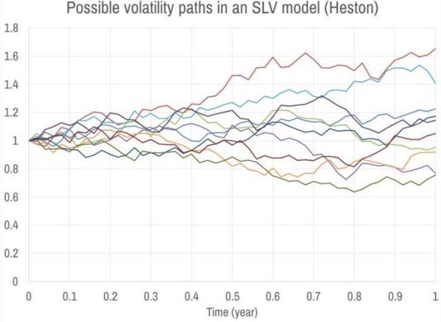
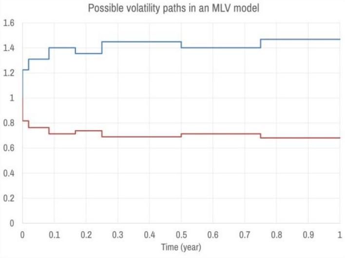
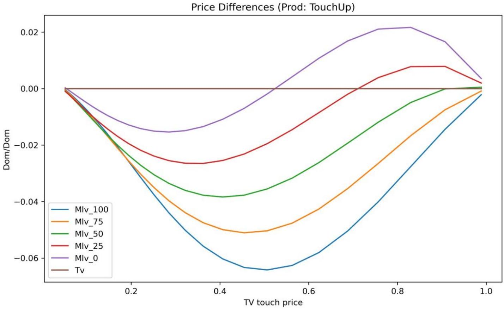
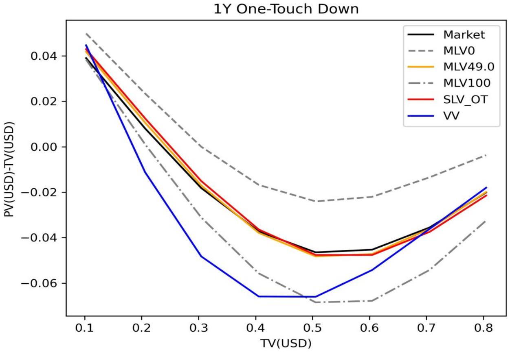
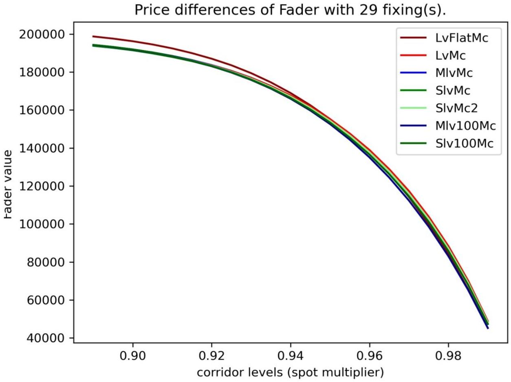
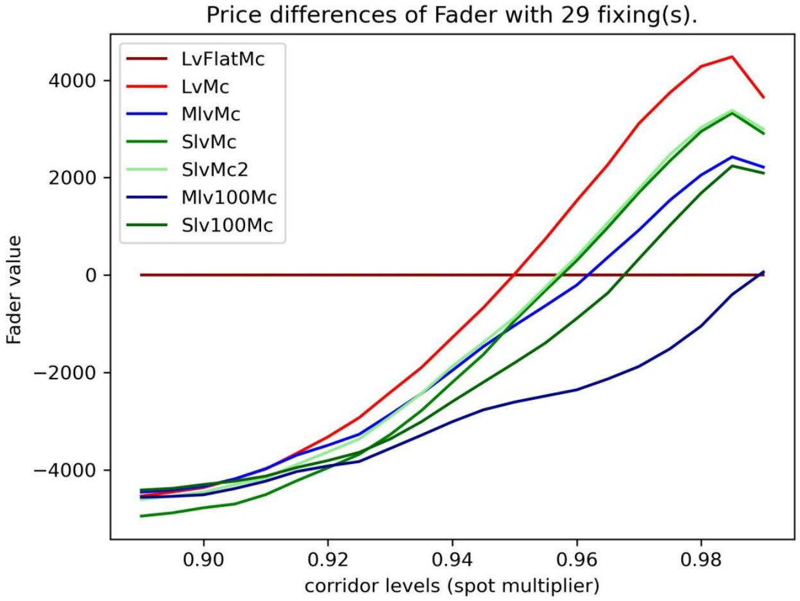

# FX Column: Mixed Local Volatility Model Boosts Distribution of Exotics

Uwe Wystup, MathFinance AG, Frankfurt am Main

As a market maker for FX Derivatives, and especially flow products on a single dealer platform, one needs the best trade-off between precision and speed in one's exotics model. A Mixed Local Volatility (MLV) model is a simplified, yet powerful version of the full-fledged Stochastic Local Volatility (SLV) model. It ignores correlation between spot and volatility (which is common in FX); the skew is generated exclusively from local volatility, and the stochastic volatility process is simplified into a discrete set of volatility states. The key features include:

- MLV is more than 10 times faster for calibration and pricing than SLV.
- It allows flexible calibration to term-structure of Double-No-Touch (DNT) contracts.
- It is arguably the market standard for pricing a large range of 1st generation exotics.

## How is volatility modeled in SLV and MLV?

Ignoring drift (interest rates and forward rates), the general concept of an SLV model is using a product of a local and a stochastic volatility model, stochastic for the model dynamics and to reflect non-deterministic volatility, local to fit the model to a given vanilla options volatility surface.

$$
\frac{d S}{S}=\sigma_{l o c}(S, t) \cdot \sigma_{s t o c h}(t) \cdot d W
$$

The choices for the stochastic volatility is typically a diffusion process in SLV models, indicated by infinitely many paths on the left hand side in Figure 2. For MLV, one can think of tossing a coin and generate a low volatility state or a high volatility state.

|  |  |
| --- | --- |
| Volatility driven by a diffusive process (e.g. Heston) with continuous distribution | Volatility is stochastic, but randomness only in $\mathrm{t}=0$ and with a discrete distribution |

*Figure 1: Volatility Processes in SLV and MLV*

## How do traders mark an MLV model?

As a trader one either faces or distributes FX volatility market data in the form of At-the-money (ATM) volatilities, Risk Reversals (RR) and Butterflies (BF) for 25-delta and 10-delta strikes for the usual tenors as listed in Table 1.

|  | ATM | RR25 | BF25 | RR10 | BF10 | MIX |
| --- | --- | --- | --- | --- | --- | --- |
| ON | 10.0\% | -0.50\% | 0.30\% | -0.95\% | 1.08\% | 30.00\% |
| 1W | 9.0\% | -0.50\% | 0.35\% | -0.95\% | 1.26\% | 35.00\% |
| 2W | 8.0\% | -0.70\% | 0.40\% | -1.33\% | 1.44\% | 40.00\% |
| 3W | 8.5\% | -0.70\% | 0.40\% | -1.33\% | 1.44\% | 40.00\% |
| 1M | 8.7\% | -0.70\% | 0.40\% | -1.33\% | 1.44\% | 45.00\% |
| 2M | 9.0\% | -0.80\% | 0.40\% | -1.52\% | 1.44\% | 45.00\% |
| 3M | 9.2\% | -0.80\% | 0.40\% | -1.52\% | 1.44\% | 50.00\% |
| 6M | 9.5\% | -0.80\% | 0.40\% | -1.52\% | 1.44\% | 50.00\% |
| 9M | 10.0\% | -0.80\% | 0.40\% | -1.52\% | 1.44\% | 55.00\% |
| 1Y | 11.0\% | -0.80\% | 0.40\% | -1.52\% | 1.44\% | 55.00\% |
| 18M | 11.5\% | -0.80\% | 0.40\% | -1.52\% | 1.44\% | 55.00\% |
| 2Y | 12.0\% | -0.80\% | 0.40\% | -1.52\% | 1.44\% | 55.00\% |

*Table 1: Volatility Market Data and MLV Mixing Factors (MIX)*

A trader's job is then to mark the term structure of mixing factors empirically, for example, the 1M mixing factor of 45\% means that

45\% of BF25 is generated by stochastic volatility (or mixture)
55\% of BF25 is generated by the local volatility

Traders mark MIX to match a set of One-Touch (OT) or Double-No-touch (DNT) contracts. Figure 2 shows the difference of MLV-based OT prices and their corresponding theoretical value (TV) as a function of the TV, an illustration generally referred to as the OT-moustache. Different mixing factors (MIX) of 0\%, 25\%, 50\%, 75\% and 100\% generate different price differences. The trader chooses the MIX that would be represent the market prices of OT contracts. Notice that the interbank bid-offer spread is about 2\% in USDJPY, which is one unit block on the y-axis, thus the choice of MIX is crucially important when running an automatic trading platform.

*Figure 2: One-Touch Moustache in the Mixed Local Volatility Model with various mixing factors*

It prices of first generation exotics are not readily available, a statistical estimate of MIX can also be obtained by looking at historical correlation between spot and RR25.

## Comparison SLV / MLV / Vanna-Volga

I summarize the key features of the three most common industry exotics models in Table 2. The vanna-volga approach, which was popular until the first decade, works mostly for first generation exotics, that here with many traps and inconsistencies. The only real advantage is really its calculation speed.

|  | SLV | MLV | Vanna-Volga (Skew) |
| --- | --- | --- | --- |
| Accurate vanilla calibration | ✓ | ✓ | Perfect calibration only at 3 strikes |
| Barrier / touch options, $1{ }^{\text {st }}$ gen exotics | ✓ ( ‹ calibration at short maturity ) |  | ✓ ( slittle flexibility in adjusting exotic prices) |
| Calibration / pricing speed | 1 sec | 0.1 sec | <0.01 sec |
| Correlation spot / vol | ✓ | ⊠ | ⊠ |
| Model parameters (to be marked by trader) | \begin{tabular}[t]{l}
- BF-Factor (possibly per tenor) |  |  |
| - Correlation or RR-Factor (possibly per tenor) |  |  |  |
 & - BF-Factor (per tenor) & ⊠ \\
\hline Forward-Starting and vol payoffs &  & ⊠ & ⊠ \\
\hline Target Redemption Notes / Forwards & ✓ & ✓ & ⊠ \\
\hline
\end{tabular}

*Table 2: Features of SLV, MLV and Vanna-Volga Models*

A trader can't mark a vanna-volga model, but can mark an SLV or an MLV model. The MLV is easier to mark as there is only one mixing factor. MLV outperforms SLV in calibration and pricing speed, but would perform poorly for forward starting contracts and volatility derivatives like variance swap, volatility swaps, FVAs, or volatility options.

## Example 1: USDJPY One-Touch (OT) under MLV and SLV

I reconsider the OT-moustache in Figure 3, with TV of a 1Y One-Touch with lower barrier on the x-axis and differences to TV on the y-axis.

*Figure 3: Marking SLV and MLV to Market Prices of One-Touch Contracts*

The dashed line originates from a fully local volatility model (MLV0) and indicates overpricing of the OT. The dash-dot line is a fully stochastic volatility model (MLV100) and indicates underpricing of the OT. The black curve represents market prices. A suitable fit of an SLV model in red can be obtained by an SLV mixing factor of $70 \%$ (SLV70). An equally suitable fit of the MLV model can be obtained by a mixing factor of 56\% (MLV56). Note that the mixing factors generally differ depending on the model choice. Vanna-Volga (VV) in blue has a similar pattern, but still leads to mispricing of the OT contracts as it is often outside the market bid-offer.

## Example 2: Fader Call

Next I consider a fader call option with a notional proportional to the number of times the FX rate fixes in a pre-defined corridor, whose lower end is set by the spot multiplier and upper end is calculated symmetrically, e.g. 1.1 for a spot multiplier of 0.9. The prices generated by various SLV and MLV models are exhibited in Figure 4.

*Figure 4: Fader Call Option Prices in Different Models as Function of the Corridor Size*

Since the prices overlap each other, it is better to consider the differences of the prices to TV in Figure 5. We observe that for wide corridors, all the models under consideration yield similar results, but for small corridors the differences are much larger. I conclude that model risk is not only a function of the product, but also of the contractual parameters of the product. Faders with small fade-in corridors will be priced differently in different SLV and MLV models. The way to go forward is to make the fader price at least consistent with first generation exotics by calibrating an MLV model with the appropriate MIX.

*Figure 5: Fader Call Option Price Differences in Different Models as Function of the Corridor Size*

And of course, the risk managers and model governance officers should be aware the model risk.

## A parsimonious choice of model

An overview of which model I consider suitable for which product class is presented in Table 3. Red colors refer to a too simple model and mispricing, blue indicates a too complex model and overkill, and green the right level of complexity. Yellow indicates borderline cases, e.g. a vanna-volga approach does not even work precisely for vanilla options, because the volatility is only correct for three strikes, but usually wing volatilities are too low. A pure Heston model, while studied intensely in the academic literature does not really perform satisfactory for any product.

**Payoffs**

|  |  | Vanillas \ | European payoffs | TRFs, tarns (target but no barrier) | 1st generation exotics (barriers, discrete barriers) | 2nd gen exotics, Forwardstarting barriers, forward strikes, FVAs, cliquets | Option on realized volatility / variance |
| --- | --- | --- | --- | --- | --- | --- | --- |
| Models | BS + Volatility interpolation | ✓ | × | x | × | x |  |
|  | Vanna - Volga | ✓ × | × | $\boldsymbol{v} \boldsymbol{x}$ | × | × |  |
|  | Dupire | ✓ | ✓ | × | × | × |  |
|  | Local-Vol Mixture | ✓ | ✓ | ✓ | × | × |  |
|  | Local-Vol Mixture with transition | ✓ | ✓ | ✓ | ✓ | $\boldsymbol{\vee} \boldsymbol{x}$ |  |
|  | SLV | ✓ | ✓ | ✓ | ✓ | ✓ |  |
|  | Heston | ✓ × | ✓ × | ✓ × | ✓ × | ✓ × |  |

*Table 3: Model/Product Matrix*

## In summary: MLV is a simplified version of SLV

- The stochastic volatility process is discretized into a small number of volatility states.
- Zero correlation between spot and volatility is assumed (common assumption in FX).
- MLV contains the necessary flexibility to calibrate to a large range of 1st generation exotics and most of the target forwards family.
- Calibration and pricing is very fast, suitable for structuring and a flow trading environment.

## References

There are not many papers out there on Mixed Local Volatility Models, but some worth reading include

1. Bruno Dupire. Pricing with a smile. Risk, 7(7), 18-20.
2. Yong Ren, Dilip Madan, Michael Qian Qian: Calibrating and pricing with embedded local volatility models, Risk Magazine, September 2007, 138-143.
3. Iain J. Clark: Foreign Exchange Option Pricing - A Practitioner's Guide, Wiley Finance.
