# IMPERIAL

**Imperial College London \\ Department of Mathematics**

## Mixed Local Volatility Models

Author: Muaz CHOWDHURY (CID: 02291903)

A thesis submitted for the degree of
MSc in Mathematics and Finance, 2023-2024

## Declaration

The work contained in this thesis is my own work unless otherwise stated.

## Acknowledgements

I would like to start by thanking Taisiya Izhutkina and Rob Zvan for providing me with invaluable advice and their expertise while working on this thesis. I would also like to thank Jack Jacquier for being the academic supervisor of this thesis and providing me with useful feedback.

I'm sincerely grateful to my close friends for always being there for me, inspiring me, and helping me to stay motivated through tough times. Finally, I'm forever indebted to my close family for making it possible for me to pursue this master's program, and for all of the encouragement, reassurance and support they have given me throughout all of my years of studying and more.

> [!ABSTRACT]
> Stochastic local volatility (SLV) models are an industry standard for pricing exotic options in foreign exchange and equity markets; they are able to match the prices of liquidly traded vanilla options in the market while also producing realistic implied volatility dynamics, allowing us to be able to price exotic options accurately. However, calibration and pricing under SLV models are computationally expensive due to their complexity. In this thesis, we examine Mixed Local Volatility (MLV) models, a simplified version of SLV models where instead of modelling the stochastic volatility process as being driven by a Brownian motion, we simplify it to a discrete set of volatility states. If we model one underlying and one volatility process, this simplification reduces our calibration and pricing problems from solving two-dimensional partial differential equations to solving several one-dimensional partial differential equations, resulting in a very significant reduction in computation time. It has been argued that SLV models are in fact too complex for pricing a range of first-generation exotic options, including continuous barrier options, and that MLV models are the model of choice for these options. In this study, we investigate the prices of continuous barrier options generated by the MLV model, as well as the forward implied volatility smile dynamics of the model. The SLV model will serve as our main point of comparison, and our goal is to determine whether the MLV model can produce similar behaviour to that of an SLV model.

## Contents
1 Black-Scholes and Local Volatility Models ..... 7
1.1 The Black-Scholes Model ..... 7
1.2 Implied Volatility ..... 8
1.3 Local Volatility Model and Dupire's Formula ..... 9
1.4 Forward Implied Volatility in Local Volatility Models ..... 10
2 Stochastic Volatility Models ..... 12
2.1 Standard Stochastic Volatility Models ..... 12
2.2 Lognormal Mixture Models ..... 13
2.3 Regime-Switching Models ..... 15
3 Stochastic Local Volatility Models ..... 16
3.1 Stochastic Local Volatility Models ..... 16
3.2 Calibration of SLV Models ..... 17
3.2.1 SLV Leverage Function Calibration ..... 17
3.2.2 General SLV Calibration ..... 19
3.2.3 Impact of the Mixing Weight ..... 20
4 Mixed Local Volatility Models ..... 21
4.1 The MLV Model ..... 22
4.2 Calibration of MLV Models ..... 22
4.2.1 MLV Leverage Function Calibration ..... 22
4.2.2 MLV Mixing Parameters ..... 23
4.3 MLV Barrier Option Pricing ..... 25
4.3.1 Barrier Options ..... 25
4.3.2 MLV Barrier Option Price Comparisons ..... 26
4.4 MLV Forward Implied Volatility Dynamics ..... 32
4.4.1 Effect of Mixing Parameters on Forward Smiles ..... 33
4.4.2 Forward Smiles of Multi-State MLV Models ..... 35
4.5 Regime-Switching MLV Model ..... 39
4.5.1 General RS-MLV Model ..... 39
A Technical Details ..... 42
A. 1 MLV Calibration Finite-Difference Scheme ..... 42
A.1.1 Finite-difference with Non Uniform Grids in One Dimension ..... 42
A.1.2 Fokker-Planck Discretisation in One Dimension ..... 42
B Additional Figures ..... 44
B. 1 MLV Forward Implied Volatility Dynamics ..... 44
Bibliography ..... 50

## List of Figures
1.1 Forward implied volatility smiles under the local volatility model, obtained by pricing SPX forward-starting call options with forward-starting dates $T_{0}=0 \mathrm{Y}, 6 \mathrm{M}, 2 \mathrm{Y}, 3 \mathrm{Y}, 6 \mathrm{Y}$. ..... 11
4.1 Two-state MLV leverage surfaces calibrated to AAPL vanilla options using two sets of model parameters (constant volatility states). ..... 24
4.2 1Y up-and-out barrier call option prices with 80\% strike written on SPX; comparison between LV, SLV, and MLV with volatility states $\sigma=[1,0.30]$ and varying stochasticity. ..... 28
4.3 1Y up-and-out barrier call option prices with 80\% strike written on SPX; comparison between LV, SLV, and MLV with 50\% stochasticity and varying volatility states. ..... 29
4.4 1Y down-and-out barrier call option prices with 80\% strike written on SPX; comparison between LV, SLV, and MLV with 50\% stochasticity and varying volatility states. ..... 30
4.5 1Y one-touch option price differences written on USD-JPY; comparison between LV, SLV, and MLV with 90\% stochasticity and varying volatility states. ..... 31
4.6 Forward implied volatility smiles under the SLV model, obtained using SPX forward-start call options for a range of forward-starting dates and 6-month time to expiry from the forward-starting date. ..... 33
4.7 Forward implied volatility smiles under the MLV model, obtained using SPX forward-start call options for a range of forward-starting dates and 6 -month time to expiry from the forward-starting date, using $\sigma=[0.2,1]$ for all forward-starting dates. ..... 34
4.8 Forward smile comparison of two-state MLV model with probabilities $\lambda=$ [0.25, 0.75], $\lambda=[0.5,0.5]$ and $\lambda=[0.75,0.25]$, over a range of volatility state combinations. ..... 36
4.9 Forward smile comparison of two-state MLV models with volatility states $\sigma=[0.1,1]$ and $\sigma=[0.3,1]$, with 100\%, 75\%, 50\%, 25\% stochasticities but a smaller probability weighting on the volatility state with value 1. ..... 37
4.10 Forward smile comparison of two-state MLV models with volatility states $\sigma=[0.1,1]$ and $\sigma=[0.3,1]$, with 100\%, 75\%, 50\%, 25\% stochasticities but a larger probability weighting on the volatility state with value 1. ..... 38
4.11 Forward smile comparison of two-state MLV using GBP/USD as the un- derlying, with 50\% stochasticity and a smaller probability weighting on the volatility state with value 1, for a range of volatility states. ..... 39
B. 1 Forward smile comparison of two-state MLV model with probabilities $\lambda=$ [0.25, 0.75], $\lambda=[0.5,0.5]$ and $\lambda=[0.75,0.25]$, over a range of volatility state combinations. ..... 45

- B. 2 Forward smile comparison of two-state MLV models with volatility states $\sigma=[0.1,1]$ and $\sigma=[0.3,1]$, with 100\%, 75\%, 50\%, 25\% stochasticities but a smaller probability weighting on the volatility state with value 1. 46
- B. 3 Forward smile comparison of two-state MLV models with volatility states $\sigma=[0.1,1]$ and $\sigma=[0.3,1]$, with 100\%, 75\%, 50\%, 25\% stochasticities but a larger probability weighting on the volatility state with value 1. 47

## Introduction

Black and Scholes revolutionised the field of option pricing in their 1973 paper [1], in which they introduced the Black-Scholes model for valuing European options. This model, however, does not reflect realistic market dynamics, and consequently, is not sufficient for accurately pricing financial derivatives. In particular, the model assumes that the volatility in the market is constant, which is highly unrealistic. Consequently, the Black-Scholes model cannot reproduce the market prices of European options, one of the simplest types of financial derivatives, for all strikes and maturities. A model that is not at all consistent with market prices of European options is not suitable for pricing and hedging other types of financial derivatives.

Since the introduction of the Black-Scholes model, there has been an extensive amount of research done to develop more realistic models which can better capture market dynamics. Bruno Dupire in [2] introduced a local volatility model, in which volatility is modelled as a deterministic function that is dependent on both the value of the underlying and time. Dupire's local volatility model has the advantage that it can exactly reproduce the market prices of European options. However, the implied volatility dynamics of this local volatility model do not reflect realistic market behaviour, and because of this, they are not the most suitable model for pricing and hedging exotic derivatives which have much more dependency on how the price of the underlying changes over the life of the contract.

Stochastic volatility models are a class of models in which the volatility is modelled as a stochastic process, to better reflect empirical observations of volatility in the market. The advantage is that the implied volatility dynamics of these models are more realistic than the local volatility model. The issue is that, unlike Dupire's local volatility model, stochastic volatility models cannot reproduce the market prices of European options exactly.

The class of stochastic local volatility models, introduced by Jex et al. in [3], are a combination of both types of models; they are able to reproduce market prices of European options exactly, while exhibiting realistic implied volatility dynamics. In foreign exchange and equity markets, stochastic local volatility models have become an industry standard for pricing exotic derivatives. These models, however, come at a cost; due to their complexity, calibration of the models and using them to price are computationally expensive. However, for a subset of exotic derivatives, stochastic local volatility models may be too complex. In this thesis, we explore Mixed Local Volatility (MLV) models, a heavily simplified version of stochastic local volatility models which can be calibrated and used to price derivatives with a significant reduction in computation time. As we will see, in the case of modelling one underlying and one volatility process, the simplification reduces calibration and pricing from solving a two-dimensional partial differential equation to instead solving several one-dimensional partial differential equations. We focus specifically on assessing the MLV model's capability in accurately pricing continuous barrier options, as well as analysing its forward implied volatility dynamics, relative to a stochastic local volatility
model and a local volatility model.

The thesis is structured as follows: in Chapter 1, we briefly introduce the Black-Scholes model and the concept of implied volatility, before introducing Dupire's local volatility model and discussing its main limitations. In Chapter 2, we then give a brief overview of stochastic volatility models and introduce some simplified models to contrast with the MLV model that will be discussed in Chapter 4. In Chapter 3, we move on to the class of stochastic local volatility models, and here we go into more detail about the process of calibrating such models. The main results of this thesis are found in Chapter 4, where we delve into the topic of MLV models. Here, we start by introducing the model, presenting a general framework for calibration, and discussing the parameters which characterise this model. We then investigate the prices of continuous barrier options generated by this model, as well as the forward implied volatility dynamics that the model exhibits; we use Dupire's local volatility model and a stochastic local volatility model for points of comparison. We make conclusions about the applicability of the model, and present a theoretical framework for an extended version of the model.

## Chapter 1

## Black-Scholes and Local Volatility Models

### 1.1 The Black-Scholes Model

Black and Scholes introduced the Black-Scholes model for valuing European options in their 1973 paper [1], in which they defined the risk-neutral dynamics for an asset price process $\left(S_{t}\right)_{t \geq 0}$ of a non-dividend paying asset to be given by the stochastic differential equation (SDE)

$$
\mathrm{d} S_{t}=r S_{t} \mathrm{~d} t+\sigma S_{t} \mathrm{~d} W_{t}, \quad S_{0}>0,
$$

where $r$ is a constant instantaneous risk-free interest rate, $\sigma$ is a constant instantaneous volatility, and $\left(W_{t}\right)_{t \geq 0}$ is a standard Brownian motion defined on the filtered probability space $\left(\Omega, \mathcal{F},\left(\mathcal{F}_{t}\right)_{t \geq 0}, \mathbb{Q}\right)$ with $\mathbb{Q}$ denoting the risk-neutral probability measure.

Black and Scholes presented closed-form solutions for the price of European options under the Black-Scholes model, which are known as the Black-Scholes formulas. Let $V_{B S}$ denote the value of a European option under the Black-Scholes model. Then, the time $t \geq 0$ value of a European option under this model is given by

$$
V_{B S}\left(S_{t}, t, K, T, \phi, \sigma\right):=\phi\left[S_{t} \mathcal{N}\left(\phi d_{+}\right)-K e^{-r(T-t)} \mathcal{N}\left(\phi d_{-}\right)\right]
$$

where

$$
\begin{aligned}
& d_{+}:=\frac{1}{\sigma \sqrt{T-t}}\left[\log \left(\frac{S_{t}}{K}\right)+\left(r+\frac{\sigma^{2}}{2}\right)(T-t)\right], \\
& d_{-}:=d_{+}-\sigma \sqrt{T-t},
\end{aligned}
$$

and $\mathcal{N}$ is the standard normal cumulative distribution function, $K \geq 0$ is the strike of the option, $T>t$ is the maturity of the option, and $\phi$ takes value +1 for a European call option and -1 for a European put option. In the original paper, Black and Scholes obtained this formula by solving the Black-Scholes partial differential equation (PDE), which is given by

$$
\frac{\partial V}{\partial t}(t, s)+r s \frac{\partial V}{\partial s}(t, s)+\frac{1}{2} \sigma^{2} s^{2} \frac{\partial^{2} V}{\partial s^{2}}(t, s)-r V(t, s)=0,
$$

subject to boundary conditions imposed by the type of option being priced, where $V(t, s)$ denotes the time $t$ value of the option when the asset price takes value $s$. The PDE (1.1.3) is known as a backward pricing PDE associated with the model, as it is solved backward
in time.

This model can be generalised to take into account a more general, time-dependent drift coefficient. The risk-neutral dynamics for the asset price here are given by,

$$
\mathrm{d} S_{t}=\left(r_{t}-q_{t}\right) S_{t} \mathrm{~d} t+\sigma S_{t} \mathrm{~d} W_{t}, \quad S_{0}>0,
$$

where $r, q$ are deterministic processes. In equity markets, $r, q$ represent the risk-free rate and the (continuous) dividend yield of the asset, and in FX markets, they represent the domestic and foreign risk-free rates, respectively. The backward pricing PDE then becomes

$$
\frac{\partial V}{\partial t}(t, s)+\left(r_{t}-q_{t}\right) s \frac{\partial V}{\partial s}(t, s)+\frac{1}{2} \sigma^{2} s^{2} \frac{\partial^{2} V}{\partial s^{2}}(t, s)-r V(t, s)=0,
$$

a derivation of which can be found in [4, Section 2.3, page 15]. This generalised Black-Scholes model also admits closed-form solutions for the value of European options; here we re-define the time $t$ value of a European option $V_{B S}$ to be given by

$$
V_{B S}\left(S_{t}, t, K, T, \phi, \sigma\right):=\phi\left[S_{t} e^{-\int_{t}^{T} q_{u} \mathrm{~d} u} \mathcal{N}\left(\phi d_{+}\right)-K e^{-\int_{t}^{T} r_{u} \mathrm{~d} u} \mathcal{N}\left(\phi d_{-}\right)\right],
$$

where

$$
\begin{aligned}
& d_{+}:=\frac{1}{\sigma \sqrt{T-t}}\left[\log \left(\frac{S_{t}}{K}\right)+\int_{t}^{T}\left(r_{u}-q_{u}+\frac{\sigma^{2}}{2}\right) \mathrm{d} u\right], \\
& d_{-}:=d_{+}-\sigma \sqrt{T-t} .
\end{aligned}
$$

### 1.2 Implied Volatility

It is often useful to express European option prices in terms of their implied volatility instead of their raw price. Expressing option prices in terms of implied volatility allows for a useful way of comparing prices of options written on different assets, and options with different strikes and maturities. The implied volatility of a European option is the unique volatility which recovers the price of the option when passed into the Black-Scholes formulas given by (1.1.6). Let $V(t, K, T, \phi)$ be the time $t$ value of a European option with strike $K$ and maturity $T$. We define the implied volatility of the option as the unique value $\sigma_{i m p}(t ; K, T)$ which is such that

$$
V(t, K, T, \phi)=V_{B S}\left(S_{t}, t, K, T, \phi, \sigma_{i m p}(t ; K, T)\right) .
$$

The implied volatility surface is defined by $\sigma_{i m p}:(K, T) \mapsto \sigma_{i m p}(t ; K, T)$, which expresses the prices of European options for a range of strikes and maturities.

This model was later extended to allow for a term-structure of volatility, which we will call the Black-Scholes term-structure model, the risk-neutral dynamics for which are given by

$$
\mathrm{d} S_{t}=\left(r_{t}-q_{t}\right) S_{t} \mathrm{~d} t+\sigma_{t} S_{t} \mathrm{~d} W_{t}, \quad S_{0}>0 .
$$

where $\sigma$ is now a time-dependent, deterministic function. The shortcomings of the Black-Scholes model and the Black-Scholes term-structure model are well known. In particular, an important consequence of the Black-Scholes model is that for a European option with a fixed maturity, the corresponding implied volatility is constant for all values of strike. This behaviour is not reflected in market implied volatilities for European options; in reality, we see that, for a given maturity, the implied volatilities of European options depend on
strike, and implied volatilities tend to be higher as the strike moves away from the at-the-money strike level. This results in a smile or a smirk shaped implied volatility curve. It is crucial that a model for an asset price can reproduce such behaviour, in order to be useful for pricing and hedging other types of derivatives, and for this reason, the Black-Scholes model is not sufficient.

### 1.3 Local Volatility Model and Dupire's Formula

A desirable property of a model for an asset price used to price and hedge derivatives is that it can be calibrated to liquid vanilla (European) option market data in such a way that the model can closely reprice these vanilla options with minimal error. Clearly the Black-Scholes model does not have this capability.

Dupire in [2] showed that is it possible to construct a state-dependent (and time-dependent) instantaneous volatility $\sigma_{\text {local }}$ which is such that if the asset price process $\left(S_{t}\right)_{t \geq 0}$ follows the SDE

$$
\mathrm{d} S_{t}=\left(r_{t}-q_{t}\right) S_{t} \mathrm{~d} t+\sigma_{\text {local }}\left(t, S_{t}\right) S_{t} \mathrm{~d} W_{t}, \quad S_{0}>0,
$$

then, the implied volatility surface produced by this model matches exactly the market implied volatility surface. In other words, there exists a state-dependent diffusion coefficient $\sigma_{\text {local }}$ which allows us to match the prices of European options in the market exactly. This state-dependent diffusion, known as Dupire's formula, is unique, and is given by

$$
\sigma_{\text {local }}^{2}(K, T)=\frac{\frac{\partial C}{\partial T}+q_{T} C+\left(r_{T}-q_{T}\right) K \frac{\partial C}{\partial K}}{\frac{1}{2} K^{2} \frac{\partial^{2} C}{\partial K^{2}}} .
$$

Two proofs of Dupire's formula can be found in [5, Chapter 1, pages 5-11]. We will refer to the model (1.3.1) as the local volatility model.

As vanilla option prices are quoted in the market in terms of implied volatility, it is more useful to express Dupire's local volatility in terms of derivatives with respect to the implied volatility surface. Here we state the equivalent formulation of Dupire's formula in terms of implied volatility from [6, Equation 16, page 11]:

$$
\sigma_{l o c a l}^{2}(K, T)=\frac{2 \frac{\partial \sigma_{i m p}}{\partial T}+\frac{\sigma_{i m p}}{T}+2 K\left[r_{T}-q_{T}\right] \frac{\partial \sigma_{i m p}}{\partial K}}{K^{2}\left[\frac{\partial^{2} \sigma_{i m p}}{\partial K^{2}}-d_{1} \sqrt{T}\left(\frac{\partial \sigma_{i m p}}{\partial K}\right)^{2}+\frac{1}{\sigma_{i m p}}\left(\frac{1}{K \sqrt{T}}+d_{1} \frac{\partial \sigma_{i m p}}{\partial K}\right)^{2}\right]},
$$

where

$$
d_{1}=\frac{1}{\sigma_{i m p} \sqrt{T}}\left[\log \left(\frac{S_{0}}{K}\right)+\int_{0}^{T}\left(r_{u}-q_{u}+\frac{\sigma_{i m p}^{2}}{2}\right) \mathrm{d} u\right],
$$

and $\sigma_{i m p}=\sigma_{i m p}(K, T)$. Note that in order to use this formula, one must have a continuous implied volatility surface. However, vanilla options listed on an exchange are only quoted for a discrete set of strikes and maturities, and so we need to build a continuous implied volatility surface from this in such a way that we do not introduce arbitrage. One can build the implied volatility surface using a global parameterisation in strike and time, or build implied volatility smiles slice by slice for each maturity and interpolate between the slices in time. Popular methods for slice by slice parameterisation include the SABR stochastic volatility model parameterisation (see [7]) and SVI/SSVI parameterisation (see [8]). The topic of implied volatility smile interpolation and extrapolation is a very rich and broad subject by itself, so in this thesis we will not discuss it further.

### 1.4 Forward Implied Volatility in Local Volatility Models

Although the local volatility model is able to match all vanilla option prices in the market exactly, this does not necessarily mean that the exotic option prices generated by the model are accurate. Baker et al. in [9] state that prices of vanilla options are dependent on the transition probabilities from the current market state to all future market states, whereas prices of exotic options depend also on the transition probabilities between future states. The transition probabilities between future states are not embedded in the prices of vanilla options, and hence the requirement that a model is consistent with the vanilla implied volatility surface is not necessarily sufficient for accurate pricing and hedging of exotic derivatives. Moreover, in FX markets for example, there are some exotic options that are liquidly traded, and so a model that is flexible enough to also match the prices of these contracts is desirable. The local volatility model does not possess this flexibility; the local volatility is determined purely by the vanilla implied volatility surface at initial time. One major issue with this model is that the forward implied volatility dynamics of the local volatility model do not reflect empirically observed behaviour.

Forward implied volatilities can be obtained by pricing forward-starting vanilla options and converting the price to implied volatility. Forward-starting vanilla options are a type of second-generation exotic option, in which the strike price of the option is not fixed at inception, but is instead determined at some pre-specified future date called the forward-start date. Let $t=0$ be the time of inception, $T_{0}$ be the forward-start date, and $T_{1}$ be the expiry date, with $0<T_{0}<T_{1}$. The price of a forward-starting call option is given by

$$
D\left(0, T_{1}\right) \mathbb{E}\left[\left(\frac{S_{T_{1}}}{S_{T_{0}}}-K\right)^{+}\right],
$$

where $D(0, t)=e^{-\int_{0}^{t} r_{u} \mathrm{~d} u}$ represents the discount factor over the period between time 0 and $t$. By pricing forward-starting call options for a range of strikes and a given forwardstart date and maturity, we can obtain the corresponding forward implied volatility curve by backing out the implied volatilities of the prices. As forward-starting options are path-dependent contracts, they are heavily influenced by the dynamics of the model being used to price them, and hence we can examine the forward implied volatility curves produced by a model to gauge how suitable it is for pricing exotic options.

It is well-known that the local volatility model has the issue that the forward implied volatility smiles flatten in time. This type of behaviour is not seen empirically, and consequently, the local volatility model is not sufficient for pricing path-dependent options. To analyse the forward volatility dynamics of the local volatility (LV) model, we can use the model to price forward-starting call options with a fixed expiry, for a range of forward-starting dates, and observe how the forward implied volatility smiles change as the forward-starting date increases. In Figure 1.1(a), we plot the implied volatilities of forward-starting call options written on SPX expiring 6 months after the forward-starting dates 0Y, 6M, 2Y, 3Y, 6Y. In Figure 1.1(b), we plot the implied volatilities of forward-starting call options expiring 1 year after the same forward-starting dates. We see clearly that as the forward-starting date moves further away, the forward implied volatility smiles become increasingly flat. In the next chapter, we will introduce stochastic volatility models, a class of models which model the instantaneous volatility as a stochastic process, as opposed to a deterministic process, which will alleviate this issue suffered by the local volatility model.

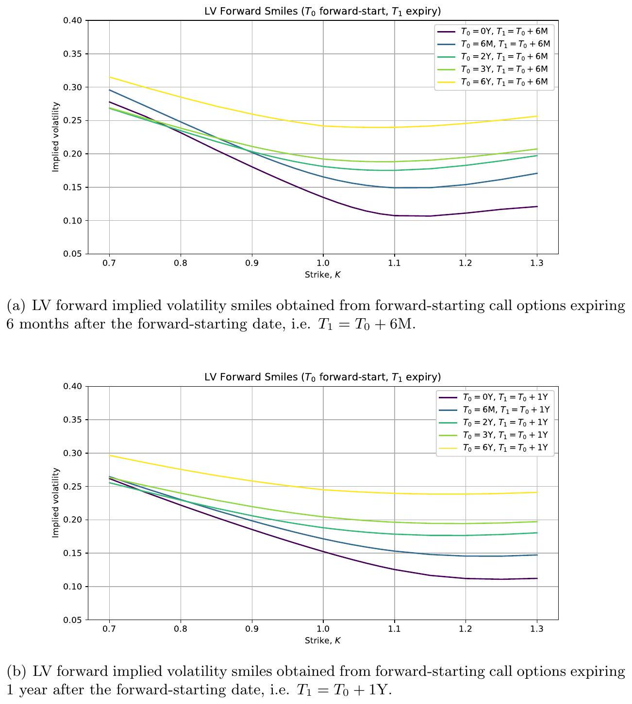

*Figure 1.1: Forward implied volatility smiles under the local volatility model, obtained by pricing SPX forward-starting call options with forward-starting dates $T_{0}=0 \mathrm{Y}, 6 \mathrm{M}, 2 \mathrm{Y}$, $3 \mathrm{Y}, 6 \mathrm{Y}$.*

## Chapter 2

## Stochastic Volatility Models

For a model to be able to accurately price path-dependent options, it is important that it is able to produce realistic implied volatility smile dynamics that reflect empirical behaviour. As we have just seen, the local volatility model has the advantage of being able to perfectly reproduce exactly the market implied volatility surface, but exhibits unrealistic implied volatility smile dynamics.

Another way for a model to produce an implied volatility smile is to model the instantaneous volatility as a stochastic process. By modelling the instantaneous volatility as a stochastic process driven by a Brownian motion, one can introduce correlation between the asset price and the instantaneous volatility to produce a skewed smile. This class of models tends to produce more desirable implied volatility smile dynamics.

### 2.1 Standard Stochastic Volatility Models

The risk-neutral dynamics for general one-factor standard stochastic volatility models are given by

$$
\begin{array}{ll}
\mathrm{d} S_{t}=\left(r_{t}-q_{t}\right) S_{t} \mathrm{~d} t+\sigma_{t} S_{t} \mathrm{~d} W_{t}^{(1)}, & S_{0}>0, \\
\mathrm{~d} \sigma_{t}=\alpha\left(\sigma_{t}, t\right) \mathrm{d} t+\beta\left(\sigma_{t}, t\right) \mathrm{d} W_{t}^{(2)}, & \sigma_{0} \geq 0,
\end{array}
$$

where $\left(W_{t}^{(1)}\right)_{t \geq 0},\left(W_{t}^{(2)}\right)_{t \geq 0}$ are correlated Brownian motions such that $\mathrm{d}\left\langle W^{(1)}, W^{(2)}\right\rangle_{t}=$ $\rho \mathrm{d} t$, with correlation $\rho \in[-1,1]$, and $\alpha, \beta$ are deterministic functions. Here we use the term standard to highlight the fact that the volatility is modelled as a stochastic process driven by a Brownian motion. This is to be contrasted with regime-switching models that we introduce later in this chapter, in which the volatility process is not driven by a Brownian motion, but is still stochastic.

The backward pricing PDE for a standard stochastic volatility model is given by

$$
\begin{aligned}
& \frac{\partial V}{\partial t}+\left(r_{t}-q_{t}\right) s \frac{\partial V}{\partial s}+\alpha(\sigma, t) \frac{\partial V}{\partial \sigma} \\
& +\frac{1}{2} \sigma^{2} s^{2} \frac{\partial^{2} V}{\partial s^{2}}+\frac{1}{2} \beta(\sigma, t)^{2} \frac{\partial^{2} V}{\partial \sigma^{2}}+\rho \beta(\sigma, t) \sigma s \frac{\partial^{2} V}{\partial s \partial \sigma}-r_{t} V=0,
\end{aligned}
$$

subject to boundary conditions imposed by the type of option being priced, where $V=$ $V(s, \sigma, t)$ is the value of the option.

One of the most well-known stochastic volatility models is the Heston model, introduced
by Heston in [10]. The risk-neutral dynamics for the Heston model are given by

$$
\begin{array}{ll}
\mathrm{d} S_{t}=\left(r_{t}-q_{t}\right) S_{t} \mathrm{~d} t+\sqrt{v_{t}} S_{t} \mathrm{~d} W_{t}^{(1)}, & S_{0}>0, \\
\mathrm{~d} v_{t}=\kappa\left(m-v_{t}\right) \mathrm{d} t+\alpha \sqrt{v_{t}} \mathrm{~d} W_{t}^{(2)}, & v_{0} \geq 0,
\end{array}
$$

where $v_{0}$ is the initial variance, $\rho$ is the spot-variance correlation, $\alpha$ is the volatility-of-variance, $\kappa$ is the mean-reversion rate and $m$ the mean-reversion level. Note that the model is formulated in terms of instantaneous variance here, modelled by a CIR process, as opposed to instantaneous volatility. Increasing the volatility-of-variance term $\alpha$ increases the convexity of the implied volatility smile produced by the model. The correlation $\rho$ between the Brownian motions allows us to adjust the skewness of the implied volatility smile generated. One of the main advantages of the Heston model is that there is a semi-analytic solution for the price of vanilla options, meaning that calibration of this model to the market implied volatility surface can be done faster.

Calibration of a stochastic volatility model to market vanilla option data generally involves using an optimisation technique to choose the parameters of the model which minimise the difference between the market vanilla implied volatilities and the implied volatilities produced by the model (or another suitably chosen objective function). As stochastic volatility models have a limited number of parameters, naturally they cannot fit the implied volatility surface exactly like a local volatility model can. However, the advantage of stochastic volatility models over local volatility models is that their implied volatility dynamics better reflect empirical behaviour, and this can have significant implications on the prices of path-dependent options implied by the model. Baker at al. in [9] illustrate the importance of realistic forward smile dynamics of a model for pricing path-dependent options by looking at a comparison of the prices of barrier options under a local volatility model and a stochastic volatility model. This will also be illustrated in Chapter 4 of this thesis when we compare local volatility, stochastic local volatility and mixed local volatility models in the context of continuous barrier options and forward-starting vanilla options; we will calibrate all three models exactly to vanilla market data, and look at the differences in the option prices generated by each of the models.

### 2.2 Lognormal Mixture Models

One of the simplest models one can define for an asset price is one in which the volatility process driving the asset price is comprised of a discrete set of deterministic volatility states, and the state is determined at initial time. This is not exactly a stochastic volatility model, as the volatility is not a stochastic process, but it is still random. The SDE for this model can be written as

$$
\mathrm{d} S_{t}=\left(r_{t}-q_{t}\right) S_{t} \mathrm{~d} t+\sigma_{Z_{0}}(t) S_{t} \mathrm{~d} W_{t}, \quad S_{0}>0,
$$

where $Z_{0}: \Omega \rightarrow \mathcal{Z}$ is an $\mathcal{F}_{0}$-measurable random variable independent of $\left(W_{t}\right)_{t \geq 0}$, taking values on a discrete finite set $\mathcal{Z}=\{1, \ldots, n\}$ with associated probabilities $\lambda_{i}:=\mathbb{P}\left(Z_{0}=i\right)$ that the asset price will follow indefinitely the SDE

$$
\mathrm{d} S_{t}=\left(r_{t}-q_{t}\right) S_{t} \mathrm{~d} t+\sigma_{i}(t) S_{t} \mathrm{~d} W_{t}, \quad S_{0}>0,
$$

with $\sigma_{i}(\cdot)$ a deterministic volatility process. In other words, the randomness of the volatility process $\sigma_{Z_{0}}$ exists only at initial time, and

$$
\mathbb{P}\left(\left\{\sigma_{Z_{0}}(t)=\sigma_{i}(t), \forall t\right\}\right)=\lambda_{i}, \quad i=1, \ldots, n .
$$

The probability density of the asset price under volatility state $i$ is given by,

$$
\begin{aligned}
p_{t}^{i}(x) & =\frac{1}{x V_{i}(t) \sqrt{2 \pi}} \exp \left\{-\frac{1}{2 V_{i}^{2}(t)}\left[\log \left(x / S_{0}\right)-\int_{0}^{t}\left(r_{u}-q_{u}\right) \mathrm{d} u+\frac{1}{2} V_{i}^{2}(t)\right]^{2}\right\}, \\
V_{i}^{2}(t) & :=\int_{0}^{t} \sigma_{i}^{2}(u) \mathrm{d} u,
\end{aligned}
$$

and the marginal density of the asset price is given by

$$
p_{t}(x)=\sum_{i=1}^{n} \lambda_{i} p_{t}^{i}(x) .
$$

Mixing lognormal distributions results in a distribution that has heavier tails than the non-mixed lognormal counterparts, meaning the model can produce an implied volatility smile. However, there is no correlation between spot and volatility, meaning that it cannot generate a skewed implied volatility smile. European option prices under the lognormal mixture model are analytical, and are simply a probability weighted average of European option prices under Black-Scholes term-structure models. The corresponding price of a European call option is given by,

$$
\begin{aligned}
C(K, T) & =D(0, T) \mathbb{E}\left[\left(S_{T}-K\right)^{+}\right] \\
& =D(0, T) \int_{0}^{\infty}(x-K)^{+} p_{T}(x) \mathrm{d} x \\
& =\sum_{i=1}^{n} \lambda_{i} D(0, T) \int_{0}^{\infty}(x-K)^{+} p_{T}^{i}(x) \mathrm{d} x \\
& =\sum_{i=1}^{n} \lambda_{i} C\left(K, T ; \sigma_{i}\right),
\end{aligned}
$$

where $C\left(K, T ; \sigma_{i}\right)$ represents the price of a call option under volatility state $\sigma_{i}$, which is simply the price of a call option under the Black-Scholes term structure model 1.2.2.

One may be tempted to use a formula similar to (2.2.6) to price exotic options, i.e. using a probability weighted average of prices under Black-Scholes term-structure models. Piterbarg explains in [11] that this is wrong, and that the formula is only valid for European options, as they depend only on the terminal distribution of the underlying. The only valid approach would be to define a local volatility model consistent with the assumption of lognormal mixture dynamics and use this to price exotic options. This approach was taken by Brigo et al. in [12]. Brigo et al. defined a local volatility model with a closedform local volatility function, such that the marginal density of the asset price under this local volatility model is a mixture of lognormals. They showed that under some basic conditions on the volatility states, if we define

$$
\nu^{2}(t, x)=\frac{\sum_{i=1}^{n} \lambda_{i} \frac{\sigma_{i}^{2}(t)}{V_{i}(t)} \exp \left\{-\frac{1}{2 V_{i}^{2}(t)}\left[\log \left(x / S_{0}\right)-\int_{0}^{t}\left(r_{u}-q_{u}\right) \mathrm{d} u+\frac{1}{2} V_{i}^{2}(t)\right]^{2}\right\}}{\sum_{i=1}^{n} \lambda_{i} \frac{1}{V_{i}(t)} \exp \left\{-\frac{1}{2 V_{i}^{2}(t)}\left[\log \left(x / S_{0}\right)-\int_{0}^{t}\left(r_{u}-q_{u}\right) \mathrm{d} u+\frac{1}{2} V_{i}^{2}(t)\right]^{2}\right\}},
$$

then the SDE

$$
\mathrm{d} S_{t}=\left(r_{t}-q_{t}\right) S_{t} \mathrm{~d} t+\nu\left(t, S_{t}\right) S_{t} \mathrm{~d} W_{t}
$$

has a unique strong solution whose marginal density is given by (2.2.5).

In Chapter 4, we will revisit this idea of a volatility process driven by an $\mathcal{F}_{0}$-measurable random variable, and see if we can find a potential exception to the arguments of Piterbarg following the ideas of Austing [13] and Wystup [14] in the context of continuous barrier options and forward-starting options.

### 2.3 Regime-Switching Models

Naik in [15] introduced a regime-switching model for pricing European options. Similar to the lognormal mixture models, here we again consider a discrete set of $n$ volatility states, except now we allow for the volatility process to transition between volatility states as the asset price evolves. This is a heavily simplified version of a standard stochastic volatility model, but the computations can be done much faster; if we use a PDE approach to price options, then a regime-switching model requires us to solve $n$ coupled one-dimensional PDEs, as opposed to a 2-dimensional PDE (in the case of a one-factor stochastic volatility model).

Let $\left(Z_{t}\right)_{t \geq 0}$ be a Markov chain taking values in a discrete finite set $\mathcal{Z}=\{1, \ldots, n\}$, which indexes the set of volatility states $\left\{\sigma_{1}, \ldots, \sigma_{n}\right\}$, and is characterised by transition-rate matrix $Q=\left(q_{i j}\right)_{1 \leq i, j \leq n}$, where $q_{i j} \geq 0$ for $i \neq j$ and $q_{i i}=-\sum_{j \neq i} q_{i j}$. For $i \neq j, q_{i j}$ is the transition rate from state $i$ to state $j$. The transition rates satisfy the following:

$$
\begin{array}{ll}
\mathbb{P}\left(Z_{t+\mathrm{d} t}=j \mid Z_{t}=i\right)=q_{i j} \mathrm{~d} t, & i \neq j, \\
\mathbb{P}\left(Z_{t+\mathrm{d} t}=i \mid Z_{t}=i\right)=1+q_{i i} \mathrm{~d} t, & i=j .
\end{array}
$$

We define the SDE describing the dynamics of the asset price process as

$$
\mathrm{d} S_{t}=\left(r_{t}-q_{t}\right) S_{t} \mathrm{~d} t+\sigma_{Z_{t}}(t) S_{t} \mathrm{~d} W_{t}, \quad S_{0}>0 .
$$

One can price options under a regime-switching model via a backward pricing system of coupled PDEs. Di Masi et al. first used this PDE approach to price European options in a two-state regime switching model in [16]. The backward pricing PDE corresponding to the volatility state $i$ in this regime-switching model is given by

$$
\frac{\partial V_{i}}{\partial t}+\left(r_{t}-q_{t}\right) \frac{\partial V_{i}}{\partial s}+\frac{1}{2} \sigma_{i}^{2} s^{2} \frac{\partial^{2} V_{i}}{\partial s^{2}}-r_{t} V_{i}+\sum_{i=1}^{n} q_{i j} V_{j}=0,
$$

where $V_{i}(t, s)=V\left(t, s ; \sigma_{i}\right)$ is the value of the option under volatility state $i$ at time $t$ and spot $s$, for $i=1, \ldots, n$, subject to boundary conditions imposed by the type of option being priced. In matrix form, this can be written as

$$
\frac{\partial V}{\partial t}+\left(r_{t}-q_{t}\right) \frac{\partial V}{\partial s}+\frac{1}{2} s^{2} \Sigma^{2} \frac{\partial^{2} V}{\partial s^{2}}-r_{t} V+Q V=0
$$

where $\Sigma=\operatorname{diag}\left(\sigma_{1}^{2}, \ldots, \sigma_{n}^{2}\right)$. A scheme for solving this system of coupled PDEs in the context of pricing exotic options can be found in [17]. In the case of a two-state regime-switching model with constant volatilities, Naik in [15] derived a semi-analytic formula for pricing vanilla options.

## Chapter 3

## Stochastic Local Volatility Models

Local volatility models are able to reprice the vanilla market exactly, but tend to produce unrealistic implied volatility dynamics. Stochastic volatility models can produce more desirable implied volatility dynamics, but can have trouble repricing all vanilla market prices. When pricing an exotic derivative in FX and equity markets, one of the models will tend to underprice the option while the other will tend to overprice it. Even with perfect calibration of a stochastic volatility model to the vanilla market, the prices of exotic options obtained under this model will be different to the price obtained under the local volatility model.

Stochastic local volatility (SLV) models allow us to combine the two types of models and produce an implied volatility smile which is explained partly by a stochastic volatility component, and then 'corrected' by a local volatility component. The proportions of the smile that are explained by the stochastic volatility component and by the local volatility component are determined by a mixing weight. The mixing of stochastic and local volatility allows us to have flexibility with the prices of exotic options produced by the model while retaining the ability to reprice the vanilla market. In this way, one can also calibrate an SLV model to match the prices of both vanilla options and liquid exotic options in the market, to then be able to accurately price non-liquid exotic options.

### 3.1 Stochastic Local Volatility Models

The class of SLV models were first introduced by Jex et al. in [3] and developed by Lipton and McGhee in [18], [19]. The risk-neutral dynamics describing the SDE of a general one-factor SLV model are given by

$$
\begin{array}{ll}
\mathrm{d} S_{t}=\left(r_{t}-q_{t}\right) S_{t} \mathrm{~d} t+\sigma_{t} L\left(S_{t}, t\right) S_{t} \mathrm{~d} W_{t}^{(1)}, & S_{0}>0, \\
\mathrm{~d} \sigma_{t}=\alpha\left(\sigma_{t}, t\right) \mathrm{d} t+\beta\left(\sigma_{t}, t\right) \mathrm{d} W_{t}^{(2)}, & \sigma_{0}>0 .
\end{array}
$$

where $\left(W_{t}^{(1)}\right)_{t \geq 0},\left(W_{t}^{(2)}\right)_{t \geq 0}$ are correlated Brownian motions such that $\mathrm{d}\left\langle W^{(1)}, W^{(2)}\right\rangle_{t}=$ $\rho \mathrm{d} t$, with correlation $\rho \in[-1,1]$, and $\alpha, \beta, L$ are deterministic functions. $L$ is known as the leverage function or local volatility correction, which must be calibrated to market data; calibration of this function will be discussed in the next section.

The backward pricing PDE for a general SLV model is given by

$$
\begin{aligned}
& \frac{\partial V}{\partial t}+\left(r_{t}-q_{t}\right) s \frac{\partial V}{\partial s}+\alpha(\sigma, t) \frac{\partial V}{\partial \sigma} \\
& +\frac{1}{2} \sigma^{2} L(s, t)^{2} s^{2} \frac{\partial^{2} V}{\partial s^{2}}+\frac{1}{2} \beta(\sigma, t)^{2} \frac{\partial^{2} V}{\partial \sigma^{2}}+\rho \beta(\sigma, t) \sigma L(s, t) s \frac{\partial^{2} V}{\partial s \partial \sigma}-r_{t} V=0 .
\end{aligned}
$$

A popular type of SLV model is the extended version of the Heston stochastic volatility model introduced in the previous chapter, the Heston-SLV model. The risk-neutral dynamics for this model are given by

$$
\begin{array}{ll}
\mathrm{d} S_{t}=\left(r_{t}-q_{t}\right) S_{t} \mathrm{~d} t+\sqrt{v_{t}} L\left(S_{t}, t\right) S_{t} \mathrm{~d} W_{t}^{(1)}, & S_{0}>0, \\
\mathrm{~d} \sigma_{t}=\kappa\left(m-v_{t}\right) \mathrm{d} t+\alpha \sqrt{v_{t}} \mathrm{~d} W_{t}^{(2)}, & v_{0}>0 .
\end{array}
$$

See [20], [21], [22] for detailed discussions of calibration, pricing, and simulation of the Heston-SLV model.

### 3.2 Calibration of SLV Models

### 3.2.1 SLV Leverage Function Calibration

Theorem 3.2.1 (Gyöngy's Mimicking Theorem [23]). Let $\left(\xi_{t}\right)_{t \geq 0}$ be a stochastic process satisfying

$$
\mathrm{d} \xi_{t}=\beta_{t} \mathrm{~d} t+\delta_{t} \mathrm{~d} W_{t},
$$

where $\left(W_{t}\right)_{t \geq 0}$ is a standard one-dimensional Brownian motion with filtration $\mathcal{F}_{t}$, and $\beta_{t}, \delta_{t}$ are bounded stochastic processes adapted to $\mathcal{F}_{t}$. Then, there exists a stochastic differential equation,

$$
\mathrm{d} X_{t}=b\left(X_{t}, t\right) \mathrm{d} t+\sigma\left(X_{t}, t\right) \mathrm{d} W_{t},
$$

with non-random coefficients, with a solution $X_{t}$ which is such that its marginal probability distribution is the same as $\xi_{t}$, for all $t$. Moreover, the coefficients $b$ and $\sigma$ are given by,

$$
\begin{aligned}
\sigma(x, t)^{2} & =\mathbb{E}\left[\delta_{t}^{2} \mid \xi_{t}=x\right], \\
b(x, t) & =\mathbb{E}\left[\beta_{t} \mid \xi_{t}=x\right] .
\end{aligned}
$$

Definition 3.2.2 (Fokker-Planck equation [24]). Let $\left(\boldsymbol{X}_{t}\right)_{t \geq 0}$ be an $n$-dimensional stochastic process governed by the SDE

$$
\mathrm{d} \mathbf{X}_{t}=\boldsymbol{\mu}\left(\mathbf{X}_{t}, t\right) \mathrm{d} t+\boldsymbol{\sigma}\left(\mathbf{X}_{t}, t\right) \mathrm{d} \mathbf{W}_{t},
$$

with drift $\boldsymbol{\mu}=\left(\mu_{1}, \ldots, \mu_{2}\right)$ and diffusion matrix $\boldsymbol{\sigma}=\left(\sigma_{i j}\right)_{1 \leq i \leq N, 1 \leq j \leq M}$, driven by an $M$-dimensional Brownian motion $\mathbf{W}_{t}$. Then, the probability density $p$ of $\mathbf{X}_{t}$ satisfies the Fokker-Planck equation (also known as the Forward Kolmogorov equation), given by:

$$
\frac{\partial p(\mathbf{x}, t)}{\partial t}=-\sum_{i=1}^{N} \frac{\partial\left[\mu_{i}(\mathbf{x}, t) p(\mathbf{x}, t)\right]}{\partial x_{i}}+\frac{1}{2} \sum_{i=1}^{N} \sum_{j=1}^{N} \frac{\partial^{2}\left[D_{i j}(\mathbf{x}, t) p(\mathbf{x}, t)\right]}{\partial x_{i} \partial x_{j}},
$$

with initial condition

$$
p(\mathbf{x}, 0)=\delta_{\left\{\mathbf{x}-\mathbf{x}_{\mathbf{0}}\right\}},
$$

where diffusion tensor $\mathbf{D}=\left(D_{i j}\right)_{1 \leq i, j \leq N}$ is defined by

$$
D_{i j}(\mathbf{x}, t)=\frac{1}{2} \sum_{k=1}^{M} \sigma_{i k}(\mathbf{x}, t) \sigma_{j k}(\mathbf{x}, t),
$$

and $\delta$ is the Dirac delta function.
Consider a general SLV model introduced previously in (3.1.1). Suppose that this model is calibrated to market data such that the model reprices the vanilla options for all maturities
and strikes. As the Dupire local volatility function is the unique diffusion that reprices the vanilla market everywhere, it follows from Theorem 3.2.1 that

$$
\begin{aligned}
\sigma_{\text {local }}^{2}(K, t) & =\mathbb{E}\left[\sigma_{t}^{2} L^{2}(K, t) \mid S_{t}=K\right] \\
& =L^{2}(K, t) \mathbb{E}\left[\sigma_{t}^{2} \mid S_{t}=K\right],
\end{aligned}
$$

for all strikes $K$ and maturities $t$, where $\sigma_{\text {local }}$ is the Dupire local volatility function introduced previously. We can rearrange this to obtain

$$
\begin{aligned}
L^{2}(K, t) & =\frac{\sigma_{\text {local }}^{2}(K, t)}{\mathbb{E}\left[\sigma_{t}^{2} \mid S_{t}=K\right]} \\
& =\sigma_{\text {local }}^{2}(K, t) \frac{\mathbb{E}\left[\delta_{\left\{S_{t}-K\right\}}\right]}{\mathbb{E}\left[\sigma_{t}^{2} \delta_{\left\{S_{t}-K\right\}}\right]} \\
& =\sigma_{\text {local }}^{2}(K, t) \frac{\int_{\mathbb{R}_{+}} p(K, \sigma, t) \mathrm{d} \sigma}{\int_{\mathbb{R}_{+}} \sigma^{2} \cdot p(K, \sigma, t) \mathrm{d} \sigma}
\end{aligned}
$$

where $p$ is the joint probability density function of spot and variance. Note that the SDE of a general SLV model is an example of a McKean SDE; the two-dimensional process $X_{t}=\left(S_{t}, \sigma_{t}\right)$ is dependent on the probability distribution of $X_{t}$ through the conditional expectation $\mathbb{E}\left[\sigma_{t}^{2} \mid S_{t}=K\right]$.

We want to build the surface $L(K, t)$ for all $K$ and $t$, but the difficulty is that the conditional expectation $\mathbb{E}\left[\sigma_{t}^{2} \mid S_{t}=K\right]$ depends itself on the leverage function $L$. There are several methods that can be used for this calibration process. As we are considering only a one-factor SLV model, we will describe calibration of the leverage function via the associated Fokker-Planck PDE. For multi-factor SLV models, this approach becomes too slow due to the curse of dimensionality, and one must instead use probabilistic methods. Examples of such methods include Markovian projection methods first introduced by Piterbarg in [25], and the particle method introduced by Guyon and Henry-Labordère in [26].

Calibration of the leverage function using this Fokker-Planck equation is done by solving the above PDE forward in time and "boostrapping" the leverage function $L$ after each time step. The two-dimensional Fokker-Planck equation for the transition probability density $p(\cdot, \cdot, \cdot)$ of the spot and volatility for a general one-factor SLV model can be obtained by applying Definition 3.2.2, and is given by,

$$
\begin{aligned}
\frac{\partial p}{\partial t}(s, \sigma, t)= & -\frac{\partial}{\partial s}\left[\left(r_{t}-q_{t}\right) s p(s, \sigma, t)\right]-\frac{\partial}{\partial v}[\alpha p(s, \sigma, t)] \\
& +\frac{1}{2} \frac{\partial}{\partial s^{2}}\left[\sigma^{2} L(s, t)^{2} s^{2} p(s, \sigma, t)\right]+\frac{1}{2} \frac{\partial}{\partial \sigma^{2}}\left[\alpha^{2} p(s, \sigma, t)\right] \\
& +\rho \frac{\partial^{2}}{\partial s \partial \sigma}[\beta \sigma L(s, t) s p(s, \sigma, t)] .
\end{aligned}
$$

Suppose we have a sequence of time grid points $0=t_{0}<t_{1}<\cdots<t_{N}=T$, and assume we have $L$ computed from time $t_{0}$ up to $t_{n}$, for some $n<N$ and for all strikes $K$. We approximate $L(K, t)$ with $L\left(K, t_{n}\right)$ for $t \in\left(t_{n}, t_{n+1}\right)$, and use this to solve the PDE forward one time step and obtain the joint probability density function $p\left(K, \sigma, t_{n+1}\right)$. This allows us to then compute $L\left(K, t_{n+1}\right)$ using equation (3.2.7).

The leverage function calibration can be summarised by the following steps:

1. Set $n=0$ and, for all $K$, set the initial leverage function to

$$
L\left(K, t_{n}\right)=1
$$

- and initial joint probability density to

$$
p\left(K, \sigma, t_{n}\right)=\delta_{\left\{K-S_{0}\right\}} \cdot \delta_{\left\{\sigma-\sigma_{0}\right\}},
$$

where $S_{0}, \sigma_{0}$ are the initial spot and initial volatility respectively.
2. Use $L\left(K, t_{n}\right)$ to solve the-Fokker Planck equation (3.2.8) forward to time $t_{n+1}$ to obtain $p\left(K, \sigma, t_{n+1}\right)$.
3. Use numerical integration to compute the leverage function at time $t_{n+1}$ using the formula

$$
L\left(K, t_{n+1}\right)=\sigma_{\text {local }}\left(K, t_{n+1}\right) \sqrt{\frac{\int_{\mathbb{R}_{+}} p\left(K, \sigma, t_{n+1}\right) \mathrm{d} \sigma}{\int_{\mathbb{R}_{+}} \sigma^{2} \cdot p\left(K, \sigma, t_{n+1}\right) \mathrm{d} \sigma}} .
$$

4. Increment $n$ and repeat steps 2 and 3 until reaching the final time $t_{N}=T$.

To solve the Fokker-Planck equation in step 2, there are several methods that can be used, namely finite-difference methods (see [27], [28]), finite-volume methods (see [29], [30]), and finite-element methods (see [31]). We will not describe schemes for solving two-dimensional Fokker-Planck equations in this thesis, but we direct the reader to the aforementioned references for some detailed discussions of efficient numerical schemes.

There are several issues that arise during this calibration process when solving the Fokker-Planck equation. One issue is potential numerical instability due to the highly singular initial condition of the Fokker-Planck equation. One way to help improve stability is to use non-uniform spatial and time grids with a higher density of points around initial spot $S_{0}$ and initial volatility $\sigma_{0}$ around the initial time $t_{0}$ [4, page 124]. One may also approximate the Dirac delta distribution using a bivariate normal distribution evaluated at a very short time after the initial time $t_{0}+\epsilon$, where $\epsilon>0$ is small, described in [32, pages 63-64].

Another consideration when solving the Fokker-Planck equation with finite-difference is the boundary conditions; as it is important that the transition density integrates to 1 at any time, it is crucial we do not lose probability mass at the boundaries when solving the PDE forward in time. Lucic describes zero-flux boundary conditions in [33] in the context of a Heston-SLV model to ensure this condition. A detailed application of non-uniform grids and zero-flux boundary conditions applied to calibration of the Heston-SLV model can be found in [21].

### 3.2.2 General SLV Calibration

Now that we have described the calibration of the leverage function, we can summarise the entire SLV model calibration process:

1. (Calibrate the stochastic volatility). Calibrate the stochastic volatility model underlying the SLV model, i.e. the model without the leverage function, to the market implied volatility smiles with reduced convexity. The reduced convexity can be achieved by using a mixing weight $\eta \in[0,1]$ and multiplying the term controlling the volatility-of-volatility of the stochastic volatility model by it; this has the effect of reducing the convexity of the implied volatility smile generated by the model. In FX, one can instead multiply the butterfly and risk reversal market quotes by the mixing weight.

2. (Calibrate the leverage function). Then use the forward induction method described above to calibrate the leverage function. This will make corrections at each time step to ensure that the model exactly fits the vanilla implied volatility surface.

To ensure that the calibration has been successful, we can price vanilla options at different strikes and maturities and check that they match the vanilla option prices in the market. This can be done either by integrating the joint probability density function of the spot and volatility at maturity time $T$ using

$$
V(K, T, \phi)=e^{-\int_{0}^{T} r_{s} d s} \int_{0}^{\infty} \int_{0}^{\infty}(\phi(x-K))^{+} p(x, y, T) \mathrm{d} x \mathrm{~d} y
$$

or by solving the corresponding backward pricing PDE (3.1.2) via finite-difference.
Note that the time grid and spatial grids used in the finite difference schemes for calibrating the SLV model will in general be different to the grids used to solve the backward pricing PDE. This means that in order to solve the backward pricing PDE, we need to interpolate the leverage function in time and space. Tian in [32, page 76] suggests interpolating the leverage function using cubic splines in the spatial dimension, and linearly in the time dimension. This interpolation is also necessary to be able to price using Monte Carlo.

### 3.2.3 Impact of the Mixing Weight

The mixing parameter $\eta$ allows the SLV model to have flexibility on the prices of exotic options that it produces, while still correctly pricing the vanilla options in the market. If we set $\eta=0$, then there is no stochastic volatility component to the model; the model will simply degenerate to a Dupire local volatility model. If we set $\eta=1$, the corresponding SLV model is close to a purely stochastic volatility model. Hence, the mixing weight can be seen as a tuning parameter allowing us to control how much of the smile is to be explained by stochastic volatility and by local volatility. Wystup in [14] mentions that the mixing weight in FX markets can be chosen such that the SLV model matches the prices of liquid first-generation exotic options, such as one-touch or double no-touch options, or alternatively, one can estimate the mixing weight by looking at the historical correlation between spot and risk reversals. Clark in [4, page 124] and Austing in [13, page 141] mention that the mixing weight is typically around 60\% in FX markets.

## Chapter 4

## Mixed Local Volatility Models

SLV models are a powerful class of models which combine stochastic volatility and local volatility models, integrating the strengths of both types of models without suffering from their individual limitations. However, due to the complexity of these models, calibrating an SLV model and using it to price can be very slow computationally. Mixed local volatility (MLV) models are a heavily simplified version of SLV models, the major difference being that the volatility process is comprised of a discrete finite set of deterministic volatility states, and the stochastic nature of the volatility process exists only at the initial time, as opposed to the volatility process being driven by a Brownian motion. This simplification results in a significantly reduced computation time for calibration and pricing. This type of random volatility was seen in lognormal mixture models in Section 2.2, but now we combine it with a local volatility correction. One consequence of the simplified volatility process, however, is that there is no correlation between spot and volatility. The MLV model can be extended to a regime-switching model, in which the volatility process can switch between different volatility states beyond the initial time, to allow for more flexibility.

To our knowledge, the only discussions of the MLV model in the literature have been first by Peter Austing ([13], 2014), and then Uwe Wystup ([14], 2021). As mentioned in Section 2.2, Piterbarg in [11] showed that trying to price path-dependent options under a lognormal mixture model using a probability weighted average formula akin to (2.2.6) is wrong. Peter Austing argues in [13, pages 138, 148] that pricing continuous barrier options using a lognormal mixture model to underlie an SLV model may be an exception to the issues pointed out by Piterbarg. He compares the price of a one-touch option under a $\lambda$-SABR SLV model to a three-state MLV model with constant volatilities, and shows that the prices are very similar for all barrier levels [13, Figure 9.1, page 142].

More recently, Uwe Wystup in [14] discusses the MLV model in more detail, arguing that the SLV model is overkill in terms of complexity for pricing a range of first-generation exotic options, and that the MLV model is the model of choice here, as it can price these options with similar accuracy to the SLV model but with a computation time reduction by a factor of over 10. He mentions that the MLV model in its simplest form is not adequate for pricing second-generation exotics, and instead needs to be extended to a regime-switching model.

In this section, we start by introducing the MLV model and a framework for calibrating the model to market data. Next, we investigate the prices of continuous barrier options generated by this model and compare them to the LV model and an SLV model, to see what kind of flexibility we can achieve with the variable parameters of the model. We
then examine the forward smile dynamics of the model and see if it has the capability of accurately pricing forward-starting options. Finally, we introduce a theoretical framework for an extended version of the MLV model.

### 4.1 The MLV Model

The SDE describing the risk-neutral dynamics of the asset price process $\left(S_{t}\right)_{t \geq 0}$ is given by:

$$
\mathrm{d} S_{t}=\left(r_{t}-q_{t}\right) S_{t} \mathrm{~d} t+\sigma_{Z_{0}}(t) L\left(S_{t}, t\right) S_{t} \mathrm{~d} W_{t}, \quad S_{0}>0,
$$

where $Z_{0}: \Omega \rightarrow \mathcal{Z}$ is an $\mathcal{F}_{0}$-measurable random variable independent of $\left(W_{t}\right)_{t \geq 0}$, taking values on a discrete finite set $\mathcal{Z}=\{1, \ldots, n\}$ with associated probabilities $\lambda_{i}:=\mathbb{P}\left(Z_{0}=i\right)$ that the asset price will follow indefinitely the SDE

$$
\mathrm{d} S_{t}=\left(r_{t}-q_{t}\right) S_{t} \mathrm{~d} t+\sigma_{i}(t) L\left(S_{t}, t\right) S_{t} \mathrm{~d} W_{t}, \quad S_{0}>0,
$$

with $\sigma_{i}(\cdot)$ a deterministic volatility process. Note that $\sigma_{Z_{0}}$ in the MLV model is defined in the same way as in the lognormal mixture model 2.2.1, except now we introduce the leverage function $L$ to allow us to calibrate the model exactly to the vanilla options in the market.

### 4.2 Calibration of MLV Models

### 4.2.1 MLV Leverage Function Calibration

Following the same idea from the previous chapter, we arrive at the following formula for the leverage function:

$$
L^{2}(K, t)=\frac{\sigma_{\text {local }}^{2}(K, t)}{\mathbb{E}\left[\sigma_{Z_{0}}^{2}(t) \mid S_{t}=K\right]} .
$$

As our volatility process is now a discrete process taking $n$ states with randomness only at initial time, we can rewrite this as

$$
L^{2}(K, t)=\sigma_{\text {local }}^{2}(K, t) \frac{\sum_{i=1}^{n} p\left(K, t ; \sigma_{i}\right) \cdot \lambda_{i}}{\sum_{i=1}^{n} \sigma_{i}^{2}(t) \cdot p\left(K, t ; \sigma_{i}\right) \cdot \lambda_{i}},
$$

where $p\left(\cdot, \cdot ; \sigma_{i}\right)$ represents the probability density of the spot conditional on being in volatility state $i$. We will write $p\left(K, t ; \sigma_{i}\right)=p_{i}(K, t)$ for notational convenience.

As in the previous chapter, to obtain the leverage function at all strikes and times, one way to proceed is by considering the associated Fokker-Planck equations describing the transition probability densities under each volatility state; in this simplified model, we now have to solve $n$ one-dimensional Fokker-Planck equations, as opposed to a two-dimensional Fokker-Planck equation, which is much less computationally expensive. The associated Fokker-Planck equation for the MLV model is given by:

$$
\begin{aligned}
\frac{\partial p}{\partial t}(s, t) & =\frac{1}{2} \frac{\partial^{2}}{\partial s^{2}}\left[\sigma(t)^{2} L^{2}(s, t) s^{2} p(s, t)\right]-\frac{1}{2} \frac{\partial}{\partial s}\left[\left(r_{t}-q_{t}\right) s p(s, t)\right] \\
& =\sum_{i=1}^{n} \lambda_{i}\left[\frac{1}{2} \frac{\partial^{2}}{\partial s^{2}}\left[\sigma_{i}(t)^{2} L^{2}(s, t) s^{2} p_{i}(s, t)\right]-\frac{1}{2} \frac{\partial}{\partial s}\left[\left(r_{t}-q_{t}\right) s p_{i}(s, t)\right]\right],
\end{aligned}
$$

subject to the initial conditions

$$
p_{i}(s, 0)=\delta_{\left\{s-S_{0}\right\}}, \quad i=1, \ldots, n .
$$

The idea behind solving this Fokker-Planck equation via finite-difference by approximating the leverage function on intervals is analogous to what was described in the previous chapter. In Appendix A.1.2, we provide a finite-difference scheme for calibrating the leverage function for the MLV model. Alternatively, a finite-volume approach for solving general Fokker-Planck equations in one-dimension can be found in [30, pages 6-11], which can adapted here. We take a slightly different approach to the overall calibration process compared to the SLV case. Instead of calibrating the stochastic volatility component first before calibrating the leverage function, we instead consider the volatility states as free parameters, as we are interested in seeing what effect they have on the model.

Figure 4.1 shows two examples of a calibrated leverage surface under a two-state MLV model with constant volatility states $\sigma=[0.2,1]$, using vanilla option data written on AAPL. Figure 4.1(a) and 4.1(b) differ by their level of stochasticity; Figure 4.1(a) represents a fully stochastic MLV model while 4.1(b) represents a 50\% stochastic MLV model. Because of this, both figures show similar general shapes, but Figure 4.1(a) has a larger peak around the at-the-money logspot level. This is because the 50\% stochastic MLV model is closer to a local volatility model, meaning less "correction" is required to reprice the vanilla option prices that the model is being calibrated to. Note that here we did not apply any smoothing to the leverage surfaces, however one may want to incorporate this; an example of a smoothing scheme is presented in [29, page 13] in the context of a Heston-SLV model.

As before, to check that the calibration process has been successful, we can reprice the vanilla options for all strikes and maturities and check that they match the vanilla option prices in the market. Here the price of a European option is simply a probability weighted average of the prices under each of the $n$ volatility states. Once the leverage function has been calibrated for all strikes and maturities, we can price path-dependent options by solving the backward pricing PDE's associated with this MLV model using finite-difference. As our model gives rise to $n$ SDE's of the form

$$
\mathrm{d} S_{t}=\left(r_{t}-q_{t}\right) S_{t} \mathrm{~d} t+\sigma_{i}(t) L\left(S_{t}, t\right) S_{t} \mathrm{~d} W_{t}, \quad i=1, \ldots, n,
$$

this means we have to solve $n$ one-dimensional backward pricing PDE's and take a probability weighted average of the prices (as opposed to solving a two-dimensional backward pricing PDE as in SLV models). The backward pricing PDE under volatility state $\sigma_{i}$ is given by

$$
\frac{\partial V}{\partial t}+\left(r_{t}-q_{t}\right) s \frac{\partial V}{\partial s}+\frac{1}{2} \sigma_{i}^{2}(t) L^{2}(s, t) s^{2} \frac{\partial^{2} V}{\partial s^{2}}-r_{t} V=0 .
$$

### 4.2.2 MLV Mixing Parameters

In SLV models, the mixing of stochastic volatility and local volatility is controlled by a mixing weight $\eta \in[0,1]$. In MLV models, we will control the mixing by adjusting the levels of the volatility states, $\left\{\sigma_{i}\right\}_{i=1}^{n}$, as well as the associated probabilities, $\left\{\lambda_{i}\right\}_{i=1}^{n}$, of entering each volatility state at initial time. In this study, we will focus on MLV models with two constant volatility states. For convenience, we will write $\sigma_{Z_{0}}(\cdot)=\sigma(\cdot)$, and hence

$$
\mathbb{P}\left(\left\{\sigma(t)=\sigma_{i}(t), \forall t\right\}\right)=\lambda_{i}, \quad i=1,2 .
$$

and $\lambda_{1}+\lambda_{2}=1$. The probabilities of the two-state model can be parameterised by one of the probabilities, which gives us one degree of freedom for calibrating the MLV model.

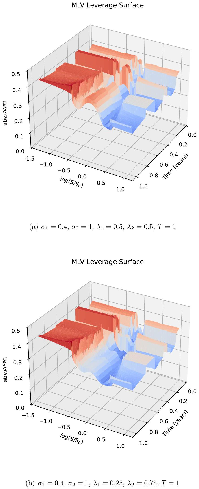

*Figure 4.1: Two-state MLV leverage surfaces calibrated to AAPL vanilla options using two sets of model parameters (constant volatility states).*

We can define the level of stochasticity of the MLV model by

$$
\begin{aligned}
1-\left|\lambda_{1}-\lambda_{2}\right| & =1-\left|2 \lambda_{1}-1\right|, \quad \lambda_{1} \in[0,1] \\
& =: \eta_{1} .
\end{aligned}
$$

A 100\% stochastic MLV model corresponds to the case where the two volatility states are equiprobable. A 0\% stochastic MLV model corresponds to the case where one volatility state has probability 1 , and here the model simply degenerates to the local volatility model. The choice of volatility states also gives us one more degree of freedom for calibrating the MLV model: this is because the effect of the volatility states on the model is invariant to scaling. That is, the effect that the volatility states have on the model does not depend directly on the absolute value of the volatility states, but instead on a relative difference between them. This means we can choose one of the states arbitrarily, and use the level of the other state to adjust the relative difference. Without loss of generality, we set $\sigma_{2}(t)=1$ for all $t$. If we define the relative difference by

$$
-\eta_{2}:=\frac{\left|\sigma_{1}(t)-\sigma_{2}(t)\right|}{\sigma_{1}(t)+\sigma_{2}(t)},
$$

then, by setting $\sigma_{2}(t)=1$ for all $t$ and choosing $\sigma_{1}(t)<\sigma_{2}(t)$, we can write that

$$
\sigma_{1}(t)=\frac{1-\eta_{2}}{1+\eta_{2}}, \quad \eta_{2} \in[0,1],
$$

since $\sigma_{1}(t) \geq 0$, and consequently, we can simply consider $\sigma_{1}(t) \in(0,1]$ for all $t$ and $\lambda_{1} \in[0,1]$. This gives us two mixing parameters for the two-state MLV model. Setting the volatility states to be equal to each other, or equivalently $\eta_{2}=0$, degenerates the model to the local volatility model. Note that for a given set of volatility states, the model does depend on whether there is a smaller or larger probability weighting on the volatility state with value 1, and so we must consider both cases. For the rest of the thesis, when describing the mixing parameters of the MLV model, we will quote the values of the volatility states as opposed to the corresponding value of the parameter $\eta_{2}$.

### 4.3 MLV Barrier Option Pricing

Uwe Wystup in [14] describes the MLV model as the model of choice for pricing barrier options. With our calibrated MLV model, we will look at the corresponding prices of continuous barrier options and compare them to the LV model and an SLV model.

### 4.3.1 Barrier Options

Barrier options are a type of first-generation exotic option whose payoffs are contingent on the price of the underlying asset reaching a barrier or barriers over the life of the option. A knock-in barrier option is such that the option only becomes active if the asset price reaches the barrier(s); otherwise, the option is worthless. A knock-out barrier option is such that the option is active unless the asset price reaches the barrier(s), after which the option becomes worthless.

For the purposes of this thesis, we will briefly describe the four types of single barrier options with European exercise style (down-and-out, down-and-in, up-and-out, up-and-in barrier options), as well as one-touch options, all with continuously monitored barriers. Denote the running infimum and supremum of the underlying asset price process by

$$
\begin{aligned}
& \underline{S}_{t}:=\inf _{0 \leq u \leq t} S_{t}, \\
& \bar{S}_{t}:=\sup _{0 \leq u \leq t} S_{t} .
\end{aligned}
$$

The payoff of each of the barrier options are given by:

$$
\begin{aligned}
\text { Down-and-out: } & \left(\phi\left(S_{T}-K\right)\right)^{+} \mathbf{1}_{\left\{\underline{S}_{T} \geq B\right\}} \\
\text { Down-and-in: } & \left(\phi\left(S_{T}-K\right)\right)^{+} \mathbf{1}_{\left\{\underline{S}_{T} \leq B\right\}} \\
\text { Up-and-out: } & \left(\phi\left(S_{T}-K\right)\right)^{+} \mathbf{1}_{\left\{\bar{S}_{T} \leq B\right\}} \\
\text { Up-and-in: } & \left(\phi\left(S_{T}-K\right)\right)^{+} \mathbf{1}_{\left\{\bar{S}_{T} \geq B\right\}} \\
\text { One-touch (upper barrier): } & \mathbf{1}_{\left\{\bar{S}_{T} \geq B\right\}} \\
\text { One-touch (lower barrier): } & \mathbf{1}_{\left\{\underline{S}_{T} \leq B\right\}}
\end{aligned}
$$

where $T$ is the maturity of the option, $K \geq 0$ is the strike, $B$ is the barrier level, and $\phi$ takes value +1 for a European call option style payoff and -1 for a European put option style payoff at maturity.

### 4.3.2 MLV Barrier Option Price Comparisons

It is not obvious why such a huge simplification of the stochastic volatility process underlying an SLV model could still lead to accurate prices of continuous barrier options, which are path-dependent contracts. Peter Austing in [13] argues that most of the characteristics of the stochastic volatility process underlying an SLV model do not make much of a difference in the corresponding prices of continuous barrier options generated. He illustrates this by first making a heuristic argument with a simple example for why spot-volatility correlation can be somewhat reproduced by the local volatility correction term, and that it can explain why modelling correlation in SLV models does not have a significant effect on continuous barrier option prices [13, pages 131-133]. He uses this and an approximation argument to argue that for a stochastic volatility model with no spot-volatility correlation, continuous barrier option prices depend mostly on the probability distribution of the total variance over the lifetime of the contract [13, pages 134-138]. He shows that for an SLV model with no spot-volatility correlation, the price of a continuous barrier option can be approximated well by a weighted sum of Black-Scholes prices with different volatilities. Although the arguments are not rigorous, they give us some insight in to why MLV models may be sufficient for pricing these options accurately.

To price a continuous knock-out barrier option under the MLV model, we solve the corresponding backward pricing PDE, with the necessary boundary conditions, for each of the volatility states, and take a probability weighted average of each price. For $i=1, \ldots n$, the backward pricing PDE and boundary conditions satisfied by the value of a continuous knock-out barrier option under volatility state $i$ is given by

$$
\begin{cases}\frac{\partial V}{\partial t}+\left(r_{t}-q_{t}\right) s \frac{\partial V}{\partial s}+\frac{1}{2} \sigma_{i}^{2}(t) L^{2}(s, t) s^{2} \frac{\partial^{2} V}{\partial s^{2}}-r_{t} V=0, & t<T, \\ V(t, B)=0, & t<T, \\ V(t, s)=g(s), & t=T,\end{cases}
$$

where $V=V(s, t)$ is the value of the option, $B$ is the barrier level, and $g$ represents the boundary condition specific to the type of barrier option. For example, to price an up-and-out barrier call option, we would set $g(s)=(s-K)^{+} \mathbf{1}_{\{s<B\}}$. To then price the corresponding knock-in barrier option, we can use the "in-out" parity; to price an up-and-in European barrier option, the "in-out" parity says that

$$
\left(\phi\left(S_{T}-K\right)\right)^{+}=\left(\phi\left(S_{T}-K\right)\right)^{+} \mathbf{1}_{\left\{\bar{S}_{T} \leq B\right\}}+\left(\phi\left(S_{T}-K\right)\right)^{+} \mathbf{1}_{\left\{\bar{S}_{T}>B\right\}} .
$$

Pricing of the one-touch options is analogous. Now we will compare the LV, SLV, and MLV model prices for knock-out barrier call options and one-touch options with 1 year
expiry for a range of barrier levels. For a knock-out barrier call option, we suspect that, for all barrier levels, the LV price will be lower than the SLV price, and that the MLV model will be able to achieve a range of prices bounded from below by the LV price. We suspect the opposite for one-touch options. This is due to the way in which the implied volatility dynamics of each model impacts the price of barrier options generated. In the context of a continuous barrier one-touch option with an upper barrier, Peter Austing in [13, pages 143-147] uses a heuristic approximate static hedging argument to show that, in general, the price of a one-touch option generated by an LV model is higher than the price under a stochastic volatility model. He does this by showing that the price of the one-touch option depends mainly on the forward implied volatility skew, and that the forward skew at a random future barrier touch time will be higher under an LV model, resulting in a higher price. This argument can be extended to continuous knock-in barrier options to show that they are generally priced higher by an LV model. By using the "in-out" parity (4.3.1), it follows that the opposite relation holds for continuous knock-out barrier options. A similar argument is made by Gatheral in [34, pages 114-116].

In figures 4.2, 4.3, 4.4, we look at a comparison of the prices (normalised by initial spot) of up-and-out and down-and-out barrier call options written on SPX with 80\% strike for each of the models, while varying the mixing parameters of the MLV model. We are interested in what effect the mixing parameters have on the prices generated by the model, and how they compare to the SLV model, relative to the LV model. In Figure 4.2, we fix the volatility state of the MLV model to $\sigma=[1,0.3]$, and look at the prices generated by the model for probabilities $\lambda \in\{[0.125,0.875],[0.25,0.75],[0.375,0.625]\}$ corresponding to 25\%, 50\% and 75\% stochasticity. We also look at the price differences with the LV model. In figures 4.3 and 4.4, we fix the level of stochasticity of the MLV model to 50\%, and look at the prices generated by the model for volatility states $\sigma \in\{[1,0.3],[1,0.4],[1,0.5]\}$. Note that the parameters of the MLV model here were chosen arbitrarily to illustrate the effect of the mixing parameters on the prices, and were not specifically chosen to closely match the SLV price. In Figure 4.5, we plot price differences with the LV model for both types of one-touch options written on USD-JPY. For these options, we have chosen the mixing parameters of the MLV model with more intention of achieving a price close to the SLV model. We considered 90\% stochastic MLV models with volatility states $\sigma \in\{[1,0.55],[1,0.6],[1,0.65]\}$.

We indeed see in figures, 4.2, 4.3, 4.4 that the SLV and MLV models price knock-out barrier options higher than the LV model, and that we are able to get a lot of flexibility on the prices generated by the MLV model by controlling the two mixing parameters. However, one immediate problem we see by comparing Figure 4.3(b) and Figure 4.4(b) is that the parameters for which the MLV model can closely match the up-and-out barrier call option prices of the SLV model are not the same as for the down-and-out call option. In Figure 4.5, where we chose the mixing parameters with more intention of matching the SLV model one-touch prices, we see something similar. For the upper barrier one-touch option, the prices generated by the 90\% stochastic MLV model with $\sigma=[0.6,1]$ are close to SLV for all barrier levels, and are extremely close beyond the 110\% barrier level. However, this is not reflected in the lower barrier one-touch case, and significant deviations are present here particularly around the 90-100\% barrier level. With this in mind, the applicability of this model may depend on what barrier levels are being considered, and to what extent one is willing to trade off accuracy for speed of pricing. The MLV model was able to price the barrier options with a computation time reduction of 1-2 orders of magnitude compared to the SLV model.

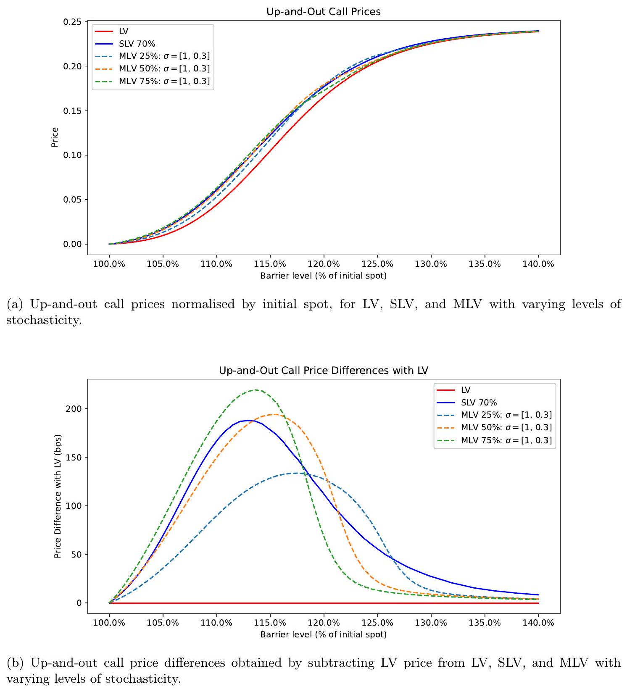

*Figure 4.2: 1Y up-and-out barrier call option prices with 80\% strike written on SPX; comparison between LV, SLV, and MLV with volatility states $\sigma=[1,0.30]$ and varying stochasticity.*

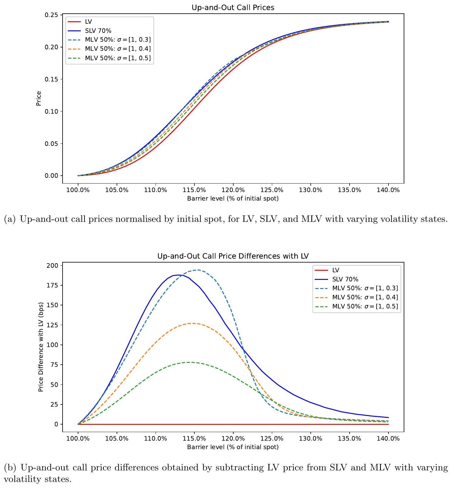

*Figure 4.3: 1Y up-and-out barrier call option prices with 80\% strike written on SPX; comparison between LV, SLV, and MLV with 50\% stochasticity and varying volatility states.*

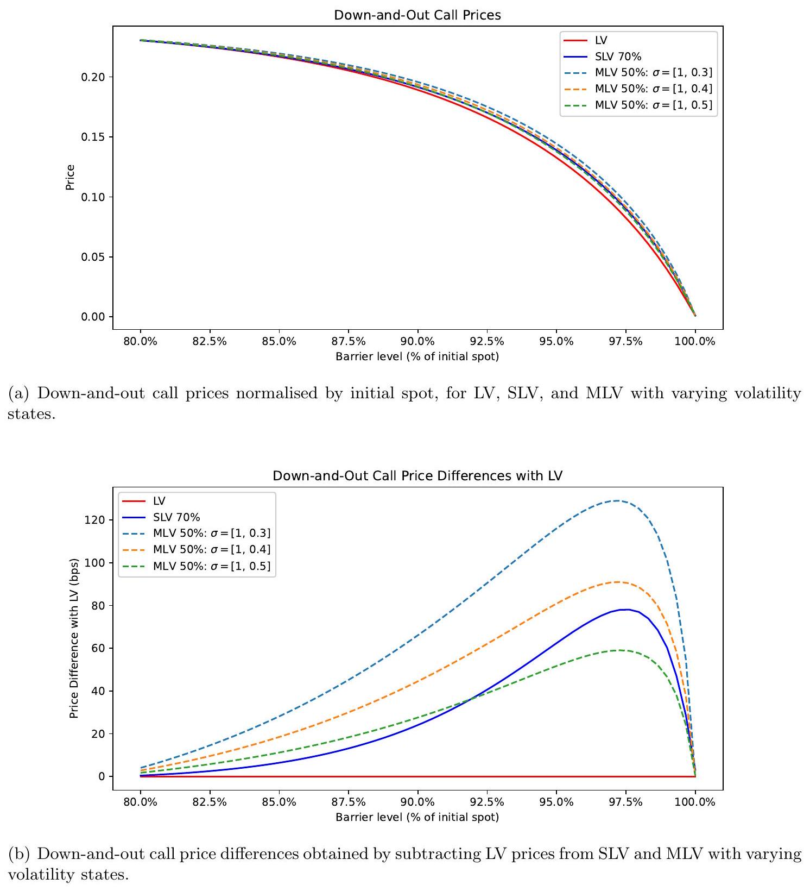

*Figure 4.4: 1Y down-and-out barrier call option prices with 80\% strike written on SPX; comparison between LV, SLV, and MLV with 50\% stochasticity and varying volatility states.*

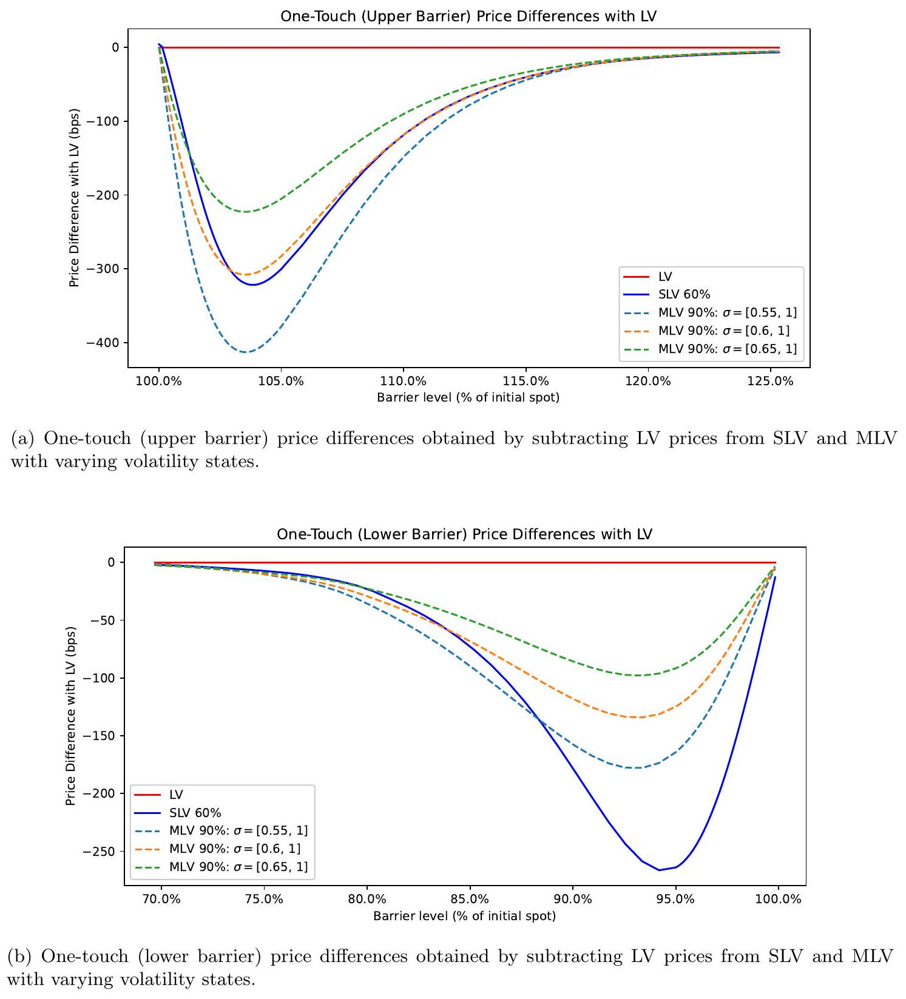

*Figure 4.5: 1Y one-touch option price differences written on USD-JPY; comparison between LV, SLV, and MLV with 90\% stochasticity and varying volatility states.*

### 4.4 MLV Forward Implied Volatility Dynamics

It is important that a model used for pricing path-dependent options exhibits realistic forward implied volatility dynamics, otherwise it will not be pricing these options correctly. As mentioned in Chapter 2, the local volatility model has the undesirable property that the forward implied volatility smiles flatten in time. Given that the volatility process of the MLV model is as simple of a random process as we can possibly make it, we want to investigate whether this volatility process has enough randomness to sufficiently reduce the flattening of the forward implied volatility smiles, and if it can produce behaviour that resembles that of an SLV model. We will investigate this by looking at the implied volatilities obtained from prices of forward-starting contracts generated by the MLV model. Peter Austing in [13, page 139] suggests that in order for a model to accurately price forwardstarting contracts, consistency of the model with the vanilla implied volatility surface and with barrier options is potentially sufficient, as consistency with these products imposes significant constraints on the prices of forward-starting contracts generated by the model.

In this section, we will compare the forward implied volatility smiles of the MLV model to the LV model and an SLV model, and look at how the smiles change as we adjust the mixing parameters. We would like to see if there exists a set of mixing parameters for which the skew and convexity of the smile are similar to that of the SLV model. We use SPX as the underlying, and the forward implied volatilities are obtained by calibrating the given model to vanilla SPX option market data, computing the prices of forward-starting call options using a finite-difference methods, and then backing out the forward implied volatility. We use an SLV model with a mixing weight of 80\% for our comparisons. In all of the examples in this section, the MLV models are calibrated using constant volatility states over the entire period to maturity, i.e. there is no term structure for the volatility states.

We start by plotting the forward smiles obtained from forward-starting call options with forward-starting dates 0Y, 6M, 2Y, 3Y, 6Y, and 6-month time to expiry from the forwardstart date; these can be compared with Figure 1.1(a) seen earlier in Chapter 2, where we looked at the equivalent plot for the local volatility model. Figure 4.6 shows the corresponding forward smiles for the SLV model which exhibits the behaviour which we would ideally like to match with the MLV model. We see that the forward smiles do not suffer from the same flattening issue as the local volatility model, and produces forward smiles with much more convexity and skew.

Figure 4.7 shows the forward smiles under the MLV model with $\sigma=[0.2,1]$ for three different levels of stochasticity; we consider $\lambda \in\{[0.5,0.5],[0.75,0.25],[0.25,0.75]\}$ which correspond to 100\%, 50\% and 50\% stochasticity respectively. Recall that the model with $\lambda=[0.75,0.25]$ has the same stochasticity as the model with $\lambda=[0.25,0.75]$, but it puts less probability weight on the volatility state with value one, which results in a different model. We indeed see that the MLV model does not exhibit a flattening forward smile as the forward-starting date increases. The three plots seem to have fairly similar shapes between 0.9 and 1.1 moneyness but differing by vertical shifts. The behaviour at the wings is quite different, particularly at the left wing. In Figure 4.7(a), forward smiles for forward-starting dates 2Y and 3Y seem to be flattening quite quickly at the left wing. This effect is slightly less pronounced in Figure 4.7(b), and not shown at all in 4.7(c).

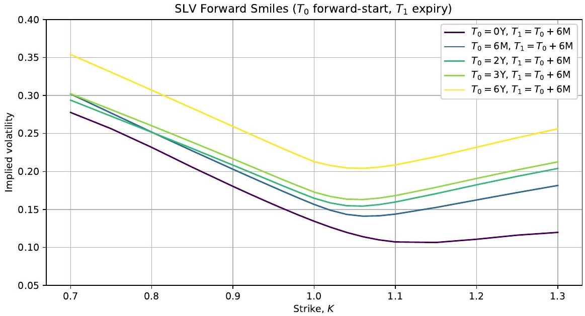

*Figure 4.6: Forward implied volatility smiles under the SLV model, obtained using SPX forward-start call options for a range of forward-starting dates and 6-month time to expiry from the forward-starting date.*

### 4.4.1 Effect of Mixing Parameters on Forward Smiles

Recall that for a two-state MLV model, we effectively have two mixing parameters that we can control, one for the level of the volatility states and one for the probabilities of entering each of the states at initial time (i.e. the stochasticity of the model). We are interested in looking at the effect of each of these mixing parameters. We start by fixing the stochasticity of the MLV model, and plotting the corresponding forward smiles for a range of volatility states $\sigma \in\{[0.1,1],[0.2,1],[0.3,1],[0.4,1]\}$. We also plot the forward smiles for the LV and SLV model for comparison. Figure 4.8 shows three examples where the forward smiles have been obtained from forward-starting call options with forward-start date $T_{0}=2 \mathrm{Y}$ and maturity $T_{1}=3 \mathrm{Y}$. Each of the plots, figures 4.8(a), 4.8(b), 4.8(c), have fixed levels of stochasticity, $50 \%(\lambda=[0.25,0.75]), 100 \%$ and $50 \%(\lambda=[0.75,0.25])$ respectively.

Again we see that the MLV model is able to produce a forward implied volatility smile which is much less flat than the LV model. However, the MLV model is not able to achieve a level of skew/convexity that closely matches the SLV model for all levels of strike. One immediate issue we see is the large deviations between MLV and SLV occurring at the right wing of the volatility smile in all of the examples. This could be due to the fact that we do not model spot-volatility correlation in an MLV model. The smile of the MLV model with $\lambda=[0.25,0.75]$, which puts more weight on the volatility state with value 1 , exhibits the least amount of convexity. The MLV model with $\lambda=[0.75,0.25]$ produces the most convexity at the left wing of the smile, whereas the MLV model with $\lambda=[0.5,0.5]$ produces the most convexity at the right wing. For a given level of stochasticity, increasing the difference between the volatility states increases the convexity of the smile in all cases.

Next, we fix the level of the volatility states, and plot the corresponding forward smiles for a range of probabilities. Figure 4.9 shows two examples for two sets of volatility states, $\sigma=[0.1,1]$ and $\sigma=[0.3,1]$, plotting the forward smiles for $\lambda \in\{[0.5,0.5],[0.625,0.375]$, [0.75, 0.25], [0.875, 0.125]\} corresponding to 100\%, 75\%, 50\% and 25\% stochasticity. Figure 4.10 is similar, but instead with $\lambda \in\{[0.5,0.5],[0.375,0.625],[0.25,0.75],[0.125,0.875]\}$, i.e. more probability weighting on the volatility state with value 1.

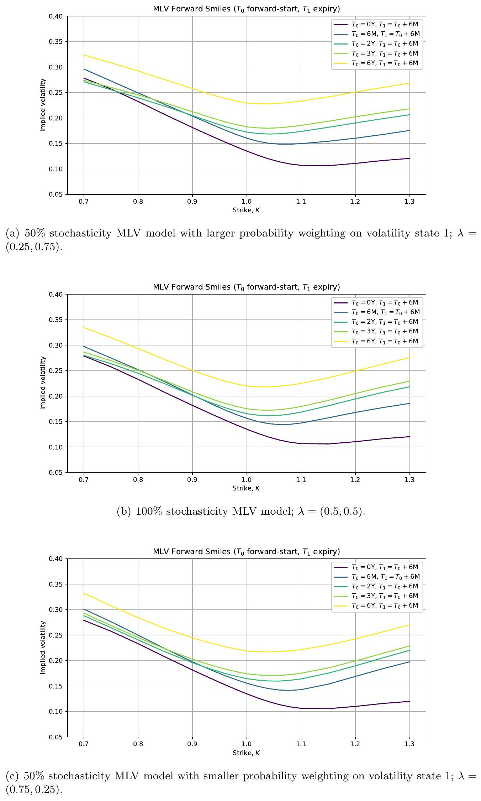

*Figure 4.7: Forward implied volatility smiles under the MLV model, obtained using SPX forward-start call options for a range of forward-starting dates and 6-month time to expiry from the forward-starting date, using $\sigma=[0.2,1]$ for all forward-starting dates.*

Figure 4.9 shows quite strange and less predictable behaviour for varying levels of stochasticity. The change in the smiles is much less clear for $\sigma=[0.3,1]$ where the relative difference between the states is smaller. Here, varying the level of stochasticity has a fairly insignificant effect on the smiles between 0.9 and 1.1 strike. When $\sigma=[0.1,1]$, the effect becomes more apparent, especially at the wings. The plots in Figure 4.10 show a pattern much more similar to what was seen in Figure 4.8. We see that for a fixed set of volatility states, increasing the level of stochasticity results in increased convexity. We also see that there is no set of parameters that is able to alleviate the issue of the large deviation of the MLV smiles from the SLV smiles at the right wing (without causing large deviations elsewhere), which is problematic.

Note that another set of examples using forward-start date $T_{0}=6 \mathrm{Y}$ and maturity $T_{1}=7 \mathrm{Y}$ can be found in Appendix B. We questioned if the undesirable behaviour at the right wing of the MLV forward smiles was because the MLV model cannot not handle the amount of skew present in the implied volatility curves of equity markets, and whether the MLV model would have more applicability to FX markets with currency pairs which exhibit more symmetric implied volatility curves. We tested on a range of currency pairs and found that this did not alleviate these issues. In Figure 4.11, we show one example of the forward smiles for GBP/USD, with $T_{0}=2 \mathrm{Y}$ and $T_{1}=3 \mathrm{Y}$, which illustrates this. Based on the results, it seems that the two-state MLV model is not sufficiently complex for handling forward-starting options, and consequently, not sufficiently complex for handling other options with strong path-dependence.

### 4.4.2 Forward Smiles of Multi-State MLV Models

So far we have only considered two-state MLV models, but to get some more flexibility, one can consider adding more volatility states. In our testing, we looked briefly at the forward smiles of three-state and four-state MLV models. We found, however, that increasing the number of volatility states did not have a significant enough effect for it to be worth going into detail about in this thesis. We found that increasing the number of states did not necessarily alleviate some of the main issues seen previously, in particular the inability of the MLV forward smiles to match the SLV forward smiles at the right wing. Our conclusion is that, for derivatives with strong path-dependence, MLV models in the current form are not sufficient, and instead we should consider looking to extend the model. One way to do so would be to allow the volatility to transition between states beyond the initial time.

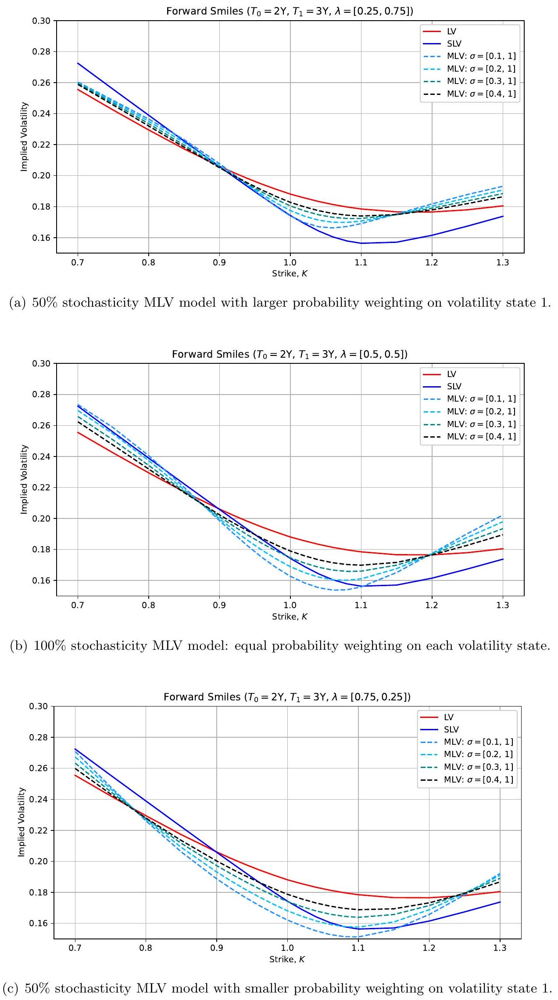

*Figure 4.8: Forward smile comparison of two-state MLV model with probabilities $\lambda=$ $[0.25,0.75], \lambda=[0.5,0.5]$ and $\lambda=[0.75,0.25]$, over a range of volatility state combinations.*

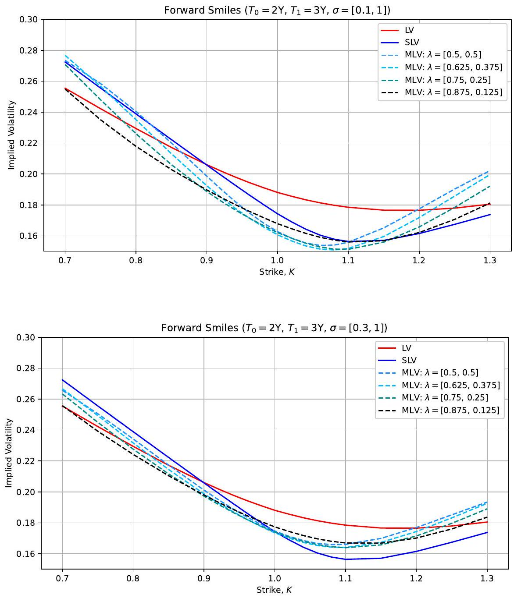

*Figure 4.9: Forward smile comparison of two-state MLV models with volatility states $\sigma=[0.1,1]$ and $\sigma=[0.3,1]$, with 100\%, 75\%, 50\%, 25\% stochasticities but a smaller probability weighting on the volatility state with value 1.*

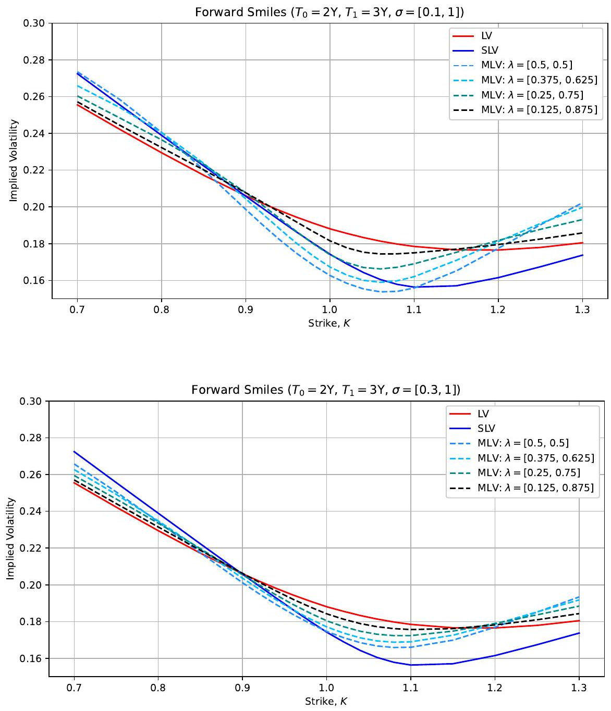

*Figure 4.10: Forward smile comparison of two-state MLV models with volatility states $\sigma=[0.1,1]$ and $\sigma=[0.3,1]$, with 100\%, 75\%, 50\%, 25\% stochasticities but a larger probability weighting on the volatility state with value 1.*

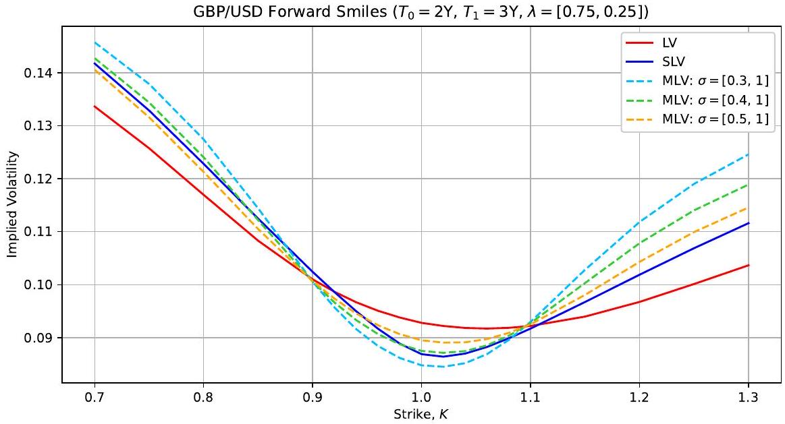

*Figure 4.11: Forward smile comparison of two-state MLV using GBP/USD as the underlying, with 50\% stochasticity and a smaller probability weighting on the volatility state with value 1, for a range of volatility states.*

### 4.5 Regime-Switching MLV Model

The MLV model in its current form does not seem to possess the capability to price strongly-path dependent options. One of the big simplifications of the model is that the stochasticity of the volatility is concentrated purely at initial time. To achieve a more flexible model while still being significantly less computationally expensive than an SLV model, we can extend the MLV model by allowing for transitions between the volatility states beyond initial time. Here we briefly introduce a theoretical framework for this regime-switching MLV model.

### 4.5.1 General RS-MLV Model

The SDE describing the risk-neutral dynamics of the asset price process in a general regime-switching MLV (RS-MLV) model is given by,

$$
\mathrm{d} S_{t}=\left(r_{t}-q_{t}\right) S_{t} \mathrm{~d} t+\sigma_{Z_{t}}(t) L\left(S_{t}, t\right) S_{t} \mathrm{~d} W_{t}, \quad S_{0}>0,
$$

where $Z_{0}: \Omega \rightarrow \mathcal{Z}=\{1, \ldots, n\}$ is an $\mathcal{F}_{0}$-measurable random variable with associated probabilities

$$
\lambda_{i}:=\mathbb{P}\left(Z_{0}=i\right), \quad i=1, \ldots, n,
$$

and the process $Z$ evolves in time following

$$
\mathbb{P}\left(Z_{t+\mathrm{d} t}=j \mid \mathcal{F}_{t}\right)=q_{Z_{t} j}\left(S_{t}\right) \mathrm{d} t,
$$

where $\mathcal{F}_{t}$ is the $\sigma$-algebra generated by $\left\{\left(S_{u}, Y_{u}\right)\right\}_{0 \leq u \leq t},\left(S_{0}, Z_{0}\right)$ and $\left(W_{t}\right)_{t \geq 0}$ are independent, $Q(x)=\left(q_{i j}(x)\right)_{1 \leq i, j \leq n}$ is a transition-rate matrix with $q_{i j} \geq 0$ and bounded for $i \neq j$, and $q_{i i}=-\sum_{j \neq i} q_{i j}$.

By the usual application of Gyöngy's theorem, we get the following expression for the leverage function:

$$
L^{2}(S, t)=\sigma_{\text {local }}^{2}(S, t) \frac{\sum_{i=1}^{n} p\left(S, t ; Z_{0}=i\right) \cdot \lambda_{i}}{\sum_{i=1}^{n} \sigma_{i}^{2} \cdot p\left(S, t ; Z_{0}=i\right) \cdot \lambda_{i}},
$$

where $p\left(\cdot, \cdot ; Z_{0}=i\right)=p_{i}(\cdot, \cdot)$ denotes the probability density of the asset price process conditional on $\left\{Z_{0}=i\right\}$. The SDE given by 4.5.1 gives rise to a system of $n$ coupled Fokker-Planck equations describing the marginal density of the asset price process, where, for $i=1, \ldots, n$,

$$
\begin{aligned}
\frac{\partial p_{i}}{\partial t} & =\frac{1}{2} \frac{\partial^{2}}{\partial s^{2}}\left[\sigma_{i}^{2} L^{2}(s, t) s^{2} \lambda_{i} p_{i}\right]-\frac{1}{2} \frac{\partial}{\partial s}\left[\left(r_{t}-q_{t}\right) s \lambda_{i} p_{i}\right]+\sum_{i=1}^{n} q_{j i} p_{j}, \\
p_{i}(\cdot, 0) & =\delta_{\left\{s-S_{0}\right\}} .
\end{aligned}
$$

Jourdain and Zhou proved the existence of this general regime-switching MLV model, under some conditions and assumptions, the details of which can be found in [35].

## Conclusion

In this thesis, we explored mixed local volatility models, a heavily simplified version of stochastic local volatility models. We provided a framework for calibrating the MLV model to vanilla option market data, and compared the models ability to accurately price continuous barrier options by comparing it to a local volatility model and a stochastic local volatility model. We saw that one can find mixing parameters for which the MLV model can price continuous barrier options quite similarly to an SLV model. These parameters, however, are not necessarily the same for pricing all types of continuous barrier options simultaneously, for all barrier levels, meaning the applicability of the MLV model here may depend on the context in which it is to be used. We then did the same thing in the context of forward-starting options in order to understand the forward implied volatility smile dynamics of the model. We saw that the MLV model does not exhibit the well-known flattening issue suffered by the local volatility model, but it cannot seem to match the forward implied volatility smiles of an SLV model for all levels of moneyness. This suggests that the MLV model may not be complex enough to handle options with strong path-dependency, and may require a more sophisticated volatility process to be able to price these types of options. The two-state MLV model was able to price with a computation time reduction of 1-2 orders of magnitude relative to the SLV model.

There are several ways in which the results of this thesis can be extended. Firstly, we only investigated the capability of the MLV model to price continuous barrier options and forward-starting options. However, Uwe Wystup in [14] suggests that MLV models are the model of choice for a range of first-generation exotics, and hence it would be interesting to look at how well the model can price other types of exotic options. The most interesting extension would be to explore a regime-switching MLV model, or even a regime-switching jump diffusion model. This may provide the flexibility needed to better match the forward implied volatility smiles of the SLV model, and to achieve the capability to price more complex and strongly path-dependent products, whilst still being able to price significantly faster than an SLV model.

## Appendix A \\ Technical Details

## A. 1 MLV Calibration Finite-Difference Scheme

Here we will briefly describe a finite-difference scheme for solving the Fokker-Planck equation associated with calibrating the MLV model. We will not discuss a finite-difference scheme for solving the Fokker-Planck associated with calibrating the RS-MLV model.

## A.1.1 Finite-difference with Non Uniform Grids in One Dimension

When solving the Fokker-Planck equation and the backward pricing PDE, it is useful to use non-uniform spatial grids with a concentration of points around the initial spot and/or around values of interest. Here we write down the corresponding approximations of first and second order derivatives on such grids.

Let $f$ be a smooth function and consider a non-uniform grid of points $x_{0}<\cdots<x_{n}$. Define $h_{i}:=x_{i+1}-x_{i}$. Let $f_{i}$ represent the value of the function $f$ evaluated at the point $x_{i}$. The approximations of the first and second derivative of $f$ on the non-uniform grid are given by

$$
\begin{aligned}
\frac{\partial f_{i}}{\partial x} & \approx-\frac{h_{i-1}}{h_{i}\left(h_{i-1}+h_{i}\right)} f_{i-1}+\frac{h_{i}-h_{i-1}}{h_{i-1} h_{i}} f_{i}+\frac{h_{i-1}}{h_{i}\left(h_{i-1}+h_{i}\right)} f_{i+1}, \\
\frac{\partial^{2} f_{i}}{\partial x^{2}} & \approx \frac{2}{h_{i-1}\left(h_{i-1}+h_{i}\right)} f_{i-1}-\frac{2}{h_{i-1} h_{i}} f_{i}+\frac{2}{h_{i}\left(h_{i-1}+h_{i}\right)} f_{i+1} .
\end{aligned}
$$

## A.1.2 Fokker-Planck Discretisation in One Dimension

Recall the Fokker-Planck equation associated with the MLV model given by (4.2.2). We start by transforming the Fokker-Planck equation for the MLV model to log coordinates:

$$
\frac{\partial p(x, t)}{\partial t}=\sum_{i=1}^{n} \lambda_{i}\left[\frac{1}{2} \sigma_{i}^{2} \frac{\partial^{2}}{\partial x^{2}}\left[L^{2}(x, t) p_{i}(x, t)\right]+\frac{\partial}{\partial x}\left[\left(\frac{1}{2} \sigma_{i}^{2} L^{2}(x, t)-\left(r_{t}-q_{t}\right)\right) p_{i}(x, t)\right]\right] .
$$

There are $n$ one-dimensional Fokker-Planck equations associated with the MLV model that we need to solve, i.e. one for each state. The Fokker-Planck equation associated with the probability density under volatility state $i$ is given by

$$
\frac{\partial p_{i}(x, t)}{\partial t}=\frac{1}{2} \sigma_{i}^{2} \frac{\partial^{2}}{\partial x^{2}}\left[L^{2}(x, t) p_{i}(x, t)\right]+\frac{\partial}{\partial x}\left[\left(\frac{1}{2} \sigma_{i}^{2} L^{2}(x, t)-\left(r_{t}-q_{t}\right)\right) p_{i}(x, t)\right] .
$$

For notational convenience, we will discretise a general form of this equation. Define $a_{i}(x, t):=\frac{1}{2} \sigma_{i}^{2}(t) L^{2}(x, t)$ and $b_{i}(x, t):=\frac{1}{2} \sigma_{i}^{2}(t) L^{2}(x, t)-\left(r_{t}-q_{t}\right)$. This equation then
becomes

$$
\frac{\partial p_{i}(x, t)}{\partial t}=\frac{\partial^{2}}{\partial x^{2}}\left[a_{i}(x, t) p_{i}(x, t)\right]+\frac{\partial}{\partial x}\left[b_{i}(x, t) p_{i}(x, t)\right] .
$$

We will describe a fully implicit finite-difference scheme for solving this PDE. Define the time grid $\left\{t_{0}, t_{1}, \ldots, t_{N}\right\}$ and spatial grid $\left\{x_{0}, x_{1}, \ldots, x_{M}\right\}$. Let $\Delta t_{i}:=t_{i}-t_{i-1}$ and let $\left(p_{i}\right)_{k}^{l}:=p_{i}\left(x_{k}, t_{l}\right),\left(a_{i}\right)_{k}^{l}:=a_{i}\left(x_{k}, t_{l}\right),\left(b_{i}\right)_{k}^{l}:=b_{i}\left(x_{k}, t_{l}\right)$ denote functions $p_{i}, a_{i}, b_{i}, c_{i}$ evaluated at the coordinate $\left(x_{k}, t_{l}\right)$. For a fully implicit scheme, we approximate the time derivative using a backward difference. Following (A.1.1) and (A.1.2), we approximate the first and second spatial derivatives by

$$
\begin{aligned}
\frac{\partial\left[b_{i}(x, t) p_{i}\right]}{\partial x} & \approx \frac{h_{k-1}\left(b_{i}\right)_{k-1}^{l}}{h_{k}\left(h_{k-1}+h_{k}\right)}\left(p_{i}\right)_{k-1}^{l}+\frac{\left(h_{k}-h_{k-1}\right)\left(b_{i}\right)_{k}^{l}}{h_{k} h_{k-1}}\left(p_{i}\right)_{k}^{l}+\frac{h_{k-1}\left(b_{i}\right)_{k+1}^{l}}{h_{k}\left(h_{k-1}+h_{k}\right)}\left(p_{i}\right)_{k+1}^{l}, \\
\frac{\partial^{2}\left[a_{i}(x, t) p_{i}\right]}{\partial x^{2}} & \approx \frac{2\left(a_{i}\right)_{k-1}^{l}}{h_{k}\left(h_{k-1}+h_{k}\right)}\left(p_{i}\right)_{k-1}^{l}-\frac{2\left(a_{i}\right)_{k}^{l}}{h_{k-1} h_{k}}\left(p_{i}\right)_{k}^{l}+\frac{2\left(a_{i}\right)_{k+1}^{l}}{h_{k}\left(h_{k-1}+h_{k}\right)}\left(p_{i}\right)_{k+1}^{l} .
\end{aligned}
$$

This leads to the following PDE discretisation:

$$
\begin{aligned}
\frac{\left(p_{i}\right)_{k}^{l}-\left(p_{i}\right)_{k}^{l-1}}{\Delta t_{l}}= & \frac{2\left(a_{i}\right)_{k-1}^{l}+h_{k-1}\left(b_{i}\right)_{k-1}^{l}}{h_{k}\left(h_{k-1}+h_{k}\right)}\left(p_{i}\right)_{k-1}^{l}+\frac{-2\left(a_{i}\right)_{k}^{l}+\left(h_{k}-h_{k-1}\right)\left(b_{i}\right)_{k}^{l}}{h_{k} h_{k-1}}\left(p_{i}\right)_{k}^{l} \\
& +\frac{2\left(a_{i}\right)_{k+1}^{l}+h_{k-1}\left(b_{i}\right)_{k+1}^{l}}{h_{k}\left(h_{k-1}+h_{k}\right)}\left(p_{i}\right)_{k+1}^{l} \\
= & :\left(\alpha_{i}\right)_{k}^{l}\left(p_{i}\right)_{k-1}^{l}+\left(\beta_{i}\right)_{k}^{l}\left(p_{i}\right)_{k}^{l}+\left(\gamma_{i}\right)_{k}^{l}\left(p_{i}\right)_{k+1}^{l},
\end{aligned}
$$

where

$$
\begin{aligned}
\left(\alpha_{i}\right)_{k}^{l} & :=\frac{2\left(a_{i}\right)_{k-1}^{l}+h_{k-1}\left(b_{i}\right)_{k-1}^{l}}{h_{k}\left(h_{k-1}+h_{k}\right)}, \\
\left(\beta_{i}\right)_{k}^{l} & :=\frac{-2\left(a_{i}\right)_{k}^{l}+\left(h_{k}-h_{k-1}\right)\left(b_{i}\right)_{k}^{l}}{h_{k} h_{k-1}}, \\
\left(\gamma_{i}\right)_{k}^{l} & :=\frac{2\left(a_{i}\right)_{k+1}^{l}+h_{k-1}\left(b_{i}\right)_{k+1}^{l}}{h_{k}\left(h_{k-1}+h_{k}\right)},
\end{aligned}
$$

which holds for $k=1, \ldots, M-1$ and $l=1, \ldots, N$. For simplicity, if we define the boundary conditions by

$$
\left.\frac{\partial p_{i}(x, t)}{\partial x}\right|_{x=x_{0}}=0,\left.\quad \frac{\partial p_{i}(x, t)}{\partial x}\right|_{x=x_{M}}=0,
$$

then by setting $\left(\beta_{i}\right)_{0}^{l}=0,\left(\gamma_{i}\right)_{0}^{l}=\frac{1}{\Delta t_{l}},\left(\alpha_{i}\right)_{M}^{l}=\frac{1}{\Delta t_{l}},\left(\beta_{i}\right)_{M}^{l}=0$, we obtain the following recursive equation in vector notation:

$$
\left(p_{i}\right)^{l}=\left(\mathbb{I}-\Delta t_{l} A_{i}^{l}\right)^{-1}\left(\tilde{p}_{i}\right)^{l-1},
$$

where $\left\{A_{i}^{l}\right\}_{i=1}^{n}$ is a sequence of tridiagonal matrices defined by

$$
A_{i}^{l}=\left(\begin{array}{cccccc}
\left(\beta_{i}\right)_{0}^{l} & \left(\gamma_{i}\right)_{0}^{l} & 0 & \ldots & \ldots & 0 \\
\left(\alpha_{i}\right)_{1}^{l} & \left(\beta_{i}\right)_{1}^{l} & \left(\gamma_{i}\right)_{1}^{l} & 0 & \ldots & 0 \\
0 & \ddots & \ddots & \ddots & \ddots & \vdots \\
\vdots & \ddots & \ddots & \ddots & \ddots & 0 \\
\vdots & \ddots & \ddots & \left(\alpha_{i}\right)_{M-1}^{l} & \left(\beta_{i}\right)_{M-1}^{l} & \left(\gamma_{i}\right)_{M-1}^{l} \\
0 & \ldots & \ldots & 0 & \left(\alpha_{i}\right)_{M}^{l} & \left(\beta_{i}\right)_{M}^{l}
\end{array}\right),
$$

and $\left(\tilde{p}_{i}\right)_{k}^{l}= \begin{cases}0 & \text { if } k=0, \\ \left(p_{i}\right)_{k}^{l} & \text { if } k=1 \ldots M-1, \\ 0 & \text { if } k=M .\end{cases}$

## Appendix B

## Additional Figures

## B. 1 MLV Forward Implied Volatility Dynamics

Here we provide another example of comparing forward smiles for LV, SLV and MLV, using a $T_{0}=6 \mathrm{Y}$ forward-start and $T_{1}=7 \mathrm{Y}$ maturity, which can be seen in figures B.1, B.2, B. 3

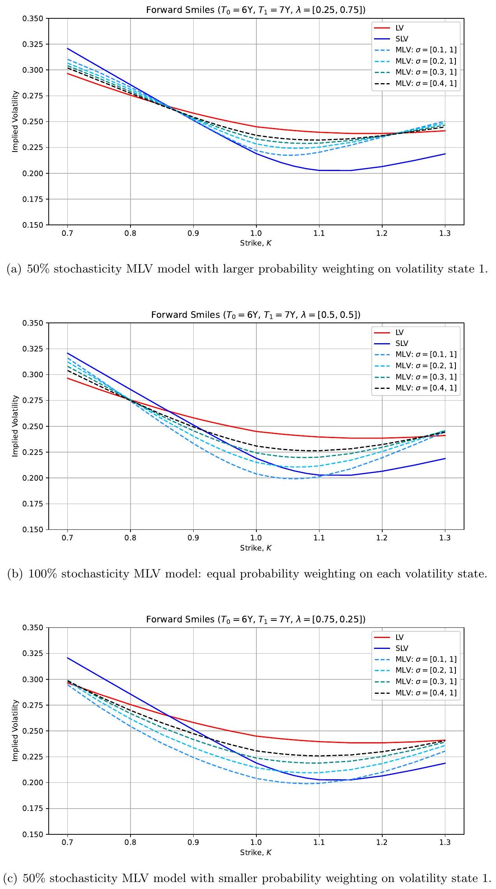

*Figure B.1: Forward smile comparison of two-state MLV model with probabilities $\lambda=$ $[0.25,0.75], \lambda=[0.5,0.5]$ and $\lambda=[0.75,0.25]$, over a range of volatility state combinations.*

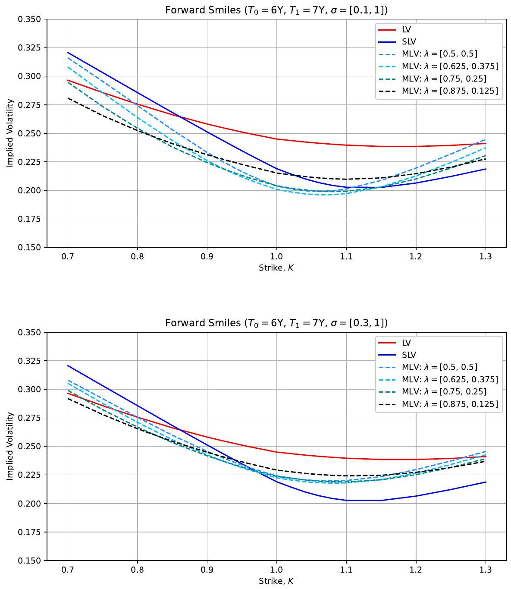

*Figure B.2: Forward smile comparison of two-state MLV models with volatility states $\sigma=[0.1,1]$ and $\sigma=[0.3,1]$, with 100\%, 75\%, 50\%, 25\% stochasticities but a smaller probability weighting on the volatility state with value 1.*

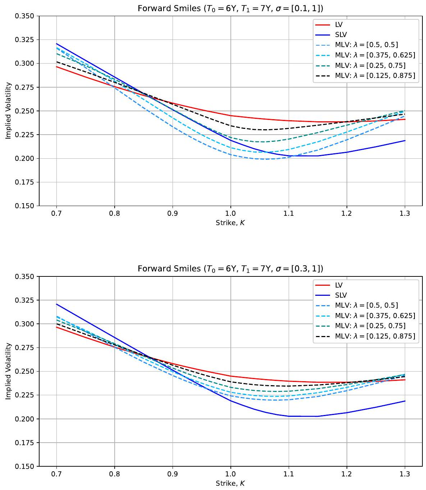

*Figure B.3: Forward smile comparison of two-state MLV models with volatility states $\sigma=[0.1,1]$ and $\sigma=[0.3,1]$, with 100\%, 75\%, 50\%, 25\% stochasticities but a larger probability weighting on the volatility state with value 1.*

## Bibliography

- [1] Fischer Black and Myron Scholes. The pricing of options and corporate liabilities. Journal of Political Economy, 81(3):637-654, 1973.
- [2] Bruno Dupire et al. Pricing with a smile. Risk, 7(1):18-20, 1994.
- [3] Mark Jex, Robert Henderson, David Wang. Pricing exotics under the smile. 1999. http://www.smartquant.com/references/OptionPricing/option14.pdf.
- [4] Iain J Clark. Foreign exchange option pricing: A practitioner's guide. John Wiley \& Sons, 2011.
- [5] Andrey Itkin. Fitting Local Volatility: Analytic and Numerical Approaches in Black-Scholes and Local Variance Gamma Models. World Scientific, 2020.
- [6] Leif Andersen and Rupert Brotherton-Ratcliffe. The equity option volatility smile: an implicit finite-difference approach. Journal of Computational Finance, 1(2):5-37, 1998.
- [7] Patrick S. Hagan, Deep Kumar, Andrew Lesniewski, and Diana E. Woodward. Managing smile risk. Wilmott Magazine, September:84-108, 2002.
- [8] Jim Gatheral and Antoine Jacquier. Arbitrage-free svi volatility surfaces. Quantitative Finance, 14(1):59-71, 2014.
- [9] Glyn Baker, Reimer Beneder, and Alex Zilber. Fx barriers with smile dynamics. Available at SSRN 964627, 2004.
- [10] Steven L. Heston. A Closed-Form Solution for Options with Stochastic Volatility with Applications to Bond and Currency Options. The Review of Financial Studies, 6(2):327-343, 042015.
- [11] Vladimir Piterbarg. Mixture of models: A simple recipe for a ... hangover? Wilmott, 2005, 072003.
- [12] Damiano Brigo and Fabio Mercurio. Lognormal-mixture dynamics and calibration to market volatility smiles. International Journal of Theoretical and Applied Finance, 5(04):427-446, 2002.
- [13] P. Austing. Smile Pricing Explained. Financial Engineering Explained. Palgrave Macmillan UK, 2014.
- [14] Uwe Wystup. Mixed local volatility models for fx derivatives. Thalesians, 2022-05-01, 2022. https://thalesians.com/aiovg_videos/uwe-wystrup-mixed-local-volatility-models-for-fx-derivatives/.
- [15] Vasanttilak Naik. Option valuation and hedging strategies with jumps in the volatility of asset returns. The Journal of Finance, 48(5):1969-1984, 1993.

- [16] G. B. Di Masi, Yu. M. Kabanov, and W. J. Runggaldier. Mean-variance hedging of options on stocks with markov volatilities. Theory of Probability \& Its Applications, 39(1):172-182, 1995.
- [17] Phelim Boyle and Thangaraj Draviam. Pricing exotic options under regime switching. Insurance: Mathematics and Economics, 40(2):267-282, 2007.
- [18] A Lipton. The vol smile problem risk, 2002.
- [19] Alex Lipton and William McGhee. Universal barriers. RISK-LONDON-RISK MAG-AZINE LIMITED-, 15(5):81-85, 2002.
- [20] Yu Tian, Zili Zhu, Geoffrey Matthew Lee, Fima C Klebaner, and Kais Hamza. Calibrating and pricing with a stochastic-local volatility model. The Journal of Derivatives, 22(3):21-39, 2015.
- [21] J. Göttker-Schnetmann, K. Spanderen. Heston stochastic local volatility. Quantlib, 2002.
- [22] Anthonie W Van der Stoep, Lech A Grzelak, and Cornelis W Oosterlee. The heston stochastic-local volatility model: Efficient monte carlo simulation. International Journal of Theoretical and Applied Finance, 17(07):1450045, 2014.
- [23] István Gyöngy. Mimicking the one-dimensional marginal distributions of processes having an itô differential. Probability theory and related fields, 71(4):501-516, 1986.
- [24] Hannes Risken. Fokker-planck equation. Springer, 1996.
- [25] Vladimir Piterbarg. Markovian projection method for volatility calibration. SSRN, 2006.
- [26] Julien Guyon and Pierre Henry-Labordere. The smile calibration problem solved. Available at SSRN 1885032, 2011.
- [27] Yong Ren, Dilip Madan, and M Qian Qian. Calibrating and pricing with embedded local volatility models. RISK-LONDON-RISK MAGAZINE LIMITED-, 20(9):138, 2007.
- [28] Maarten Wyns and Karel J In't Hout. An adjoint method for the exact calibration of stochastic local volatility models. Journal of computational science, 24:182-194, 2018.
- [29] Bernd Engelmann, Frank Koster, and Daniel Oeltz. Calibration of the heston stochastic local volatility model: A finite volume scheme. International Journal of Financial Engineering, 8(01):2050048, 2021.
- [30] Maarten Wyns and Jacques Du Toit. A finite volume-alternating direction implicit approach for the calibration of stochastic local volatility models. International Journal of Computer Mathematics, 94(11):2239-2267, 2017.
- [31] DANIELE COZZI. Local stochastic volatility models. solving the smile problem with a nonlinear partial integro-differential equation. 2011.
- [32] Yu Tian. The hybrid stochastic-local volatility model with applications in pricing fx options. Available at SSRN 2399935, 2013.

- [33] Vladimir Lucic. Boundary conditions for computing densities in hybrid models via pde methods. Stochastics An International Journal of Probability and Stochastic Processes, 84(5-6):705-718, 2012.
- [34] Jim Gatheral. The volatility surface: a practitioner's guide. John Wiley \& Sons, 2011.
- [35] Alexandre Zhou Benjamin Jourdain. Existence of a calibrated regime switching local volatility model and new fake brownian motions. arXiv preprint arXiv:1607.00077, 2017. January 23, 2017.
