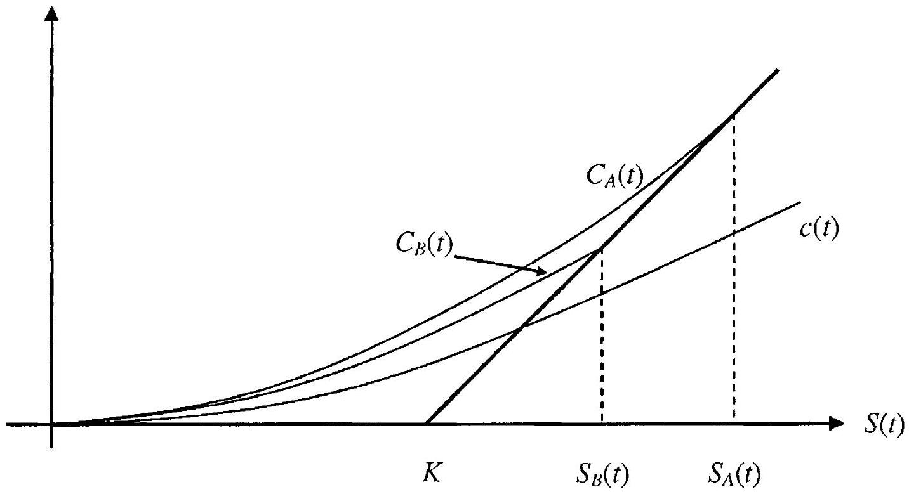

---
tags: [quant/knowledge]
---
## Introduction to Arbitrage Pricing Theory

For reference, this chapter reviews selected results from stochastic calculus and from the modern theory of asset pricing. The material in this chapter is well covered in existing literature, so we keep the chapter brief and the mathematical treatment informal. For a more rigorous treatment we refer to Duffie [2001] or Musiela and Rutkowski [1997]. Most of the necessary mathematical foundation for the theory is available in Karatzas and Shreve [1997], Øksendal [1992], and Protter [2005].

The treatment in this chapter focuses on asset pricing in general; we shall specialize it to interest rate securities in Chapter 4. Chapter 5 introduces fixed income markets in detail.

### 1.1 The Setup

Unless otherwise noted, in this book we shall always consider an economy with continuous and frictionless trading taking place inside a finite horizon $[0, T]$. We assume the existence of traded dividend-free assets with prices characterized by a $p$-dimensional vector-valued stochastic process $X(t)= \left(X_{1}(t), \ldots X_{p}(t)\right)^{\top}$. Uncertainty and information arrival is modeled by a probability space ( $\Omega, \mathcal{F}, \mathrm{P}$ ), with $\Omega$ being a sample space with outcome elements $\omega ; \mathcal{F}$ being a $\sigma$-algebra on $\Omega$; and P being a probability measure on the measure space ( $\Omega, \mathcal{F}$ ). Information is revealed over time according to a filtration $\left\{\mathcal{F}_{t}, t \in[0, T]\right\}$, a family of sub- $\sigma$-algebras of $\mathcal{F}$ satisfying $\mathcal{F}_{s} \subseteq \mathcal{F}_{t}$ whenever $s \leq t$. We can loosely think of $\mathcal{F}_{t}$ as the information available at time $t$. We assume that the process $X(t)$ is adapted to $\left\{\mathcal{F}_{t}\right\}$, i.e. that $X(t)$ is fully observable at time $t$. For technical reasons, we require that the filtration satisfies the "usual conditions" ${ }^{1}$. Let $\mathrm{E}^{\mathrm{P}}(\cdot)$ be the expectation

[^0]operator for the measure P ; when conditioning on information at time $t$, we will use the notation $\mathrm{E}_{t}^{\mathrm{P}}(\cdot)=\mathrm{E}^{\mathrm{P}}\left(\cdot \mid \mathcal{F}_{t}\right)$.

In all of the models in this book, we specialize the abstract setup above to the situation where information is generated by a $d$-dimensional vector-valued Brownian motion (or Wiener process) $W(t)=\left(W_{1}(t), \ldots, W_{d}(t)\right)^{\top}$, where $W_{i}$ is independent of $W_{j}$ for $i \neq j$. Brownian motions are treated in detail in Karatzas and Shreve [1997]; here, we just recall that a scalar Brownian motion $W_{i}$ is a continuous stochastic process starting at 0 (i.e. $W_{i}(0)=0$ ), having independent Gaussian increments: $W_{i}(t)-W_{i}(s) \sim \mathcal{N}(0, t-s), t \geq s$. The filtration we consider is normally always the one generated by $W$, $\mathcal{F}_{t}=\sigma\{W(u), 0 \leq u \leq t\}$, possibly augmented to satisfy the usual conditions. We will generally assume that the price vector $X(t)$ is described by a vectorvalued Ito process:

$$
\begin{equation*}
X(t)=X(0)+\int_{0}^{t} \mu(s, \omega) d s+\int_{0}^{t} \sigma(s, \omega) d W(s) \tag{1.1}
\end{equation*}
$$
^eq1-1

or, in differential notation,

$$
\begin{equation*}
d X(t)=\mu(t, \omega) d t+\sigma(t, \omega) d W(t) \tag{1.2}
\end{equation*}
$$
^eq1-2

where $\mu: \mathbb{R} \times \Omega \rightarrow \mathbb{R}^{p}$ and $\sigma: \mathbb{R} \times \Omega \rightarrow \mathbb{R}^{p \times d}$ are processes of dimension $p$ and $p \times d$, respectively. We assume that both $\mu$ and $\sigma$ are adapted to $\left\{\mathcal{F}_{t}\right\}$ and are in $L^{1}$ and $L^{2}$ respectively, in the sense that for all $t \in[0, T]$,

$$
\begin{align*}
& \int_{0}^{t}|\mu(s, \omega)| d s<\infty  \tag{1.3}\\
& \int_{0}^{t}|\sigma(s, \omega)|^{2} d s<\infty \tag{1.4}
\end{align*}
$$
^eq1-3
^eq1-4

almost surely ${ }^{2}$. In (1.4), we have defined

$$
\begin{equation*}
|\sigma(t, \omega)|^{2}=\operatorname{tr}\left(\sigma(t, \omega) \sigma(t, \omega)^{\top}\right) \tag{1.5}
\end{equation*}
$$
^eq1-5

We notice that the sample paths of $X$ generated by (1.1) are almost surely continuous, with no jumps in asset prices.

A technical treatment of Ito processes and the Ito integral with respect to Brownian motion can be found in Karatzas and Shreve [1997]. For our needs, it suffices to think of the Ito integral as

$$
\begin{equation*}
\int_{0}^{t} \sigma(s, \omega) d W(s)=\lim _{n \rightarrow \infty} \sum_{i=1}^{n} \sigma((i-1) \delta, \omega)[W(i \delta)-W((i-1) \delta)] \tag{1.6}
\end{equation*}
$$
^eq1-6

[^1]where $\delta \triangleq t / n$. We note that the integrand $\sigma$ is here always evaluated at the left of each interval $[(i-1) \delta, i \delta]$. Other choices are possible ${ }^{3}$, but, as we shall see, the "non-anticipative" structure of the Ito integral gives rise to a number of useful results and makes it particularly useful as a model of trading gains (see Section 1.2).

We list a few relevant definitions and results below.
Definition 1.1.1 (Martingale). Let $Y(t)$ be an adapted vector-valued process with $\mathrm{E}^{\mathrm{P}}(|Y(t)|)<\infty$ for all $t \in[0, T]$. We say that $Y(t)$ is a martingale under measure P if for all $s, t \in[0, T]$ with $t \leq s$,

$$
\mathrm{E}_{t}^{\mathrm{P}}(Y(s))=Y(t), \quad \text { a.s. }
$$

If we replace the equality sign in this equation with $\leq$ or $\geq, Y(t)$ is said to be a supermartingale or a submartingale, respectively.

Definition 1.1.2 (Space $H^{2}$ ). Let $|\sigma(t, \omega)|^{2}$ be as defined in (1.5). We say that $\sigma$ is in $H^{2}$, if for all $t \in[0, T]$ we have

$$
\mathrm{E}^{\mathrm{P}}\left(\int_{0}^{t}|\sigma(s, \omega)|^{2} d s\right)<\infty
$$

The importance of Definition 1.1.2 becomes clear from the following result:

Theorem 1.1.3 (Properties of Ito Integral). Define $I(t)= \int_{0}^{t} \sigma(s, \omega) d W(s)$ and assume that $\sigma$ is in $H^{2}$. Then

1. $I(t)$ is $\mathcal{F}_{t}$-measurable.
2. $I(t)$ is a continuous martingale. In particular, $\mathrm{E}^{\mathrm{P}}(I(t))=0$ for all $t \in[0, T]$.
3. $\mathrm{E}^{\mathrm{P}}\left(|I(t)|^{2}\right)=\mathrm{E}^{\mathrm{P}}\left(\int_{0}^{t}|\sigma(s, \omega)|^{2} d s\right)<\infty$.
4. $\mathrm{E}^{\mathrm{P}}\left(I(t) I(s)^{\top}\right)=\mathrm{E}^{\mathrm{P}}\left(\int_{0}^{\min (t, s)} \sigma(u, \omega) \sigma(u, \omega)^{\top} d u\right)$.

A proof of Theorem 1.1.3 can be found in, e.g., Karatzas and Shreve [1997]. The equality in the third item of Theorem 1.1.3 is known as the Ito isometry. Due to the inequality in the third item, we say that the martingale defined in the process is a square-integrable martingale.

While it is common in applied work to simply assume that Ito integrals are martingales, without technical regularity conditions on $\sigma(t, \omega)$ (such as the $H^{2}$ restriction in Theorem 1.1.3), we should note that Ito integrals involving general processes in $L^{2}$ can, in fact, only be guaranteed to be local martingales. A process $X$ is said to be a local martingale if there exists a

[^2]sequence of stopping times ${ }^{4}\left\{\tau_{n}\right\}_{n=1}^{\infty}$, with $\tau_{n} \rightarrow \infty$ as $n \rightarrow \infty$, such that $X\left(\min \left(t, \tau_{n}\right)\right), t \geq 0$, is a martingale for all $n$. In other words, all "driftless" Ito processes of the type

$$
\begin{equation*}
d Y(t)=\sigma(t, \omega) d W(t) \tag{1.7}
\end{equation*}
$$
^eq1-7
are local martingales, but not necessarily martingales. Interestingly, a converse result holds as well; all local martingales adapted to the filtration generated by the Brownian motion $W$ can be represented as Ito processes of the form (1.7):

Theorem 1.1.4 (Martingale Representation Theorem). If $Y$ is a local martingale adapted to the filtration generated by a Brownian motion $W$, then there exists a process $\sigma$ such that (1.7) holds. If $Y$ is a square-integrable martingale, then $\sigma$ is in $H^{2}$.

The proof of Theorem 1.1.4 can be found in Karatzas and Shreve [1997].
In the manipulation of functionals of Ito processes, the key result is a famous result by K. Ito:

Theorem 1.1.5 (Ito's Lemma). Let $f(t, x), x=\left(x_{1}, \ldots, x_{p}\right)^{\top}$, denote a continuous function, $f:[0, T] \times \mathbb{R}^{p} \rightarrow \mathbb{R}$, with continuous partial derivatives $\partial f / \partial t=f_{t}, \partial f / \partial x_{i}=f_{x,}, \partial^{2} f / \partial x_{i} \partial x_{j}=f_{x_{, x, x}}$. Let $X(t)$ be given by the Ito process (1.2) and define a scalar process $Y(t)=f(t, X(t))$. Then $Y(t)$ is an Ito process with stochastic differential

$$
\begin{aligned}
d Y(t)=f_{t}(t, X(t)) d t & +f_{x}(t, X(t)) \mu(t, \omega) d t+f_{x}(t, X(t)) \sigma(t, \omega) d W(t) \\
& +\frac{1}{2} \sum_{i=1}^{p} \sum_{j=1}^{p} f_{x, x_{j}}(t, X(t))\left(\sigma(t, \omega) \sigma(t, \omega)^{\top}\right)_{i, j} d t
\end{aligned}
$$

where $f_{x}=\left(f_{x_{1}}, \ldots, f_{x_{p}}\right)$.
For easy reference, the result below lists Ito's lenma for the special case where $p=d=1$.

Corollary 1.1.6. For the case $p=d=1$, Ito's lemma becomes

$$
\begin{aligned}
d Y(t)=\left(f_{t}(t, X(t))+f_{x}(t, X(t)) \mu(t, \omega)\right. & \left.+\frac{1}{2} f_{x x}(t, X(t)) \sigma(t, \omega)^{2}\right) d t \\
& +f_{x}(t, X(t)) \sigma(t, \omega) d W(t)
\end{aligned}
$$

Ito's lemma can be motivated heuristically from a Taylor expansion. For instance, for the scalar case in Corollary 1.1.6, we write informally[^3]

$$
\begin{equation*}
f(t+d t, X(t+d t))=f(t, X(t))+f_{t} d t+f_{x} d X(t)+\frac{1}{2} f_{x x}(d X(t))^{2}+\ldots \tag{1.8}
\end{equation*}
$$
^eq1-8

Here, we have

$$
(d X(t))^{2}=\mu(t, \omega)^{2}(d t)^{2}+\sigma(t, \omega)^{2}(d W(t))^{2}+2 \mu(t, \omega) \sigma(t, \omega) d t d W(t)
$$

As shown earlier, $(d W(t))^{2}=d t$ in quadratic mean, whereas all other terms in the expression for $(d X(t))^{2}$ are of order $O\left(d t^{3 / 2}\right)$ or higher and can be neglected for small $d t$. In the limit, we therefore have $(d X(t))^{2}=\sigma(t, \omega)^{2} d t$ which can be inserted into (1.8). The result in Corollary 1.1.6 then emerges.

Remark 1.1.7. The quantity $(d X(t))^{2}$ discussed above is the differential of the quadratic variation of $X(t)$, often denoted by $\langle X(t), X(t)\rangle$. That is,

$$
d\langle X(t), X(t)\rangle=(d X(t))^{2} \quad \Rightarrow \quad\langle X(t), X(t)\rangle=\int_{0}^{t}(d X(u))^{2}
$$

For two different (scalar) Ito processes $X(t)$ and $Y(t)$, we may equivalently define the quadratic covariation process $\langle X(t), Y(t)\rangle$ by

$$
d\langle X(t), Y(t)\rangle=d X(t) d Y(t)
$$

Sometimes we also write $d\langle X(t), Y(t)\rangle=\langle d X(t), d Y(t)\rangle$. If $X(t)$ is a $p$ dimensional process and $Y(t)$ is a $q$-dimensional process, the quadratic covariation $\left\langle X(t), Y(t)^{\top}\right\rangle$ is a $(p \times q)$-dimensional matrix process whose $(i, j)$-th element is $\left\langle X_{i}(t), Y_{j}(t)\right\rangle, i=1, \ldots, p, j=1, \ldots, q$.

The so-called Tanaka extension (see Karatzas and Shreve [1997]) extends Ito's lemma to continuous but non-differentiable functions. At points where the function has a kink, the Tanaka extension (loosely speaking) justifies using the Heaviside (step-) function for the first-order derivative and the Dirac delta function for the second-order derivative. An application of the Tanaka extension can be found in Section 1.9.2 and in Chapter 7, along with further discussion and references.

### 1.2 Trading Gains and Arbitrage

Working in the setting of Section 1.1 with assets driven by Ito processes, we now consider an investor engaging in a trading strategy involving the $p$ assets $X_{1}, \ldots, X_{p}$. Let the trading strategy be characterized by a predictable ${ }^{5}$ adapted process $\phi(t, \omega)=\left(\phi_{1}(t, \omega), \ldots, \phi_{p}(t, \omega)\right)^{\top}$, with $\phi_{i}(t, \omega)$ denoting[^4] the holdings at time $t$ in the $i$-th asset $X_{i}$. The value $\pi(t)$ of the trading strategy at time $t$ is thus (dropping the dependence on $\omega$ in the notation)

$$
\begin{equation*}
\pi(t)=\phi(t)^{\top} X(t) \tag{1.9}
\end{equation*}
$$
^eq1-9

The gain from trading over a small time interval $[t, t+\delta]$ is (approximately) $\phi(t)^{\top}[X(t+\delta)-X(t)]$, suggesting (compare to (1.6)) that the Ito integral

$$
\int_{0}^{t} \phi(s)^{\top} d X(s)=\int_{0}^{t} \phi(s)^{\top} \mu(s) d s+\int_{0}^{t} \phi(s)^{\top} \sigma(s) d W(s)
$$

is a proper model for trading gains over $[0, t]$. An investment strategy is said to be self-financing if, for any $t \in[0, T]$,

$$
\begin{equation*}
\pi(t)-\pi(0)=\int_{0}^{t} \phi(s)^{\top} d X(s) \tag{1.10}
\end{equation*}
$$
^eq1-10

This relationship simply expresses that changes in portfolio value are solely caused by trading gains or losses, with no funds being added or withdrawn.

Self-financing trading strategies allow investors to turn a certain initial investment $\pi(0)$ into stochastic future wealth $\pi(t)$. Under natural assumptions on possible trading strategies (e.g., that there is finite supply of all assets) we would expect that there should be limitations to the profits that self-financing strategies can create. Most notably, it should be impossible to create "something for nothing", that is, to turn a zero initial investment into future wealth that is certain to be non-negative and may be positive with non-zero probability. To express this formally, we introduce the concept of an arbitrage opportunity:

Definition 1.2.1 (Arbitrage). An arbitrage opportunity is a self-financing strategy $\phi$ for which $\pi(0)=0$ and, for some $t \in[0, T]$,

$$
\begin{equation*}
\pi(t) \geq 0 \text { a.s., and } \mathrm{P}(\pi(t)>0)>0 \tag{1.11}
\end{equation*}
$$
^eq1-11

with $\pi$ given in (1.9).
In economic equilibrium, arbitrage strategies cannot exist and precluding (1.11) constitutes a fundamental consistency requirement on the asset processes.

### 1.3 Equivalent Martingale Measures and Arbitrage

We turn to the question of characterizing the conditions under which the trading economy is free of arbitrage opportunities. A concise way to state these conditions involves equivalent martingale measures, a concept we shall work our way up to in a number of steps. First, we recall that two
probability measures P and $\widehat{\mathrm{P}}$ on the same measure space $(\Omega, \mathcal{F})$ are said to be equivalent if $\mathrm{P}(A)=0 \Leftrightarrow \widehat{\mathrm{P}}(A)=0, \forall A \in \mathcal{F}$; that is, the two measures have the same null-sets. An important result from measure theory states that equivalent measures are uniquely associated through a quantity known as a Radon-Nikodym derivative:

Theorem 1.3.1 (Radon-Nikodym Theorem). Let P and $\widehat{\mathrm{P}}$ be equivalent probability measures on the common measure space $(\Omega, \mathcal{F})$. There exists a unique (a.s.) non-negative random variable $R$ with $\mathrm{E}^{\mathrm{P}}(R)=1$, such that

$$
\widehat{\mathrm{P}}(A)=\mathrm{E}^{\mathrm{P}}\left(R 1_{\{A\}}\right), \quad \text { for all } A \in \mathcal{F} .
$$

For a proof of Theorem 1.3.1, see e.g. Billingsley [1995]. The random variable $R$ in the theorem is known as a Radon-Nikodym derivative and is denoted $d \widehat{\mathrm{P}} / d \mathrm{P}$. In the theorem we have used an indicator $1_{\{A\}}$; this quantity is 1 if the event $A$ comes true, 0 if not.

For later use, we associate any probability measure $\widehat{\mathrm{P}}$ with a density process

$$
\begin{equation*}
\varsigma(t)=\mathrm{E}_{t}^{\mathrm{P}}\left(\frac{d \widehat{\mathrm{P}}}{d \mathrm{P}}\right), \quad \forall t \in[0, T] \tag{1.12}
\end{equation*}
$$
^eq1-12

Clearly, $\varsigma(t)$ is a P-martingale with $\varsigma(0)=1$ and $\varsigma(t)=\mathrm{E}_{t}^{\mathrm{P}}(\varsigma(T))$. A simple conditioning exercise demonstrates that for any $\mathcal{F}_{T}$-measurable random variable $Y(T)$, with $R=d \widehat{\mathrm{P}} / d \mathrm{P}$,

$$
\begin{align*}
\mathrm{E}^{\widehat{\mathrm{P}}}\left(Y(T) \mid \mathcal{F}_{t}\right) & =\frac{1}{\mathrm{E}^{\mathrm{P}}\left(R \mid \mathcal{F}_{t}\right)} \mathrm{E}^{\mathrm{P}}\left(R Y(T) \mid \mathcal{F}_{t}\right) \\
& =\varsigma(t)^{-1} \mathrm{E}^{\mathrm{P}}\left(\mathrm{E}^{\mathrm{P}}\left(R \mid \mathcal{F}_{T}\right) Y(T) \mid \mathcal{F}_{t}\right) \\
& =\mathrm{E}^{\mathrm{P}}\left(\left.Y(T) \frac{\varsigma(T)}{\varsigma(t)} \right\rvert\, \mathcal{F}_{t}\right) \tag{1.13}
\end{align*}
$$
^eq1-13

We shall use this result on numerous occasions in this book.
We now introduce the important concept of a deflator, a strictly positive Ito process used to normalize the asset prices. Let the deflator be denoted $D(t)$, whose dynamics under the physical measure $\mathbb{P}$ satisfy:

$$
d D(t) = -r(t) D(t) d t - \theta(t)^{\top} D(t) d W(t)
$$
^eq-custom-1-sdf

and define the normalized asset process $X^{D}(t)= \left(X_{1}(t) / D(t), \ldots, X_{p}(t) / D(t)\right)^{\top}$. We say that a measure $\mathrm{Q}^{D}$ is an equivalent martingale measure induced by $D$ if $X^{D}(t)$ is a martingale with respect to $\mathrm{Q}^{D}$. If $\mathrm{Q}^{D}$ is a martingale measure, we say that a self-financing trading strategy is permissible if

$$
\int_{0}^{t} \phi(s)^{\top} d X^{D}(s)
$$

is a martingale. For the Ito setup discussed earlier, a permissible strategy ${ }^{6}$ is obtained by, say, requiring that $\phi(t)^{\top} \sigma(t)$ is in $H^{2}$; see Theorem 1.1.3. An

[^5]application of Ito's lemma combined with (1.9)-(1.10) implies that $\pi(t) / D(t)$ is a $\mathrm{Q}^{D}$-martingale when the trading strategy is permissible.

For permissible trading strategies, the importance of equivalent martingale measures follows from the following theorem:

Theorem 1.3.2 (Sufficient Condition for No-Arbitrage). Restrict attention to permissible trading strategies. If there is a deflator $D$ such that the deflated asset price process allows for an equivalent martingale measure, then there is no arbitrage.

For a proof we refer to Musiela and Rutkowski [1997]. We note that Theorem 1.3.2 only provides sufficient conditions for the absence of arbitrage, and known (and rather technical) counterexamples demonstrate that the existence of an equivalent martingale measure does not follow from the absence of arbitrage in a setting with permissible trading strategies. A body of results known as the fundamental theorem of arbitrage establishes the conditions under which the existence of an equivalent martingale measure is also a necessary condition for the absence of arbitrage. The results are rather technical, but generally state that absence of arbitrage and the existence of an equivalent martingale measure are "nearly" equivalent concepts. The exact notion of "nearly" equivalent is discussed in Duffie [2001] as well as in the authoritative reference ${ }^{7}$ Delbaen and Schachermayer [1994]. For our purposes in this book, we ignore many of these technicalities and often simply treat the absence of arbitrage and the existence of a martingale measure as equivalent concepts.

Finally, if the deflator is one of the $p$ assets, we call the deflator a numeraire. Let us, say, assume that $X_{1}$ is strictly positive and can be used as a numeraire. Also assume that a deflator $D$ has been identified such that Theorem 1.3.2 holds. As $X_{1}(t) / D(t)$ is a $Q^{D}$-martingale, we can use the Radon-Nikodym theorem to define a new measure $\mathrm{Q}^{X_{1}}$ by the density $\varsigma(t)=\left(X_{1}(t) / D(t)\right) /\left(X_{1}(0) / D(0)\right)$. For an $\mathcal{F}_{T}$-measurable variable $Y(T)$, we then have, from (1.13),

$$
\begin{equation*}
X_{1}(t) \mathrm{E}_{t}^{\mathrm{Q}^{X_{1}}}\left(\frac{Y(T)}{X_{1}(T)}\right)=D(t) \mathrm{E}_{t}^{\mathrm{Q}^{D}}\left(\frac{Y(T)}{D(T)}\right) \tag{1.14}
\end{equation*}
$$
^eq1-14

In particular, if $Y(t) / D(t)$ is a $\mathrm{Q}^{D}$-martingale, $Y(t) / X_{1}(t)$ must also be a $\mathrm{Q}^{X_{1}}$-martingale. In practice, it normally suffices to only consider deflators from the set of available numeraires.

Remark 1.3.3. Some sources define $1 / D(t)$ (rather than $D(t)$ ) as the deflator. The convention used in this book is more natural for our applications.

[^6]
### 1.4 Derivative Security Pricing and Complete Markets

A $T$-maturity derivative security (also known as a contingent claim) pays out at time $T$ an $\mathcal{F}_{T}$-measurable random variable $V(T)$, and makes no payments before $T$. We assume that $V(T)$ has finite variance, and say that the derivative security is attainable (or sometimes redundant) if there exists a permissible trading strategy $\phi$ such that $V(T)=\phi(T)^{\top} X(T)=\pi(T)$ a.s. The trading strategy is said to replicate the derivative security. Importantly, the absence of arbitrage dictates that the time 0 price of an attainable derivative security $V(0)$ must be equal to the cost of setting up the selffinancing strategy, i.e. $V(0)=\pi(0)$. More generally, $V(t)=\pi(t), t \in[0, T]$. This observation is the foundation of arbitrage pricing and allows us to price derivative securities as expectations under an equivalent martingale measure. Specifically, consider a deflator $D$ and assume the existence of an equivalent martingale measure $\mathrm{Q}^{D}$ induced by $D$; the existence of $\mathrm{Q}^{D}$ guarantees that there are no arbitrages in the market, by Theorem 1.3.2. Now, from the martingale property of $\pi(t) / D(t)$ in the measure $\mathrm{Q}^{D}$ and the relation $V(t)=\pi(t)$ it immediately follows that

$$
\frac{V(t)}{D(t)}=\mathrm{E}_{t}^{\mathrm{Q}^{D}}\left(\frac{V(T)}{D(T)}\right)
$$

or

$$
\begin{equation*}
V(t)=D(t) \mathrm{E}_{t}^{\mathrm{Q}^{D}}\left(\frac{V(T)}{D(T)}\right) \tag{1.15}
\end{equation*}
$$
^eq1-15

If all finite-variance $\mathcal{F}_{T}$-measurable random variables can be replicated, the market is said to be complete. In a complete market, all derivatives are "spanned" and hence have unique prices. Interestingly, a similar uniqueness result holds for equivalent martingale measures:

Theorem 1.4.1. In the absence of arbitrage, a market is complete if and only if there exists a deflator inducing a unique martingale measure.

From (1.14) it follows that the martingale measures induced by all numeraires must then be unique as well.

In practical applications, we shall often manipulate the choice of numeraire asset to simplify computations. The following result is useful for this:

Theorem 1.4.2 (Change of Numeraire). Consider two numeraires $N(t)$ and $M(t)$, inducing equivalent martingale measures $\mathrm{Q}^{N}$ and $\mathrm{Q}^{M}$, respectively. If the market is complete, then the density of the Radon-Nikodym derivative relating the two measures is uniquely given by

$$
\varsigma(t)=\mathrm{E}_{t}^{\mathrm{Q}^{N}}\left(\frac{d \mathrm{Q}^{M}}{d \mathrm{Q}^{N}}\right)=\frac{M(t) / M(0)}{N(t) / N(0)}
$$

Proof. As the market is complete, all derivatives prices are unique. Consider an integrable $\mathcal{F}_{T}$-measurable payout $V(T)=Y(T) M(T)$, with time $t$ price $V(t)$. From Theorem 1.4.1 and (1.15) we must have

$$
V(t)=N(t) \mathrm{E}_{t}^{\mathrm{Q}^{N}}\left(\frac{M(T) Y(T)}{N(T)}\right)=M(t) \mathrm{E}_{t}^{\mathrm{Q}^{A \prime}}\left(\frac{M(T) Y(T)}{M(T)}\right)
$$

or

$$
\mathrm{E}_{t}^{\mathrm{Q}^{N}}(Y(T))=\mathrm{E}_{t}^{\mathrm{Q}^{N}}\left(Y(T) \frac{M(T) / N(T)}{M(t) / N(t)}\right)
$$

Comparison with (1.13), and the fact that the density must be scaled to equal 1 at time 0 , reveals that the Radon-Nikodym derivative for the measure shift is characterized by the density in the theorem.

### 1.5 Girsanov's Theorem

The last two sections have demonstrated a close link between the concept of arbitrage and the existence and uniqueness of equivalent martingale measures. In this section, we consider i) the conditions on the asset prices that allow for an equivalent martingale measure; and ii) the effect on asset dynamics from a change of probability measure. We consider two measures P and $\mathrm{P}(\theta)$ related by a density $\varsigma^{\theta}(t)=\mathrm{E}_{t}^{\mathrm{P}}(d \mathrm{P}(\theta) / d \mathrm{P})$, where $\varsigma^{\theta}(t)$ is an exponential martingale given by the Ito process

$$
d \varsigma^{\theta}(t) / \varsigma^{\theta}(t)=-\theta(t)^{\top} d W(t)
$$

where $W(t)$ is a $d$-dimensional P-Brownian motion. The $d$-dimensional process $\theta$ is known as the market price of risk. By an application of Ito's lemma, we can write

$$
\begin{align*}
\varsigma^{\theta}(t) & =\exp \left(-\int_{0}^{t} \theta(s)^{\top} d W(s)-\frac{1}{2} \int_{0}^{t} \theta(s)^{\top} \theta(s) d s\right) \\
& \triangleq \mathcal{E}\left(-\int_{0}^{t} \theta(s)^{\top} d W(s)\right) \tag{1.16}
\end{align*}
$$
^eq1-16

where $\mathcal{E}(\cdot)$ is the Doleans exponential. An often-quoted sufficient condition on $\theta(t)$ for (1.16) to define a proper martingale (and not just a local martingale) is the Novikov condition

$$
\begin{equation*}
\mathrm{E}^{\mathrm{P}}\left[\exp \left(\frac{1}{2} \int_{0}^{t} \theta(s)^{\top} \theta(s) d s\right)\right]<\infty \tag{1.17}
\end{equation*}
$$
^eq1-17

The Novikov condition can often be difficult to verify in practical applications.
Armed with the notation above, we are now ready to state the main result of this section.

Theorem 1.5.1 (Girsanov's Theorem). Suppose that $\varsigma^{\theta}(t)$ defined in (1.16) is a martingale. Then for all $t \in[0, T]$

$$
W^{\theta}(t)=W(t)+\int_{0}^{t} \theta(s) d s
$$
^eq-custom-1-girsanov-bm

is a Brownian motion under the measure $\mathrm{P}(\theta)$.
To discuss a strategy to prove Girsanov's theorem, assume for simplicity that the dimension of the Brownian motion is $d=1$. One way to construct a proof for Theorem 1.5.1 is to demonstrate that the joint moment-generating function (mgf) ${ }^{8}$ (under $\mathrm{P}(\theta)$ ) of the increments

$$
W^{\theta}\left(t_{1}\right), W^{\theta}\left(t_{2}\right)-W^{\theta}\left(t_{1}\right), \ldots, W^{\theta}\left(t_{n}\right)-W^{\theta}\left(t_{n-1}\right), \quad 0<t_{1}<\ldots<t_{n},
$$

is the same as that of $n$ independent Gaussian random variables with expectations 0 and variances $t_{1}, t_{2}-t_{1}, \ldots$. That is, for any positive integer value of $n$ and any set of values $\alpha_{i} \in \mathbb{R}, i=1,2, \ldots, n$, we need to show that,

$$
\mathrm{E}^{\mathrm{P}^{\theta}}\left[\exp \left(\sum_{i=1}^{n} \alpha_{i}\left(W^{\theta}\left(t_{i}\right)-W^{\theta}\left(t_{i-1}\right)\right)\right)\right]=\prod_{i=1}^{n} \exp \left(\alpha_{i}^{2}\left(t_{i}-t_{i-1}\right) / 2\right),
$$

where we have defined $t_{0}=0$. While carrying out such a proof is not difficult, we here merely justify the final result by examining the case $n=1$ only. Specifically, we consider

$$
\mathrm{E}^{\mathrm{P}(\theta)}\left[\exp \left(\alpha W^{\theta}(t)\right)\right],
$$

where $\alpha \in \mathbb{R}$ and $t>0$. Shifting probability measure, we get

$$
\begin{aligned}
& \mathrm{E}^{\mathrm{P}(\theta)}\left[\exp \left(\alpha W^{\theta}(t)\right)\right]=\mathrm{E}^{\mathrm{P}(\theta)}\left[\exp \left(\alpha W(t)+\alpha \int_{0}^{t} \theta(s) d s\right)\right] \\
& \quad=\mathrm{E}^{\mathrm{P}}\left[\exp \left(\alpha W(t)+\alpha \int_{0}^{t} \theta(s) d s\right) \mathcal{E}\left(-\int_{0}^{t} \theta(s) d W(s)\right)\right] \\
& \quad=e^{\alpha^{2} t / 2} \mathrm{E}^{\mathrm{P}}\left[\exp \left(\int_{0}^{t}(\alpha-\theta(s)) d W(s)-\frac{1}{2} \int_{0}^{t}(\alpha-\theta(s))^{2} d s\right)\right] \\
& \quad=e^{\alpha^{2} t / 2} \mathrm{E}^{\mathrm{P}}\left[\mathcal{E}\left(\int_{0}^{t}(\alpha-\theta(s)) d W(s)\right)\right] \\
& \quad=e^{\alpha^{2} t / 2}
\end{aligned}
$$

[^7]as desired. In the last step, we used the fact that the Doleans exponential is a martingale with initial value 1.

Girsanov's theorem implies that we can shift probability measure to transform an Ito process with a given drift to an Ito process with nearly arbitrary drift. Specifically, we notice that our asset price process (under P)

$$
d X(t)=\mu(t) d t+\sigma(t) d W(t)
$$
^eq-custom-1-asset-sde

can be written

$$
d X(t)=(\mu(t)-\sigma(t) \theta(t)) d t+\sigma(t) d W^{\theta}(t)
$$
^eq-custom-1-asset-sde-shifted

where $W^{\theta}(t)$ is a Brownian measure under the measure $\mathrm{P}(\theta)$. This process will be driftless provided that $\theta$ satisfies the "spanning condition" $\mu(t)=\sigma(t) \theta(t)$ for all $t \in[0, T]$. This gives us a convenient way to check for the existence of equivalent martingale measures:

Corollary 1.5.2. For a given numeraire $D$, assume that the deflated asset process satisfies

$$
d X^{D}(t)=\mu^{D}(t) d t+\sigma^{D}(t) d W(t)
$$

where $\sigma^{D}(t)$ is sufficiently regular to make $\int_{0}^{t} \sigma^{D}(s) d W(s)$ a martingale. Assume also that there exists a $\theta$ such that the density $\varsigma^{\theta}$ is a martingale and (a.s.)

$$
\begin{equation*}
\sigma^{D}(t) \theta(t)=\mu^{D}(t), \quad t \in[0, T], \tag{1.18}
\end{equation*}
$$
^eq1-18

then $D$ induces an equivalent martingale measure and there is no arbitrage.
Equation (1.18) is a system of linear equations and we can use rank results from linear algebra to determine the circumstances under which (1.18) will have solutions (no arbitrage) and when these are unique (complete market). For instance, a necessary condition for the market to be complete is that $\operatorname{rank}(\sigma)=d$. Further results along these lines can be found in Musiela and Rutkowski [1997] and Duffie [2001].

We conclude this section by noting that while a change of probability measure affects the drift $\mu$ of an Ito process, it does not change the diffusion coefficient $\sigma$. This is sometimes known as the diffusion invariance principle.

### 1.6 Stochastic Differential Equations

So far we have defined the asset process vector to be an Ito process with general measurable coefficients $\mu(t, \omega)$ and $\sigma(t, \omega)$. In virtually all applications, however, we restrict our attention to the case where these coefficients
are deterministic functions of time and the state of the asset process ${ }^{9}$. In other words, we consider a stochastic differential equation (SDE) of the form

$$
\begin{equation*}
d X(t)=\mu(t, X(t)) d t+\sigma(t, X(t)) d W(t), \quad X(0)=X_{0} \tag{1.19}
\end{equation*}
$$
^eq1-19

with $\mu:[0, T] \times \mathbb{R}^{p} \rightarrow \mathbb{R}^{p} ; \sigma:[0, T] \times \mathbb{R}^{p} \rightarrow \mathbb{R}^{p \times d} ;$ and $X_{0}$ an initial condition. A strong solution ${ }^{10}$ to (1.19) is an Ito process

$$
X(t)=X_{0}+\int_{0}^{t} \mu(s, X(s)) d s+\int_{0}^{t} \sigma(s, X(s)) d W(s)
$$

A number of restrictions on $\mu$ and $\sigma$ are needed to ensure that the solution to (1.19) exists and is unique. A standard result is listed below.

Theorem 1.6.1. In (1.19) assume that there exists a constant $K$ such that for all $t \in[0, T]$ and all $x, y \in \mathbb{R}^{p}$,

$$
\begin{array}{ll}
|\mu(t, x)-\mu(t, y)|+|\sigma(t, x)-\sigma(t, y)| \leq K|x-y|, & \text { (Lipschitz condition) } \\
|\mu(t, x)|^{2}+|\sigma(t, x)|^{2} \leq K^{2}\left(1+|x|^{2}\right), & \text { (growth condition) }
\end{array}
$$

Then there exists a unique solution to (1.19).
We notice that the dynamics of (1.19) do not depend on the past evolution of $X(t)$ beyond the state of $X$ at time $t$. This lack of path-dependence suggests that $X$ is a Markov process. We formalize this as follows.

Definition 1.6.2 (Markov Process). The $\mathbb{R}^{p}$-valued stochastic process $X(t)$ is called a Markov process if for all $s, t \in[0, T]$ with $t \leq s$,

$$
\begin{equation*}
\mathrm{P}\left(X(s) \in B \mid \mathcal{F}_{t}\right)=\mathrm{P}(X(s) \in B \mid X(t)) \tag{1.20}
\end{equation*}
$$
^eq1-20

for all sets $B$ in the $p$-dimensional $\sigma$-algebra of Borel set $\mathfrak{B}^{p}$. If (1.20) holds with $s$ replaced by a stopping time, the process is a strong Markov process.

Expressed verbally, the Markov property implies that the past and future become statistically independent when we condition on the present.

Theorem 1.6.3 (Markov Property of SDEs). Let the coefficient of the SDE for $X(t)$ satisfy the conditions in Theorem 1.6.1. Then $X(t)$ is a strong Markov process.

[^8]Let us consider the explicit solutions of a few simple SDEs. First, consider a linear SDE

$$
d X(t)=(A X(t)+B(t)) d t+C(t) d W(t)
$$

where $A$ is a constant $p \times p$ matrix, and $B$ and $C$ are deterministic matrices of dimension $p \times 1$ and $p \times d$, respectively. The solution to this equation can, by Ito's lemma, be verified to be

$$
X(t)=e^{A t} X(0)+\int_{0}^{t} e^{A(t-s)}(B(s) d s+C(s) d W(s))
$$

The term

$$
\int_{0}^{t} e^{A(t-s)} C(s) d W(s)
$$

is distributed as a $p$-dimensional Gaussian random variable with mean 0 and, from Theorem 1.1.3, covariance matrix

$$
\Sigma=\int_{0}^{t} e^{A(t-s)} C(s) C(s)^{\top} e^{A^{\top}(t-s)} d s
$$

Extensions to time-varying $A$ are straightforward, and basically involve replacing the exponential matrix $e^{A t}$ with the solution of a homogeneous ODE with time-dependent coefficients. Details can be found in, e.g., Arnold [1974] and key results are listed in Chapter 12.

Now let us specialize to the scalar case with $p=1$. An SDE of great importance is the geometric Brownian motion with drift (GBMD):

$$
d X(t) / X(t)=\mu(t) d t+\sigma(t) d W(t)
$$

where $\mu(t)$ and $\sigma(t)$ are deterministic (with $\sigma(t)$ having dimension $1 \times d$ ). An application of Ito's lemma to $\ln (X(t))$ reveals that

$$
\begin{align*}
X(t) & =X(0) \exp \left(\int_{0}^{t}\left(\mu(s)-\frac{1}{2} \sigma(s) \sigma(s)^{\top}\right) d s+\int_{0}^{t} \sigma(s) d W(s)\right) \\
& =X(0) \exp \left(\int_{0}^{t} \mu(s) d s\right) \mathcal{E}\left(\int_{0}^{t} \sigma(s) d W(s)\right) \tag{1.21}
\end{align*}
$$
^eq1-21

Being an exponential of a Gaussian random variable, $X(t)$ follows a lognormal distribution, with moments (see Karatzas and Shreve [1997])

$$
\begin{align*}
\mathrm{E}^{\mathrm{P}}(X(t)) & =X(0) \exp \left(\int_{0}^{t} \mu(s) d s\right)  \tag{1.22}\\
\mathrm{E}^{\mathrm{P}}\left(X(t)^{2}\right) & =\mathrm{E}^{\mathrm{P}}(X(t))^{2} \exp \left(\int_{0}^{t} \sigma(s) \sigma(s)^{\top} d s\right) \tag{1.23}
\end{align*}
$$
^eq1-22
^eq1-23

### 1.7 Explicit Trading Strategies and PDEs

After the mathematical interlude of Section 1.6, we now return to financial markets and a more careful analysis of the trading strategies that replicate derivative securities. We have already established that in a complete market such strategies must exist for any given derivative, but it still remains to determine these strategies explicitly. Consider a Markovian setup where the asset vector $X$ satisfies an SDE of the form (1.19). Let there be given a derivative security $V$ paying out at time $T$ an amount $V(T)=g(X(T))$, for some smooth payout function $g: \mathbb{R}^{p} \rightarrow \mathbb{R}$. The Markovian form of the asset dynamics suggests that the time $t$ derivative price is a function of $t$ and $X(t)$ only, $V(t)=V(t, X(t))$ for some deterministic function $V(t, x)$, $x \in \mathbb{R}^{p}$. Conjecturing that this function is smooth enough to allow for an application of Ito's lemma for all $t \in[0, T)$, Theorem 1.1 .5 implies (suppressing dependence on $X(t)$ for brevity)

$$
\begin{align*}
& d V(t)=V_{t}(t) d t+\sum_{i=1}^{p} V_{x_{i}}(t) \mu_{i}(t) d t \\
& \quad+\frac{1}{2} \sum_{i=1}^{p} \sum_{j=1}^{p} V_{x_{i} x_{j}}(t) \Sigma_{i, j}(t) d t+\sum_{i=1}^{p} V_{x_{i}}(t) \sigma_{i}(t) d W(t) \tag{1.24}
\end{align*}
$$
^eq1-24

where $\sigma_{i}$ is the $i$-th row of the $p \times d$ matrix $\sigma$ and $\Sigma_{i, j}$ is the $(i, j)$-th element in $\sigma \sigma^{\top}$. We recall that subscripts like $V_{X}$, denote partial differentiation, see Theorem 1.1.5.

If $V(t)$ can be replicated by a self-financing trading strategy $\phi$ in the $p$ assets, we must also have, from (1.10),

$$
\begin{equation*}
d V(t)=\phi(t)^{\top} d X(t)=\sum_{i=1}^{p} \phi_{i}(t) \mu_{i}(t) d t+\sum_{i=1}^{p} \phi_{i}(t) \sigma_{i}(t) d W(t) \tag{1.25}
\end{equation*}
$$
^eq1-25

Comparing terms in (1.24) and (1.25) we see that both equations will hold, provided that for all $t \in[0, T]$

$$
\begin{equation*}
\phi_{i}(t)=\frac{\partial V(t, X(t))}{\partial x_{i}}, \quad i=1, \ldots, p \tag{1.26}
\end{equation*}
$$
^eq1-26

and

$$
\begin{equation*}
\frac{\partial V(t, x)}{\partial t}+\frac{1}{2} \sum_{i=1}^{p} \sum_{j=1}^{p} \frac{\partial^{2} V(t, x)}{\partial x_{i} \partial x_{j}} \Sigma_{i, j}(t, x)=0 \tag{1.27}
\end{equation*}
$$
^eq1-27

To the extent that the system above allows for a solution (it may not if the market is not complete, from (1.26) we see that the trading strategy that replicates the derivative $V$ holds $\partial V(t, X(t)) / \partial x_{i}$ units of asset $X_{i}$ at time
$t$. The quantity $\partial V / \partial x_{i}$ is often known as the delta with respect to $X_{i}{ }^{11}$. Note that, from (1.9) and (1.26) we have that

$$
\begin{equation*}
V(t, X(t))=\sum_{i=1}^{p} \frac{\partial V(t, X(t))}{\partial x_{i}} X_{i}(t) . \tag{1.28}
\end{equation*}
$$
^eq1-28

Besides identifying an explicit replication strategy, the arguments above have also produced (1.27), a partial differential equation (PDE) for the value function $V(t, x)$. The PDE is a second-order parabolic equation in $p$ spatial variables, with known terminal condition $V(T, x)=g(x)$ (a so-called Cauchy problem). Solving this PDE provides an alternative way to price the derivative, as compared to the purely probabilistic expectations-based methods outlined earlier (see (1.15)). We shall investigate the link between expectations and PDEs in more detail in Section 1.8.

Inspection of the valuation PDE (1.27) reveals that the drifts $\mu_{i}$ of the asset price SDE (1.19) are notably absent, making the price of the derivative security independent of drifts. This is typical of derivatives in complete markets and follows from the fact that derivatives can be priced preferencefree, by arbitrage arguments. In contrast, for the elements of the fundamental asset price vector, risk-averse investors would demand that assets with high volatilities $\left|\sigma_{i}\right|$ be rewarded with higher drifts (more precisely, higher rates of return) as compensation for the additional uncertainty.

### 1.8 Kolmogorov's Equations and the Feynman-Kac Theorem

In earlier sections, we have seen that derivatives prices can be expressed as expectations under certain probability measures or as solutions to PDEs. This hints at a deeper connection between expectations and PDEs, a connection we shall explore in this section. As part of this exploration, we list results for transition densities that will be useful later in model calibration.

As in Section 1.6, we consider a Markov vector SDE of the type (see (1.19))

$$
\begin{equation*}
d X(t)=\mu(t, X(t)) d t+\sigma(t, X(t)) d W(t), \quad X(0)=X_{0}, \tag{1.29}
\end{equation*}
$$
^eq1-29

where the coefficients are assumed smooth enough to allow for a unique solution (see Theorem 1.6.1). Now define a functional

$$
u(t, x)=\mathrm{E}^{\mathrm{P}}(g(X(T)) \mid X(t)=x),
$$

[^9]for a function $g: \mathbb{R}^{p} \rightarrow \mathbb{R}$. Under regularity conditions on $g$, it is easy to see that the process $u(t, X(t))$, being a conditional expectation, must be a martingale. Proceeding informally, an application of Ito's lemma gives, for $t \in[0, T)$ (suppressing dependence on $X(t)$ ),

$$
d u(t)=u_{t}(t) d t+\sum_{i=1}^{p} u_{x_{i}}(t) \mu_{2}(t) d t+\frac{1}{2} \sum_{i=1}^{p} \sum_{j=1}^{p} u_{x_{i} x_{j}}(t) \Sigma_{i, j}(t) d t+O(d W(t))
$$
where as before $\Sigma_{i, j}$ is the $(i, j)$-th element of $\sigma \sigma^{\top}$. From earlier results, we know that for $u(t, X(t))$ to be a martingale, the term multiplying $d t$ in the equation above must be zero. Defining the operator

$$
\mathcal{A}=\sum_{i=1}^{p} \mu_{i}(t, x) \frac{\partial}{\partial x_{i}}+\frac{1}{2} \sum_{i=1}^{p} \sum_{j=1}^{p} \Sigma_{i, j}(t, x) \frac{\partial^{2}}{\partial x_{i} \partial x_{j}},
$$
we deduce that $u(t, x)$ satisfies the PDE

$$
\begin{equation*}
\frac{\partial u(t, x)}{\partial t}+\mathcal{A} u(t, x)=0 \tag{1.30}
\end{equation*}
$$
^eq1-30
with terminal condition $u(T, x)=g(x)$. The equation above is known as the Kolmogorov backward equation for the SDE (1.29). The operator $\mathcal{A}$ is known as the generator or infinitesimal operator of the SDE, and can be identified as

$$
\mathcal{A} u(t, x)=\lim _{h \downarrow 0} \frac{\mathrm{E}^{\mathrm{P}}(u(t+h, X(t+h)) \mid X(t)=x)-u(t, x)}{h}
$$

In arriving at (1.30) we made several implicit assumptions, most notably that the function $u(t, x)$ exists and is twice differentiable. Sufficient conditions for the validity of (1.30) can be found in Karatzas and Shreve [1997], for instance. A relevant result is listed below.

Theorem 1.8.1. Let the process $X(t)$ be given by the $S D E$ (1.29), where the coefficients $\mu$ and $\sigma$ are continuous in $x$ and satisfy the Lipschitz and growth conditions of Theorem 1.6.1. Consider a continuous function $g(x)$ that is either non-negative or satisfies a polynomial growth condition, meaning that for some positive constants $K$ and $q$

$$
g(x) \leq K\left(1+|x|^{q}\right), \quad x \in \mathbb{R}^{p}
$$

If $u(t, x)$ solves (1.30) with boundary condition $u(T, x)=g(x)$, and $u(t, x)$ satisfies a polynomial growth condition in $x$, then

$$
\begin{equation*}
u(t, x)=\mathrm{E}^{\mathrm{P}}(g(X(T)) \mid X(t)=x), \quad t \in[0, T] \tag{1.31}
\end{equation*}
$$
^eq1-31

Conditions required to ensure existence of a solution to (1.30) are more involved, and we just refer to Karatzas and Shreve [1997] and the references therein.

A family of functions $g$ of particular importance to many of our applications is

$$
g(x)=e^{i k^{\top} x}, \quad k \in \mathbb{R}^{p}
$$

where $i=\sqrt{-1}$ is the imaginary unit. In this case $u(t, x)$ becomes the characteristic function of $X(T)$, conditional on $X(t)=x$. We refer to any standard statistics textbook (e.g. Ochi [1990]) for the many useful properties of characteristic functions.

For the Markov process $X(t)$ in (1.29), let us now introduce a transition density, given heuristically by

$$
p(t, x ; s, y) d y \triangleq \mathrm{P}(X(s) \in[y, y+d y] \mid X(t)=x), \quad 0 \leq t \leq s \leq T
$$

We can loosely think of the transition density as a special case of the functional $u(t, x)$ above, with boundary condition $u(s, x)=\delta(x-y)$, where $\delta(\cdot)$ is the Dirac delta function. Sometimes $p(\cdot, \cdot ; \cdot, \cdot)$ is called a Green's function or a fundamental solution to (1.30). Under certain regularity conditions discussed in Karatzas and Shreve [1997], the transition density solves the Kolmogorov backward equation

$$
\frac{\partial p(t, x)}{\partial t}+\mathcal{A} p(t, x)=0, \quad(s, y) \text { fixed, }
$$

subject to the boundary condition $p(s, x ; s, y)=\delta(x-y)$. Further, the general expectation $u(t, x)=\mathrm{E}^{\mathrm{P}}(g(X(T)) \mid X(t)=x)$ in Theorem 1.8.1 can be written

$$
\begin{equation*}
u(t, x)=\int_{\mathbb{R}^{\prime}} g(y) p(t, x ; T, y) d y, \quad t \in[0, T] \tag{1.32}
\end{equation*}
$$
^eq1-32

In many applications, it is useful to have a result that produces transition densities at future times $s \geq t$ from a known state at time $t$, rather than vice-versa. For this, we first define an operator $\mathcal{A}^{*}$ by

$$
\mathcal{A}^{*} f(s, y)=-\sum_{i=1}^{p} \frac{\partial\left[\mu_{i}(s, y) f(s, y)\right]}{\partial y_{i}}+\frac{1}{2} \sum_{i=1}^{p} \sum_{j=1}^{p} \frac{\partial^{2}\left[\Sigma_{i, j}(s, y) f(s, y)\right]}{\partial y_{i} \partial y_{j}} .
$$

In the transition density $p(t, x ; s, y)$ now consider ( $t, x$ ) fixed and let $\mathcal{A}^{*}$ operate on the resulting function of $s$ and $y$. Under additional regularity conditions, we then have the forward Kolmogorov equation

$$
\begin{equation*}
-\frac{\partial p(s, y)}{\partial s}+\mathcal{A}^{*} p(s, y)=0, \quad(t, x) \text { fixed, } \tag{1.33}
\end{equation*}
$$
^eq1-33

subject to the boundary condition $p(t, x ; t, y)=\delta(x-y)$.
The forward Kolmogorov equation is sometimes known as the FokkerPlanck equation. We stress that the backward equation is more general than the forward equation, in the sense that the former holds for general terminal conditions $g(x)$, whereas the latter only holds for $\delta$-type initial conditions.

We round off this section by a useful extension to the Kolmogorov backward equation. Specifically, consider extending the PDE (1.30) to

$$
\begin{equation*}
\frac{\partial u(t, x)}{\partial t}+\mathcal{A} u(t, x)+h(t, x)=r(t, x) u(t, x) \tag{1.34}
\end{equation*}
$$
^eq1-34

where $h, r:[0, T] \times \mathbb{R}^{p} \rightarrow \mathbb{R}$. Given the boundary condition $u(T, x)=g(x)$, the Feynman-Kac solution to (1.34), should it exist, is given by

$$
\begin{equation*}
u(t, x)=\mathrm{E}^{\mathrm{P}}\left(\psi(t, T) g(X(T))+\int_{t}^{T} \psi(t, s) h(s, X(s)) d s \mid X(t)=x\right) \tag{1.35}
\end{equation*}
$$
^eq1-35

where

$$
\psi(t, T)=\exp \left(-\int_{t}^{T} r(s, X(s)) d s\right), \quad t \in[0, T]
$$

The result is easily understood from an application of Ito's lemma, similar to the one used above to motivate the backward Kolmogorov equation. Sufficient regularity conditions for the Feynman-Kac result to hold are identical to those of Theorem 1.8.1, supplemented with the requirement that $r$ be nonnegative and continuous in $x$; and the requirement that $h$ be continuous in $x$ and either be nonnegative or satisfy a polynomial growth requirement in $x$. See Duffie [2001] for further details about the often delicate regularity issues surrounding the Feynman-Kac result.

For later use, let us finally note that when $g(x)=\delta(x-y)$ and $h(t, x)=0$, $u(t, x)$ in (1.35) will equal

$$
G(t, x ; T, y) \triangleq \mathrm{E}^{\mathrm{P}}\left(e^{-\int_{t}^{T} r(s, X(s)) d s} \delta(X(T)-y) \mid X(t)=x\right)
$$

The function $G$ is known as a state-price density or as an Arrow-Debreu security price function. In particular, notice that for an arbitrary $g(x)$, we then have

$$
\begin{equation*}
\mathrm{E}^{\mathrm{P}}\left(e^{-\int_{t}^{T^{\prime}} r(s, X(s)) d s} g(X(T)) \mid X(t)=x\right)=\int_{\mathbb{R}} G(t, x ; T, y) g(y) d y \tag{1.36}
\end{equation*}
$$
^eq1-36

Comparison with (1.32) shows that the state-price density is, essentially, equivalent to a Green's function with built-in discounting.

### 1.9 Black-Scholes and Extensions

In reviews of asset pricing theory, a discussion of the seminal Black-ScholesMerton model (sometimes just known as the Black-Scholes model) of Black and Scholes [1973] and Merton [1973] is nearly mandatory. As the Black-Scholes-Merton (BSM) model constitutes a well-behaved setting in which to tie elements of previous sections together, our text is no exception. To provide a smoother transition to material that follows, we do, however, extend the usual analysis to include a simple case of stochastic interest rates.

### 1.9.1 Basics

In the basic BSM economy, two assets are traded: a money market account $\beta$ and a stock $S$. In previous notations, $X(t)=(\beta(t), S(t))^{\top}$ and $p=2$. The money market account value is 1 at time 0 and accrues risk-free interest at a continuously compounded, non-negative rate of $r$, initially assumed constant. The dynamics for $\beta$ are thus given by an ordinary differential equation (ODE)

$$
d \beta(t) / \beta(t)=r d t, \quad \beta(0)=1,
$$

implying that simply $\beta(t)=\beta(0) e^{r t}$.
The stock dynamics are assumed to satisfy GBMD under measure P:

$$
\begin{equation*}
d S(t) / S(t)=\mu d t+\sigma d W(t), \tag{1.37}
\end{equation*}
$$
^eq1-37

where $W$ is a Brownian motion of dimension $d=1$, and $\mu$ and $\sigma$ are constants.

Taking first a probabilistic approach, we notice that $\beta$ is positive and can be used as a numeraire. Let $S^{\beta}(t)=S(t) / \beta(t)$ be the stock price deflated by $\beta$. By Ito's lemma,

$$
d S^{\beta}(t) / S^{\beta}(t)=(\mu-r) d t+\sigma d W(t)
$$

Applying Girsanov's theorem (see Theorem 1.5.1) and Corollary 1.5.2, we see that if $\sigma \neq 0, \beta$ will induce a unique equivalent martingale measure, with the measure shift characterized by the density process ${ }^{12}$

$$
d \varsigma(t) / \varsigma(t)=-\theta d W(t), \quad \theta=\frac{\mu-r}{\sigma} .
$$

Clearly, $\varsigma(t)$ defines an exponential martingale. The probability measure induced by the money market account $\beta$ is called the risk-neutral martingale measure and is traditionally denoted Q . Under $\mathrm{Q}, W^{\beta}(t)=W(t)+\theta t$ is a Brownian motion, and

$$
\begin{gather*}
d S^{\beta}(t) / S^{\beta}(t)=\sigma d W^{\beta}(t) \\
d S(t) / S(t)=r d t+\sigma d W^{\beta}(t) \tag{1.38}
\end{gather*}
$$
^eq1-38

or, from (1.21),

$$
\begin{equation*}
S(T)=S(t) e^{\left(r-\frac{1}{2} \sigma^{2}\right)(T-t)+\sigma\left(W^{\beta}(T)-W^{\beta}(t)\right)}, \quad t \in[0, T] \tag{1.39}
\end{equation*}
$$
^eq1-39

We note that under Q , the drift $\mu$ of the stock process is replaced by the risk-free interest rate $r$. That is, under Q agents in the economy will

[^10]appear to be indifferent ("neutral") to the risk of the stock, content with an average growth rate of the stock equal to that of the money market account.

Before proceeding with the BSM analysis, we wish to emphasize that the drift restriction imposed on the stock in the risk-neutral measure Q is a general result. In a larger setting with a $p$-dimensional vector asset process $X$, if the Q -dynamics of the components of $X$ are all of the form

$$
d X_{i}(t)=r X_{i} d t+O(d W(t)), \quad i=1, \ldots, p
$$

there is no arbitrage. This result holds unchanged if the interest rate is random (see Section 1.9.3).

Returning to the BSM setting, we note that the risk-neutral measure is unique, whereby the market is complete and all derivative securities on $S$ (and $\beta$ ) are attainable. Let us consider a few such securities. First, we consider a security paying at time $T \$ 1$ for certain. Such a security is a discount bond and we shall denote its time $t$ price by $P(t, T), t \in[0, T]$. If the interest rate is positive, we would expect $P(t, T) \leq 1$ as a reflection of the time value of money, with equality only holding for $t=T$. Application of the basic derivative pricing equation (1.15) immediately gives

$$
P(t, T)=\beta(t) \mathrm{E}_{t}^{\mathrm{Q}}\left(\frac{1}{\beta(T)}\right)=\mathrm{E}_{t}^{\mathrm{Q}}\left(e^{-r(T-t)}\right)=e^{-r(T-t)}
$$

This result is trivial, as it is easily seen that the amount $e^{-r(T-t)}$ invested in the money market account at time $t$ will grow to exactly $\$ 1$ at time $T$.

Second, consider a derivative $V$ paying $V(T)=S(T)-K$ at time $T$, with $K$ being an arbitrary constant. Proceeding as above, at time $t \leq T$ the arbitrage-free price must be

$$
\begin{align*}
V(t) & =\mathrm{E}_{t}^{\mathrm{Q}}\left(e^{-r(T-t)}(S(T)-K)\right) \\
& =e^{-r(T-t)}\left(\mathrm{E}_{t}^{\mathrm{Q}}(S(T))-K\right)=S(t)-K P(t, T) \tag{1.40}
\end{align*}
$$
^eq1-40

where the last equality follows from property (1.22) of GBMD. We notice that $V(t)=0$ if $K=S(t) / P(t, T)$. This value of $K$ is known as the time $t$ forward price of $S(T)^{13}$.

Third, consider the derivative that was the main focus of the original BSM analysis, a European call option paying ${ }^{14} c(T)=(S(T)-K)^{+}$, with $K$ being a positive strike price. Following (1.40), we can write

$$
\begin{equation*}
c(t)=P(t, T) \mathrm{E}_{t}^{\mathrm{Q}}\left((S(T)-K)^{+}\right) \tag{1.41}
\end{equation*}
$$
^eq1-41

From the representation (1.39), basic probability theory allows us to write this expectation as[^11]

$$
\begin{equation*}
c(t)=P(t, T) \int_{-\infty}^{\infty}\left(S(t) e^{\left(r-\frac{1}{2} \sigma^{2}\right)(T-t)+z \sigma \sqrt{T-t}}-K\right)^{+} \phi(z) d z \tag{1.42}
\end{equation*}
$$
^eq1-42
where $\phi(z)=(2 \pi)^{-1 / 2} \exp \left(-z^{2} / 2\right)$ is the standard Gaussian density. A straightforward evaluation of the integral leads to the famous Black-ScholesMerton call pricing formula:

Theorem 1.9.1. In the BSM economy, the arbitrage-free time $t$ price of a $K$-strike call option maturing at time $T$ is

$$
\begin{gather*}
c(t)=S(t) \Phi\left(d_{+}\right)-K P(t, T) \Phi\left(d_{-}\right)  \tag{1.43}\\
d_{ \pm} \triangleq \frac{\ln (S(t) / K)+\left(r \pm \sigma^{2} / 2\right)(T-t)}{\sigma \sqrt{T-t}}, \quad t<T
\end{gather*}
$$
^eq1-43

where $\Phi(\cdot)$ is the Gaussian cumulative distribution function.
A formula for a European put option $p(t)$ paying $(K-S(T))^{+}$can be obtained from (1.43) by put-call parity:

$$
c(t)-p(t)=V(t)
$$

where $V(t)$ is the forward contract defined above.
Remark 1.9.2. At time $t$, call and put options with strikes equal to $S(t)$ are said to be at-the-money (ATM). If $S(t)>K$, the call option is in-the-money (ITM) and the put option is out-of-the-money (OTM). If $S(t)<K$, the call is OTM and the put is ITM. The ATM, ITM, and OTM monikers are sometimes used to refer to the ordering of the forward value $\mathrm{E}_{t}(S(T))=S(t) e^{r(T-t)}$ (for a $T$-maturity option) rather than the spot $S(t)$, relative to the strike $K$.

In deriving (1.43), the choice of $\beta$ as numeraire was arbitrary. If we instead use $S$ (which is also strictly positive) as numeraire, we can write

$$
\begin{equation*}
c(t)=S(t) \mathrm{E}_{t}^{\mathrm{Q}^{s}}\left(\frac{(S(T)-K)^{+}}{S(T)}\right)=S(t) \mathrm{E}_{t}^{\mathrm{Q}^{S}}\left((1-K / S(T))^{+}\right) \tag{1.44}
\end{equation*}
$$
^eq1-44

where $\mathrm{Q}^{S}$ is the martingale measure induced by $S$. To identify the measure shift involved in moving from P to $\mathrm{Q}^{S}$, consider that $\beta^{S}(t)=\beta(t) / S(t)$ must be a martingale in $\mathrm{Q}^{S}$. By Ito's lemma, in measure P we have

$$
d \beta^{S}(t) / \beta^{S}(t)=\left(r-\mu+\sigma^{2}\right) d t-\sigma d W(t)
$$

such that $d W^{S}(t)=((r-\mu) / \sigma+\sigma) d t+d W(t)$ is a Brownian motion under $Q^{S}$. Application of Ito's lemma on $1 / S(t)$ yields, after a few rearrangements,

$$
d S(t)^{-1} / S(t)^{-1}=-r d t-\sigma d W^{S}(t)
$$

which is a GBMD as before. Evaluation of the expectation (1.44) can be verified to recover the BSM formula (1.43).

Our derivation of the BSM formula was so far entirely probabilistic. Writing $c(t)=c(t, \beta, S)$, the arguments in Section 1.7 allow us to write $c$ as a solution to the PDE (see (1.27))

$$
\begin{equation*}
\frac{\partial c}{\partial t}+\frac{1}{2} \sigma^{2} S^{2} \frac{\partial^{2} c}{\partial S^{2}}=0 \tag{1.45}
\end{equation*}
$$
^eq1-45

subject to the boundary condition $c(T, \beta, S)=(S-K)^{+}$. From (1.28) we also have that the replication positions in $\beta$ and $S$ are $\frac{\partial c}{\partial \beta}$ and $\frac{\partial c}{\partial S}$, respectively. That is,

$$
\begin{equation*}
c(t, \beta, S)=\frac{\partial c}{\partial \beta} \beta+\frac{\partial c}{\partial S} S \tag{1.46}
\end{equation*}
$$
^eq1-46

As $\beta$ is deterministic, we can actually eliminate $c$-dependence on this variable by a change of variables $\widetilde{c}(t, S)=c(t, \beta, S)$. By the chain rule

$$
\frac{\partial \widetilde{c}}{\partial t}=\frac{\partial c}{\partial t}+\frac{\partial c}{\partial \beta} \frac{\partial \beta}{\partial t}=\frac{\partial c}{\partial t}+\frac{\partial c}{\partial \beta} r \beta=\frac{\partial c}{\partial t}+r c-\frac{\partial c}{\partial S} r S
$$

where the last equation follows from (1.46). Inserting this into (1.45) yields the original Black-Scholes PDE

$$
\begin{equation*}
\frac{\partial \widetilde{c}}{\partial t}+r S \frac{\partial \widetilde{c}}{\partial S}+\frac{1}{2} \sigma^{2} S^{2} \frac{\partial^{2} \widetilde{c}}{\partial S^{2}}=r \widetilde{c} \tag{1.47}
\end{equation*}
$$
^eq1-47

with $\tilde{c}(T, S)=(S-K)^{+}$. We can solve this equation by classical methods (see Lipton [2001] for several techniques), or we can use the Feynman-Kac result to write it as an expectation. We leave it as an exercise to the reader to verify that Feynman-Kac leads to the same expectation as derived earlier by probabilistic means (see (1.41)).

A final note: the derivation of the Black-Scholes PDE above was somewhat non-standard due to the initial assumption of option price being a function of the deterministic numeraire $\beta$. A more conventional (but entirely equivalent) argument sets up a portfolio of the call option and a position in the stock, and demonstrates that the stock position can be set such that the total portfolio growth is deterministic (risk-free) on $[t, t+d t]$. Equating the portfolio growth with the risk-free rate yields the Black-Scholes PDE (1.47). See Hull [2006] for details of this approach.

### 1.9.2 Alternative Derivation

We have already demonstrated several different ways of proving the BSM call pricing formula, but as shown in Andreasen et al. [1998] there are many more. One particularly enlightening proof is based on the concept of local time and shall briefly be discussed in this section. The proof, which borrows
from the results in Carr and Jarrow [1990], will also allow us to demonstrate the Tanaka extension of Ito's lemma, mentioned earlier in Section 1.1.

As above, we assume that the stock price process is as in (1.38), and define the forward stock price $F(t) \triangleq S(t) / P(t, T)$. Clearly,

$$
\begin{equation*}
d F(t) / F(t)=\sigma d W^{\beta}(t), \quad t \leq T, \tag{1.48}
\end{equation*}
$$
^eq1-48

where $W^{\beta}$ is a Brownian motion in the risk-neutral measure. Define the random variable $I(t)=(F(t)-K)^{+}$. The first derivative of $I$ with respect to $F$ is an indicator function $1_{\{F(t)>K\}}$ and the second derivative can be interpreted as the Dirac delta function, $\delta(F(t)-K)$. As $I$ is clearly not twice differentiable, Ito's lemma formally does not apply, but the Tanaka extension nevertheless gives us permission to write

$$
\begin{aligned}
d I(t) & =1_{\{F(t)>K\}} d F(t)+\frac{1}{2} \sigma^{2} F(t)^{2} \delta(F(t)-K) d t \\
& =1_{\{F(t)>K\}} \sigma F(t) d W^{\beta}(t)+\frac{1}{2} \sigma^{2} K^{2} \delta(F(t)-K) d t
\end{aligned}
$$

In integrated form,

$$
I(T)=I(t)+\int_{t}^{T} 1_{\{F(u)>K\}} \sigma F(u) d W^{\beta}(u)+\frac{1}{2} \sigma^{2} K^{2} \int_{t}^{T} \delta(F(u)-K) d u
$$

The second integral in this expression is a random variable known as the local time of $F$ spent at the level $K$, on the interval $[t, T]$. Taking expectations, it follows that

$$
\mathrm{E}_{t}^{\mathrm{Q}}(I(T))=I(t)+\frac{1}{2} \sigma^{2} K^{2} \int_{t}^{T} \mathrm{E}_{t}^{\mathrm{Q}}(\delta(F(u)-K)) d u
$$

Here, if $p(t, y ; u, x)$ is the density of $F(u)$ given $F(t)=y, u \geq t$, then obviously

$$
\mathrm{E}_{t}^{\mathrm{Q}}(\delta(F(u)-K))=p(t, F(t) ; u, K) .
$$

By the definition of $F(T)$ we have $F(T)=S(T)$, such that $I(T)= (S(T)-K)^{+}$. From (1.41), we may therefore write the time $t$ European call option price as

$$
\begin{align*}
c(t) & =P(t, T) \mathrm{E}_{t}^{\mathrm{Q}}(I(T)) \\
& =(S(t)-K P(t, T))^{+}+\frac{P(t, T)}{2} \sigma^{2} K^{2} \int_{t}^{T} p(t, F(t) ; u, K) d u \tag{1.49}
\end{align*}
$$
^eq1-49

The formula (1.49) decomposes the call option into a sum of two terms, the intrinsic value and the time value, respectively. The time value can be made more explicit by observing from the representation (1.39) that ${ }^{15}$[^12]

$$
\begin{aligned}
p(t, F(t) ; u, K) & =\frac{1}{K \sigma \sqrt{u-t} \sqrt{2 \pi}} \exp \left(-\frac{1}{2} d(u)^{2}\right) \\
d(u) & \triangleq \frac{\ln (F(t) / K)-\frac{1}{2} \sigma^{2}(u-t)}{\sigma \sqrt{u-t}}
\end{aligned}
$$

In other words, we have arrived at the following result.
Proposition 1.9.3. The European call option price $c(t)$ on the process (1.38) can be written as

$$
\begin{equation*}
c(t)=(S(t)-K P(t, T))^{+}+\frac{P(t, T) \sigma K}{2} \int_{t}^{T} \frac{\phi(d(u))}{\sqrt{u-t}} d u \tag{1.50}
\end{equation*}
$$
^eq1-50

where $\phi(x)$ is the Gaussian density.
Explicit evaluation of the integral in (1.50) can be verified to produce the BSM formula in Theorem 1.9.1. We leave this as an exercise to the reader.

### 1.9.3 Extensions

### 1.9.3.1 Deterministic Parameters and Dividends

In our basic BSM setup, consider now first a simple extension to a deterministic interest rate $r(t)$ and a deterministic volatility $\sigma(t)$. Carrying out the analysis as before, we see that discount bond prices now become

$$
\begin{equation*}
P(t, T)=e^{-\int_{t}^{r} r(s) d s} \tag{1.51}
\end{equation*}
$$
^eq1-51

The BSM call pricing formula (1.43) holds unchanged provided $P(t, T)$ is changed according to (1.51), and we redefine

$$
d_{ \pm} \triangleq \frac{\ln (S(t) / K)+\int_{t}^{T}\left(r(s) \pm \sigma(s)^{2} / 2\right) d s}{\sqrt{\int_{t}^{T} \sigma(s)^{2} d s}}
$$

Let us further assume that the stock pays dividends at a deterministic rate of $q(t)$. Our framework so far, however, has assumed that assets pay no cash over $[0, T]$. To salvage the situation, consider a fictitious asset $S^{*}$ obtained by reinvesting all dividends into the stock $S$ itself. It is easily seen that

$$
S^{*}(t)=S(t) e^{\int_{0}^{t} q(s) d s}
$$

and clearly $S^{*}(t)$ satisfies the requirements of generating no cash flows on $[0, T]$. Stating the call option payout as

$$
c(T)=(S(T)-K)^{+}=\left(S^{*}(T) e^{-\int_{0}^{7} q(s) d s}-K\right)^{+}
$$

and performing the pricing analysis of Section 1.9.1 on $S^{*}(t)$, rather than $S(t)$, results in a dividend-extended BSM call option formula:

$$
\begin{aligned}
c(t) & =S(t) e^{-\int_{t}^{T} q(s) d s} \Phi\left(d_{+}\right)-K P(t, T) \Phi\left(d_{-}\right) \\
d_{ \pm} & \triangleq \frac{\ln (S(t) / K)+\int_{t}^{T}\left(r(s)-q(s) \pm \sigma(s)^{2} / 2\right) d s}{\sqrt{\int_{t}^{T} \sigma(s)^{2} d s}}
\end{aligned}
$$

When the stock pays a dividend rate of $q(t)$, note that the risk-neutral process for $S(t)$ is

$$
d S(t) / S(t)=(r(t)-q(t)) d t+\sigma(t) d W^{\beta}(t)
$$

which extends (1.38). Note that for the special case where $r(t)=q(t), S(t)$ becomes a martingale and the call option price formula simplifies to

$$
\begin{equation*}
c(t)=P(t, T)\left(S(t) \Phi\left(d_{+}\right)-K \Phi\left(d_{-}\right)\right) \tag{1.52}
\end{equation*}
$$
^eq1-52

where now

$$
d_{ \pm} \triangleq \frac{\ln (S(t) / K) \pm \frac{1}{2} \int_{t}^{T} \sigma(s)^{2} d s}{\sqrt{\int_{t}^{T} \sigma(s)^{2} d s}}
$$

Remark 1.9.4. The martingale call formula (1.52) typically emerges when pricing options on futures and forward prices (see (1.48)) and is often called the Black formula, in honor of the work in Black [1976].

### 1.9.3.2 Stochastic Interest Rates

We now get even more ambitious and wish to consider call option pricing in the case where the interest rate $r$ is stochastic. The money market account $\beta$ becomes

$$
\beta(t)=e^{\int_{0}^{t} r(s) d s}
$$

and is now assumed an $\mathcal{F}_{t}$-measurable random variable. Proceeding as in Section 1.9.1, we find that under the risk-neutral measure $Q$, the call option price expression is (assuming that the stock pays no dividends)

$$
\begin{equation*}
c(t)=\beta(t) \mathrm{E}_{t}^{\mathrm{Q}}\left(\frac{1}{\beta(T)}(S(T)-K)^{+}\right)=\mathrm{E}_{t}^{\mathrm{Q}}\left(e^{-\int_{t}^{T} r(s) d s}(S(T)-K)^{+}\right) \tag{1.53}
\end{equation*}
$$
^eq1-53

In (1.53), we emphasize that the numeraire no longer can be pulled out from the expectation. Still, to simplify call option computations, it would be convenient to somehow remove the term $\exp \left(-\int_{t}^{T} r(s) d s\right)$ from the expectation in (1.53). By substituting 1 for $(S(T)-K)^{+}$in the expression above, we first notice that

$$
P(t, T)=\mathrm{E}_{t}^{\mathrm{Q}}\left(e^{-\int_{t}^{T} r(s) d s}\right)
$$

This inspires us to perform a new measure shift, where we use the discount bond $P(t, T)$, rather than $\beta(t)$, as our numeraire. Let the martingale measure induced by $P(t, T)$ be denoted $\mathrm{Q}^{T}$, often termed the $T$-forward measure. By the standard result (1.15) we have

$$
\begin{aligned}
c(t) & =P(t, T) \mathrm{E}_{t}^{\mathrm{Q}^{T}}\left(P(T, T)^{-1}(S(T)-K)^{+}\right) \\
& =P(t, T) \mathrm{E}_{t}^{\mathrm{Q}^{T}}\left((S(T)-K)^{+}\right)
\end{aligned}
$$

where we have used that $P(T, T)=1$. From Theorem 1.4.2, $\mathrm{Q}^{T}$ and Q are related by the density

$$
\begin{equation*}
\varsigma(t)=\mathrm{E}_{t}^{\mathrm{Q}}\left(\frac{d \mathrm{Q}^{T}}{d \mathrm{Q}}\right)=\frac{P(t, T) / P(0, T)}{\beta(t)} \tag{1.54}
\end{equation*}
$$
^eq1-54

To proceed, we need to add more structure to the model by making assumptions about the stochastic process for $P(t, T)$. We shall spend considerable effort in subsequent chapters on this issue, but for this initial application we simply assume that $P(t, T)$ has Q dynamics

$$
\begin{equation*}
d P(t, T) / P(t, T)=r(t) d t-\sigma_{P}(t, T) d W_{P}(t) \tag{1.55}
\end{equation*}
$$
^eq1-55

where $\sigma_{P}(t, T)$ is deterministic and $W_{P}(t)$ is a Brownian motion correlated to the stock Brownian motion. Notice that the drift of $P(t, T)$ under Q is not freely specifiable and must be equal to the risk-free rate; see the discussion following (1.38). For clarity, let the stock Brownian motion be renamed $W_{S}(t)$, and assume that the correlation between $W_{P}(t)$ and $W_{S}(t)$ is a constant $\rho$. In the setting of vector-valued Brownian motion with independent components used in earlier sections, we can introduce correlation by writing $W(t)=\left(W_{1}(t), W_{2}(t)\right)^{\top}$ and setting, say,

$$
\begin{gathered}
W_{P}(t)=W_{1}(t), \\
W_{S}(t)=\rho W_{1}(t)+\sqrt{1-\rho^{2}} W_{2}(t) .
\end{gathered}
$$

The filtration $\left\{\mathcal{F}_{t}\right\}$ of our extended BSM setting is the one generated by the 2-dimensional $W(t)$.

Under $\mathrm{Q}^{T}$, the deflated process $S^{P}(t)=S(t) / P(t, T)$ is a martingale. An application of Ito's lemma combined with the Diffusion Invariance Principle shows that the $\mathrm{Q}^{T}$ process for $S^{P}(t)$ is

$$
\begin{equation*}
d S^{P}(t) / S^{P}(t)=\sigma_{P}(t, T) d W_{1}(t)+\sigma(t)\left(\rho d W_{1}(t)+\sqrt{1-\rho^{2}} d W_{2}(t)\right) \tag{1.56}
\end{equation*}
$$
^eq1-56

where $\sigma(t)$ as before is the deterministic volatility of the stock $S$. We recognize $S^{P}(t)$ as a drift-free geometric Brownian motion with instantaneous variance of

$$
\sigma_{P}(t, T)^{2}+\sigma(t)^{2}+2 \rho \sigma(t) \sigma_{P}(t, T)
$$

Exploiting the convenient fact that $S^{P}(T)=S(T)$ and $c(T)=\left(S^{P}(T)-K\right)^{+}$ (as $P(T, T)=1$ ), we get

$$
\begin{align*}
c(t) & =P(t, T) \mathrm{E}_{t}^{\mathrm{Q}^{T}}\left(\left(S^{P}(T)-K\right)^{+}\right) \\
& =P(t, T) \int_{-\infty}^{\infty}\left(S^{P}(t) e^{-\frac{1}{2} v(t, T)+z \sqrt{v(t, T)}}-K\right)^{+} \phi(z) d z \tag{1.57}
\end{align*}
$$
^eq1-57

where we have defined the "term", or total, variance

$$
\begin{equation*}
v(t, T) \triangleq \int_{t}^{T}\left(\sigma_{P}(s, T)^{2}+\sigma(s)^{2}+2 \rho \sigma(s) \sigma_{P}(s, T)\right) d s \tag{1.58}
\end{equation*}
$$
^eq1-58

Completing the integration (compare with (1.42)) and using $S^{P}(t)= S(t) / P(t, T)$, we arrive at a modified BSM-type call option formula:

Proposition 1.9.5. Consider a BSM economy with stochastic interest rates evolving according to (1.55). Define term variance $v(t, T)$ as in (1.58). Then, the $T$-maturity European call option price is

$$
\begin{aligned}
c(t) & =S(t) \Phi\left(d_{+}\right)-K P(t, T) \Phi\left(d_{-}\right) \\
d_{ \pm} & =\frac{\ln (S(t) /(K P(t, T))) \pm \frac{1}{2} v(t, T)}{\sqrt{v(t, T)}}
\end{aligned}
$$

Proposition 1.9.5 was originally derived in Merton [1973], using PDE methods. Extensions to dividend-paying stocks are straightforward and follow the arguments shown in Section 1.9.3.1.

### 1.10 Options with Early Exercise Rights

In our previous definition of a contingent claim, we assumed that the claim involved a single $\mathcal{F}_{T}$-measurable payout at time $T$. In reality, a number of derivative contracts may have intermediate cash payments from, say, scheduled coupons or through "rebates" for barrier-style options. Mostly, such complications are straightforwardly incorporated; see for instance Section 2.7.3. Of particular interest from a theoretical perspective are the claims that allow the holder to accelerate payments through early exercise. Derivative securities with early exercise are characterized by an adapted payout process $U(t)$, payable to the option holder at a stopping time (or exercise policy) $\tau \leq T$, chosen by the holder. If early exercise can take place at any time in some interval, we say that the derivative security is an American option; if exercise can only take place on a discrete set of dates, we say that it is a Bermudan option.

Let the allowed (and deterministic) set of exercise dates larger than or equal to $t$ be denoted $\mathcal{D}(t)$, and suppose that we are given at time 0 a particular exercise policy $\tau$ taking values in $\mathcal{D}(0)$, as well as a pricing numeraire $N$ inducing a unique martingale measure $\mathrm{Q}^{N}$. Let $V^{\tau}(0)$ be the time 0 value of a derivative security that pays $U(\tau)$. Under some technical conditions on $U(t)$, we can write for the value of the derivative security

$$
\begin{equation*}
V^{\tau}(0)=\mathrm{E}^{\mathrm{Q}^{N}}\left(\frac{U(\tau)}{N(\tau)}\right) \tag{1.59}
\end{equation*}
$$
^eq1-59

where we have assumed, with no loss of generality, that $N(0)=1$. Let $\mathcal{T}(t)$ be the time $t$ set of (future) stopping times taking value in $\mathcal{D}(t)$. In the absence of arbitrage, the time 0 value of a security with early exercise into $U$ must then be given by the optimal stopping problem

$$
\begin{equation*}
V(0)=\sup _{\tau \in \mathcal{T}(0)} V^{\tau}(0)=\sup _{\tau \in \mathcal{T}(0)} \mathrm{E}^{\mathrm{Q}^{N}}\left(\frac{U(\tau)}{N(\tau)}\right) \tag{1.60}
\end{equation*}
$$
^eq1-60

reflecting the fact that a rational investor would choose an exercise policy to optimize the value of his claim.

We can extend (1.60) to future times $t$ by

$$
\begin{equation*}
V(t)=N(t) \sup _{\tau \in \mathcal{T}(t)} \mathrm{E}_{t}^{\mathrm{Q}^{N}}\left(\frac{U(\tau)}{N(\tau)}\right) \tag{1.61}
\end{equation*}
$$
^eq1-61

where $\sup _{\tau \in \mathcal{T}(t)} \mathrm{E}_{t}^{\mathrm{Q}^{N}}(U(\tau) / N(\tau))$ is known as the Snell envelope of $U / N$ under $\mathrm{Q}^{N}$. The process $V(t)$ must here be interpreted as the value of the option with early exercise, conditional on exercise not having taken place before time $t$. To make this explicit, let $\tau^{*} \in \mathcal{T}(0)$ be the optimal exercise policy, as seen from time 0 . We can then write, for $0<t \leq T$,

$$
\begin{equation*}
V(0)=\mathrm{E}^{\mathrm{Q}^{N}}\left(1_{\left\{\tau^{*} \geq t\right\}} V(t) / N(t)\right)+\mathrm{E}^{\mathrm{Q}^{N}}\left(1_{\left\{\tau^{*}<t\right\}} U\left(\tau^{*}\right) / N\left(\tau^{*}\right)\right) \tag{1.62}
\end{equation*}
$$
^eq1-62

where we break the time 0 value into two components: one from the time $t$ value of the option, should it not have been exercised before time $t$; and one from the right to exercise on $[0, t]$. As we can always elect - possibly suboptimally - to never exercise on $[0, t]$, from (1.62) we see that

$$
V(0) \geq \mathrm{E}^{\mathrm{Q}^{N}}(V(t) / N(t))
$$

which establishes that $V(t) / N(t)$ is a supermartingale under $\mathrm{Q}^{N}$. This result also follows directly from known properties of the Snell envelope; see, e.g., Musiela and Rutkowski [1997].

For later use, focus now on the Bermudan case and assume that $\mathcal{D}(0)= \left\{T_{1}, T_{2}, \ldots, T_{B}\right\}$, where $T_{1}>0$ and $T_{B}=T$. For $t<T_{i+1}$, define $H_{i}(t)$ as the time $t$ value of the Bermudan option when exercise is restricted to the dates $\mathcal{D}\left(T_{i+1}\right)=\left\{T_{i+1}, T_{i+2}, \ldots, T_{B}\right\}$. That is

$$
H_{i}(t)=N(t) \mathrm{E}_{t}^{\mathrm{Q}^{N}}\left(V\left(T_{i+1}\right) / N\left(T_{i+1}\right)\right), \quad i=1, \ldots, B-1 .
$$

At time $T_{i}, H_{i}\left(T_{i}\right)$ can be interpreted as the hold value of the Bermudan option, that is, the value of the Bermudan option if not exercised at time $T_{i}$. If an optimal exercise policy is followed, clearly we must have at time $T_{i}$

$$
\begin{equation*}
V\left(T_{i}\right)=\max \left(U\left(T_{\imath}\right), H_{i}\left(T_{i}\right)\right), \quad i=1, \ldots, B \tag{1.63}
\end{equation*}
$$
^eq1-63

such that

$$
\begin{equation*}
H_{i}(t)=N(t) \mathrm{E}_{t}^{\mathrm{Q}^{N}}\left(\max \left(U\left(T_{i+1}\right), H_{i+1}\left(T_{i+1}\right)\right) / N\left(T_{i+1}\right)\right), i=1, \ldots, B-1 . \tag{1.64}
\end{equation*}
$$
^eq1-64

Starting with the terminal condition $H_{B}(T)=0$, (1.64) defines a useful iteration backwards in time for the value $V(0)=H_{0}(0)$. We shall use this later for the purposes of designing valuation algorithms in Chapter 18, and for computing price sensitivities (deltas) in Chapter 24.

We note that the idea behind (1.63) is often known as dynamic programming or the Bellman principle. Loosely speaking, we here work "from the back" to price the Bermudan option. As we shall see later (in Chapter 2), this idea is particularly well-suited for numerical methods that proceed backwards in time, such as finite difference methods.

### 1.10.1 The Markovian Case

We now specialize to the Markovian case where $U(t)=g(t, x(t))$, where $g:[0, T] \times \mathbb{R}^{n} \rightarrow \mathbb{R}$ is continuous and

$$
\begin{equation*}
d x(t)=\mu(t, x(t)) d t+\sigma(t, x(t)) d W(t) \tag{1.65}
\end{equation*}
$$
^eq1-65

is an $n$-dimensional Markovian process, where $\mu$ and $\sigma$ satisfy the regularity conditions of Theorem 1.6.1. The $n$-dimensional process ${ }^{16} x(t)$ here defines the state of the exercise value $U(t)$, so we say that $x(t)$ is a state variable process. For concreteness let our numeraire $N(t)$ be the money market account

$$
N(t)=\beta(t)=e^{\int_{0}^{t} r(u, x(u)) d u}
$$

where the short interest rate $r:[0, T] \times \mathbb{R}^{n} \rightarrow \mathbb{R}$ is here assumed a function of time and the state variable vector $x$. In (1.65), $W(t)$ is understood to be a $d$-dimensional Brownian motion in the risk-neutral measure Q .

Writing $V(t)=V(t, x(t))$, we have from (1.61)

$$
\begin{equation*}
V(t, x)=\sup _{\tau \in \mathcal{T}(t)} \mathrm{E}^{\mathrm{Q}}\left(e^{-\int_{\iota}^{\tau} r(u, x(u)) d u} g(\tau, x(\tau)) \mid x(t)=x\right) \tag{1.66}
\end{equation*}
$$
^eq1-66

[^13]For dates $t \in \mathcal{D}(0)$, clearly $V(t, x) \geq g(t, x)$, with equality holding only when time $t$ exercise is optimal. This leads us to define the concept of an exercise region as

$$
\mathcal{X}=\left\{(t, x) \in \mathcal{D}(0) \times \mathbb{R}^{n}: V(t, x)=g(t, x)\right\}
$$

Similarly, we define the complement of $\mathcal{X}$,

$$
\mathcal{C}=\left\{(t, x) \in[0, T] \times \mathbb{R}^{n}:(t, x) \notin \mathcal{X}\right\}
$$

to be the continuation region, i.e. the region where we wait (either because exercise is not optimal or because it is not allowed, $t \notin \mathcal{D}(0)$ ) rather than exercise the option.

For Markovian systems, rather than solving the optimization problem (1.66) directly, it is often particularly convenient to invoke the Bellman principle. Extending the ideas presented earlier, let us, somewhat loosely, state the Bellman principle as follows: for any $t \in \mathcal{D}(0)$,

$$
\begin{equation*}
V(t, x)=\lim _{\Delta \downarrow 0} \max \left(g(t, x), \mathrm{E}_{t}^{\mathrm{Q}}\left(e^{-\int_{t}^{t+\Delta} r(u, x(u)) d u} V(t+\Delta, x(t+\Delta))\right)\right) \tag{1.67}
\end{equation*}
$$
^eq1-67

Again, this simply says that the option value at time $t$ is the maximum of the exercise value and the hold value, that is, the present value of continuing to hold on to the option for a small period of time. As we have seen above, for a Bermudan option, (1.67) also holds for finite $\Delta$ (namely up to the next exercise date).

The Bellman principle provides us with a link between present (time $t)$ and future (time $t+\Delta$ ) option values that we can often exploit in a numerical scheme. For this, however, we need further characterization of $V(t, x)$ in the continuation region. By earlier arguments, we realize that $V(t, x) / \beta(t)$ must be a Q-martingale on the continuation region. Assuming sufficient smoothness for an application of Ito's lemma, this leads to a PDE formulation, to hold for $(t, x) \in \mathcal{C}$,

$$
\begin{equation*}
\mathcal{J} V(t, x)=0 \tag{1.68}
\end{equation*}
$$
^eq1-68

where

$$
\mathcal{J}=\frac{\partial}{\partial t}+\mu(t, x) \frac{\partial}{\partial x}+\frac{1}{2} \sum_{i=1}^{n} \sum_{j=1}^{n}\left(\sigma(t, x) \sigma(t, x)^{\top}\right)_{i, j} \frac{\partial^{2}}{\partial x_{i} \partial x_{j}}-r(t, x)
$$

Assume first that our option is of the Bermudan type, and let $T_{2}$ and $T_{\imath+1}$ be subsequent exercise dates in the exercise schedule. For any function $f$ of time, define $f(t \pm)$ to be the limits $\lim _{\varepsilon \downarrow 0} f(t \pm \varepsilon)$, and assume that $V\left(T_{i+1}-, x\right)$ is known for all $x$. As all values of $t \in\left(T_{i}, T_{i+1}\right)$ by definition must be in the continuation region, we can use (1.68) to solve for $V\left(T_{i}+, x\right)$. Applying the Bellman principle (1.67) at time $T_{i}$ then leads to the condition

$$
V\left(T_{i}-, x\right)=\max \left(g\left(T_{i}, x\right), V\left(T_{i}+, x\right)\right)
$$

In PDE parlance, this is a so-called jump condition which is straightforward to incorporate into a numerical solution; see Section 2.7.4 for details.

For American-style options, (1.68) continues to apply on $\mathcal{C}$. The Bellman principle here leads to the characterization that

$$
\mathcal{J} V(t, x)<0
$$

for $(t, x) \in \mathcal{X}$, i.e. we exercise when the rate of return from holding the option strictly fails to match $r(t, x)$. The American option pricing problem is often conveniently summarized in a variational inequality, to hold on $\mathcal{X} \cup \mathcal{C}$,

$$
\begin{equation*}
V(t, x) \geq g(t, x), \quad \mathcal{J} V(t, x) \leq 0, \quad(V(t, x)-g(t, x)) \mathcal{J} V(t, x)=0 \tag{1.69}
\end{equation*}
$$
^eq1-69

and subject to the boundary condition $V(T, x)=g(T, x)$. The first of these three conditions expresses that the option is always worth at least its exercise value; the second expresses the supermartingale property of $V(t, x)$; and the third implies (after a little thought) that $\mathcal{J} V(t, x)=0$ on $\mathcal{C}$ and $\mathcal{J} V(t, x)<0$ on $\mathcal{X}$. The system (1.69) is discussed more carefully in Duffie [2001], where additional discussion of regularity issues may also be found.

### 1.10.2 Some General Bounds

In many cases of practical interest, solving PDEs and/or variational inequalities is not computationally feasible. In such situations, we may be interested in at least bounding the value of an option with early exercise rights. Providing a lower bound is straightforward: postulate an exercise policy $\tau$ and compute the price $V^{\tau}(0)$ by direct methods. From (1.60), clearly this provides a lower bound

$$
\begin{equation*}
V^{\tau}(0) \leq V(0) \tag{1.70}
\end{equation*}
$$
^eq1-70

The closer the postulated exercise policy $\tau$ is to the optimal exercise policy $\tau^{*}$, the tighter this bound will be. We shall later study a number of numerical techniques to generate good exercise strategies for fixed income options with early exercise rights, see Chapter 18.

To produce an upper bound, we can rely on duality results established in Rogers [2001], Haugh and Kogan [2004] and Andersen and Broadie [2004]. Let $\mathcal{K}$ denote the space of adapted martingales $M$ for which $\sup _{\tau \in[0, T]} \mathrm{E}^{\mathrm{Q}^{N}}|M(\tau)|<\infty$. For a martingale $M \in \mathcal{K}$, we then write

$$
\begin{aligned}
V(0) & =\sup _{\tau \in \mathcal{T}(0)} \mathrm{E}^{\mathrm{Q}^{N}}\left(\frac{U(\tau)}{N(\tau)}\right) \\
& =\sup _{\tau \in \mathcal{T}(0)} \mathrm{E}^{\mathrm{Q}^{N}}\left(\frac{U(\tau)}{N(\tau)}+M(\tau)-M(\tau)\right) \\
& =M(0)+\sup _{\tau \in \mathcal{T}(0)} \mathrm{E}^{\mathrm{Q}^{N}}\left(\frac{U(\tau)}{N(\tau)}-M(\tau)\right)
\end{aligned}
$$

In the second equality, we have relied on the optional sampling theorem, a result that states that the martingale property is satisfied up to a bounded random stopping time, i.e. that $\mathrm{E}^{\mathrm{Q}^{N}}(M(\tau))=M(0)$; see Karatzas and Shreve [1997] for details. We now turn the above result into an upper bound by forming a pathwise maximum at all possible future exercise dates $\mathcal{D}(0)$ :

$$
\begin{align*}
V(0) & =M(0)+\sup _{\tau \in \mathcal{T}(0)} \mathrm{E}^{\mathrm{Q}^{N}}\left(\frac{U(\tau)}{N(\tau)}-M(\tau)\right) \\
& \leq M(0)+\mathrm{E}^{\mathrm{Q}^{N}}\left(\max _{t \in \mathcal{D}(0)}\left(\frac{U(t)}{N(t)}-M(t)\right)\right) . \tag{1.71}
\end{align*}
$$
^eq1-71

With (1.70) and (1.71) we have, as desired, established upper and lower bounds for values of options with early exercise rights. Let us consider how to make these bounds tight. As mentioned earlier, to tighten the lower bound we need to pick exercise strategies close to the optimal one. Tightening the upper bound is a bit more involved and requires the following basic theorem, proven in Karatzas and Shreve [1997]:

Theorem 1.10.1 (Doob-Meyer Decomposition). Let $\{Y(t), t \in[0, T]\}$ be a positive $\mathcal{F}_{t}$-adapted supermartingale process with right-continuous sample paths. Then we can write

$$
Y(t)=m(t)-A(t)
$$

where $m(t)$ is a martingale process with $m(0)=Y(0)$ and $A(t)$ is an increasing predictable process with $A(0)=0$.

Applying the Doob-Meyer decomposition on the supermartingale process $V(t) / N(t)$ under $\mathrm{Q}^{N}$ shows that

$$
V(t) / N(t)=m(t)-A(t)
$$

and $V(0)=m(0)$. Consider taking $M(t)=m(t)$ in equation (1.71), to get

$$
\begin{aligned}
V(0) & \leq V(0)+\mathrm{E}^{\mathrm{Q}^{N}}\left(\max _{t \in \mathcal{D}(0)}\left(\frac{U(t)}{N(t)}-m(t)\right)\right) \\
& =V(0)+\mathrm{E}^{\mathrm{Q}^{N}}\left(\max _{t \in \mathcal{D}(0)}\left(\frac{U(t)}{N(t)}-\frac{V(t)}{N(t)}-A(t)\right)\right) \\
& \leq V(0)
\end{aligned}
$$

The last inequality follows from the fact that $V(t) \geq U(t)$ and $A(t) \geq 0$. In conclusion, we have arrived at a dual formulation of the option price

$$
\begin{equation*}
V(0)=\inf _{M \in \mathcal{K}}\left\{M(0)+\mathrm{E}^{\mathrm{Q}^{N}}\left(\max _{t \in \mathcal{D}(0)}\left(\frac{U(t)}{N(t)}-M(t)\right)\right)\right\}, \tag{1.72}
\end{equation*}
$$
^eq1-72

and have demonstrated that the infimum is attained when the martingale $M$ is set equal to the martingale component of the deflated price process
$V(t) / N(t)$. In practice, we are obviously not privy to $V(t) / N(t)$ (which is a quantity that we are trying to estimate), but we are nevertheless provided with a strategy to make the upper bound (1.71) tight: use a martingale that is "close" to the martingale component of the true deflated option price process. In Chapter 18 we shall demonstrate how to make this strategy operational.

### 1.10.3 Early Exercise Premia

We finish our discussion of options with early exercise rights by listing some known results for puts and calls, including an interesting decomposition of American and Bermudan option prices into the sum of a European option price and an early exercise premium. For convenience, we work in a Markovian setting where the single state variable, denoted $S(t)$, follows one-dimensional GBMD. Specifically, we assume that

$$
\begin{equation*}
d S(t) / S(t)=(r-q) d t+\sigma d W^{\beta}(t) \tag{1.73}
\end{equation*}
$$
^eq1-73

with $W^{\beta}(t)$ being a one-dimensional Brownian motion in the risk-neutral measure, i.e. the measure induced by the money market account $\beta(t)=e^{r t}$. For simplicity we assume that the interest rate $r$, the dividend yield $q$, and the volatility $\sigma$ are all constants; the extension to time-dependent parameters is straightforward.

Let $c(t), C_{A}(t)$, and $C_{B}(t)$ be the time $t$ European, American, and Bermudan prices of the call option with terminal maturity $T$, conditional on no exercise prior to time $t$. While obviously $c(t) \leq C_{B}(t) \leq C_{A}(t)$, in some cases these inequalities are equalities, as the following straightforward lemma shows.

Lemma 1.10.2. Suppose that $r \geq 0$ and $q \leq 0$ in (1.73). It is then never optimal to exercise a call option early, and

$$
c(t)=C_{A}(t)=C_{B}(t) .
$$

Proof. Notice that, by Jensen's inequality,

$$
\begin{aligned}
c(t) & =e^{-r(T-t)} \mathrm{E}_{t}^{\mathrm{Q}}\left((S(T)-K)^{+}\right) \\
& \geq e^{-r(T-t)}\left(\left(\mathrm{E}_{t}^{\mathrm{Q}}(S(T))-K\right)^{+}\right)=\left(e^{-q(T-t)} S(t)-e^{-r(T-t)} K\right)^{+}
\end{aligned}
$$

It is therefore clear that if $r \geq 0$ and $q \leq 0$, then for any value of $T-t$,

$$
c(t) \geq(S(t)-K)^{+},
$$

i.e the European call option price dominates the exercise value. As the hold value of American and Bermudan options must be at least as large as the European option price, it follows that the option to exercise early is worthless.

Remark 1.10.3. For the put option, early exercise is never optimal if $r \leq 0$ and $q \geq 0$. As this situation rarely happens in practice, American put options nearly always trade at a premium to their European counterparts.

Lemma 1.10.2 demonstrates the well-known fact that American or Bermudan call options on stocks that pay no dividends ( $q=0$ ) should never be exercised early. On the other hand, if the stock does pay dividends, for an American call option there will, at time $t$, be a critical value of the stock, $S_{A}(t)$, at which the value of the stream of dividends paid by the stock will compensate for the cost of accelerating the payment of the strike $K$. In other words, an American option should be exercised at time $t$, provided that $S(t) \geq S_{A}(t)$. The deterministic curve $S_{A}(t)$ is known as the early exercise boundary and marks the boundary between the exercise and continuation regions, $\mathcal{X}$ and $\mathcal{C}$. Writing $C_{A}(t)=C_{A}(t, S(t))$, we formally have

$$
S_{A}(t)=\inf \left\{S: C_{A}(t, S)=(S-K)^{+}\right\}, \quad t \leq T
$$

For a Bermudan option, we may similarly define

$$
S_{B}(t)=\inf \left\{S: C_{B}(t, S)=(S-K)^{+}\right\}, \quad t \in \mathcal{D}(0)
$$

where we recall that $\mathcal{D}(0)$ is the (discrete) set of allowed exercise dates for the Bermudan option.

The following important result characterizes the exercise boundary of American call options.

Proposition 1.10.4 For the American call option on a stock that follows (1.73), we have

$$
\begin{equation*}
\frac{\partial S_{A}(t)}{\partial t} \leq 0, \quad t<T \tag{1.74}
\end{equation*}
$$
^eq1-74

and

$$
\begin{equation*}
\left.\frac{\partial C_{A}(t, S)}{\partial S}\right|_{S=S_{\Lambda}(t)}=1, \quad t<T \tag{1.75}
\end{equation*}
$$
^eq1-75

Equation (1.74) states that the exercise boundary decreases as we approach maturity, a result that is easily understood. Statement (1.75) is more subtle, however, and amounts to a tangency condition that ensures that the American call option value transitions smoothly from hold value to exercise value across the early exercise boundary. As a consequence, (1.75) is often known as the smooth pasting condition or the high contact condition. A similar tangency condition does not hold for the Bermudan option value, which is not differentiable at the boundary but instead transitions into the exercise region at a "kink":

$$
\left.\lim _{\varepsilon \downarrow 0} \frac{C_{B}(t, S)-C_{B}(t, S-\varepsilon)}{\varepsilon}\right|_{S=S_{13}(t)}<1, \quad t \in \mathcal{D}(0) .
$$

Fig. 1.1. Call Option Prices

Notes: Time $t$ prices of American, Bermudan, and European call options, as a function of the asset price. The Bermudan option is assumed to be exercisable at time $t$.

Figure 1.1 shows a typical value profile for a Bermudan call, along with the corresponding profiles for the European and American options.

Smooth pasting is essentially an optimality condition, which is how Proposition 1.10.4 is traditionally derived (see, e.g., Merton [1973] or the more recent Brekke and Øksendal [1991]). A more descriptive proof based on hedging arguments is given in Tavella and Randall [2000] and Wilmott et al. [1993]. Loosely speaking, the idea is here that a delta hedger should not be able to make riskless profits when the underlying asset crosses into the exercise region. This requires that the delta is continuous across the boundary, which is (1.75).

Remark 1.10.5. For the American put option, $\partial S_{A}(t) / \partial t \geq 0$ and the high contact condition states that the delta equals -1 at the exercise boundary.

Establishing the boundary $S_{A}(t)$ will virtually always require numerical methods, although asymptotic results are known for $t$ close to $T$ (see for instance Lipton [2001]). One simple result is listed below.

Lemma 1.10.6. Assume that $r \geq 0$ and $q \geq 0$, such that the early exercise boundary exists for the American call option. The exercise boundary just prior to maturity is then

$$
\lim _{\varepsilon \downarrow 0} S_{A}(T-\varepsilon)=K \max \left(1, \frac{r}{q}\right) .
$$

Proof. An informal proof of Lemma 1.10.6 proceeds as follows. At time $T-d t$, assume that $S(T-d t)>K$; otherwise it clearly makes no sense to exercise the option. If we exercise the option, we receive $S(T-d t)-K$ at time $T-d t$. On the other hand, if we postpone exercise, at time $T-d t$ our hold value is

$$
\begin{aligned}
e^{-r d t} \mathrm{E}_{T-d t}^{\mathrm{Q}}(S(T)-K) & =S(T-d t) e^{-q d t}-K e^{-r d t} \\
& =S(T-d t)-K-S(T-t) q d t+K r d t
\end{aligned}
$$

Clearly, we should then only exercise if

$$
S(T-d t)-K>S(T-d t)-K-S(T-d t) q d t+K r d t
$$

or if

$$
S(T-d t) q>K r
$$

Notice that since clearly $S_{A}(T)=K$, the call option exercise boundary will have a discontinuity at time $T$, if $q<r$.

One might guess that complete knowledge of the curve $S_{A}(t)$ should suffice to price the American option analytically. This intuition is confirmed by the following result due to Jamshidian [1992], Carr et al. [1992], Kim [1990], and Jacka [1991].

Proposition 1.10.7. The American option price $C_{A}(t)$ satisfies

$$
\begin{equation*}
C_{A}(t)=c(t)+E_{A}(t), \quad t \leq T, \tag{1.76}
\end{equation*}
$$
^eq1-76

where the (American) early exercise premium $E_{A}(t)$ is defined as

$$
\begin{align*}
E_{A}(t) & =\int_{t}^{T} e^{-r(u-t)} \mathrm{E}_{t}^{\mathrm{Q}}\left(1_{\left\{S(u) \geq S_{A}(u)\right\}}(q S(u)-r K)\right) d u  \tag{1.77}\\
& =\int_{t}^{T}\left(q S(t) e^{-q(u-t)} \Phi\left(d_{+}(u)\right)-r K e^{-r(u-t)} \Phi\left(d_{-}(u)\right)\right) d u \tag{1.78}
\end{align*}
$$
^eq1-77
^eq1-78

where

$$
d_{ \pm}(u)=\frac{\ln \left(S(t) / S_{A}(u)\right)+\left(r-q \pm \frac{1}{2} \sigma^{2}\right)(u-t)}{\sigma \sqrt{u-t}} .
$$

Proof. Due to the smooth pasting condition in Proposition 1.10.4, we are justified ${ }^{17}$ in applying Ito's lemma. In informal notation,

$$
\begin{align*}
& d C_{A}(t)=1_{\left\{S(t) \geq S_{A}(t)\right\}} d S(t) \\
& \quad+1_{\left\{S(t)<S_{\Lambda}(t)\right\}}\left\{\frac{\partial C_{A}(t)}{\partial t} d t+\frac{\partial C_{A}(t)}{\partial S} d S(t)+\frac{1}{2} \sigma^{2} S^{2} \frac{\partial^{2} C_{A}(t)}{\partial S^{2}} d t\right\} \tag{1.79}
\end{align*}
$$
^eq1-79

[^14]where we have used the fact that

$$
1_{\left\{S(t) \geq S_{A}(t)\right\}} C_{A}(t)=1_{\left\{S(t) \geq S_{A}(t)\right\}}(S(t)-K) .
$$

In the continuation region, $C_{A}(t, S)$ satisfies the PDE (1.47), i.e.

$$
\frac{\partial C_{A}(t, S)}{\partial t}+(r-q) S \frac{\partial C_{A}(t, S)}{\partial S}+\frac{1}{2} \sigma^{2} S^{2} \frac{\partial^{2} C_{A}(t, S)}{\partial S^{2}}=r C_{A}(t, S) .
$$

Inserting this into (1.79) we get, after a few rearrangements,

$$
\begin{aligned}
d C_{A}(t)= & r C_{A}(t) d t+1_{\left\{S(t)<S_{A}(t)\right\}}(r-q) S(t) \frac{\partial C_{A}(t)}{\partial S} d W^{\beta}(t) \\
& +1_{\left\{S(t) \geq S_{A}(t)\right\}}\left\{\left((r-q) S(t)-r C_{A}(t)\right) d t+\sigma S(t) d W^{\beta}(t)\right\} \\
= & r C_{A}(t) d t+1_{\left\{S(t)<S_{A}(t)\right\}}(r-q) S(t) \frac{\partial C_{A}(t)}{\partial S} d W^{\beta}(t) \\
& +1_{\left\{S(t) \geq S_{A}(t)\right\}}\left\{(r K-q S(t)) d t+\sigma S(t) d W^{\beta}(t)\right\}
\end{aligned}
$$

Setting $y(t)=C_{A}(t) / \beta(t)$, it follows from Ito's lemma that

$$
\begin{aligned}
& d y(t)=e^{-r t} 1_{\left\{S(t)<S_{\Lambda}(t)\right\}}(r-q) S(t) \frac{\partial C_{A}(t)}{\partial S} d W^{\beta}(t) \\
& \quad+1_{\left\{S(t) \geq S_{A}(t)\right\}} e^{-r t}\left\{(r K-q S(t)) d t+\sigma S(t) d W^{\beta}(t)\right\}
\end{aligned}
$$

Integrating and taking expectations leads to

$$
\mathrm{E}_{t}^{\mathrm{Q}}(y(T))=y(t)+\int_{t}^{T} e^{-r u} \mathrm{E}_{t}^{\mathrm{Q}}\left(1_{\left\{S(u) \geq S_{\Lambda}(u)\right\}}(r K-q S(u))\right) d u
$$

Applying the definition of $y(t)$ and the fact that $y(T)=e^{-r T}(S(T)-K)^{+}$ proves (1.76). The explicit form of the early exercise premium in (1.78) follows from the properties of GBMD.

Remark 1.10.8. Combining results from Lemma 1.10.6 and Proposition 1.10.4, it follows that $E_{A}(t) \geq 0$, so $C_{A}(t) \geq c(t)$ as expected.

The integral representation of the American call option in Proposition 1.10.7 forms the basis for a number of proposed computational methods for American option pricing. Loosely speaking, these methods are based on the idea of iteratively estimating the exercise boundary $S_{A}(t)$, often working backwards from $t=T$, after which an application of Proposition 1.10 .7 will yield the American option price. A representative example of these methods can be found in Ju [1998]. See Chiarella et al. [2004] for a survey of the literature, and Section 19.7.3 for an application in interest rate derivative pricing.

For a Bermudan option, an integral representation such as that in Proposition 1.10.7 is not possible. Nevertheless, it is still possible to break the

Bermudan call option into the sum of a European option and an early exercise premium. To show this, assume that the allowed exercise dates are $\mathcal{D}(0)=\left\{T_{1}, T_{2}, \ldots, T_{B}\right\}$, and let $S_{B}\left(T_{i}\right)$ be the exercise level above which the Bermudan option should be exercised at time $T_{i}, i=1, \ldots, B$. Notice that if at time $T_{i}$ we have $S\left(T_{i}\right)>S_{B}\left(T_{i}\right)$, then $C_{B}$ will jump down in value when time progresses past time $T_{i}$, as a reflection of the missed exercise opportunity. Indeed, in the earlier notation of hold and exercise values, we have

$$
\begin{aligned}
C_{B}\left(T_{i}\right) & =\max \left(U\left(T_{i}\right), H\left(T_{i}\right)\right) \\
C_{B}\left(T_{\imath}+\right) & =H\left(T_{\imath}\right)
\end{aligned}
$$

which makes the jump in value evident. Given the existence of these jumps, we may write

$$
\begin{aligned}
d C_{B}(t)=r C_{B}(t) d t & +d M(t) \\
& +\sum_{i=1}^{B} 1_{\left\{S\left(T_{i}\right)>S_{B}\left(T_{i}\right)\right\}} \delta\left(T_{i}-t\right)\left(H\left(T_{i}\right)-U\left(T_{i}\right)\right) d t
\end{aligned}
$$

where $H\left(T_{i}\right)=C_{B}\left(T_{i}+\right)$ is the hold value at time $T_{i}, U\left(T_{i}\right)=S\left(T_{i}\right)-K$, and $M(t)$ is a martingale,

$$
d M(t)=\frac{\partial C_{B}(t)}{\partial S}(r-q) S(t) d W^{\beta}(t)
$$

Deflating $C_{B}$ by the money market account and forming expectations, we get, since $c(t)=e^{-r(T-t)} \mathrm{E}_{t}^{\mathrm{Q}}\left(C_{B}(T)\right)$,

$$
C_{B}(t)=c(t)+\sum_{T_{i} \geq t} e^{-r\left(T_{i}-t\right)} \mathrm{E}_{t}^{\mathrm{Q}}\left(1_{\left\{S\left(T_{i}\right)>S_{B}\left(T_{i}\right)\right\}}\left(U\left(T_{i}\right)-H\left(T_{i}\right)\right)\right)
$$

As $H\left(T_{i}\right)$ must be less than the exercise value $U\left(T_{i}\right)$ whenever $S\left(T_{i}\right)>S_{B}\left(T_{i}\right)$ we can simplify this expression to the following result that we, in Section 18.2.3, call the marginal exercise value decomposition.

Proposition 1.10.9. The Bermudan option price $C_{B}(t)$ satisfies

$$
C_{B}(t)=c(t)+E_{B}(t), \quad t \leq T,
$$

where the (Bermudan) early exercise premium $E_{B}(t)$ is defined as

$$
E_{B}(t)=\sum_{T_{i} \geq t} e^{-r\left(T_{i}-t\right)} \mathrm{E}_{t}^{\mathrm{Q}}\left(\left(U\left(T_{i}\right)-H\left(T_{i}\right)\right)^{+}\right)
$$

with $T_{1}<T_{2}<\ldots<T_{B}=T$ being the set of exercise dates.
As shown in Section 18.2.3, the result in Proposition 1.10.9 may be extended to more complicated processes and payouts than those considered here.

