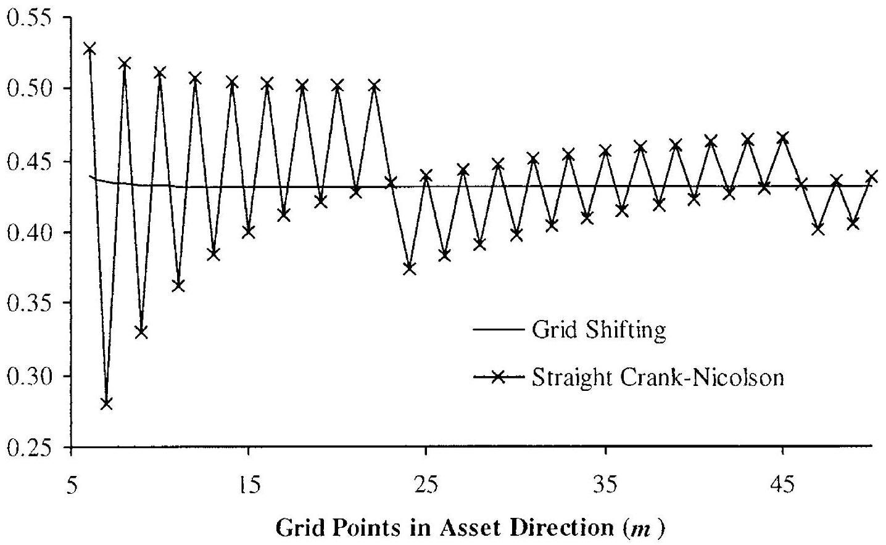
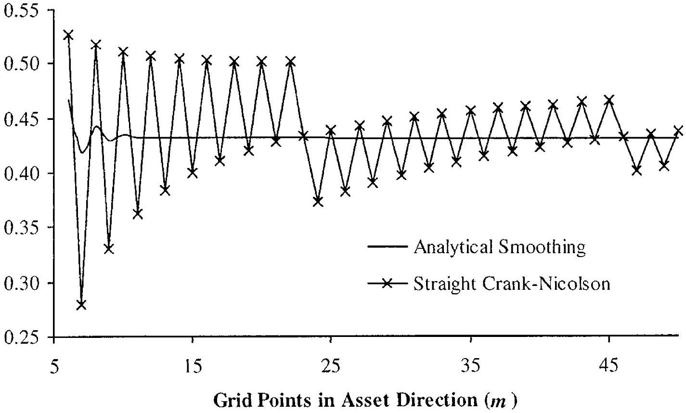

## Finite Difference Methods

In Chapter 1 we described how the pricing of a derivative security typically requires either the solution of a parabolic partial differential equation (PDE) or the evaluation of an expectation of a random variable. In realistic applications, both of these price formulations often do not allow for closed-form solution, in which case we must resort to either analytical approximations or, more generally, numerical techniques. In the next two chapters we will describe a number of numerical algorithms useful in derivatives pricing. Analytical approximations will receive ample treatment later in this book, in the context of specific problems.

Our treatment of numerical methods is broken into two main subjects. In this chapter, we cover finite difference solutions of PDEs; and in Chapter 3 we turn to Monte Carlo evaluation of expectations. Many excellent specialist books exist on both topics, including Mitchell and Griffiths [1980], Tavella and Randall [2000], and Glasserman [2004]; our treatment only surveys the most important concepts, as required for our needs in this book. We do provide, however, a number of schemes rarely described in detail in the finance literature and also supplement our analysis with a number of "tricks of the trade", particularly in the application of finite difference grids.

The analysis of numerical PDE solutions in this chapter is arranged in two blocks. First, in Sections 2.1-2.8 we study the basic mechanics of the finite difference grid method for one-dimensional PDEs. Subsequently, Sections 2.9-2.12 then apply operator splitting techniques to extend the finite difference method to PDE of dimensions two and higher. The analysis culminates with a presentation of ADI schemes for multi-dimensional PDEs with mixed partial derivatives.

### 2.1 1-Dimensional PDEs: Problem Formulation

Initially, we will consider the numerical solution of the general onedimensional terminal value PDE problem

$$
\begin{equation*}
\frac{\partial V}{\partial t}+\mathcal{L} V=0 \tag{2.1}
\end{equation*}
$$
^eq2-1

where $\mathcal{L}$ is the operator

$$
\mathcal{L}=\mu(t, x) \frac{\partial}{\partial x}+\frac{1}{2} \sigma(t, x)^{2} \frac{\partial^{2}}{\partial x^{2}}-r(t, x)
$$

and where $V=V(t, x)$ satisfies a terminal condition $V(T, x)=g(x)$. We recognize the PDE as being an extension of the Black-Scholes PDE (1.47) to general time- and state-dependent drift ( $\mu$ ), volatility ( $\sigma$ ), and interest rate ( $r$ ). Underneath the PDE lies a physical model where a state variable process $x(\cdot)$ follows an SDE of the form

$$
\begin{equation*}
d x(t)=\mu(t, x(t)) d t+\sigma(t, x(t)) d W(t) \tag{2.2}
\end{equation*}
$$
^eq2-2

where $W(t)$ is a Brownian motion in the risk-neutral probability measure Q . Let the range of values attainable by $x(t)$ on $t \in[0, T]$ be denoted $\mathcal{B} \subseteq \mathbb{R}$, and assume that the functions $\mu, \sigma, r:[0, T) \times \mathcal{B} \rightarrow \mathbb{R}$ are sufficiently regular to make (2.1) and (2.2) meaningful (see Chapter 1).

The terminal value problem above is, as discussed earlier, a Cauchy problem to be solved for $V(t, x)$ on $(t, x) \in[0, T) \times \mathcal{B}$. In many cases of practical interest, further boundary conditions are applied in the spatial $(x)$ domain. If such boundary conditions are expressed directly in terms of $V$ (rather than its derivatives) we have a Dirichlet boundary problem. For instance, a so-called up-and-out barrier option will pay out $g(x(T))$ at time $T$ if and only if $x(t)$ stays strictly below a contractually specified barrier level $H$ at all times $t \leq T$. If, on the other hand, $x(t)$ touches $H$ at any time during the life of the contract, it will expire worthless (or "knock out"). In this case, the PDE is only to be solved on $(t, x) \in[0, T) \times(\mathcal{B} \cap(-\infty, H))$ and is subject to the Dirichlet boundary condition

$$
V(t, H)=0, \quad t \in[0, T]
$$

which expresses that the option has no value for $x \geq H$. We note that it is not uncommon to encounter options where the spatial domain boundaries are functions of time, a situation we shall deal with in Section 2.7.1. Also, as we shall see shortly, sometimes boundary conditions are conveniently expressed in terms of derivatives of $V$.

For numerical solution of the PDE (2.1), we often need to assume that the domain of the state variable $x$ is finite, even in situations where (2.1) is supposed to hold for an infinite domain. Suitable truncation of the domain can often be done probabilistically, based on a confidence interval for $x(T)$. To illustrate the procedure, consider the Black-Scholes PDE (1.47) applied to a call option with strike $K$. A common first step is to use the transformation $x=\ln S$, such that the PDE has constant coefficients,

$$
\begin{equation*}
\frac{\partial V}{\partial t}+\left(r-\frac{1}{2} \sigma^{2}\right) \frac{\partial V}{\partial x}+\frac{1}{2} \sigma^{2} \frac{\partial^{2} V}{\partial x^{2}}-r V=0 \tag{2.3}
\end{equation*}
$$
^eq2-3

with terminal value (for a call option) $V(T, x)=\left(e^{x}-K\right)^{+}$. The domain of $x$ is here the entire real line, $\mathcal{B}=\mathbb{R}$. We know (from (1.39)) that

$$
\begin{equation*}
x(T)=x(0)+\left(r-\frac{1}{2} \sigma^{2}\right) T+\sigma(W(T)-W(0)) \tag{2.4}
\end{equation*}
$$
^eq2-4

which is a Gaussian random variable with mean $\bar{x}=x(0)+\left(r-\frac{1}{2} \sigma^{2}\right) T$ and variance $\sigma^{2} T$. Consider now replacing the domain $(-\infty, \infty)$ with the finite interval $[\bar{x}-\alpha \sigma \sqrt{T}, \bar{x}+\alpha \sigma \sqrt{T}]$ for some positive constant $\alpha$. The likelihood of $x(T)$ falling outside of this interval is easily seen to be $2 \Phi(-\alpha)$ (where, as always, $\Phi(z)$ is the standard Gaussian cumulative distribution function). If, say, we set $\alpha$ to $4,2 \Phi(-\alpha)=6.3 \times 10^{-5}$, which is an insignificant probability for most applications. Larger (smaller) values of $\alpha$ will make the truncation error smaller (larger) and will ultimately require more (less) effort in a numerical scheme. We recommend values of $\alpha$ somewhere between 3 and 5 for most applications. For the Black-Scholes case, a rigorous estimate of the error imposed by domain truncation is given in Kangro and Nicolaides [2000].

In many cases of practical interest, it is not possible to write down an exact confidence interval for $x(T)$. In such cases, one instead may use an approximate confidence interval, found by, for instance, using "average" values for $\mu(t, x)$ and $\sigma(t, x)$. High precision in these estimates is typically not needed.

### 2.2 Finite Difference Discretization

In order to solve the PDE (2.1) numerically, we now wish to discretize it on the rectangular domain $(t, x) \in[0, T] \times[\underline{M}, \bar{M}]$, where $\bar{M}$ and $\underline{M}$ are finite constants, possibly found by a truncation procedure such as the one outlined above. We first introduce two equidistant ${ }^{1}$ grids $\left\{t_{i}\right\}_{i=0}^{n}$ and $\left\{x_{j}\right\}_{j=0}^{m+1}$ where $t_{i}=i T / n \triangleq i \Delta_{t}, i=0,1, \ldots, n$, and $x_{j}=\underline{M}+j(\bar{M}-\underline{M}) /(m+1) \triangleq \underline{M}+j \Delta_{x}$, $j=0,1, \ldots, m+1$. The terminal value $V(T, x)=g(x)$ is imposed at $t_{n}=T$, and spatial boundary conditions are imposed at $x_{0}$ and $x_{m+1}$.

### 2.2.1 Discretization in $x$-Direction. Dirichlet Boundary Conditions

We first focus on the spatial operator $\mathcal{L}$ and restrict $x$ to take values in the interior of the spatial grid $x \in\left\{x_{j}\right\}_{j=1}^{m}$. Consider replacing the firstand second-order partial derivatives with first- and second-order difference operators:[^15]

$$
\begin{gather*}
\delta_{x} V\left(t, x_{j}\right) \triangleq \frac{V\left(t, x_{j+1}\right)-V\left(t, x_{j-1}\right)}{2 \Delta_{x}}  \tag{2.5}\\
\delta_{x x} V\left(t, x_{j}\right) \triangleq \frac{V\left(t, x_{j+1}\right)+V\left(t, x_{j-1}\right)-2 V\left(t, x_{j}\right)}{\Delta_{x}^{2}} \tag{2.6}
\end{gather*}
$$
^eq2-5
^eq2-6

These operators are accurate to second order. Formally ${ }^{2}$,

## Lemma 2.2.1.

$$
\begin{aligned}
\delta_{x} V\left(t, x_{j}\right) & =\frac{\partial V\left(t, x_{j}\right)}{\partial x}+O\left(\Delta_{x}^{2}\right) \\
\delta_{x x} V\left(t, x_{j}\right) & =\frac{\partial^{2} V\left(t, x_{j}\right)}{\partial x^{2}}+O\left(\Delta_{x}^{2}\right)
\end{aligned}
$$

Proof. A Taylor expansion of $V(t, x)$ around the point $x=x_{j}$ gives

$$
\begin{aligned}
V\left(t, x_{j+1}\right)=V\left(t, x_{j}\right)+ & \Delta_{x} \frac{\partial V\left(t, x_{j}\right)}{\partial x} \\
& +\frac{1}{2} \Delta_{x}^{2} \frac{\partial^{2} V\left(t, x_{j}\right)}{\partial x^{2}}+\frac{1}{6} \Delta_{x}^{3} \frac{\partial^{3} V\left(t, x_{j}\right)}{\partial x^{3}}+O\left(\Delta_{x}^{4}\right)
\end{aligned}
$$

and

$$
\begin{aligned}
V\left(t, x_{j-1}\right)=V\left(t, x_{j}\right)- & \Delta_{x} \frac{\partial V\left(t, x_{j}\right)}{\partial x} \\
& +\frac{1}{2} \Delta_{x}^{2} \frac{\partial^{2} V\left(t, x_{j}\right)}{\partial x^{2}}-\frac{1}{6} \Delta_{x}^{3} \frac{\partial^{3} V\left(t, x_{j}\right)}{\partial x^{3}}+O\left(\Delta_{x}^{4}\right)
\end{aligned}
$$

Insertion of these expressions into (2.5) and (2.6) gives the desired result.
In other words, if we introduce the discrete operator

$$
\widehat{\mathcal{L}}=\mu(t, x) \delta_{x}+\frac{1}{2} \sigma(t, x)^{2} \delta_{x x}-r(t, x)
$$

we have, for $x \in\left\{x_{j}\right\}_{j=1}^{m}$,

$$
\mathcal{L} V(t, x)=\widehat{\mathcal{L}} V(t, x)+O\left(\Delta_{x}^{2}\right)
$$

With attention restricted to values on the grid $\left\{x_{j}\right\}_{j=1}^{m}$, we can view $\widehat{\mathcal{L}}$ as a matrix, once we specify the side boundary conditions at $x_{0}$ and $x_{m+1}$. For the Dirichlet case, assume for instance that

$$
V\left(x_{0}, t\right)=\underline{f}\left(t, x_{0}\right), \quad V\left(x_{m+1}, t\right)=\bar{f}\left(t, x_{m+1}\right)
$$

[^16]for given functions $\underline{f}, \bar{f}:[0, T] \times \mathbb{R} \rightarrow \mathbb{R}$. With $^{3} \mathbf{V}(t) \triangleq \left(V\left(t, x_{1}\right), \ldots, V\left(t, x_{m}\right)\right)^{\bar{\top}}$ and, for $j=1, \ldots, m$,

$$
\begin{align*}
c_{j}(t) & \triangleq-\sigma\left(t, x_{j}\right)^{2} \Delta_{x}^{-2}-r\left(t, x_{j}\right)  \tag{2.7}\\
u_{j}(t) & \triangleq \frac{1}{2} \mu\left(t, x_{j}\right) \Delta_{x}^{-1}+\frac{1}{2} \sigma\left(t, x_{j}\right)^{2} \Delta_{x}^{-2}  \tag{2.8}\\
l_{j}(t) & \triangleq-\frac{1}{2} \mu\left(t, x_{j}\right) \Delta_{x}^{-1}+\frac{1}{2} \sigma\left(t, x_{j}\right)^{2} \Delta_{x}^{-2} \tag{2.9}
\end{align*}
$$
^eq2-7
^eq2-8
^eq2-9
we can write

$$
\begin{equation*}
\widehat{\mathcal{L}} \mathbf{V}(t)=\mathbf{A}(t) \mathbf{V}(t)+\mathbf{\Omega}(t) \tag{2.10}
\end{equation*}
$$
^eq2-10
where $\mathbf{A}$ is a tri-diagonal matrix

$$
\mathbf{A}(t)=\left(\begin{array}{ccccccc}
c_{1}(t) & u_{1}(t) & 0 & 0 & 0 & \ldots & 0  \tag{2.11}\\
l_{2}(t) & c_{2}(t) & u_{2}(t) & 0 & 0 & \ldots & 0 \\
0 & l_{3}(t) & c_{3}(t) & u_{3}(t) & 0 & \ldots & 0 \\
0 & 0 & l_{4}(t) & c_{4}(t) & u_{4}(t) & \ldots & 0 \\
\vdots & \vdots & \vdots & \ddots & \ddots & \ddots & 0 \\
0 & 0 & 0 & 0 & l_{m-1}(t) & c_{m-1}(t) & u_{m-1}(t) \\
0 & 0 & 0 & 0 & 0 & l_{m}(t) & c_{m}(t)
\end{array}\right)
$$
^eq2-11
and $\Omega(t)$ is a vector containing boundary values

$$
\Omega(t)=\left(\begin{array}{c}
l_{1}(t) \underline{f}\left(t, x_{0}\right) \\
0 \\
\vdots \\
0 \\
u_{m}(t) \bar{f}\left(t, x_{m+1}\right)
\end{array}\right) .
$$

As discussed earlier, sometimes one or both of the functions $\bar{f}$ and $\underline{f}$ are explicitly imposed as part of the option specification (as is the case for a knock-out options). In other cases, asymptotics may be necessary to establish these functions. For instance, for the case of a simple call option on a stock paying no dividends, we can set

$$
\begin{aligned}
& \bar{f}(t, x)=e^{x}-K e^{-r(T-t)} \\
& \underline{f}(t, x)=0
\end{aligned}
$$

where we, as before, have set $x=\ln S$ ( $S$ being the stock price) and assumed that the strike $K$ is positive. The result for $\underline{f}$ is obvious; the result for $\bar{f}$ follows from the fact that a deep in-the-money call option will almost certainly pay at maturity the stock (the present value of which is just $S=e^{x}$ ) minus the strike (the present value of which is $\left.K e^{-r(T-t)}\right)$.

[^17]
### 2.2.2 Other Boundary Conditions

Deriving asymptotic Dirichlet conditions can be quite involved for complicated option payouts and is often inconvenient in implementations. Rather than having to perform an asymptotic analysis for each and every type of option payout, it would be preferable to have a general-purpose mechanism for specifying the boundary condition. One common idea involves making assumptions on the form of the functional dependency between $V$ and $x$ at the grid boundaries, often from specification of relationships between spatial derivatives. For instance, if we impose the condition that the second derivative of $V$ is zero at the upper boundary $\left(x_{m+1}\right)$ - that is, $V$ is a linear function of $x$ - we can write (effectively using a downward discretization of the second derivative)

$$
\begin{aligned}
\frac{V\left(t, x_{m+1}\right)+V\left(t, x_{m-1}\right)-2 V\left(t, x_{m}\right)}{\Delta_{x}^{2}} & =0 \\
& \Rightarrow V\left(t, x_{m+1}\right)=2 V\left(t, x_{m}\right)-V\left(t, x_{m-1}\right) .
\end{aligned}
$$

A similar assumption at the lower spatial boundary yields

$$
V\left(t, x_{0}\right)=2 V\left(t, x_{1}\right)-V\left(t, x_{2}\right) .
$$

For PDEs discretized in the logarithm of some asset, it may be more natural to assume that $V(t, x) \propto e^{x}$ at the boundaries; equivalently, we can assume that $\partial V / \partial x=\partial^{2} V / \partial x^{2}$ at the boundary. When discretized in downward fashion at the upper boundary ( $x_{m+1}$ ), this implies that

$$
\frac{V\left(t, x_{m+1}\right)-V\left(t, x_{m}\right)}{\Delta_{x}}=\frac{V\left(t, x_{m+1}\right)+V\left(t, x_{m-1}\right)-2 V\left(t, x_{m}\right)}{\Delta_{x}^{2}}
$$

or (assuming that $\Delta_{x} \neq 1$ )

$$
V\left(t, x_{m+1}\right)=V\left(t, x_{m-1}\right) \frac{1}{\Delta_{x}-1}+V\left(t, x_{m}\right) \frac{\Delta_{x}-2}{\Delta_{x}-1}
$$

Similarly,

$$
V\left(t, x_{0}\right)=V\left(t, x_{1}\right) \frac{2+\Delta_{x}}{1+\Delta_{x}}-V\left(t, x_{2}\right) \frac{1}{\Delta_{x}+1}
$$

Common for both methods above - and for the Dirichlet specification discussed earlier - is that they give rise to boundary specifications through simple linear systems of the general form

$$
\begin{align*}
V\left(t, x_{m+1}\right) & =k_{m}(t) V\left(t, x_{m}\right)+k_{m-1}(t) V\left(t, x_{m-1}\right)+\bar{f}\left(t, x_{m+1}\right)  \tag{2.12}\\
V\left(t, x_{0}\right) & =k_{1}(t) V\left(t, x_{1}\right)+k_{2}(t) V\left(t, x_{2}\right)+\underline{f}\left(t, x_{0}\right) \tag{2.13}
\end{align*}
$$
^eq2-12
^eq2-13

This boundary specification can be captured in the matrix system (2.10) by simply rewriting a few components of $\mathbf{A}(t)$; specifically, we must set

$$
\begin{aligned}
c_{m}(t) & =-\sigma\left(t, x_{m}\right)^{2} \Delta_{x}^{-2}-r\left(t, x_{m}\right)+k_{m}(t) u_{m}(t) \\
l_{m}(t) & =-\frac{1}{2} \mu\left(t, x_{m}\right) \Delta_{x}^{-1}+\frac{1}{2} \sigma\left(t, x_{m}\right)^{2} \Delta_{x}^{-2}+k_{m-1}(t) u_{m}(t) \\
c_{1}(t) & =-\sigma\left(t, x_{j}\right)^{2} \Delta_{x}^{-2}-r\left(t, x_{j}\right)+k_{1}(t) l_{1}(t) \\
u_{1}(t) & =\frac{1}{2} \mu\left(t, x_{1}\right) \Delta_{x}^{-1}+\frac{1}{2} \sigma\left(t, x_{1}\right)^{2} \Delta_{x}^{-2}+k_{2}(t) l_{1}(t)
\end{aligned}
$$

All other components of $\mathbf{A}$ remain as in (2.11); note that $\mathbf{A}$ remains tridiagonal.

An alternative approach to specification of boundary conditions in the $x$-domain involves using the PDE itself to determine the boundary conditions, through replacement of all central difference operators with one-sided differences at the boundaries. Section 10.1.5.2 contains a detailed example of this idea; ultimately, this approach leads to boundary conditions that can also be written in the form (2.12)-(2.13).

### 2.2.3 Time-Discretization

To simplify notation, assume for now that $\Omega(t)=0$ for all $t$, as will be the case if, say, we use the linear or linear-exponential boundary conditions outlined earlier. On the spatial grid, our original PDE can be written

$$
\frac{\partial \mathbf{V}(t)}{\partial t}=-\mathbf{A}(t) \mathbf{V}(t)+O\left(\Delta_{x}^{2}\right)
$$

which, ignoring the error term ${ }^{4}$, defines a system of coupled ordinary differential equations (ODEs).

A number of methods are available for the numerical solution of coupled ODEs; see, e.g., Press et al. [1992]. We here only consider basic two-level time-stepping schemes, where grid computations at time $t_{i}$ involve only PDE values at times $t_{i}$ and $t_{i+1}$. Focusing the attention on a particular bucket $\left[t_{i}, t_{i+1}\right]$, the choice for the finite difference approximation of $\partial V / \partial t$ is obvious:

$$
\frac{\partial \mathbf{V}}{\partial t} \approx \frac{\mathbf{V}\left(t_{i+1}\right)-\mathbf{V}\left(t_{i}\right)}{\Delta_{t}} .
$$

Not so obvious, however, is to which time in the interval $\left[t_{i}, t_{i+1}\right]$ we should associate this derivative. To be general, consider picking a time $t_{i}^{i+1}(\theta) \in \left[t_{i}, t_{i+1}\right]$, given by

$$
\begin{equation*}
t_{i}^{i+1}(\theta)=(1-\theta) t_{i+1}+\theta t_{i} \tag{2.14}
\end{equation*}
$$
^eq2-14

where $\theta \in[0,1]$ is a parameter. We then write

$$
\frac{\partial \mathbf{V}\left(t_{i}^{i+1}(\theta)\right)}{\partial t} \approx \frac{\mathbf{V}\left(t_{\imath+1}\right)-\mathbf{V}\left(t_{i}\right)}{\Delta_{t}}
$$

[^18]By a Taylor expansion, it is easy to see that this expression is first-order accurate in the time step when $\theta \neq \frac{1}{2}$, and second-order accurate when $\theta=\frac{1}{2}$. Written compactly,

$$
\begin{equation*}
\frac{\partial \mathbf{V}\left(t_{i}^{i+1}(\theta)\right)}{\partial t}=\frac{\mathbf{V}\left(t_{i+1}\right)-\mathbf{V}\left(t_{i}\right)}{\Delta_{t}}+1_{\left\{\theta \neq \frac{1}{2}\right\}} O\left(\Delta_{t}\right)+O\left(\Delta_{t}^{2}\right) \tag{2.15}
\end{equation*}
$$
^eq2-15

This result on the convergence order is intuitive since only in the case $\theta=\frac{1}{2}$ is the difference coefficient precisely central; for all other cases, the difference coefficient is either predominantly backward in time or predominantly forward in time.

The time-discretization technique introduced above is known as a theta scheme. The special cases of $\theta=1, \theta=0$, and $\theta=\frac{1}{2}$ are known as the fully implicit scheme, the fully explicit scheme, and the Crank-Nicolson scheme, respectively. In light of the convergence result (2.15), one may wonder why anything other than the Crank-Nicolson scheme is ever used. The CN method is, indeed, often the method of choice, but there are situations where a straight application of the Crank-Nicolson scheme can lead to oscillations in the numerical solution or its spatial derivatives. Judicial application of the fully implicit method can often alleviate these problems, as we shall discuss later. The fully explicit method should never be used due to poor convergence and stability properties (see Section 2.3), but has nevertheless managed to survive in a surprisingly large number of finance texts and papers.

### 2.2.4 Finite Difference Scheme

We now proceed to combine the discretizations (2.10) and (2.15) into a complete finite difference scheme. First, we expand

$$
\begin{aligned}
\mathbf{A}\left(t_{i}^{i+1}(\theta)\right) \mathbf{V} & \left(t_{i}^{i+1}(\theta)\right)=\theta \mathbf{A}\left(t_{i}^{i+1}(\theta)\right) \mathbf{V}\left(t_{i}\right) \\
& +(1-\theta) \mathbf{A}\left(t_{i}^{i+1}(\theta)\right) \mathbf{V}\left(t_{i+1}\right)+1_{\left\{\theta \neq \frac{1}{2}\right\}} O\left(\Delta_{t}\right)+O\left(\Delta_{t}^{2}\right)
\end{aligned}
$$

such that our PDE can be represented as

$$
\begin{aligned}
\frac{\mathbf{V}\left(t_{i+1}\right)-\mathbf{V}\left(t_{i}\right)}{\Delta_{t}} & +1_{\left\{\theta \neq \frac{1}{2}\right\}} O\left(\Delta_{t}\right)+O\left(\Delta_{t}^{2}\right) \\
= & -\mathbf{A}\left(t_{i}^{i+1}(\theta)\right) \mathbf{V}\left(t_{i}^{i+1}(\theta)\right)+O\left(\Delta_{x}^{2}\right) \\
= & -\theta \mathbf{A}\left(t_{i}^{i+1}(\theta)\right) \mathbf{V}\left(t_{2}\right)-(1-\theta) \mathbf{A}\left(t_{i}^{i+1}(\theta)\right) \mathbf{V}\left(t_{i+1}\right) \\
& +1_{\left\{\theta \neq \frac{1}{2}\right\}} O\left(\Delta_{t}\right)+O\left(\Delta_{t}^{2}\right)+O\left(\Delta_{x}^{2}\right)
\end{aligned}
$$

Multiplying through with $\Delta_{t}$ gives rise to the complete finite difference representation of the PDE solution at times $t_{i}$ and $t_{i+1}$ :

Proposition 2.2.2. On the grid $\left\{x_{j}\right\}_{j=1}^{m}$, the solution to (2.1) at times $t_{i}$ and $t_{i+1}$ is characterized by

$$
\begin{equation*}
\left(\mathbf{I}-\theta \Delta_{t} \mathbf{A}\left(t_{i}^{i+1}(\theta)\right)\right) \mathbf{V}\left(t_{i}\right)=\left(\mathbf{I}+(I-\theta) \Delta_{t} \mathbf{A}\left(t_{i}^{i+1}(\theta)\right)\right) \mathbf{V}\left(t_{i+1}\right)+e_{i}^{i+1} \tag{2.16}
\end{equation*}
$$
^eq2-16

where $\mathbf{I}$ is the $m \times m$ identity matrix, and $e_{i}^{i+1}$ is an error term

$$
\begin{equation*}
e_{i}^{i+1}=\Delta_{t} O\left(\Delta_{x}^{2}\right)+1_{\left\{\theta \neq \frac{1}{2}\right\}} O\left(\Delta_{t}^{2}\right)+O\left(\Delta_{t}^{3}\right) \tag{2.17}
\end{equation*}
$$
^eq2-17

Let $\widehat{V}\left(t_{i}, x_{j}\right)$ denote the approximation to the true solution $V\left(t_{i}, x_{j}\right)$ obtained by using (2.16) without the error term. Defining

$$
\widehat{\mathrm{V}}(t)=\left(\widehat{V}\left(t, x_{1}\right), \ldots, \widehat{V}\left(t, x_{m}\right)\right)^{\top}
$$

we have

$$
\begin{equation*}
\left(\mathbf{I}-\theta \Delta_{t} \mathbf{A}\left(t_{i}^{i+1}(\theta)\right)\right) \hat{\mathbf{V}}\left(t_{i}\right)=\left(\mathbf{I}+(1-\theta) \Delta_{t} \mathbf{A}\left(t_{i}^{i+1}(\theta)\right)\right) \widehat{\mathbf{V}}\left(t_{i+1}\right) \tag{2.18}
\end{equation*}
$$
^eq2-18

For a known value of $\widehat{\mathbf{V}}\left(t_{i+1}\right)$, (2.18) defines a simple linear system of equations that can be solved for $\widehat{\mathrm{V}}\left(t_{i}\right)$ by standard methods. Simplifying matters is the fact that the matrix $\left(\mathbf{I}-\theta \Delta_{t} \mathbf{A}\left(t_{i}^{i+1}(\theta)\right)\right)$ is tri-diagonal, allowing us to solve (2.18) in only $O(m)$ operations; see Press et al. [1992] for an algorithm ${ }^{5}$.

Starting from the prescribed terminal condition $V\left(t_{n}, x_{\jmath}\right)=g\left(x_{j}\right), j= 1, \ldots, m$, we can now use (2.18) to iteratively step backward in time until we ultimately recover $\widehat{\mathrm{V}}(0)$. This procedure is known as backward induction.

Proposition 2.2.3. The theta scheme (2.18) recovers $\widehat{\mathbf{V}}(0)$ in $O(m n)$ operations. If the scheme converges, the error on $\widehat{\mathrm{V}}(0)$ compared to the exact solution $\mathbf{V}(0)$ is of order

$$
O\left(\Delta_{x}^{2}\right)+1_{\left\{\theta \neq \frac{1}{2}\right\}} O\left(\Delta_{t}\right)+O\left(\Delta_{t}^{2}\right)
$$

Proof. The backward induction algorithm requires the solution of $n$ tridiagonal systems, one per time step, for a total computational cost of $O(m n)$. The local truncation error on $\widehat{\mathrm{V}}\left(t_{i}\right)$ is $e_{i}^{i+1}$, making the global truncation error after $n$ time steps of order $n e_{i}^{i+1}$. Combining (2.17) with the fact that $n=T / \Delta_{t}=O\left(\Delta_{t}^{-1}\right)$ gives the order result listed in the proposition.

[^19]It follows from Proposition 2.2.3 that the Crank-Nicolson scheme is second-order convergent in the time step, and all other theta schemes are first-order convergent in the time step. All theta-schemes are second-order convergent in the spatial step $\Delta_{x}$.

In deriving (2.18), we assumed earlier that the boundary vector was zero, $\boldsymbol{\Omega}(t)=0$. Including a non-zero boundary vector into the scheme is, however, straightforward and results in a time-stepping scheme of the form

$$
\begin{align*}
\left(\mathbf{I}-\theta \Delta_{t} \mathbf{A}\left(t_{i}^{i+1}(\theta)\right)\right) \widehat{\mathbf{V}}\left(t_{i}\right)=(\mathbf{I}+(1- & \left.\theta) \Delta_{t} \mathbf{A}\left(t_{i}^{i+1}(\theta)\right)\right) \widehat{\mathbf{V}}\left(t_{i+1}\right) \\
& +(1-\theta) \boldsymbol{\Omega}\left(t_{i+1}\right)+\theta \boldsymbol{\Omega}\left(t_{i}\right) \tag{2.19}
\end{align*}
$$
^eq2-19

Again, this system is easily solved for $\widehat{\mathbf{V}}\left(t_{i}\right)$ by a standard tri-diagonal equation solver.

As a final point, we stress that the finite difference scheme above ultimately yields a full vector of values $\widehat{\mathbf{V}}(0)$ at time 0 , with one element per value of $x_{j}, j=1, \ldots, m$. In general, we are mainly interested in $V(0, x(0))$, where $x(0)$ is the known value of $x$ at time 0 . There is no need to include $x(0)$ in the grid, as we can simply employ an interpolator (e.g., a cubic spline) on this vector $\widehat{\mathrm{V}}(0)$ to compute $V(0, x(0))$. Clearly, such an interpolator should be at least second-order accurate to avoid interfering with the overall $O\left(\Delta_{x}^{2}\right)$ convergence of the finite difference scheme. Assuming the interpolator is sufficiently smooth, we can also use it to compute various partial derivatives with respect to $x$ that we may be interested in. Alternatively, these can be computed by the same type of finite difference coefficients discussed in Section 2.2.1. The derivative $\partial V(0, x(0)) / \partial t$ - the time decay - can be picked up from the grid in the same fashion.

Remark 2.2.4. The scheme (2.18) may, without affecting convergence order, be replaced with

$$
\left(\mathbf{I}-\theta \Delta_{t} \mathbf{A}\left(t_{i}\right)\right) \widehat{\mathbf{V}}\left(t_{i}\right)=\left(\mathbf{I}+(1-\theta) \Delta_{t} \mathbf{A}\left(t_{i+1}\right)\right) \widehat{\mathbf{V}}\left(t_{i+1}\right)
$$

### 2.3 Stability

### 2.3.1 Matrix Methods

Ignoring the contributions from boundary conditions, the finite difference scheme developed in the previous section can be rewritten

$$
\begin{equation*}
\widehat{\mathbf{V}}\left(t_{i}\right)=\mathbf{B}_{i}^{i+1} \widehat{\mathbf{V}}\left(t_{i+1}\right), \tag{2.20}
\end{equation*}
$$
^eq2-20

where

$$
\mathbf{B}_{i}^{i+1} \triangleq\left(\mathbf{I}-\theta \Delta_{t} \mathbf{A}\left(t_{i}^{i+1}(\theta)\right)\right)^{-1}\left(\mathbf{I}+(1-\theta) \Delta_{t} \mathbf{A}\left(t_{i}^{i+1}(\theta)\right)\right)
$$

That is, for any $0 \leq k<n$,

$$
\widehat{\mathrm{V}}\left(t_{k}\right)=\mathbf{B}_{k}^{n} \widehat{\mathrm{~V}}\left(t_{n}\right), \mathbf{B}_{k}^{n} \triangleq \mathbf{B}_{k}^{k+1} \mathbf{B}_{k+1}^{k+2} \ldots \mathbf{B}_{n-1}^{n}
$$

We say that the scheme is stable if $\left|\widehat{\mathrm{V}}\left(t_{k}\right)\right|$ is bounded for all $0 \leq k<n$. Assuming $|\widehat{\mathrm{V}}(T)|<\infty$, a necessary and sufficient condition for stability is that there exists a constant $K$ such that for all $0 \leq k<n$

$$
\begin{equation*}
\left|\mathbf{B}_{k}^{n}\right| \leq K, \tag{2.21}
\end{equation*}
$$
^eq2-21

where $|\cdot|$ is any matrix norm, e.g. the spectral norm or the infinity norm ${ }^{6}$. See Mitchell and Griffiths [1980] for further details.

### 2.3.2 Von Neumann Analysis

For simple problems with time- and space-independent coefficients, it may be possible to establish the spectral norm of $\mathbf{B}_{k}^{n}$ by direct methods (see e.g. Mitchell and Griffiths [1980], Kraaijevanger et al. [1987], Lenferink and Spijker [1991], Spijker and Straetemans [1997]), but generally the stability criterion (2.21) is difficult to evaluate. While certain somewhat simpler matrix-based methods exist to establish necessary conditions for stability (again, see Mitchell and Griffiths [1980]), we shall here only consider a "local" method, known as the von Neumann method. In principle, the von Neumann method only holds for finite difference schemes where the underlying PDE has constant coefficients, but there is much numerical evidence to support wider application ${ }^{7}$. The von Neumann method does not directly consider the effect of boundary conditions on stability, but (for constant coefficient problems) provides a necessary condition for stability irrespective of the type of boundary condition.

The basis for the von Neumann analysis is the observation that a real function sampled on a finite number of points is uniquely defined by a complex Fourier series. For our PDE solution sampled on the spatial grid, the precise result is

$$
V\left(t_{k}, x_{j}\right)=\sum_{l} H_{l}\left(t_{k}\right) e^{-i \omega_{l} j \Delta_{x}}
$$

where $H_{l}\left(t_{k}\right)$ and $\omega_{l}$ are the amplification factor (discrete Fourier transform) and wave number for the $l$-th mode, respectively. Notice that $i$ here denotes

[^20]the imaginary unit, $i^{2}=-1$, with $k$ (momentarily) having taken the role of the time index in the finite difference grid. For the constant coefficient case, a key fact for our PDE problem is that

$$
H_{l}\left(t_{k}\right)=H_{l}\left(t_{k+1}\right) \xi_{l}^{-1}
$$
where $\xi_{l}$ is a mode-specific amplification factor independent of time. To determine how a solution is propagated back through the finite difference grid, it thus suffices to consider a test function of the form

$$
\begin{equation*}
v\left(t_{k}, x_{j}\right)=\xi(\omega)^{n-k} e^{i \omega j \Delta_{i}} \tag{2.22}
\end{equation*}
$$
^eq2-22

According to the Von Neumann criterion, stability of (2.20) requires that the modulus of the amplification factor $\xi(\omega)$ is less or equal to one, independent of the wave number:

$$
\begin{equation*}
\forall \omega:|\xi(\omega)| \leq 1 \tag{2.23}
\end{equation*}
$$
^eq2-23

This criterion is natural and merely expresses that all eigenmodes should be dampened, and not exponentially amplified, by the finite difference scheme.

Turning to our system (2.20), assume for simplicity that $r(t, x)=0$. A positive interest rate (we will nearly always have $r(t, x)>0$ ) introduces some extra dampening through discounting effects and will, if anything, lead to better stability properties than the case of zero interest rates. Writing $v\left(t_{k}, x_{j}\right)=v_{k, j}, \sigma\left(t_{k}^{k+1}(\theta), x_{j}\right)=\sigma_{k, j}$, and $\mu\left(t_{k}^{k+1}(\theta), x_{j}\right)=\mu_{k, j}$, the von Neumann analysis gives the following result:

Proposition 2.3.1. Define $\alpha=\Delta_{t} /\left(\Delta_{x}\right)^{2}$. For (2.20) with $r(t, x)=0$, the von Neumann stability criterion is

$$
\begin{equation*}
1 \geq \theta \geq \frac{1}{2}-\frac{1}{\alpha}\left(\frac{\sigma_{k, j}^{2}}{\sigma_{k, j}^{4}+\mu_{k, j}^{2} \Delta_{x}^{2}+\left|\mu_{k, j}^{2} \Delta_{x}^{2}-\sigma_{k, j}^{4}\right|}\right) \tag{2.24}
\end{equation*}
$$
^eq2-24

to hold for all $k=0,1, \ldots, n-1, j=1,2, \ldots, m$.
Proof. Define $\varsigma_{k, j}^{ \pm}=\sigma_{k, j}^{2} \pm \Delta_{x} \mu_{k, j}$. A local application of (2.20) gives

$$
\begin{gathered}
v_{k, j-1}\left(-\frac{\alpha \theta}{2} \varsigma_{k, j}^{-}\right)+v_{k, j}\left(1+\alpha \theta \sigma_{k, j}^{2}\right)+v_{k, j+1}\left(-\frac{\alpha \theta}{2} \varsigma_{k, j}^{+}\right)= \\
v_{k+1, j}\left(\frac{\alpha(1-\theta)}{2} \varsigma_{k, j}^{-}\right)+v_{k+1, j}\left(1-\alpha(1-\theta) \sigma_{k, j}^{2}\right)+v_{k+1, j+1}\left(\frac{\alpha(1-\theta)}{2} \varsigma_{k, j}^{+}\right)
\end{gathered}
$$

with $\alpha$ defined above. Inserting (2.22) and rearranging (using Euler's formulas for $\sin$ and $\cos$ ) yields

$$
\xi(\omega)=\frac{1-(1-\theta) \alpha \sigma_{k, j}^{2}\left(1-\cos \omega \Delta_{x}\right)+i(1-\theta) \alpha \Delta_{x} \mu_{k, j} \sin \omega \Delta_{x}}{1+\theta \alpha \sigma_{k, j}^{2}\left(1-\cos \omega \Delta_{x}\right)-i \theta \alpha \Delta_{x} \mu_{k, j} \sin \omega \Delta_{x}}
$$

Note that $\xi$ is a function of $k$ and $j$, due to the non-constant PDE parameters. As discussed earlier (see also Mitchell and Griffiths [1980]), we expect the system to be stable if the criterion (2.23) holds for all $k$ and $j$ in the grid. Computing the modulus of $\xi$ and requiring that it does not exceed one leads, after straightforward manipulations, to the stability criterion

$$
\forall \omega: 2 \alpha \sigma_{k, j}^{2}+(2 \theta-1) \alpha^{2}\left[\sigma_{k, j}^{4}+\mu_{k, j}^{2} \Delta_{x}^{2}+\cos \omega \Delta_{x}\left(\mu_{k, j}^{2} \Delta_{x}^{2}-\sigma_{k, j}^{4}\right)\right] \geq 0
$$

As $\cos \omega \Delta_{x} \in[-1,1]$, this expression can be simplified to (2.24).
From (2.24) we can immediately conclude that the finite difference scheme is always stable if $\frac{1}{2} \leq \theta \leq 1$, irrespective of the magnitudes of $\Delta_{x}$ and $\Delta_{t}$. For $\frac{1}{2} \leq \theta \leq 1$, we therefore say that the theta scheme is absolutely stable, or simply $A$-stable. Both the fully implicit $(\theta=1)$ and the Crank-Nicolson $\left(\theta=\frac{1}{2}\right)$ finite difference schemes are thus $A$-stable. For the explicit scheme ( $\theta=0$ ), however, stability is conditional, requiring

$$
\frac{2}{\alpha} \sigma_{k, j}^{2} \geq \sigma_{k, j}^{4}+\mu_{k, j}^{2} \Delta_{x}^{2}+\left|\mu_{k, j}^{2} \Delta_{x}^{2}-\sigma_{k, j}^{4}\right|
$$

For small drifts, this expression amounts to the restriction $\sigma_{k, j}^{2} \leq \Delta_{x}^{2} / \Delta_{t}$ which can be quite onerous, often requiring the (laborious) use of thousands of time steps in the finite difference grid. We shall not consider fully explicit methods any further in this book.

Returning to the case $\frac{1}{2} \leq \theta \leq 1$, let us introduce a stronger definition of stability. A time-stepping method is said to be strongly $A$-stable if the modulus of the amplification factor $\xi$ is strictly below 1 for any value of the time step, including the limit ${ }^{8} \Delta_{t} \rightarrow \infty$. From (2.24), we see that if $\Delta_{t} \rightarrow \infty$ (which implies $\alpha \rightarrow \infty$ ), then the modulus of the amplification factor could reach 1 in the special case of $\theta=1 / 2$. In other words, the Crank-Nicolson scheme is not strongly $A$-stable. For large time steps, harmonics in the CrankNicolson finite difference solution will effectively not be dampened from one time step to the next, opening up the possibility that unwanted highfrequency oscillations can creep into the numerical solution. In practice, this is primarily a problem if high-frequency eigenmodes have high amplification factors, as can happen if there is an outright discontinuity in the terminal value function $g$. The problem is especially noticeable if the discontinuity in the value function is "close" in both time and space to $t=0$ and $x=x(0)$ (as would be the case for a short-dated option with a discontinuity close to the starting value of $x$ ). Oscillations can be prevented by setting the time step smaller than twice the maximum stable explicit time step (see Tavella and Randall [2000]), but this can often be computationally expensive. We shall deal with other methods to suppress oscillations in Section 2.5.

We conclude this section by noting a deep connection between the stability of a finite difference scheme and its convergence to the true solution

[^21]of the PDE as $\Delta_{t} \rightarrow 0$ and $\Delta_{x} \rightarrow 0$. First, we define a finite difference scheme to be consistent if local (Taylor) truncation errors approach zero for $\Delta_{t} \rightarrow 0$ and $\Delta_{x} \rightarrow 0$. All the schemes we have encountered so far are consistent. Further, define a finite difference scheme to be convergent if the difference between the numerical solution and the exact PDE solution at a fixed point in the domain converges to zero uniformly as $\Delta_{t} \rightarrow 0$ and $\Delta_{x} \rightarrow 0$ (not necessarily independently of each other). We then have

Theorem 2.3.2 (Lax Equivalence Theorem). For a well-posed ${ }^{9}$ linear terminal value PDE, a consistent 2-level finite difference scheme is convergent if and only if it is stable.

A more precise statement of the above result, as well as a proof, can be found in Mitchell and Griffiths [1980].

### 2.4 Non-Equidistant Discretization

In practice, we often wish to align the finite difference grid to particular dates (e.g., those on which a coupon or a dividend is paid) and particular values of $x$ (e.g., those on which strikes and barriers are positioned). Also, for numerical reasons we may want to make certain important parts of the finite difference grid more densely spaced to concentrate computational effort on domains of particular importance to the solution of the PDE. To do so, we will now relax our earlier assumption of equidistant discretization in time and space. Doing so for the time domain is actually trivial and merely requires us to replace $\Delta_{t}$ in (2.18) with $\Delta_{t, i} \triangleq t_{i+1}-t_{i}$, where the spacing of the time grid $\left\{t_{i}\right\}_{i=0}^{n}$ is now no longer constant. The backward induction algorithm can proceed as before. We note that the ability to freely select the time grid will allow us to line up perfectly with dates that carry high significance for the product in question (e.g. dates on which cash flows take place, see Section 2.7.3) or to, say, use coarser time steps for the part of the finite difference grid that is far in the future. For an adaptive algorithm to automatically select the time-step, see d'Halluin et al. [2001].

For the spatial step, we have a number of options to induce nonequidistant spacing. One method involves a non-linear change of variables $y=h(x)$ in the PDE, followed by a regular equidistant discretization in the new variable $y$. This maps into a non-equidistant discretization in $x$ which, provided that $h(\cdot)$ is chosen carefully, will have the desired geometry. Discussion of this method along with guidelines for choosing $h(\cdot)$ can be found in Chapter 5 of Tavella and Randall [2000]. We will here pursue a more direct alternative, where we simply introduce an irregular grid $\left\{x_{j}\right\}_{j=0}^{m+1}$

[^22]and redefine the finite difference operators (2.5)-(2.6) to achieve maximum precision. For this, define

$$
\Delta_{x, j}^{+} \triangleq x_{j+1}-x_{j}, \quad \Delta_{x, j}^{-} \triangleq x_{j}-x_{j-1}
$$
and set

$$
\delta_{x}^{+} V\left(t, x_{j}\right)=\frac{V\left(t, x_{j+1}\right)-V\left(t, x_{j}\right)}{\Delta_{x, j}^{+}}, \quad \delta_{x}^{-} V\left(t, x_{j}\right)=\frac{V\left(t, x_{j}\right)-V\left(t, x_{j-1}\right)}{\Delta_{x, j}^{-}} .
$$

By a Taylor expansion, we get

$$
\begin{align*}
\delta_{x}^{+} V\left(t, x_{j}\right)=\frac{\partial V\left(t, x_{j}\right)}{\partial x}+ & \frac{1}{2} \frac{\partial^{2} V\left(t, x_{j}\right)}{\partial x^{2}} \Delta_{x, j}^{+} \\
& +\frac{1}{6} \frac{\partial^{3} V\left(t, x_{j}\right)}{\partial x^{3}}\left(\Delta_{x, j}^{+}\right)^{2}+O\left(\left(\Delta_{x, j}^{+}\right)^{3}\right) \tag{2.25}
\end{align*}
$$
^eq2-25

$$
\begin{align*}
\delta_{x}^{-} V\left(t, x_{j}\right)=\frac{\partial V\left(t, x_{j}\right)}{\partial x}- & \frac{1}{2} \frac{\partial^{2} V\left(t, x_{j}\right)}{\partial x^{2}} \Delta_{x, j}^{-} \\
& +\frac{1}{6} \frac{\partial^{3} V\left(t, x_{j}\right)}{\partial x^{3}}\left(\Delta_{x, j}^{-}\right)^{2}+O\left(\left(\Delta_{x, j}^{-}\right)^{3}\right) . \tag{2.26}
\end{align*}
$$
^eq2-26

Maximum accuracy on the first-order derivative approximation is achieved by selecting a weighted combination of (2.25)-(2.26) such that the terms of order $O\left(\Delta_{x, j}^{+}\right)$and $O\left(\Delta_{x, j}^{-}\right)$cancel. That is, we set

$$
\begin{align*}
\delta_{x} V\left(t, x_{j}\right) & =\frac{\Delta_{x, j}^{-}}{\Delta_{x, j}^{+}+\Delta_{x, j}^{-}} \cdot \delta_{x}^{+} V\left(t, x_{j}\right)+\frac{\Delta_{x, j}^{+}}{\Delta_{x, j}^{+}+\Delta_{x, j}^{-}} \cdot \delta_{x}^{-} V\left(t, x_{j}\right)  \tag{2.27}\\
& =\frac{\partial V\left(t, x_{j}\right)}{\partial x}+O\left(\frac{\left(\Delta_{x, j}^{+}\right)^{2} \Delta_{x, j}^{-}+\left(\Delta_{x, j}^{-}\right)^{2} \Delta_{x, j}^{+}}{\Delta_{x, j}^{+}+\Delta_{x, j}^{-}}\right)
\end{align*}
$$
^eq2-27

which is second-order accurate, in the sense that reducing both $\Delta_{x, j}^{+}$and $\Delta_{x, j}^{+}$by a factor of $k$ will reduce the error by a factor of $k^{2}$. To estimate the derivative $\partial^{2} V\left(t, x_{j}\right) / \partial x^{2}$ we set

$$
\begin{align*}
\delta_{x x} V\left(t, x_{j}\right) & =\frac{\delta_{x}^{+} V\left(t, x_{j}\right)-\delta_{x}^{-} V\left(t, x_{j}\right)}{\frac{1}{2}\left(\Delta_{x, j}^{+}+\Delta_{x, j}^{-}\right)}  \tag{2.28}\\
& =\frac{\partial^{2} V\left(t, x_{j}\right)}{\partial x^{2}}+O\left(\frac{\left(\Delta_{x, j}^{+}\right)^{2}-\left(\Delta_{x, j}^{-}\right)^{2}}{\Delta_{x, j}^{+}+\Delta_{x, j}^{-}}+\frac{\left(\Delta_{x, j}^{+}\right)^{3}+\left(\Delta_{x, j}^{-}\right)^{3}}{\Delta_{x, j}^{+}+\Delta_{x, j}^{-}}\right)
\end{align*}
$$
^eq2-28

which is only first-order accurate, unless $\Delta_{x, j}^{+}=\Delta_{x, j}^{-}$. Despite this, the global discretization error will typically remain second-order in the spatial step, even for a non-equidistant grid. A proof of this perhaps somewhat
surprising result can be found in the monograph Axelsson and Barker [1991] on finite element methods.

Development of a theta scheme around the definitions (2.27) and (2.28) proceeds in the same way as in Section 2.2. The resulting time-stepping scheme is identical to (2.18), after a modification of the matrix A. Specifically, we must simply redefine the $c-$, $u_{-}$, and $l$-arrays in (2.7)-(2.9) as follows:

$$
\begin{align*}
c_{j}(t) & \triangleq \frac{\Delta_{x, j}^{+}-\Delta_{x, j}^{-}}{\Delta_{x, j}^{+} \Delta_{x, j}^{-}}-\frac{1}{\Delta_{x, j}^{-} \Delta_{x, j}^{+}} \sigma\left(t, x_{j}\right)^{2}-r\left(t, x_{j}\right)  \tag{2.29}\\
u_{j}(t) & \triangleq \frac{\Delta_{x, j}^{-}}{\left(\Delta_{x, j}^{+}+\Delta_{x, j}^{-}\right) \Delta_{x, j}^{+}} \mu\left(t, x_{j}\right)+\frac{1}{\left(\Delta_{x, j}^{+}+\Delta_{x, j}^{-}\right) \Delta_{x, j}^{+}} \sigma\left(t, x_{j}\right)^{2}  \tag{2.30}\\
l_{j}(t) & \triangleq-\frac{\Delta_{x, j}^{+}}{\left(\Delta_{x, j}^{+}+\Delta_{x, j}^{-}\right) \Delta_{x, j}^{-}} \mu\left(t, x_{j}\right)+\frac{1}{\left(\Delta_{x, j}^{+}+\Delta_{x, j}^{-}\right) \Delta_{x, j}^{-}} \sigma\left(t, x_{j}\right)^{2} \tag{2.31}
\end{align*}
$$
^eq2-29
^eq2-30
^eq2-31

For an example where having a non-equidistant grid is essential to the numerical performance of the scheme, see Section 9.4.3.

### 2.5 Smoothing and Continuity Correction

### 2.5.1 Crank-Nicolson Oscillation Remedies

As discussed earlier, for discontinuous terminal conditions, the CrankNicolson scheme may exhibit localized oscillations if the time step is too coarse relative to the spatial step. Depending on the timing and spatial position of the discontinuities, these spurious oscillations may negatively affect the computed option value or, more likely, its first ("delta") or second ("gamma") $x$-derivatives. Further, in the presence of discontinuous terminal conditions, the expected $O\left(\Delta_{t}^{2}\right)$ convergence order of the Crank-Nicolson scheme may not be realized. While $O\left(\Delta_{t}^{2}\right)$ convergence is possible without spurious oscillations in some multi-level time-stepping schemes, there is evidence that these schemes are less robust than the Crank-Nicolson scheme for many financially relevant problems, see, e.g., Windcliff et al. [2001]. Fortunately, it is relatively easy to remedy the problems in the Crank-Nicolson scheme. Specifically, a theoretical result by Rannacher [1984] shows that second-order convergence can be achieved for the Crank-Nicolson scheme, provided that two simple algorithm modifications are taken:

- The discontinuous terminal payout is least-squares $\left(L^{2}\right)$ projected onto the space of linear Lagrange basis functions ${ }^{10}$.

[^23]- Two fully implicit time steps $(\theta=1)$ are taken before we switch to Crank-Nicolson ( $\theta=\frac{1}{2}$ ) time stepping ("Rannacher stepping").

Both techniques effectively smoothen out the discontinuity before the Crank-Nicolson scheme is applied, dampening the problematic high-frequency modes of the numerical solution. As demonstrated in Pooley et al. [2003] (see also Giles and Carter [2006]), applying either technique in isolation will typically not suffice; both are jointly required to ensure smooth second-order convergence. That said, the application of Lagrange basis function projection may conveniently be substituted with simpler smoothing techniques, with no loss of convergence order. The usefulness of such payoff smoothing extends beyond the case of discontinuous boundary conditions, so we proceed to discuss a few common techniques next.

### 2.5.2 Continuity Correction

By the Shannon sampling theorem, (see Shannon [1949]) if the spectrum of $g(x)$ contains frequencies higher than $1 /\left(2 \Delta_{x}\right)$ (the Nyquist frequency), information is lost when we sample $g(x)$ on our mesh $\left\{x_{j}\right\}_{j=0}^{m+1}$. In other words, whenever $g(x)$ or its derivatives are non-smooth, we will incur a quantization error where important features of the payout (e.g., the discontinuity of the slope of a call option at the strike) will be lost between grid points. As the grid geometry is modified, and the location of critical points (strikes, barriers, etc.) relative to $x$-grid changes, the computed finite difference solution will jump back and forth in erratic fashion. This so-called odd-even effect will result in poor convergence and an undesirably strong dependence of the solution on the grid geometry.

One straightforward way to reduce the odd-even effect (and to smooth out the high-frequency components of the payoff) is to apply a common technique from probability theory known as a continuity correction. Here, we simply imagine that the value of $g$ at a grid point $x_{j}$ represents the average value of the function over the interval $\left[x_{j}-\left(x_{j}-x_{j-1}\right) / 2, x_{j}+\left(x_{j+1}-x_{j}\right) / 2\right]$. In setting the terminal boundary value $V\left(T, x_{j}\right)$ we thus write

$$
\begin{equation*}
V\left(T, x_{j}\right)=\frac{1}{\left(x_{j+1}-x_{j-1}\right) / 2} \int_{x_{j}-\left(x_{j}-x_{j-1}\right) / 2}^{x_{j}+\left(x_{j+1}-x_{j}\right) / 2} g(x) d x \tag{2.32}
\end{equation*}
$$
^eq2-32

We note that this implies that $V\left(T, x_{j}\right) \neq g\left(x_{j}\right)$, unless $g$ is linear in $x$. The application of continuity correction to parabolic PDE solvers was first proposed in Kreiss et al. [1970].

### 2.5.3 Grid Shifting

Consider the effect of using (2.32) on a digital call option, $g(x)=1_{\{x>H\}}$, where the level $H$ (the digital strike) is located between nodes $x_{k}$ and
$x_{k+1}$. For nodes $x_{j}, j>k+1$, clearly $V\left(T, x_{j}\right)=1$; for nodes $x_{j}, j<k$, $V\left(T, x_{j}\right)=0$. The smoothing algorithm will have effect only at $x_{k}$ or $x_{k+1}$, and will set either $V\left(T, x_{k}\right)$ or $V\left(T, x_{k+1}\right)$ to a value somewhere between 0 and 1 , depending on which of $x_{k}$ or $x_{k+1}$ is closest to $H$. If $H$ happens to be exactly midway between $x_{k}$ or $x_{k+1}$, the continuity correction is seen to have no effect whatsoever.

The digital option example above gives rise to a method listed in Tavella and Randall [2000] (see also Cheuk and Vorst [1996]). Here, we simply arrange the spatial grid such that the $x$-values where the payoff (or its derivatives) is discontinuous are exactly midway between grid nodes. If necessary, we can use a scheme with non-equidistant grid spacing to accomplish this (see Section 2.4). Our example above shows that aligning the grid in this way will, in a loose sense, make the payoff smooth.

For digital options, the grid shifting technique can be very efficient, and such "locking" of the location of strikes and barriers relative to the spatial grid can often reduce odd-even effects even better than the continuity correction discussed earlier. To demonstrate, consider the concrete task of using a finite difference grid to price a digital call option on a stock $S$ in the Black-Scholes model. In this case, we conveniently have a theoretical option price to compare against, since it is easily shown that the time 0 value $V(0)$ must be

$$
\begin{equation*}
V(0)=e^{-r T} \mathrm{Q}(S(T)>H)=e^{-r T} \Phi\left(\frac{\ln (S(0) / H)+\left(r-\sigma^{2} / 2\right) T}{\sigma \sqrt{T}}\right) \tag{2.33}
\end{equation*}
$$
^eq2-33

For our numerical work, we discretize the asset equidistantly in log-space (i.e., we work with the PDE (2.3)) and determine the spatial grid boundaries by probabilistic means using a multiplier of $\alpha=4.5$, see Section 2.1. Spatial boundary conditions are $\partial V / \partial x=\partial^{2} V / \partial x^{2}$, implemented as described in Section 2.2.2. In one experiment, we apply a straight Crank-Nicolson approach, with no attempt to regularize the payoff condition. In a second experiment, we combine Crank-Nicolson with Rannacher stepping and also nudge the entire spatial grid upwards until the log-barrier $\ln (H)$ is located exactly half-way between two spatial grid points. Numerical results are shown in Figure 2.1.

As Figure 2.1 shows, a naive Crank-Nicolson implementation is plagued by severe odd-even effects and very slow convergence - 100's of spatial steps appear to be necessary before acceptable levels of the option price are reached. On the other hand, grid shifting combined with Rannacher stepping results in a perfectly smooth ${ }^{11}$ convergence profile, and 5 -digit price precision is here reached in less than 30 steps.

[^24]Fig. 2.1. 3 Year Digital Option Price

Notes: Finite difference estimates for the Black-Scholes price of a 3 year digital option with a strike of $H=100$. The initial asset price is $S(0)=100$, the interest rate is $r=0$, and the volatility is $\sigma=20 \%$. Time stepping is performed with an equidistant grid containing $n=50$ points. Spatial discretization in log-space is equidistant, as described in the main text; the number of grid points $(m)$ is as listed on the $x$-axis of the figure. The "Straight Crank-Nicolson" graph shows the convergence profile for a pure Crank-Nicolson finite difference grid. The "Grid Shifting" graph shows the convergence profile for a Crank-Nicolson finite difference grid with Rannacher stepping and a shift of the spatial grid to center $\ln (H)$ midway between two grid points. From (2.33), the theoretical value of the option is 0.4312451 .

### 2.6 Convection-Dominated PDEs

Recall from Section 2.3 that stability of the explicit finite difference scheme requires that (omitting grid subscripts on $\mu$ and $\sigma$ )

$$
\frac{2 \Delta_{x}^{2}}{\Delta_{t}} \sigma^{2} \geq \sigma^{4}+\mu^{2} \Delta_{x}^{2}+\left|\mu^{2} \Delta_{x}^{2}-\sigma^{4}\right|
$$

As discussed, this condition can be violated if $\Delta_{t}$ is too large relative to $\Delta_{x}$. However, for fixed $\Delta_{t}$ and $\Delta_{x}$ we notice that instability can also be triggered if the absolute value of the drift $\mu$ is raised to be sufficiently large relative to the diffusion coefficient $\sigma$.

While theta schemes with $\theta \geq 1 / 2$ are always stable, large drifts in the PDE can nevertheless cause spurious oscillations and an overall deterioration in numerical performance of these schemes. PDEs for which this effect
occurs are said to be convection-dominated. To quantify matters, assume for simplicity that the finite difference grid is equidistant in the $x$-direction, and consider the matrix $\mathbf{A}$ in (2.11) with tri-diagonal coefficients $c, u$, and $l$ given by (2.7)-(2.9). As discussed in e.g. d'Halluin et al. [2005], spurious oscillations can occur when, for some $t$ and some $j$, either $u_{j}(t)<0$ or $l_{j}(t)<0$. From (2.8) and (2.9), to avoid spurious oscillations we would thus need

$$
\begin{equation*}
\sigma\left(t, x_{j}\right)^{2} \geq\left|\mu\left(t, x_{j}\right)\right| \Delta_{x} \tag{2.34}
\end{equation*}
$$
^eq2-34

Intuitively, in convection-dominated systems, the central difference coefficient $\delta_{x}$ and $\delta_{x x}$ used to discretize the PDE can no longer fully contain the large expected up- or downward trend of the underlying process for $x$; as a result, spurious oscillations can occur.

### 2.6.1 Upwinding

There are a number of well-established techniques to deal with convectiondominated PDEs. First, we can obviously attempt to lower $\Delta_{x}$ such that (2.34) is satisfied. This, however, may not be practical from a computational standpoint (and may require that $\Delta_{t}$ is lowered as well to avoid spurious oscillations originating from the time-stepping scheme). An alternative is to modify the first-order discrete operator $\delta_{x}$ such that it points in the direction of the large absolute drift. For instance, we can simply elect to use a suitably oriented one-sided difference, rather than a central difference, whenever (2.34) is violated. This procedure is known as upstream differencing or upwinding. To formalize the idea, introduce a new first-order difference operator $\delta_{x}^{*}$ given as

$$
\delta_{x}^{*} V\left(t, x_{j}\right)= \begin{cases}\frac{1}{2}\left(V\left(t, x_{j+1}\right)-V\left(t, x_{j-1}\right)\right) \Delta_{x}^{-1}, & \left|\mu\left(t, x_{j}\right)\right| \Delta_{x} \leq \sigma\left(t, x_{j}\right)^{2} \\ \left(V\left(t, x_{j}\right)-V\left(t, x_{j-1}\right)\right) \Delta_{x}^{-1}, & \mu\left(t, x_{j}\right) \Delta_{x}<-\sigma\left(t, x_{j}\right)^{2} \\ \left(V\left(t, x_{j+1}\right)-V\left(t, x_{j}\right)\right) \Delta_{x}^{-1}, & \mu\left(t, x_{j}\right) \Delta_{x}>\sigma\left(t, x_{j}\right)^{2}\end{cases}
$$

Using $\delta_{x}^{*}$ instead of $\delta_{x}$ modifies the matrix $\mathbf{A}$ in (2.11). Specifically, if $\mu\left(t, x_{j}\right) \Delta_{x}<-\sigma\left(t, x_{j}\right)^{2}$ we replace (2.7)-(2.9) with:

$$
\begin{align*}
c_{j}(t) & =\mu\left(t, x_{j}\right) \Delta_{x}^{-1}-\sigma\left(t, x_{j}\right)^{2} \Delta_{x}^{-2}-r\left(t, x_{j}\right)  \tag{2.35}\\
u_{j}(t) & =\frac{1}{2} \sigma\left(t, x_{j}\right)^{2} \Delta_{x}^{-2}  \tag{2.36}\\
l_{j}(t) & =-\mu\left(t, x_{j}\right) \Delta_{x}^{-1}+\frac{1}{2} \sigma\left(t, x_{j}\right)^{2} \Delta_{x}^{-2} \tag{2.37}
\end{align*}
$$
^eq2-35
^eq2-36
^eq2-37

And when $\mu\left(t, x_{j}\right) \Delta_{x}>\sigma\left(t, x_{j}\right)^{2}$, we use

$$
\begin{align*}
c_{j}(t) & =-\mu\left(t, x_{j}\right) \Delta_{x}^{-1}-\sigma\left(t, x_{j}\right)^{2} \Delta_{x}^{-2}-r\left(t, x_{j}\right)  \tag{2.38}\\
u_{j}(t) & =\mu\left(t, x_{j}\right) \Delta_{x}^{-1}+\frac{1}{2} \sigma\left(t, x_{j}\right)^{2} \Delta_{x}^{-2}  \tag{2.39}\\
l_{j}(t) & =\frac{1}{2} \sigma\left(t, x_{j}\right)^{2} \Delta_{x}^{-2} \tag{2.40}
\end{align*}
$$
^eq2-38
^eq2-39
^eq2-40

For non-equidistant grids, a similar modification to (2.29)-(2.31) is required. We omit the straightforward details.

Let us try to gain some further understanding of the upwind algorithm. Comparison of (2.35)-(2.40) with (2.7)-(2.9), shows that upwinding amounts to using a regular central difference operator $\delta_{x}$ on a PDE with a diffusion coefficient modified to be $\sigma(t, x)+\sqrt{|\mu(t, x)| \Delta_{x}}$. The numerical scheme in effect introduces enough artificial diffusion into the PDE to satisfy (2.34). Doing so, however, comes at a cost: the convergence order of the scheme will be reduced to $O\left(\Delta_{x}\right)$ if one-sided differencing ends up being activated in a significant part of the grid. We note that higher-order upwinding schemes are possible if the finite difference operator $\delta_{x}^{*}$ is allowed to act on more than three neighboring points. For such schemes, the matrix $\mathbf{A}$ will no longer be tri-diagonal.

### 2.6.2 Other Techniques

As discussed earlier, upwinding amounts to adding numerical diffusion at nodes where the scheme is convection dominated. Alternatively, we can increase $\sigma(t, x)$ directly, to $\sigma(t, x)+\varepsilon$ where $\varepsilon$ is chosen to be large enough for the scheme to satisfy (2.34). By solving the resulting PDE for different values of $\varepsilon$, it may be possible to determine how the error associated with $\varepsilon$ scales in $\varepsilon$. This, in turn, will allow us to extrapolate to the limit $\varepsilon=0$. See p. 135 of Tavella and Randall [2000] for an example.

The upwinding scheme presented in Section 2.6.1 switches abruptly from central differencing to one-sided differencing when the condition (2.34) is violated. In some schemes, the switch from central to one-sided differencing is made smooth by using a weighted average of a one-sided and a central difference operator. The weight on the central difference is close to one when $\sigma(t, x)^{2} \gg|\mu(t, x)| \Delta_{x}$, but decreases smoothly to zero as $\sigma(t, x)^{2} /|\mu(t, x)|$ tends to zero. While it is unclear whether a smooth transition to upwinding is truly important (the convergence order is typically not improved over straight upwinding), Duffy [2000] suggests that the class of exponentially fitted schemes (see Duffy [2000] and Stoyan [1979]) may be quite robust in derivatives pricing applications.

In some finance applications, multi-dimensional PDEs might arise where $\sigma(t, x)=0$ for one of the underlying variables; see for instance Section 2.7.5. While upwinding techniques still apply here, we note that specialized methods exist with better $\left(O\left(\Delta_{x}^{2}\right)\right)$ convergence, should they become necessary. See, for instance, d'Halluin et al. [2005] for details on the so-called semi-Lagrangian methods.

### 2.7 Option Examples

In our discussion so far, we have assumed that options are characterized by a single terminal payoff function $g(x)$ and a set of spatial boundary
conditions determining the option price at the boundaries of the $x$-domain. In reality, many options are more complicated than this and may involve early exercise decisions, pre-maturity cash flows, path dependency, and more. In this section, we provide some relatively straightforward examples of such complications and how to modify the basic finite difference algorithm to deal with them. More examples will be provided later, in the context of specific fixed income securities.

### 2.7.1 Continuous Barrier Options

We have already touched upon the concept of an up-and-out knock-out option, an option that expires worthless if the $x$-process ever rises above a critical level $H$. As we described, we here must simply solve the PDE (2.1) on a domain $[\underline{M}, H]$, where $\underline{M}$ represents the lowest attainable value of the process $x(t)$ on $[0, T]$. The boundary condition at the upper boundary is then dictated to be $V(t, H)=0$, i.e. of the Dirichlet type. We can generalize this to allow both "up" and "down" type barriers, and to perhaps give a non-zero payout (a "rebate") at the time the barrier(s) are hit (provided this happens before the option maturity). Specifically, if we have a lower barrier at $\underline{H}$, an upper barrier of $\bar{H}$, a time-dependent lower rebate function of $\underline{f}(t)$, and a time-dependent upper rebate function of $\bar{f}(t)$, we must dimension our spatial grid $\left\{x_{j}\right\}_{j=0}^{m+1}$ to have $x_{0}=\underline{H}, x_{m+1}=\bar{H}$, and we then simply impose the Dirichlet boundary conditions $V\left(t, x_{0}\right)=\underline{f}(t)$ and $V\left(t, x_{m+1}\right)=\bar{f}(t)$. See (2.10) and the definition of $\Omega$ for the algorithm required to incorporate such Dirichlet boundary conditions into the finite difference scheme.

In practice, barrier options sometimes involve time-dependent barriers, possibly with discontinuities. For instance, step-up and step-down barrier options will have piecewise flat barriers that increase (step-up) or decrease (step-down) at discrete points in time. Extension of the finite difference algorithm to cover step-up and step-down options is relatively straightforward. As an illustration, consider a zero-rebate up-and-out single-barrier option where the (upper) barrier is flat, except for a discontinuous change at time $T^{*}<T$, at which point the barrier moves from a value of $H^{*}$ to a value of $H$, with $H>H^{*}$. We set the $x$-domain of our finite difference grid to $x \in[\underline{M}, H]$, with $\underline{M}$ a probabilistic lower limit, as defined above; accordingly, our spatial grid would be $\left\{x_{j}\right\}_{j=0}^{m+1}$, where $x_{0}=\underline{M}$ and $x_{m+1}=H$. In preparation for the shift in barrier levels at time $T^{*}$, we make sure that one level in the spatial grid - say $x_{k+1}, k<m$, - is set exactly at the level $H^{*}$. Similarly, we make sure that one level in the time grid is set exactly to $T^{*}$. Starting at time $T$, we then iterate backwards in time by repeated solution of $m$-dimensional tri-diagonal systems of equations, at each step integrating a prescribed rebate function by supplying the Dirichlet boundary condition $V\left(t, x_{m+1}\right)=0$. The moment we hit $T^{*}$, the PDE now only applies to the smaller region $\left[\underline{M}, H^{*}\right]$, covered by the reduced spatial grid $\left\{x_{j}\right\}_{j=0}^{k+1}$ with
$x_{k+1}=H^{*}$. From $T^{*}$ back to time 0, the backward induction algorithm then involves only $k$-dimensional tri-diagonal systems of equations, with the Dirichlet boundary condition $V\left(t, x_{k+1}\right)=0$. Spatial nodes above $x_{k+1}$ correspond to zero option value and can be ignored ${ }^{12}$. Modification of the algorithm outlined above to handle more than two barrier discontinuities is straightforward.

We can extend our definition of barrier options even further by making the topology of "alive" and "dead" regions more complicated. At time $t$, assume for instance that the PDE applies in an "alive" region of $x \in L(t)$ and a rebate function $R(t, x)$ that applies in the "dead" region $D(t)=\mathcal{B} \backslash L(t)$. Assume that we discretize the problem on a single rectangular finite difference grid spanning the spatial domain $[\underline{M}, \bar{M}]$, where $\underline{M}$ and $\bar{M}$ are set such that the alive regions are covered, up to probabilistic limits (if necessary). Given option values at time $t_{i+1}$, we then only need to run the basic matrix equation (2.18) for values in our grid $\left\{x_{j}\right\}$ that lie inside $L\left(t_{i}\right)$. This requires scaling down the dimension of the matrix $\mathbf{A}$ as needed, and providing the relevant boundary conditions (given through $R\left(t_{i}, x_{j}\right)$ ) at the boundary (or boundaries) of $L\left(t_{i}\right)$. The parts of the spatial grid that lie outside of $L\left(t_{i}\right)$ can be directly filled in with values provided by the rebate function $R$. Notice that, if possible, the spatial grid should be set such that the boundaries of $L\left(t_{i}\right)$ are contained in the mesh; this will likely require us to use the techniques outlined in Section 2.4.

If the alive region has the simple form $L(t)=[\alpha(t), \beta(t)]$ for smooth deterministic functions $\alpha$ and $\beta$, an alternative to the scheme above is to introduce a time-dependent transformation that straightens out the barriers, allowing us to return to the standard finite difference setup where the PDE applies to a single rectangular ( $t, x$ ) domain. One possible transformation involves using a spatial variable of

$$
\begin{equation*}
y=y(t, x)=\frac{x-\alpha(t)}{\beta(t)-\alpha(t)} \tag{2.41}
\end{equation*}
$$
^eq2-41

which transforms the curved $x$-barriers $\alpha(t)$ and $\beta(t)$ into flat $y$-barriers at $y=0$ and $y=1$, respectively. The linearity of the transformation (2.41) makes it easy to work with; see Tavella and Randall [2000] for details and a discussion of extensions to multi-dimensional PDEs and to barriers with discontinuities.

[^25]
### 2.7.2 Discrete Barrier Options

The barrier options considered in Section 2.7.1 are continuously monitored, in the sense that the barrier condition is observed for all times in a given interval. In practice, monitoring the barrier condition continuously can be impractical, and it may instead only be imposed on a discrete set of dates $T_{1}<T_{2}<\ldots<T_{K}$, with $T_{K} \leq T$ and $T_{1}>0$. For the sake of concreteness, let us consider a discretely monitored up-and-out option with a constant barrier $H$. For a continuously monitored up-and-out barrier option it would suffice to solve the PDE on a domain $x \in[\underline{M}, H]$, where $\underline{M}$ is a probabilistic lower limit. This is, however, no longer the case for a discretely monitored option where we need to allow the value function to "diffuse" above the barrier levels between dates in the monitoring set $\left\{T_{k}\right\}_{k=1}^{K}$. To allow for this, we discretize the PDE on a larger domain $x \in[\underline{M}, \bar{M}], \bar{M}>H$. We can determine $\bar{M}$ probabilistically by determining a confidence interval for how far above the barrier $x(t)$ can rise between monitoring dates. For instance, for the Black-Scholes PDE (2.3), assume that $\max _{k=2, \ldots, K}\left(T_{k}-T_{k-1}\right)=\Delta_{T}$. Conditioned on $x(t)=H$, the probability that $x\left(t+\Delta_{T}\right)$ exceeds

$$
x_{\alpha}=H+\left(r-\frac{1}{2} \sigma^{2}\right) \Delta_{T}+\alpha \sigma \sqrt{\Delta_{T}}
$$

is $\Phi(-\alpha)$. As in Section 2.1, we recommend setting $\bar{M}=x_{\alpha}$ for values of $\alpha$ somewhere between 3 and 5 . To properly capture diffusion between barrier observation dates, we should also dimension the time grid of the finite difference scheme such that multiple time steps (at least two or three, say) are taken between observation dates. All observation dates $\left\{T_{k}\right\}_{k=1}^{K}$ should obviously be contained in the time grid.

Between barrier observation dates, we solve our PDE by the standard finite difference algorithm outlined in Section 2.2.4, as always imposing either all asymptotic Dirichlet condition at $x=\bar{M}$ or a condition on the $x$-derivatives of the value function. At each barrier observation time $T_{k}$, we must impose a barrier jump condition

$$
\begin{equation*}
V\left(T_{k}-, x\right)=V\left(T_{k}+, x\right) 1_{\{x<H\}}, \quad k=1, \ldots, K, \tag{2.42}
\end{equation*}
$$
^eq2-42

where the notation $T_{k} \pm$ was introduced in Section 1.10.1 to denote the limit $T_{k} \pm \varepsilon$ for $\varepsilon \downarrow 0$. This merely states that all values $V\left(T_{k}, x\right)$ are zero for $x \geq H$, consistent with the definition of an up-and-out option. In our finite difference scheme, we incorporate this jump condition by simply interpreting the vector $\widehat{\mathrm{V}}\left(T_{k}\right)$ as found by regular backward induction as $\widehat{\mathrm{V}}\left(T_{k}+\right)$ and then replacing

$$
\widehat{\mathbf{V}}\left(T_{k}+\right)=\left(\widehat{V}_{1}\left(T_{k}+\right), \ldots, \widehat{V}_{m}\left(T_{k}+\right)\right)^{\top}
$$

with

$$
\widehat{\mathrm{V}}\left(T_{k}-\right)=\left(\widehat{V}_{1}\left(T_{k}+\right) 1_{\left\{x_{1}<H\right\}}, \ldots, \widehat{V}_{m}\left(T_{k}+\right) 1_{\left\{x_{m}<H\right\}}\right)^{\top}
$$

before continuing the algorithm backwards from $T_{k}$.
The jump condition (2.42) will generally produce a discontinuity in $V$ as a function of $x$, around the barrier level $H$. If we use Crank-Nicolson time-stepping, it will then be prudent to employ a fully implicit scheme for the first few backwards time steps (Rannacher stepping) past each barrier observation date $T_{k}$. As discussed in Section 2.5, ideally this should be combined with a smoothing algorithm acting on $\widehat{\mathrm{V}}\left(T_{k}-^{-}\right)$or, perhaps more conveniently, a shift of the spatial grid such that $H$ lies exactly mid-way between two spatial nodes in the grid.

We round off by noting that the discussion above for an up-and-out option easily extends to more complicated discrete barrier options, including those with time-varying barrier levels and rebates. For instance, assume that an option involves upper and lower time-varying barriers of $\bar{H}(t)$ and $\underline{H}(t)$, respectively, as well as a time- and state-dependent rebate of $R(t, x)$. In this case, we simply replace the jump condition (2.42) with

$$
\begin{aligned}
&\left.V\left(T_{k}-, x\right)=V\left(T_{k}+, x\right) 1_{\left\{\underline{H}\left(T_{k}\right)\right.}<x<\bar{H}\left(T_{k}\right)\right\} \\
&+R\left(T_{k}, x\right)\left(1_{\left\{x \geq \bar{H}\left(T_{k}\right)\right\}}+1_{\left\{x \leq \underline{H}\left(T_{k}\right)\right\}}\right)
\end{aligned}
$$

and otherwise proceed as above. We note that time-dependent barriers will typically require flexibility in setting the spatial grid, as there are now multiple critical $x$-levels to consider. The discretization in Section 2.4 can obviously assist with this.

### 2.7.3 Coupon-Paying Securities and Dividends

Many fixed-income securities are coupon-bearing and involve periodic transfer of a cash amount between the buyer and the seller. This can easily be incorporated into a finite difference grid, through a jump condition. Specifically, consider a security that pays its owner a single cash amount of $p\left(T^{*}, x\right)$ at time $T^{*}<T$, where $p$ is a deterministic function $p:[0, T] \times \mathcal{B} \rightarrow \mathbb{R}$. We dimension our time grid such that $T^{*}$ is contained in the grid, and then apply at time $T^{*}$ the condition

$$
\begin{equation*}
V\left(T^{*}-, x\right)=V\left(T^{*}+, x\right)+p\left(T^{*}, x\right) \tag{2.43}
\end{equation*}
$$
^eq2-43

This simply expresses that $V$ will decrease by an amount $p$ immediately after $p$ is paid (and thereby no longer contained in $V$ ). In a finite difference algorithm, (2.43) is incorporated by replacing $\hat{\mathrm{V}}\left(T^{*}+\right)$, as found by regular backward induction, with

$$
\widehat{\mathrm{V}}\left(T^{*}-\right)=\left(\widehat{V}_{1}\left(T^{*}+\right)+p\left(T^{*}, x_{1}\right), \ldots, \widehat{V}_{m}\left(T^{*}+\right)+p\left(T^{*}, x_{m}\right)\right)^{\top}
$$

before continuing the algorithm backwards from $T^{*}$. Extensions to multiple coupons are trivial.

In some cases a derivative security does not itself pay coupons, but is written on a security that does. This involves no particular complications, except for the case where payments may affect the state variable underlying the PDE. For instance, consider the classical case of a stock paying a dividend: at the time of the dividend payment, the stock jumps down by an amount equal to the dividend payment. For a model that uses the stock price (or a transformation of the stock price) as the state variable $x$, a dividend payment at time $T^{*}$ would thus be associated with a discontinuity in the state variable, $x\left(T^{*}+\right)=x\left(T^{*}-\right)-d\left(T^{*}, x\left(T^{*}-\right)\right)$, where $d$ is the magnitude of the jump ${ }^{13}$. As long as the dividend-payment does not come as a surprise (i.e., at a random time), it must already be contained into the option price at $T^{*}-$, and will have no price effect as we move forward from $T^{*}-$ to $T^{*}+$. We can express this continuity restriction through yet another jump condition

$$
\begin{equation*}
V\left(T^{*}-, x\right)=V\left(T^{*}+, x-d\left(T^{*}, x\right)\right) . \tag{2.44}
\end{equation*}
$$
^eq2-44

See Wilmott et al. [1993] for more discussion. Implementation of (2.44) in a finite difference grid proceeds as follows. First, we use regular backward induction to establish

$$
\begin{aligned}
\widehat{\mathbf{V}}\left(T^{*}+\right) & =\left(\widehat{V}_{1}\left(T^{*}+\right), \ldots, \widehat{V}_{m}\left(T^{*}+\right)\right)^{\top} \\
& =\left(\widehat{V}\left(T^{*}+, x_{1}\right), \ldots, \widehat{V}\left(T^{*}+, x_{m}\right)\right)^{\top}
\end{aligned}
$$

Then we write

$$
\widehat{\mathrm{V}}\left(T^{*}-\right)=\left(\widehat{V}\left(T^{*}+, x_{1}-d\left(T^{*}, x_{1}\right)\right), \ldots, \widehat{V}\left(T^{*}+, x_{m}-d\left(T^{*}, x_{m}\right)\right)\right)^{\top}
$$

The values $\widehat{V}_{j}\left(T^{*}+, x_{j}-d\right)$ here can be found by interpolation in the $x$ direction on the $\widehat{\mathbf{V}}\left(T^{*}+\right)$-array. As shown in Tavella and Randall [2000], the order of the interpolator should be strictly higher than two, to avoid inducing spurious numerical diffusion into our $\theta$-style finite difference schemes. We note that this rules out the piecewise linear interpolation rule proposed in Wilmott et al. [1993]. A common choice is to use cubic spline interpolation; see Chapter 6 for much information on cubic splines.

### 2.7.4 Securities with Early Exercise

In Section 1.10 we introduced the concept of Bermudan and American securities with early exercise features. Under the assumption that exercise

[^26]values are determined by a deterministic function ${ }^{14} h(t, x), h:[0, T] \times \mathcal{B} \rightarrow \mathbb{R}$, finite difference grids are ideal for pricing of such securities. Let us first consider a Bermudan option with exercise opportunities restricted to the finite set $\left\{T_{k}\right\}_{k=1}^{K}$. The Bellman principle (1.67) in Section 1.10 can, as shown there, be expressed as a simple jump condition

$$
\begin{equation*}
V\left(T_{k^{-}}, x\right)=\max \left(V\left(T_{k}+, x\right), h\left(T_{k}, x\right)\right), \quad k=1, \ldots, K, \tag{2.45}
\end{equation*}
$$
^eq2-45
which can be incorporated into a finite difference solver precisely the same way as in previous sections. The condition ( 2.45 ) will result in a kink in the value function around the level of $x$ at which we shift from the hold region into the exercise region. If Crank-Nicolson time-stepping is used, one should ideally apply smoothing on the finite difference value vector $\widehat{\mathrm{V}}\left(T^{*}-\right)$, particularly around the kink.

If exercise can take place continuously (that is, American-style) on a given time interval, a crude way to incorporate this into a finite difference grid is by simply applying (2.45) to every point in the time grid of the finite difference scheme. By not specifically imposing the partial differential inequalities (see Section 1.10.1), this algorithm, however, will generally only be accurate to first order in the time step, even if a Crank-Nicolson scheme is used; see Carverhill and Clewlow [1990] for a proof. As American-style exercise is rarely used in fixed income markets, we shall not pursue this issue further but just point out that a number of schemes exist to restore secondorder time convergence to finite difference pricing of American options, see, e.g., Forsyth and Vetzal [2002].

### 2.7.5 Path-Dependent Options

Finite difference methods are normally limited to Markovian problems where dynamics are characterized by SDEs and where payouts are simple deterministic functions of the underlying state variables. A number of options, however, have terminal time $T$ payouts that depend not only on the state of $x$ at time $T$, but on the entire path $\{x(t), t \in[0, T]\}$. In general, such options must be priced by Monte Carlo methods (see Chapter 3), but exceptions exist. Indeed, barrier and American options can be considered path-dependent options, yet, as we have seen, can still be priced in a finite difference grid. Even stronger path-dependence can sometimes be handled, through the introduction of new state variables to the PDE.

To give an example, consider a path-dependent contract where the terminal payout at time $T$ can be written as[^27]

$$
\begin{equation*}
V(T)=g(x(T), I(T)) \tag{2.46}
\end{equation*}
$$
^eq2-46
where $I$ is a path integral of the type

$$
\begin{equation*}
I(t)=\int_{0}^{t} h(x(s)) d s \tag{2.47}
\end{equation*}
$$
^eq2-47
for some deterministic function $h$. For instance, if $h(x)=x$, we say that the option is a continuously sampled Asian option.

For the payout (2.46) we have $V(t)=V(t, x(t), I(t))$ where $x(t)$ satisfies the SDE (2.2) and

$$
d I(t)=h(x(t)) d t, \quad I(0)=0
$$

From the backward Kolmogorov equation, it follows that $V(t, x, I)$ solves

$$
\begin{equation*}
\frac{\partial V}{\partial t}+\mu(t, x) \frac{\partial V}{\partial x}+\frac{1}{2} \sigma(t, x)^{2} \frac{\partial^{2} V}{\partial x^{2}}+h(x) \frac{\partial V}{\partial I}=r(t, x) V \tag{2.48}
\end{equation*}
$$
^eq2-48

subject to the terminal condition $V(T, x, I)=g(x, I)$. There are several complications with this PDE. First, it involves two spatial variables, $x$ and $I$, requiring the use of a two-dimensional PDE solver. Second, the PDE contains no second-order derivative in the variable $I$, i.e. it is convection dominated in the $I$-direction. We have discussed methods to handle the latter issue in Section 2.6.1 and will turn to address the former in Section 2.9. Another complication is the fact that the term $h(x)$ multiplying $\partial V / \partial I$ may be of a different order of magnitude than the other coefficients in (2.48), increasing the difficulty of solving the equation numerically. We refer to Zvan et al. [1998] for a more detailed discussion of PDEs of the type (2.48).

In practice, it is rare that a continuous-time integral such as (2.47) is used in an option payout. Instead, one normally samples the function $h(x(t))$ only on a discrete set of dates, i.e. we replace $I(T)$ with

$$
I(T)=\sum_{i=1}^{n} h\left(x\left(T_{i}\right)\right)\left(T_{i}-T_{i-1}\right)
$$

where $T_{0}<T_{1}<\ldots<T_{n}$ is a discrete schedule, with $T_{0}=0$ and $T_{n}=T$. Informally, we now have

$$
\begin{equation*}
d I(t)=\delta\left(T_{i}-t\right) \cdot h\left(x\left(T_{i}\right)\right)\left(T_{i}-T_{i-1}\right), \quad I(0)=0 \tag{2.49}
\end{equation*}
$$
^eq2-49

where $\delta(\cdot)$ is the Dirac delta function. In a PDE setting, we incorporate a process such as (2.49) through appropriate jump conditions, writing

$$
\begin{equation*}
V\left(T_{i}-, x, I\right)=V\left(T_{i}+, x, I+h(x)\left(T_{i}-T_{i-1}\right)\right) . \tag{2.50}
\end{equation*}
$$
^eq2-50

In the same fashion as for discrete dividends (Section 2.7.3), the jump condition enforces continuity of the option price across the dates where $I$
gets updated. The condition is applied at each date in the discrete schedule, $i=1, \ldots, n$; in between schedule dates (where now $d I(t)=0$ ), we solve the PDE

$$
\frac{\partial V}{\partial t}+\mu(t, x) \frac{\partial V}{\partial x}+\frac{1}{2} \sigma(t, x)^{2} \frac{\partial^{2} V}{\partial x^{2}}=r(t, x) V,
$$

which has no term involving $I$. When the $I$-direction is discretized in, say, $m_{I}$ different values, the solution scheme thus involves solving $m_{I}$ different one-dimensional PDEs backward in time; the solutions of these $m_{I}$ PDEs exchange information with each other at each date in the schedule, in accordance with (2.50). As was the case for cash dividends, implementation of (2.50) will normally require support from an interpolation scheme, to align the ( $x$-dependent) jumps in $I$ with the knots of the discretized $I$-grid used in the finite difference scheme. See, e.g., Zvan et al. [1999] or Wilmott et al. [1993] for further details. An application of this idea in the context of interest rate derivatives is given in Section 18.4.5.

On rare occasions - basically when the homogeneity condition $V(\eta x, \lambda I, t)=\lambda^{\eta} V(x, I, t), \lambda, \eta>0$, holds - it is possible to make a change of variables or a change of probability measure that will reduce (2.48) or its discrete-time version to a one-dimensional PDE; see e.g. Rogers and Shi [1995] or Andreasen [1998] for the case of various Asian options. Section 18.4.5 demonstrates one such method, sometimes called the method of similarity reduction, for pricing of "weakly path-dependent" securities, including certain callable interest rate derivatives where the notional accretes at a stochastic coupon rate (see Section 5.14.5 for definitions).

### 2.7.6 Multiple Exercise Rights

Certain financial products with early exercise rights allow the holder to exercise more than once. Such "multi-exercise" options are relatively rare, but the so-called chooser cap (also known as a flexi-cap) is occasionally traded and constitutes a good example for describing how to handle multiexercise options in a PDE setting. Let there be given a set of $L$ possible exercise dates, $T_{1}<T_{2}<\ldots<T_{L}$, and assume that we have the right to exercise no more than $l$ times, with $l<L$. Provided that we exercise at time $T_{i}$, in a chooser cap we are paid ${ }^{15}\left(S\left(T_{i}\right)-K\right)^{+}$, where $S(\cdot)$ is some interest rate index and $K$ is the strike. Clearly, we would never exercise at time $T_{i}$ unless $S\left(T_{i}\right)>K$, but how much larger than $K$ the rate $S\left(T_{i}\right)$ needs to be to trigger optimal exercise is not obvious, and must at least depend on i) how many of our $l$ exercise opportunities we have already used up at time $T_{i}$; and ii) how much value is lost by using (rather than postponing) one of the remaining exercise opportunities.

[^28]While the question of how to exercise optimally on a chooser cap may appear quite complex, it is surprisingly easy to implement in a finite difference setting by combining techniques from Sections 2.7.4 and 2.7.5 above. The key to the method is to introduce an additional state variable $I$ to keep track of how many exercise opportunities are left. Assume that all interest rates are functions of a Markov state variable $x(\cdot)$, and let therefore $V(t, x, I)$ denote the value of the chooser cap at time $t$, given $x(t)=x$ and given that there are still $I$ exercise opportunities left. Notice that the variable $I$ can only take $l+1$ distinct values: $0,1, \ldots, l$; notice also that $V(t, x, 0)=0$ for all $t$ and $x$, since $I=0$ corresponds to the situation where there are no exercise opportunities left. Additionally, at the terminal time $T_{L}$ we clearly have

$$
\begin{equation*}
V\left(T_{L}, x, I\right)=\left(S\left(T_{L}, x\right)-K\right)^{+}, \quad I=1,2, \ldots, l \tag{2.51}
\end{equation*}
$$
^eq2-51

where we have written $S\left(T_{L}\right)=S\left(T_{L}, x\right)$ to emphasize the deterministic dependence of $S$ on the state variable $x$.

For given dynamics of $x(t)$, starting with the terminal conditions in (2.51), we may roll the $l$ different value functions $V(\cdot, x, I), I=1,2, \ldots, l$, back through time in standard finite difference manner. At each time $T_{i}$, $i=1, \ldots, L-1$, jump conditions similar to (2.45) must be applied, for all $I=1,2, \ldots, l$ :

$$
V\left(T_{i}-, x, I\right)=\max \left(V\left(T_{i}+, x, I\right), V\left(T_{i}+, x, I-1\right)+\left(S\left(T_{i}, x\right)-K\right)^{+}\right) .
$$

Notice that these conditions simply express that exercise is optimal only if the exercise value (the cap payout plus the value of a chooser cap with one less exercise opportunity) exceeds the hold value (the non-exercised chooser cap). Once we have rolled all the way back to $t=0$, the chooser cap value at time $t=0$ may be identified as $V(0)=V(0, x(0), l)$.

We should note that the "chooser" or "flexi" feature can be added to securities other than caps (and floors). For instance, in Section 19.5 we study the so-called flexi-swap, another security with multiple embedded exercise rights.

### 2.8 Special Issues

In this section, we briefly show a few techniques that may come in handy for certain applications.

### 2.8.1 Mesh Refinements for Multiple Events

As discussed in Section 2.1, the domain of the state variable $x$ is often determined as an exact or approximate confidence interval for the random variable $x(T)$, where $T$ is the final time of interest for a particular valuation problem we want to solve. Given the number of desired spatial steps in the
scheme, the discretization step in $x$-direction is then obtained by dividing the size of the confidence interval by the number of steps. Similarly, the discretization step in $t$-direction is typically obtained by dividing $T$ by the number of desired time steps. This is a standard procedure for building a simple rectangular mesh, and it works well if the derivative we wish to value does not have any "interesting" features between the valuation time 0 and the final time $T$ (e.g., for a simple European option). However, as should be evident from the examples in Section 2.7, many real-life derivative securities are characterized by a multitude of events during their lifetimes, all of which must be adequately captured in the PDE scheme. It is not hard to see that a grid dimensioning scheme based solely on the last event date may yield inappropriate mesh resolution at earlier dates.

To make the discussion above concrete, let us consider the example of a Bermudan option (see Section 2.7.4) with two exercise dates, $T_{1}$ and $T_{2}$. Assume that $0<T_{1} \ll T_{2}$, i.e. that the first exercise date is much closer to the valuation date than the second (and last) one. Also assume that there is a decent chance that the option actually will be exercised at time $T_{1}$, making it important to capture to good precision the value of the option expiring at $T_{1}$. Now, if we build our mesh based only on the distribution of the state variable $x\left(T_{2}\right)$ at time $T_{2}$, there would typically be too few $t$-points in the interval $\left[0, T_{1}\right]$. Also, the $x$-direction discretization step would be too large compared to the range of possible values of the state variable $x\left(T_{1}\right)$ at time $T_{1}$, i.e. the $x$-grid would be too coarse for the process $x(\cdot)$ on the time interval $\left[0, T_{1}\right]$. Both issues would typically lead to a large discretization error in the finite difference stepping of the option over the time period $\left[0, T_{1}\right]$, leading to problems with accuracy in values and risk sensitivities.

The issue of the sparsity of the time grid is fairly easy to deal with, as we are free to add extra points to the time grid before time $T_{1}$. This by itself, however, will not solve precision problems, as the space step remains large. Any proper solution should, of course, come in the form of refining both the $t$ - and $x$-grids at the same time.

One possible way of refining the $x$-discretization is to abandon the usage of a single rectangular ( $t, x$ )-domain, and instead link together different equidistant rectangular meshes for different periods in the life of the derivative. These mesh "blocks" would generally increase in spatial width with time and would connect to each other via an interpolation scheme. To be more specific, let us assume, as in Section 2.1, that the state variable $x(\cdot)$ is the logarithm of the stock in the Black-Scholes model and is given by (2.4), with the PDE to solve given by (2.3). We extend our simple two-period example above to a derivative with $K$ times of interest, $0<T_{1}<\ldots<T_{K}$; these times could be specified as an additional input into valuation, or derived from the trade description (e.g. they could represent the exercise dates for a Bermudan option, or the knock-out dates for the discretely-monitored barrier option of Section 2.7.2). Suppose we are given values of $m$ and $n$, and now wish to construct the mesh for the time period [ $T_{k-1}, T_{k}$ ], by using
the same time and space steps $\Delta_{t}^{k}, \Delta_{x}^{k}$ as would be used in the standard scheme of Section 2.1 for a derivative security with the terminal payoff at $T_{k}$. That is, having fixed the cutoff $\alpha$ we would set

$$
\begin{equation*}
\Delta_{t}^{k}=T_{k} / n, \quad \Delta_{x}^{k}=2 \alpha \sigma \sqrt{T_{k}} /(m+1) . \tag{2.52}
\end{equation*}
$$
^eq2-52

Then the rectangular, equidistant mesh for the time period $\left[T_{k-1}, T_{k}\right]$ is given by

$$
\begin{equation*}
\left\{t_{i}^{k}\right\}_{i=0}^{\left\lfloor\left(1-T_{k-1} / T_{k}\right) n\right\rfloor} \times\left\{x_{j}^{k}\right\}_{j=0}^{m+1}, \quad t_{i}^{k}=T_{k-1}+i \Delta_{t}^{k}, \quad x_{j}^{k}=x_{\min }^{k}+j \Delta_{x}^{k} \tag{2.53}
\end{equation*}
$$
^eq2-53

where $\lfloor\cdot\rfloor$ denotes the integer part of a real number and (see (2.4))

$$
\begin{equation*}
x_{\min }^{k}=x(0)+\left(r-\frac{1}{2} \sigma^{2}\right) T_{k}-\alpha \sigma \sqrt{T_{k}} \tag{2.54}
\end{equation*}
$$
^eq2-54

Note that in reality we would want to make sure that the point $T_{k}$ is also in the mesh for the time period $\left[T_{k-1}, T_{k}\right]$, even though for simplicity of notations we did not reflect it in (2.53). It is also useful to note that the total number of time points is not going to be $n$, but is actually equal to

$$
\sum_{k=1}^{K}\left\lfloor\left(1-T_{k-1} / T_{k}\right) n\right\rfloor,
$$

which scales linearly with $n$. Clearly, if exactly $n$ points were required, a simple adjustment to the definition of the time step in (2.52) could be applied.

With a mesh as defined above, when arriving at time $T_{k}$ in a backward induction scheme the solution $V\left(T_{k}, \cdot\right)$ would be discretized on the $x$-grid $\left\{x_{j}^{k+1}\right\}_{j=0}^{m+1}$. To solve the PDE backwards over the time period $\left[T_{k-1}, T_{k}\right]$, we would need to resample it on the different $x$-grid $\left\{x_{j}^{k}\right\}_{j=0}^{m+1}$. As with interpolation across dividends (Section 2.7.3), simple cubic interpolation would be a good choice here. Specifically, one would fit a cubic spline to the values $V\left(T_{k}, x_{j}^{k+1}\right), j=0, \ldots, m+1$, and then calculate $V\left(T_{k}, x_{j}^{k}\right)$, $j=0, \ldots, m+1$, by valuing the spline at the required grid points.

The "interpolated mesh" scheme above is rather intuitive and straightforward, but it does suffer from the need to do interpolation work that could slow down the PDE (especially in dimensions higher than 1 and/or for a large number of interface points $K$ ). Also, it is not entirely clear how interpolation will affect stability and convergence properties of the PDE. Finally, linking the interface mesh geometry to the trade specifics (such as exercise dates) may not be ideal from the point of view of designing an efficient valuation flow in a risk management system. These considerations lead us to an alternative approach that relies on non-equidistant discretization as developed in Section 2.4. The idea of this method is to use non-uniform
discretization to concentrate more points, both in time and space, around the initial point $t=0, x=x(0)$. Clearly many ways of achieving this are possible - below we present a simple scheme we have used with good results.

We define $K$, the user input, to be the number of spatial refinement levels (with $K=2$ or 3 typically used), and $\tau$, another user input, to be a time scaling constant (typically $\tau=4$ ). If $T$ is the final horizon for valuation, we then introduce times

$$
0=T_{0}<T_{1}<\ldots<T_{K}=T
$$

by

$$
T_{k}=\frac{T}{\tau^{K-k}}, \quad k=1, \ldots, K .
$$

Then, the time grid for the time period $\left[T_{k-1}, T_{k}\right]$ is given by uniformly distributing $\widetilde{n} \triangleq\lfloor n / K\rfloor$ points ${ }^{16}$ over $\left[T_{k-1}, T_{k}\right]$, i.e. is given by $\left\{t_{i}^{k}\right\}_{i=0}^{\widetilde{n}}$ with

$$
t_{i}^{k}=T_{k-1}+i \frac{T_{k}-T_{k-1}}{\widetilde{n}}=T_{k-1}+i \frac{T_{k}-T_{k-1}}{\lfloor n / K\rfloor} .
$$

(Note that we can use this specification with the interpolated mesh as well, instead of the time grid definition in (2.53)). The fact that the width of the intervals $\left[T_{k-1}, T_{k}\right]$ grow with $k$ means that the time grid is more finely spaced in the beginning of the interval $[0, T]$ than at the end.

The $x$-grid we are going to define will be universal - i.e. the same for all time steps on the whole time interval $[0, T]$ - and non-uniform. To construct it, we first define a set of nested $x$-subdomains $\left[x_{\min }^{k}, x_{\max }^{k}\right]$, with $x_{\text {min }}^{k}$ defined by (2.54) and $x_{\text {max }}^{k}$ defined accordingly, i.e.

$$
x_{\max }^{k}=x(0)+\left(r-\frac{1}{2} \sigma^{2}\right) T_{k}+\alpha \sigma \sqrt{T_{k}}
$$

for $k=0, \ldots, K$. Then we define step sizes by

$$
\Delta_{x}^{k}=\frac{x_{\max }^{k}-x_{\min }^{k}}{\widetilde{m}+1}, \quad \widetilde{m}=\left\lfloor\frac{m}{K}\right\rfloor .
$$

The $x$-grid is then constructed by distributing grid points uniformly in subintervals $\left[x_{\text {min }}^{k}, x_{\text {min }}^{k-1}\right]$ and $\left[x_{\text {max }}^{k-1}, x_{\text {max }}^{k}\right]$ with the space step $\Delta_{x}^{k}$, and is given by

$$
\left(\bigcup_{k=1}^{K}\left\{x_{j}^{\min , k}\right\}_{j=0}^{m^{k}+1}\right) \cup\left(\bigcup_{k=1}^{K}\left\{x_{j}^{\max , k}\right\}_{j=0}^{m^{k}+1}\right),
$$

where

$$
x_{j}^{\min , k}=x_{\min }^{k}+j \Delta_{x}^{k}, \quad x_{j}^{\max , k}=x_{\max }^{k-1}+j \Delta_{x}^{k},
$$

[^29]and

$$
m^{k}=\left\lfloor\frac{x_{\min }^{k-1}-x_{\min }^{k}}{\Delta_{x}^{k}}\right\rfloor-1=\left\lfloor\frac{x_{\max }^{k}-x_{\max }^{k-1}}{\Delta_{x}^{k}}\right\rfloor-1 .
$$

This distribution of space points results in an $x$-grid that is more dense around the point $x=x(0)$ than at the edges. It is worth noting that with only one refinement level $K=1$, the standard rectangular uniform mesh sized by the terminal distribution of the state variable is recovered.

### 2.8.2 Analytics at the Last Time Step

In cases where the dynamics of underlying PDE variables are tractable, one naturally wonders whether finite difference methods could somehow be improved by incorporating analytical results into the scheme. Here, and in the next section, we discuss two simple ideas.

Suppose that we are faced with the problem of pricing a contingent claim with terminal boundary condition $g(x(T))$, where $x(t)$ is a Markovian process with known Arrow-Debreu state prices:

$$
G(t, x ; s, y)=\mathrm{E}^{\mathrm{Q}}\left(\delta(x(s)-y) e^{-\int_{t}^{s} r(u, x(u)) d u} \mid x(t)=x\right), \quad s>t
$$

Assume also that the claim in question involves a jump condition at time $0<T^{*}<T$ (but no jump conditions between $T^{*}$ and $T$ ). If our finite difference grid is $\left\{x_{j}\right\}_{j=0}^{m+1}$, we can now use a series of $m+2$ outright convolutions to compute

$$
\begin{equation*}
V\left(T^{*}, x_{j}\right)=\int_{\mathbb{R}} G\left(T^{*}, x_{j} ; T, y\right) g(y) d y, \quad j=0,1, \ldots, m+1 \tag{2.55}
\end{equation*}
$$
^eq2-55

If we are lucky (i.e., if both $g$ and $G$ are sufficiently simple), then the integral on the right-hand side may be known in closed form for all values of $x_{j}$. If not, we can always perform a series of numerical integrations, the total cost of which is typically ${ }^{17} O\left(m^{2}\right)$, i.e. more expensive than the typical $O(m)$ cost of a single time step in a finite difference method. There are several reasons why we may want to perform the numerical integrations nevertheless. First, the convolution expression (2.55) is exact, as it is based on the true transition density. Second, if the gap between $T^{*}$ and $T$ is large, an ordinary finite difference grid would need to roll back from $T$ to $T^{*}$ using multiple time steps $n^{*}$, at a total cost of $O\left(n^{*} m\right)$; if $n^{*}$ is of the same magnitude as $m$, the computational effort of the convolution scheme would be comparable to that of a finite difference grid. Third, for discontinuous payouts, the integration in (2.55) will have a naturally smoothing effect, similar to (but often better than) the continuity correction method of Section 2.5.2. The smoothing

[^30]effect is discussed in more detail in Section 23.2.4 and is also demonstrated below, in Figure 2.2, where we have continued our investigation of the 3 year digital option considered earlier in Section 2.5.3. Since the model used in Figure 2.2 is ordinary Black-Scholes and $g(x)=1_{\{x>H\}}$, the integrals in (2.55) can here be computed in closed form from (2.33).

Fig. 2.2. 3 Year Digital Option Price

Notes: Finite difference estimates for the Black-Scholes price of a 3 year digital option. All contract and model parameters are as in Figure 2.1. Time stepping is performed with an equidistant grid containing $n=50$ points. Spatial discretization in log-space is equidistant, as described in the main text; the number of grid points ( $m$ ) is as listed on the $x$-axis of the figure. The "Straight Crank-Nicolson" graph shows the convergence profile for a pure Crank-Nicolson finite difference grid. The "Analytical Smoothing" graph shows the convergence profile for a Crank-Nicolson finite difference grid starting at $T^{* *}=2.5$ years, with the terminal boundary condition set equal to a 0.5 year digital option price (as in (2.55)). The theoretical value of the option is 0.4312451 .

In principle, we could continue rolling back from $T^{*}$ (through, possibly, jump conditions at earlier times) by performing convolutions, rather than solving finite difference grids. In practice, this rarely leads to improvements over a finite difference grid, unless the densities and payoffs are quite simple ${ }^{18}$. Moreover, in many cases we may not have exact Arrow-Debreu

[^31]prices, only approximate ones based on, say, a small-time expansion (see, e.g., Section 13.1.9.1). In this case, a one-time convolution may be safeespecially if $T-T^{*}$ is small - whereas repeated convolutions may lead to unacceptable biases.

### 2.8.3 Analytics at the First Time Step

The idea in Section 2.8.2 of replacing the finite difference stepping with analytical integration is even easier to apply over the first, rather than the last, time step. Suppose $T^{*}$ is the first "interesting" time for a given derivative security, i.e there might be a jump condition at time $T^{*}$ but none over the time interval $\left[0, T^{*}\right]$. Then, rather than stepping the finite difference scheme from $T^{*}$ to 0 , we can perform a single integration to calculate the value $V(0, x(0))$ of the derivative at time zero from the discretized values $\left\{V\left(T^{\times}, x_{j}\right)\right\}_{j=0}^{m+1}$ of the derivative at time $T^{*}$ (using the same notations as in Section 2.8.2),

$$
V(0, x(0))=\int_{\mathbb{R}} G\left(0, x(0) ; T^{*}, y\right) \tilde{V}\left(T^{*}, y\right) d y
$$

where $\tilde{V}\left(T^{*}, y\right)$ is interpolated (using cubic splines, say) from the values $\left\{V\left(T^{*}, x_{j}\right)\right\}_{\jmath=0}^{m+1}$ on the grid. If the integral is computed numerically - as is most often the case - the numerical cost is often comparable with that of the finite difference stepping because only one value $V(0, x(0))$ is required at time 0 , not the whole slice.

While there are typically no numerical cost savings that arise from using integration over the first time step, there are accuracy and stability considerations that favor this approach. We have already seen in Section 2.8.1 that the standard discretization of a PDE often leads to insufficient fidelity in resolving any features of the payoff that are close to today, and numerical integration can be of considerable help in this regard. Moreover, as we discuss in much detail later in Chapter 23, an integration scheme typically allows us to treat discontinuities in the value $V\left(T^{*}, x\right)$ arising from the jump condition at time $T^{*}$ explicitly. If the discontinuity is introduced at the value of the state variable $x^{*}$, then the integration scheme can (and should) explicitly take this information into account. For example we would write

$$
\begin{aligned}
V(0, x(0))= & \int_{-\infty}^{x^{*}} G\left(0, x(0) ; T^{*}, y\right) \tilde{V}^{-}\left(T^{*}, y\right) d y \\
& +\int_{x^{*}}^{\infty} G\left(0, x(0) ; T^{*}, y\right) \tilde{V}^{+}\left(T^{*}, y\right) d y
\end{aligned}
$$

this book except for a brief mention in Section 11.A. For a representative example see Hu et al. [2006].
and calculate $\widetilde{V}^{-}\left(T^{*}, y\right)$ by interpolating the grid values in the time interval $\left(-\infty, x^{*}\right)$, and $\tilde{V}^{+}\left(T^{*}, y\right)$ by interpolating the grid values in $\left(x^{*}, \infty\right)$, separately ${ }^{19}$.

The usefulness of the method is only limited by the availability of the closed-form expression for the time 0 Arrow-Debreu prices $G\left(0, x(0) ; T^{*}, \cdot\right)$. For some models this is not an issue; for most others, sufficiently close approximations could be obtained in a small-time limit (see e.g. Section 13.1.9.1 for a typical approach) that can be useful for times $T^{*}$ that are not too large. By a change of measure, we see that

$$
\begin{aligned}
V(0, x(0)) & =\mathrm{E}\left(e^{-\int_{0}^{T^{*}} r(s) d s} V\left(T^{*}, x\left(T^{*}\right)\right)\right) \\
& =P\left(0, T^{*}\right) \mathrm{E}^{T^{*}}\left(V\left(T^{*}, x\left(T^{*}\right)\right)\right)
\end{aligned}
$$

where $\mathrm{E}^{T^{*}}$ is the expected value operator under the $T^{*}$-forward measure $\mathrm{Q}^{T^{*}}$; so we really only need the expression for the density (rather than ArrowDebreu security prices) of $x\left(T^{*}\right)$ under $Q^{T^{*}}$, either exact or approximate.

Finally, we note that while the integration over the first time step can be seen to offer similar advantages to those of the methods in Section 2.8.1, the two approaches are not substitutes for each other, but are complementary. We typically recommend using direct integration over the time step $\left[0, T^{*}\right]$, where $T^{*}$ is the smaller of the time of the first jump condition or the limit of applicability of the approximation to the density of $x\left(T^{*}\right)$, and then (if needed) use the methods in Section 2.8.1 over the time interval [ $T^{*}, T$ ], with $T$ being the final maturity of the option in question.

### 2.9 Multi-Dimensional PDEs: Problem Formulation

We now turn our attention to the numerical solution of multi-dimensional terminal value problems. Let the spatial variable $x$ be $p$-dimensional, $x= \left(x_{1}, \ldots, x_{p}\right)^{\top}$, and consider the PDE

$$
\begin{equation*}
\frac{\partial V}{\partial t}+\sum_{h=1}^{p} \mu_{h}(t, x) \frac{\partial V}{\partial x_{h}}+\frac{1}{2} \sum_{h=1}^{p} \sum_{l=1}^{p} s_{h, l}(t, x) \frac{\partial^{2} V}{\partial x_{h} \partial x_{l}}-r(t, x)=0, \tag{2.56}
\end{equation*}
$$
^eq2-56

where $s_{h, h}(t, x) \geq 0$ and $s_{h, l}(t, x)=s_{l, h}(t, x)$ for $h, l=1, \ldots, p$. The PDE is assumed subject to the terminal value condition $V(T, x)=g(x), g: \mathbb{R}^{p} \rightarrow \mathbb{R}$.

From the results in Chapter 1, we recognize that the PDE provides the solution to the expectation[^32]

$$
V(t, x)=\mathrm{E}_{t}\left(e^{-\int_{0}^{T} r(u, x) d u} g(x(T)) \mid x(t)=x\right)
$$
where the components of $x(t)$ satisfy risk-neutral SDEs of the type

$$
\begin{equation*}
d x_{h}(t)=\mu_{h}(t, x(t)) d t+\sigma_{h}(t, x(t)) d W(t), \quad h=1, \ldots, p \tag{2.57}
\end{equation*}
$$
^eq2-57

Here $W(t)$ is a $d$-dimensional Brownian motion, $\mu_{h}:[0, T] \times \mathbb{R}^{p} \rightarrow \mathbb{R}$, $h=1, \ldots, p$, are (scalar) drifts, and $\sigma_{h}:[0, T] \times \mathbb{R}^{p} \rightarrow \mathbb{R}^{1 \times d}, h=1, \ldots, p$, are $d$-dimensional (row vector) diffusion coefficients. The PDE coefficients $s_{h, l}$ in (2.56) represent the instantaneous covariance matrix for the components of $x(\cdot)$, i.e., $s_{h, l}(t, x)=\sigma_{h}(t, x) \sigma_{l}(t, x)^{\top}$. We assume enough regularity on $\mu_{h}, \sigma_{h}, r$, and $g$ to ensure that (2.56) has a unique solution.

For the purpose of solving (2.56) numerically, we assume that the PDE is to be solved on a (finite) spatial domain in $x, x \in\left[\underline{M}_{1}, \bar{M}_{1}\right] \times \ldots \times\left[\underline{M}_{p}, \bar{M}_{p}\right]$, where $\underline{M}_{h}, \bar{M}_{h}, h=1, \ldots, p$, are constants either dictated by the contract at hand (barrier options) or found by a suitable probabilistic truncation (see Section 2.1).

### 2.10 Two-Dimensional PDE with No Mixed Derivatives

To illustrate the construction of finite difference discretization of (2.56), we start out with the simple case where $p=d=2$ and there are no mixed partial derivatives in the PDE: $s_{1,2}(t, x)=s_{2,1}(t, x)=0$ for all $t$ and $x$. Probabilistically, the absence of mixed derivatives corresponds to the case where the stochastic process increments $d x_{1}(t)$ and $d x_{2}(t)$ are independent. Defining $\gamma_{h}(t, x)^{2}=s_{h, h}(t, x), h=1,2$, the PDE to be solved now becomes

$$
\begin{equation*}
\frac{\partial V}{\partial t}+\left(\mathcal{L}_{1}+\mathcal{L}_{2}\right) V=0 \tag{2.58}
\end{equation*}
$$
^eq2-58

where

$$
\mathcal{L}_{h} \triangleq \mu_{h}(t, x) \frac{\partial}{\partial x_{h}}+\frac{1}{2} \gamma_{h}(t, x)^{2} \frac{\partial^{2}}{\partial x_{h}^{2}}-\frac{1}{2} r(t, x), \quad h=1,2
$$

Notice that we have divided the term $r(t, x)$ into equal pieces in $\mathcal{L}_{1}$ and $\mathcal{L}_{2}$.
To discretize (2.58) in $x$, introduce grids $x_{1} \in\left\{x_{1}^{j_{1}}\right\}_{j_{1}=0}^{m_{1}+1}$ and $x_{2} \in \left\{x_{2}^{j_{2}}\right\}_{j_{2}=0}^{m_{2}+1}$. To simplify notation, assume these grids are equidistant such that $x_{1}^{j_{1}}=\underline{M}_{1}+j_{1} \Delta_{1}$ and $x_{2}^{j_{2}}=\underline{M}_{2}+j_{2} \Delta_{2}$. Let $V_{j_{1}, j_{2}}(t) \triangleq V\left(t, x_{1}^{j_{1}}, x_{2}^{j_{2}}\right)$. We define discrete central difference operators as before

$$
\begin{aligned}
\delta_{x_{1}} V_{j_{1}, j_{2}}(t) & =\frac{V_{j_{1}+1, j_{2}}(t)-V_{j_{1}-1, j_{2}}(t)}{2 \Delta_{1}} \\
\delta_{x_{2}} V_{j_{1}, j_{2}}(t) & =\frac{V_{j_{1}, j_{2}+1}(t)-V_{j_{1}, j_{2}-1}(t)}{2 \Delta_{2}}
\end{aligned}
$$

and

$$
\begin{aligned}
& \delta_{x_{1} x_{1}} V_{j_{1}, j_{2}}(t)=\frac{V_{j_{1}+1, j_{2}}(t)-2 V_{j_{1}, j_{2}}(t)+V_{j_{1}-1, j_{2}}(t)}{\Delta_{1}^{2}} \\
& \delta_{x_{2} x_{2}} V_{j_{1}, j_{2}}(t)=\frac{V_{j_{1}, j_{2}+1}(t)-2 V_{j_{1}, j_{2}}(t)+V_{j_{1}, j_{2}-1}(t)}{\Delta_{2}^{2}}
\end{aligned}
$$

These operators, in turn, give rise to the discrete operators

$$
\widehat{\mathcal{L}}_{h} \triangleq \mu_{h}(t, x) \delta_{x_{h}}+\frac{1}{2} \gamma_{h}(t, x)^{2} \delta_{x_{h} x_{h}}-\frac{1}{2} r(t, x), \quad h=1,2
$$

where $x$ is constrained to take values in the spatial grid. A Taylor expansion shows that this operator is second-order accurate (compare to Lemma 2.2.1),

$$
\left(\mathcal{L}_{1}+\mathcal{L}_{2}\right) V(t, x)=\left(\widehat{\mathcal{L}}_{1}+\widehat{\mathcal{L}}_{2}\right) V(t, x)+O\left(\Delta_{1}^{2}+\Delta_{2}^{2}\right)
$$

### 2.10.1 Theta Method

Turning to a theta-style time discretization, consider first proceeding exactly as in Section 2.2.3. Assuming equidistant time spacing $\Delta_{t}$, we get for the period $\left[t_{i}, t_{i+1}\right]$,

$$
\begin{aligned}
\left(1-\theta \Delta_{t}\left(\widehat{\mathcal{L}}_{1}+\widehat{\mathcal{L}}_{2}\right)\right) & V_{j_{1}, j_{2}}\left(t_{i}\right) \\
& =\left(1+(1-\theta) \Delta_{t}\left(\widehat{\mathcal{L}}_{1}+\widehat{\mathcal{L}}_{2}\right)\right) V_{j_{1}, j_{2}}\left(t_{i+1}\right)+e_{i}^{i+1}
\end{aligned}
$$

where

$$
e_{i}^{i+1}=O\left(\Delta_{t}\left(\Delta_{1}^{2}+\Delta_{2}^{2}+1_{\left\{\theta \neq \frac{1}{2}\right\}} \Delta_{t}+\Delta_{t}^{2}\right)\right),
$$

and where it is understood that $\widehat{\mathcal{L}}_{1}$ and $\widehat{\mathcal{L}}_{2}$ are to be evaluated at $(t, x)= \left(t_{i}^{i+1}(\theta), x_{1}^{j_{1}}, x_{2}^{j_{2}}\right)$ with $t_{2}^{i+1}(\theta)$ defined as in (2.14). If $\widehat{V}_{j_{1}, j_{2}}(t) \triangleq \widehat{V}\left(t, x_{1}^{j_{1}}, x_{2}^{j_{2}}\right)$ is a finite difference approximation to $V_{j_{1}, j_{2}}(t)$, we thus get the scheme

$$
\begin{equation*}
\left(1-\theta \Delta_{t}\left(\widehat{\mathcal{L}}_{1}+\widehat{\mathcal{L}}_{2}\right)\right) \widehat{V}_{j_{1}, j_{2}}\left(t_{i}\right)=\left(1+(1-\theta) \Delta_{t}\left(\widehat{\mathcal{L}}_{1}+\widehat{\mathcal{L}}_{2}\right)\right) \widehat{V}_{j_{1}, j_{2}}\left(t_{i+1}\right) \tag{2.59}
\end{equation*}
$$
^eq2-59

to be solved for the $m_{1} m_{2}$ interior points $\widehat{V}_{j_{1}, j_{2}}\left(t_{i}\right), j_{1}=1, \ldots, m_{1}, j_{2}= 1, \ldots, m_{2}$, given the values of $\widehat{V}_{j_{1}, j_{2}}\left(t_{t+1}\right)$, and given appropriate boundary conditions at $j_{1}=0, j_{1}=m_{1}+1, j_{2}=0$, and $j_{2}=m_{2}+1$.

The scheme (2.59) represents a system of linear equations in $m_{1} m_{2}$ unknowns $\left\{\widehat{V}_{j_{1}, j_{2}}\left(t_{i}\right)\right\}$. When written out as a matrix equation (which requires us to arrange the various $\widehat{V}_{j_{1}, j_{2}}\left(t_{i}\right)$ in some order in a $\left(m_{1} m_{2}\right)$-dimensional vector), the matrix to be inverted is sparse but, unfortunately, no longer tri-diagonal. Solution of the system of equations by standard methods (e.g., Gauss-Jordan elimination or LU decomposition) is out of the question due
to the size of the matrix ${ }^{20}$. We can proceed in two ways: either we use a specialized sparse-matrix solver; or we attempt to redo the discretization (2.59) to make it computationally efficient. We personally prefer the second approach and shall outline one method in the next section. As for the first approach, we simply note that a good iterative sparse solver should be able to solve (2.59) in order $O\left(\left(m_{1} m_{2}\right)^{5 / 4}\right)$ operations. See Saad [2003] for concrete algorithms.

### 2.10.2 The Alternating Direction Implicit (ADI) Method

The ADI method is an example of a so-called operator splitting method, where the simultaneous application of two operators (here $\widehat{\mathcal{L}}_{1}$ and $\widehat{\mathcal{L}}_{2}$ ) is split into two sequential operator applications. To illustrate the idea, set $\theta=\frac{1}{2}$ (Crank-Nicolson scheme) in (2.59) and approximate

$$
\begin{align*}
& \left(1-\frac{1}{2} \Delta_{t}\left(\widehat{\mathcal{L}}_{1}+\widehat{\mathcal{L}}_{2}\right)\right) \approx\left(1-\frac{1}{2} \Delta_{t} \widehat{\mathcal{L}}_{1}\right)\left(1-\frac{1}{2} \Delta_{t} \widehat{\mathcal{L}}_{2}\right)  \tag{2.60}\\
& \left(1+\frac{1}{2} \Delta_{t}\left(\widehat{\mathcal{L}}_{1}+\widehat{\mathcal{L}}_{2}\right)\right) \approx\left(1+\frac{1}{2} \Delta_{t} \widehat{\mathcal{L}}_{1}\right)\left(1+\frac{1}{2} \Delta_{t} \widehat{\mathcal{L}}_{2}\right) \tag{2.61}
\end{align*}
$$
^eq2-60
^eq2-61

It is easy to see ${ }^{21}$ (and to verify, by a Taylor expansion) that the operators on the right-hand sides of these approximations have the same order truncation error as do the left-hand sides, namely $O\left(\Delta_{t}\left(\Delta_{1}^{2}+\Delta_{2}^{2}+\Delta_{t}^{2}\right)\right)$. To the order of our original scheme, no accuracy is gained or lost in using the right-hand sides of (2.60)-(2.61). What is gained, however, is a considerable improvement in computational efficiency, originating in the fact that the resulting scheme

$$
\begin{align*}
\left(1-\frac{1}{2} \Delta_{t} \widehat{\mathcal{L}}_{1}\right)(1- & \left.\frac{1}{2} \Delta_{t} \widehat{\mathcal{L}}_{2}\right) \widehat{V}_{j_{1}, j_{2}}\left(t_{i}\right) \\
& =\left(1+\frac{1}{2} \Delta_{t} \widehat{\mathcal{L}}_{1}\right)\left(1+\frac{1}{2} \Delta_{t} \widehat{\mathcal{L}}_{2}\right) \widehat{V}_{j_{1}, j_{2}}\left(t_{i+1}\right) \tag{2.62}
\end{align*}
$$
^eq2-62

can be split into the system

$$
\begin{align*}
& \left(1-\frac{1}{2} \Delta_{t} \widehat{\mathcal{L}}_{1}\right) U_{j_{1}, j_{2}}=\left(1+\frac{1}{2} \Delta_{t} \widehat{\mathcal{L}}_{2}\right) \widehat{V}_{j_{1}, j_{2}}\left(t_{i+1}\right)  \tag{2.63}\\
& \left(1-\frac{1}{2} \Delta_{t} \widehat{\mathcal{L}}_{2}\right) \widehat{V}_{j_{1}, j_{2}}\left(t_{i}\right)=\left(1+\frac{1}{2} \Delta_{t} \widehat{\mathcal{L}}_{1}\right) U_{j_{1}, j_{2}} \tag{2.64}
\end{align*}
$$
^eq2-63
^eq2-64

[^33]where we have introduced an intermediate value $U_{j_{1}, j_{2}}$. The advantage of this decomposition is the fact that in each of (2.63) and (2.64), there is only one operator on the left-hand side, leading to simple tri-diagonal equation systems. To formalize this, first define

$$
\mathrm{U}_{1}^{j_{2}}=\left(U_{1, j_{2}}, U_{2, j_{2}}, \ldots, U_{m_{1}, j_{2}}\right)^{\top} .
$$

Then, for a fixed value of $j_{2}$ we can write for the first step

$$
\begin{equation*}
\left(\mathbf{I}-\frac{1}{2} \Delta_{t} \mathbf{A}_{1}^{j_{2}}\left(\frac{t_{i+1}+t_{i}}{2}\right)\right) \mathbf{U}_{1}^{j_{2}}=\mathbf{M}_{2}^{j_{2}}\left(\frac{t_{i+1}+t_{i}}{2}\right) \tag{2.65}
\end{equation*}
$$
^eq2-65

where $\mathbf{A}_{1}^{j_{2}}$ is an ( $m_{1} \times m_{1}$ )-dimensional tri-diagonal matrix of the same form as (2.11) (to get $\mathbf{A}_{1}^{j_{2}}$, basically freeze $x_{2}=x_{2}^{j_{2}}$ and substitute $\mu_{1}$ and $\gamma_{1}$ for $\mu$ and $\sigma$ in the definition of the one-dimensional matrix $\mathbf{A}$ ). The $m_{1}$-dimensional vector $\mathbf{M}_{2}^{j_{2}}$ has components $M_{2, j_{1}}^{j_{2}}, j_{1}=1, \ldots, m_{1}$, given by

$$
\begin{align*}
M_{2, j_{1}}^{j_{2}}\left(\frac{t_{i+1}+t_{i}}{2}\right)= & \left(1+\frac{1}{2} \Delta_{t} \widehat{\mathcal{L}}_{2}\right) \widehat{V}_{j_{1}, j_{2}}\left(t_{i+1}\right) \\
= & \frac{1}{2} \varsigma_{j_{1}, j_{2}}^{-} \widehat{V}_{j_{1}, j_{2}-1}\left(t_{i+1}\right)+\frac{1}{2} \varsigma_{j_{1}, j_{2}}^{+} \widehat{V}_{j_{1}, j_{2}+1}\left(t_{i+1}\right) \\
& +\left(1-\frac{1}{2} \varsigma_{j_{1}, j_{2}}\right) \widehat{V}_{j_{1}, j_{2}}\left(t_{i+1}\right) \tag{2.66}
\end{align*}
$$
^eq2-66

where we have defined

$$
\begin{aligned}
& \varsigma_{j_{1}, j_{2}}^{ \pm} \triangleq \frac{\Delta_{t}}{2 \Delta_{2}^{2}}\left(\gamma_{2}\left(\frac{t_{i+1}+t_{i}}{2}, x_{1}^{j_{1}}, x_{2}^{j_{2}}\right)^{2} \pm \Delta_{2} \mu_{2}\left(\frac{t_{i+1}+t_{i}}{2}, x_{1}^{j_{1}}, x_{2}^{j_{2}}\right)\right) \\
& \varsigma_{j_{1}, j_{2}} \triangleq \frac{\Delta_{t}}{\Delta_{2}^{2}}\left(\gamma_{2}\left(\frac{t_{i+1}+t_{i}}{2}, x_{1}^{j_{1}}, x_{2}^{j_{2}}\right)^{2}+\frac{1}{2} \Delta_{2}^{2} r\left(\frac{t_{i+1}+t_{i}}{2}, x_{1}^{j_{1}}, x_{2}^{j_{2}}\right)\right)
\end{aligned}
$$

For known values of $\widehat{V}\left(t_{i+1}\right)$, (2.65) defines a simple tri-diagonal equation system which can be solved for $\mathbf{U}_{1}^{j_{2}}$ in $O\left(m_{1}\right)$ operations. Repeating the procedure above for $j_{2}=1, \ldots, m_{2}$ allows us to find $U_{j_{1}, j_{2}}$ for all $j_{1}= 1, \ldots, m_{1}, j_{2}=1, \ldots, m_{2}$, at a total computational cost of $O\left(m_{1} m_{2}\right)$.

Turning to the second step of (2.63)-(2.64), we first fix $j_{1}$ and define

$$
\widehat{\mathrm{V}}_{2}^{j_{1}}(t)=\left(\widehat{V}_{j_{1}, 1}(t), \widehat{V}_{j_{1}, 2}(t), \ldots, \widehat{V}_{j_{1}, m_{2}}(t)\right)^{\top}
$$

In the same fashion as earlier, we can then write

$$
\begin{equation*}
\left(\mathbf{I}-\frac{1}{2} \Delta_{t} \mathbf{A}_{2}^{j_{1}}\left(\frac{t_{i+1}+t_{i}}{2}\right)\right) \widehat{\mathbf{V}}_{2}^{j_{1}}\left(t_{i}\right)=\mathbf{M}_{1}^{j_{1}}\left(\frac{t_{i+1}+t_{i}}{2}\right) \tag{2.67}
\end{equation*}
$$
^eq2-67

where $\mathbf{A}_{2}^{j_{1}}$ is an ( $m_{2} \times m_{2}$ )-dimensional tri-diagonal matrix and where the right-hand side vector now has components

$$
M_{1, j_{2}}^{j_{1}}\left(\frac{t_{i+1}+t_{i}}{2}\right)=\left(1+\frac{1}{2} \Delta_{t} \widehat{\mathcal{L}}_{1}\right) U_{j_{1}, j_{2}}, \quad j_{2}=1, \ldots, m_{2}
$$

For brevity we omit writing out the $M_{1, j_{2}}^{j_{1}}$ (which will be similar to (2.66)), but just notice that the right-hand side of (2.67) is known after the first step of the ADI algorithm (above) is complete. For a given value of $j_{1}$, we can solve the tri-diagonal system (2.67) for $\widehat{\mathbf{V}}_{2}^{j_{1}}\left(t_{i}\right)$ in $O\left(m_{2}\right)$ operations. Looping over all $m_{1}$ different values of $j_{1}$, the full matrix of time $t_{i}$ values $\widehat{V}_{j_{1}, j_{2}}\left(t_{i}\right)$, $j_{1}=1, \ldots, n_{1}, j_{2}=1, \ldots, m_{2}$, can then be found at a total computational cost of $O\left(m_{1} m_{2}\right)$.

The scheme outlined above is known as the Peaceman-Rachford scheme. As is the case for all ADI schemes, the scheme works by alternating the directions that are treated fully implicitly in the finite difference grid: in the first step, the $x_{1}$-direction is fully implicit and the $x_{2}$-direction is fully explicit, and in the second step the order is reversed. In effect, both spatial variables end up being discretized "semi-implicitly", i.e. similar to a Crank-Nicolson scheme, resulting in convergence order is $O\left(\Delta_{1}^{2}+\Delta_{2}^{2}+\Delta_{t}^{2}\right)$. We emphasize, however, that whereas a direct application of the Crank-Nicolson scheme will involve (if an efficient sparse-matrix solver is used) a computational cost of $O\left(\left(m_{1} m_{2}\right)^{5 / 4}\right)$ per time step, the computational cost of the PeacemanRachford ADI scheme is only $O\left(m_{1} m_{2}\right)$. A (tedious) von Neumann analysis reveals that the scheme is $A$-stable, but, like the Crank-Nicolson scheme, not strongly $A$-stable.

While the Peaceman-Rachford scheme is a classical example of an ADI scheme, there are many others. For instance, consider a theta-version of the Douglas-Rachford scheme:

$$
\begin{gather*}
\left(1-\theta \Delta_{t} \widehat{\mathcal{L}}_{1}\right) U_{j_{1}, j_{2}}=\left(1+(1-\theta) \Delta_{t} \widehat{\mathcal{L}}_{1}+\Delta_{t} \widehat{\mathcal{L}}_{2}\right) \widehat{V}_{j_{1}, j_{2}}\left(t_{2+1}\right)  \tag{2.68}\\
\left(1-\theta \Delta_{t} \widehat{\mathcal{L}}_{2}\right) \widehat{V}_{j_{1}, j_{2}}\left(t_{i}\right)=U_{j_{1}, j_{2}}-\theta \Delta_{t} \widehat{\mathcal{L}}_{2} \widehat{V}_{j_{1}, j_{2}}\left(t_{i+1}\right) \tag{2.69}
\end{gather*}
$$
^eq2-68
^eq2-69

where we understand that in $\widehat{\mathcal{L}}_{1}$ and $\widehat{\mathcal{L}}_{2}$ the PDE coefficients are to be evaluated at time $t_{i}^{i+1}(\theta)$. Again, notice how the scheme consists of two steps, each involving the solution of tri-diagonal sets of equations along only one of the $x_{1}$ - or $x_{2}$-directions. The computational cost thus remains at $O\left(m_{1} m_{2}\right)$. It can be shown that the convergence order of this scheme is $O\left(\Delta_{1}^{2}+\Delta_{2}^{2}+1_{\left\{\theta \neq \frac{1}{2}\right\}} \Delta_{t}+\Delta_{t}^{2}\right)$ and it is $A$-stable for $\theta \geq \frac{1}{2}$, and strongly $A$-stable for $\theta>\frac{1}{2}$. By elimination of $U_{j_{1}, j_{2}}$ we note that the unsplit version of the Douglas-Rachford scheme is

$$
\begin{aligned}
& \left(1-\theta \Delta_{t} \widehat{\mathcal{L}}_{1}\right)\left(1-\theta \Delta_{t} \widehat{\mathcal{L}}_{2}\right) \widehat{V}_{j_{1}, j_{2}}\left(t_{i}\right) \\
& \quad=\left(\left(1-\theta \Delta_{t} \widehat{\mathcal{L}}_{1}\right)\left(1-\theta \Delta_{t} \widehat{\mathcal{L}}_{2}\right)+\Delta_{t} \widehat{\mathcal{L}}_{1}+\Delta_{t} \widehat{\mathcal{L}}_{2}\right) \widehat{V}_{j_{1}, j_{2}}\left(t_{i+1}\right)
\end{aligned}
$$

It is not difficult to see that this approximates $(2.59)$ to second order.

### 2.10.3 Boundary Conditions and Other Issues

The fact that ADI schemes reduce to solving sequences of matrix systems identical to the ones arising in the one-dimensional case is convenient, in the sense that many of the issues we have encountered for one-dimensional finite difference grids (oscillations, stability, convection dominance, etc.) and their remedies (smoothing, non-equidistant discretization, upwinding, etc.) carry over to the ADI setting with only minor modifications. Consider for instance the issue of applying spatial boundary conditions along the edges of the $\left(x_{1}, x_{2}\right)$ domain, which we have so far not discussed. As for the one-dimensional PDEs, the most convenient way to express such boundary conditions is typically by imposing conditions on derivatives, like $\partial^{2} V\left(t, x_{1}^{0}, x_{2}^{j_{2}}\right) / \partial x_{1}^{2}=\partial V\left(t, x_{1}^{0}, x_{2}^{j_{2}}\right) / \partial x_{1}$ and so forth. For the PeacemanRachford scheme, say, such conditions can be incorporated directly into (2.65) and (2.67) by altering the matrices $\mathbf{A}_{1}^{j_{2}}$ and $\mathbf{A}_{2}^{j_{1}}$, as well as the boundary elements of $\mathbf{M}_{1}^{j_{1}}$ and $\mathbf{M}_{2}^{j_{2}}$, in the manner outlined in Section 2.2.1. If instead we wish to impose Dirichlet boundary conditions, we need to add corrective terms to the tri-diagonal systems, as in (2.19). To complete the first part of the split scheme, this then requires us to establish what boundary terms are needed for the intermediate quantity $U_{j_{1}, j_{2}}$, i.e. we must define $U_{j_{1}, 0}$ and $U_{j_{1}, m_{2}+1}$ for $j_{1}=1, \ldots, m_{1}$, as well as $U_{0, j_{2}}$ and $U_{m_{1}+1, j_{2}}$ for $j_{2}=1, \ldots, m_{2}$. While $U_{j_{1}, j_{2}}$ is a purely mathematic construct, sometimes it is adequate to think of $U_{j_{1}, j_{2}}$ as a proxy for $V_{j_{1}, j_{2}}$ evaluated at $t_{i}^{2+1}(\theta)$, which obviously makes determination of boundary conditions straightforward. For maximum precision, however, we should use the ADI equations themselves to express the boundary conditions of $U$ directly in terms of boundary conditions for $V\left(t_{1}\right)$ and $V\left(t_{\imath+1}\right)$. Here, the Douglas-Rachford scheme is particularly easy to deal with, as a rearrangement of (2.69) directly relates $U_{\jmath_{1}, j_{2}}$ to $\widehat{V}_{\jmath_{1}, j_{2}}\left(t_{i}\right)$ and $\widehat{V}_{\jmath_{1}, \jmath_{2}}\left(t_{\imath+1}\right)$,

$$
U_{j_{1}, j_{2}}=\left(1-\theta \Delta_{t} \widehat{\mathcal{L}}_{2}\right) \widehat{V}_{j_{1}, j_{2}}\left(t_{i}\right)+\theta \Delta_{t} \widehat{\mathcal{L}}_{2} \widehat{V}_{j_{1}, j_{2}}\left(t_{i+1}\right)
$$

The Peaceman-Rachford scheme requires some further manipulations to express $U$ in terms of $V\left(t_{i}\right)$ and $V\left(t_{i+1}\right)$; see Mitchell and Griffiths [1980] for the details.

### 2.11 Two-Dimensional PDE with Mixed Derivatives

Consider now the case where the 2 -dimensional PDE (2.58) has a mixed partial derivative,

$$
\begin{equation*}
\frac{\partial V}{\partial t}+\left(\mathcal{L}_{1}+\mathcal{L}_{2}+\mathcal{L}_{1,2}\right) V=0 \tag{2.70}
\end{equation*}
$$
^eq2-70

where $\mathcal{L}_{1}$ and $\mathcal{L}_{2}$ are as in (2.58), and where

$$
\begin{equation*}
\mathcal{L}_{1,2}=s_{1,2}(t, x) \frac{\partial^{2}}{\partial x_{1} \partial x_{2}} \triangleq \rho(t, x) \gamma_{1}(t, x) \gamma_{2}(t, x) \frac{\partial^{2}}{\partial x_{1} \partial x_{2}} . \tag{2.71}
\end{equation*}
$$
^eq2-71

The quantity $\rho(t, x)$ is the instantaneous correlation between the processes $x_{1}(t)$ and $x_{2}(t)$ in (2.57), i.e. $\rho(t, x) \in[-1,1]$.

The presence of $\mathcal{L}_{1,2}$ prevents a direct application of the ADI methods in Section 2.10.2, since the mixed operator $\mathcal{L}_{1,2}$ is not amenable to operator splitting. We shall demonstrate two ways to overcome this problem: a) orthogonalization of the PDE; and b) predictor-corrector schemes.

### 2.11.1 Orthogonalization of the PDE

The idea here is to introduce new variables $y_{1}\left(t, x_{1}, x_{2}\right)$ and $y_{2}\left(t, x_{1}, x_{2}\right)$ such that the PDE loses its mixed derivative term when stated in terms of these variables. To demonstrate this idea, assume first that $\rho(t, x), \gamma_{1}(t, x)$, and $\gamma_{2}(t, x)$ are all functions of time only and independent of $x$. Then define, say,

$$
\begin{align*}
& y_{1}\left(t, x_{1}, x_{2}\right)=x_{1}  \tag{2.72}\\
& y_{2}\left(t, x_{1}, x_{2}\right)=-\rho(t) \frac{\gamma_{2}(t)}{\gamma_{1}(t)} x_{1}+x_{2} \triangleq a(t) x_{1}+x_{2} \tag{2.73}
\end{align*}
$$
^eq2-72
^eq2-73

where we must assume that $\gamma_{1}(t) \neq 0$ for all $t$.
Lemma 2.11.1. Consider the PDE (2.70) subject to the terminal value condition $V(T, x)=g(x)$. Define $y=\left(y_{1}, y_{2}\right)^{\top}$ and $v(t, y)=V(t, x)$. With the variable change defined in (2.72)-(2.73), $v$ satisfies

$$
\begin{align*}
\frac{\partial v}{\partial t}+\mu_{1}^{y}(t, y) & \frac{\partial v}{\partial y_{1}}+\mu_{2}^{y}(t, y) \frac{\partial v}{\partial y_{2}}+\frac{1}{2} \gamma_{1}(t)^{2} \frac{\partial^{2} v}{\partial y_{1}^{2}} \\
& +\frac{1}{2}\left(1-\rho(t)^{2}\right) \gamma_{2}(t)^{2} \frac{\partial^{2} v}{\partial y_{2}^{2}}-r\left(t, y_{1}, y_{2}-a(t) y_{1}\right)=0 \tag{2.74}
\end{align*}
$$
^eq2-74

where

$$
\begin{align*}
\mu_{1}^{y}(t, y) & \triangleq \mu_{1}\left(t, x_{1}, x_{2}\right)=\mu_{1}\left(t, y_{1}, y_{2}-a(t) y_{1}\right)  \tag{2.75}\\
\mu_{2}^{y}(t, y) & \triangleq \frac{d a(t)}{d t} x_{1}+a(t) \mu_{1}\left(t, x_{1}, x_{2}\right)+\mu_{2}\left(t, x_{1}, x_{2}\right) \\
& =\frac{d a(t)}{d t} y_{1}+a(t) \mu_{1}^{y}(t, y)+\mu_{2}\left(t, y_{1}, y_{2}-a(t) y_{1}\right) \tag{2.76}
\end{align*}
$$
^eq2-75
^eq2-76

The equation (2.74) is subject to the terminal value condition $v\left(T, y_{1}, y_{2}\right)= g\left(x_{1}, x_{2}\right)=g\left(y_{1}, y_{2}-a(T) y_{1}\right)$.

Proof. While the result can be established by the usual mechanics of ordinary calculus, we will take the opportunity to show how stochastic calculus can
also conveniently prove results of this type. Going back to the processes underlying the PDE (see (2.57)), we write

$$
\begin{align*}
& d x_{1}(t)=\mu_{1}(t, x) d t+\gamma_{1}(t) d W_{1}(t)  \tag{2.77}\\
& d x_{2}(t)=\mu_{2}(t, x) d t+\gamma_{2}(t)\left(\rho(t) d W_{1}(t)+\sqrt{1-\rho(t)^{2}} d W_{2}(t)\right) \tag{2.78}
\end{align*}
$$
^eq2-77
^eq2-78

for independent scalar Brownian motions $W_{1}(t)$ and $W_{2}(t)$; this is easily seen to generate the correct correlation $\rho(t)$ between $x_{1}$ and $x_{2}$. An application of Ito's lemma then shows that the processes for $y_{1}$ and $y_{2}$ are

$$
\begin{aligned}
d y_{1}(t)= & d x_{1}(t)=\mu_{1}(t, x) d t+\gamma_{1}(t) d W_{1}(t) \\
d y_{2}(t)= & \frac{d a(t)}{d t} x_{1}(t) d t+a(t) \mu_{1}(t, x) d t+a(t) \gamma_{1}(t) d W_{1}(t) \\
& +\mu_{2}(t, x) d t+\gamma_{2}(t)\left(\rho(t) d W_{1}(t)+\sqrt{1-\rho(t)^{2}} d W_{2}(t)\right) \\
= & \left(\frac{d a(t)}{d t} x_{1}(t)+a(t) \mu_{1}(t, x)+\mu_{2}(t, x)\right) d t \\
& +\gamma_{2}(t) \sqrt{1-\rho(t)^{2}} d W_{2}(t)
\end{aligned}
$$

With the definitions (2.75)-(2.76), this becomes simply

$$
\begin{align*}
& d y_{1}(t)=\mu_{1}^{y}(t, y(t)) d t+\gamma_{1}(t) d W_{1}(t)  \tag{2.79}\\
& d y_{2}(t)=\mu_{2}^{y}(t, y(t)) d t+\gamma_{2}(t) \sqrt{1-\rho(t)^{2}} d W_{2}(t) \tag{2.80}
\end{align*}
$$
^eq2-79
^eq2-80

Equations (2.79)-(2.80) define a Markov SDE in $y_{1}(t)$ and $y_{2}(t)$ where, importantly, the Brownian motions on $y_{1}(t)$ and $y_{2}(t)$ are now independent. Writing $V(t, x)=v(t, y)$, it then follows immediately from the backward Kolmogorov equation (see Section 1.8) that $v$ satisfies the PDE (2.74).

Through the chosen transformation (2.72)-(2.73), our original PDE has now been put into a form where we can immediately apply the ADI schemes outlined in Section 2.10.2.

In performing the orthogonalization of the PDE in Lemma 2.11.1 we relied on $\rho(t, x), \gamma_{1}(t, x)$, and $\gamma_{2}(t, x)$ all being independent of $x$. This can often be relaxed. Consider for instance the case where $\rho(t, x)=\rho(t)$, $\gamma_{1}(t, x)=\gamma_{1}\left(t, x_{1}\right)$, and $\gamma_{2}(t, x)=\gamma_{2}\left(t, x_{2}\right)$; here the correlation $\rho$ is still assumed deterministic, but we now allow for some (though not full) $x$ dependence in $\gamma_{1}$ and $\gamma_{2}$. Assuming that $\gamma_{1}\left(t, x_{1}\right)>0$ and $\gamma_{2}\left(t, x_{2}\right)>0$ we can introduce new variables

$$
\begin{align*}
& z_{1}\left(t, x_{1}\right)=\int \frac{1}{\gamma_{1}\left(t, x_{1}\right)} d x_{1}  \tag{2.81}\\
& z_{2}\left(t, x_{2}\right)=\int \frac{1}{\gamma_{2}\left(t, x_{2}\right)} d x_{2} \tag{2.82}
\end{align*}
$$
^eq2-81
^eq2-82

Applying Ito's lemma to $(2.77)-(2.78)$ we see that

$$
\begin{align*}
d z_{1}\left(t, x_{1}\right)=\left(-\int \frac{\partial \gamma_{1}\left(t, x_{1}\right)}{\partial t} \frac{1}{\gamma_{1}\left(t, x_{1}\right)^{2}}\right. & d x_{1}+\frac{\mu_{1}(t, x)}{\gamma_{1}\left(t, x_{1}\right)} \\
& \left.-\frac{1}{2} \frac{\partial \gamma_{1}\left(t, x_{1}\right)}{\partial x_{1}}\right) d t+d W_{1}(t) \tag{2.83}
\end{align*}
$$
^eq2-83

and

$$
\begin{align*}
d z_{2}\left(t, x_{2}\right)= & \left(-\int \frac{\partial \gamma_{2}\left(t, x_{2}\right)}{\partial t} \frac{1}{\gamma_{2}\left(t, x_{2}\right)^{2}} d x_{2}+\frac{\mu_{2}(t, x)}{\gamma_{2}\left(t, x_{2}\right)}\right. \\
- & \left.-\frac{1}{2} \frac{\partial \gamma_{2}\left(t, x_{2}\right)}{\partial x_{2}}\right) d t+\rho(t) d W_{1}(t)+\sqrt{1-\rho(t)^{2}} d W_{2}(t) \tag{2.84}
\end{align*}
$$
^eq2-84

As we assumed that $\gamma_{1}\left(t, x_{1}\right)>0$ and $\gamma_{2}\left(t, x_{2}\right)>0$, the functions $z_{1}$ and $z_{2}$ are increasing in $x_{1}$ and $x_{2}$, respectively, and are thereby invertible. As such, we can rewrite (2.83)-(2.84) in the more appealing form

$$
\begin{gathered}
d z_{1}\left(t, x_{1}\right)=\mu_{1}^{z}\left(t, z_{1}, z_{2}\right) d t+d W_{1}(t) \\
d z_{2}\left(t, x_{1}\right)=\mu_{2}^{z}\left(t, z_{1}, z_{2}\right) d t+\rho(t) d W_{1}(t)+\sqrt{1-\rho(t)^{2}} d W_{2}(t)
\end{gathered}
$$

Through the transformation (2.81)-(2.82), we have reduced our original system to one where the coefficients on $W_{1}(t)$ and $W_{2}(t)$ are no longer state-dependent, similar to the case that lead to Lemma 2.11.1. We can now proceed with another variable transformation, as in (2.72)--(2.73), to orthogonalize the system and prepare it for an application of the ADI method.

While the orthogonalization method outlined here can be very effective on a range of practical problems, it suffers from a few drawbacks. Most obviously, the method is not completely general and requires a certain structure on the parameters of the PDE. Another drawback is that the introduction of a timedependent transformation on one or more variables (Lemma 2.11.1) often makes the alignment of the finite difference grid along (time-independent) critical level points in $x$-space impossible. Also, the introduction of terms like $y_{1} d a(t) / d t$ in the drift of $y_{2}$ (see (2.76)) can be problematic, particularly if the functions $\gamma_{1}(t)$ and $\gamma_{2}(t)$ are not smooth. For instance, it is not unlikely that $y_{1} d a(t) / d t$ will locally be of such magnitude that upwinding will be necessary to prevent oscillations; see Section 2.6.1. Further, we note that inversion of the transformations (2.81)-(2.82) will not always be possible to perform analytically and may require numerical (root-search) work, complicating the scheme and potentially slowing it down. Finally, as we shall highlight in future chapters, maintaining the "continuity" of a numerical scheme with respect to input parameters is of critical importance for the smoothness of risk sensitivities. Such continuity is difficult to ensure if complicated transformations are applied to model variables. So, in the end, we recommend formulating the PDEs in terms of financially meaningful variables, avoiding excessive transformations, and relying on methods such as developed in the next section when dealing with mixed derivatives and other numerical complications.

### 2.11.2 Predictor-Corrector Scheme

In this section we shall consider a completely general method for handling mixed derivatives in two-dimensional PDEs. While a bit slower than the method outlined in Section 2.11.1, it does not involve any variable transformations and, by extension, does not suffer from the drawbacks associated with such transformations. As a first step, consider the discretization of the mixed derivative $\partial^{2} V / \partial x_{1} \partial x_{2}$. There are a few possibilities (see Mitchell and Griffiths [1980]), but we shall just use

$$
\begin{align*}
& \delta_{x_{1} x_{2}} V_{j_{1}, j_{2}}(t)=\delta_{x_{1}} \delta_{x_{2}} V_{j_{1}, j_{2}}(t) \\
& \quad=\frac{V_{j_{1}+1, j_{2}+1}(t)-V_{j_{1}+1, j_{2}-1}(t)-V_{j_{1}-1, j_{2}+1}(t)+V_{j_{1}-1, j_{2}-1}(t)}{4 \Delta_{1} \Delta_{2}} \tag{2.85}
\end{align*}
$$
^eq2-85

Extensions to non-equidistant grids follow directly from (2.27) and the relation $\delta_{x_{1} x_{2}} V_{j_{1}, j_{2}}(t)=\delta_{x_{1}} \delta_{x_{2}} V_{j_{1}, j_{2}}(t)$. As we have not encountered mixed difference operators before, for completeness we show the following lemma.

Lemma 2.11.2. For the discrete operator (2.85) we have

$$
\delta_{x_{1} x_{2}} V_{j_{1}, j_{2}}(t)=\frac{\partial^{2} V\left(t, x_{1}^{j_{1}}, x_{2}^{j_{2}}\right)}{\partial x_{1} \partial x_{2}}+O\left(\Delta_{1}^{2}+\Delta_{2}^{2}\right)
$$

Proof. A Taylor expansion of $V(t, x)$ around the point $x=\left(x_{1}^{j_{1}}, x_{2}^{j_{2}}\right)^{\top}$ gives

$$
\begin{aligned}
V_{j_{1}+1, j_{2} \pm 1}(t)= & V_{j_{1}, j_{2}}(t)+\Delta_{1} \frac{\partial V}{\partial x_{1}} \pm \Delta_{2} \frac{\partial V}{\partial x_{2}}+\frac{1}{2} \Delta_{1}^{2} \frac{\partial^{2} V}{\partial x_{1}^{2}}+\frac{1}{2} \Delta_{2}^{2} \frac{\partial^{2} V}{\partial x_{2}^{2}} \\
& \pm \Delta_{1} \Delta_{2} \frac{\partial^{2} V}{\partial x_{1} \partial x_{2}}+\frac{1}{6} \Delta_{1}^{3} \frac{\partial^{3} V}{\partial x_{1}^{3}} \pm \frac{1}{6} \Delta_{2}^{3} \frac{\partial^{3} V}{\partial x_{2}^{3}} \\
& +\frac{1}{2} \Delta_{1} \Delta_{2}^{2} \frac{\partial^{3} V}{\partial x_{1} \partial x_{2}^{2}} \pm \frac{1}{2} \Delta_{1}^{2} \Delta_{2} \frac{\partial^{3} V}{\partial x_{1}^{2} \partial x_{2}}+\ldots, \\
V_{j_{1}-1, j_{2} \pm 1}(t)= & V_{j_{1}, j_{2}}(t)-\Delta_{1} \frac{\partial V}{\partial x_{1}} \pm \Delta_{2} \frac{\partial V}{\partial x_{2}}+\frac{1}{2} \Delta_{1}^{2} \frac{\partial^{2} V}{\partial x_{1}^{2}}+\frac{1}{2} \Delta_{2}^{2} \frac{\partial^{2} V}{\partial x_{2}^{2}} \\
& \mp \Delta_{1} \Delta_{2} \frac{\partial^{2} V}{\partial x_{1} \partial x_{2}}-\frac{1}{6} \Delta_{1}^{3} \frac{\partial^{3} V}{\partial x_{1}^{3}} \pm \frac{1}{6} \Delta_{2}^{3} \frac{\partial^{3} V}{\partial x_{2}^{3}} \\
& -\frac{1}{2} \Delta_{1} \Delta_{2}^{2} \frac{\partial^{3} V}{\partial x_{1} \partial x_{2}^{2}} \pm \frac{1}{2} \Delta_{1}^{2} \Delta_{2} \frac{\partial^{3} V}{\partial x_{1}^{2} \partial x_{2}}+\ldots
\end{aligned}
$$

A little thought then shows that

$$
\begin{aligned}
V_{j_{1}+1, j_{2}+1}(t)-V_{j_{1}+1, j_{2}-1}(t) & -V_{j_{1}-1, j_{2}+1}(t)+V_{j_{1}-1, j_{2}-1}(t) \\
& =4 \Delta_{1} \Delta_{2} \frac{\partial^{2} V}{\partial x_{1} \partial x_{2}}+O\left(\Delta_{1}^{3} \Delta_{2}+\Delta_{1} \Delta_{2}^{3}\right)
\end{aligned}
$$

as error terms of order $\Delta_{1}^{4}, \Delta_{2}^{4}$, and $\Delta_{1}^{2} \Delta_{2}^{2}$ will cancel. The result follows.
Equipped with (2.85), we can approximate the operator $\mathcal{L}_{1,2}$ in (2.71) as

$$
\widehat{\mathcal{L}}_{1,2} V_{j_{1}, j_{2}}(t) \triangleq \rho\left(t, x_{1}^{j_{1}}, x_{2}^{j_{2}}\right) \gamma_{1}\left(t, x_{1}^{j_{1}}, x_{2}^{j_{2}}\right) \gamma_{2}\left(t, x_{1}^{j_{1}}, x_{2}^{j_{2}}\right) \delta_{x_{1} x_{2}} V_{j_{1}, j_{2}}(t)
$$

which is accurate to order $O\left(\Delta_{1}^{2}+\Delta_{2}^{2}\right)$. The first easy way to modify our ADI scheme to incorporate $\widehat{\mathcal{L}}_{1,2}$ is to treat the mixed derivative fully explicitly. In the Douglas-Rachford scheme (2.68)-(2.69), for instance, we thus modify the right-hand side of the first step as follows:

$$
\begin{gather*}
\left(1-\theta \Delta_{t} \widehat{\mathcal{L}}_{1}\right) U_{j_{1}, j_{2}}=\left(1+(1-\theta) \Delta_{t} \widehat{\mathcal{L}}_{1}+\Delta_{t} \widehat{\mathcal{L}}_{2}+\Delta_{t} \widehat{\mathcal{L}}_{1,2}\right) \widehat{V}_{j_{1}, j_{2}}\left(t_{i+1}\right)  \tag{2.86}\\
\left(1-\theta \Delta_{t} \widehat{\mathcal{L}}_{2}\right) \widehat{V}_{j_{1}, j_{2}}\left(t_{i}\right)=U_{j_{1} ; j_{2}}-\theta \Delta_{t} \widehat{\mathcal{L}}_{2} \widehat{V}_{j_{1}, j_{2}}\left(t_{i+1}\right) \tag{2.87}
\end{gather*}
$$
^eq2-86
^eq2-87

The addition of $\widehat{\mathcal{L}}_{1,2}$ this way clearly preserves the ADI structure of the scheme which will continue to involve only sequences of tri-diagonal linear equations. However, having, in effect, only a one-sided time-differencing of the mixed derivative term will lower the convergence order of the time step to $O\left(\Delta_{t}\right)$, irrespective of the choice of $\theta$.

To change the time at which the mixed operator $\widehat{\mathcal{L}}_{1,2}$ is evaluated, consider using a predictor-corrector scheme, where the results of (2.86)(2.87) are re-used in a one-time ${ }^{22}$ iteration. Specifically, we write, for some $\lambda \in[0,1]$,

## Predictor:

$$
\begin{gather*}
\left(1-\theta \Delta_{t} \widehat{\mathcal{L}}_{1}\right) U_{j_{1}, j_{2}}^{(1)}=\left(1+(1-\theta) \Delta_{t} \widehat{\mathcal{L}}_{1}+\Delta_{t} \widehat{\mathcal{L}}_{2}+\Delta_{t} \widehat{\mathcal{L}}_{1,2}\right) \widehat{V}_{j_{1}, j_{2}}\left(t_{i+1}\right)  \tag{2.88}\\
\left(1-\theta \Delta_{t} \widehat{\mathcal{L}}_{2}\right) U_{j_{1}, j_{2}}^{(2)}=U_{j_{1}, j_{2}}^{(1)}-\theta \Delta_{t} \widehat{\mathcal{L}}_{2} \widehat{V}_{j_{1}, j_{2}}\left(t_{i+1}\right) \tag{2.89}
\end{gather*}
$$
^eq2-88
^eq2-89

## Corrector:

$$
\begin{align*}
& \left(1-\theta \Delta_{t} \widehat{\mathcal{L}}_{1}\right) Z_{j_{1}, j_{2}}^{(1)}=\left(1+(1-\theta) \Delta_{t} \widehat{\mathcal{L}}_{1}+\Delta_{t} \widehat{\mathcal{L}}_{2}\right. \\
& \left.+(1-\lambda) \Delta_{t} \widehat{\mathcal{L}}_{1,2}\right) \widehat{V}_{j_{1}, j_{2}}\left(t_{2+1}\right)+\lambda \Delta_{t} \widehat{\mathcal{L}}_{1,2} U_{j_{1}, j_{2}}^{(2)}  \tag{2.90}\\
& \left(1-\theta \Delta_{t} \widehat{\mathcal{L}}_{2}\right) \widehat{V}_{j_{1}, j_{2}}\left(t_{i}\right)=Z_{j_{1}, j_{2}}^{(1)}-\theta \Delta_{t} \widehat{\mathcal{L}}_{2} \widehat{V}_{j_{1}, j_{2}}\left(t_{i+1}\right) \tag{2.91}
\end{align*}
$$
^eq2-90
^eq2-91

[^34]Notice how the Douglas-Rachford scheme is first run once, in (2.88)$(2.89)$, to yield a first guess (a "predictor"), $U_{j_{1}, j_{2}}^{(2)}$, for the time $t_{i}$ value $V_{j_{1}, j_{2}}\left(t_{2}\right)$. In a second run of the Douglas-Rachford scheme, in (2.90)-(2.91), this guess is used as a "corrector" to affect the time at which $\widehat{\mathcal{L}}_{1,2}$ is evaluated, by applying this operator to $(1-\lambda) \widehat{V}_{j_{1}, j_{2}}\left(t_{i+1}\right)+\lambda U_{j_{1}, j_{2}}^{(2)}$; when $\lambda=\frac{1}{2}$ we effectively center the time-differencing of the mixed term. The scheme now relies on three intermediate variables, $U_{j_{1}, j_{2}}^{(1)}, U_{j_{1}, j_{2}}^{(2)}$, and $Z_{j_{1}, j_{2}}^{(1)}$.

The combined predictor-corrector scheme above (in a slightly less general form, with $\Delta_{1}=\Delta_{2}$ ) was suggested by Craig and Sneyd [1988]. It can be shown that the scheme has convergence order

$$
O\left(\left(\Delta_{1}+\Delta_{2}\right)^{2}+1_{\left\{\theta \neq \frac{1}{2}\right\}} \Delta_{t}+1_{\left\{\lambda \neq \frac{1}{2}\right\}} \Delta_{t}+\Delta_{t}^{2}\right)
$$

so second order convergence in the time domain is still achievable by setting $\theta=\lambda=\frac{1}{2}$. The scheme will be $A$-stable for $\theta \geq \frac{1}{2}$ and $\frac{1}{2} \leq \lambda \leq \theta$. The computational cost of the predictor-corrector is clearly still $O\left(m_{1} m_{2}\right)$ per time step, as both the predictor and corrector schemes have $O\left(m_{1} m_{2}\right)$ cost per time-step. Even though the standard Douglas-Rachford scheme is effectively run twice, we should point out that when intelligently implemented, (2.88)(2.91) is typically only about $30-40 \%$ slower than the Douglas-Rachford scheme, as a number of results from the predictor step can be cached and reused in the corrector step.

As for the standard ADI grids, extensions to non-equidistant grids are straightforward using the techniques in Section 2.4. Boundary conditions in the $x$-domain are imposed along the lines outlined in Section 2.10.3.

### 2.12 PDEs of Arbitrary Order

We now turn our attention back to the general $p$-dimensional PDE (2.56). To prepare for a numerical scheme, let us rewrite the PDE as follows:

$$
\begin{equation*}
\frac{\partial V}{\partial t}+\sum_{h=1}^{p} \mathcal{L}_{h} V+\sum_{h=1}^{p} \sum_{l=h+1}^{p} \mathcal{L}_{h, l} V=0 \tag{2.92}
\end{equation*}
$$
^eq2-92

where

$$
\begin{gathered}
\mathcal{L}_{h}=\mu_{h}(t, x) \frac{\partial}{\partial x_{h}}+\frac{1}{2} s_{h, h}(t, x) \frac{\partial^{2}}{\partial x_{h}^{2}}-p^{-1} r(t, x) \\
\mathcal{L}_{h, l}=s_{h, l}(t, x) \frac{\partial^{2}}{\partial x_{h} \partial x_{l}}
\end{gathered}
$$

The method we present here for solution of (2.92) is a $p$-dimensional version of the predictor-corrector scheme outlined above. The extension
is straightforward and we simply list it here without further discussion; see Craig and Sneyd [1988] for additional background. To simplify notation, we have omitted sub-indices everywhere (i.e., $\widehat{V}\left(t_{i}\right)$ is used instead of $\widehat{V}_{j_{1}, j_{2}, \ldots, j_{p}}\left(t_{i}\right)$ ).

Predictor:

$$
\begin{aligned}
& \left(1-\theta \Delta_{t} \widehat{\mathcal{L}}_{1}\right) U^{(1)} \\
& =\Delta_{t}\left(\Delta_{t}^{-1}+(1-\theta) \widehat{\mathcal{L}}_{1}+\sum_{h=2}^{p} \widehat{\mathcal{L}}_{h}+\sum_{h=1}^{p} \sum_{l=h+1}^{p} \widehat{\mathcal{L}}_{h, l}\right) \widehat{V}\left(t_{i+1}\right) \\
& \left(1-\theta \Delta_{t} \widehat{\mathcal{L}}_{2}\right) U^{(2)}=U^{(1)}-\theta \Delta_{t} \widehat{\mathcal{L}}_{2} \widehat{V}\left(t_{\imath+1}\right) \\
& \vdots \\
& \left(1-\theta \Delta_{t} \widehat{\mathcal{L}}_{p}\right) U^{(p)}=U^{(p-1)}-\theta \Delta_{t} \widehat{\mathcal{L}_{p}} \widehat{V}\left(t_{i+1}\right)
\end{aligned}
$$

## Corrector:

$$
\begin{aligned}
& \left(1-\theta \Delta_{t} \widehat{\mathcal{L}}_{1}\right) Z^{(1)} \\
& \quad=\Delta_{t}\left(\Delta_{t}^{-1}+(1-\theta) \widehat{\mathcal{L}}_{1}+\sum_{h=2}^{p} \widehat{\mathcal{L}}_{h}\right. \\
& \left.\quad+(1-\lambda) \sum_{h=1}^{p} \sum_{l=h+1}^{p} \widehat{\mathcal{L}}_{h, l}\right) \widehat{V}\left(t_{i+1}\right)+\lambda \Delta_{t} \sum_{h=1}^{p} \sum_{l=h+1}^{p} \widehat{\mathcal{L}}_{h, l} U^{(p)} \\
& \quad\left(1-\theta \Delta_{t} \widehat{\mathcal{L}}_{2}\right) Z^{(2)}=Z^{(1)}-\theta \Delta_{t} \widehat{\mathcal{L}}_{2} \widehat{V}\left(t_{i+1}\right) \\
& \quad \vdots \\
& \quad\left(1-\theta \Delta_{t} \widehat{\mathcal{L}}_{p}\right) \widehat{V}\left(t_{i}\right)=Z^{(p-1)}-\theta \Delta_{t} \widehat{\mathcal{L}_{p}} \widehat{V}\left(t_{i+1}\right)
\end{aligned}
$$

With $m_{h}$ points in the $x_{h}$-direction, $h=1, \ldots, p$, the computational cost of the predictor-corrector scheme is $O\left(\prod_{h=1}^{p} m_{h}\right)$. For $p \leq 3$, sufficient conditions for $A$-stability are $\theta \geq \frac{1}{2}$ and $\frac{1}{2} \leq \lambda \leq \theta$. For $p \geq 4$, sufficient conditions are $\theta \leq \frac{1}{2}$ and

$$
\frac{1}{2} \leq \lambda \leq \frac{p^{p-1}}{(p-1)^{p}} \theta
$$

See Craig and Sneyd [1988] for a proof. Convergence is similar to the two-dimensional case.

As a final comment, let us note that as dimensionality increases, the computational complexity of an iterative sparse solver will start approaching that of ADI. Specifically, for a $p$-dimensional problem, the complexity of the former is $O\left(m_{\text {total }}\right)$ and for the latter $O\left(m_{\text {total }}^{(2 p+1) / 2 p}\right)$, with $m_{\text {total }}= m_{1} \cdot m_{2} \cdot \ldots \cdot m_{p}$.

