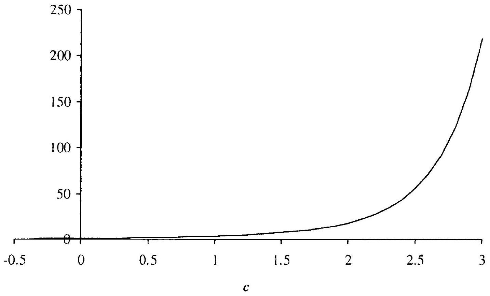

## Monte Carlo Methods

While the finite difference method is flexible and powerful, it has a number of limitations. First, its usage is restricted to problems where the state variable dynamics are Markovian. Second, for strongly path-dependent problems, the method often does not apply. And third, it is unsuited for problems where the dimension of the underlying vector of state variables is high. To expand on the last point, recall from Section 2.9 that the (ADI) finite difference method applied to a $p$-dimensional problem has computational complexity $O\left(m^{p}\right)$ per time step, where $m$ is the average number of spatial points per dimension. The exponential growth in $p$ - the "curse of dimensionality" - is typical of grid-based methods and prevents the practical usage of the method for $p$ larger than about 4 or 5 .

In this chapter, we study the Monte Carlo method, a numerical technique where the computational effort grows only linearly in the problem dimension $p$. While convergence of the Monte Carlo method is relatively slow, it is nearly always the method of choice for high-dimensional pricing problems. Compared to finite difference methods, Monte Carlo methods are easy to apply to problems with non-Markovian dynamics as well as strong path-dependency in the payout. On the other hand, as Monte Carlo methods inherently run forward in time, dynamic programming techniques are challenging to implement, making Monte Carlo pricing of American and Bermudan options significantly more involved than for the naturally backward-working finite difference method.

### 3.1 Fundamentals

Consider a European-style derivative $V$ with time $T$ payout $V(T)=g(T)$, where $g(T)$ is an $\mathcal{F}_{T}$-measurable (and integrable) random variable. Where finite difference methods start with a PDE representation of the price of a contingent claim at times $t<T$, the starting point for the Monte Carlo method is the basic martingale relation (see (1.15))

$$
\begin{equation*}
V(t)=N(t) \mathrm{E}_{t}^{\mathrm{Q}^{N}}(g(T) / N(T)) \tag{3.1}
\end{equation*}
$$
^eq3-1

where $N(\cdot)$ is a numeraire and $\mathrm{Q}^{N}$ is the measure induced by $N(\cdot)$. To evaluate this expression numerically, we need a numerical technique to compute expectations of a random variable. For this, we turn to the law of large numbers:

Theorem 3.1.1 (Strong Law of Large Numbers). Let $Y_{1}, Y_{2}, \ldots$ be a sequence of independent identically distributed (i.i.d.) random variables with expectation $\mu<\infty$. Define the sample mean

$$
\begin{equation*}
\bar{Y}_{n}=\frac{1}{n} \sum_{i=1}^{n} Y_{i} \tag{3.2}
\end{equation*}
$$
^eq3-2

Then

$$
\lim _{n \rightarrow \infty} \bar{Y}_{n}=\mu, \quad \text { a.s. }
$$

This result forms the basis for the Monte Carlo method, which computes the expectation in (3.1) by simply i) generating independent realizations of $g(T) / N(T)$ under $\mathrm{Q}^{N}$; and ii) forming their average. Specifically, let $g_{1} / N_{1}, \ldots, g_{n} / N_{n}$ denote $n$ independent samples from the distribution of $g(T) / N(T)$, conditional on $\mathcal{F}_{t}$. Then our Monte Carlo estimator for $V(t)$ is the sample mean

$$
\begin{equation*}
\bar{V}(t)=N(t) \frac{1}{n} \sum_{i=1}^{n} g_{i} / N_{i} . \tag{3.3}
\end{equation*}
$$
^eq3-3

We shall delve into how to generate samples from the distribution of $g(T) / N(T)$ shortly, but before doing so let us consider the expected convergence rate of the Monte Carlo method as $n$ is increased. The key result is here the central limit theorem:

Theorem 3.1.2 (Central Limit Theorem). Let $Y_{1}, Y_{2}, \ldots$ be a sequence of i.i.d. random variables with expectation $\mu$ and standard deviation $\sigma<\infty$. Let the sample mean be defined as in (3.2). Then, for $n \rightarrow \infty$,

$$
\frac{\bar{Y}_{n}-\mu}{\sigma / \sqrt{n}} \xrightarrow{d} \mathcal{N}(0,1)
$$

where $\mathcal{N}(0,1)$ is a standard Gaussian distribution and $\xrightarrow{d}$ denotes convergence in distribution ${ }^{1}$. Further, if we define

$$
s_{n}=\sqrt{\frac{1}{n-1} \sum_{i=1}^{n}\left(Y_{i}-\bar{Y}_{n}\right)^{2}}
$$

[^35]then also

$$
\frac{\bar{Y}_{n}-\mu}{s_{n} / \sqrt{n}} \xrightarrow{d} \mathcal{N}(0,1)
$$

Define the Gaussian percentile $u_{\gamma}$ as $\Phi\left(u_{\gamma}\right)=1-\gamma$, where $\Phi$ is the Gaussian cumulative distribution function. From Theorem 3.1.2, and from the definition of convergence in distribution (see footnote 1), the probability that the confidence interval

$$
\begin{equation*}
\left[\bar{V}(t)-u_{\gamma / 2} \cdot s_{n} / \sqrt{n}, \bar{V}(t)+u_{\gamma / 2} \cdot s_{n} / \sqrt{n}\right] \tag{3.4}
\end{equation*}
$$
^eq3-4

fails to include the true value $V(t)$ approaches $\gamma$ for large $n$. Here

$$
s_{n} \triangleq \sqrt{\frac{1}{n-1} \sum_{i=1}^{n}\left(\frac{g_{i} N(t)}{N_{i}}-\bar{V}(t)\right)^{2}}
$$

with the quantity $s_{n} / \sqrt{n}$ known as the standard error. For given $\gamma$, the rate at which the confidence interval for $V(t)$ contracts is $O\left(n^{-\frac{1}{2}}\right)$. This is relatively slow: to reduce the width of the interval by a factor of $2, n$ must increase by a factor of 4 . On the other hand, we notice that the (asymptotic) convergence rate only depends on $n$, not on the specifics of the $g_{i}$ 's. In particular, if $g(T)=g(X(T))$ where $X$ is $p$-dimensional, the asymptotic convergence rate is independent of $p$. As we shall see shortly, in most applications the work required to generate samples of $g(X(T))$ is (at most) linear in $p$.

### 3.1.1 Generation of Random Samples

At the most basic level, the Monte Carlo method requires the ability to draw independent realizations of a scalar random variable $Z$ with a specified cumulative distribution function $F(z)=\mathrm{P}(Z \leq z)$, where P is a probability measure. On a computer, the starting point for this exercise is normally a pseudo-random number generator, a software program that will generate a sequence of numbers uniformly distributed on $[0,1]$ (i.e. from $\mathcal{U}(0,1)$ ). Press et al. [1992] list a number of generators producing sequences of uniform numbers $u_{1}, u_{2}, \ldots$ from iterative relationships of the form

$$
\begin{aligned}
I_{i+1} & =\left(a I_{i}+c\right) \bmod (m) \\
u_{i+1} & =I_{i+1} / m
\end{aligned}
$$

The externally specified starting point $I_{0}$ is the seed of the random number generator. In this so-called general linear congruential generator, the choice of the multiplier a, the modulus $m$, and the increment $c$ must be done
with great care to ensure that the period length of the generator is large ${ }^{2}$ and that the resulting algorithm is efficient on a computer. The latter, for instance, can be accomplished be setting $m$ to be a power of 2 such that the modulo operation can be done by bit-shifting. For detailed discussion and a number of concrete algorithms (including computer code), we refer to Press et al. [1992]. The algorithms in Press et al. [1992] should suffice for most fixed income applications, but we should note the existence of more sophisticated methods that (theoretically, at least) have better performance than linear congruential generators. For instance, the so-called Mersenne twister proposed in Matsumoto and Nishimura [1998] has become popular, especially the specific variant MT19937 which has a period of $2^{19937}-1$. For an extensive survey of pseudo-random number generators, see L'Ecuyer [1994].

So far we have only discussed techniques to generate $\mathcal{U}(0,1)$ numbers, but many methods exist to convert uniformly distributed numbers into draws from the distribution $F$ of $Z$. We cover a few important techniques next.

### 3.1.1.1 Inverse Transform Method

The idea of the inverse transform method is straightforward. Let $U$ be a random variable uniformly distributed on $[0,1]$, and consider setting

$$
\begin{equation*}
Z=F^{-1}(U), \tag{3.5}
\end{equation*}
$$
^eq3-5

where we assume that $F^{-1}$ is well-defined, for all but a finite number of points ${ }^{3}$. As desired,

$$
\mathrm{P}(Z \leq z)=\mathrm{P}\left(F^{-1}(U) \leq z\right)=\mathrm{P}(U \leq F(z))=F(z),
$$

where the last equality follows from the property of uniformly distributed random variables. The inverse transform method (3.5) is quite general, but its practical usefulness hinges on being able to compute $F^{-1}$ fast. Many distributions allow for closed-form inversion; this includes the exponential distribution where $F(z)=1-e^{-z \lambda}$ for some positive constant $\lambda$, and the Cauchy distribution where $F(z)=1 / 2+(1 / \pi) \arctan ((z-t) / s)$ for constants $t$ and $s>0$.

For the important case of the Gaussian distribution, no closed-form expression for the inverse distribution exists. Nevertheless, the inverse transform

[^36]method can still be applied as fast and extremely accurate approximations for $\Phi^{-1}$ exist. For instance, Beasley and Springer [1977] suggest the rational approximation

$$
\begin{equation*}
\Phi^{-1}(x) \approx \frac{\sum_{i=0}^{3} a_{i}\left(x-\frac{1}{2}\right)^{2 i+1}}{1+\sum_{2=0}^{3} b_{i}\left(x-\frac{1}{2}\right)^{2 i}}, \quad 0.5 \leq x \leq 0.92 \tag{3.6}
\end{equation*}
$$
^eq3-6
for constants $a_{\imath}, b_{i}, i=0, \ldots, 3$, listed in Appendix 3.A. For values of $x$ greater than 0.92 , Moro [1995] proposes the approximation

$$
\begin{equation*}
\Phi^{-1}(x) \approx \sum_{i=1}^{8} c_{i}[\ln (-\ln (1-x))]^{i}, \quad 0.92 \leq x<1 \tag{3.7}
\end{equation*}
$$
^eq3-7
for constants $c_{i}, i=0, \ldots, 8$, given in Appendix 3.A. Taken together, (3.6) and (3.7) provide an approximation valid for $0.5 \leq x<1$; when $0<x<0.5$ we can compute $\Phi^{-1}(x)$ by symmetry: $\Phi^{-1}(1-x)=-\Phi^{-1}(x)$. The precision of (3.6)-(3.7) is excellent ${ }^{4}$, with the error less than $3 \times 10^{-9}$ for $x$ in the range $x \in[\Phi(-7), \Phi(7)]$. For alternative algorithms, see for instance Acklam [2003] and Wichura [1988].

Well-known alternative methods for sampling in the Gaussian distribution include the Box-Muller method and the related Marsaglia polar method (see Press et al. [1992]).

### 3.1.1.2 Acceptance-Rejection Method

In cases where $F^{-1}$ is cumbersome to compute, the so-called acceptancerejection method may be preferable. To describe the method, suppose that we want to sample from a density $f(z)=d F(z) / d z$, and further suppose that we have a good method to sample from a density $e(z)$, where

$$
\begin{equation*}
e(z) c \geq f(z), \quad z \in \mathbb{R} \tag{3.8}
\end{equation*}
$$
^eq3-8

for some positive constant $c$. By necessity, $c \geq 1$ as both $e$ and $f$ integrate to 1 . In the acceptance-rejection method, we

1. Draw a sample $Z$ from $e(z)$.
2. Draw an independent uniform variable $U, U \sim \mathcal{U}(0,1)$.
3. Accept the sample $Z$ if $U \leq f(Z) /(c e(Z))$; otherwise discard it.
[^37]The proof of why this algorithm works is straightforward and we omit it. Note that the third step of the acceptance-rejection method can be wasteful if too many samples need rejection. The key to the numerical efficiency of the acceptance-rejection method is thus evidently the ability to identify densities $e(z)$ that are "close" to $f(z)$, in the sense that $c$ is close to 1 for all $x$. Indeed, it can easily be shown that the probability of rejecting a sample is $1 / c$. Press et al. [1992] list good choices for $e(z)$ for a number of standard densities $f(z)$.

To demonstrate the mechanics of setting up an acceptance-rejection scheme for a particular distribution, let us consider sampling of a variable $\chi_{\nu}^{2}$ from a chi-square distribution with $\nu$ degrees of freedom. This distribution arises in a number of interest rate applications and is characterized by the cumulative distribution function

$$
\mathrm{P}\left(\chi_{\nu}^{2} \leq z\right)=\frac{1}{2^{\nu / 2} \Gamma(\nu / 2)} \int_{0}^{z} e^{-y / 2} y^{(\nu / 2)-1} d y, \quad \nu>0, z \geq 0
$$

where $\Gamma$ is the gamma function. For reasonably large degrees of freedom $\nu$, the chi-square density is typically bell-shaped. The chi-square distribution is a special case of the gamma distribution with density

$$
\begin{equation*}
f(z ; a, b)=\frac{a(a z)^{b-1} e^{-a z}}{\Gamma(b)}, \quad a, b>0, z \geq 0 \tag{3.9}
\end{equation*}
$$
^eq3-9

The chi-square distribution corresponds to $a=\frac{1}{2}$ and $b=\frac{\nu}{2}$. Rather than considering how to simulate a chi-square distribution, we will consider the more general question of how to draw from (3.9). We note that if a variable $X$ has gamma density $f(z ; 1, b)$, then $a X, a>0$, has gamma density $f(z ; a, b)$, so, in fact, it suffices to consider a simulation algorithm for the unit-scale density

$$
f(z)=\frac{z^{b-1} e^{-z}}{\Gamma(b)}
$$

where we assume that $b \geq 1$. One simple choice of "comparison" density for an acceptance-rejection algorithm is the exponential density

$$
e(z)=\lambda e^{-\lambda z}
$$

which, as mentioned earlier, can easily be simulated by inverse transform techniques. Note that

$$
\frac{f(z)}{e(z)}=\frac{1}{\lambda \Gamma(b)} z^{b-1} e^{(\lambda-1) z}
$$

which can be checked to have a maximum value of

$$
\begin{equation*}
\sup \left(\frac{f(z)}{e(z)}\right)=\frac{1}{\lambda \Gamma(b)}\left(\frac{b-1}{e(1-\lambda)}\right)^{b-1} \tag{3.10}
\end{equation*}
$$
^eq3-10

where we must assume that $\lambda<1$. To satisfy (3.8) we take $c=\sup (f(z) / e(z))$ and now search for the value of $\lambda$ that minimizes $c$, thereby optimizing computational speed. It is easy to see that (3.10) is minimized for $\lambda=1 / b$, corresponding to $c=b^{b} e^{1-b} / \Gamma(b)$. Note that

$$
\frac{f(z)}{c e(z)}=\frac{z^{b-1}}{\lambda} e^{b-1+(\lambda-1) z} b^{-b}
$$

with the third step of the acceptance-rejection algorithm best done in logarithms.

The algorithm outlined above was proposed by Fishman [1976] and works best for moderate values of $b$. For larger values, the Gamma distribution starts looking like a bell-shaped Gaussian distribution and is no longer well-approximated by an exponential distribution. Indeed, we notice that the probability of rejection $(1 / c)$ is approximately $e \sqrt{b /(2 \pi)}$, so of order $O(\sqrt{b})$. Modifications to the basic Fishman algorithm to accelerate sampling can be found in Cheng and Feast [1980]. Another common idea is to set $e(z)$ to the Cauchy density

$$
e(z)=\frac{1}{s \pi\left(1+((z-t) / s)^{2}\right)}
$$

where $s>0$ and $t$ are constants. This distribution is bell-shaped and, as discussed earlier, can be simulated by the inverse transform method. Press et al. [1992] list computer code and references for this case. For values $b \in[0,1]$, the acceptance-rejection technique of Ahrens and Dieter [1974] can also be used.

### 3.1.1.3 Composition

A third and final method to generate random variables from a given distribution function exploits known functional relationships that map variables sampled from one or more distributions to variables sampled from a target distribution. This technique is known as composition. A classical example of composition is the log-normal distribution $\mathcal{L} \mathcal{N}\left(\mu, \sigma^{2}\right)$ which, as we saw earlier in Chapter 1, is defined through the relation

$$
X \sim \mathcal{N}\left(\mu, \sigma^{2}\right) \Rightarrow e^{X} \sim \mathcal{L} \mathcal{N}\left(\mu, \sigma^{2}\right)
$$

where $\sim$ denotes "distributed as", and where $\mathcal{N}\left(\mu, \sigma^{2}\right)$ is the Gaussian distribution with mean $\mu$ and variance $\sigma^{2}$. In other words, a sample $Z$ from $\mathcal{L} \mathcal{N}\left(\mu, \sigma^{2}\right)$ can be generated by drawing (by the inverse transformation method, say) a $\mathcal{N}(0,1)$ variable $X$, and then setting $Z=e^{\mu+\sigma X}$.

Another classical example of a functional map is the Student's tdistribution, where samples can be generated by multiplying independent
samples from a standard Gaussian and a chi-square distribution; see Andersen et al. [2003] for a financial application of this. While we earlier demonstrated that the chi-square and gamma distributions can be generated by acceptance-rejection techniques, in fact we can also use composition for this. For instance, it is known that if $X_{1}, X_{2}, \ldots, X_{\nu}$ are independent standard Gaussian variables, then

$$
\begin{equation*}
Z=\sum_{i=1}^{\nu} X_{i}^{2} \tag{3.11}
\end{equation*}
$$
^eq3-11

is distributed chi-square with $\nu$ degrees of freedom. Also, if $U_{1}, \ldots, U_{b}$ are independent uniformly distributed variables, then

$$
\begin{equation*}
Z=-a \sum_{i=1}^{b} \ln U_{i} \tag{3.12}
\end{equation*}
$$
^eq3-12

is gamma distributed with density (3.9). For small integer-valued distribution parameters $b$ or $\nu$, (3.11) or (3.12) often define a faster simulation scheme than acceptance-rejection methods.

For later use, we note that the relationship (3.11) can be generalized to

$$
\widetilde{\chi}_{\nu}^{2}(\lambda)=\sum_{i=1}^{\nu}\left(X_{i}+a_{i}\right)^{2}
$$

for a series of constants $a_{i}, i=1, \ldots, \nu$. The random variable $\widetilde{\chi}_{\nu}^{2}(\lambda)$ follows a so-called non-central chi-square distribution with $\nu$ degrees of freedom and non-centrality parameter $\lambda=\sum_{2} a_{2}^{2}$. The distribution function is given by

$$
\begin{equation*}
\mathrm{P}\left(\tilde{\chi}_{\nu}^{2}(\lambda) \leq z\right)=e^{-\lambda / 2} \sum_{j=0}^{\infty} \frac{\left(\frac{1}{2} \lambda\right)^{j}}{j!\Gamma\left(\frac{\nu}{2}+j\right) 2^{(\nu / 2)+j}} \int_{0}^{z} y^{\nu / 2+j-1} e^{-y / 2} d y \tag{3.13}
\end{equation*}
$$
^eq3-13

an expression that also holds for non-integer $\nu$. If $\nu>1$, samples from a non-central chi-squared distribution can be generated by composition, using the relation

$$
\tilde{\chi}_{\nu}^{2}(\lambda)=(Z+\sqrt{\lambda})^{2}+\chi_{\nu-1}^{2}
$$

where $Z$ is a standard Gaussian random variable independent of $\chi_{\nu-1}^{2}$. To handle the case $\nu \leq 1$, one can observe from the expression (3.13) that a non-central chi-square variable can be expressed as a regular chi-square variable $\chi_{\nu+2 N}^{2}$, where $N$ is an independent Poisson-distributed discrete variable with intensity $\lambda / 2$,

$$
\mathrm{P}(N=j)=e^{-\lambda / 2} \frac{(\lambda / 2)^{j}}{j!}, \quad j=0,1, \ldots
$$

This suggests a composition rule for arbitrary $\nu$ : draw Poisson variables $N$ (by the inverse transformation method, say) and then draw $\chi_{\nu+2 N}^{2}$ using the methods in Section 3.1.1.2.

### 3.1.2 Correlated Gaussian Samples

The previous section dealt with the generation of scalar random variables. In applications, however, we may face the task of generating vectors of random variables, drawn from a joint multi-variate distribution. Of primary importance in financial applications is the multi-variate Gaussian distribution, so we devote this section to issues surrounding the generation of correlated Gaussian samples.

Recall that a $p$-dimensional Gaussian distribution $\mathcal{N}(\mu, \Sigma)$ is characterized by a $p$-dimensional vector-valued mean $\mu$ and a $p \times p$ symmetric, positive semi-definite ${ }^{5}$ covariance matrix $\Sigma$. The joint density is

$$
\phi_{p}(z ; \mu, \Sigma)=\frac{1}{(2 \pi)^{p / 2}(\operatorname{det} \Sigma)^{1 / 2}} \exp \left(-\frac{1}{2}(z-\mu)^{\top} \Sigma^{-1}(z-\mu)\right), \quad z \in \mathbb{R}^{p}
$$

The following result is useful:
Lemma 3.1.3 (Linear Transformation). Let $Z \sim \mathcal{N}(\mu, \Sigma)$ be pdimensional. Given a $d \times p$ matrix $A$ and a $d$-dimensional vector $B$, then

$$
A Z+B \sim \mathcal{N}\left(A \mu+B, A \Sigma A^{\top}\right)
$$

We can use this lemma as follows. Suppose that we generate $p$ independent standard (that is, $\mathcal{N}(0,1)$ ) Gaussian samples and collect them in a $p$-dimensional vector $X$. This can be accomplished using the techniques in Section 3.1.1. Clearly $X \sim \mathcal{N}(0, I)$, where $I$ is the $p$-dimensional identity matrix. Define a $(p \times p)$-dimensional matrix $C$ satisfying

$$
\begin{equation*}
C C^{\top}=\Sigma \tag{3.14}
\end{equation*}
$$
^eq3-14

Then

$$
Z=\mu+C X
$$

is distributed $\mathcal{N}(\mu, \Sigma)$.
It remains to determine a matrix $C$ that satisfies (3.14). While there is generally an infinite number of such matrices, two particular choices are of primary importance. We discuss these below.

### 3.1.2.1 Cholesky Decomposition

In the Cholesky decomposition, we impose the constraint that the matrix $C$ be lower triangular (that is, having all zeros above the diagonal), thereby conveniently reducing the number of multiplications required to compute $C X$ to $p(1+(p-1) / 2)$, rather than $p^{2}$. Assuming that the matrix is positive definite (not only positive semi-definite), the Cholesky decomposition is well-defined, and given by[^38]

$$
\begin{aligned}
C_{i, i} & =\sqrt{\Sigma_{i, i}-\sum_{k=1}^{i-1} C_{i, k}^{2}}, \quad i=1, \ldots, p \\
C_{i, j} & =\frac{1}{C_{j, j}}\left(\Sigma_{\imath, j}-\sum_{k=1}^{j-1} C_{i, k} C_{j, k}\right), \quad j=1, \ldots, p-1, \quad j<i
\end{aligned}
$$

For instance, if

$$
\Sigma=\left(\begin{array}{cc}
\sigma_{1}^{2} & \rho \sigma_{1} \sigma_{2} \\
\rho \sigma_{1} \sigma_{2} & \sigma_{2}^{2}
\end{array}\right)
$$

where $\rho \in[-1,1]$ and $\sigma_{1}, \sigma_{2}>0$, then

$$
C=\left(\begin{array}{cc}
\sigma_{1} & 0 \\
\sigma_{2} \rho & \sigma_{2} \sqrt{1-\rho^{2}}
\end{array}\right)
$$

a result that we have already used in Section 2.11. Press et al. [1992], among others, list computer code implementing the relations above.

If the matrix $\Sigma$ is only positive semi-definite (but not positive definite), the Cholesky decomposition will fail. In this case, linear algebra tells us that the matrix $\Sigma$ is rank-deficient, with rank $r<p$. As such, we must be able to set $Z=\mu+M Y$, where $M$ is a $p \times r$ matrix and $Y \sim \mathcal{N}\left(0, \Sigma_{Y}\right)$ is $r$-dimensional, with the covariance matrix having full rank $r$. Using Cholesky composition instead on $\Sigma_{Y}$, we can find a lower diagonal matrix $C_{Y}$ satisfying $C_{Y} C_{Y}^{\top}=\Sigma_{Y}$. Thus, in this case

$$
Z=\mu+M C_{Y} X
$$

where $X$ is a vector of $r$ (not $p$ ) independent standard Gaussian samples. The matrix $M$ can be found by the singular value decomposition (SVD) algorithm, see Press et al. [1992], or the algorithm in the next section.

### 3.1.2.2 Eigenvalue Decomposition

As an alternative to Cholesky decomposition, we can also consider diagonalizing $\Sigma$ through an eigenvalue decomposition. Here, we write

$$
\begin{equation*}
\Sigma=E \Lambda E^{\top} \tag{3.15}
\end{equation*}
$$
^eq3-15

where $\Lambda$ is a diagonal matrix of eigenvalues $\lambda_{i}, i=1, \ldots, p$, and the columns of $E$ contain the orthonormal eigenvectors of $\Sigma$. Some eigenvalues may be zero, if $\Sigma$ is rank-deficient (positive semi-definite). Comparison with (3.14) implies that one choice of $C$ is

$$
C=E \sqrt{\Lambda}=E\left(\begin{array}{cccc}
\sqrt{\lambda_{1}} & 0 & \cdots & 0  \tag{3.16}\\
0 & \sqrt{\lambda_{2}} & \ddots & \vdots \\
\vdots & \ddots & \ddots & 0 \\
0 & \cdots & 0 & \sqrt{\lambda_{p}}
\end{array}\right)
$$
^eq3-16

The eigenvalue decomposition (3.15) is relatively straightforward, at least as eigenvalue problems go, due to the fact that $\Sigma$ is symmetric and positive semi-definite; see Press et al. [1992] for an algorithm. While both Cholesky decomposition and eigenvalue decompositions have computational complexity $O\left(n^{3}\right)$, in practice the Cholesky method is often much faster than the eigenvalue method, making the Cholesky method preferable in practice. Nevertheless, decompositions of the type (3.16) have certain appealing theoretical properties that shall be useful later, so the next section explores (3.16) further.

### 3.1.3 Principal Components Analysis (PCA)

Consider a $p$-dimensional Gaussian variable $Z$ with a given covariance matrix $\Sigma$. Assume, with no loss of generality, that the mean of $Z$ is 0 and that $\Sigma$ has full rank (positive definite). Consider now writing, as an approximation,

$$
\begin{equation*}
Z \approx D X, \tag{3.17}
\end{equation*}
$$
^eq3-17

where $X$ is an $r$-dimensional vector of independent standard Gaussian variables, $r \leq p$, and $D$ is a ( $p \times r$ )-dimensional matrix. How should we choose $D$ in an optimal way?

First, we obviously need to define what constitutes an "optimal" approximation in (3.17). We here have in mind $L^{2}$ closeness of the covariance matrix $D D^{\top}$ to $\Sigma$ (see Lemma 3.1.3), so let us define the optimal $D^{*}$ as the matrix that minimizes the norm

$$
f(D)=\operatorname{tr}\left(\left(\Sigma-D D^{\top}\right)\left(\Sigma-D D^{\top}\right)^{\top}\right)
$$

This is just the matrix representation of the usual Frobenius norm on the squared differences between $\Sigma$ and $D D^{\top}$. The value of $D$ that minimizes $f(D)$ can be shown to be

$$
\begin{equation*}
D^{*}=E_{r} \sqrt{\Lambda_{r}}, \tag{3.18}
\end{equation*}
$$
^eq3-18

where $\Lambda_{r}$ is an $r \times r$ diagonal matrix containing the largest $r$ eigenvalues of $\Sigma$, and $E_{r}$ is a $p \times r$ matrix of $r p$-dimensional eigenvectors corresponding to the eigenvalues in $\Lambda_{r}$.

Equipped with the optimal $D$, we now go back to the approximation (3.17) and write

$$
\begin{equation*}
Z \approx \widetilde{Z} \triangleq E_{r} \sqrt{\Lambda_{r}} X=\sqrt{\lambda_{1}} e_{1} X_{1}+\sqrt{\lambda_{2}} e_{2} X_{2}+\ldots+\sqrt{\lambda_{r}} e_{r} X_{r}, \tag{3.19}
\end{equation*}
$$
^eq3-19

where $e_{i}$ denotes the $i$-th column of $E_{r}$ and the $\lambda_{i}$ 's are the eigenvalues, sorted in decreasing order of magnitude. The (deterministic) vector $e_{i}$ is known as the $i$-th principal component of $Z$, and the (random) variable $\sqrt{\lambda_{i}} X_{i}$ as the $i$-th principal factor. With (3.19), we have $\operatorname{tr}(\operatorname{Cov}(Z, Z))= \mathrm{E}\left(Z^{\top} Z\right)=\sum_{i=1}^{p} \lambda_{i}$ and $\operatorname{tr}(\operatorname{Cov}(\widetilde{Z}, \widetilde{Z}))=\mathrm{E}\left(\widetilde{Z}^{\top} \widetilde{Z}\right)=\sum_{i=1}^{r} \lambda_{i}$, i.e. the first $r$ terms in the decomposition (3.19) explain a fraction

$$
\frac{\sum_{i=1}^{r} \lambda_{i}}{\sum_{i=1}^{p} \lambda_{i}}
$$

of the sum of the diagonal elements of the covariance matrix of $Z$. Principal components decomposition will thus result in a loss of total variance, unless the covariance matrix is either rank-deficient (i.e. has eigenvalues that are strictly zero), or we use a full set of principal components ( $p=r$ ). In many cases of interest to us here, the loss of variance can be small, even if $r$ is a modest number, e.g. 2 or 3 . We notice that the covariance matrix for $Z$, as approximated by (3.19), will be rank-deficient, as the number $r$ of non-zero eigenvalues is less than $p$.

While we have used a setting with Gaussian variables to motivate our treatment of principal components analysis (PCA), it is, in fact, a generically useful tool for uncovering the structure of large-dimensional random vectors, and replacing them with more manageable, lower-dimensional variables; see, e.g., Theil [1971] for more details and an application to empirical nonGaussian data. Also, PCA identifies which directions of a multi-dimensional random variable are "important", potentially allowing us to allocate computational resources in an intelligent manner. One example of this is shown later in this chapter, in Section 3.2.10.

### 3.2 Generation of Sample Paths

So far, we have assumed that random variables are characterized by a known distribution function. In most of our applications, however, the random variables $g(T) / N(T)$ used in the basic pricing equation (3.1) are specified through an SDE or, more generally, an Ito process. In this section, we shall discuss Monte Carlo simulation of such processes. We start out with a motivating example, set in the Black-Scholes-Merton economy.

### 3.2.1 Example: Asian Basket Options in Black-Scholes Economy

Consider a dividend-free stock $S$, with Black-Scholes dynamics

$$
\begin{equation*}
d S(t) / S(t)=r d t+\sigma d W(t) \tag{3.20}
\end{equation*}
$$
^eq3-20

where $W(t)$ is a Brownian motion in the risk-neutral measure $\mathrm{Q}, r$ is a constant interest rate, and $\sigma$ is a constant volatility. Let there be given an increasing set of observation times $\left\{t_{1}, t_{2}, \ldots, t_{m}\right\}$, with $t_{m}=T$, and define the $\mathcal{F}_{T}$-measurable (discretely observed) stock average

$$
\begin{equation*}
A(T)=\frac{1}{m} \sum_{i=1}^{m} S\left(t_{i}\right) \tag{3.21}
\end{equation*}
$$
^eq3-21

An Asian (or average rate) call option with strike $K$ is defined by the terminal payout

$$
\begin{equation*}
g(T)=(A(T)-K)^{+} \tag{3.22}
\end{equation*}
$$
^eq3-22

we wish to price this option by Monte Carlo simulation.
As discussed earlier (see (1.39)), the geometric Brownian motion process (3.20) allows us to express $S$ directly in terms of the Brownian motion,

$$
S(t)=S(0) e^{r t-\frac{1}{2} \sigma^{2} t+\sigma W(t)}, \quad t>0
$$

whereby, with $\Delta_{i} \triangleq t_{i}-t_{i-1}$ and $t_{0}=0$,

$$
S\left(t_{i}\right)=S\left(t_{i-1}\right) \exp \left(\left[r-\frac{1}{2} \sigma^{2}\right] \Delta_{i}+\sigma\left[W\left(t_{i}\right)-W\left(t_{i-1}\right)\right]\right)
$$

$i=1, \ldots, m$. By the properties of Brownian motion, the increments $W\left(t_{i}\right)- W\left(t_{i-1}\right)$ are independent Gaussian variables distributed as $\mathcal{N}\left(0, \Delta_{i}\right)$. For the purposes of Monte Carlo simulation, we can therefore write

$$
\begin{equation*}
S\left(t_{i}\right)=S\left(t_{i-1}\right) \exp \left(\left(r-\frac{1}{2} \sigma^{2}\right) \Delta_{i}\right) \exp \left(\sigma \sqrt{\Delta_{i}} Z_{i}\right), \quad i=1, \ldots, m \tag{3.23}
\end{equation*}
$$
^eq3-23

where the $Z_{i}$ are independent standard $\mathcal{N}(0,1)$ Gaussian random variables. To produce a single sample draw of $g(T)$, we thus

1. Draw independent standard Gaussian samples $Z_{i}, i=1, \ldots, m$ (see Section 3.1.1).
2. Starting from $S(0)$, generate $S\left(t_{i}\right), i=1, \ldots, m$, from the iteration (3.23).
3. Compute $g(T)$ from (3.21)-(3.22).

Repeating this procedure $n$ times (with Gaussian samples independent from one path to the next), we can generate $n$ random samples $g_{1}, g_{2}, \ldots, g_{n}$ of $g(T)$. Our estimate of the time 0 price of the Asian option is then, from (3.3) with $N(t)=e^{r t}$ and non-random,

$$
\bar{V}(0)=e^{-r T} \frac{1}{n} \sum_{j=1}^{n} g_{j} .
$$

Asymptotic confidence intervals can be computed from (3.4). The pricing algorithm involves drawing $m n$ Gaussian variables, so the computational cost of the pricing algorithm is $O(m n)$.

Increasing the complexity, let us now consider an Asian option on a $p$-dimensional basket of stocks $S_{1}, S_{2}, \ldots, S_{p}$, each following geometric Brownian motion,

$$
d S_{k}(t) / S_{k}(t)=r d t+\sigma_{k} d W_{k}(t), \quad k=1, \ldots, p
$$

The Brownian motions $W_{k}$ and $W_{j}$ are assumed correlated with constant correlation coefficient $\rho_{k, j}, j, k=1, \ldots, p, j \neq k$. Define a unit-weighted basket price as

$$
B(t)=\sum_{k=1}^{p} S_{k}(t),
$$

and set the terminal Asian option payout to be

$$
\begin{equation*}
g(T)=\left(\frac{1}{m} \sum_{i=1}^{m} B\left(t_{i}\right)-K\right)^{+} \tag{3.24}
\end{equation*}
$$
^eq3-24

where the time line $\left\{t_{2}\right\}$ is as before. Equivalent to (3.23), we draw sample paths for each asset according to the prescription

$$
\begin{align*}
S_{k}\left(t_{2}\right) & =S_{k}\left(t_{i-1}\right) \exp \left(\left(r-\frac{1}{2} \sigma_{k}^{2}\right) \Delta_{i}+\sigma_{k} \sqrt{\Delta_{i}} Z_{k, i}\right)  \tag{3.25}\\
i & =1, \ldots, m, \quad k=1, \ldots, p
\end{align*}
$$
^eq3-25

where the $Z_{k, i}$ are Gaussian samples, independently drawn at each time step but correlated across $k$ 's. Let $C$ be the Cholesky decomposition of the correlation matrix $\left\{\rho_{k, j}\right\}$ (see Section 3.1.2.1), in which case we can generate the correlated sample vectors $Z_{i}=\left(Z_{1, i}, Z_{2, i}, \ldots, Z_{p, i}\right)^{\top}$ as

$$
Z_{i}=C X_{i}
$$

for a $p$-dimensional vector $X_{i}$ of independent Gaussian samples. Given joint sample paths of all basket component assets $S_{k}, k=1, \ldots, p$, pricing of the Asian basket option proceeds as above, substituting (3.24) for (3.22).

Completion of (3.25) requires $p m$ samples to complete a full path of all $p$ assets, making the total computational effort of an $n$-sample Monte Carlo scheme $O(n m p)$, with the (probabilistic) convergence order $O\left(n^{-1 / 2}\right)$ and dependent only on $n$. As mentioned earlier, the linearity of computational cost on the dimension of the asset vector $p$ compares favorably to the exponential growth in $p$ of finite difference schemes. Notice also the ease with which the Monte Carlo scheme is able to incorporate path-dependence.

### 3.2.2 Discretization Schemes, Convergence, and Stability

At the heart of the example in Section 3.2.1 was an iterative scheme for the production of a sample path for a vector-valued SDE; see (3.25). For the simple Black-Scholes model, SDE state variables (stock prices) could be expressed analytically in terms of independent increments of a Brownian motion, making path generation straightforward. In practice, however, we are often working with SDEs that do not permit closed-form solution. In such cases, we need to time-discretize the SDE, much the same way as we did for the numerical solution of PDEs.

In the next few sections, we shall consider a few important SDE discretization schemes. Before moving on to this, it is useful to discuss the sense in which we consider a discretization scheme to converge to the true SDE solution. For this, consider a vector-valued SDE

$$
\begin{equation*}
d X(t)=\mu(t, X(t)) d t+\sigma(t, X(t)) d W(t) \tag{3.26}
\end{equation*}
$$
^eq3-26

where $X(t)$ is $p$-dimensional, $W$ is a $d$-dimensional vector of independent Brownian motions, and $\mu:[0, T] \times \mathbb{R}^{p} \rightarrow \mathbb{R}^{p}$ and $\sigma:[0, T] \times \mathbb{R}^{p} \rightarrow \mathbb{R}^{p \times d}$ satisfy the usual regularity conditions. Consider an equidistant ${ }^{6}$ time grid $\{0, \Delta, 2 \Delta, \ldots, m \Delta\}$, the number of references and let $\widehat{X}$ be an approximation to $X$, based on some kind of time-discretization scheme on the grid $\{i \Delta\}$. For simplicity of notation, set $\widehat{X}_{i} \triangleq \widehat{X}(i \Delta)$. We say that the underlying approximation is weakly consistent if there exists a function $c(\Delta)$ with

$$
\lim _{\Delta \downarrow 0} c(\Delta)=0
$$

such that (dropping the measure superscript on the expectation operator)

$$
\begin{equation*}
\mathrm{E}\left(\left|\mathrm{E}\left(\Delta^{-1}\left(\widehat{X}_{i+1}-\widehat{X}_{i}\right) \mid \mathcal{F}_{i \Delta}\right)-\mu\left(i \Delta, \widehat{X}_{i}\right)\right|^{2}\right) \leq c(\Delta) \tag{3.27}
\end{equation*}
$$
^eq3-27

and

$$
\begin{align*}
\mathrm{E}\left(\mid \mathrm{E}\left(\Delta^{-1}\left(\widehat{X}_{i+1}-\widehat{X}_{i}\right)\right.\right. & \left.\left(\widehat{X}_{i+1}-\widehat{X}_{i}\right)^{\top} \mid \mathcal{F}_{i \Delta}\right) \\
& \left.-\left.\sigma\left(i \Delta, \widehat{X}_{i}\right) \sigma\left(i \Delta, \widehat{X}_{i}\right)^{\top}\right|^{2}\right) \leq c(\Delta) \tag{3.28}
\end{align*}
$$
^eq3-28

for all $i=0, \ldots, m-1$. The notion of weak consistency ${ }^{7}$ thus amounts to requiring that the mean and variance of the increments of the approximating process be close to those of the true SDE solution.

A concept related to consistency is the notion of weak convergence. We say that an approximate solution converges weakly to $X$ at time $T=m \Delta$ with respect to a class $\mathcal{C}$ of test functions $g: \mathbb{R}^{p} \rightarrow \mathbb{R}$ if

$$
\begin{equation*}
\lim _{\Delta \downarrow 0} \mid \mathrm{E}(g(X(T))-\mathrm{E}(g(\widehat{X}(T)) \mid=0 \tag{3.29}
\end{equation*}
$$
^eq3-29

for all $g \in \mathcal{C}$. Notice that the limit necessarily involves $m \rightarrow \infty$.

[^39]The class of test functions used in (3.29) is normally always in the set $\mathcal{C}_{P}^{l}$ of functions with polynomially bounded ${ }^{8}$ derivatives of order $0,1, \ldots, l$ with maximum power $l$. We say that a scheme converges with weak order $\beta$ if, for all $g \in C_{P}^{2(\beta+1)}$, (3.29) can be strengthened to

$$
\begin{equation*}
\mid \mathrm{E}\left(g(X(T))-\mathrm{E}\left(g(\hat{X}(T)) \mid \leq c \Delta^{\beta},\right.\right. \tag{3.30}
\end{equation*}
$$
^eq3-30

for all $\Delta \in\left(0, \Delta_{0}\right)$, where $\Delta_{0}$ and $c$ are constants and $c$ does not depend on $\Delta$ (but may depend on $g$ ).

One would generally expect that a weakly consistent scheme is weakly convergent. Indeed, this can be established to be the case under certain additional regularity conditions. We will not list the exact result here, but refer to Kloeden and Platen [2000], Theorem 9.7.4.

Finally, a brief word on stability of a time-discretized SDE. A commonly used definition of $A$-stability focuses on the behavior of a discretized test SDE of the type

$$
\begin{equation*}
d X(t)=\lambda X(t) d t+d W(t) \tag{3.31}
\end{equation*}
$$
^eq3-31

where $\lambda$ is a complex-valued constant with real part $\operatorname{Re}(\lambda)<0$. We suppose that a discretization scheme can be represented as

$$
\begin{equation*}
\widehat{X}_{i+1}=\widehat{X}_{i} G(\lambda \Delta)+Z_{i}^{\Delta}, \quad i=0,1, \ldots, m-1, \tag{3.32}
\end{equation*}
$$
^eq3-32

where $G$ is a mapping of the complex plane onto itself and the $Z_{i}^{\Delta}$ 's are random variables independent of the $\widehat{X}_{i}$ 's. In this case, the region of stability for a scheme is the set of $\lambda \Delta$ for which $\operatorname{Re}(\lambda)<0$ and

$$
\begin{equation*}
|G(\lambda \Delta)|<1 . \tag{3.33}
\end{equation*}
$$
^eq3-33

Similar to the definition used for finite difference scheme discretizations, we say that an SDE time-discretization scheme is $A$-stable, if the region of stability includes all values of $\lambda$ with $\operatorname{Re}(\lambda)<0$ and all $\Delta>0$.

### 3.2.3 The Euler Scheme

An obvious first scheme to discretize (3.26) treats both $d t$ and $d W(t)$ fully explicitly, evaluating all SDE coefficients on time step $[i \Delta, i \Delta+\Delta]$ at the left interval point $i \Delta$. In other words, we write, starting from $\widehat{X}_{0}=X(0)$,

$$
\begin{align*}
\widehat{X}_{i+1} & =\widehat{X}_{i}+\mu\left(i \Delta, \widehat{X}_{i}\right) \Delta+\sigma\left(i \Delta, \widehat{X}_{i}\right)(W(i \Delta+\Delta)-W(i \Delta))  \tag{3.34}\\
i & =0,1, \ldots, m-1
\end{align*}
$$
^eq3-34

[^40]With this scheme, Monte Carlo generation of paths is straightforward and involves, as in Section 3.2.1, replacing the increments $W(i \Delta+\Delta)-W(i \Delta)$ with $Z_{i} \sqrt{\Delta}$, for a $d$-dimensional vector of independent standard Gaussian samples $Z_{i}$.

The discretization scheme (3.34) is known as the Euler scheme, sometimes also called the Euler-Maruyama scheme. The Euler scheme is easy to implement and is a true workhorse that we will often use in this book. We note that the scheme is weakly consistent, as

$$
\mathrm{E}\left(\left|\mathrm{E}\left(\Delta^{-1}\left(\widehat{X}_{i+1}-\widehat{X}_{i}\right) \mid \mathcal{F}_{\imath \Delta}\right)-\mu\left(i \Delta, \widehat{X}_{i}\right)\right|^{2}\right)=0
$$

and

$$
\begin{aligned}
\mathrm{E}\left(\mid \mathrm{E}\left(\Delta^{-1}\left(\widehat{X}_{i+1}-\widehat{X}_{\imath}\right)\left(\widehat{X}_{\imath+1}-\widehat{X}_{\imath}\right)^{\top} \mid\right.\right. & \left.\mathcal{F}_{i \Delta}\right) \\
& \left.-\left.\sigma\left(i \Delta, \widehat{X}_{i}\right) \sigma\left(i \Delta, \widehat{X}_{i}\right)^{\top}\right|^{2}\right)=O\left(\Delta^{2}\right)
\end{aligned}
$$

While one might believe that the explicit discretization of the diffusion term - which is only accurate to order $O(\sqrt{\Delta})$ - would give the scheme weak convergence order ${ }^{9} 1 / 2$, in fact we typically have that the Euler scheme has weak convergence order $\beta=1$. We note that for this result to hold, however, regularity conditions on $\mu$ and $\sigma$ stronger than those of the existence and uniqueness results (Theorem 1.6.1) are needed. For instance, in the case where $\mu$ and $\sigma$ are functions of $X$ alone, Theorem 9.7.6 in Kloeden and Platen [2000] requires that $\mu$ and $\sigma$ be four times continuously differentiable with polynomial growth and uniformly bounded derivatives. See also their Theorem 15.4.2 for a more general result.

Given that the Euler scheme is fully explicit, our experience from finite difference methods suggests that the scheme may have stability problems. To investigate, we follow Section 3.2.2 and consider the test SDE

$$
d X(t)=\lambda X(t) d t+d W(t)
$$

which is discretized as

$$
\begin{equation*}
\widehat{X}_{i+1}=\widehat{X}_{i}(1+\lambda \Delta)+\sqrt{\Delta} Z_{i} \tag{3.35}
\end{equation*}
$$
^eq3-35

where $Z_{i}$ 's are standard Gaussian. Comparison to (3.32) and (3.33) shows that the region of stability for the Euler scheme is

$$
|(1+\lambda \Delta)|<1, \quad \operatorname{Re}(\lambda)<0
$$

which is the unit disc in the complex plane centered at $\lambda \Delta=-1$. For a given $\lambda$, there are thus restrictions on how big a time step $\Delta$ can be used.

[^41]
### 3.2.3.1 Linear-Drift SDEs

The restricted stability region of the Euler scheme can be a practical concern. For instance, SDEs of the important type

$$
\begin{equation*}
d X(t)=\varkappa(\theta(t)-X(t)) d t+\sigma(t, X(t)) d W(t) \tag{3.36}
\end{equation*}
$$
^eq3-36

arise quite frequently in fixed income modeling, and in cases where $\varkappa$ is big (which is often the case for, say, stochastic volatility models such as those covered in Chapters 8, 9 and 13) the Euler scheme can become unstable and return meaningless results. One way to solve the problem is to switch to an implicit scheme (see next section), but in the case (3.36) we can use the fact that the drift term can be removed by a simple change of variable. For instance, for the case where $X(t)$ is scalar we can set

$$
Y(t)=e^{\varkappa t} X(t)-\varkappa \int_{0}^{t} e^{\varkappa u} \theta(u) d u
$$

such that, from Ito's lemma,

$$
\begin{aligned}
d Y(t) & =e^{\varkappa t} \sigma(t, X(t)) d W(t) \\
& =e^{\varkappa t} \sigma\left(t, e^{-\varkappa t}\left(Y(t)+\varkappa \int_{0}^{t} e^{\varkappa u} \theta(u) d u\right)\right) d W(t)
\end{aligned}
$$

Euler simulation of the process for $Y(t)$, rather than for $X(t)$, will center $X$ around its analytically known mean

$$
\mathrm{E}(X((i+1) \Delta) \mid X(i \Delta))=e^{-\varkappa \Delta} X(i \Delta)+\varkappa \int_{i \Delta}^{i \Delta+\Delta} e^{-\varkappa((i+1) \Delta-u)} \theta(u) d u
$$

and will often alleviate any stability problems.

### 3.2.3.2 Log-Euler Scheme

One potential problem with the pure Euler scheme (3.34) is the fact that all increments are locally Gaussian, thereby implying a non-zero probability of $\widehat{X}$ crossing zero and becoming negative. Many SDEs, however, are known to produce only non-negative solutions, and the functions $\mu$ and $\sigma$ may not allow for negative arguments. This, for instance, is the case for the square-root process

$$
d X(t)=\sqrt{X(t)} d W(t), \quad X(0)>0,
$$

where the Euler scheme cannot be directly applied. Some authors (e.g., Kloeden and Platen [2000]) suggest heuristic modifications of the Euler scheme, such as

$$
\widehat{X}_{i+1}=\widehat{X}_{i}+\sqrt{\left|\widehat{X}_{i}\right|}(W(i \Delta+\Delta)-W(i \Delta))
$$

but ultimately this is not very satisfying and the resulting scheme will often have large errors ${ }^{10}$. An alternative is to introduce an invertible transformation $X(t)=f(Y(t))$, with $f: \mathbb{R} \rightarrow \mathbb{R}_{+}$, and then apply the Euler scheme to $Y$, at each step recovering $X$ as $f(Y)$. In finance applications, where many processes are based on SDEs that bear some resemblance to geometric Brownian motion, an often-used choice for $f$ is $f(y)=e^{y}$. The resulting scheme is known as the log-Euler scheme.

Consider the SDE (3.26) and assume for simplicity that $X$ is scalar (if $X$ is vector valued, the log-transform can be applied to all, or a few selected, components of $X$ ). Set $X(t)=\exp (Y(t))$, such that $Y(t)=\ln (X(t))$. The process for $Y$ then follows from Ito's lemma:
$d Y(t)=\left(\frac{\mu(t, X(t))}{X(t)}-\frac{1}{2} \frac{\sigma(t, X(t))^{2}}{X(t)^{2}}\right) d t+\frac{\sigma(t, X(t))}{X(t)} d W(t), X(t)=e^{Y(t)}$.
Writing out a standard Euler scheme for $Y$ and making the transformation $\widehat{X}_{i}=\exp \left(\widehat{Y}_{i}\right)$ gives us the (scalar) log-Euler scheme for $X$ :

$$
\widehat{X}_{i+1}=\widehat{X}_{i} \exp \left(\left(\frac{\mu\left(t, \widehat{X}_{i}\right)}{\widehat{X}_{i}}-\frac{1}{2} \frac{\sigma\left(t, \widehat{X}_{\imath}\right)^{2}}{\widehat{X}_{i}^{2}}\right) \Delta+\frac{\sigma\left(t, \widehat{X}_{i}\right)}{\widehat{X}_{i}} Z_{i} \sqrt{\Delta}\right)
$$

where $Z_{i} \sim \mathcal{N}(0,1)$. Generalizations of the technique above to situations where the valid range of $X$ is some general set $\mathcal{C}$ are obvious and involve identifying an invertible mapping function $f: \mathbb{R} \rightarrow \mathcal{C}$, preferably one that can be inverted analytically. For instance, if $\mathcal{C}=[a, \infty)$, we could use $f(y)=a+e^{y}$.

### 3.2.4 The Implicit Euler Scheme

The implicit Euler scheme for the vector-valued SDE (3.26) takes the form

$$
\begin{equation*}
\widehat{X}_{i+1}=\widehat{X}_{i}+\mu\left(i \Delta+\Delta, \widehat{X}_{i+1}\right) \Delta+\sigma\left(i \Delta, \widehat{X}_{i}\right)(W(i \Delta+\Delta)-W(i \Delta)) \tag{3.37}
\end{equation*}
$$
^eq3-37

for $i=0,1, \ldots, m-1$. We highlight the fact that the drift coefficient $\mu$ is now evaluated at time $i \Delta+\Delta$, rather than at time $i \Delta$. It is easy to show that the implicit Euler scheme is consistent. Under regularity conditions, it can also be shown that the weak convergence order is $\beta=1$, just as was the case for the explicit Euler scheme.

The main advantage of the implicit Euler scheme over the explicit Euler scheme is numerical stability. To examine the region of stability for the implicit Euler scheme, consider again the test SDE[^42]

$$
d X(t)=\lambda X(t) d t+d W(t) .
$$

It will now be discretized as (compare to (3.35))

$$
\widehat{X}_{i+1}=\widehat{X}_{i}+\widehat{X}_{i+1} \lambda \Delta+\sqrt{\Delta} Z_{i},
$$

or

$$
\widehat{X}_{i+1}(1-\lambda \Delta)=\widehat{X}_{i}+\sqrt{\Delta} Z_{i} .
$$

Comparison to (3.32) and (3.33) shows that now

$$
G(\lambda \Delta)=\frac{1}{1-\lambda \Delta}
$$

such that the stability criterion $|G(\lambda \Delta)|<1$ is satisfied for any value of $\lambda \Delta$ where $\operatorname{Re}(\lambda)<0$. In other words, the implicit scheme is $A$-stable.

### 3.2.4.1 Implicit Diffusion Term

The reader may at this point wonder why the implicit scheme (3.37) only discretized the drift term ( $\mu$ ) implicitly, and not the diffusion term ( $\sigma$ ). The answer lies in the differences between a regular Riemann integral and the stochastic integral. Recall in particular that the stochastic Ito integral is defined to be non-anticipative, in the sense that the integrand is always evaluated "to the left" on any partitions of the Brownian motion. As a consequence, if $\sigma\left(i \Delta, \widehat{X}_{i}\right)$ were replaced with $\sigma\left(i \Delta+\Delta, \widehat{X}_{i+1}\right)$ in (3.37), the resulting scheme would not be weakly consistent, in the sense defined earlier. To illustrate this point, just consider the simple scalar process

$$
d X(t)=\sigma X(t) d W(t)
$$

which we contemplate discretizing as

$$
\widehat{X}_{i+1}=\widehat{X}_{i}+\sigma \widehat{X}_{i+1}(W(i \Delta+\Delta)-W(i \Delta))
$$

or

$$
\begin{equation*}
\widehat{X}_{i+1}\left(1-\sigma Z_{i} \sqrt{\Delta}\right)=\widehat{X}_{i}, \quad i=0, \ldots, m-1 \tag{3.38}
\end{equation*}
$$
^eq3-38

Here, a first difficulty arises: the term $\left(1-\sigma Z_{i} \sqrt{\Delta}\right)$ may become 0 (or very close to zero) if $Z_{\imath}$ is an (unbounded) Gaussian variable. For fully implicit discretization schemes, it becomes necessary to use a bounded approximation to the Brownian motion. As discussed in Kloeden and Platen [2000], weak convergence order is preserved if in (3.38) we set the $Z_{i}$ to be independent binomial variables with

$$
\mathrm{P}\left(Z_{i}=1\right)=\mathrm{P}\left(Z_{i}=-1\right)=\frac{1}{2} .
$$

We assume that $1-\sigma \sqrt{\Delta}>0$. Rearranging and Taylor-expanding, we get

$$
\begin{aligned}
\frac{\widehat{X}_{i+1}-\widehat{X}_{i}}{\Delta} & =\frac{\widehat{X}_{i}}{\Delta}\left(\frac{1}{1-\sigma Z_{i} \sqrt{\Delta}}-1\right) \\
& =\frac{\widehat{X}_{i}}{\Delta}\left(1+\sigma Z_{i} \sqrt{\Delta}+\sigma^{2} Z_{i}^{2} \Delta+O\left(\sigma^{3} Z_{i}^{3} \Delta^{3 / 2}\right)-1\right) \\
& =\widehat{X}_{i}\left(\sigma Z_{i} \Delta^{-1 / 2}+\sigma^{2} Z_{i}^{2}+O\left(\sigma^{3} Z_{i}^{3} \Delta^{1 / 2}\right)\right)
\end{aligned}
$$

such that

$$
\mathrm{E}\left(\left.\frac{\widehat{X}_{\imath+1}-\widehat{X}_{i}}{\Delta} \right\rvert\, \widehat{X}_{\imath}\right)=\widehat{X}_{i}\left(\sigma^{2}+O\left(\Delta^{1 / 2}\right)\right)
$$

Clearly, this will cause a violation of the consistency condition (3.27).
In the example above, we notice that consistency can be restored if the drift of the original SDE is changed from 0 to $-\sigma^{2} X(t)$ before the "doubly" implicit Euler discretization is employed. More generally, it is not difficult to show that (3.37) can be modified to treat the diffusion term implicitly, provided that the drift of the original vector-valued SDE (3.26) is first changed from $\mu$ to

$$
\bar{\mu}=\mu-\sum_{j=1}^{d} \sum_{k=1}^{p}\left(\sigma_{X_{k}}\right)_{\cdot, j} \sigma_{k, j}
$$

where the $p$-dimensional vector $\left(\sigma_{X_{k}}\right)_{\cdot, j}$ is the $j$-th column of the $(p \times d)$ dimensional matrix $\sigma_{X_{k}}=\left\{\partial \sigma_{i, j} / \partial X_{k}\right\}$. Inspired by the theta methods of Chapter 2, we can, in fact, introduce a family of discretizations

$$
\begin{align*}
\widehat{X}_{i+1}=\widehat{X}_{i}+ & {\left[(1-\theta) \bar{\mu}_{\eta}\left(i \Delta, \widehat{X}_{i}\right)+\theta \bar{\mu}_{\eta}\left(i \Delta+\Delta, \widehat{X}_{i+1}\right)\right] \Delta } \\
& +\left[(1-\eta) \sigma\left(i \Delta, \widehat{X}_{i}\right)+\eta \sigma\left(i \Delta+\Delta, \widehat{X}_{i+1}\right)\right] Z_{i} \sqrt{\Delta} \tag{3.39}
\end{align*}
$$
^eq3-39

where the $Z_{2}$ are binomially distributed variables, $\theta, \eta \in[0,1]$ are parameters, and

$$
\begin{equation*}
\bar{\mu}_{\eta}=\mu-\eta \sum_{j=1}^{d} \sum_{k=1}^{p}\left(\sigma_{X_{k}}\right)_{\cdot, j} \sigma_{k, j} . \tag{3.40}
\end{equation*}
$$
^eq3-40

As it turns out, all these schemes theoretically have identical convergence order $\beta=1$, but in practice some choices of $\theta, \eta$ may turn out to work better than others. We shall discuss methods to raise the theoretical convergence order in Section 3.2.6. The scheme (3.39) can be verified to be $A$-stable for $\theta \in[1 / 2,1]$.

### 3.2.5 Predictor-Corrector Schemes

A closer examination of the implicit Euler scheme (3.37) demonstrates the need to recover $\widehat{X}(i \Delta+\Delta)$ as the vector-valued root of a possibly nonlinear equation. In general, this must be done numerically (using, say, the

Newton-Raphson algorithm), causing a severe deterioration of computational performance. An alternative is to use the explicit Euler scheme as a predictor and the implicit scheme as a corrector, much the same way we used explicit finite difference approximations as predictors in the Craig-Sneyd algorithm of Section 2.11. Moving straight to the general implicit discretization family (3.39), we write the predictor-corrector as

$$
\begin{align*}
& \bar{X}_{i+1}=\widehat{X}_{i}+\mu\left(i \Delta, \widehat{X}_{i}\right) \Delta+\sigma\left(i \Delta, \widehat{X}_{i}\right)(W(i \Delta+\Delta)-W(i \Delta))  \tag{3.41}\\
& \widehat{X}_{i+1}=\widehat{X}_{i}+\left[(1-\theta) \bar{\mu}_{\eta}\left(i \Delta, \widehat{X}_{i}\right)+\theta \bar{\mu}_{\eta}\left(i \Delta+\Delta, \bar{X}_{\imath+1}\right)\right] \Delta \\
& \quad+\left[(1-\eta) \sigma\left(i \Delta, \widehat{X}_{i}\right)+\eta \sigma\left(i \Delta+\Delta, \bar{X}_{i+1}\right)\right](W(i \Delta+\Delta)-W(i \Delta)) \tag{3.42}
\end{align*}
$$
^eq3-41
^eq3-42

where $\theta, \eta \in[0,1]$, and $\bar{\mu}_{\eta}$ is as given in (3.40). It is understood that the Brownian motion increments in (3.41) and (3.42) are to be identical.

For sufficiently smooth coefficients, it can be shown that the predictorcorrector scheme (3.41)-(3.42) converges weakly with order $\beta=1$, independent of the choice of $\theta$ and $\eta$. As for stability, discretization of (3.31) leads to

$$
\begin{aligned}
\bar{X}_{i+1} & =\widehat{X}_{i}(1+\lambda \Delta)+W(i \Delta+\Delta)-W(i \Delta) \\
\widehat{X}_{i+1} & =\widehat{X}_{i}+\left[(1-\theta) \lambda \widehat{X}_{i}+\theta \lambda \bar{X}_{i+1}\right] \Delta+W(i \Delta+\Delta)-W(i \Delta) \\
& =\widehat{X}_{i}(1+\lambda \Delta(1+\theta \lambda \Delta))+(W(i \Delta+\Delta)-W(i \Delta))(1+\theta \lambda \Delta)
\end{aligned}
$$

The region of stability can be verified to be

$$
|1+\lambda \Delta(1+\theta \lambda \Delta)|<1, \quad \operatorname{Re}(\lambda)<0 .
$$

For $\theta=\frac{1}{2}$, the stability criterion above is identical to that of the classical Heun scheme (or modified trapezoidal scheme) used for ordinary differential equations. Indeed, the predictor-corrector scheme above can be seen as an adaptation of this scheme for SDEs. We note that SDE adaptations of more sophisticated ODE solvers (such as Runge-Kutta) are also possible, but this goes beyond the scope of this text.

### 3.2.6 Ito-Taylor Expansions and Higher-Order Schemes

Despite our various efforts at centering derivatives, none of the schemes listed above theoretically attain second-order weak convergence. To develop such schemes, we need to delve further into adapting classical Taylor expansions to the rules of stochastic (Ito) calculus. As we shall ultimately not have much use for higher-order schemes, we keep the treatment informal and limit ourselves to the scalar case where $p=d=1$ in (3.26).

### 3.2.6.1 Ordinary Taylor Expansion of ODEs

To gain intuition, start by setting $\sigma=0$ in (3.26), such that we first deal with an ordinary ODE

$$
\begin{equation*}
d X(t)=\mu(t, X(t)) d t \tag{3.43}
\end{equation*}
$$
^eq3-43

For a given value of $t$, we can use Taylor's theorem to write

$$
X(t+\Delta)=X(t)+\frac{d X(t)}{d t} \Delta+\frac{1}{2} \frac{d^{2} X(t)}{d t^{2}} \Delta^{2}+O\left(\Delta^{3}\right)
$$

where we stop at order $O\left(\Delta^{3}\right)$. We notice that

$$
\frac{d X(t)}{d t}=\mu(t, X(t))
$$

and

$$
\begin{aligned}
\frac{d^{2} X(t)}{d t^{2}} & =\frac{\partial}{\partial t} \mu(t, X(t))+\frac{\partial}{\partial x} \mu(t, X(t)) \cdot \frac{d X(t)}{d t} \\
& =\left(\frac{\partial}{\partial t}+\mu(t, X(t)) \frac{\partial}{\partial x}\right) \mu(t, X(t))
\end{aligned}
$$

Setting

$$
\mathcal{L} \triangleq \frac{\partial}{\partial t}+\mu \frac{\partial}{\partial x},
$$

we thus have

$$
\begin{equation*}
X(t+\Delta)=X(t)+\mu(t, X(t)) \Delta+\frac{1}{2} \mathcal{L} \mu(t, X(t)) \Delta^{2}+O\left(\Delta^{3}\right) \tag{3.44}
\end{equation*}
$$
^eq3-44

Another way to develop (3.44) proceeds by iteration on the integral representation

$$
\begin{equation*}
X(t+\Delta)=X(t)+\int_{t}^{t+\Delta} \mu(u, X(u)) d u \tag{3.45}
\end{equation*}
$$
^eq3-45

First we recognize that (as seen above)

$$
d \mu(t, X(t))=\mathcal{L} \mu(t, X(t)) d t
$$

such that

$$
\begin{equation*}
\mu(u, X(u))=\mu(t, X(t))+\int_{t}^{u} \mathcal{L}_{\mu}(s, X(s)) d s, \quad u>t \tag{3.46}
\end{equation*}
$$
^eq3-46

Inserting this into (3.45) gives

$$
X(t+\Delta)=X(t)+\mu(t, X(t)) \int_{t}^{t+\Delta} d u+\int_{t}^{t+\Delta} \int_{t}^{u} \mathcal{L} \mu(s, X(s)) d s d u
$$

Applied to $\mathcal{L} \mu(s, X(s))$ the steps that lead to (3.46) yield

$$
\mathcal{L} \mu(s, X(s))=\mathcal{L} \mu(t, X(t))+\int_{t}^{s} \mathcal{L}^{2} \mu(v, X(v)) d v, \quad s>t
$$

such that

$$
\begin{align*}
X(t+\Delta)= & X(t)+\mu(t, X(t)) \int_{t}^{t+\Delta} d u+\mathcal{L} \mu(t, X(t)) \int_{t}^{t+\Delta} \int_{t}^{u} d s d u \\
& +\int_{t}^{t+\Delta} \int_{t}^{u} \int_{t}^{s} \mathcal{L}^{2} \mu(v, X(v)) d v d s d u \\
= & X(t)+\mu(t, X(t)) \Delta+\frac{1}{2} \mathcal{L} \mu(t, X(t)) \Delta^{2}+O\left(\Delta^{3}\right) \tag{3.47}
\end{align*}
$$
^eq3-47

which is just (3.44). We can continue the iteration to arbitrary high order.

### 3.2.6.2 Ito-Taylor Expansions

One may wonder why in the previous section we bothered with the integral representation of Taylor's theorem when the usual (differential) Taylor expansion lead to the correct result. The reason is that the integral approach can be extended to SDEs, leading to stochastic Ito-Taylor expansions. To give a flavor of these, reintroduce a diffusion term to (3.43), and start out with the integral representation

$$
\begin{equation*}
X(t+\Delta)=X(t)+\int_{t}^{t+\Delta} \mu(u, X(u)) d u+\int_{t}^{t+\Delta} \sigma(u, X(u)) d W(u) \tag{3.48}
\end{equation*}
$$
^eq3-48

Applying Ito's lemma to $\mu$ gives (compare to (3.46))

$$
\begin{equation*}
\mu(u, X(u))=\mu(t, X(t))+\int_{t}^{u} \mathcal{L}_{0} \mu(s, X(s)) d s+\int_{t}^{u} \mathcal{L}_{1} \mu(s, X(s)) d W(s) \tag{3.49}
\end{equation*}
$$
^eq3-49

where

$$
\mathcal{L}_{0} \triangleq \frac{\partial}{\partial t}+\mu \frac{\partial}{\partial x}+\frac{1}{2} \sigma^{2} \frac{\partial^{2}}{\partial x^{2}}, \quad \mathcal{L}_{1} \triangleq \sigma \frac{\partial}{\partial x}
$$

Similarly,

$$
\begin{equation*}
\sigma(u, X(u))=\sigma(t, X(t))+\int_{t}^{u} \mathcal{L}_{0} \sigma(s, X(s)) d s+\int_{t}^{u} \mathcal{L}_{1} \sigma(s, X(s)) d W(s) \tag{3.50}
\end{equation*}
$$
^eq3-50

Plugging (3.49) and (3.50) into (3.48) yields

$$
\begin{align*}
X(t+\Delta) & =X(t)+\mu(t, X(t)) \int_{t}^{t+\Delta} d u+\sigma(t, X(t)) \int_{t}^{t+\Delta} d W(u)+R_{1} \\
& =X(t)+\mu(t, X(t)) \Delta+\sigma(t, X(t))(W(t+\Delta)-W(t))+R_{1} \tag{3.51}
\end{align*}
$$
^eq3-51

where the remainder $R_{1}$ is

$$
\begin{aligned}
R_{1}= & \int_{t}^{t+\Delta} \int_{t}^{u} \mathcal{L}_{0} \mu(s, X(s)) d s d u \\
& +\int_{t}^{t+\Delta} \int_{t}^{u} \mathcal{L}_{1} \mu(s, X(s)) d W(s) d u \\
& +\int_{t}^{t+\Delta} \int_{t}^{u} \mathcal{L}_{0} \sigma(s, X(s)) d s d W(u) \\
& +\int_{t}^{t+\Delta} \int_{t}^{u} \mathcal{L}_{1} \sigma(s, X(s)) d W(s) d W(u)
\end{aligned}
$$

As for the ODE example above, we can repeat this procedure arbitrarily many times. Going just one step further, we arrive at

$$
\begin{align*}
X(t+\Delta)= & X(t)+\mu(t, X(t)) \Delta+\sigma(t, X(t))(W(t+\Delta)-W(t)) \\
& +\mathcal{L}_{0} \mu(t, X(t)) \frac{1}{2} \Delta^{2} \\
& +\mathcal{L}_{1} \mu(t, X(t)) \int_{t}^{t+\Delta} \int_{t}^{u} d W(s) d u \\
& +\mathcal{L}_{0} \sigma(t, X(t)) \int_{t}^{t+\Delta} \int_{t}^{u} d s d W(u) \\
& +\mathcal{L}_{1} \sigma(t, X(t)) \int_{t}^{t+\Delta} \int_{t}^{u} d W(s) d W(u)+R_{2} \tag{3.52}
\end{align*}
$$
^eq3-52

where $R_{2}$ contains triple integrals over $t$ and $W$.
Stochastic Taylor expansions can be continued to arbitrary order, but we shall not go any further.

### 3.2.6.3 Milstein Second-Order Discretization Scheme

Discarding the remainder $R_{1}$ in the one-step iteration (3.51) is seen to lead to the Euler scheme (see Section 3.2.3), known to have weak convergence order $\beta=1$. Under additional regularity (see Talay [1984]) of $\mu$ and $\sigma$, discarding the remainder $R_{2}$ in the higher-order expansion (3.52) can form the basis of a discretization scheme with weak order $\beta=2$. For us to implement such a scheme, however, we need to concern ourselves with the simulation of the three stochastic double integrals figuring in (3.52). We go through the integrals in order below.

First,

$$
\begin{align*}
I_{(1,1)} & \triangleq \int_{t}^{t+\Delta} \int_{t}^{u} d W(s) d W(u) \\
& =\int_{t}^{t+\Delta}(W(u)-W(t)) d W(u)=\frac{1}{2}(W(t+\Delta)-W(t))^{2}-\frac{1}{2} \Delta \tag{3.53}
\end{align*}
$$
^eq3-53

where we have used the fact that

$$
\int_{0}^{t} W(u) d W(u)=\frac{1}{2} W(t)^{2}-\frac{1}{2} t
$$

as can be verified by Ito's lemma. Second,

$$
\begin{align*}
I_{(0,1)} & \triangleq \int_{t}^{t+\Delta} \int_{t}^{u} d s d W(u)=\int_{t}^{t+\Delta}(u-t) d W(u) \\
& =\Delta(W(t+\Delta)-W(t))-\int_{t}^{t+\Delta}(W(u)-W(t)) d u \\
& \triangleq \Delta(W(t+\Delta)-W(t))-I_{(1,0)} \tag{3.54}
\end{align*}
$$
^eq3-54

where we have used the integration-by-parts formula

$$
\int_{0}^{t} u d W(u)=t W(t)-\int_{0}^{t} W(u) d u
$$

which follows from applying Ito's lemma to $t W(t)$. In (3.54), the remaining integral $I_{(1,0)}$ on the right-hand-side is the same as the final double integral in (3.52), namely

$$
I_{(1,0)} \triangleq \int_{t}^{t+\Delta} \int_{t}^{u} d W(s) d u=\int_{t}^{t+\Delta}(W(u)-W(t)) d u
$$

Reversing the order of integration, we get

$$
\begin{aligned}
I_{(1,0)} & =\int_{t}^{t+\Delta} \int_{t}^{u} d W(s) d u \\
& =\int_{t}^{t+\Delta} \int_{u}^{t+\Delta} d s d W(u)=\int_{t}^{t+\Delta}(t+\Delta-u) d W(u)
\end{aligned}
$$

so we see, from Theorem 1.1.3 and the discussion in Section 1.6 on linear SDEs, that $I_{(1,0)}$ is Gaussian with mean 0 and variance

$$
\operatorname{Var}\left(I_{(1,0)}\right)=\int_{t}^{t+\Delta}(t+\Delta-u)^{2} d u=\frac{1}{3} \Delta^{3}
$$

The covariance between $I_{(1,0)}$ and $W(t+\Delta)-W(t)$ can be computed as

$$
\operatorname{Cov}\left(I_{(1,0)}, W(t+\Delta)-W(t)\right)=\int_{t}^{t+\Delta}(t+\Delta-u) d u=\frac{1}{2} \Delta^{2}
$$

With the results above, we can cast the Taylor expansion (3.52) in the form of a simulation scheme ( $\mu, \sigma$, and their derivatives are to be evaluated at $t=i \Delta$ and $X=\widehat{X}(i \Delta))$,

$$
\begin{align*}
\widehat{X}_{i+1}= & \widehat{X}_{i}+\mu \Delta+\sigma Z_{i, 1} \sqrt{\Delta}+\mathcal{L}_{0} \mu \frac{1}{2} \Delta^{2}+\mathcal{L}_{1} \mu Z_{i, 2} \sqrt{\frac{1}{3} \Delta^{3}} \\
& +\mathcal{L}_{0} \sigma\left[\Delta Z_{i, 1} \sqrt{\Delta}-Z_{i, 2} \sqrt{\frac{1}{3} \Delta^{3}}\right]+\mathcal{L}_{1} \sigma\left(\frac{1}{2} Z_{i, 1}^{2} \Delta-\frac{1}{2} \Delta\right) \tag{3.55}
\end{align*}
$$
^eq3-55

where $Z_{i, 1}$ and $Z_{i, 2}$ are sequences of $\mathcal{N}(0,1)$ Gaussian variables with pairwise correlation

$$
\rho\left(Z_{i, 1}, Z_{i, 2}\right)=\frac{\frac{1}{2} \Delta^{2}}{\sqrt{\frac{1}{3} \Delta^{3}} \sqrt{\Delta}}=\sqrt{\frac{3}{4}}
$$

The scheme above is known as the Milstein scheme. As mentioned earlier, the scheme has weak convergence order 2 under fairly strong regularity assumptions on $\mu$ and $\sigma$. We note that in the literature on SDE simulation, the Milstein scheme is often presented in a simplified form with the integral $I_{(1,0)}$ simulated as

$$
\mathrm{E}\left(\int_{t}^{t+\Delta} \int_{t}^{u} d W(s) d u \mid W(t), W(t+\Delta)\right)=\frac{1}{2} \Delta(W(t+\Delta)-W(t))
$$

which corresponds to replacing $Z_{i, 2} \sqrt{\Delta^{3} / 3}$ with $\frac{1}{2} \Delta Z_{i, 1}$ in (3.55). See Kloeden and Platen [2000] for a discussion of why this type of simplification does not affect the weak convergence order. The same source also contains a full discussion of how to extend the Milstein scheme to multi-dimensional SDEs.

### 3.2.7 Other Second-Order Schemes

The need to explicitly compute derivatives of the functions $\mu$ and $\sigma$ often makes the Milstein scheme inconvenient to apply. High-order simulation schemes that substitute finite difference approximations for derivatives exist, and retain second (or higher) order weak convergence, are surveyed in Kloeden and Platen [2000]. To give an example of such a scheme, consider the scalar case $d=p=1$ and assume that SDE coefficient functions $\mu$ and $\sigma$ are function of $x$ only. A derivative-free scheme that achieves second-order weak convergence is (from Kloeden and Platen [2000], Chapter 15)

$$
\begin{align*}
\widehat{X}_{i+1}= & \widehat{X}_{i}+\frac{1}{2}\left(\mu(\bar{X})+\mu\left(\widehat{X}_{i}\right)\right) \Delta \\
& +\frac{1}{4}\left(\sigma\left(\bar{X}^{+}\right)+\sigma\left(\bar{X}^{-}\right)+2 \sigma\left(\widehat{X}_{i}\right)\right) Z_{i} \sqrt{\Delta} \\
& +\frac{1}{4}\left(\sigma\left(\bar{X}^{+}\right)-\sigma\left(\bar{X}^{-}\right)\right)\left(Z_{i}^{2} \Delta-\Delta\right) \Delta^{-1 / 2} \tag{3.56}
\end{align*}
$$
^eq3-56

where the $Z_{2}$ 's are a sequence of $\mathcal{N}(0,1)$ Gaussian variables, and

$$
\begin{aligned}
\bar{X} & =\widehat{X}_{i}+\mu\left(\widehat{X}_{i}\right) \Delta+\sigma\left(\widehat{X}_{i}\right) Z_{i} \sqrt{\Delta}, \\
\bar{X}^{ \pm} & =\widehat{X}_{i}+\mu\left(\widehat{X}_{i}\right) \Delta \pm \sigma\left(\widehat{X}_{i}\right) \sqrt{\Delta} .
\end{aligned}
$$

Comparison of (3.56) with the simplified Milstein scheme in the previous section shows that (3.56) avoids derivatives by using additional supporting values $\bar{X}$ and $\bar{X}^{ \pm}$.

Another, quite different, approach to avoid explicit derivatives applies the classical idea of Richardson extrapolation to the Euler scheme. This idea was proposed by Talay and Tubaro [1990] and takes advantage of the fact that, under additional regularity conditions, the error of the Euler scheme can be sharpened beyond (3.30) (with $\beta=1$ ) to

$$
\begin{equation*}
\mathrm{E}(g(\widehat{X}(T)))=\mathrm{E}(g(X(T)))+c \Delta+O\left(\Delta^{2}\right) \tag{3.57}
\end{equation*}
$$
^eq3-57

for a constant $c$. Let $\widehat{X}_{\Delta}$ and $\widehat{X}_{2 \Delta}$ be estimates of $X$ based on Euler discretizations with time steps of $\Delta$ and $2 \Delta$, respectively. Provided that (3.57) holds, we can write

$$
\begin{equation*}
2 \mathrm{E}\left(g\left(\widehat{X}_{\Delta}(T)\right)\right)-\mathrm{E}\left(g\left(\widehat{X}_{2 \Delta}(T)\right)\right)=\mathrm{E}(g(X(T)))+O\left(\Delta^{2}\right) \tag{3.58}
\end{equation*}
$$
^eq3-58

which is our second-order extrapolation formula. As the Euler scheme is simple to set up, the extrapolation scheme is an attractive alternative to other second-order techniques. In practice, however, the convergence of the Euler scheme may not always be smooth enough to make (3.58) work well. Numerical experiments will nearly always be necessary (as is also the case of the Ito-Taylor schemes, for that matter).

A final word about generation of $\widehat{X}_{\Delta}$ and $\widehat{X}_{2 \Delta}$ in the Richardson extrapolation scheme. To avoid duplication of work, we discretize time in buckets of $\Delta$ and generate both $\widehat{X}_{\Delta}$ and $\widehat{X}_{2 \Delta}$ simultaneously, combining time steps in pairs for the purpose of generating $\widehat{X}_{2 \Delta}$. That is, if we use Gaussian increments of $Z_{1} \sqrt{\Delta}, Z_{2} \sqrt{\Delta}, \ldots$ for $\widehat{X}_{\Delta}$, we use $\left(Z_{1}+Z_{2}\right) \sqrt{\Delta},\left(Z_{3}+Z_{4}\right) \sqrt{\Delta}, \ldots$ for $\widehat{X}_{2 \Delta}$. Not only do we save work by re-using Gaussian draws, we most likely also reduce the statistical error of our Monte Carlo estimate of the difference $2 \mathrm{E}\left(g\left(\widehat{X}_{\Delta}(T)\right)\right)-\mathrm{E}\left(g\left(\widehat{X}_{2 \Delta}(T)\right)\right)$ by raising correlation between $g\left(\widehat{X}_{\Delta}(T)\right)$ and $g\left(\widehat{X}_{2 \Delta}(T)\right)$. We shall return to this idea in Section 3.3.1.

### 3.2.8 Bias vs. Monte Carlo Error

When we use an $m$-step discretization scheme in an $n$-path Monte Carlo run, we are exposed to two types of errors on the expectation we are trying to evaluate: i) the statistical Monte Carlo error $e_{s}$ (the standard error); and ii) a bias $e_{b}$, originating from the discretization scheme. Raising $n$ will reduce the standard error, but will not affect the bias which can only be
reduced by increasing the number of steps $m$ in the time discretization scheme. Raising $m$ and/or $n$ obviously involves a computational cost, so let us briefly consider explicitly the trade-offs involved in simultaneously reducing bias and standard error.

Assume first that the discretization scheme has weak order $\beta$. Proceeding informally, we interpret this as implying

$$
e_{b}=c_{b} \Delta^{\beta},
$$

for some constant $c_{b}$. Also, we know that the variance of $e_{s}$ is

$$
\operatorname{Var}\left(e_{s}\right)=\frac{c_{s}}{n},
$$

for a constant $c_{s}$. The total computing time $\tau$ is reasonably assumed to be proportional to $n m$ or, using the fact that $\Delta=T / m$,

$$
\begin{equation*}
\tau=n \frac{c_{\tau}}{\Delta} \tag{3.59}
\end{equation*}
$$
^eq3-59

for some constant $c_{\tau}$. For a given computing budget $\tau$, consider minimizing the total mean-square error (MSE) $c_{b}^{2} \Delta^{2 \beta}+\frac{c_{\mathrm{i}}}{n}$. Using (3.59) to eliminate a variable, the optimization problem is

$$
\min _{\Delta}\left(c_{b}^{2} \Delta^{2 \beta}+\frac{c_{s} c_{\tau}}{\tau \Delta}\right) .
$$

Let $\Delta^{*}$ be the value of $\Delta$ at which the minimum MSE is attained. $\Delta^{*}$ is seen to satisfy

$$
\begin{equation*}
\Delta^{*}=C \tau^{-\frac{1}{2 \beta+1}}, \quad C \triangleq\left(\frac{c_{s} c_{\tau}}{2 \beta c_{b}^{2}}\right)^{\frac{1}{2 \beta+1}} \tag{3.60}
\end{equation*}
$$
^eq3-60

such that the minimum MSE becomes

$$
\begin{equation*}
C^{\prime} \tau^{-\frac{2 \beta}{2 \beta+1}} \tag{3.61}
\end{equation*}
$$
^eq3-61

for yet another constant $C^{\prime}$.
Equations (3.60) and (3.61) reveal a number of structural characteristics of Monte Carlo simulation of discretized SDEs. For instance, according to (3.61), the optimal root-mean-square (RMS) error behaves with the computing time $\tau$ as

$$
\begin{equation*}
\mathrm{RMS} \propto \tau^{-\frac{\beta}{2 \beta+1}} \tag{3.62}
\end{equation*}
$$
^eq3-62

The computational cost of working with SDEs that are not explicitly solvable are quantified by (3.62). For an unbiased (that is, exact) SDE simulation scheme, $\beta=\infty$ and the optimal RMS error converges at the rate of $\tau^{-\frac{1}{2}}$, consistent with the results of Section 3.1. However, for an Euler scheme $(\beta=1)$ the RMS error convergence rate is lowered to $\tau^{-\frac{1}{3}}$.

Equation (3.60) in principle tells us how to optimally allocate resources between the competing objectives of a lower bias and a lower standard
error. Let $m^{*}$ be defined through $\Delta^{*}=T / m^{*}$ and let $n^{*}$ be defined through $\tau=c_{\tau} n^{*} m^{*} / T$. After a few rearrangements, we find the intuitive result

$$
\sqrt{n^{*}}=C^{\prime \prime}\left(m^{*}\right)^{\beta}
$$

where $C^{\prime \prime}$ is a constant independent of $\tau$. When we increase or decrease our computing budget, it is thus reasonable to allocate resources in such a way that we keep the factor $n^{1 / 2} m^{-\beta}$ constant. More detailed discussion, as well as asymptotic limit results, can be found in Duffie and Glynn [1995].

### 3.2.9 Sampling of Continuous Process Extremes

We round off our discussion of path simulation schemes by considering the pricing of options that depend on continuously or high-frequency sampled extremes of an SDE. We focus on the scalar case, with our SDE given as

$$
d X(t)=\mu(t, X(t)) d t+\sigma(t, X(t)) d W(t)
$$

where both $X$ and $W$ are 1 -dimensional (i.e., $p=d=1$ ). We also assume that the SDE is Euler-discretized according to

$$
\widehat{X}_{i+1}=\widehat{X}_{i}+\mu\left(i \Delta, \widehat{X}_{i}\right) \Delta+\sigma\left(i \Delta, \widehat{X}_{i}\right) \sqrt{\Delta} Z_{i}, \quad i=0,1, \ldots, m-1
$$

with $m \Delta=T$.
On the interval $[0, T]$, let the maximum and minimum values of $X(t)$ be denoted $M_{[0, T]}$ and $m_{[0, T]}$, respectively. That is,

$$
M_{[0, T]} \triangleq \max _{0 \leq t \leq T} X(t) ; \quad m_{[0, T]} \triangleq \min _{0 \leq t \leq T} X(t) .
$$

To give examples of options that depend on $M_{[0, T]}$ and $m_{[0, T]}$, consider for instance the up-and-out call option we encountered in Section 2.7. With a knock-out barrier of $H$ and a terminal strike of $K$, the terminal maturity payout can be written as ${ }^{11}$

$$
g(T)=1_{\left\{M_{[0, T]}<H\right\}}(X(T)-K)^{+} .
$$

A double-barrier knock-out call option with an upper barrier of $H$ and a lower barrier of $h$ pays

$$
g(T)=1_{\left\{m_{[0, T]}>h\right\}} 1_{\left\{M_{[0, T]}<H\right\}}(X(T)-K)^{+} .
$$

Finally, a so-called lookback call option (see Section 2.7) pays

$$
g(T)=\left(M_{[0, T]}-K\right)^{+}
$$

[^43]To price options such as those above, we must provide pathwise estimates of $M_{[0, T]}$ and $m_{[0, T]}$. Given our discretization schemes, natural estimators are

$$
\begin{align*}
& \widehat{M}_{[0, T]}=\max \left(X(0), \widehat{X}_{1}, \ldots, \widehat{X}_{m}\right),  \tag{3.63}\\
& \widehat{m}_{[0, T]}=\min \left(X(0), \widehat{X}_{1}, \ldots, \widehat{X}_{m}\right) . \tag{3.64}
\end{align*}
$$
^eq3-63
^eq3-64

Even in cases where the discretization scheme itself is perfectly unbiased, it is clear that these estimators will understate the range of the extremes of $X(t)$, by consistently failing to account for the movement (the "overshoot" and "undershoot") of $X$ between sample points $i \Delta, i=0,1, \ldots, m$. As a consequence, for each simulated path in an otherwise unbiased discretization scheme, almost surely

$$
\widehat{M}_{[0, T]}<M_{[0, T]}, \quad \widehat{m}_{[0, T]}>m_{[0 . T]} .
$$

As shown in Andersen and Brotherton-Ratcliffe [1996], the bias introduced can be very significant, even if $\Delta$ is quite small. For instance, for a 1 year lookback option, Andersen and Brotherton-Ratcliffe [1996] report that even daily sampling produces a $6 \%$ price error.

To improve the price estimates of options that depend on continuously sampled extremes, we should alter (3.63) and (3.64) to take into consideration movements between sample dates. This can be accomplished by the Brownian bridge technique introduced in Andersen and Brotherton-Ratcliffe [1996] (see also Broadie et al. [1997]). Let us focus on a particular bucket $[i \Delta,(i+1) \Delta]$ and assume, consistent with the Euler scheme, that $\widehat{X}(t), t \in[i \Delta,(i+1) \Delta]$, is a Gaussian process with conditional moments

$$
\begin{aligned}
\mathrm{E}\left(\widehat{X}(t)-\widehat{X}_{i} \mid \widehat{X}_{i}\right) & =\mu\left(i \Delta, \widehat{X}_{i}\right)(t-i \Delta), \quad t \in[i \Delta,(i+1) \Delta) ; \\
\operatorname{Var}\left(\widehat{X}(t)-\widehat{X}_{i} \mid \widehat{X}_{i}\right) & =\sigma\left(i \Delta, \widehat{X}_{i}\right)^{2}(t-i \Delta), \quad t \in[i \Delta,(i+1) \Delta) .
\end{aligned}
$$

Assume that we have already simulated $\widehat{X}_{i}$ and $\widehat{X}((i+1) \Delta)$ by the Euler scheme above. Conditional on both $\widehat{X}_{i}$ and $\widehat{X}_{i+1}$, the process for $\widehat{X}(t)$, $t \in[i \Delta,(i+1) \Delta]$ is a Gaussian process "pinned" at the levels $\widehat{X}_{i}$ and $\widehat{X}_{i+1}$. The resulting process is known as a Brownian bridge with diffusion coefficient $\sigma\left(i \Delta, \widehat{X}_{i}\right)$. Let $\widehat{M}_{i}^{c}\left(\widehat{m}_{i}^{c}\right)$ be defined as the continuously sampled maximum (minimum) of $\widehat{X}(t)$ on $[i \Delta,(i+1) \Delta]$. The following lemma is a special case of a result in Andersen and Brotherton-Ratcliffe [1996]:

## Lemma 3.2.1.

$$
\begin{aligned}
& \mathrm{P}\left(\widehat{M}_{i}^{c} \leq s \mid \widehat{X}_{i}, \widehat{X}_{i+1}\right)=1-\xi_{i}(s), \quad s>\max \left(\widehat{X}_{i}, \widehat{X}_{i+1}\right), \\
& \mathrm{P}\left(\widehat{m}_{i}^{c} \leq s \mid \widehat{X}_{i}, \widehat{X}_{i+1}\right)=\xi_{i}(s), \quad s<\min \left(\widehat{X}_{i}, \widehat{X}_{i+1}\right),
\end{aligned}
$$

where

$$
\xi_{\imath}(s) \triangleq \exp \left(\frac{2\left(s-\widehat{X}_{i}\right)\left(\widehat{X}_{\imath+1}-s\right)}{\sigma\left(i \Delta, \widehat{X}_{i}\right)^{2} \Delta}\right)
$$

We can use the result of the lemma in a number of ways. Most obviously, we can apply it to sample $\widehat{M}_{i}^{c}$ and $\widehat{m}_{i}^{c}$ directly, by the inverse transform method (see Section 3.1.1.1). To illustrate, consider for instance sampling $\widehat{M}_{i}^{\mathrm{c}}$. Having first drawn $\widehat{X}_{i}$ and $\widehat{X}_{i+1}$ by usual means, we draw an additional independent $\mathcal{U}(0,1)$ uniform variable $U_{i}$, and set

$$
1-\xi_{i}\left(\widehat{M}_{\imath}^{c}\right)=U_{i}
$$

or, after a few rearrangements,

$$
\widehat{M}_{i}^{c}=\frac{1}{2}\left(\widehat{X}_{i+1}+\widehat{X}_{i}\right)+\frac{1}{2} \sqrt{\left(\widehat{X}_{i+1}-\widehat{X}_{i}\right)^{2}-2 \sigma\left(i \Delta, \widehat{X}_{i}\right)^{2} \Delta \ln \left(1-U_{i}\right)}
$$

This procedure can be repeated for $i=0,1, \ldots, m-1$, giving us the improved estimator for the maximum of $X$ over $[0, T]$,

$$
\widehat{M}_{[0, T]}^{c}=\max \left(\widehat{M}_{0}^{c}, \ldots, \widehat{M}_{m-1}^{c}\right) .
$$

For options depending on both the minimum and maximum (such as double barrier options and the double lookback options in He et al. [1998]), the necessary extensions required for joint sampling of minimum and maximum are developed in Andersen [1998].

For barrier options, we note that locating $\widehat{M}_{2}^{c}$ and $\widehat{m}_{i}^{c}$ directly is typically not necessary, as it suffices to check locally whether the barrier is breached. For an up-and-out knock-out option with barrier $H$, for each interval it thus suffices to check whether $\widehat{M}_{i}^{c}>H$ which, conditional on $\widehat{X}_{i}$ and $\widehat{X}_{i+1}$, happens with likelihood $\xi_{i}(H)$. So, provided that $\widehat{X}_{i}$ and $\widehat{X}_{i+1}$ are both below $H$, determining whether the barrier was nevertheless breached in $[i \Delta,(i+1) \Delta]$ is a matter of drawing a uniform variable $U_{i}$ and setting

$$
\begin{equation*}
1_{\left\{\widehat{M}_{\prime}^{c} \geq H\right\}}=1_{\{U, \leq \xi,(H)\}} \tag{3.65}
\end{equation*}
$$
^eq3-65

This scheme is easily extended to time-dependent barriers and to cases where there are rebates ${ }^{12}$. As pointed out in Glasserman and Staum [2001], for

[^44]Markov processes and the special case of barrier options with no rebates, one can in fact avoid drawing $U_{i}$ 's altogether, as

$$
\begin{aligned}
& \mathrm{E}\left(g\left(\widehat{X}_{m}\right) 1_{\left\{\widehat{M}_{[0 . T]}^{c}<H\right\}} \mid \widehat{X}_{0}, \widehat{X}_{1}, \ldots, \widehat{X}_{m}\right) \\
& \quad=\mathrm{E}\left(g\left(\widehat{X}_{m}\right) \prod_{i=0}^{m-1} 1_{\left\{\widehat{M}_{i}^{c}<H\right\}} \mid \widehat{X}_{0}, \widehat{X}_{1}, \ldots, \widehat{X}_{m}\right) \\
& \quad=g\left(\widehat{X}_{m}\right) \prod_{i=0}^{m-1} \mathrm{E}\left(1_{\left\{\widehat{M}_{i}^{c}<H\right\}} \mid \widehat{X}_{i}, \widehat{X}_{i+1}\right)
\end{aligned}
$$

Here,

$$
\mathrm{E}\left(1_{\left\{\widehat{M}_{\imath}^{c}<H\right\}} \mid \widehat{X}_{i}, \widehat{X}_{i+1}\right)= \begin{cases}0, & \widehat{X}_{i} \geq H \text { or } \widehat{X}_{i+1} \geq H \\ 1-\xi_{i}(H), & \widehat{X}_{\imath}<H \text { and } \widehat{X}_{i+1}<H\end{cases}
$$

In other words, rather than explicitly simulating the indicator functions (3.65), it suffices to adjust the terminal payout by the product of conditional survival probabilities along the path. This scheme is an example of conditional Monte Carlo, a variance-reduction scheme discussed in more detail in Section 25.2 and in Boyle et al. [1997]. One potential drawback of the scheme is the fact that we typically need to continue the paths for a longer period of time before a barrier crossing is detected and the path can be stopped.

We round off this section with a few comments. First, we note that the schemes above assume that $X$ is well approximated by a Gaussian process. In some applications the geometric Brownian motion, say, may be a more appropriate model. In Lemma 3.2.1, we can easily accommodate this by simply replacing $\widehat{M}_{i}^{c}, \widehat{m}_{i}^{c}, s, \widehat{X}_{i}$, and $\widehat{X}_{i+1}$ with $\ln \widehat{M}_{i}^{c}, \ln \widehat{m}_{i}^{c}, \ln s, \ln \widehat{X}_{i}$, and $\ln \widehat{X}_{i+1}$. Other transformations are handled the same way.

Secondly, it should be pointed out that many real options are, in fact, not sampled continuously but rather at some finite but high frequency, often daily. Running an Euler scheme with daily discretization is obviously computationally inefficient. Fortunately, we can often use our scheme above as part of a Richardson-type interpolation idea. Indeed, it can often be established (see Andersen and Brotherton-Ratcliffe [1996]) that options on process extremes converge as $O(\sqrt{\Delta})$. If we first compute a price estimate $\widehat{V}^{\Delta}$ based on a relatively coarse value of $\Delta$, we can then write

$$
\widehat{V}^{\Delta^{*}} \approx \widehat{V}^{c}+\left(\widehat{V}^{\Delta}-\widehat{V}^{c}\right) \Delta^{*} / \Delta, \quad \Delta^{*}<\Delta
$$

where $\widehat{V}^{c}$ is the continuously monitored price computed by the scheme outlined above. We have here implicitly made the assumption that the regular Euler bias is small relative to the bias induced by using the wrong sampling frequency. The idea above is developed further in Chapter V of Andersen [1996], where a number of numerical results can also be found.

And finally, one may wonder whether it is possible to deal with a continuously monitored barrier option in a discrete-time simulation by adjusting the barrier, rather than the underlying process. As it turns out, this is indeed possible. Specifically, in the Black-Scholes-Merton model with volatility $\sigma$, let $V^{c}(H), V^{\Delta}(H)$ be the values of a continuously and discretely sampled barrier options with barrier $H$, respectively. Assuming that the discrete sampling happens on a time grid with spacing $\Delta$, we have the following result from Broadie et al. [1997]:

Theorem 3.2.2. The following holds,

$$
V^{\Delta}(H)=V\left(H e^{ \pm \beta \sigma \sqrt{\Delta}}\right)+o(\sqrt{\Delta})
$$

where + applies if $H>X(0),-$ applies if $H<X(0)$, and $\beta= \zeta(1 / 2) / \sqrt{2 \pi} \approx 0.5826$, with $\zeta(\cdot)$ being the Riemann zeta function.

According to this result we can price a continuous barrier option by evaluating a discrete barrier option instead (e.g., one where the barrier monitoring takes place only on the simulation dates of the Monte Carlo scheme used), but with the discrete barrier level shifted according to the theorem. Theorem 3.2.2 can also be to save computation time by, say, turning a barrier option with daily observations into an option with quarterly observations, as the theorem shows that

$$
V^{\Delta^{*}}(H) \approx V^{\Delta}\left(H e^{ \pm \beta \sigma\left(\sqrt{\Delta^{*}}-\sqrt{\Delta}\right)}\right)
$$

While the result of Theorem 3.2.2 is only proved for the log-normal process, practical experience shows that it is robust across a wide variety of models. A similar approach exists for lookback options, see Broadie et al. [1999].

### 3.2.10 PCA and Bridge Construction of Brownian Motion Paths

### 3.2.10.1 Brownian Bridge and Quasi-Random Sequences

To close out the section on sample path simulation, let us address alternative ways of generating sample paths of Brownian motion. So far, to produce a sample of the vector $\mathbf{W}=(W(\Delta), W(2 \Delta), \ldots, W(m \Delta))^{\top}$, we have relied exclusively on the forward recursion

$$
\begin{equation*}
W(i \Delta+\Delta)=W(i \Delta)+Z_{i} \sqrt{\Delta}, \quad W(0)=0 \tag{3.66}
\end{equation*}
$$
^eq3-66

where $Z_{0}, Z_{1}, \ldots, Z_{m-1}$ is a sequence of independent standard Gaussian variables. Rather than filling out the elements of W in order, we may, for instance, rely on a Brownian bridge $(B B)$ construction where we first
sample the end-point $W(m \Delta)$, then sample the mid-point ${ }^{13} W(\lfloor m / 2\rfloor \Delta)$ conditional on $W(m \Delta)$, and so forth. In executing this scheme, we can use the easily proven result below.

Lemma 3.2.3. Let $\underline{t}<t<\bar{t}$. Conditional on $W(\underline{t})$ and $W(\bar{t}), W(t)$ is Gaussian with moments

$$
\begin{aligned}
\mathrm{E}(W(t) \mid W(\underline{t}) & =\underline{w}, W(\bar{t})=\bar{w})=\underline{w} \times \frac{\bar{t}-t}{\bar{t}-\underline{t}}+\bar{w} \times \frac{t-\underline{t}}{\bar{t}-\underline{t}} \\
\operatorname{Var}(W(t) \mid W(\underline{t}) & =\underline{w}, W(\bar{t})=\bar{w})=\frac{(\bar{t}-t)(t-\underline{t})}{\bar{t}-\underline{t}} .
\end{aligned}
$$

The BB scheme for construction of W relies on repeated application of the result in Lemma 3.2.3 to progressively fill in W in the "bisection" manner described above; consult any Monte Carlo textbook (e.g. Jäckel [2002] or Glasserman [2004]) if further details are required. As is the case for the standard scheme (3.66), a total of $m$ standard Gaussian random variables are needed to construct a single sample of $\mathbf{W}$ by the Brownian bridge scheme, so the latter offers no computational advantage over the former. Why then use the Brownian bridge construction?

One important distinction between the BB construction and (3.66) is the fact that the Brownian bridge assigns different importance to the random numbers used to produce W. For instance, the very first Gaussian number drawn in the BB technique alone determines the end-point $W(m \Delta)$ of the Brownian motion - and thereby establishes a significant part of the overall coarse structure of the path of $W$. Subsequent random number draws contribute by filling in the details of the $W$-path, with late draws adding only to the fine-structure of the path. In contrast, with (3.66) the end-point $W(m \Delta)$ is affected equally by the $m$ random numbers $Z_{0}, Z_{1}, \ldots, Z_{m-1}$. In most financial problems the coarse shape of the path of $W$ is more critical than finer details, so ultimately the BB technique allows us to identify and isolate the important features of the Brownian motion path. In some variance reduction techniques this can be important, as it allows us to focus computational effort on the random numbers that matter the most. Also, some variance reduction techniques that are known to work particularly well on low-dimensional problems can now be applied to the (low-dimensional) random numbers that contribute most to the sample path.

One relevant technique is quasi-random sequences (also known as lowdiscrepancy sequences), a method of generating points on the hypercube that are as "dispersed" as possible. A good survey of the underlying ideas and theory can be found in Jäckel [2002] or Glasserman [2004], with source code available (for the special case of Sobol sequences) in Press et al. [1992]; suffice to say that quasi-random sequences can, under some circumstances,

[^45]accelerate Monte Carlo convergence substantially ${ }^{14}$. It is well-known, however, that the efficacy of quasi-random sequences depend strongly on the problem dimension (here: $m$, the number of random numbers needed per path), and that the sequences deteriorate in higher dimensions. When quasirandom sequences are combined with BB simulation of the path, however, the (low-dimensional) points of the sequences that are well-distributed can be applied to generate - by the methods in Section 3.1.1 - the Gaussian samples that determine the coarse structure of the paths, whereas the poorly distributed (high-dimensional) parts of the sequence can be relegated to the generation of less important fine-structure details ${ }^{15}$. A full account of this idea can be found in Moskowitz and Caflisch [1996].

### 3.2.10.2 PC Construction

With the Brownian Bridge (BB) construction of Brownian motion, much of the variance of the sample paths $\mathbf{W}$ is explained by the values of the first few (Gaussian) random variables drawn in the path simulation. We recall from Section 3.1.3, however, that the optimal way to project the variation of a Gaussian vector onto a low-dimensional set of random variables is done through a principal component ( PC ) construction, rather than the Brownian bridge. To demonstrate how a PC construction of $\mathbf{W}= (W(\Delta), W(2 \Delta), \ldots, W(m \Delta))^{\top}$ would proceed, we first notice that the $m \times m$ variance-covariance matrix $\Sigma$ of W has elements

$$
\Sigma_{i, j}=\mathrm{E}(W(i \Delta) W(j \Delta))=\sqrt{\frac{\min (i, j)}{\max (i, j)}}, \quad i, j=1,2, \ldots, m .
$$

As shown in Åkesson and Lehoczy [1998], the eigenvalues of $\Sigma$ can be found analytically to be

$$
\lambda_{i}=\frac{\Delta}{4} \sin \left(\frac{\pi}{2} \cdot \frac{2 i-1}{2 m+1}\right)^{-2}, \quad i=1, \ldots, m
$$

where $\lambda_{1}>\lambda_{2}>\ldots>\lambda_{m}$. Let $e_{i}$ be the eigenvector associated with $\lambda_{i}$, then it is also known that $e_{i}=\left(e_{i, 1}, e_{i, 2}, \ldots, e_{i, m}\right)^{\top}$, where

$$
e_{i, j}=\frac{2}{\sqrt{2 m+1}} \sin \left(j \pi \cdot \frac{2 i-1}{2 m+1}\right), \quad j=1, \ldots, m .
$$

From the results in Section 3.1.3, we know that we can write[^46]

$$
\begin{equation*}
\mathrm{W}=\sum_{i=1}^{m} Z_{i} \sqrt{\lambda_{i}} e_{i} \tag{3.67}
\end{equation*}
$$
^eq3-67
where $Z_{1}, Z_{2}, \ldots, Z_{m}$ is a sequence of independent standard Gaussian random variables. This equation constitutes the principal components construction of the Brownian path, and it is characterized by the fact that for any $k \leq m$, the first $k$ terms of (3.67) (that is, $\sum_{i=1}^{k} Z_{i} \sqrt{\lambda_{i}} e_{i}$ ) explain as much of the variance of $\mathbf{W}$ as is possible with $k$ Gaussian variables. Even more so than for the Brownian bridge, the PC construction of a Brownian motion thus connects the overall shape of the Brownian path to a few of the Gaussian random variables $Z_{i}$, with the remaining random variables contributing only high-frequency details. As explained above, this can be useful in certain variance reduction techniques by allowing us to focus our attention and resources on just a few of the $m$ random variables needed to simulate W . We note that the PC construction is more expensive to compute than the BB technique (the latter is $O(m)$ whereas the former can be seen from (3.67) to be $O\left(m^{2}\right)$ ), so the optimality of the PC approach may, in some applications, be outweighed by its lack of speed.

While we developed the BB and PC constructions exclusively on an equidistant time grid, they easily extend to non-equidistant grids. When the grid is non-equidistant, the variance-covariance matrix of $\mathbf{W}$ has elements

$$
\Sigma_{\imath, j}=\mathrm{E}\left(W\left(t_{i}\right) W\left(t_{j}\right)\right)=\sqrt{\frac{\min \left(t_{i}, t_{j}\right)}{\max \left(t_{i}, t_{j}\right)}}, \quad i, j=1,2, \ldots, m
$$

and eigenvectors and eigenvalues must then be found numerically, rather than through the analytical results listed earlier. Also, both the BB and PC techniques can easily be extended to the case of multi-variate Brownian motions, see Jäckel [2002].

Finally, for those interested in such matters, we note that in the limit $m \rightarrow \infty$, the PC construction of Brownian motion is known as the KarhunenLoeve decomposition. In the continuous-time limit, the BB representation is sometimes known as a Haar function decomposition of Brownian motion.

### 3.3 Sensitivity Computations

In most finance applications, the fact that options must be dynamically hedged and risk managed requires us not only to produce an estimate of an option price, but also to compute reliable estimates of the sensitivity of the price with respect to the underlying state variables, as well as various other model parameters. In this section, we will present a number of methods for sensitivity computations by Monte Carlo methods. For each method, we use the problem of estimating the stock price delta of options in the Black-Scholes economy as a motivating example. We shall spend much more
time on sensitivity computations (by PDE and Monte Carlo methods) in Part V of this book, often in the context of particular interest rate products. Here we just give a flavor of things to come.

### 3.3.1 Finite Difference Estimates

### 3.3.1.1 Black-Scholes Delta

Consider a $T$-maturity European option on a dividend-free stock $S$ in the Black-Scholes economy. Let the payout function be $g(S(T))$, and assume that the continuously compounded interest rate is a constant $r$. With $V\left(S_{0}\right)$ denoting the time 0 price of the option given $S(0)=S_{0}$, we are interested in computing

$$
\begin{equation*}
\frac{d V}{d S_{0}}=\lim _{h \rightarrow 0} \frac{V\left(S_{0}+h\right)-V\left(S_{0}\right)}{h} \tag{3.68}
\end{equation*}
$$
^eq3-68

In a Monte Carlo setting, we can approximate this derivative ("delta") by finite difference techniques as follows. First, for some fixed number $\varepsilon$ draw random standard Gaussian variables $Z$ and $Z_{\varepsilon}$, and set (see Section 3.2.1)

$$
\begin{aligned}
S(T) & =S_{0} \exp \left(\left(r-\frac{1}{2} \sigma^{2}\right) T+\sigma \sqrt{T} Z\right) \\
S_{\varepsilon}(T) & =\left(S_{0}+\varepsilon\right) \exp \left(\left(r-\frac{1}{2} \sigma^{2}\right) T+\sigma \sqrt{T} Z_{\varepsilon}\right)
\end{aligned}
$$

where $\sigma$ as always denotes the constant volatility of the stock. We then form the difference

$$
\delta=e^{-r T} \varepsilon^{-1}\left(g\left(S_{\varepsilon}(T)\right)-g(S(T))\right),
$$

such that $\delta$ constitutes a single-sample estimate for $d V / d S_{0}$. By generating $n$ independent replications of $\delta$ and forming the sample average, we will obtain in the limit $n \rightarrow \infty$ the finite difference ratio

$$
\begin{equation*}
\frac{V\left(S_{0}+\varepsilon\right)-V\left(S_{0}\right)}{\varepsilon} . \tag{3.69}
\end{equation*}
$$
^eq3-69

We know from Chapter 2 that this estimate will be biased relative to the true derivative $d V / d S_{0}$ by an amount of order $O\left(\varepsilon^{2}\right)$.

We have so far not mentioned whether the standard Gaussian variables $Z$ and $Z_{\varepsilon}$ should be independent or not. To analyze this, we need to consider the variance of the Monte Carlo estimator of (3.69). From Theorem 3.1.2, we know that for a finite number of trials $n$, the variance of our sample average will decrease as $v_{\varepsilon} / n$, where

$$
\begin{aligned}
v_{\varepsilon}= & \varepsilon^{-2} e^{-2 r T} \operatorname{Var}\left(g\left(S_{\varepsilon}(T)\right)-g(S(T))\right) \\
= & \varepsilon^{-2} e^{-2 r T}\left[\operatorname{Var}(g(S(T)))+\operatorname{Var}\left(g\left(S_{\varepsilon}(T)\right)\right)\right. \\
& \left.-2 \operatorname{Cov}\left(g\left(S_{\varepsilon}(T)\right), g(S(T))\right)\right]
\end{aligned}
$$

If the random numbers $Z$ and $Z_{\varepsilon}$ are independent, $\operatorname{Cov}\left(g\left(S_{\varepsilon}(T)\right), g(S(T))\right)$ will be zero and

$$
v_{\varepsilon} \approx 2 \varepsilon^{-2} e^{-2 r T} \operatorname{Var}(g(S(T)))
$$

Making $\varepsilon$ approach zero - as is needed to reduce the bias of the finite difference approximation (3.69) - will cause $v_{\varepsilon}$ grow at a rate of $O\left(\varepsilon^{-2}\right)$. This is obviously not ideal as our Monte Carlo estimate will be swamped by noise if $\varepsilon$ is picked too small. On the other hand, if we set $Z$ and $Z_{\varepsilon}$ to be identical, we see that

$$
S_{\varepsilon}(T)=\left(S_{0}+\varepsilon\right) S(T) / S_{0}
$$

and would expect

$$
\operatorname{Cov}\left(g\left(S_{\varepsilon}(T)\right), g(S(T))\right)>0
$$

which would reduce $v_{\varepsilon}$ relative to the independent case. For smooth $g$, a Taylor expansion in $\varepsilon$ shows that

$$
\begin{aligned}
g\left(S_{\varepsilon}(T)\right) & =g(S(T))+\left(S_{\varepsilon}(T)-S(T)\right) g^{\prime}(S(T))+\ldots \\
& =g(S(T))+\varepsilon S(T) / S_{0} \cdot g^{\prime}(S(T))+\ldots
\end{aligned}
$$

If derivatives of $g$ are bounded

$$
\operatorname{Cov}\left(g\left(S_{\varepsilon}(T)\right), g(S(T))\right)=\operatorname{Var}(g(S(T)))+O\left(\varepsilon^{2}\right),
$$

and similarly for $\operatorname{Var}\left(g\left(S_{\varepsilon}(T)\right)\right)$. In other words,

$$
\begin{equation*}
v_{\varepsilon}=e^{-2 r T} O(1) \tag{3.70}
\end{equation*}
$$
^eq3-70

which is a clear improvement over the earlier $O\left(\varepsilon^{-2}\right)$ result.
The result (3.70) hinged on the payout function having bounded derivatives. We can, in fact, relax this considerably, to functions that are essentially just continuous in the stock price; see Section 3.3.2.2 for a discussion. For discontinuous payouts, however, (3.70) will not hold. To demonstrate, consider a digital option paying

$$
g(S(T))=1_{\{S(T)>K\}},
$$

for some strike $K$. With $Z=Z_{\varepsilon}$ we get (assuming $\varepsilon>0$ and that the probability measure is P )

$$
\begin{aligned}
\mathrm{E}\left(\left[g\left(S_{\varepsilon}(T)\right)-g(S(T))\right]^{2}\right) & =\mathrm{P}\left(S(T) \leq K<S_{\varepsilon}(T)\right) \\
& =\mathrm{P}\left(S(T) \leq K<\left(1+\varepsilon / S_{0}\right) S(T)\right)=O(\varepsilon)
\end{aligned}
$$

compared with the $O\left(\varepsilon^{2}\right)$ result for smooth $g$.

### 3.3.1.2 General Case

To generalize the problem considered in the previous section, we consider a setting where a random variable $Y$ depends on a parameter $\alpha \in \mathbb{R}$, in the sense that each value of $\alpha$ uniquely determines a scheme for the generation of $Y$. The random variable $Y$ will typically represent a (discounted) option payout, and $\alpha$ is typically an initial value of an asset price (as in Section 3.3.1.1) or a parameter in the (vector) equations determining the dynamics of the underlying model. Let

$$
V(\alpha)=\mathrm{E}(Y(\alpha))
$$

and consider the problem of determining $d V / d \alpha$.
In the basic finite difference Monte Carlo approximation to $d V / d \alpha$, we use the sample average of one-sided difference coefficients,

$$
\bar{\delta}_{n}=\frac{\bar{Y}_{n}(\alpha+\varepsilon)-\bar{Y}_{n}(\alpha)}{\varepsilon},
$$

where $\bar{Y}_{n}(\alpha)$ is the sample average of $n$ realizations of $Y(\alpha)$. In the limit,

$$
\lim _{n \rightarrow \infty} \bar{\delta}_{n}=\frac{V(\alpha+\varepsilon)-V(\alpha)}{\varepsilon}=d V / d \alpha+O\left(\varepsilon^{2}\right)
$$

If we instead wish to use a central estimator

$$
\bar{\delta}_{n}^{c}=\frac{\bar{Y}_{n}(\alpha+\varepsilon)-\bar{Y}_{n}(\alpha-\varepsilon)}{2 \varepsilon},
$$

we get

$$
\lim _{n \rightarrow \infty} \bar{\delta}_{n}^{c}=\frac{V(\alpha+\varepsilon)-V(\alpha-\varepsilon)}{2 \varepsilon}=d V / d \alpha+O\left(\varepsilon^{3}\right)
$$

but now need to simulate an extra random variable (that is, $Y(\alpha-\varepsilon)$ ), increasing the computational cost.

In the generation of $\bar{Y}_{n}(\alpha \pm \varepsilon)$ and $\bar{Y}_{n}(\alpha)$, the individual samples of $Y(\alpha+\varepsilon), Y(\alpha-\varepsilon)$, and $Y(\alpha)$ would typically be based on a series of draws of vector-valued support variables $Z$, with $Y(\alpha)=Y(Z ; \alpha)$, and so forth. For instance, in an $m$-step Euler simulation of an SDE with $d$ Brownian motions, each SDE path (and each outcome of $Y$ ) would involve $d \cdot m$ i.i.d. standard Gaussian variables $Z_{1}, \ldots, Z_{d \cdot m}$. The observations in the previous section tell us that to minimize variance we should use the same $Z$ for $Y(\alpha+\varepsilon)$, $Y(\alpha-\varepsilon)$, and $Y(\alpha)$. In practice, this is often easiest to accomplish by simply using the same random number seed (see Section 3.1.1) in otherwise separate computations of each of the quantities $\bar{Y}_{n}(\alpha+\varepsilon), \bar{Y}_{n}(\alpha-\varepsilon)$, and $\bar{Y}_{n}(\alpha)$. Assuming this so-called common random number scheme is followed, the variance analysis in Section 3.3.1.1 can be generalized to our setting, and we would expect that either i) $\operatorname{Var}\left(\bar{\delta}_{n}\right)=\operatorname{Var}\left(\bar{\delta}_{n}^{c}\right)=O\left(\varepsilon^{-1} n^{-1}\right)$; or ii)
$\operatorname{Var}\left(\bar{\delta}_{n}\right)=\operatorname{Var}\left(\bar{\delta}_{n}^{c}\right)=O\left(n^{-1}\right)$. Case ii) essentially requires a.s. continuity ${ }^{16}$ of $Y(\alpha)$ with respect to $\alpha$, as would be the case when $Y$ represents a continuous option payout function. Case i) generally applies when $Y$ represents a discontinuous option payout, such as the digital option considered in Section 3.3.1.1.

If case ii) above applies, the estimator variance is independent of $\varepsilon$, and $\varepsilon$ should be picked as small as possible (a matter of machine precision) to minimize the $O\left(\varepsilon^{2}\right)$ and $O\left(\varepsilon^{3}\right)$ biases of $\bar{\delta}_{n}$ and $\bar{\delta}_{n}^{c}$. If the overhead of evaluating $Y(Z ; \alpha)$ for given $Z$ is small relative to the cost of generating $Z$, the central estimator $\bar{\delta}_{n}^{c}$ will dominate. For complicated payout functions, however, there may be situations when $\bar{\delta}_{n}$ is preferable, despite its slower convergence rate in $\varepsilon$. For case i), we must weigh bias against variance in a manner quite similar to the discussion in Section 3.2.8: if $\varepsilon$ is small the difference coefficient bias will be small, but the variance of the estimators $\bar{\delta}_{n}$ and $\bar{\delta}_{n}^{c}$ will be high. An RMS minimization similar to the one in Section 3.2.8 is possible; in the interest of brevity, we leave this as an exercise to the reader (see also Glasserman [2004], Chapter 7).

### 3.3.2 Pathwise Estimate

### 3.3.2.1 Black-Scholes Delta

Reverting back to the setting of Section 3.3.1.1, let us take another look at the delta definition (3.68):

$$
\begin{align*}
\frac{d V}{d S_{0}} & =\lim _{h \rightarrow 0} \frac{V\left(S_{0}+h\right)-V\left(S_{0}\right)}{h} \\
& =e^{-r T} \lim _{h \rightarrow 0} \mathrm{E}\left(\frac{g\left(S_{h}(T)\right)-g(S(T))}{h}\right) \tag{3.71}
\end{align*}
$$
^eq3-71

where we have used the same notation as earlier:

$$
\begin{equation*}
S_{h}(T)=\left(S_{0}+h\right) S(T) / S_{0} \tag{3.72}
\end{equation*}
$$
^eq3-72

Under sufficient regularity on $g$, we can interchange expectation and limit in (3.71), such that simply

$$
\begin{align*}
\frac{d V}{d S_{0}} & =e^{-r T} \mathrm{E}\left(\lim _{h \rightarrow 0} \frac{g\left(S_{h}(T)\right)-g(S(T))}{h}\right) \\
& =e^{-r T} \mathrm{E}\left(g^{\prime}(S(T)) \frac{d S(T)}{d S_{0}}\right) \\
& =e^{-r T} \mathrm{E}\left(g^{\prime}(S(T)) \frac{S(T)}{S_{0}}\right) \tag{3.73}
\end{align*}
$$
^eq3-73

[^47]where $g^{\prime}(x) \triangleq d g / d x$, and the last equality follows by the linearity of (3.72).
We can implement the result (3.73) directly in a Monte Carlo trial, by generating samples of $S(T)$ and recording the sample averages of $g^{\prime}(S(T)) S(T) / S_{0}$. The resulting estimate for $d V / d S_{0}$ is a direct and unbiased estimate of the true derivative; it is known as a pathwise estimate.

For (3.73) to hold, $g$ should be continuous, but does not necessarily need to be differentiable everywhere (it suffices that $g$ is Lipschitz continuous, as discussed below). A regular call option payout $g(x)=(x-K)^{+}$, for instance, is non-differentiable at $x=K$, but we simply write

$$
g^{\prime}(x)=1_{\{x>K\}}
$$

and proceed directly with (3.73). For discontinuous payouts ${ }^{17}$, however, care must be taken as a direct application of (3.73) will introduce a bias. To demonstrate, consider the case $g(x)=1_{\{x>K\}}$. Proceeding informally, a literal application of (3.73) results in

$$
\frac{d V}{d S_{0}}=e^{-r T} \mathrm{E}\left(\delta(S(T)-K) \frac{S(T)}{S_{0}}\right)
$$

where $\delta(x)$ is the Dirac delta function. While correct, this result is unsuited for Monte Carlo simulation: no matter how many samples $n$ we draw of $S(T)$, the likelihood of $\delta(S(T)-K)$ being non-zero is zero, and the derivative would almost surely be estimated as 0 . The correct result, however, is

$$
\begin{aligned}
e^{-r T} \mathrm{E}\left(\delta(S(T)-K) \frac{S(T)}{S_{0}}\right) & =e^{-r T} \mathrm{E}\left(\delta(S(T)-K) \frac{K}{S_{0}}\right) \\
& =e^{-r T} \frac{K}{S_{0}} \mathrm{E}(\delta(S(T)-K)) \\
& =e^{-r T} \frac{K}{S_{0}} \varphi_{S}(K)
\end{aligned}
$$

where $\varphi_{S}(\cdot)$ is the density of $S(T)$.

### 3.3.2.2 General Case

In a general setting, the technique employed in Section 3.3.2.1 above is known as infinitesimal perturbation analysis. A broad overview of the technique can be found in Glasserman [2004], with applications to finance covered in Broadie and Glasserman [1996]. Our treatment follows the latter closely.

Borrowing the notation of Section 3.3.1.2, we again consider estimating $d V / d \alpha$, where $V(\alpha)=\mathrm{E}(Y(\alpha))$. The basic idea of the pathwise derivative estimate is to write[^48]

$$
\begin{equation*}
\frac{d V}{d \alpha}=\frac{d}{d \alpha} \mathrm{E}(Y(\alpha))=\mathrm{E}\left(\frac{d}{d \alpha} Y(\alpha)\right) \tag{3.74}
\end{equation*}
$$
^eq3-74

The exchange of expectation and differentiation requires certain regularity conditions to be valid. In practice, the most interesting situation arises when $Y$ represents a (discounted) payout function, such that

$$
Y(\alpha)=g(X(\alpha))
$$

where $X(\alpha)=\left(X_{1}(\alpha), \ldots, X_{q}(\alpha)\right)^{\top}$ is a $q$-dimensional random vector of observations (possibly at different dates) of asset prices. In this case, we have the following result, from Broadie and Glasserman [1996]:

Proposition 3.3.1. For all $\alpha$ in some open interval $\mathcal{A}$ assume that $d X_{i} / d \alpha$ exists almost surely for all $i=1, \ldots, q$. Suppose that the function $g$ is almost surely differentiable ${ }^{18}$ and is Lipschitz, such that

$$
|g(x)-g(y)| \leq k|x-y|
$$

for some constant $k$. Finally, assume that there exists finite-mean random variables $\beta_{i}, i=1, \ldots, q$, such that for all $\alpha_{1}, \alpha_{2} \in \mathcal{A}$

$$
\left|X_{i}\left(\alpha_{2}\right)-X_{i}\left(\alpha_{1}\right)\right| \leq \beta_{i}\left|\alpha_{2}-\alpha_{1}\right|
$$

In this case, (3.74) holds.
The first two assumptions of Proposition ensure that the random variable $d Y(\alpha) / d \alpha$ exists almost surely, with its value given by the chain rule

$$
\begin{equation*}
\frac{d}{d \alpha} Y(\alpha)=\sum_{i=1}^{q} \frac{\partial g}{\partial X_{i}} \frac{d X_{i}}{d \alpha} \tag{3.75}
\end{equation*}
$$
^eq3-75

As we saw earlier, in Section 3.3.2.1, almost sure existence of $d Y(\alpha) / d \alpha$ is not sufficient for the pathwise method to yield an unbiased estimator, we also need, roughly speaking, for $g$ to be continuous at the points at which differentiability fails. The last two conditions ensure this, and together imply that $Y$ is almost surely Lipschitz in $\alpha$ :

$$
\left|Y\left(\alpha_{2}\right)-Y\left(\alpha_{1}\right)\right| \leq \beta_{Y}\left|\alpha_{2}-\alpha_{1}\right|, \quad \beta_{Y}=k \sum_{i=1}^{q} \beta_{i}
$$

As $\alpha^{-1}|Y(h+\alpha)-Y(h)|$ is then bounded by $\beta_{Y}$, where $\mathrm{E}\left(\beta_{Y}\right)<\infty$, the result of Proposition 3.3.1 follows from the dominated convergence theorem. See Broadie and Glasserman [1996] for further details.

[^49]Remark 3.3.2. If in Proposition 3.3.1 we further assume that $\mathrm{E}\left(\beta_{i}^{2}\right)<\infty$, it follows that $\mathrm{E}(Y(h+\varepsilon)-Y(h)) \leq \beta_{Y}^{2} \varepsilon^{2}$, such that

$$
\operatorname{Var}(Y(h+\varepsilon)-Y(h))=O\left(\varepsilon^{2}\right)
$$

We recognize this as case ii) from Section 3.3.1.2 on finite difference estimates, for which we have now made the regularity conditions more precise. In practice, the Lipschitz continuity of $g$ is the critical condition.

Remark 3.3.3. For discontinuous payouts, the pathwise method will yield a biased estimator. As we saw in Section 3.3.2.1, however, for a simple process where the transition density is known, the bias can often be accounted for. We shall see an example of this in Chapter 24. Notice that if the transition density is known, another method for sensitivity simulation - the likelihood ratio method - also applies. See Section 3.3.3 below for details about this method.

### 3.3.2.3 Sensitivity Path Generation

In Section 3.3.2.1, simulation of $d Y(\alpha) / d \alpha$ was straightforward due to the simplicity of the Black-Scholes dynamics. In general, we see from (3.75) that generation of the random variables $d Y(\alpha) / d \alpha$ will require us to compute the partial derivatives of the payout with respect to the underlying assets $\left(\partial g / \partial X_{i}\right)$, as well as the sensitivities of the assets with respect to the perturbation parameter $\alpha\left(d X_{i} / d \alpha\right)$. The latter is normally the most difficult, and we shall outline a general approach here.

For illustration, consider a scalar SDE of the usual form

$$
d X(t)=\mu(t, X(t)) d t+\sigma(t, X(t)) d W(t)
$$

where $X$ and $W$ are one-dimensional. Let $a$ be a parameter on which $X(t)$ depends (such as $X(0)$ or some parameter of $\mu$ or $\sigma$ ). Let $D_{\alpha}(t)$ denote $d X(t) / d \alpha$. Formally differentiating the SDE with respect to $\alpha$, we get

$$
\begin{equation*}
d D_{\alpha}(t)=\mu^{\prime}(t, X(t)) D_{\alpha}(t) d t+\sigma^{\prime}(t, X(t)) D_{\alpha}(t) d W(t) \tag{3.76}
\end{equation*}
$$
^eq3-76

where $\mu^{\prime}(t, x)=\partial \mu(t, x) / \partial x$, and similar for $\sigma^{\prime}$. This SDE can be discretized and simulated in parallel with the simulation of the SDE for $X(t)$ itself. In general, the work associated with this will obviously be more substantial than for the Black-Scholes delta, where we saw that $D_{\alpha}(t)$ could be recovered as the simple fraction $X(t) / X(0)$ (see equation (3.73)).

A few notes on the technique above. First, some regularity is obviously needed for (3.76) to be meaningful; see Kunita [1990] for some relevant results. Second, extensions to multi-dimensional SDEs are straightforward, although the dimension of the total scheme can be large. For instance, if $X$ is $p$-dimensional and we wish to compute sensitivities with respect to $X_{i}(0)$,
$i=1, \ldots, p$, a $p \times p$ system of SDEs for quantities $d X_{i}(t) / d X_{j}(0)$ will be required. We shall discuss approximative methods to improve efficiency of such high-dimensional matrix SDEs later, in Chapter 24 (see also Glasserman and Zhao [1999]).

### 3.3.3 Likelihood Ratio Method

As discussed above, the pathwise derivative method typically applies only to options with sufficiently smooth payouts ${ }^{19}$ and can be cumbersome for multi-dimensional SDEs. For processes with explicitly known transition densities, the alternative likelihood ratio method can be used. This method applies to discontinuous payout functions and, unlike the pathwise method, requires little knowledge of the payout function and its derivatives, making it convenient for general implementation on a computer. When both methods apply, however, the pathwise derivative method generally is more efficient.

### 3.3.3.1 Black-Scholes Delta

In the notation of Sections 3.3.1.1 and 3.3.2.1, the Black-Scholes price of a call option can be written

$$
\begin{aligned}
V\left(S_{0}\right) & =e^{-r T} \mathrm{E}\left((S(T)-K)^{+} \mid S(0)=S_{0}\right) \\
& =e^{-r T} \mathrm{E}\left(\left(e^{\ln S_{0}+\left(r-\frac{1}{2} \sigma^{2}\right) T+\sigma \sqrt{T} Z}-K\right)^{+}\right) \\
& =e^{-r T} \mathrm{E}\left(\left(e^{Y(T)}-K\right)^{+}\right)
\end{aligned}
$$

where $Z \sim \mathcal{N}(0,1)$ and

$$
Y(T) \sim \mathcal{N}\left(\ln S_{0}+\left(r-\frac{1}{2} \sigma^{2}\right) T, \sigma^{2} T\right)
$$

The density of $Y$ is thereby a function of $S_{0}$ :

$$
\begin{aligned}
P(Y \in d y) & =\frac{d y}{\sqrt{2 \pi} \sigma \sqrt{T}} \exp \left(-\frac{1}{2}\left(\frac{y-\ln S_{0}-\left(r-\frac{1}{2} \sigma^{2}\right) T}{\sigma \sqrt{T}}\right)^{2}\right) \\
& \triangleq \varphi\left(y ; S_{0}\right) d y
\end{aligned}
$$

Thereby

$$
\begin{equation*}
V\left(S_{0}\right)=e^{-r T} \int_{-\infty}^{\infty}\left(e^{y}-K\right)^{+} \varphi\left(y ; S_{0}\right) d y \tag{3.77}
\end{equation*}
$$
^eq3-77

such that[^50]

$$
\begin{align*}
\frac{d V\left(S_{0}\right)}{d S_{0}} & =e^{-r T} \int_{-\infty}^{\infty}\left(e^{y}-K\right)^{+} \frac{\partial \varphi\left(y ; S_{0}\right)}{\partial S_{0}} d y \\
& =e^{-r T} \int_{-\infty}^{\infty}\left(e^{y}-K\right)^{+} \frac{\partial \varphi\left(y ; S_{0}\right)}{\partial S_{0}} \frac{\varphi\left(y ; S_{0}\right)}{\varphi\left(y ; S_{0}\right)} d y \\
& =e^{-r T} \int_{-\infty}^{\infty}\left(e^{y}-K\right)^{+} \frac{\partial \ln \varphi\left(y ; S_{0}\right)}{\partial S_{0}} \varphi\left(y ; S_{0}\right) d y \tag{3.78}
\end{align*}
$$
^eq3-78

Comparison of (3.78) with (3.77) demonstrates that we can effectively compute the Black-Scholes delta as the price of a security that pays out at time $T$ the amount

$$
\begin{equation*}
\left(e^{Y(T)}-K\right)^{+} l(Y(T)), \tag{3.79}
\end{equation*}
$$
^eq3-79

where $l$ is the so-called log-likelihood ratio (also known as the score function)

$$
\begin{equation*}
l(Y(T))=\frac{\partial \ln \varphi\left(Y(T) ; S_{0}\right)}{\partial S_{0}}=\frac{Y(T)-\ln S_{0}-\left(r-\frac{1}{2} \sigma^{2}\right) T}{S_{0} \sigma^{2} T}=\frac{Z}{S_{0} \sigma \sqrt{T}} . \tag{3.80}
\end{equation*}
$$
^eq3-80

By differentiating the density, rather than the payout itself, the likelihood ratio technique applies to even discontinuous payouts, requiring only that the density is smooth (which is clearly the case here). Notice in particular that the log-likelihood ratio is independent of the payout, allowing us to use the same function $l(Y(T))$ for all European style payout functions $V(T)=g(S(T))$.

### 3.3.3.2 General Case

As in Section 3.3.2.2, consider now the general case where a random variable $Y(\alpha)$ represents a (deflated) payout function $g$ applied to a vector of random variables $X(\alpha)=\left(X_{1}(\alpha), \ldots, X_{q}(\alpha)\right)^{\top}$. Again, $\alpha$ is a parameter with respect to which we wish to compute sensitivities. Let the joint density of $X(\alpha)$ be denoted $f(x ; \alpha), x \in \mathbb{R}^{q}$. We then have

$$
V(\alpha)=\int_{\mathbb{R}^{\eta}} g(x) f(x ; \alpha) d x
$$

Making the reasonable assumption that density $f(x ; \alpha)$ is a smooth function of $\alpha$, we interchange integration and differentiation, such that

$$
\frac{\partial V(\alpha)}{\partial \alpha}=\int_{\mathbb{R}^{q}} g(x) \frac{\partial f(x ; \alpha)}{\partial \alpha} d x=\int_{\mathbb{R}^{q}} g(x) \frac{\partial \ln f(x ; \alpha)}{\partial \alpha} f(x ; \alpha) d x .
$$

As for the Black-Scholes case above, the derivative $\partial V(\alpha) / \partial \alpha$ can thus be computed as the expectation of the payout modified by a log-likelihood ratio:

$$
g(x) l(x), \quad l(x)=\frac{\partial \ln f(x ; \alpha)}{\partial \alpha}
$$

### 3.3.3.3 Euler Schemes

In practice, the reliance on explicit knowledge of a transition density can be a considerable obstacle, and may rule out the application of the likelihood ratio method for many complex models. In cases where process dynamics are simulated through a simple time-discretization scheme, the situation is, however, salvageable, as we shall now demonstrate.

For illustration, consider an asset $X(t)$ that follows an SDE of the type

$$
d X(t)=\mu(t, X(t) ; \alpha) d t+\sigma(t, X(t) ; \alpha) d W(t)
$$

where $\mu$ and $\sigma$ are smooth functions, and where $\alpha$ is a parameter. In general, we do not know the exact transition density for $X(t)$. However, suppose now that we use an Euler scheme to simulate on some grid $\left\{t_{i}\right\}_{i=1}^{m}$, i.e.
$\widehat{X}\left(t_{i+1}\right)=\widehat{X}\left(t_{i}\right)+\mu\left(t_{i}, \widehat{X}\left(t_{i}\right) ; \alpha\right)\left(t_{i+1}-t_{i}\right)+\sigma\left(t_{i}, \widehat{X}\left(t_{i}\right) ; \alpha\right) \sqrt{t_{i+1}-t_{i}} Z_{i}$,
where $t_{0}=0$ and $Z_{0}, Z_{1}, \ldots, Z_{m-1}$ is a sequence of i.i.d. standard Gaussian random variables. Clearly, the transition density for the $\widehat{X}\left(t_{i+1}\right)$ is now Gaussian,

$$
\widehat{X}\left(t_{i+1}\right) \mid \widehat{X}\left(t_{i}\right) \sim \mathcal{N}\left(m_{i}\left(\widehat{X}\left(t_{i}\right) ; \alpha\right), s_{i}\left(\widehat{X}\left(t_{i}\right) ; \alpha\right)\right)
$$

where, for $i=0, \ldots, m-1$,

$$
\begin{aligned}
m_{i}\left(\widehat{X}\left(t_{i}\right) ; \alpha\right) & =\widehat{X}\left(t_{i}\right)+\mu\left(t_{i}, \widehat{X}\left(t_{i}\right) ; \alpha\right)\left(t_{i+1}-t_{i}\right) \\
s_{i}\left(\widehat{X}\left(t_{i}\right) ; \alpha\right) & =\sigma\left(t_{i}, \widehat{X}\left(t_{i}\right) ; \alpha\right)^{2}\left(t_{i+1}-t_{i}\right)
\end{aligned}
$$

Set $\widehat{X}=\left(\widehat{X}\left(t_{1}\right), \ldots, \widehat{X}\left(t_{m}\right)\right)^{\top}$; the density of this vector is (where $\left.x_{0}=X(0)\right)$

$$
\begin{equation*}
f\left(x_{1}, \ldots x_{m} ; \alpha\right)=\prod_{i=1}^{m} \frac{1}{\sqrt{2 \pi} \sqrt{s_{i-1}\left(x_{i-1} ; \alpha\right)}} \exp \left(-\frac{\left(x_{i}-m_{i-1}\left(x_{i-1} ; \alpha\right)\right)^{2}}{2 s_{i-1}\left(x_{i-1} ; \alpha\right)}\right) \tag{3.81}
\end{equation*}
$$
^eq3-81

Consider some (potentially path-dependent) security $V$ with payout function $g(\widehat{X})$ and time 0 price of $V(\alpha)$. Equipped with (3.81), we can estimate the parameter sensitivity by the likelihood ratio method as

$$
\frac{\partial V(\alpha)}{\partial \alpha}=\mathrm{E}\left(g(\widehat{X}) \frac{d}{d \alpha} \ln (f(\widehat{X} ; \alpha))\right)
$$

where

$$
\begin{align*}
& \frac{d}{d \alpha} \ln (f(\widehat{X} ; \alpha)) \\
& \quad=\frac{d}{d \alpha} \sum_{i=1}^{m}\left(-\frac{1}{2} \ln \left(s_{i-1}\left(x_{i-1} ; \alpha\right)\right)-\frac{\left(x_{i}-m_{i-1}\left(x_{i-1} ; \alpha\right)\right)^{2}}{2 s_{i-1}\left(x_{i-1} ; \alpha\right)}\right) \tag{3.82}
\end{align*}
$$
^eq3-82

This derivative can typically be computed in closed form; if not, one can estimate it by finite differences (as in Su and Randall [2008]). Notice that when $\alpha=X(0)$ (i.e. we are trying to estimate the delta), only $s_{0}$ and $m_{0}$ will depend on $\alpha$, simplifying computations.

The idea used above extends easily to vector-valued $X(t)$. In principle, higher-order schemes (e.g. the Milstein scheme) can also be used, although the complexity increases considerably.

### 3.3.3.4 Some Remarks

The main advantage of the likelihood ratio is the fact that it applies to classes of payouts for which other methods (pathwise methods, finite difference method) do not work well. Moreover, the method is easy and efficient to implement, as the log-likelihood ratio $l$ is independent of the payout and does not - unlike the general pathwise method - require simulation of any quantities other than the vector $X$ itself. As discussed above, the primary drawback of the method is its reliance on explicit knowledge of the process density, ruling out many of the more advanced models (although, as Section 3.3.3.3 demonstrated, there may sometimes be ways around this). Further, the variance of the likelihood ratio method can often be quite big, particularly if the parameter $\alpha$ simultaneously affects multiple stochastic variables. A fuller discussion of this issue, as well as the related issue of absolute continuity, can be found in Glasserman [2004]. We note in passing that the likelihood ratio method is a special case of a body of methods that have emerged from the so-called Malliavin calculus; see Fournie et al. [1999] for a survey. Most Malliavin methods other than the basic likelihood ratio method are, however, not particularly attractive due to computational issues ${ }^{20}$.

We round off this section by noting that the various methods for derivative estimates can often be successfully combined. For instance, while it is common to use either the pathwise method or the likelihood ratio method to compute first order sensitivities (such as delta), second-order sensitivities (such as gamma) are often done by the finite difference method applied to first-order sensitivities, often using fairly sizable shifts of the underlying variables. By combining the pathwise method with the likelihood ratio method, we can also address the fact that the first derivative of many kinked option payouts is discontinuous, allowing us to produce a bias-free estimate of the second derivative. See Fournie et al. [1999] for other examples of combining the pathwise method with the likelihood ratio method.

[^51]
### 3.4 Variance Reduction Techniques

As discussed earlier, the convergence of the Monte Carlo method is quite slow, of order $O\left(n^{-1 / 2}\right)$ where $n$ is the number of Monte Carlo samples. While there is little that can be done to improve ${ }^{21}$ the $n^{-1 / 2}$ order itself, the constant multiplying $n^{-1 / 2}$ can be affected by a careful choice of the Monte Carlo estimator. Methods to improve numerical efficiency this way are known collectively as variance reduction techniques, and constitute a major area of research in the theory of Monte Carlo methods. Our introduction of the topic is limited to a few basic examples. More details are provided later in the book for concrete models and products (see e.g. Chapter 25), and more information can be found in the standard Monte Carlo literature, including Hammersley and Handscomb [1965] and the survey article Boyle et al. [1997].

### 3.4.1 Variance Reduction and Efficiency

We recall that the goal of the Monte Carlo method is to estimate some quantity $\mu$ (e.g., the price of a financial contract) as the sample mean of $n$ i.i.d. random variables $Y_{1}, \ldots, Y_{n}$, where each $Y_{i}$ has expectation $\mathrm{E}\left(Y_{i}\right)=\mu$ and variance $\operatorname{Var}\left(Y_{i}\right)=\sigma^{2}$. From Section 3.1, we know that for large $n$ the standard error of the sample mean $n^{-1} \sum Y_{i}$ is $\sigma n^{-1 / 2}$, with the probabilistic error bounds on the estimate of $\mu$ being proportional to the standard error.

Suppose now that we have available two sets of i.i.d. sequences $Y_{1, i}$ and $Y_{2, i}, i=1, \ldots, n$, where $\mathrm{E}\left(Y_{1, i}\right)=\mathrm{E}\left(Y_{2, i}\right)=\mu$, but $\operatorname{Var}\left(Y_{1, i}\right)=\sigma_{1}^{2}$ and $\operatorname{Var}\left(Y_{2,2}\right)=\sigma_{2}^{2}$, with $\sigma_{1} \neq \sigma_{2}$. Also suppose that the time it takes on a computer to generate individual samples $Y_{1, i}$ and $Y_{2, i}$ is $\tau_{1}$ and $\tau_{2}$, respectively. Which of the two estimators $n^{-1} \sum Y_{1, i}$ and $n^{-1} \sum Y_{2, i}$ is preferable? To answer this question, assume that we have a large fixed computing time budget $\tau$. The number of replications of $Y_{1, i}$ and $Y_{2, i}$ that can be executed are thus (the integer parts of) $\tau / \tau_{1}$ and $\tau / \tau_{2}$, respectively. To this correspond sample mean standard errors of

$$
\frac{\sigma_{1}}{\sqrt{\tau / \tau_{1}}} \text { and } \frac{\sigma_{2}}{\sqrt{\tau / \tau_{2}}},
$$

respectively. It follows that, for large $\tau$, the estimator based on the sequence $Y_{1, i}, i=1, \ldots, n$, is preferable, if

$$
\frac{\sigma_{1}}{\sqrt{\tau / \tau_{1}}}<\frac{\sigma_{2}}{\sqrt{\tau / \tau_{2}}}
$$

or equivalently[^52]

$$
\sigma_{1}^{2} \tau_{1}<\sigma_{2}^{2} \tau_{2}
$$

For obvious reasons, the product of variance and per-sample computing time is known as the efficiency of a Monte Carlo estimator. In devising methods to improve Monte Carlo performance, efficiency should always constitute the measure of comparison. For instance, a high-variance estimator may, in fact, be preferable to a low-variance estimator, provided that the former takes less time to compute than the latter.

Duffie and Glynn [1995] discuss Monte Carlo efficiency in more depth, with additional analysis of the effects of bias (see also Section 3.2.8) and cases where $\tau_{1}$ and $\tau_{2}$ are random.

### 3.4.2 Antithetic Variates

### 3.4.2.1 The Gaussian Case

A simple and easily implemented variance reduction technique is the method of antithetic variates. Assume that we are interested in estimating the expected value of a random variable $Y=G(Z)$, where $G$ is a real-valued function and $Z$ is a $q$-dimensional vector of independent standard Gaussian random variables. This problem routinely arises in determining the expected value of a function of assets driven by a vector SDE; $Z$ then represents the aggregation of all independent standard Gaussian variables used to produce Brownian motion increments; see for instance Section 3.2.3. For $n$ independent realizations of $Z, Z_{1}, \ldots, Z_{n}$, rather than using the regular sample average estimator for $\mathrm{E}(Y)$, consider instead using

$$
\bar{Y}_{n}^{a}=n^{-1} \sum_{i=1}^{n} \frac{G\left(Z_{i}\right)+G\left(-Z_{i}\right)}{2} .
$$

In other words, in addition to the set $Z_{1}, \ldots, Z_{n}$ of Gaussian samples, we also effectively include the set $-Z_{1}, \ldots,-Z_{n}$ in the Monte Carlo trial. As $-Z_{1}, \ldots,-Z_{n}$ itself is a sequence of $n$ independent Gaussian samples, we still must have

$$
\mathrm{E}\left(\bar{Y}_{n}^{a}\right)=\mathrm{E}(Y)
$$

so the antithetic estimator is unbiased. Also, as $G(Z)$ and $G(-Z)$ have identical variance,

$$
\operatorname{Var}\left(\bar{Y}_{n}^{a}\right)=n^{-1}\left[\frac{1}{2} \operatorname{Var}(Y)+\frac{1}{2} \operatorname{Cov}(G(Z), G(-Z))\right]=\frac{\operatorname{Var}(Y)}{n} \frac{(1+\rho)}{2},
$$

where $\rho$ is the correlation between $G(Z)$ and $G(-Z)$. Recalling that the regular sample average has variance

$$
\operatorname{Var}\left(\bar{Y}_{n}\right)=\frac{\operatorname{Var}(Y)}{n}
$$

we conclude that $\operatorname{Var}\left(\bar{Y}_{n}^{a}\right)<\operatorname{Var}\left(\bar{Y}_{n}\right)$ as long as $\rho<1$ (which is obviously likely).

While use of antithetic variates can always be expected to lower the standard error, it is not necessarily more efficient than regular Monte Carlo, in the sense defined in Section 3.4.1. For instance, if generation of the $Z_{i}$ 's is of negligible cost relative to the evaluation of $G(Z)$, computation of $\bar{Y}_{n}^{a}$ will take about twice as long as the regular sample average $\bar{Y}_{n}$. For this case, the results in Section 3.4.1 show that for antithetic variates to constitute an improvement in computational efficiency, we must require that

$$
\operatorname{Var}\left(\bar{Y}_{n}^{a}\right) \leq \frac{1}{2} \operatorname{Var}\left(\bar{Y}_{n}\right),
$$

or

$$
\rho \leq 0 .
$$

A sufficient condition for $\rho<0$ is that $G$ be monotone in all $q$ elements of $Z$. Given this, we would expect antithetic variates to be most suitable for option payouts that depend monotonically on prices.

### 3.4.2.2 General Case

While the method of antithetic variates is primarily associated with the idea of changing signs on Gaussian variables, the method can, in fact, be extended to other distributions. At the most basic level, most simulation trials involve a series of uniform draws that are translated to other random variables, using techniques described in Section 3.1.1. In this case, we can focus our attention on estimating the mean of a random variable $Y=H(U)$, where $H$ is a function and $U$ is a vector of independent uniformly distributed random variables. We notice that if $U=\left(U_{1}, \ldots, U_{q}\right)^{\top}$ is a vector of independent uniform random variables on $[0,1]$, then so is $\widetilde{U}=\left(1-U_{1}, \ldots, 1-U_{q}\right)^{\top}$. The pair $\{U, \widetilde{U}\}$ is thereby antithetic (negatively dependent) in the same way as the Gaussian pair $\{Z,-Z\}$ above, and we can estimate the mean of $Y$ as the average of independent samples of the form

$$
\frac{H(U)+H(\widetilde{U})}{2}
$$

From the discussion above, it follows that if $H$ is monotonic in $U$, the resulting scheme will exhibit better computational efficiency than regular Monte Carlo.

As an aside, we note that the simple "reflection" of a vector of uniforms advocated above is, as should be obvious, not the only possible way of generating an antithetic sample - for instance, we could have chosen to reflect only select dimensions of the $U$-vector. A similar observation holds for the case of vector-valued Gaussian variables. The general idea of applying deterministic transformations to a vector-valued sample of random numbers as a way to reduce variance is sometimes known as systematic sampling.

### 3.4.3 Control Variates

### 3.4.3.1 Basic Idea

While we may need to use Monte Carlo simulation to estimate the unknown mean of a random variable $Y$, there may be random variables "close" to $Y$ with means that can be computed analytically. It seems reasonable that the additional information about $Y$ revealed by these random variables could be useful in improving our estimate of $\mathrm{E}(Y)$. While a number of strategies are possible ${ }^{22}$, we shall here focus on the so-called control variate method.

Formally, let

$$
Y^{c}=\left(Y_{1}^{c}, \ldots, Y_{q}^{c}\right)^{\top}
$$

be a vector of control variates (or just controls), ideally with strong negative or positive correlation to a variable $Y$. The mean of $Y^{c}$ is known to be

$$
\mathrm{E}\left(Y^{c}\right)=\mu^{c}=\left(\mu_{1}^{c}, \ldots, \mu_{q}^{c}\right)^{\top} .
$$

Now, introduce an arbitrary constant vector

$$
\beta=\left(\beta_{1}, \ldots, \beta_{q}\right)^{\top}
$$

and consider forming the linear combination

$$
\begin{equation*}
X=Y-\beta^{\top}\left(Y^{c}-\mu^{c}\right) \tag{3.83}
\end{equation*}
$$
^eq3-83

Clearly

$$
\mathrm{E}(X)=\mathrm{E}(Y)-\beta^{\top}\left(\mathrm{E}\left(Y^{c}\right)-\mu^{c}\right)=\mathrm{E}(Y)
$$

so using Monte Carlo sampling to estimate the mean of $X$ will provide an unbiased estimate of $\mathrm{E}(Y)$, regardless of the choice of $\beta$.

To analyze the variance of the new variable $X$, let $\Sigma_{Y^{c}}$ be the $q \times q$ covariance matrix of the vector $Y^{c}$, and let $\Sigma_{Y, Y^{c}}$ be the $q$-dimensional vector of covariances between $Y$ and the components of $Y^{c}$. The variance of $X$ can then be shown to be

$$
\begin{equation*}
\operatorname{Var}(X)=\operatorname{Var}(Y)-2 \beta^{\top} \Sigma_{Y, Y^{c}}+\beta^{\top} \Sigma_{Y^{c}} \beta . \tag{3.84}
\end{equation*}
$$
^eq3-84

Whether or not this constitutes an improvement (in the sense that $\operatorname{Var}(X)< \operatorname{Var}(Y))$ is largely a matter of what $\beta$ is chosen to be. We have the following easily proven lemma.

Lemma 3.4.1. The function $\operatorname{Var}(X)=\operatorname{Var}(Y)-2 \beta^{\top} \Sigma_{Y, Y^{c}}+\beta^{\top} \Sigma_{Y^{c}} \beta$ is minimized at

$$
\beta^{*}=\Sigma_{Y^{*}}^{-1} \Sigma_{Y, Y^{c}}
$$

[^53]with minimum value

$$
\begin{equation*}
\min _{\beta} \operatorname{Var}(X)=\left(1-R^{2}\right) \operatorname{Var}(Y), \quad R^{2} \triangleq \frac{\Sigma_{Y, Y^{c}}^{\top} \Sigma_{Y^{c}}^{-1} \Sigma_{Y, Y^{c}}}{\operatorname{Var}(Y)} \geq 0 \tag{3.85}
\end{equation*}
$$
^eq3-85

In the lemma, we recognize the scalar $R^{2}$ as the $R$-squared of a multidimensional regression of $Y$ against $Y^{c}$. Similarly, the components of the optimal vector $\beta^{*}$ are the regression coefficients (the slopes) on the vector $Y^{c}$. In practice, we may not know $\Sigma_{Y^{e}}$ and $\Sigma_{Y, Y^{e}}$ explicitly, in which case we simply replace these with empirical estimates, as obtained by an $n$-sample Monte Carlo trial. We note that if the random samples used to estimate $\beta^{*}$ are the same as those used to estimate $\mathrm{E}(X)$, a small bias is typically introduced. This can be circumvented by using separate random numbers for the estimates of $\beta^{*}$ and $\mathrm{E}(X)$, but in practice this is rarely worth the effort. Nelson [1990], among others, analyzes this issue in more detail.

While the usage of control variates will always lower variance (unless $Y$ and $Y^{c}$ are perfectly uncorrelated), an improvement of computational efficiency over standard Monte Carlo is, of course, not guaranteed. Consider, for instance, the case where the computational effort involved in generating a single sample of $X$ is $q+1$ times that of generating $Y$ itself. This will be the case, if i) the effort of drawing random numbers is small relative to computing $Y$ itself; and ii) each of the components of $Y^{q}$ take about the same time to compute as $Y$. According to the result in Section 3.4.1, for this special case the control variate method will only entail an increase in efficiency, if

$$
\left(1-R^{2}\right) \operatorname{Var}(Y)(q+1)<\operatorname{Var}(Y)
$$

or

$$
1-R^{2}<\frac{1}{q+1}
$$

As $q$ grows large, this requirement obviously becomes increasingly difficult to satisfy. Rather than indiscriminately adding multiple controls, it is therefore normally best to properly analyze a given problem and use only a few well-chosen variables with strong (negative or positive) correlation to the variable in question.

### 3.4.3.2 Non-Linear Controls

Our discussion of the control variate method has so far only considered linear controls (3.83), where the modified estimator involves a linear combination of control variates. The resulting estimate of $\mathrm{E}(Y)$ are $n$-point sample averages of the type

$$
\bar{Y}_{n}-\beta^{\top}\left(\bar{Y}_{n}^{c}-\mu^{c}\right) .
$$

A more general formulation than (3.83) approximates $\mathrm{E}(Y)$ with

$$
\begin{equation*}
f\left(\bar{Y}_{n}^{c}, \bar{Y}_{n}\right) \tag{3.86}
\end{equation*}
$$
^eq3-86

for some function $f$ satisfying

$$
\begin{equation*}
f\left(\mu^{c}, y\right)=y . \tag{3.87}
\end{equation*}
$$
^eq3-87

The requirement (3.87) ensures that $f\left(\bar{Y}_{n}^{c}, \bar{Y}_{n}\right)$ approaches $\mathrm{E}(Y)$ in the large-sample limit; unlike the regular control variate formulation, however, (3.86) may involve a bias for finite sample sizes.

If $f$ is smooth, a result by Glynn and Whitt [1989] demonstrates that for sufficiently large samples, any non-linear control variate estimator of the type (3.86) is equivalent to an ordinary linear control variate estimator. Still, there may be situations where a non-linear control variate estimator is appropriate, either because i) the sample size is not large enough to justify the result in Glynn and Whitt [1989]; or ii) because the "effective" $\beta$ weighting of $\bar{Y}_{n}^{c}$ implied by $f$ is close to optimal, allowing us to skip the estimation of $\beta^{*}$.

To give an example of non-linear control variates, let us consider the "delta" method of Clewlow and Carverhill [1994]. To state the basic idea, consider the estimate of

$$
V(0)=\mathrm{E}(g(X(T))),
$$

where $X(t)$ is a $p$-dimensional vector process and $g: \mathbb{R}^{p} \rightarrow \mathbb{R}$ is a smooth function. Assume that all components of $X$ are martingales, as is the case when $X$ represents assets deflated by a numeraire. We recall from Section 1.7 that, under certain regularity conditions, we have

$$
V(T)=V(0)+\int_{0}^{T} \sum_{i=1}^{p} V_{x_{i}}(t) d X_{i}(t)
$$

where we use the notation $V_{x_{i}}(t)$ from Section 1.7 to denote, informally, $V_{x_{i}}(t)=\partial V(t) / \partial X_{i}(t)$. On a simulation time line $\left\{t_{j}\right\}_{j=1}^{m}$, we can write, in the style of an Euler scheme,

$$
V(T) \approx V(0)+\sum_{j=1}^{m} \sum_{i=1}^{p} V_{x_{i}}\left(t_{j-1}\right)\left(X_{i}\left(t_{j}\right)-X_{i}\left(t_{j-1}\right)\right) .
$$

As the zero-mean quantity

$$
\sum_{j=1}^{m} \sum_{i=1}^{p} V_{x_{i}}\left(t_{j-1}\right)\left(X_{i}\left(t_{j}\right)-X_{i}\left(t_{j-1}\right)\right)
$$

is likely to have high correlation to $V(T)$, we can consider using it as a control variate. One obstacle is the fact that the derivatives $V_{x_{i}}(t)$ are likely
to be unknown (as the function $V(t)$ is unknown). Often, however, we can provide an inspired guess for these derivatives, based on perhaps a simpler model or on regression information. The former idea is outlined in Clewlow and Carverhill [1994], and the latter shall be discussed further in Chapter 25. In any case, the resulting scheme ends up effectively using the increments $X_{i}\left(t_{j}\right)-X_{i}\left(t_{j-1}\right)$ as controls, with non-constant weights $V_{x_{2}}\left(t_{j-1}\right)$ being functions of the $X_{i}$ themselves.

### 3.4.4 Importance Sampling

### 3.4.4.1 Basic Idea

The basic idea of the importance sampling method is to use a measure shift to reduce variance. For a given measure P , consider estimating

$$
\begin{equation*}
\mu=\mathrm{E}^{\mathrm{P}}(Y), \tag{3.88}
\end{equation*}
$$
^eq3-88

where $Y$ is a scalar random variable. Let $\widehat{\mathrm{P}}$ be a measure equivalent to P . From the Radon-Nikodym theorem in Chapter 1, we have

$$
\begin{equation*}
\mu=\mathrm{E}^{\widehat{P}}(Y / R), \tag{3.89}
\end{equation*}
$$
^eq3-89

where $R$ is the Radon-Nikodym derivative

$$
R=d \widehat{\mathrm{P}} / d \mathrm{P}, \quad \mathrm{E}^{\mathrm{P}}(R)=1
$$

While (3.88) and (3.89) are both valid expressions for $\mu$, it is possible that the variance of $Y / R$ under measure $\widehat{\mathrm{P}}$ is lower than the variance of $Y$ under P , making (3.89) potentially more efficient for Monte Carlo purposes. As an extreme case, consider setting (assuming $Y>0$ a.s.)

$$
\begin{equation*}
R=\frac{Y}{\mathrm{E}^{\mathrm{P}}(Y)}=\frac{Y}{\mu} . \tag{3.90}
\end{equation*}
$$
^eq3-90

In this case

$$
Y / R=\mu
$$

and non-random, implying that the measure shift from P to $\widehat{\mathrm{P}}$ has removed all variance. The problem with the "perfect" choice ( 3.90 ) is obviously that we do not know $\mu$ - if we did, there would be no need to estimate it by Monte Carlo methods. Nevertheless, we may be able to provide a good guess for $\mu$, allowing us to use (3.90) in an approximate sense.

### 3.4.4.2 Density Formulation

Importance sampling methods are often most conveniently (and most intuitively) treated in terms of probability densities, so let us cast the description
of Section 3.4.4.1 in such terms. Specifically, let us assume that $Y$ can be represented as $g(X)$, where $g: \mathbb{R}^{p} \rightarrow \mathbb{R}$ is a well-behaved function and $X$ is $p$-dimensional with probability density $f: \mathbb{R}^{p} \rightarrow \mathbb{R}$. We then write

$$
\mu=\mathrm{E}^{\mathrm{P}}(g(X))=\int_{\mathbb{R}^{p}} g(x) f(x) d x,
$$

to which corresponds a regular Monte Carlo estimator

$$
\bar{\mu}_{n}=\frac{1}{n} \sum_{i=1}^{n} g\left(X_{i}\right),
$$

where the $X_{i}$ are independent samples of $X$, drawn from the density $f$. Let $h: \mathbb{R}^{p} \rightarrow \mathbb{R}$ be another density, satisfying the continuity requirement that $h(x)>0$ whenever $f(x)>0$. We can then also represent $\mu$ as

$$
\mu=\int_{\mathbb{R}^{p}} g(x) \frac{f(x)}{h(x)} h(x) d x
$$

which we can interpret as

$$
\mu=\mathrm{E}^{\widehat{\mathrm{P}}}\left(g(X) \frac{f(X)}{h(X)}\right),
$$

where $\widehat{\mathrm{P}}$ is a measure under which $X$ has density $h(x)$. Comparison to the results above identifies the so-called likelihood ratio $l(x)=f(x) / h(x)$ as the Radon-Nikodym derivative $d \mathrm{P} / d \widehat{\mathrm{P}}$ (or $1 / R$ ) governing the shift from P to $\widehat{\mathrm{P}}$. If now $X_{1}, \ldots, X_{n}$ are independent draws from $h$ (and not $f$ ), the importance sampling Monte Carlo estimator for $\mu$ takes the form

$$
\bar{\mu}_{n}^{h}=\frac{1}{n} \sum_{i=1}^{n} g\left(X_{i}\right) \frac{f\left(X_{i}\right)}{h\left(X_{i}\right)} .
$$

Let us investigate under which circumstances importance sampling will lead to an improvement in variance. We have

$$
\begin{aligned}
\operatorname{Var}\left(\bar{\mu}_{n}^{h}\right) & =\frac{1}{n}\left[\mathrm{E}^{\hat{\mathrm{P}}}\left(g(X)^{2} \frac{f(X)^{2}}{h(X)^{2}}\right)-\mu^{2}\right] \\
& =\frac{1}{n}\left[\mathrm{E}^{\mathrm{P}}\left(g(X)^{2} \frac{f(X)}{h(X)}\right)-\mu^{2}\right],
\end{aligned}
$$

and

$$
\operatorname{Var}\left(\bar{\mu}_{n}\right)=\frac{1}{n}\left[\mathrm{E}^{\mathrm{P}}\left(g(X)^{2}\right)-\mu^{2}\right] .
$$

Hence, importance sampling will lower variance, provided that

$$
\mathrm{E}^{\mathrm{P}}\left(g(X)^{2} \frac{f(X)}{h(X)}\right)<\mathrm{E}^{\mathrm{P}}\left(g(X)^{2}\right) .
$$

Choosing the importance sampling density $h(x)$ wisely is key to the efficiency of the importance sampling. As an extreme, suppose we could set

$$
\begin{equation*}
h(x)=C f(x) g(x) \tag{3.91}
\end{equation*}
$$
^eq3-91

where the constant $C$ is dictated by the need for $h(x)$ to integrate to 1 :

$$
C^{-1}=\int_{\mathbb{R}^{p}} g(x) f(x) d x=\mu
$$

In this case,

$$
\mathrm{E}^{\mathrm{P}}\left(g(X)^{2} \frac{f(X)}{h(X)}\right)=C^{-1} \mathrm{E}^{\mathrm{P}}(g(X))=\mu^{2}
$$

and

$$
\operatorname{Var}\left(\bar{\mu}_{n}^{h}\right)=0 .
$$

This replicates a similar argument in Section 3.4.4.1 (see equation (3.90)), and is equally useless in practice: to compute (3.91) we need to normalize by the constant $1 / \mu$, where $\mu$ is the quantity that we are trying to estimate in the first place. Nevertheless, (3.91) provides some useful practical guidance: a good choice of likelihood density will sample in proportion to $f$ and $g$. That is, values of $X$ where both the density $f(X)$ and the payout $g(X)$ are high should be assigned a high value of $h(X)$ (high "importance"), and values of $X$ where either $f(X)$ or $g(X)$ (or both) are low should be assigned a low value of $h(X)$ (low "importance"). This rule is often particularly easy and efficient to apply to situations where $g(X)$ is significant only for a set $X \in \mathcal{A}$, where $P(X \in \mathcal{A})$ is small. Such rare-event problems are a classical application of importance sampling; we give a simple example in Section 3.4.4.5. Related applications to barrier options can be found later, in Chapter 25, with more such examples in Boyle et al. [1997].

### 3.4.4.3 Importance Sampling and SDEs

Consider now a dynamic setting where we are given a P -measure SDE

$$
\begin{equation*}
d X(t)=\mu(t, X(t)) d t+\sigma(t, X(t)) d W(t) \tag{3.92}
\end{equation*}
$$
^eq3-92

where $X$ is $p$-dimensional and $W$ is $d$-dimensional. We wish to evaluate

$$
\mathrm{E}^{\mathrm{P}}(g(X(T)))
$$

for a real-valued function $g$. To shift measure, we introduce the density process

$$
\begin{equation*}
d \varsigma(t)=-\varsigma(t) \theta(t)^{\top} d W(t), \quad \varsigma(0)=1 \tag{3.93}
\end{equation*}
$$
^eq3-93

for some adapted $d$-dimensional process $\theta(t)$, sufficiently regular to make $\varsigma(\cdot)$ a martingale (see Chapter 1). Let

$$
\varsigma(t)=\mathrm{E}_{t}^{\mathrm{P}}\left(\frac{d \widehat{\mathrm{P}}}{d \mathrm{P}}\right)
$$

for a new measure $\widehat{\mathrm{P}}$. By the Girsanov theorem, under $\widehat{\mathrm{P}}$,

$$
\begin{equation*}
d X(t)=[\mu(t, X(t))-\sigma(t, X(t)) \theta(t)] d t+\sigma(t, X(t)) d \widehat{W}(t) \tag{3.94}
\end{equation*}
$$
^eq3-94

where $\widehat{W}$ is a Brownian motion in $\widehat{\mathrm{P}}$. Also, by the Radon-Nikodym theorem,

$$
\begin{equation*}
\mathrm{E}^{\mathrm{P}}(g(X(T)))=\mathrm{E}^{\widehat{\mathrm{P}}}\left(\frac{g(X(T))}{\varsigma(T)}\right) . \tag{3.95}
\end{equation*}
$$
^eq3-95

In a Monte Carlo setting, rather than simulating (3.92) (using methods from Section 3.2) and computing the sample mean of $g(X(T))$, we can instead jointly simulate (3.93) and (3.94) and compute the sample mean of $g(X(T)) / \varsigma(T)$. The validity of this approach is independent of the choice of $\theta$ in (3.93), and we can use $\theta$ as a parameter to minimize the variance of $g(X(T)) / \varsigma(T)$ under $\widehat{\mathrm{P}}$.

To find the optimal choice for $\theta$, define

$$
u(t, X(t))=\mathrm{E}_{t}^{\mathrm{P}}(g(X(T))), \quad t \leq T,
$$

and consider setting

$$
\varsigma(t) u(0, X(0))=u(t, X(t)) .
$$

By Ito's lemma,

$$
d \varsigma(t)=-\varsigma(t) \theta(t)^{\top} d W(t), \quad \varsigma(0)=1
$$

where

$$
\begin{equation*}
\theta(t)=-u(t, X(t))^{-1} \sigma(t, X(t))^{\top} \frac{\partial u(t, X(t))}{\partial x}, \tag{3.96}
\end{equation*}
$$
^eq3-96

with $\partial u(t, X(t)) / \partial x$ being a $p$-dimensional vector of partial derivatives $\left\{\partial u(t, X(t)) / \partial x_{i}\right\}$. The choice for $\theta$ in (3.96) is optimal as we have

$$
g(X(T)) / \varsigma(T)=u(0, X(0))=\mathrm{E}^{\mathrm{P}}(g(X(T)))
$$

which is non-random with zero variance. As in earlier examples, the optimal choice for $\theta(t)$ cannot be applied directly as it requires knowledge of $\mathrm{E}_{t}^{\mathrm{P}}(g(X(T)))$ for all $t$, knowledge which we never possess in practice. In many applications, however, we can often make an educated guess for $u$, based perhaps on either a simpler SDE than (3.92) or on a simpler payout function than $g$. We shall see an example of this in Chapter 25; another application can be found in Schoenmakers and Heemink [1997].

### 3.4.4.4 More on SDE Path Simulation

Let us consider an alternative point of view about SDE simulations, where we assume that the SDE (3.92) is simulated by an $m$-dimensional Euler scheme (or similar), such that we can write (see also Section 3.4.2.1) for some function $G: \mathbb{R}^{p \times m} \rightarrow \mathbb{R}$,

$$
g(X(T))=G\left(Z_{1}, \ldots, Z_{m}\right)
$$

where the $Z_{i}$ are independent $p$-dimensional Gaussian vectors. With the Gaussian density of $Z_{i}$ being denoted $\phi(z), z \in \mathbb{R}^{p}$, the independence of the $Z_{i}$ 's allows us to write

$$
\mathrm{E}^{\mathrm{P}}(g(X(T)))=\int_{\mathbb{R}^{p \times m}} G\left(z_{1}, \ldots, z_{m}\right) \prod_{i=1}^{m} \phi\left(z_{i}\right) d z, \quad z \triangleq\left(z_{1}, \ldots, z_{m}\right)
$$

If we apply a change of measure that preserves independence of $Z_{i}$ but alters the common marginal density from $\phi(z)$ to $h(z)$, the likelihood ratio is easily seen to be

$$
l(z)=\prod_{i=1}^{m} \frac{\phi\left(z_{i}\right)}{h\left(z_{i}\right)}
$$

such that

$$
\mathrm{E}^{\mathrm{P}}(g(X(T)))=\mathrm{E}^{\widehat{\mathrm{P}}}\left(G\left(Z_{1}, \ldots, Z_{m}\right) \prod_{i=1}^{m} \frac{\phi\left(Z_{i}\right)}{h\left(Z_{i}\right)}\right)
$$

It is understood that the $Z_{i}$ used to advance the SDE simulation under $\widehat{\mathrm{P}}$ are drawn from the density $h$, rather than $\phi$.

To give a concrete example of a measure shift, assume for simplicity that $p=1$ and consider shifting the means of the $Z_{i}$ from zero to some scalar ${ }^{23} \mu$, but retaining unit variance. For this, we must set

$$
h\left(z_{i}\right)=\frac{1}{\sqrt{2 \pi}} \exp \left(-\frac{1}{2}\left(z_{i}-\mu\right)^{2}\right)
$$

whereby

$$
\begin{equation*}
l(z)=l(z ; \mu)=\exp \left(-\mu \sum_{i=1}^{m} z_{i}+\frac{m}{2} \mu^{2}\right) \tag{3.97}
\end{equation*}
$$
^eq3-97

Here $\mu$ is a free variable, which can be set to minimize the variance of the term

$$
G(Z) l(Z ; \mu), \quad Z \triangleq\left(Z_{1}, \ldots, Z_{m}\right)
$$

[^54]under $\widehat{\mathrm{P}}$. Sometimes this minimization problem can be handled analytically (see Section 3.4.4.5), but most often numerical methods are required. Examples of how to perform this minimization by Monte Carlo simulation can be found in, for example, Su and Fu [2002] and Capriotti [2007]. The approach in Capriotti [2007] (called least-squares importance sampling) is particularly straightforward, as the optimization problem is here cast as a least-squares regression problem for which well-known numerical schemes exist such as, e.g., the Levenberg-Marquardt routine in Press et al. [1992]. Both Su and Fu [2002] and Capriotti [2007] point out that, when computing variance, it is advantageous to cast the problem back into the original probability measure P by using

$$
\mathrm{E}^{\widehat{\mathrm{P}}}\left(G(Z)^{2} l(Z ; \mu)^{2}\right)=\mathrm{E}^{\mathrm{P}}\left(G(Z)^{2} l(Z ; \mu)\right) .
$$

Let us finally note that the measure transformation employed above is a special case of so-called exponential twisting (also known as Esscher transform), under which a density $f(x), x \in \mathbb{R}$, is transformed into

$$
f_{\theta}(x)=e^{\theta x-\gamma(\theta)} f(x),
$$

where $\theta$ is a twisting parameter and $\gamma$ is the cumulant-generating function

$$
\gamma(\theta)=\ln \left(\int_{\mathbb{R}} e^{\theta x} d x\right)
$$

For a standard Gaussian variable, $\gamma(\theta)=\theta^{2} / 2$, demonstrating that the shift of mean employed above is indeed a special case of exponential twisting. We notice that exponential twisting is often a very convenient starting point when working with parametric families of Radon-Nikodym derivatives.

### 3.4.4.5 Rare Event Simulation and Linearization

For illustrative purposes, consider finally the problem of estimating by Monte Carlo

$$
\begin{equation*}
\mathrm{P}(Z>c) \tag{3.98}
\end{equation*}
$$
^eq3-98

where $Z \sim \mathcal{N}(0,1)$ is standard Gaussian under the measure P , and $c$ is a big number. In ordinary Monte Carlo, we write

$$
\mathrm{P}(Z>c)=\mathrm{E}^{\mathrm{P}}\left(1_{\{Z>c\}}\right)
$$

and use the sample mean estimator

$$
\mathrm{P}(Z>c) \approx \frac{1}{n} \sum_{i=1}^{n} 1_{\left\{Z_{i}>c\right\}}
$$

where $Z_{1}, \ldots, Z_{n}$ are independent standard Gaussian samples. We notice that

$$
\begin{aligned}
\operatorname{Var}^{\mathrm{P}}\left(1_{\{Z>c\}}\right) & =\mathrm{E}^{\mathrm{P}}\left(\left(1_{\{Z>c\}}\right)^{2}\right)-\mathrm{E}^{\mathrm{P}}\left(1_{\{Z>c\}}\right)^{2} \\
& =\mathrm{E}^{\mathrm{P}}\left(1_{\{Z>c\}}\right)-\mathrm{E}^{\mathrm{P}}\left(1_{\{Z>c\}}\right)^{2} \\
& =\mathrm{P}(Z>c)(1-\mathrm{P}(Z>c)),
\end{aligned}
$$

with sample mean estimator variance being $n$ times smaller. Consider now introducing a probability measure that shifts the mean of $Z$ from 0 to $\mu$. The likelihood ratio is seen from (3.97) to be

$$
l(z)=e^{-\mu z+\mu^{2} / 2}
$$

such that

$$
\mathrm{P}(Z>c)=\mathrm{E}^{\widehat{\mathrm{P}}}\left(e^{-\mu Z+\mu^{2} / 2} 1_{\{Z>c\}}\right)
$$

where $Z \sim \mathcal{N}(\mu, 1)$ in the measure $\widehat{\mathrm{P}}$. A Monte Carlo estimator for this is then

$$
\frac{1}{n} \sum_{i=1}^{n} e^{-\mu\left(Z_{i}+\mu\right)+\mu^{2} / 2} 1_{\left\{Z_{i}+\mu>c\right\}},
$$

where $Z_{1}, \ldots, Z_{n}$ are again independent standard Gaussian samples. Notice that we have added to the $Z_{i}$ the mean $\mu$ to reflect the shift of measure from P to $\widehat{\mathrm{P}}$. As for variance, we have

$$
\begin{align*}
\operatorname{Var}^{\widehat{\mathrm{P}}}\left(e^{-\mu Z+\mu^{2} / 2} 1_{\{Z>c\}}\right) & =\mathrm{E}^{\widehat{\mathrm{P}}}\left(e^{-2 \mu Z+\mu^{2}}\left(1_{\{Z>c\}}\right)^{2}\right)-\mathrm{P}(Z>c)^{2} \\
& =\mathrm{E}^{\widehat{\mathrm{P}}}\left(e^{-2 \mu Z+\mu^{2}} 1_{\{Z>c\}}\right)-\mathrm{P}(Z>c)^{2} \\
& =\mathrm{E}^{\mathrm{P}}\left(e^{-\mu Z+\mu^{2} / 2} 1_{\{Z>c\}}\right)-\mathrm{P}(Z>c)^{2} \\
& =e^{\mu^{2}} \mathrm{P}(Z>c+\mu)-\mathrm{P}(Z>c)^{2} \tag{3.99}
\end{align*}
$$
^eq3-99

where the last equation follows from the properties of the standard Gaussian density. The choice of $\mu$ that minimizes the variance under $\widehat{\mathrm{P}}$ is the solution to

$$
\min _{\mu} e^{\mu^{2}} \mathrm{P}(Z>c+\mu)
$$

Differentiating with respect to $\mu$ and setting the resulting expression to zero shows that the variance is minimized at $\mu^{*}$, where

$$
\begin{equation*}
2 \mu^{*}\left[1-\Phi\left(c+\mu^{*}\right)\right]-\phi\left(c+\mu^{*}\right)=0 \tag{3.100}
\end{equation*}
$$
^eq3-100

with $\Phi$ and $\phi$ being the standard Gaussian distribution function and density, respectively. This expression can be solved for $\mu^{*}$ with the aid of a numerical root solver. Alternatively, we can use the fact that $c$ is large to rely on the asymptotic approximation

$$
1-\Phi\left(c+\mu^{*}\right) \approx \frac{\phi\left(c+\mu^{*}\right)}{c+\mu^{*}}
$$

which leads to

$$
\begin{equation*}
2 \mu^{*} \frac{\phi\left(c+\mu^{*}\right)}{c+\mu^{*}} \approx \phi\left(c+\mu^{*}\right) \Rightarrow \mu^{*} \approx c . \tag{3.101}
\end{equation*}
$$
^eq3-101

Note that this implies that the probability of $Z$ exceeding $c$ in measure $\widehat{\mathrm{P}}$ is approximately $\frac{1}{2}$. This is an intuitive result ${ }^{24}$, consistent with the discussion at the end of Section 3.4.4.2.

To measure the efficacy of importance sampling, we can use (3.99) to define a variance efficiency ratio as

$$
\begin{equation*}
\frac{\mathrm{P}(Z>c)(1-\mathrm{P}(Z>c))}{e^{\mu^{2}} \mathrm{P}(Z>c+\mu)-\mathrm{P}(Z>c)^{2}} \tag{3.102}
\end{equation*}
$$
^eq3-102

Figure 3.1 graphs this ratio when $\mu$ is set to $c$, as prescribed in (3.101). For large $c$, the improvements to variance associated with using importance sampling can be seen to be extremely significant.

Fig. 3.1. Variance Ratio

Notes: The figure graphs the ratio (3.102), with $\mu$ set according to (3.101).

It is also illustrative to consider the multi-variate extension to the problem above. Here, we are interested in estimating

$$
\mathrm{E}^{\mathrm{P}}\left(1_{\{x>c\}}\right)
$$

${ }^{24}$ For a somewhat more accurate approximation to $\mu^{*}$, see Jäckel [2004].
where $c$ is a $p$-dimensional constant and $X$ is a $p$-dimensional vector of Gaussian random variables with mean 0 and covariance matrix $\Sigma$. Let $C$ be the Cholesky decomposition of $\Sigma$, such that

$$
\mathrm{E}^{\mathrm{P}}\left(1_{\{X>c\}}\right)=\mathrm{E}^{\mathrm{P}}\left(1_{\{C Z>c\}}\right)=\mathrm{E}^{\mathrm{P}}\left(1_{\left\{Z>c^{\prime}\right\}}\right), \quad c^{\prime} \triangleq C^{-1} c,
$$

where $Z$ is a $p$-dimensional vector of independent standard Gaussian variables. Let us introduce a measure $\widehat{\mathrm{P}}$ where the mean of $Z$ has been shifted to $\mu$, a $p$-dimensional vector. Following the same steps as for the univariate case, we have

$$
\mathrm{E}^{\mathrm{P}}\left(1_{\left\{Z>c^{\prime}\right\}}\right)=\mathrm{E}^{\widehat{\mathrm{P}}}\left(\exp \left(-\mu^{\top} Z+\frac{1}{2} \mu^{\top} \mu\right) 1_{\left\{Z>c^{\prime}\right\}}\right),
$$

with variance

$$
\begin{aligned}
\operatorname{Var}^{\widehat{\mathrm{P}}}\left(\exp \left(-\mu^{\top} Z+\frac{1}{2} \mu^{\top} \mu\right)\right. & \left.1_{\left\{Z>c^{\prime}\right\}}\right) \\
& =e^{\mu^{\top} \mu} \mathrm{E}^{\mathrm{P}}\left(1_{\left\{Z>c^{\prime}+\mu\right\}}\right)-\mathrm{P}(X>c)^{2}
\end{aligned}
$$

A direct optimization of this expression in $\mu$ involves multi-dimensional Gaussian integrals, so we wish to resort to approximations. We can use the arguments of Section 3.4.4.2 to argue that the optimal importance sampling density should be proportional to

$$
\begin{equation*}
1_{\left\{z>c^{\prime}\right\}} \exp \left(-\frac{1}{2} z^{\top} z\right) \tag{3.103}
\end{equation*}
$$
^eq3-103

since $\exp \left(-z^{\top} z / 2\right)$ is proportional to the normal density. Following the idea in Glasserman et al. [1999], we can choose $\mu$ such that the location of the peak of an $\mathcal{N}(\mu, I)$ distribution coincides with the peak of (3.103). In other words, we approximate the optimal $\mu$ as the value $\mu^{*}$ of $z$ that solves

$$
\begin{equation*}
\max _{z}\left\{1_{\left\{z>c^{\prime}\right\}} \exp \left(-\frac{1}{2} z^{\top} z\right)\right\}=\min _{z>c^{\prime}}\left\{z^{\top} z\right\} . \tag{3.104}
\end{equation*}
$$
^eq3-104

If we assume, say, that all components of $c^{\prime}$ are larger than 0 , then obviously

$$
\mu^{*}=c^{\prime}=C^{-1} c
$$

consistent with the approximative univariate result (3.101).
We note that the idea behind (3.104) is not limited to situations where we evaluate expectations of an indicator function. For instance, suppose we, as in Section 3.4.4.4, wish to estimate

$$
\mathrm{E}^{\mathrm{P}}(G(Z)),
$$

for a smooth function $G: \mathbb{R}^{p} \rightarrow \mathbb{R}$. Restricting ourselves again to the class of measure shifts that only move the mean of $Z$, the approximately optimal mean shift $\mu$ solves

$$
\max _{z}\left\{G(z) \exp \left(-\frac{1}{2} z^{\top} z\right)\right\}
$$

or, if $G(Z)$ is strictly positive,

$$
\max _{z}\left\{w(z)-\frac{1}{2} z^{\top} z\right\}, \quad w(z) \triangleq \ln (G(z))
$$

The first-order condition for the optimum is

$$
\begin{equation*}
\nabla w\left(\mu^{*}\right)=\left(\mu^{*}\right)^{\top} \tag{3.105}
\end{equation*}
$$
^eq3-105

where $\nabla$ is the gradient operator, $\nabla=\left(\partial / \partial z_{1}, \ldots, \partial / \partial z_{p}\right)$ (row vector). This is a fixed-point condition that can be solved by numerical methods. The result (3.105) is exact if $w$ is linear in its argument; the method above can thus be seen as a linearization through a first-order Taylor approximation. Glasserman et al. [1999] demonstrate that, under some conditions, (3.105) satisfies a certain asymptotic optimality property.

### 3.5 Some Notes on Bermudan Security Pricing

As alluded to in the beginning of this chapter, one drawback of Monte Carlo methods is the difficulty associated with the pricing of securities with early exercise rights. We demonstrated earlier in the chapter that Monte Carlo path generation runs forward in time, making direct application of dynamic programming and backward induction (see Chapters 1 and 2) impossible. Indeed, until the early 1990's, it was generally believed that Monte Carlo techniques were inherently incompatible with the pricing of early exercise rights. In the last decade, however, this belief has been overturned, with the advent of several different techniques for Monte Carlo pricing of options with early exercise rights. Most of these techniques are rather advanced and a detailed description will be postponed until later in this book, when the interest rate modeling foundation has been properly laid and the details of callable interest rate securities have been covered. For now, we only provide a brief discussion of certain generic principles, with additional details to be filled in later, in Chapters 18 and 19, among others. We start by establishing some notation and reminding the reader of some basic results from Chapter 1.

### 3.5.1 Basic Idea

For the remainder of this section, we consider the pricing of a Bermudan security $C$, with a payout function ${ }^{25} U(t)=U(t, x(t))$, where $x(t)$ is a

[^55]$p$-dimensional vector of Markovian state variables. The allowed discrete set of exercise dates is denoted $\mathcal{D}=\left\{T_{1}, T_{2}, \ldots, T_{B}\right\}$, with $T_{B}=T$ being the terminal maturity of $C$. We fix a numeraire $N$, assumed to be a function of $x(t), N(t)=N(t, x(t))$. From Section 1.10, we recall that

$$
C(0)=N(0) \sup _{\tau \in \mathcal{T}} \mathrm{E}^{N}\left(\frac{U(\tau)}{N(\tau)}\right),
$$
where $\mathrm{E}^{N}$ denotes expectation in the measure $\mathrm{Q}^{N}$ induced by the numeraire $N$, and $\mathcal{T}$ is the set of stopping time strategies taking values in $\mathcal{D}$. More generally, we write

$$
\begin{equation*}
C(t)=N(t) \sup _{\tau \in \mathcal{T}(t)} \mathrm{E}_{t}^{N}\left(\frac{U(\tau)}{N(\tau)}\right) \tag{3.106}
\end{equation*}
$$
^eq3-106
where $\mathcal{T}(t)$ is the set of stopping time strategies in $\mathcal{D}$ for which $\tau \geq t$. We also recall that when $t \in\left(T_{i-1}, T_{i}\right]$, we have

$$
\begin{equation*}
C(t)=N(t) \mathrm{E}_{t}^{N}\left(N\left(T_{i}\right)^{-1} \max \left(H_{i}\left(T_{i}\right), U\left(T_{i}\right)\right)\right) \tag{3.107}
\end{equation*}
$$
^eq3-107
where the hold value (see Section 1.10) $H_{i}\left(T_{i}\right)$ is defined as

$$
H_{i}\left(T_{i}\right)=N\left(T_{\imath}\right) \mathrm{E}_{T_{i}}^{N}\left(N\left(T_{i+1}\right)^{-1} C\left(T_{\imath+1}\right)\right) .
$$

Notice that (3.107) establishes that the optimal exercise strategy, as seen from time $t$, is

$$
\begin{equation*}
\tau^{*}=\inf \left\{T_{\imath} \geq t: U\left(T_{i}\right) \geq H_{i}\left(T_{i}\right)\right\} \tag{3.108}
\end{equation*}
$$
^eq3-108

### 3.5.2 Parametric Lower Bound Methods

Assuming that we are able to simulate the $p$-dimensional vector $x(t)$ through time, it follows from (3.106) that a lower bound for $C(0)$ can be computed by Monte Carlo method through any exogenous guess for the optimal exercise strategy $\tau^{*}$. One fairly intuitive approach involves a user-supplied specification of a parametric stopping rule, $\tau(\alpha) \in \mathcal{T}$, where $\alpha \in A \subset \mathbb{R}^{m}$ is an $m$-dimensional parameter vector. Defining $x=\left(x\left(T_{1}\right), \ldots, x\left(T_{B}\right)\right)$, for a given value of $\alpha$, we have the following algorithm.

1. Generate $n$ independent paths $x^{(k)}, k=1, \ldots, n$. For path $k$, let $\tau^{(k)}(\alpha)$ be the exercise date suggested by the parametric stopping rule.
2. For each path $k$, set $U^{(k)}=U\left(\tau^{(k)}(\alpha), x\left(\tau^{(k)}(\alpha)\right)\right)$ and $C_{\alpha}^{(k)}= N\left(\tau^{(k)}(\alpha), x\left(\tau^{(k)}(\alpha)\right)\right)^{-1} U^{(k)}$.
3. Return $\bar{C}_{\alpha}(0)=N(0) n^{-1} \sum_{k=1}^{n} C_{\alpha}^{(k)}$ as our estimate for the Bermudan option value $C(0)$.

Let $C_{\alpha}(0) \triangleq \mathrm{E}^{N}\left(\bar{C}_{\alpha}(0)\right)$. As $\tau(\alpha)$ in general will be sub-optimal, it is clear that

$$
\begin{equation*}
C_{\alpha}(0) \leq C(0) \tag{3.109}
\end{equation*}
$$
^eq3-109

To get as close as possible to $C(0)$, it is, of course, preferable to use the value $\alpha^{*} \in A$ for which $C_{\alpha}(0)$ is optimized, i.e.

$$
\alpha^{*}=\underset{\alpha \in A}{\operatorname{argsup}} C_{\alpha}(0)
$$

A tempting way of estimating $C_{\alpha^{*}}(0)$ would be to modify step 3 in the algorithm above to

3a. Return $\bar{C}_{\alpha^{*}}(0)=\sup _{\alpha \in A} \bar{C}_{\alpha}(0)$.
Leaving aside the question of how one might execute the optimization in Step 3a, we notice that the estimator $\bar{C}_{\alpha^{*}}(0)$ is biased high relative to $C_{\alpha^{*}}(0)$ :

$$
\begin{equation*}
\mathrm{E}^{N}\left(\bar{C}_{\alpha^{*}}(0)\right) \geq \sup _{\alpha \in A} C_{\alpha}(0) \tag{3.110}
\end{equation*}
$$
^eq3-110

This inequality states that the expected value of the maximum over $\alpha$ must be at least as large as the maximum over $\alpha$ of expected values, a consequence of Jensen's inequality. We may interpret the bias of $\mathrm{E}^{N}\left(\bar{C}_{\alpha^{*}}(0)\right)$ as a perfect foresight bias: by using in-sample information to estimate $\alpha^{*}$, we effectively "cheat" by making the optimum specific to the same $n$ samples that are also used to determine the option value.

The combination of inequalities (3.109) and (3.110) shows that the quantity $\bar{C}_{\alpha^{*}}(0)$ from Step 3a has an indeterminate bias relative to the true option price. As a bias is generally inevitable when using parametric exercise strategies, in practice it is preferable to at least know its sign. To accomplish this, we can retain the estimated value of $\alpha^{*}$ found as described above, but draw a separate set of Monte Carlo paths when pricing the option. That is, we replace Step 3a with the following two steps:

3b. Set $\widehat{\alpha}^{*}=\operatorname{argsup}_{\alpha \in A} \bar{C}_{\alpha}(0)$.
4b. Draw a fresh set of $n_{2}$ independent paths for $x$ and $N$, with $\alpha$ locked at the value $\widehat{\alpha}^{*}$. Return $\bar{C}_{\hat{\alpha}^{*}}(0)=N(0) / n_{2} \sum_{k=1}^{n_{2}} C_{\hat{\alpha}^{*}}^{(k)}$, where the $C_{\hat{\alpha}^{*}}^{(k)}$ are computed on the new set of paths.

As the parameter $\widehat{\alpha}^{*}$ will a.s. never equal $\alpha^{*}$, it follows that

$$
\mathrm{E}^{N}\left(\bar{C}_{\widehat{\alpha}^{*}}(0)\right) \leq C_{\alpha^{*}}(0) \leq C(0)
$$

i.e. we are now assured that $\bar{C}_{\widehat{\alpha}^{*}}(0)$ is low-bound estimator.

### 3.5.3 Parametric Lower Bound: An Example

What constitutes a good parametric exercise rule is strongly instrumentspecific and typically requires case-by-case analysis. Even for simple Markov models and standard option payouts, the topology of exercise and continuation regions can be highly complicated (see e.g. Broadie and Detemple [1997]), so this exercise is by no means straightforward. As a first approximation, however, one can always attempt to use a simple rule based on outright "moneyness" of the underlying option payout, as in Andersen [2000a]. According to this rule, one sets $\alpha=\left(h_{1}, h_{2}, \ldots, h_{B}\right)$ (i.e. $m=B$ ) and writes

$$
\begin{equation*}
\tau(\alpha)=\inf \left\{T_{i}: U\left(T_{i}, x\left(T_{i}\right)\right\}>h_{i}\right) . \tag{3.111}
\end{equation*}
$$
^eq3-111

That is, exercise of the option takes place when it is sufficiently deep in the money, with the term "sufficiently deep" quantified through unknown trigger thresholds $h_{i} \geq 0, i=1, \ldots, B$.

While $\alpha$ is $B$-dimensional, finding its optimal value is not truly a $B$ dimensional optimization problem. Rather, due to the Markov assumption on $x(t)$, we may decompose it into a series of $B-1$ one-dimensional optimization problems. Specifically, working backwards in time, suppose that the optimal values of $h_{j+1}, h_{j+2}, \ldots, h_{B}$ are known. We then find the optimal value of $h_{j}$, by optimizing on $\bar{C}_{\alpha}(0)$, but subject to the constraint that exercise is not allowed to take place before time $j$. As $h_{j+1}, h_{j+2}, \ldots, h_{B}$ are assumed known - and $h_{1}, \ldots, h_{j-1}$ do not come into play - the only variable involved in this optimization is $h_{j}$. The algorithm starts with $j=B-1$ and the known ${ }^{26}$ boundary condition $h_{B}=0$.

A couple of comments on the algorithm above are in order. First, we notice that $U\left(T_{i}, x\left(T_{i}\right)\right)>h_{i}$ can be replaced with any one-parameter boolean function $g\left(T_{i}, x\left(T_{i}\right) ; h_{i}\right)$ without affecting the basic algorithm - see Andersen [2000a] for some examples. Second, if in such a boolean function $g\left(T_{i}, x\left(T_{i}\right) ; h_{i}\right)$ each $h_{i}$ is allowed to be $q$-dimensional, the optimization problem reduces to $B-1 q$-dimensional optimization problems. And third, for a finite-path simulation, the objective functions in each of the $B-1$ optimization problems will not be smooth; consequently, the optimization is best performed by an iterative search rather than a derivative-based method. Andersen [2000a] uses the golden section search (see Press et al. [1992]), but simpler strategies based on, say, outright sorting are also possible.

### 3.5.4 Regression-Based Lower Bound

According to (3.108), an approximation for the optimal exercise strategy can always be constructed through an estimate for hold values $H_{i}\left(T_{i}\right)$ at all $i=1,2, \ldots, B-1$. In our Markov setting, we know that[^56]

$$
\left.H_{i}\left(T_{i}\right)=q_{i} x\left(T_{i}\right)\right)=q_{i}\left(x_{1}\left(T_{i}\right), \ldots, x_{p}\left(T_{i}\right)\right.
$$
for a set of $B-1$ functions $q_{i}: \mathbb{R}^{p} \rightarrow \mathbb{R}, i=1,2, \ldots, B-1$; the problem of estimating hold values is equivalent to the problem of estimating the functions $q_{2}$.

From Section 3.5.1, we know that

$$
\begin{equation*}
q_{i}(x)=N\left(T_{i}, x\right) \mathrm{E}^{N}\left(C\left(T_{i+1}\right) / N\left(T_{i+1}, x\left(T_{i+1}\right)\right) \mid x\left(T_{i}\right)=x\right) \tag{3.112}
\end{equation*}
$$
^eq3-112

which can be interpreted as the regression of $C\left(T_{i+1}\right) / N\left(T_{i+1}\right)$ on the Markov state variables $x\left(T_{i}\right)$. Several authors - including Carriëre [1996], Longstaff and Schwartz [2001], and Tsitsiklis and Roy [2001] - have used this observation to suggest that $q_{i}(x)$ be estimated by a linear combination of exogenously specified (basis) functions of $x\left(T_{i}\right)$, with least-squares regression on Monte Carlo paths used to determine the best weights for these functions. That is, we fundamentally assume that

$$
\begin{equation*}
q_{i}(x)=\sum_{j=1}^{d} \beta_{i, j} \psi_{j}(x), \tag{3.113}
\end{equation*}
$$
^eq3-113

for a set of $d$ basis-functions $\psi_{j}: \mathbb{R}^{p} \rightarrow \mathbb{R}, j=1,2, \ldots, d$. Setting $\beta_{i}= \left(\beta_{i, 1}, \ldots, \beta_{i, d}\right)^{\top}$ and $\psi(x)=\left(\psi_{1}(x), \ldots, \psi_{d}(x)\right)^{\top}$, we can rewrite (3.113) as $q_{i}(x)=\psi(x)^{\top} \beta_{i}$ or, from (3.112),

$$
\begin{aligned}
& \mathrm{E}^{N}\left(N\left(T_{i}, x\left(T_{i}\right)\right) C\left(T_{i+1}\right) / N\left(T_{i+1}, x\left(T_{i+1}\right)\right) \mid x\left(T_{i}\right)=x\right) \\
& \quad=\mathrm{E}^{N}\left(\psi\left(x\left(T_{i}\right)\right)^{\top} \mid x\left(T_{i}\right)=x\right) \beta_{i}
\end{aligned}
$$

This, in turn, implies that

$$
\begin{equation*}
\Omega_{i}=\Psi_{i} \beta_{i} \quad \Rightarrow \quad \beta_{i}=\Psi_{i}^{-1} \Omega_{i} \tag{3.114}
\end{equation*}
$$
^eq3-114

where $\Omega_{i}$ is the $d$-dimensional vector

$$
\Omega_{i}=\mathrm{E}^{N}\left(\psi\left(x\left(T_{i}\right)\right) \frac{N\left(T_{i}, x\left(T_{i}\right)\right)}{N\left(T_{i+1}, x\left(T_{i+1}\right)\right)} C\left(T_{i+1}\right)\right),
$$

and $\Psi_{i}$ is the $d \times d$ matrix

$$
\Psi_{i}=\mathrm{E}^{N}\left(\psi\left(x\left(T_{i}\right)\right) \psi\left(x\left(T_{i}\right)\right)^{\top}\right)
$$

The rationale for rewriting (3.113) into the seemingly more convoluted representation (3.114) is that the latter leads naturally to the algorithm for a least-squares estimation of $\beta_{i}$ : one simply replaces the expectations in $\Psi_{i}$ and $\Omega_{i}$ with sample averages $\bar{\Psi}_{i}$ and $\bar{\Omega}_{i}$ computed on a set of Monte Carlo paths. That is, one uses ${ }^{27}$[^57]

$$
\begin{equation*}
\widehat{\beta}_{i}=\bar{\Psi}_{i}^{-1} \bar{\Omega}_{i} \tag{3.115}
\end{equation*}
$$
^eq3-115
as the sample estimate.
We shall discuss the details of (and many variations on) the regression approach later, in Chapter 18. For now, let us just notice that computation of $\bar{\Omega}_{i}$ requires estimation of $C\left(T_{i+1}\right)$, which naturally encourages running the estimation of the $\widehat{\beta}_{i}$ backwards in $i$, starting from $i=B-1$. We also notice that the success of the regression approach depends critically on the choice and number of basis functions $\psi_{j}$. We give specific advice on this topic in Chapters 18 and 19.

### 3.5.5 Upper Bound Methods

Given a martingale $M$ in measure $\mathrm{Q}^{N}$, we recall from Section 1.10.2 that an $M$-specific upper bound $C_{M}(0)$ for a Bermudan option can always be constructed as

$$
\begin{equation*}
C_{M}(0)=N(0)\left\{M(0)+\mathrm{E}^{N}\left(\max _{t \in \mathcal{D}}\left(\frac{U(t, x(t))}{N(t, x(t))}-M(t)\right)\right)\right\} \geq C(0) . \tag{3.116}
\end{equation*}
$$
^eq3-116

Let $\mathrm{M}=\left(M\left(T_{1}\right), \ldots, M\left(T_{B}\right)\right)^{\top}$. As long as $M(\cdot)$ can be simulated along with the vector $x(\cdot)$, (3.116) suggests the following Monte Carlo algorithm:

1. Generate $n$ independent paths $x^{(k)}, \mathrm{M}^{(k)}, k=1, \ldots, n$. For path $k$, let $\gamma^{(k)}$ be the maximum value of $U\left(T_{i}, x\left(T_{i}\right)\right) / N\left(T_{i}, x\left(T_{i}\right)\right)-M\left(T_{i}\right)$ over $i=1,2, \ldots, B$.
2. Return $\bar{C}_{M}(0)=N(0)\left\{M(0)+n^{-1} \sum_{k=1}^{n} \gamma^{(k)}\right\}$.

For the upper bound method to be practically useful, we would want the gap $\mathrm{E}^{N}\left(\bar{C}_{M}(0)\right)-C(0)$ to be small. This, in turn, requires that we specify the martingale $M(t)$ to be "reasonable". More specifically, from results in Section 1.10.2, we would like $M(t)$ to represent the martingale component of a good approximation to the supermartingale $C(t)$. For instance, if we happen to think that $C(t)$ is well-approximated by some known function $v$ of time and $x$,

$$
\begin{equation*}
C(t)=v(t, x(t)), \tag{3.117}
\end{equation*}
$$
^eq3-117

we would set

$$
\begin{equation*}
M(t)=\sum_{j=1}^{p} \frac{\partial v(t, x(t))}{\partial x_{j}}\left(d x_{j}(t)-\mathrm{E}_{t}^{N}\left(d x_{j}(t)\right)\right) . \tag{3.118}
\end{equation*}
$$
^eq3-118

As an example, suppose that $W^{N}$ is a (possibly vector-valued) Brownian motion in $\mathrm{Q}^{N}$ and $d x_{j}(t)=\mu_{j}(t, x(t)) d t+\sigma_{j}(t, x(t)) d W^{N}(t)$, in which case we could use

$$
\begin{equation*}
M(t)=\sum_{j=1}^{p} \frac{\partial v(t, x(t))}{\partial x_{j}} \sigma_{j}(t, x(t)) d W^{N}(t) . \tag{3.119}
\end{equation*}
$$
^eq3-119

Occasionally, a natural analytical guess for the function $v$ may exist, but most often the only estimate for $v$ is given only implicitly, through a lowbound estimator based on an approximation of the optimal exercise strategy. A completely generic algorithm to turn a guess for the optimal exercise strategy into a proxy for $M(t)$ is developed in Andersen and Broadie [2004]; we shall discuss this algorithm in detail in Chapter 18. If the evolution of $x(t)$ is described by an SDE, a regression approach to estimation of the terms multiplying $d W^{N}(t)$ in (3.119) can be found in Belomestny et al. [2007].

### 3.5.6 Confidence Intervals

Suppose that we simultaneously apply a lower bound and an upper bound method to provide two sample estimates $\bar{C}_{\text {lo }}$ and $\bar{C}_{\text {up }}$, with

$$
\begin{equation*}
\mathrm{E}^{N}\left(\bar{C}_{\mathrm{lo}}\right) \leq C(0) \leq \mathrm{E}^{N}\left(\bar{C}_{\mathrm{up}}\right) . \tag{3.120}
\end{equation*}
$$
^eq3-120

Let us assume that the sample standard errors on $\bar{C}_{\text {lo }}$ and $\bar{C}_{\text {up }}$ have been computed as $s_{\text {lo }}$ and $s_{\text {up }}$, respectively. For a sufficiently large number of Monte Carlo trials, we can then use the central limit theorem from Section 3.1 to set up a confidence interval

$$
\left[\bar{C}_{\mathrm{lo}}-u_{\gamma / 2} \cdot s_{\mathrm{lo}}, \bar{C}_{\mathrm{up}}+u_{\gamma / 2} \cdot s_{\mathrm{up}}\right]
$$

where $\Phi\left(u_{\gamma / 2}\right)=1-\gamma / 2$. It is clear from (3.120) that the likelihood of this interval bracketing the true price $C(0)$ is at least $1-\gamma$. It is also clear that this confidence interval will not shrink to zero - even in the limit of an infinite number of samples where $s_{\mathrm{lo}} \rightarrow 0$ and $s_{\mathrm{up}} \rightarrow 0$ - unless $\bar{C}_{\mathrm{lo}}$ and $\bar{C}_{\text {up }}$ simultaneously achieve the unlikely feat of being perfectly unbiased estimators for $C(0)$.

Finally, let us note that any number inside the interval $\left[\bar{C}_{\text {lo }}, \bar{C}_{\text {up }}\right]$ can reasonably be used as an estimator for $C(0)$. To the extent that we have reason to believe ${ }^{28}$ that $\bar{C}_{\text {lo }}$ and $\bar{C}_{\text {up }}$ have roughly opposite biases, a natural estimator is $\left(\bar{C}_{\text {lo }}+\bar{C}_{\text {up }}\right) / 2$.

### 3.5.7 Other Methods

The methods described so far are those that, in our opinion, are most useful for practical Monte Carlo pricing of interest rate options with early exercise rights. Several other methods, however, have been proposed in the literature, some of which have interesting theoretical properties. We highlight the random tree method (Broadie and Glasserman [1997]) which builds a random

[^58]non-recombining lattice by Monte Carlo methods; backward induction arguments are then used to construct high- and low-biased estimators, both of which are convergent to the true price as the number of Monte Carlo paths are increased. The drawback of the method is its computational complexity which increases exponentially in the number of exercise dates ( $B$ ), ruling out its practical usage for many realistic applications. Broadie and Glasserman [2004] suggest a recombining stochastic mesh method that grows only linearly in the number of exercise weights; in its basic form, this method requires explicit knowledge of transition densities as it relies on likelihood ratios to set weights on nodes in the mesh (see Section 3.3.3). As discussed in Glasserman [2004], the concept of stochastic meshes can, however, be broadened to include several other methods, include the regression approach in Section 3.5.4.

## 3.A Appendix: Constants for $\Phi^{-1}$ Algorithm

| $a_{0}$ | 2.50662823884 |  | $c_{0}$ |
| :--- | :---: | :--- | :---: |
| $a_{1}$ | -18.61500062529 |  | $c_{1} 0.9761690190917186$ |
| $a_{2}$ | 41.39119773534 |  | $c_{2} 0.1607979714918209$ |
| $a_{3}-25.44106049637$ |  | $c_{3} 0.0276438810333863$ |  |
| $b_{0}-8.47351093090$ |  | $c_{4} 0.0038405729373609$ |  |
| $b_{1} 23.08336743743$ |  | $c_{5} 0.0003951896511919$ |  |
| $b_{2}-21.06224101826$ |  | $c_{6} 0.0000321767881768$ |  |
| $b_{3}$ | 3.13082909833 |  | $c_{7} 0.0000002888167364$ |
|  |  |  | $c_{8} 0.0000003960315187$ |

