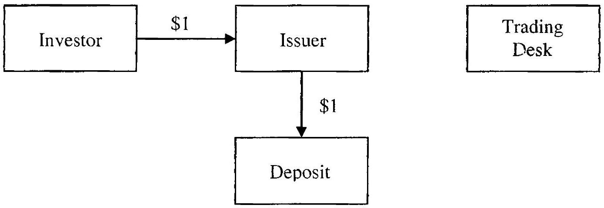
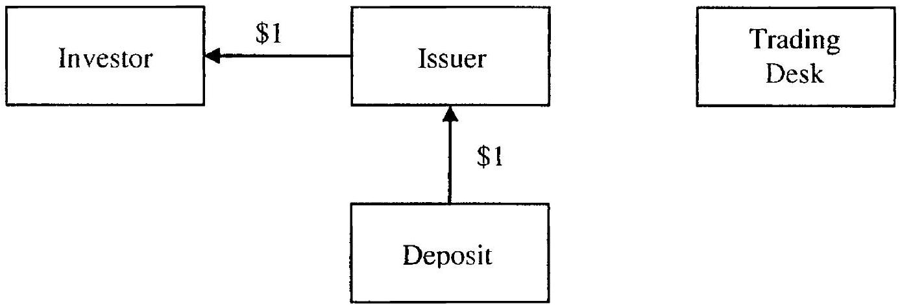

## Fixed Income Instruments

At this point, we have established the mathematical and numerical prerequisites needed for the remaining part of the book, much of which is devoted to the development of models for fixed income derivatives. Before delving into the modeling exercise, this final foundational chapter provides a tour of actual fixed income markets as well as an overview of the types of products traded. The simpler (and more liquid) of these products will typically serve as calibration targets to parameterize the models we develop; others (the more complicated and illiquid ones) will constitute the contracts that our model are ultimately meant to price and hedge. Throughout the chapter - and, indeed, this book - our focus is on the securities tied to the so-called Libor rate; this will include essentially all high-end exotic securities as well as more basic instruments such as FRAs, caps, and swaptions. Our priorities dictate that we leave out government, corporate, and mortgage bonds, as well as the derivatives associated with these types of securities. A discussion of these classes of securities, along with many more details on the organization and workings of fixed income markets, can be found in specialist literature, such as Fabozzi and Modigliani [1996], Fabozzi [1985], Fabozzi [2001], and Fabozzi and Fabozzi [1989].

### 5.1 Fixed Income Markets and Participants

At the most fundamental level, interest rates determine the economic cost of borrowing and lending, and as such define present values of future cash flows. In general, cash flows occurring at different times are discounted at different rates, reflecting market fluctuations in demand for money and risk preferences of market participants. The dependence of interest rates on time is described by the so-called term structure of interest rates, easily visualized as a curve that assigns a particular interest rate (or, equivalently, a discount factor) to each future date.

For a given entity, the cost of borrowing money will depend on its credit quality. Governments of developed countries, perceived to have virtually no possibility of default, issue bonds at comparatively low interest rates that reflect this perception. While the market in government debt is vast, corporations typically find it more convenient to use and originate fixed income instruments linked to rates that are more reflective of their own financing costs (i.e., credit quality). By far the most common of such reference rates is the London Interbank Offered rate, commonly known as the Libor rate. The Libor rate is a filtered average of bank estimates of rates at which they can borrow for a given term in the interbank money market, i.e. the wholesale market in which banks provide unsecured short-term credit to each other. Libor rates are quoted for multiple deposit maturities ranging from one day to one year, and are set every business day by averaging polling results from a number of large banks. Libor rates are available for deposits in different currencies, so that there is a USD-Libor rate, a EUR-Libor rate, and so on.

While Libor rates are probably the most used reference rates for interest rate contracts, there are other important rates to be aware of. For example, in the United States, banks are required to hold certain balances ("Federal funds") with the Federal Reserve, the central bank of the US. If a bank does not have sufficient balances, it can borrow them from another bank that has an excess on its account. The overnight interest rate charged in this case is called the (effective) Federal funds rate ${ }^{1}$, or sometimes simply the Fed funds rate. This rate is often considered the best available proxy for a risk-free USD rate, in part because the Fed funds rate is normally the contractual rate used to accrue interest on posted collateral ${ }^{2}$, as explained in Piterbarg [2010]. It is worth noting that the Fed funds rate used to be closely linked to the overnight Libor rate, with the spread between the two in the single basis points. However, in the subprime crisis of 2007-2009 the two have diverged significantly; the implications of this for interest rate curve construction are discussed in Section 6.5.3. Instruments linked to averages of the (effective) Fed fund rate over different terms are actively traded, giving rise to a term structure of Fed funds linked rates.

A special feature of the US public debt markets gives rise to another set of rates. In particular, interest on bonds issued by states and other local governments of the US is often free of the federal tax. The Bond Market Association, a trade association of the bond industry, publishes the BMA rate (or $B M A$ index) which is the estimate of borrowing by such municipalities.

[^65]There is a well-developed market in interest rate derivatives that are linked to the BMA rate.

The Euro and GBP markets do not have the same mechanism as the US does for Federal funds, but overnight rates that are proxies for riskfree borrowing in those currencies do exist. They are called Eonia (Euro OverNight Index Average) in the Eurozone and Sonia (Sterling OverNight Index Average) in Great Britain, and are computed as averages of all actual overnight lending/borrowing transactions by qualifying banks weighted by the size of the transactions. We emphasize that these rates reflect the actual transactions that have happened, in contrast to Libor which reflect banks' estimates of rates at which borrowing (for a given term) might take place. In the crisis of 2007-2009 there have been serious concerns about the integrity of the Libor rate and whether it really reflected the actual cost of funding for banks, and even some calls to scrap the Libor rate altogether. While the Libor rate has survived the crisis, the importance of overnight rates has increased dramatically, with the market in FedFunds/Eonia/Sonia linked derivatives, most importantly in overnight index swaps, or OIS, of various maturities growing dramatically. As with the Fed funds rate, Eonia and Sonia have diverged significantly from the corresponding Libor rates during market turbulence, and the decoupling continues to persist. As with the Fed funds rate, the implications of these developments on interest rate curve construction are discussed in Section 6.5.3.

Interest rates change day-to-day in response to changing macroeconomic and market conditions. With the cost of borrowing and lending money affecting all aspects of the economy, it is no surprise that a vast market in derivatives on interest rates has developed. Motivations of participants are diverse, ranging from locking in the cost of financing to pure speculation.

The fixed income market can be broadly split into two (overlapping) segments: the exchange market and the over-the-counter, or OTC, market. Contracts linked to the level of interest rates are traded on many securities exchanges. The exchanges attract all types of investors, including market makers, hedgers and speculators; see Hull [2006] for details on all. As of March 2008, notional amounts outstanding were $\$ 26$ trillion in exchange traded interest rate futures, and $\$ 45$ trillion in exchange traded interest rate options. While these are impressive numbers, far more fixed income derivatives trade in OTC markets than in exchange markets: as of December 2007, the notional amounts outstanding of OTC interest rate derivatives amounted to $\$ 393$ trillion ${ }^{3}$. The OTC market can loosely be visualized as a network of banks that trade with each other under terms governed by agreements spelled out by the trade organization International Swaps and Derivatives Association (ISDA). Central to OTC markets are the interest

[^66]rate dealers, banks with trading desks specializing in fixed income trading. The dealers provide liquidity in various types of securities, and are typically the most sophisticated players in the market. The dealers trade either on their own account or on behalf of customers such as financial institutions and corporates.

Financial institutions include mortgage companies (organizations that originate, package or service residential and commercial mortgage loans), pension funds, mutual funds, insurance companies, hedge funds, and other entities whose primary activities are related to financial markets. Financial institutions seek to either make money directly by engaging in trading activities (hedge funds), or to hedge their exposures (mortgage originators or servicers), or to achieve superior returns on their investments (pension funds, insurance companies). Among financial institutions, an important role is played by issuers, companies that issue structured notes for private and public placement. Structured notes deliver appealing return profiles to investors, returns that are essentially financed by selling options back to issuers. Issuance of increasingly complicated structured notes drives the exotic end of the fixed income markets.

Corporates are companies with primary activities not directly linked to fixed income markets, but whose operational results may be affected by the interest rate environment. For instance, many companies raise funds by borrowing from banks or by selling bonds, and are therefore affected by the prevailing levels of interest rates. Corporates often seek to lock in favorable interest rates for borrowing money, to hedge their interest rate exposures, to transform their liabilities from one type (e.g., a fixed rate liability) to another (a floating rate liability), or to design custom borrowing schemes around their expected future borrowing needs.

### 5.2 Certificates of Deposit and Libor Rates

Having identified the main types of market participants, we now proceed to define the universe of securities that this book will cover. For technical precision, we shall occasionally need to refer to the risk-neutral measure Q, as well as its associated expectation operator $\mathrm{E}=\mathrm{E}^{\mathrm{Q}}$ and its numeraire $\beta(t)$.

We start with the certificate of deposit (or $C D$ ), a deposit of money for a pre-specified term at a pre-specified interest rate. Terms may range from one week to one year or more, with the most popular being a 3 month or a 6 month term, depending on the currency of the deposit. If 1 (dollar) is deposited at time $T$ for a period of $\tau$ years, then the amount of capital to be returned at time $T+\tau$ is given by ${ }^{4}$[^67]

$$
1+\tau L
$$
where $L$ is, by definition, the interest rate for the CD. The rate is quoted as a simple rate, i.e. a rate with the compounding frequency equal to the term of the deposit. Notice that the average value of $L$ for CDs quoted in the interbank market will, by definition, be equal to the (spot) Libor rate for tenor $\tau$. Spot Libor rates for various tenors are calculated daily and are published by major news services such as Bloomberg or Reuters. As mentioned above, Libor serves as the primary reference rate in fixed income markets.

If $P(T, T+\tau)$ is the (Libor-based) discount factor to date $T+\tau$ as observed at $T$, then the discounted value of receiving $1+\tau L$ at time $T+\tau$ should be equal to 1 at time $T$, i.e.

$$
1=P(T, T+\tau)(1+\tau L) .
$$

In particular, recalling the definition (4.2) of $L(t, T, T+\tau)$, the rate $L$ paid on the CD is a simple spot rate

$$
\begin{equation*}
L=L(T, T, T+\tau)=\frac{1}{\tau}\left(\frac{1}{P(T, T+\tau)}-1\right) . \tag{5.1}
\end{equation*}
$$
^eq5-1

### 5.3 Forward Rate Agreements (FRA)

A certificate of deposit allows a market participant to lock in an interest rate for a given period of time, effective immediately. Many market participants, however, find it convenient to lock in interest rates for a given period of time that starts in the future. Contracts that provide such a rate guarantee are known as forward contracts or, in a fixed income context, forward rate agreements (FRAs). An FRA for the period $[T, T+\tau]$ is a contract to exchange fixed rate payment (agreed at the initiation of the contract) against a payment based on the time $T$ spot Libor rate of tenor $\tau$. While all payments on an FRA are exchanged at, or near ${ }^{5}$, time $T$, the contract is structured so that the payments are made in $T+\tau$ dollars.

Formally, consider the origination at time $t, t \leq T$, of a unit notional FRA contract with a rate of $k$. Ignoring payment delays, from the perspective of the fixed rate payer the net payment at time $T$ will be

$$
V_{\mathrm{FRA}}(T)=\tau(L(T, T, T+\tau)-k) /(1+\tau L(T, T, T+\tau)),
$$

with the (contractually specified) factor $1 /(1+\tau L(T, T, T+\tau))$ applied to roll the payment to the future date $T+\tau$. We note that[^68]

$$
1 /(1+\tau L(T, T, T+\tau))=P(T, T+\tau)
$$
so, by the fundamental pricing result (4.13), the value of this contract at time $t$ is equal to

$$
V_{\mathrm{FRA}}(t)=\beta(t) \mathrm{E}_{t}\left(\beta(T)^{-1} \tau(L(T, T, T+\tau)-k) P(T, T+\tau)\right)
$$
(recall that $\beta(\cdot)$ is the money market account). Substituting (5.1) we obtain

$$
V_{\mathrm{FRA}}(t)=\beta(t) \mathrm{E}_{t}\left(\beta(T)^{-1}(1-P(T, T+\tau)-\tau k P(T, T+\tau))\right) .
$$

Since $P(\cdot, T+\tau)$ is a traded asset, its price deflated by the numeraire $\beta(\cdot)$ is a martingale. Thus

$$
\begin{align*}
V_{\mathrm{FRA}}(t) & =P(t, T)-P(t, T+\tau)-\tau k P(t, T+\tau) \\
& =\tau P(t, T+\tau)\left(\frac{P(t, T)-P(t, T+\tau)}{\tau P(t, T+\tau)}-k\right) \tag{5.2}
\end{align*}
$$
^eq5-2

Most often, FRAs are issued at no cost to either party at the time of origination. The value of $k$ that makes the FRA contract have value 0 at the contract initiation time $t$ is given by the forward Libor rate (see (4.2)),

$$
k=L(t, T, T+\tau)=\frac{P(t, T)-P(t, T+\tau)}{\tau P(t, T+\tau)}
$$

Thus, a forward Libor rate has the financial interpretation of being a breakeven rate on an FRA contract in interbank markets.

### 5.4 Eurodollar Futures

FRAs, being forward contracts on Libor rates, allow market participants to either lock in favorable rates for future periods, or to speculate on the future direction of rates. FRAs trade in the OTC market, and are open only to institutions that participate in this market. Alternatively, futures contracts on Libor rates are available on a number of international exchanges, including the Chicago Mercantile Exchange (CME), London International Financial Futures and Options Exchange (LIFFE), and Marchè à Terme International de France (MATIF). The CME interest rate futures contract on a three-month spot Libor rate on US dollar denominated deposits is called the Eurodollar futures or, simply, ED futures contract.

At maturity $T$, an ED futures contract is settled at

$$
100 \times(1-L(T, T, T+\tau))
$$

The futures rate $F(t, T, T+\tau)$ at time $t$ (see (4.1.2)) is defined to be the rate such that the quoted futures price at time $t$ is equal to ${ }^{6}$[^69]

$$
100 \times(1-F(t, T, T+\tau)) .
$$

As is the case for all futures contracts, ED futures are settled (marked to market) daily. Confusing matters somewhat, the actual amount of money that is settled between holders of the long and the short positions in an ED future is determined by the daily change in the actual futures price defined by

$$
N_{\mathrm{ED}} \times\left[1-\frac{1}{4} F(t, T, T+\tau)\right]
$$

where $N_{\mathrm{ED}}$ is the notional principal of the contract $(\$ 1,000,000$ for the CME's ED futures). In particular, for 1 basis point ( $0.01 \%$ ) increase in the rate $F(t, T, T+\tau)$, the CME contract buyer pays $1,000,000 \times 0.25 \times 0.0001=$ 25 dollars to the seller.

As explained in Chapter 4, futures rates $F(t, T, T+\tau)$ are generally different from forward Libor rates $L(t, T, T+\tau)$. The problem of computing the difference, the ED convexity adjustment, is considered in Section 16.8.

Unlike FRAs, for which the deposit period is negotiated between two parties, ED futures are standardized. Available contracts expire on four specific dates, one each in March, June, September and December, over the next ten years. Such standardization increases liquidity in each particular contract.

### 5.5 Fixed-for-Floating Swaps

A swap is a generic term for an OTC derivative in which two counterparties agree to exchange one stream of cash flows against another stream. These streams are called the legs of the swap. A plain vanilla fixed-for-floating interest rate swap (a plain vanilla swap, or just a swap if there is no confusion) is a swap in which one leg is a stream of fixed rate payments and the other a stream of payments based on a floating rate, most often Libor. The legs are denominated in the same currency, have the same notional, and expire on the same date. Payment streams are made on a pre-defined schedule of contiguous time intervals, known as periods. Typically, the floating rate is observed (or fixed) at the beginning of each period, with both fixed and floating rate coupons being paid out at the end of the period. A plain-vanilla swap is economically equivalent ${ }^{7}$ to a multi-period FRA, and serves the same purpose in the market as regular FRAs. Between interest rate dealers

[^70]and financial institutions, swaps of different maturities are often traded to adjust interest risk positions of the parties involved, or to simply make bets on future direction of interest rates. Swaps are also used by corporates, often in conjunction with bond or note issuance, to transform fixed rate obligations into floating ones, or vice versa.

To formally define a fixed-floating swap, one specifies a tenor structure, i.e. an increasing sequence of maturity times, normally spaced roughly equidistantly (see Section 4.1.3)

$$
\begin{equation*}
0 \leq T_{0}<T_{1}<T_{2}<\ldots<T_{N}, \quad \tau_{n}=T_{n+1}-T_{n} \tag{5.3}
\end{equation*}
$$
^eq5-3

In a fixed-floating swap with fixed rate $k$, one party (the fixed rate payer) pays simple interest based on the rate $k$ in return for simple interest payments computed from the Libor rate fixing on date $T_{n}$, for each period $\left[T_{n}, T_{n+1}\right]$, $n=0, \ldots, N-1$. The payments are exchanged at the end of each period, i.e. at time $T_{n+1}$. In practice, the payments are netted, and only their difference changes hands. From the perspective of the fixed rate payer, the net cash flow of the swap at time $T_{n+1}$ is therefore given by (on a unit notional)

$$
\tau_{n}\left(L_{n}\left(T_{n}\right)-k\right), \quad L_{n}(t)=L\left(t, T_{n}, T_{n+1}\right)
$$

for $n=0, \ldots, N-1$. Dates when the Libor rates are observed are typically called fixing dates; dates when payments occur are called payment dates.

By the fundamental valuation result (4.13), the value of a swap is equal to the expected discounted value of its (netted) payments. Specifically, the value to the fixed rate payer of a unit notional fixed-floating swap at time $t$, $0 \leq t \leq T_{0}$, is given by ${ }^{8}$

$$
\begin{aligned}
V_{\text {swap }}(t) & =\beta(t) \sum_{n=0}^{N-1} \tau_{n} \mathrm{E}_{t}\left(\beta\left(T_{n+1}\right)^{-1}\left(L_{n}\left(T_{n}\right)-k\right)\right) \\
& =\beta(t) \sum_{n=0}^{N-1} \tau_{n} \mathrm{E}_{t}\left(\beta\left(T_{n}\right)^{-1}\left(L_{n}\left(T_{n}\right)-k\right) P\left(T_{n}, T_{n+1}\right)\right) .
\end{aligned}
$$

Using the definition of Libor rates $L_{n}\left(T_{n}\right)$,

$$
V_{\text {swap }}(t)=\beta(t) \sum_{n=0}^{N-1} \mathrm{E}_{t}\left(\beta\left(T_{n}\right)^{-1}\left(1-P\left(T_{n}, T_{n+1}\right)-\tau_{n} k P\left(T_{n}, T_{n+1}\right)\right)\right)
$$

For each $n, P\left(\cdot, T_{n}\right)$ is a traded asset, so its price deflated by the numeraire $\beta(\cdot)$ is a martingale. Hence

$$
V_{\text {swap }}(t)=\sum_{n=0}^{N-1}\left(P\left(t, T_{n}\right)-P\left(t, T_{n+1}\right)-\tau_{n} k P\left(t, T_{n+1}\right)\right)
$$

[^71]Recalling the definition of $L_{n}(t)$, this can be rewritten as

$$
V_{\text {swap }}(t)=\sum_{n=0}^{N-1} \tau_{n} P\left(t, T_{n+1}\right)\left(L_{n}(t)-k\right)
$$

An important observation is that a vanilla fixed-floating swap can be valued on date $t$ using only the term structure of interest rates observed on that date. In particular, swap values are not affected by the dynamics of interest rates, only their current levels.

The swap valuation formula above can be rewritten as follows,

$$
V_{\text {swap }}(t)=\left(\sum_{n=0}^{N-1} \tau_{n} P\left(t, T_{n+1}\right)\right)\left(\frac{\sum_{n=0}^{N-1} \tau_{n} P\left(t, T_{n+1}\right) L_{n}(t)}{\sum_{n=0}^{N-1} \tau_{n} P\left(t, T_{n+1}\right)}-k\right)
$$

Using the definitions (4.8), (4.10) and (4.11) from Chapter 4 :

$$
\begin{align*}
A(t) \triangleq A_{0, N}(t) & =\sum_{n=0}^{N-1} \tau_{n} P\left(t, T_{n+1}\right)  \tag{5.4}\\
S(t) \triangleq S_{0, N}(t) & =\frac{\sum_{n=0}^{N-1} \tau_{n} P\left(t, T_{n+1}\right) L_{n}(t)}{\sum_{n=0}^{N-1} \tau_{n} P\left(t, T_{n+1}\right)} \tag{5.5}
\end{align*}
$$
^eq5-4
^eq5-5

we obtain the convenient formula

$$
\begin{equation*}
V_{\mathrm{swap}}(t)=A(t)(S(t)-k) \tag{5.6}
\end{equation*}
$$
^eq5-6

The quantity $A(\cdot)$ is the annuity of the swap (or its $P V B P$, for Present Value of a Basis Point), and the quantity $S(t)$ is the forward swap rate. Clearly, $S(t)$ is the value of the fixed rate that makes the swap have value 0 to both parties at time $t ; S$ is consequently often referred to as a par or break-even rate.

For plain-vanilla swaps, the fixed rate and the swap notional are constant through time. More general swaps are, however, not bound by such restrictions and both the fixed rate and the notional may vary from period to period. A non-standard swap with a notional schedule $\left\{q_{n}\right\}_{n=0}^{N-1}$ (non-constant but deterministic) and a fixed rate schedule $\left\{k_{n}\right\}_{n=0}^{N-1}$ has the value

$$
\begin{aligned}
V_{\text {genswap }}(t) & =\beta(t) \sum_{n=0}^{N-1} \tau_{n} q_{n} \mathrm{E}_{t}\left(\beta\left(T_{n+1}\right)^{-1}\left(L_{n}\left(T_{n}\right)-k_{n}\right)\right) \\
& =\sum_{n=0}^{N-1} \tau_{n} q_{n} P\left(t, T_{n+1}\right)\left(L_{n}(t)-k_{n}\right)
\end{aligned}
$$

Certain general swaps have dedicated names, such as amortizing swaps (notional decreases with time) and accreting swaps (notional increases with time).

As we mentioned in Section 5.1, swaps linked to overnight rates (FedFunds/Eonia/Sonia) have recently become more popular. Among them the overnight index swap (OIS) is probably the most liquid, and is defined as a swap that pays a compounded overnight rate against fixed rate payments. To write down its definition, let us assume that a tenor structure (5.3) is given, and denote by $\left\{t_{n, i}\right\}_{i=1}^{K_{n}}$ the collection of all business days in the period $\left[T_{n}, T_{n+1}\right)$, so that $T_{n}=t_{n, 1}<\ldots<t_{K_{n}}<T_{n+1}$. Then the net payment of the OIS with fixed rate $k$ at time $T_{n+1}$ is given by

$$
\tau_{n}\left(\bar{L}_{n}-k\right)
$$

where the floating rate $\bar{L}_{n}$ for the $n$-th period of OIS is given by

$$
\begin{equation*}
\bar{L}_{n}=\frac{1}{\tau_{n}}\left(\prod_{i=1}^{K_{n}-1}\left(1+\left(t_{i+1}-t_{i}\right) L\left(t_{i}, t_{i}, t_{i+1}\right)\right)-1\right) . \tag{5.7}
\end{equation*}
$$
^eq5-7

Here we used the notation $L\left(t_{i}, t_{i}, t_{i+1}\right)$ to denote the overnight rate. Equating the overnight rate with the short rate, we can use a more mathematically convenient (although not exactly correct) expression

$$
\begin{equation*}
\bar{L}_{n}=\frac{1}{\tau_{n}}\left(e^{\int_{T_{h}}^{T_{n+1}} r(t) d t}-1\right) \tag{5.8}
\end{equation*}
$$
^eq5-8

### 5.6 Libor-in-Arrears Swaps

Allowing the fixed rate and the notional to vary through time is not the only way to generalize a swap. For a Libor-in-arrears swap, Libor rates are observed (fixed) at the end of each period rather than at the beginning. Thus, a value of a Libor-in-arrears payer swap is equal to

$$
V_{\mathrm{LIA}}(t)=\beta(t) \sum_{n=0}^{N-1} \tau_{n} \mathrm{E}_{t}\left(\beta\left(T_{n+1}\right)^{-1}\left(L_{n+1}\left(T_{n+1}\right)-k\right)\right) .
$$

Interestingly, this seemingly innocuous modification makes the value of a swap model-dependent, in contrast to the standard fixed-floating swap. We will discuss pricing of in-arrears swaps in Chapter 16.

Libor-in-arrears swaps are popular in upward-sloping interest rate curve environments, i.e. when long-tenor rates are higher than shorter-tenor ones. In such a scenario, the break-even fixed rate on the Libor-in-arrears swap tends to look more "attractive" than that of a standard fixed-floating swap, thus increasing the desirability of the swap to those seeking to receive fixed rate payments.

### 5.7 Averaging Swaps

Libor rates are not restricted to being observed on either the start date or the end of the pay period. A popular example is the averaging swap, i.e. a swap where the floating rate is determined as an average of Libor rate observations taken at regular intervals over each coupon period. For example, let $\left\{\left(t_{n, i}^{f}, t_{n, i}^{s}, t_{n, i}^{e}\right)\right\}_{i=1}^{K_{n}}$ be a collection of date triplets (fixing, start and end date) that define the rates to be used in calculating the payment in period $n$. Defining a set of weights $w_{n, i}, i=1, \ldots, K_{n}$, the floating rate $\bar{L}_{n}$ for the period [ $T_{n}, T_{n+1}$ ] may be defined as

$$
\bar{L}_{n}=\sum_{i=1}^{K_{n}} w_{n, i} L\left(t_{n, i}^{f}, t_{n, i}^{s}, t_{n, i}^{e}\right) .
$$

For the fixed rate swap payer, the averaging swap value is therefore

$$
\begin{equation*}
V_{\text {average }}(t)=\beta(t) \sum_{n=0}^{N-1} \tau_{n} \mathrm{E}_{t}\left(\beta\left(T_{n+1}\right)^{-1}\left(\bar{L}_{n}-k\right)\right) . \tag{5.9}
\end{equation*}
$$
^eq5-9

As a rule, the weights $w_{n, i}$ sum up to $1, \sum_{i=1}^{K_{n}} w_{n, i}=1$; the weights usually reflect the number of days (using the appropriate day counting conventions) that a given rate $L\left(t_{n, i}^{f}, t_{n, i}^{s}, t_{n, i}^{e}\right)$ is supposed to be in effect. Computation of the valuation expression (5.9) can be done using techniques similar to those required for in-arrears swaps; see Chapter 16 for details.

Swaps linked to the average of the Federal funds rate are common examples of an averaging swap. Particularly noteworthy is the Fed funds/Libor basis swap which pays the average of the Fed funds rate (over a given period) against a payment based on a Libor rate for that period. This instrument is an example of a floating-floating single-currency basis swap, i.e., a swap that exchanges payments based on two different floating rates in the same currency. Closely related to Fed funds basis swaps are the Fed funds futures contracts traded on the Chicago Board of Trade (CBOT) exchange. These contract uses the 30 day running average of the Federal funds rate for settlement.

Remark 5.7.1. Going forward, in our product descriptions we shall normally assume that all cash flows pay at the end of the periods in which they fix. While this is common practice, as we have just seen the "pay-in-arrears" rule can be broken at will depending on the client's needs - the only (selfevident) restriction is that payments should be fixed by the time they are made.

### 5.8 Caps and Floors

A firm with liabilities funded at a floating (i.e., Libor) rate is naturally concerned with the possibility that interest rates, and thus its interest rate
payments, may increase in the future. One way to immunize against this risk is to pay fixed on a fixed-floating interest rate swap, in effect turning floating rate payments into fixed ones. While this will guarantee a fixed rate for funding payments for the duration of the swap, it will also mean forgoing the possibility of benefiting from a potential future drop in rates. An interest rate cap is a security that allows one to benefit from low floating rates yet be protected from high rates. Similarly, for an investor with assets earning a floating rate, a low-rate scenario is unfavorable. An interest rate floor is an instrument designed to protect against low interest rates yet allow the holder to benefit from high rates.

Formally, a cap is a strip of caplets, call options on successive Libor rates, and a floor is a strip of floorlets, put options on successive Libor rates. We encountered caplets already in Section 4.5.1 and recall that this instrument pays

$$
\tau_{n}\left(L_{n}\left(T_{n}\right)-k\right)^{+}
$$

per unit notional at time $T_{n+1}$. Similarly, a floorlet pays

$$
\tau_{n}\left(k-L_{n}\left(T_{n}\right)\right)^{+}
$$

per unit notional at time $T_{n+1}$. Then, $N$-period caps and floors have values at time $t$ of

$$
\begin{gathered}
V_{\text {cap }}(t)=\beta(t) \sum_{n=0}^{N-1} \tau_{n} \mathrm{E}_{t}\left(\beta\left(T_{n+1}\right)^{-1}\left(L_{n}\left(T_{n}\right)-k\right)^{+}\right), \\
V_{\text {floor }}(t)=\beta(t) \sum_{n=0}^{N-1} \tau_{n} \mathrm{E}_{t}\left(\beta\left(T_{n+1}\right)^{-1}\left(k-L_{n}\left(T_{n}\right)\right)^{+}\right) .
\end{gathered}
$$

By switching to the $T_{n+1}$-forward measure (see Section 4.2.2) for the $n$-th caplet/floorlet, the valuation formulas can be written in a more convenient form

$$
\begin{aligned}
V_{\text {cap }}(t) & =\sum_{n=0}^{N-1} \tau_{n} P\left(t, T_{n+1}\right) \mathrm{E}_{t}^{T_{n+1}}\left(\left(L_{n}\left(T_{n}\right)-k\right)^{+}\right) \\
V_{\text {floor }}(t) & =\sum_{n=0}^{N-1} \tau_{n} P\left(t, T_{n+1}\right) \mathrm{E}_{t}^{T_{n+1}}\left(\left(k-L_{n}\left(T_{n}\right)\right)^{+}\right)
\end{aligned}
$$

By Lemma 4.2.3, the Libor rate $L_{n}(\cdot)$ is a martingale under the $T_{n+1}$-forward measure. Hence, caplets/floorlets can be priced using "vanilla" models ${ }^{9}$, such as the log-normal Black model (see Remark 1.9.4).

[^72]The OTC market in caps/floors is very liquid. While individual caplets/floorlets are not traded, caps/floors are available in a number of maturities. This allows the volatility information for individual forward Libor rates to be extracted from market quotes for caps/floors of different maturities, at least in principle ${ }^{10}$. Once extracted, these volatilities may be combined with the volatilities observed from European swaption quotes (see below), to form a set of market inputs to which interest rate models for exotics are calibrated.

### 5.9 Digital Caps and Floors

Digital caps and floors work like regular caps and floors, except that the $n$-th digital caplet pays

$$
\tau_{n} \times 1_{\left\{L_{n}\left(T_{n}\right)>k\right\}} .
$$

Similarly, the $n$-th digital floorlet pays

$$
\tau_{n} \times 1_{\left\{L_{n}\left(T_{n}\right)<k\right\}}
$$

Digital caps and floors provide a leveraged way to bet on the future direction of interest rates, more so than through standard caps and floors.

### 5.10 European Swaptions

Caps and floors have an asymmetric exposure to interest rates, a characteristic used by both hedgers and speculators. A similar exposure profile is provided by options on swaps, the so-called European swaptions. A European swaption gives the holder a right, but not an obligation, to enter a swap at a future date at a given fixed rate. A payer swaption is an option to pay the fixed leg on a fixed-floating swap; a receiver swaption is an option to receive the fixed leg.

Assuming the underlying swap starts on the expiry date $T_{0}$ of the option (a typical situation), the payoff for a payer swaption at time $T_{0}$ then equals

$$
\begin{equation*}
V_{\text {swaption }}\left(T_{0}\right)=\left(V_{\text {swap }}\left(T_{0}\right)\right)^{+}=\left(\sum_{n=0}^{N-1} \tau_{n} P\left(T_{0}, T_{n+1}\right)\left(L_{n}\left(T_{0}\right)-k\right)\right)^{+} \tag{5.10}
\end{equation*}
$$
^eq5-10

The value at an intermediate time $t, t<T_{0}$, must then equal

$$
\begin{aligned}
V_{\text {swaption }}(t) & =\beta(t) \mathrm{E}_{t}\left(\beta\left(T_{0}\right)^{-1} V_{\text {swaption }}\left(T_{0}\right)\right) \\
& =\beta(t) \mathrm{E}_{t}\left(\beta\left(T_{0}\right)^{-1} \sum_{n=0}^{N-1} \tau_{n} P\left(T_{0}, T_{n+1}\right)\left(L_{n}\left(T_{0}\right)-k\right)\right)^{+}
\end{aligned}
$$

[^73]which, using (5.6), can be rewritten in the more compact form

$$
\begin{equation*}
V_{\text {swaption }}(t)=\beta(t) \mathrm{E}_{t}\left(\beta\left(T_{0}\right)^{-1} A\left(T_{0}\right)\left(S\left(T_{0}\right)-k\right)^{+}\right) . \tag{5.11}
\end{equation*}
$$
^eq5-11

Moreover, switching to the annuity measure, also known as the swap measure, $Q^{A}$ from Section 4.2.5, the swaption value can be expressed as

$$
\begin{equation*}
V_{\text {swaption }}(t)=A(t) \mathrm{E}_{t}^{A}\left(S\left(T_{0}\right)-k\right)^{+}, \tag{5.12}
\end{equation*}
$$
^eq5-12

with the forward swap rate $S(\cdot)$ being a martingale in the swap measure $\mathrm{Q}^{A}$; see Lemma 4.2.4.

It is evident from (5.12) that a payer European swaption is a call option - and a receiver European swaption is a put option - on the forward swap rate, struck at the fixed rate of the swap. Hence, swaptions could be priced using a vanilla model (see footnote 9), such as the Black model or similar. Conversely, values of European swaptions can be translated into market-implied distributional characteristics of forward swap rates, a topic discussed at length in Section 7.1.2. In particular, it is universal practice to quote swaption prices in terms of implied Black volatilities, i.e. volatilities that recover market price when used in the Black formula. In some markets (e.g., the US), it is also common to quote implied Gaussian volatilities, defined in the same way with regard to a Gaussian (rather than log-normal) model for the distribution of interest rates, see (7.16).

The market in swaptions is very liquid, with many different option maturities and swap underlyings actively traded. To characterize the full universe of traded instruments, given a tenor structure (5.3) we consider swaptions of different expiries $\left\{T_{n}\right\}_{n=0}^{N-1}$ that can be exercised into swaps that start at $T_{n}$ and cover $m$ periods ${ }^{11}$, i.e. their last payment date is $T_{n+m}$. For a convenient way to denote the various swaptions, recall definitions (4.8), (4.10) and (4.11) and introduce

$$
\begin{align*}
A_{n, m}(t) & =\sum_{i=n}^{n+m-1} \tau_{i} P\left(t, T_{i+1}\right)  \tag{5.13}\\
S_{n, m}(t) & =\frac{\sum_{i=n}^{n+m-1} \tau_{i} P\left(t, T_{i+1}\right) L_{i}(t)}{\sum_{i=n}^{n+m-1} \tau_{i} P\left(t, T_{i+1}\right)} \tag{5.14}
\end{align*}
$$
^eq5-13
^eq5-14

for $n=0, \ldots, N-1, m=1, \ldots, N-n$. Then the value of the ( $n, m$ )-swaption (a short-hand for an " $m$-period swaption with expiry $T_{n}$ ") is equal to

$$
A_{n, m}(t) \mathrm{E}_{t}^{n, m}\left(\left(S_{n, m}\left(T_{n}\right)-k\right)^{+}\right)
$$

where $\mathrm{E}_{t}^{n, m}$ denotes time $t$ expectation in the appropriate swap measure, $\mathrm{Q}^{n, m}$. Note that in trader parlance, a (vanilla) $T_{n}$-maturity European swaption on a swap that runs from $T_{n}$ to $T_{m}$ is said to be a " $T_{n}$ into $T_{m+n}-T_{n}$ "

[^74]swaption. For instance, a 5 year option on a 10 year swap would be a "5-into-10" (or "5y-into-10y", or simply "5y10y") swaption.

Clearly, when $m=1$, the ( $n, m$ )-swaption reduces to a caplet (or floorlet) on the Libor rate $L_{n}(\cdot)$, so caplets and floorlets can be thought of as one-period swaptions. Whenever in this book swaptions are discussed or used, caplets and floorlets are thereby implicitly included. Collectively, all ( $n, m$ )-swaptions constitute the swaption grid.

Market quotes on swaptions, typically in terms of implied volatilities, in the swaption grid provide the most readily-available information on the volatility structure of interest rates. As swaptions in the grid cover overlapping sections of the term structure of interest rates, extracting clean volatility information from market quotes is a non-trivial exercise that forms the foundation for calibration of models used for exotic interest rate derivative pricing. We will have much to say about such volatility calibration later on.

While options on plain-vanilla swaps comprise the bulk of the liquid ("vanilla") interest rate market, options on general swaps (i.e. on swaps with non-constant notionals and fixed rates) also trade and are properly treated as exotic derivatives. Often, general swaps can be decomposed into baskets of standard swaps, in which case options on general swaps become basket options. Valuation of basket options requires information on the co-dependence structure of securities in the basket, information that is not readily available from the vanilla options markets. We demonstrate how to handle this complication in Section 19.4.

### 5.10.1 Cash-Settled Swaptions

The swaption contract discussed in the previous section involves physical settlement, in the sense that an actual interest rate swap is entered into, should the option be exercised at its expiry. Physically-settled swaptions are also known as swap-settled swaptions. An economically equivalent swaption contract is one that instead settles into a cash payment equal to the PV (present value) of the swap as observed at time $T_{0}$. Indeed, for both types, the swaption payoff (for a payer) is given by

$$
\begin{equation*}
A\left(T_{0}\right)\left(S\left(T_{0}\right)-k\right)^{+} \tag{5.15}
\end{equation*}
$$
^eq5-15

see (5.10) and (5.11). In the European markets, a third variety of swaptions is common, the so-called cash-settled swaptions. For this type of option, rather than entering into a swap, the option holder will receive a cash payout upon exercise. The settlement amount is calculated by a formula similar to (5.15), except the annuity $A(\cdot)$ is not calculated by (5.4), but instead by discounting fixed rate payments at the swap rate $S\left(T_{0}\right)$. Specifically,

$$
V_{\mathrm{css}}\left(T_{0}\right)=a\left(S\left(T_{0}\right)\right)\left(S\left(T_{0}\right)-k\right)^{+}
$$

where

$$
a(x)=\sum_{n=0}^{N-1} \frac{\tau_{n}}{\prod_{i=0}^{n}\left(1+\tau_{i} x\right)}
$$

Notice that the cash settlement mechanism ensures a well-defined present value of the option payout, as long as the swap rate $S\left(T_{0}\right)$ is observable. In contrast, the value of exercise of a physically settled swaption - the computation of which requires knowledge of a strip of discount factors - may be estimated differently by different dealers, due to bid-ask spread effects and differences in curve building technology (see Chapter 6). Technically, however, the cash settlement mechanism induces certain valuation complications, and cash-settled swaptions cannot, strictly speaking, be considered vanilla options that can be priced using, e.g., a Black-type formula ${ }^{12}$. This follows from the fact that in the measure associated with the deflator $X(t)=a(S(t))$, the swap rate $S(\cdot)$ is not a martingale, and certain drift adjustments are required. We discuss valuation of cash-settled swaptions in Section 16.6.12. As they are the most liquidly-traded OTC interest rate options in the European market, cash-settled swaptions still could (and should) be used to extract information on the volatility structure of interest rates; the procedure, however, is necessarily more involved.

### 5.11 CMS Swaps, Caps and Floors

As the market in plain vanilla swaps is both deep and very active, market quotes of corresponding swap rates can be used as "indexes", i.e. market variables that can themselves be used in defining payoffs of other securities. The demand for such products is often driven by particular segments of fixed income markets. For example, mortgage lenders are primarily concerned with hedging interest rate risk arising from holding residential loans, some of which may have maturities as long as thirty years. Because of potential prepayments, the interest rate risk of a pool of such mortgages is often assumed to be closely connected to movements in the 10 year swap rate; hence, mortgage lenders are natural consumers of interest rate securities linked to the 10 year swap rate.

A constant-maturity swap (CMS) rate is defined as a break-even swap rate (see (5.5)) on a standard swap of a fixed maturity, e.g. 10 years or 30 years. A $C M S$ swap works just like a standard fixed-floating (Libor) swap, except for the fact that floating leg payments are based on CMS, rather than Libor, rates. Formally, let $S_{n, m}(\cdot)$ be the $m$-period swap rate with the first fixing date $T_{n}$, as defined by (5.14). Then an $m$-period (payer) CMS swap's value is given by[^75]

$$
V_{\text {cmsswap }}(t)=\beta(t) \sum_{n=0}^{N-1} \tau_{n} \mathrm{E}_{t}\left(\beta\left(T_{n+1}\right)^{-1}\left(S_{n, m}\left(T_{n}\right)-k\right)\right)
$$
or, using the $T_{n+1}$-forward measure for each period,

$$
V_{\text {cmsswap }}(t)=\sum_{n=0}^{N-1} \tau_{n} P\left(t, T_{n+1}\right) \mathrm{E}_{t}^{T_{n+1}}\left(\left(S_{n, m}\left(T_{n}\right)-k\right)\right)
$$

While standard swaps can be valued solely from knowledge of the term structure of interest rates, CMS swaps require an interest rate model for valuation; we return to a complete discussion in Chapter 16.

CMS caps and floors are defined as strips of European options on CMS rates, just like regular caps and floors are strips of European options on Libor rates:

$$
\begin{aligned}
V_{\text {cmscap }}(t) & =\sum_{n=0}^{N-1} \tau_{n} P\left(t, T_{n+1}\right) \mathrm{E}_{t}^{T_{n+1}}\left(\left(S_{n, m}\left(T_{n}\right)-k\right)^{+}\right), \\
V_{\text {cmsfloor }}(t) & =\sum_{n=0}^{N-1} \tau_{n} P\left(t, T_{n+1}\right) \mathrm{E}_{t}^{T_{n+1}}\left(\left(k-S_{n, m}\left(T_{n}\right)\right)^{+}\right) .
\end{aligned}
$$

CMS caplets are related to European swaptions, as both are European-style options on swap rates. The connection between the two types of securities is, however, subtle, as we shall discuss later in this book.

### 5.12 Bermudan Swaptions

A Bermudan swaption is an option to enter into a fixed-floating swap on any (or any from a given subset) of its fixing dates. For a given tenor structure (5.3), the holder of a standard Bermudan swaption has the right to exercise it on any of the dates $\left\{T_{n}\right\}_{n=0}^{N-1}$. Once exercised on date $T_{n}$, say, the option goes away, and the holder enters the swap with the first fixing date $T_{n}$ and the final payment date $T_{N}$. The period up to $T_{0}>0$ is known as the lockout or no-call period. In common jargon, a Bermudan swaption on, say, a 10 year swap with a 2 year lockout period (at inception) is known as a " 10 no-call 2 ", or " 10 nc 2 ", Bermudan swaption.

Formally, at time $T_{n}$, the value of a payer ${ }^{13}$, if exercised, is therefore

$$
\begin{aligned}
U_{n}\left(T_{n}\right) & =\beta(t) \sum_{i=n}^{N-1} \tau_{i} \mathrm{E}_{T_{n}}\left(\beta\left(T_{i+1}\right)^{-1}\left(L_{i}\left(T_{i}\right)-k\right)\right) \\
& =\sum_{i=n}^{N-1} \tau_{i} P\left(T_{n}, T_{i+1}\right)\left(L_{i}\left(T_{n}\right)-k\right)
\end{aligned}
$$

[^76]Here, $U_{n}\left(T_{n}\right)$ here denotes the exercise value of the Bermudan swaption; loosely speaking, a Bermudan swaption contract is an option to chose between $U_{n}\left(T_{n}\right)$ for different $n=0, \ldots, N-1$. More succinctly, we recall from Section 1.10 that the Bermudan option value at time $T_{n}$ will be the maximum of $U_{n}\left(T_{n}\right)$ and the hold value $H_{n}\left(T_{n}\right)$, the latter defined as the value of a Bermudan swaption with the exercise dates $\left\{T_{i}\right\}_{i=n+1}^{N-1}$ only (compare to Sections 1.10 and 3.5).

Demand for Bermudan swaptions comes from different segments of fixed income markets. Mortgage companies use them to hedge pools of mortgages, with the flexibility of Bermudan exercise convenient in matching the uncertain timing of prepayments in mortgage pools. Investors seeking higher current income sell Bermudan-style options on swaps to increase the coupons they receive, as explained later in the context of callable Libor exotics. Bermudan swaptions are also used as hedges for callable coupon bonds.

While it may be tempting to think of Bermudan swaptions as straightforward generalizations of European swaptions, they are substantially more difficult to model and price. Indeed, it is fair to say that many valuation methods and techniques covered in this book were developed in response to the need to value and risk manage Bermudan swaptions. Bermudan swaptions are, by far, the most liquid exotic fixed income securities, with all interest rate dealers holding large inventories.

### 5.13 Exotic Swaps and Structured Notes

With market sophistication ever on the rise, clients demand increasingly complicated payouts, often in a familiar swap or bond format (although the appetite has waned somewhat post-crisis). In an exotic swap, a regular floating Libor leg is swapped against structured coupons that are allowed to be arbitrary functions of observed interest rates (such as Libor or CMS rates). A standard fixed-floating vanilla swap is an obvious and trivial example where the structured coupon simply is a fixed rate. A cap (or a floor) can be seen as another, less trivial, example. In particular, note that

$$
\begin{aligned}
\left(k-L_{n}\left(T_{n}\right)\right)^{+} & =\left(\left(k-L_{n}\left(T_{n}\right)\right)^{+}+L_{n}\left(T_{n}\right)\right)-L_{n}\left(T_{n}\right) \\
& =\max \left(k, L_{n}\left(T_{n}\right)\right)-L_{n}\left(T_{n}\right)
\end{aligned}
$$

which demonstrates that a floor can be represented as an exotic swap in which a Libor rate is exchanged for a floored payoff $\max \left(k, L_{n}\left(T_{n}\right)\right)$.

Exotic swaps often start their life as bonds, or notes, sold by banks to investors. In a structured note, the investor pays an up-front principal amount (e.g., $\$ 10,000,000$ ) to the issuer of the note, who in turn pays the investor a structured coupon, and repays the principal at the maturity of the note. The principal amount is invested by the issuer (or the trading
desk to which the issuer passes the note for risk management), and pays the Libor rate plus or minus a spread. From the perspective of the issuer (or the trading desk), the net cash flows of the note are those of an exotic swap.

In terms of valuation, if $C_{n}$ is the structured coupon for the $n$-th period, the value of the exotic swap is equal to (from the perspective of structured leg buyer)

$$
V_{\text {exotic }}(t)=\beta(t) \sum_{n=0}^{N-1} \tau_{n} \mathrm{E}_{t}\left(\beta\left(T_{n+1}\right)^{-1}\left(C_{n}-L_{n}\left(T_{n}\right)\right)\right),
$$

where we for brevity have assumed that both legs of the swap pay at the end date of each coupon period (see Remark 5.7.1). As discussed earlier, in this valuation equation, the coupon $C_{n}$ can be a complicated function of interest rates, structured to reflect investors' views on the market, or to take advantage of current interest rate market conditions. For example, a floored payoff can be offered to an investor who believes that interest rates are poised for a fall in the future.

There is no universally agreed "taxonomy" for exotic swaps, but for our purposes we can distinguish between exotic swaps that are i) Libor-based, ii) CMS-based, iii) multi-rate, iv) range accruals, and v) generally path dependent. We proceed to described each type of swap in more details.

### 5.13.1 Libor-Based Exotic Swaps

In a Libor-based exotic swap, the structured coupon is a function of a Libor rate:

$$
C_{n}=C_{n}\left(L_{n}\left(T_{n}\right)\right) .
$$

A large variety of structured coupons $C_{n}(\cdot)$ can be used. For example:

- A standard swap,

$$
C_{n}(x)=k
$$

- Capped and floored floaters. For strike $s$, gearing $g$, cap $c$ and floor $f$,

$$
\begin{equation*}
C_{n}(x)=\max (\min (g \times x-s, c), f) . \tag{5.16}
\end{equation*}
$$
^eq5-16

- Capped and floored inverse floaters. For spread $s$, gearing $g$, cap $c$ and floor $f$,

$$
\begin{equation*}
C_{n}(x)=\max (\min (s-g \times x, c), f) . \tag{5.17}
\end{equation*}
$$
^eq5-17

- Digitals. For strike $s$ and coupon $k$,

$$
C_{n}(x)=k \times 1_{\{x>s\}}
$$

or

$$
C_{n}(x)=k \times 1_{\{x<s\}}
$$

- "Flip-flops" or "tip-tops". For strike $s$ and two coupons, $k_{1}$ and $k_{2}$,

$$
C_{n}(x)=\left\{\begin{array}{l}
k_{1}, x \leq s \\
k_{2}, x>s
\end{array}\right.
$$

Different coupon types can be combined together to create new types of structured coupons.

A Libor-based exotic swap can usually be decomposed ${ }^{14}$ into a sum of simpler instruments such as ordinary swap floating legs, fixed legs, caps and floors, and digital caps and floors. Therefore, if the prices of these simple contracts are available in the market (as is typically the case), Libor-based exotic swaps can be perfectly replicated by a one-time transaction in marketavailable instruments, a strategy referred to as static replication. Hence, by themselves, these instruments rarely present major valuation challenges. They do, however, serve as building blocks for more complicated securities.

### 5.13.2 CMS-Based Exotic Swaps

The payoffs from the previous section can be applied to CMS, rather than Libor, rates. Structured coupons are then deterministic functions of CMS rates. If an $m$-period rate is used, then a structured coupon for period $n$ can be defined by

$$
C_{n}=C_{n}\left(S_{n, m}\left(T_{n}\right)\right)
$$

with $C_{n}(x)$ as defined in the previous section.
CMS-based exotic swaps can be decomposed into linear combinations of CMS swaps and CMS caps/floors and rarely present any extra modeling difficulties beyond those already present in CMS swaps and caps.

### 5.13.3 Multi-Rate Exotic Swaps

Multi-rate exotic swaps differ from the structures in Sections 5.13.1 and 5.13.2 by referencing multiple market rates (Libor or CMS) for the calculation of structured coupons. The most common example is a CMS spread coupon. To describe this contract, let $S_{n, a}(\cdot)$ and $S_{n, b}(\cdot)$ be two collections of CMS rates, fixing on $T_{n}, n=0, \ldots, N-1$, and covering $a$ and $b$ periods, respectively. A CMS spread coupon with gearing $g$, spread $s$, cap $c$ and floor $f$ is then defined by

$$
C_{n}=\max \left(\min \left(g \times\left(S_{n, a}\left(T_{n}\right)-S_{n, b}\left(T_{n}\right)\right)+s, c\right), f\right)
$$

A typical example would be a 10 year $/ 2$ year (often abbreviated as 10 y 2 y ) CMS call spread option where $a$ is 40 ( 40 quarterly periods to cover 10 years) and $b$ is 8 , with the quarterly coupon given by[^77]

$$
C_{n}=\max \left(S_{10 y}\left(T_{n}\right)-S_{2 y}\left(T_{n}\right), 0\right)
$$
(using somewhat loose notation). A relatively liquid broker market exists for spread options on Euro and US dollar CMS rates.

A more general example is obtained by using one of the payoff functions $C_{n}(x)$ defined in Section 5.13.1, applied to the spread $x=S_{n, a}\left(T_{n}\right)- S_{n, b}\left(T_{n}\right)$. In particular, digital and flip-flop CMS spread swaps are quite popular.

Multi-rate exotic swaps typically cannot be decomposed into "standard" instruments (such as vanilla swaps, caps, etc.). Therefore, they, as a rule, cannot be valued by replication arguments, and a valuation model is required. Such a model, however, does not always need to be a full-blown term structure model: we shall show later that some types of spread-linked payoffs can be efficiently valued and risk managed by vanilla models (see footnote 9).

It should be noted that more than two rates can be used in the definition of a coupon. For example, in the so-called curve cap one takes a standard capped and floored payoff on a Libor or CMS (or CMS spread!) rate see (5.16) - and makes the cap $c$ and the floor $f$ functions of, potentially different, CMS spreads:

$$
\begin{align*}
C_{n}(x) & =\max (\min (g \times x-s, c), f)  \tag{5.18}\\
c & =\max \left(\min \left(g_{1} \times\left(S_{n, a_{1}}\left(T_{n}\right)-S_{n, b_{1}}\left(T_{n}\right)\right)+s_{1}, c_{1}\right), f_{1}\right) \\
f & =\max \left(\min \left(g_{2} \times\left(S_{n, a_{2}}\left(T_{n}\right)-S_{n, b_{2}}\left(T_{n}\right)\right)+s_{2}, c_{2}\right), f_{2}\right)
\end{align*}
$$
^eq5-18

### 5.13.4 Range Accruals

A range accrual structured coupon is defined as a given rate - fixed in the simplest case, but potentially a Libor, CMS or a CMS spread rate that only "accrues" when a different reference rate is inside (or, sometimes, outside) a given range. So, let $R_{n}(t)$ be the payment rate and $X_{n}(t)$ be the reference rate, and let $l$ be the low bound and $u$ be the upper bound. A range accrual coupon then pays

$$
\begin{equation*}
C_{n}=R_{n}\left(T_{n}\right) \times \frac{\sharp\left\{t \in\left[T_{n}, T_{n+1}\right]: X_{n}(t) \in[l, u]\right\}}{\sharp\left\{t \in\left[T_{n}, T_{n+1}\right]\right\}}, \tag{5.19}
\end{equation*}
$$
^eq5-19

where $\sharp\{\cdot\}$ is used to denote the number of days that a given criteria is satisfied.

The most common choice of the payment rate $R_{n}(t)$ is either a constant or Libor, but a CMS rate or any other structured coupon rate are also occasionally used. The reference rate $X_{n}(t)$ can be any market-observable rate such as a Libor rate fixing at $t$, a CMS rate fixing at $t$, or even a CMS spread rate.

We note that a range accrual coupon can always be decomposed into simpler digital payoffs, because

$$
\begin{equation*}
\sharp\left\{t \in\left[T_{n}, T_{n+1}\right]: X_{n}(t) \in[l, u]\right\}=\sum_{t \in\left[T_{n}, T_{n+1}\right]} 1_{\left\{X_{n}(t) \in[l, u]\right\}}, \tag{5.20}
\end{equation*}
$$
^eq5-20

where the sum on the right-hand side is over all business days in the period. This decomposition is particularly useful for fixed rate ( $R_{n}\left(T_{n}\right) \equiv k$ ) range accruals, as simple digital options can be priced directly from the market information on European options (see Section 7.1.2). For floating, or more complicated, range accruals the decomposition is useful but requires further work to turn it into valuation formulas - see Section 17.5 for further details.

The basic payout (5.19) can be extended to include more than one range condition. In a dual range accrual, the position of two different reference rates relative to the range are monitored, and (5.19) is generalized to

$$
C_{n}=R_{n}\left(T_{n}\right) \frac{\sharp\left\{\left\{t \in I_{n}: X_{n, 1}(t) \in\left[l_{1}, u_{1}\right]\right\} \diamond\left\{t \in I_{n}: X_{n, 2}(t) \in\left[l_{2}, u_{2}\right]\right\}\right\}}{\sharp\left\{t \in I_{n}\right\}}
$$

with $I_{n}=\left[T_{n}, T_{n+1}\right]$ and $\diamond$ denoting either intersection $\cap$ or union $\cup$. In the former case, one counts the number of days when both reference rates $X_{n, 1}$ and $X_{n, 2}$ are within their ranges; in the latter case, one counts the number of days when either of the two reference rates are within their ranges.

In a curve cap range accrual, the lower and upper bounds become functions of CMS spreads themselves, similar to (5.18).

A product-of-ranges range accrual multiplies up all range accrual factors to date to define the multiplier that is used for the current coupon, e.g.

$$
C_{n}=R_{n}\left(T_{n}\right) \times Y_{n}
$$

where

$$
\begin{align*}
Y_{n} & =Y_{n-1} \times \frac{\sharp\left\{t \in\left[T_{n}, T_{n+1}\right]: X_{n}(t) \in[l, u]\right\}}{\sharp\left\{t \in\left[T_{n}, T_{n+1}\right]\right\}}  \tag{5.21}\\
Y_{-1} & =1
\end{align*}
$$
^eq5-21

### 5.13.5 Path-Dependent Swaps

The payoff (5.21) is an example of path-dependence in the payoff, where a coupon depends on rate observations from previous coupon periods. More commonly, path-dependence in exotic swaps is introduced by linking a structured coupon not only to interest rates observed during the coupon period, but to previous coupon(s) as well. This is often referred to as a snowball feature. The "original" snowball structure involved a coupon of an inverse floating type, with the $n$-th coupon $C_{n}$ given by

$$
\begin{equation*}
C_{n}=\left(C_{n-1}+s_{n}-g_{n} \times L_{n}\left(T_{n}\right)\right)^{+} \tag{5.22}
\end{equation*}
$$
^eq5-22

Here $\left\{s_{n}\right\}$ and $\left\{g_{n}\right\}$ are contractually specified deterministic sequences of spreads and gearings. This type of a swap is sometimes also called a ratchet or a ladder swap.

The term snowball originates with the tendency of high initial coupons to spill into subsequent coupons, in a compounding or "snowballing" fashion". Indeed, a little reflection reveals that a snowball has a highly leveraged exposure to its first few coupons, a feature that makes it more attractive to some investors, but also quite difficult to risk manage.

A large number of snowball-like payoffs have been created, often with "snow"-themed - and rather nonsensical - names, such as "snowrange", "snowbear", and "snowstorm". For example, a "snowrange" combines a range-accrual feature and a snowball feature, in the following way

$$
\begin{equation*}
C_{n}=C_{n-1} \times Y_{n}+s_{n}+g_{n} \times X_{n, 1}\left(T_{n}\right) \tag{5.23}
\end{equation*}
$$
^eq5-23

where $X_{n, 1}\left(T_{n}\right)$ is some reference rate, and $Y_{n}$ is a range-accrual factor depending on a second rate $X_{n, 2}$,

$$
Y_{n}=\frac{\sharp\left\{t \in\left[T_{n}, T_{n+1}\right]: X_{n, 2}(t) \in[l, u]\right\}}{\sharp\left\{t \in\left[T_{n}, T_{n+1}\right]\right\}} .
$$

The range accrual factor $Y_{n}$ may be a product-of-ranges accrual factor, as in (5.21). Also, additional caps and/or floors are often added to the coupon (5.23).

Path-dependent swaps typically require a term structure model for valuation; for obvious reasons, Monte Carlo methods are often mandatory.

### 5.14 Callable Libor Exotics

### 5.14.1 Definitions

As described in Section 5.12, Bermudan swaptions are Bermudan-style options to enter a regular fixed-floating swap. If we alter the swap underlying the Bermudan swaption from a regular swap to an exotic swap (see previous section), then a so-called callable Libor exotic (CLE) is created. CLEs most often emerge as part of callable structured notes in which an issuer receives the principal from an investor and pays a structured coupon in return. In addition, the issuer has the right to cancel - or call - the note on a schedule of dates; typically, this call schedule will coincide with coupon fixing dates, after some initial lock-out (or no-call) period. Should a note be called by its issuer ${ }^{15}$, the principal is returned to the investor and no future coupons are paid.

A callable structured note is typically passed through by the issuer to an exotics trading desk (which could, but does not have to, be internal to the issuing bank) to deal with its risk management. Also, the principal is

[^78]invested and pays a Libor rate, plus or minus a spread depending on the cost of financing. From a trading desk perspective what is left is an exotic swap paying structured coupons and receiving Libor, plus a Bermudan-style right to cancel the swap. For clarity, Figures 5.1-5.3 list the cash flow diagrams of a callable structured note ${ }^{16}$.

Fig. 5.1. Callable Note: Flows at Inception

Fig. 5.2 Callable Note: Flows at Payment Times

Sometimes it is convenient to represent a cancelable exotic swap as a straight exotic swap, plus a Bermudan-style option to enter a reverse swap, i.e. a swap where legs are reversed relative to the original one. Beyond providing a break-down that is convenient for valuation purposes, this representation emphasizes the fact that the cancelability feature of a CLE benefits the party that owns it (typically a structured note issuer). Indeed, the feature is

[^79]Fig. 5.3. Callable Note: Flows at Termination (Maturity or early Cancellation)

often added to a structured note as a way to offer a more attractive coupon to the investor, in return for the Bermudan-style option. Often, the coupons inside the non-call period are fixed rate coupons, and a typical way for the issuer to "pay" for the Bermudan option is to make these first coupons high, often much higher than the return available elsewhere. This "optical illusion" of high rate of return on investment is, at least in part, what drives investor interest in structured callable notes.

Consider a CLE on an exotic swap with structured coupons $\left\{C_{n}\right\}_{n=0}^{N-1}$. As for regular Bermudan swaptions, we denote the value of the exotic swap that one can exercise on date $T_{n}$ by

$$
\begin{equation*}
U_{n}\left(T_{n}\right)=\beta\left(T_{n}\right) \sum_{i=n}^{N-1} \tau_{i} \mathrm{E}_{T_{n}}\left(\beta\left(T_{i+1}\right)^{-1} \times\left(C_{i}-L_{i}\left(T_{i}\right)\right)\right) . \tag{5.24}
\end{equation*}
$$
^eq5-24

Here, we recall that from a trading desk prospective, the cancelability feature of CLE involves an option to enter a reverse swap, with receipt of structure coupons and payment of Libor. Hold values are also defined analogously to the Bermudan swaption case: the $n$-th hold value $H_{n}\left(T_{n}\right)$ is defined as the time $T_{n}$ value of the CLE on the same exotic swap, but with exercise dates $\left\{T_{i}\right\}_{i=n+1}^{N-1}$ only. That is, $H_{n}\left(T_{n}\right)$ is the time $T_{n}$ value of the CLE provided it has not been exercised on or before $T_{n}$.

### 5.14.2 Pricing Callable Libor Exotics

A significant part of this book is dedicated to efficient methods for pricing and risk-managing callable Libor exotics. To provide a brief preview of the difficulties involved, we notice that the call feature embedded in CLEs may suggest application of PDE methods, using backward induction arguments outlined in previous chapters. However, often a CLE has explicit path dependence that makes the application of PDE methods impractical. In other cases, as we shall describe in greater depth later in the book, models that admit an efficient PDE representation are often too inflexible for
application to anything but the simplest of CLEs. Hence, CLEs more often than not must be valued using Monte Carlo methods. We have seen a preview of how optimal exercise can be handled in Monte Carlo in Section 3.5; many more details are provided in Chapter 18.

### 5.14.3 Types of Callable Libor Exotics

Any exotic swap can be used as an underlying for a callable Libor exotic. For our purposes, the taxonomy of callable Libor exotics can follow closely that of exotic swaps, see Section 5.13. We can thereby distinguish various types of CLEs, e.g. Libor-based, CMS-based, multi-rate, callable range accruals. callable snowballs, and so on. Many variations on the basic CLE design exist. most of which are driven by a desire to increase the value of the option to cancel that the investor sells the trading desk, in order for a higher coupon to be paid. It is difficult to classify all the features that have been invented: we content ourselves with merely listing some of the more popular ones.

### 5.14.4 Callable Snowballs

A callable snowball is a CLE with a snowball (or snowrange, etc.) underlying. From a modeling prospective, they are notable for being one of the first widely popular instruments that combine both strong path-dependence and optimal exercise. It is possible to incorporate snowball-type path-dependence into a PDE framework by introducing auxiliary variables, following the principles of Section 2.7.5; Section 18.4.5 discusses details specific to snowballs. Alternatively - and often preferably - optimal exercise can be incorporated into the Monte Carlo method, as discussed in Section 3.5 and later on in Chapter 18.

### 5.14.5 CLEs Accreting at Coupon Rate

Typically the notional of the underlying swap of a CLE is fixed throughout the life of the deal, but it does not have to be. For instance, it is not uncommon for the notional to vary deterministically, e.g. increase or decrease by non-random additive or multiplicative amounts each coupon period. Such deterministic accretion/amortization rarely adds extra complications from a modeling prospective. Occasionally, however, a contract specifies that the notional of the swap accretes at the structured coupon rate, in which case the accretion rate will be random. For such CLEs, the exercise value in (5.24) must be amended. Specifically, if $q_{i}$ is the notional in place for the period $\left[T_{i}, T_{\imath+1}\right]$, then $q_{\imath}$ is obtained from the notional over the previous period $q_{i-1}$ by multiplication with the structured coupon over the previous period. Formally,

$$
\begin{aligned}
U_{n}(t) & =\beta(t) \sum_{i=n}^{N-1} \tau_{i} \mathrm{E}_{t}\left(\beta\left(T_{i+1}\right)^{-1} \times q_{i} \times\left(C_{i}-L_{i}\left(T_{i}\right)\right)\right), \\
q_{i} & =q_{i-1} \times\left(1+\tau_{i-1} C_{i-1}\right),
\end{aligned}
$$

where the initial notional $q_{0}$ is contractually specified.
Interestingly, the random accretion feature above can be incorporated into a PDE-based scheme without any extra cost, see Section 18.4.5.

### 5.14.6 Multi-Tranches

The more optionality an investor can sell to the issuer, the better coupon she can receive. As described earlier, the option to call the note is already present in a callable structured note. Another option that is sometimes embedded is a right for the issuer to increase the size of the note, i.e. to put more of the same note to the investor, whether she wants it or not. The name of this feature, a "multi-tranche" callable structured note, originates with the fact that these possible notional increases are formalized as tranches ${ }^{17}$ of the same note that the issuer has the right to put to the investor. The times when the issuer has the right to increase the notional of the note typically come before the times when the note can be canceled altogether. Callability usually applies jointly to all tranches of the note.

By itself, the multi-tranche feature rarely presents modeling issues, although one must be mindful of it and plan for a pricing infrastructure that is flexible enough to handle it.

### 5.15 TARNs and Other Trade-Level Features

While sometimes the precise split is a little arbitrary, it is often helpful to think of a Libor exotic as being defined by

- A definition of its coupon, i.e. a formula that converts rates observed during a coupon period (and, sometimes, previous coupons) into the amount of money paid to the investor.
- A collection of trade-level features, i.e. features that cannot conveniently be expressed as coupon definitions, but instead "act" on the whole trade.

We have already seen examples of both features. For instance, a callable snowball CLE has a coupon definition given by the formula (5.22) on top of which callability has been added as a trade-level feature. In the next few sections we review some other trade-level features.

[^80]
### 5.15.1 Knock-out Swaps

A knock-out swap is just an exotic swap that disappears on the first fixing date on which some reference rate is above (or below) a given barrier. If the knock-out rate for the period $n$ is denoted by $X_{n}(t)$, the coupon by $C_{n}$, the Libor rate by $L_{n}$, and the knock-out barrier by $R$, the value of a down-and-out ${ }^{18}$ knock-out swap is given by

$$
V_{\mathrm{KO}}(t)=\beta(t) \mathrm{E}_{t}\left(\sum_{n=0}^{N-1} \tau_{n} \beta\left(T_{n+1}\right)^{-1} \times\left(C_{n}-L_{n}\left(T_{n}\right)\right) \times \prod_{i=0}^{n} 1_{\left\{X_{i}\left(T_{i}\right)>R\right\}}\right) .
$$

### 5.15.2 TARNs

Callable structured notes have proved to be popular with investors, but suffer from the drawback that investors rarely know when the issuer will call the note - indeed, the decision to exercise a Bermudan-style option is driven by a model rarely accessible to the average investor. A relatively recent innovation, the Targeted Redemption Note (TARN), presents one possible solution to the problem. In a TARN (see Piterbarg [2004c]), the total investor return, defined as the sum of all structured coupons paid to date, is recorded over time. When the total return exceeds a pre-specified target level - hence the name of the structure - the note is terminated and the principal is returned to the investor.

As with callable notes, issuers do not keep TARN structures on their books, but swap them out with a trading desk. Since the principal payment from investors is invested at the Libor rate, to a trading desk a TARN looks like an exotic swap that knocks out on the total sum of structured coupons. Formally, let the structured coupon ${ }^{19}$ for the period $\left[T_{n}, T_{n+1}\right]$ be $C_{n}$. The coupon over the period [ $T_{n}, T_{n+1}$ ] is only paid if the sum of structured coupons up to (and not including) time $T_{n}$ is below a total return $R$. Thus, the value of the TARN at time 0 from the investor's viewpoint is given by

$$
\begin{align*}
V_{\operatorname{tarn}}(t) & =\beta(t) \mathrm{E}_{t}\left(\sum_{n=1}^{N-1} \tau_{n} \beta\left(T_{n+1}\right)^{-1} \times\left(C_{n}-L_{n}\left(T_{n}\right)\right) \times 1_{\left\{Q_{n}<R\right\}}\right)  \tag{5.25}\\
Q_{n} & =\sum_{i=1}^{n-1} \tau_{i} C_{i}, \quad Q_{1}=0
\end{align*}
$$
^eq5-25

[^81]We note that a TARN typically pays some fixed coupons to an investor before the knock-out feature starts, mirroring the non-call structure of CLEs, see Section 5.14. We omit these from the contract description as their present value can be computed statically off an interest rate curve separately, as the payments are known in advance.

Various features can be added to the description of the TARN we just described. For example, the last coupon, i.e. the coupon that pushes the total return over the target $R$, can be paid only partially to make the total return exactly $R$ and not more. This feature is knowns as a cap at trigger or a lifetime cap. Also, if the total return over the life of the TARN never reaches the target $R$, a TARN equipped with a so-called lifetime floor will make a make whole payment at the TARN maturity to ensure that the total return exactly equals $R$, and not less. These features do not alter the general modeling framework for TARNs that we develop in later chapters, and we shall generally ignore them.

While it could be argued that a TARN is really just a swap with a different coupon definition (namely, $\left.C_{n} \times 1_{\left\{Q_{n}<R\right\}}\right)^{20}$ we prefer to classify a TARN feature as trade-level, reflecting its historic importance and its relationship with the callability feature.

### 5.15.3 Global Cap

As discussed, a TARN can have a feature that restricts total return to an investor to be exactly the trigger level $R$. This feature can be decoupled from the TARN definition and used by itself, often called a global cap. Specifically, an exotic swap with a global cap $R$ pays a structured coupon $C_{n}$ to an investor until the sum of the coupons has reached the level $R$. Note that a swap typically does not terminate at this point, i.e. the trading desk will continue to receive Libor until the maturity of the trade or some other agreed termination event.

### 5.15.4 Global Floor

A global floor guarantees the investor a minimum cumulative return of the note. Specifically, if the sum of structured coupons paid to the investor does not reach a global floor value of $F$ by the maturity of the deal, the issuer will pay a make whole amount to the client, equal to $F$ minus the sum of actual coupons paid. The payment is made at the maturity of the swap or some other termination event (such as when the swap is canceled, in case of a callable global floor note).

[^82]
### 5.15.5 Pricing and Trade Representation Challenges

Trade-level features are often combined with each other, and with various coupon formulas. For example, one can be asked to price a callable, TARN'ed snowball with a global cap. As we shall argue in later chapters, the only modeling solution that is sufficiently scalable to accommodate such arbitrary combinations of various trade features involves a generic, flexible model that is calibrated to a broad collection of market volatility information. In such a framework, adding extra features to a trade is ultimately not much of a modeling problem, but could be a significant trade representation challenge. While outside the scope of this book, such a challenge should be addressed by a software framework that is flexible enough to represent any, current or future, trade-level features, and incorporate them into a pricing engine without significant extra effort. A successful implementation of such a trade representation framework requires careful planning and considerable investment. One fairly of common route is to use a domainspecific programming language for trade representation, see for example Jones et al. [2000] for a commercially available version or Frankau et al. [2009] for an example of an in-house one.

### 5.16 Volatility Derivatives

In a nutshell, a volatility derivative is a contingent claim whose underlying is the volatility of a financial observable, rather than a financial observable itself. The simplest example of such a derivative is the variance swap (see Carr and Lee [2009b]), a structure that first emerged in equity and foreign exchange trading. In the last few years, similar ideas and structures have entered the fixed income derivative arena.

The demand for volatility derivatives in interest rates is driven by the same factors as in other asset classes; a common motivation is the desire of some market participants - hedge funds in particular - to have direct exposure to interest rate volatility, but not to the outright level of rates, say. In other cases, the product development follows the usual path of creating structured notes with appealing payoff profiles.

Different interest rates constitute different financial observables for defining a volatility, hence one needs to be rather specific when defining a volatility-linked payoff.

### 5.16.1 Volatility Swaps

A volatility swap in interest rates is a contract that measures realized volatility (or a related quantity) of a given rate, although it is structured somewhat differently from volatility swaps in equity or FX markets. Let
$X_{n}(t)$ be the rate used for period $n$; then the most common coupon of a volatility swap is given by

$$
C_{n}=\left|X_{n+1}\left(T_{n+1}\right)-X_{n}\left(T_{n}\right)\right|,
$$

or a capped version

$$
C_{n}=\min \left(\left|X_{n+1}\left(T_{n+1}\right)-X_{n}\left(T_{n}\right)\right|, c\right)
$$

The value of the (structured) leg of a volatility swap measures realized variation of the rate $X_{n}(\cdot)$,

$$
\begin{align*}
V_{\text {volswap }}(t)= & \beta(t) \mathrm{E}_{t}\left(\sum_{n=0}^{N-1} \tau_{n} \beta\left(T_{n+1}\right)^{-1} \times\left|X_{n+1}\left(T_{n+1}\right)-X_{n}\left(T_{n}\right)\right|\right) \\
& +V_{\text {floatleg }}(t) \tag{5.26}
\end{align*}
$$
^eq5-26

where

$$
V_{\text {floatleg }}(t) \triangleq \sum_{n=0}^{N-1} \tau_{n} P\left(t, T_{n+1}\right) L_{n}(t)=1-P\left(0, T_{N}\right) .
$$

There are two common choices for the rate $X_{n}$. One choice, a fixedtenor volatility swap, involves a swap rate of the same tenor on each of the fixing dates. Technically speaking, different swap rates are therefore used for different periods,

$$
X_{n}(t)=S_{n, m}(t)
$$

with a fixed value of $m$, the number of periods in the swap rate (see the definition (5.14)). For example, a rolling 10 year CMS rate could be used. The other choice, a fixed-expiry volatility swap, specifies the swap rate to have a fixed expiry and tenor, i.e.

$$
X_{n}(t)=S_{K, m}(t)
$$

With this definition, the volatility swap pays the absolute variation of a rate with the fixing date $T_{K}$ and spanning $m$ periods of the tenor structure $\left\{T_{n}\right\}_{n=0}^{N+m}$. Often $K=N$, so that the variability of the rate $S_{N, m}$ is measured over the whole of its life.

Recently, volatility swaps on CMS spread rates have appeared. As the name implies, they measure the variation of the spread of two rates, e.g. $X_{n}=S_{n, m_{1}}-S_{n, m_{2}}$.

### 5.16.2 Volatility Swaps with a Shout

Sometimes, the investor in a volatility swap is given an option to shout, that is to choose when the fixing of the rate occurs for the purposes of calculating the coupon payoff. In particular, the payoff of the $n$-th coupon is then

$$
C_{n}=\left|X_{n+1}\left(\eta_{n}\right)-X_{n}\left(T_{n}\right)\right|,
$$

where the random stopping time $\eta_{n} \in\left[T_{n}, T_{n+1}\right]$ is chosen by the investor coupon-by-coupon. For the uncapped version of this payoff, it is intuitively clear that it is always optimal to postpone the shout until the end of the period, i.e. $\eta_{n}=T_{n+1}$. So, the option given to the investor is actually worthless, while designed to appear to have some value. Interestingly, for the capped version, it is optimal ${ }^{21}$ to shout at the lesser of $T_{n+1}$ and the first time that $\left|X_{n+1}\left(\eta_{n}\right)-X_{n}\left(T_{n}\right)\right| \geq c$, where $c$ is the cap level. As a consequence, a capped volatility swap with a shout option is equivalent to a volatility swap with a barrier on each coupon:

$$
\begin{aligned}
C_{n} & \left.=c \times 1_{\left\{\max _{t \in\left[T_{n}, T_{n+1}\right]}\right.}\left|X_{n+1}(t)-X_{n}\left(T_{n}\right)\right| \geq c\right\} \\
& +\left|X_{n+1}\left(T_{n+1}\right)-X_{n}\left(T_{n}\right)\right| \times 1_{\left\{\max _{t \in\left[T_{n}, T_{n+1}\right]}\left|X_{n+1}(t)-X_{n}\left(T_{n}\right)\right|<c\right\}}
\end{aligned}
$$

This decomposition follows from results in Broadie and Detemple [1995] and is discussed in more detail in Chapter 20. The fact that one can replace an optimal exercise feature with a known static barrier is quite convenient and allows for easy Monte Carlo valuation.

### 5.16.3 Min-Max Volatility Swaps

The structured coupon for a min-max volatility swap is given by

$$
C_{n}=M_{n}-m_{n},
$$

where

$$
\begin{aligned}
& M_{n}=\max _{t \in\left[T_{\prime \prime}, T_{\prime \prime+1}\right]} X_{n}(t), \\
& m_{n}=\min _{t \in\left[T_{\prime \prime}, T_{\prime \prime+1}\right]} X_{n}(t) .
\end{aligned}
$$

The coupon represents the spread between the maximum and the minimum values that a given rate achieves during a coupon period.

While the two products appear quite different at a first glance, there is an interesting connection between min-max and standard volatility swaps. We shall explore this further in Chapter 20.

### 5.16.4 Forward Starting Options and Other Forward Volatility Contracts

The value of a standard European swaption and a standard fixed-expiry volatility swap are both linked to the volatility of the swap rate over its

[^83]entire life, i.e. from the valuation date to the fixing date of the swap rate. Some clients, however, prefer securities that are linked to the volatility of a swap rate as measured over only a sub-period of this time; in effect, the clients want exposure to what is often known as forward volatility. Precise definitions and the importance of forward volatility are left for future chapters; for now we content ourselves by listing a few relevant varieties of forward volatility derivatives.

Midcurve swaptions are swaptions whose expiry $T^{e}$ is strictly before the fixing date $T_{0}$ of the underlying swap rate. Their value depend on the volatility of the swap rate over the period $\left[t, T^{e}\right] \subset\left[t, T_{0}\right]$.

Given a swap rate $S(\cdot)$ with the fixing date $T_{0}$, and a date $T^{s}<T_{0}$, a forward-starting swaption straddle ${ }^{22}$ is given by the payoff

$$
A\left(T_{0}\right) \times\left|S\left(T_{0}\right)-S\left(T^{s}\right)\right|
$$

paid at $T_{0}$. Essentially, this contract is a combination of a receiver and a payer swaption, both of which will have their strikes fixed at time $T^{s}$ to the then-prevailing level of the underlying swap rate. That is, the contract pays the value of the at-the-money straddle on the rate $S(\cdot)$ at time $T^{s}$ with expiry $T_{0}$. The value of a forward-starting swaption straddle is driven by the volatility of the swap rate over the period $\left[T^{s}, T_{0}\right]$.

Recall that European swaptions are typically quoted in terms of their implied volatilities. Due to this convention, some clients find the forward starting straddle too indirect and instead want to receive implied volatility itself. Particularly popular are contracts that pay implied Normal ${ }^{23}$ volatility as defined on p. 204. Fortunately, the at-the-money Normal volatility has a direct relationship to the swaption price, and the payoff of an implied Normal volatility contract is

$$
\sqrt{\frac{\pi}{2\left(T_{0}-T^{s}\right)}} \times\left|S\left(T_{0}\right)-S\left(T^{s}\right)\right|
$$

paid at $T_{0}$. Apart from the factor $A\left(T_{0}\right)$ and a non-consequential scaling factor, the payoffs of a forward-starting straddle and the implied Normal volatility contract are identical. The differences in their prices are just a matter of a minor convexity correction, a topic we return to in Chapter 20.

[^84]
## 5.A Appendix: Day Counting Rules and Other Trivia

In this appendix, we very briefly cover some of the finer details of how schedules are constructed and how interest rate payments accrue under market conventions. We generally ignore these details in the main body of the book, and our treatment here only scratches the surface. For a full account, see Mayle [1993] or Stigum and Robinson [1996].

## 5.A. 1 Libor Rate Definitions

Consider the 6 month Libor rate $L$ fixing at time $T$. According to (4.2), we would compute this rate as simply

$$
\begin{equation*}
L(T)=L(T, T, T+1 / 2)=\left(P(T, T+1 / 2)^{-1}-1\right) / \tau, \quad \tau=1 / 2 \tag{5.27}
\end{equation*}
$$
^eq5-27

In reality, this computation ignores a number of quoting conventions. First, a 6 month USD Libor rate that fixes at time $T$, does not truly cover an accrual period of $[T, T+1 / 2]$. Instead, the start date $T^{s}$ of the accrual is set to be $T^{s}=T+\delta^{s}$, where $\delta^{s}$ is a delay of two business days ${ }^{24}$. In other words, the quoted spot Libor rate is in actuality based on a forward starting CD that is entered into with time lag of $\delta^{s}$ after the quotation date $T$. As for the end date $T^{e}$ of the accrual period, it is normally determined by counting 6 months ahead starting from $T^{s}$, adjusting the resulting date to ensure that it is a valid business day. The precise mechanism used to make such a business day adjustments of $T^{s}$ is determined from a date rolling convention. For USD Libor, one always uses the so-called "Modified-Following" convention where weekend or holiday dates are rolled forward to the next business day, unless doing so would cause $T^{e}$ to lie in the next calendar month, in which case the payment date is rolled to the previous business day. Other rolling conventions are discussed in Mayle [1993] and Stigum and Robinson [1996].

Once the correct accrual period $\left[T^{s}, T^{e}\right]$ has been determined, to compute rate accrual it remains to compute the proper year fraction (or accrual factor orday count fraction) $\tau$ representing how many whole years are spanned by $\left[T^{s}, T^{e}\right]$. For the purposes of our book, we normally write simply $\tau=T^{e}-T^{s}$, but a little thought shows that expressions like this are ambiguous when $T^{e}$ and $T^{s}$ are thought of as actual (discrete) calendar dates, rather than as arbitrary numbers on the real line. For instance, given the existence of leap years, how many days are there in a standard year? For quant purposes, it is common to assume that a calendar year has 365.25 years, such that $T^{e}-T^{s}$ is obtained by simply counting the number of days between $T^{s}$ and $T^{e}$ and then dividing this number by 365.25 . This "convention" is sometimes known as Actual/ 365.25 (or sometimes just A365.25), and is rarely, if ever, used for actual market quoting purposes. Instead, for quotation of Libor

[^85]rates the standard is to use an Actual/360 (A360) convention, where the number of days between $T^{s}$ and $T^{e}$ are converted to a year fraction by dividing by 360 . As a consequence, the true value of $\tau$ used for 6 month Libor quotation purposes is typically slightly larger than $1 / 2$. For additional year-count conventions (of which there are many), see Mayle [1993] and Stigum and Robinson [1996].

Due to the quoting standards used in real Libor markets, the relationship between discount bonds and quoted Libor rates is more complicated than (5.27). Specifically, if $L_{\mathrm{mkt}}(T)$ represents the true quoted 6 month Libor rate at time $T$, we instead have

$$
\begin{equation*}
L_{\mathrm{mkt}}(T)=\left(\left(P\left(T, T^{e}\right) / P\left(T, T^{s}\right)\right)^{-1}-1\right) \frac{360}{D\left(T^{s}, T^{e}\right)} \tag{5.28}
\end{equation*}
$$
^eq5-28

where by $D\left(T^{s}, T^{e}\right)$ we denoted the number of days between $T^{s}$ and $T^{e}$ according to the convention used. Notice in particular how the formula now involves a forward starting zero-coupon bond $P\left(T, T^{s}, T^{e}\right)= P\left(T, T^{e}\right) / P\left(T, T^{s}\right)$, as a reflection of the settlement delay $\delta^{s}$. Using existing "idealized" Libor rate notation (see (4.2)), we may write this expression as

$$
L_{\mathrm{mkt}}(T)=L\left(T, T^{s}, T^{e}\right) \times \frac{360}{365.25} \approx L\left(T, T^{s}, T^{e}\right) \times 0.986
$$

The difference between $L_{\mathrm{mkt}}(T)$ and $L(T)$ is small enough for us to ignore it in most of this book, but any real system implementation obviously should use precise day counting rules when computing Libor fixings.

## 5.A.2 Swap Payments

The payments on swaps (and other instruments, such as CDs and FRAs) are subject to similar conventions as the Libor rate. Consider for instance a standard fixed-for-floating interest rate swap issued at time $t$ (today). First, a ${ }^{25}$ schedule $\left\{T_{i}\right\}_{i=0}^{N}$ for interest rate accrual must be constructed, starting from a given base frequency of the swap (e.g.: semi-annual). As was the case above, the schedule normally starts one or two business days after time $t$, i.e. $T_{0}=t+\delta_{0}$ where $\delta_{0}$ is some contractually specified delay. Date $T_{0}$ is known as the effective date of the swap. Given $T_{0}$, the remaining $T_{i}$, $i=1, \ldots, N$, are computed by first laying out "unadjusted" dates according to the swap base frequency, and then applying a date rolling convention (typically Modified-Following) to each of the dates. As part of the swap contract, associated with each accrual period $\left[T_{i}, T_{i+1}\right]$ are then:

- A fixing date $T_{i}^{f}$ : the date on which the floating leg index (Libor, most often) is observed. Typically $T_{i}^{f}$ is two business days before time $T_{i}$.

[^86]- A payment date $T_{i}^{p}$ : the date on which the swap payments are made. Normally $T_{i}^{p}=T_{i+1}$, but it is not uncommon to have payment delays of 1 or 2 business days after $T_{i+1}$.
- A fixed leg year fraction $\tau_{i}^{f i x}$ : the year fraction used to determine the payment at time $T_{i}^{p}$ on the fixed leg. In the US, the most common convention for the fixed leg is ${ }^{26} 30 / 360$.
- A floating leg year fraction $\tau_{i}^{f l t}$ : the year fraction used to determine the payment at time $T_{i}^{p}$ on the floating $\operatorname{leg}^{27}$. In the US, the most common convention for the floating leg is Actual/360.

At time $t$, the value of a payer swap paying a fixed coupon $c$ against Libor is therefore

$$
V_{\mathrm{swap}}(t)=\sum_{i=1}^{N} P\left(t, T_{i}^{p}\right) \mathrm{E}^{T_{i}^{p}}\left(\tau_{i}^{f l t} L_{\mathrm{mkt}}\left(T_{i}^{f}\right)-\tau_{i}^{f i x} c\right),
$$

where we have used the $T_{i}^{p}$-forward measure to state the valuation, and where $L_{\mathrm{mkt}}$ is defined in (5.28). In the book, we normally simplify this to

$$
V_{\text {swap }}(t)=\sum_{i=1}^{N} P\left(t, T_{i}\right) \tau_{i} \mathrm{E}^{T_{i}}\left(L\left(T_{i-1}\right)-c\right), \quad \tau_{i}=T_{i}-T_{i-1}
$$

[^87]
