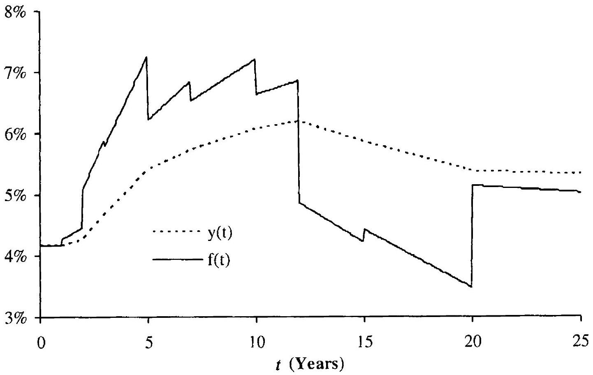
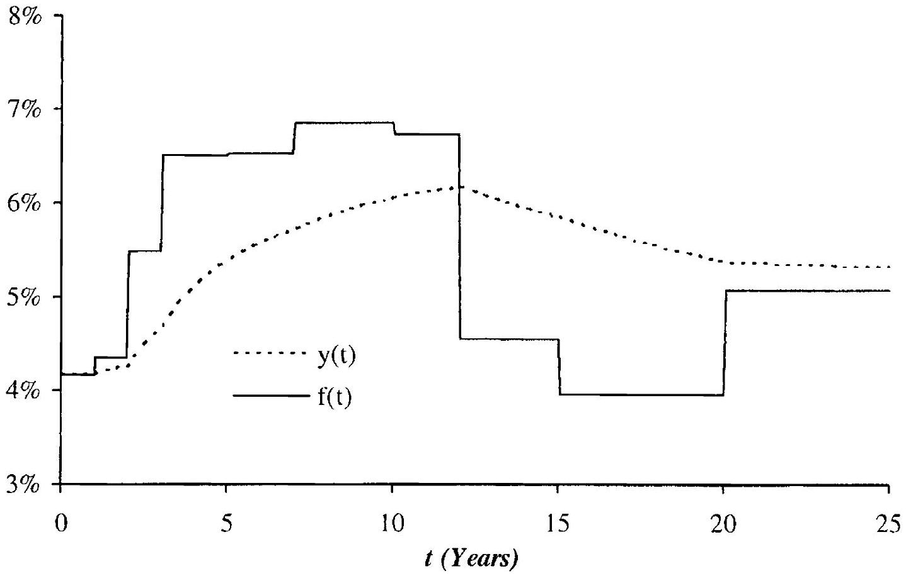
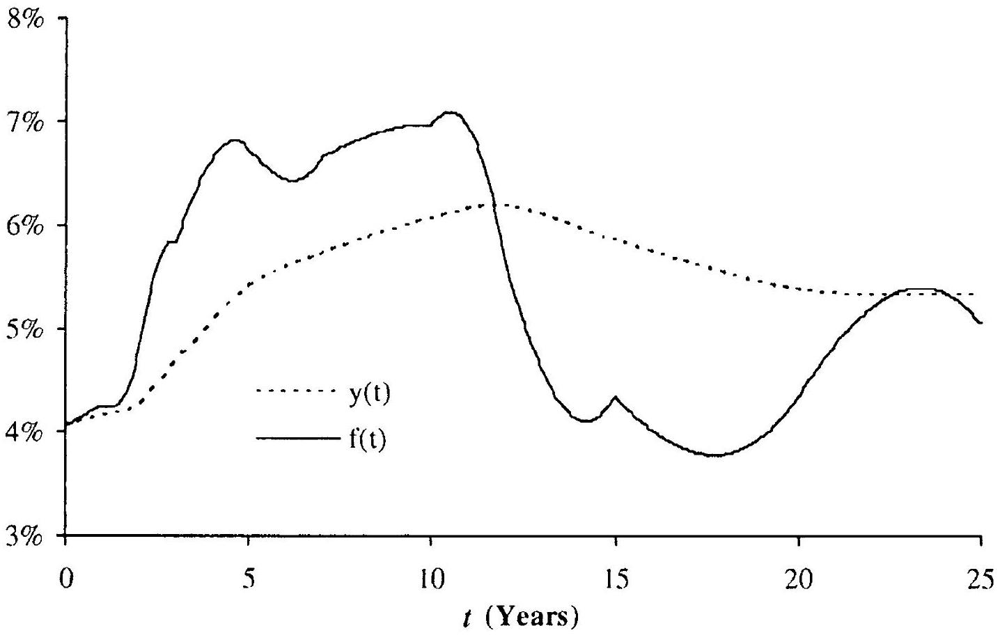
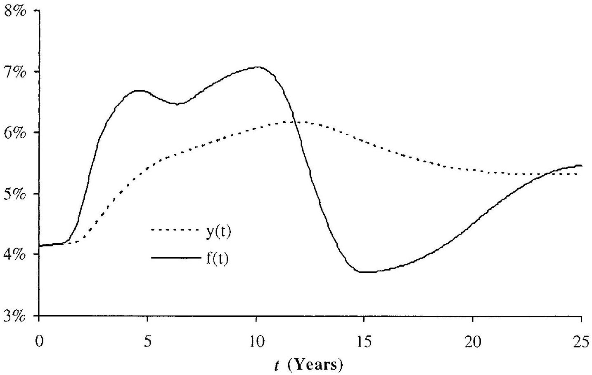
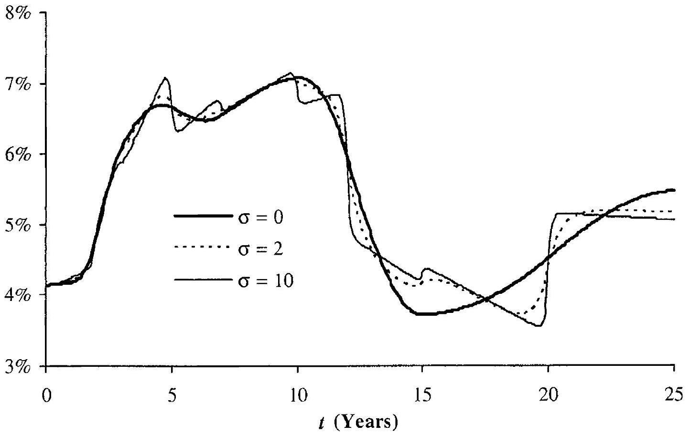
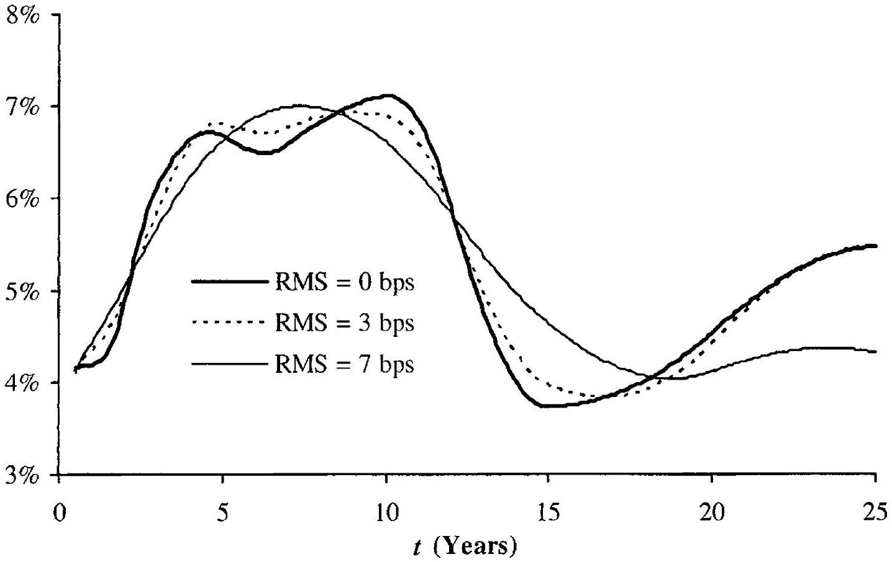
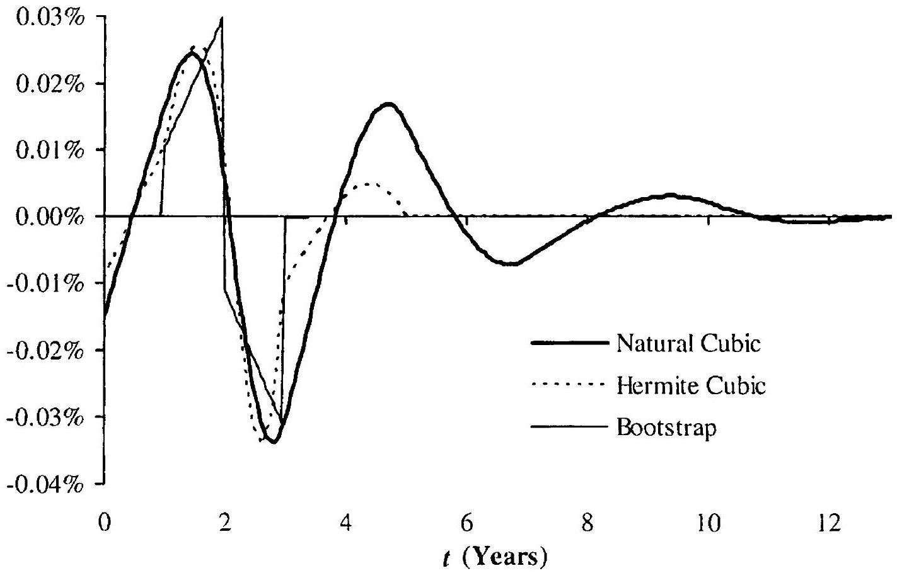
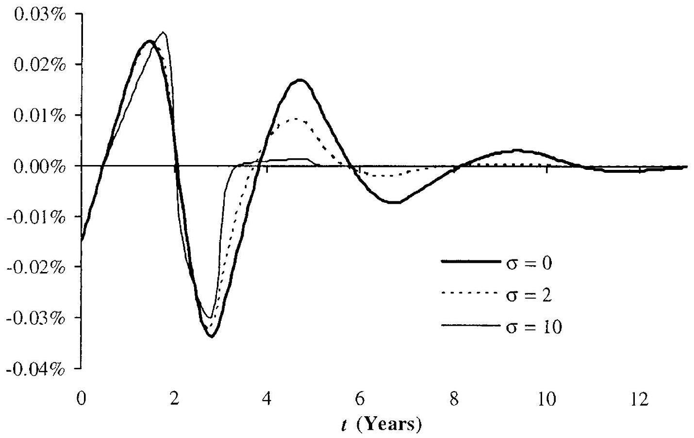

## Yield Curve Construction and Risk Management

In a nutshell, the job of an interest rate model is to describe the random movement of a curve of discount bond prices through time, starting from a known initial condition. In reality, however, only a few short-dated discount bonds are directly quoted in the market at any given time, a long stretch from the assumption of many models that an initial curve of discount bond prices is observable for a continuum of maturities out to $20-30$ years or more. Fortunately, a number of liquid securities depend in relatively straightforward fashion on discount bonds, opening up the possibility of uncovering discount bond prices from prices of such securities. Still, as only a finite set of securities are quoted in the market, constructing a continuous curve of discount bond prices will inevitably require us to complement market observations with an interpolation rule, based perhaps on direct assumptions about functional form or perhaps on a regularity norm to be optimized on. A somewhat specialized area of research, discount curve construction relies on techniques from a number of fields, including statistics and computer graphics. While we cannot possibly do the subject full justice, discount curve construction is a fundamental step in the modeling exercise, and no book on fixed income models is complete without a discussion of basic techniques.

As mentioned in the Preface to this book, the crisis of 2007-2009 have lead to changes in the foundations of interest rate modeling, not least in the area of yield curve construction and risk management. Pre-crisis, is was often sufficient to construct only a single (Libor) discount curve, but nowadays the task is more complicated as a whole collection of inter-related curves is required. Nevertheless, the traditional techniques used for singlecurve construction are by no means obsolete, and their mastery is required before more ambitious curve algorithms can be attempted. Accordingly, we have split this chapter into three parts. In the first, and most significant, part, we introduce notations and cover a number of curve construction techniques, moving from simply bootstrapped $C^{0}$ curves through "local spline" $C^{1}$ curves to full $C^{2}$ smoothing splines with and without tension.

Perturbation locality is discussed, as are methods to control behavior under perturbations. In the second part we discuss the management of interest rate curve risk, covering both basic approaches as well as more advanced methods based on Jacobian techniques. In the last part, we discuss a number of specialized issues and contemporaneous extensions, most notably turn-ofyear adjustments and techniques to construct separate discount and forward curves. The need for such a separation has long been recognized (albeit neglected in the literature) as a requirement to avoid arbitrages in markets for foreign exchange forwards and for floating-floating cross-currency swaps. More recently, similar issues have appeared in purely domestic markets where the Libor rate is no longer considered a good proxy for the risk-free discount rate, and where a significant tenor basis has developed in floatingfloating single-currency swaps. Accordingly, we conclude the chapter with a description of techniques for building a multi-index curve group, a selfconsistent arbitrage-free collection of discount and forward curves suitable for valuation of different types of swaps and other interest rate derivatives.

### 6.1 Notations and Problem Definition

### 6.1.1 Discount Curves

Throughout this chapter, we use the abbreviated notation $P(T)=P(0, T)$ where $P:[0, \mathcal{T}] \rightarrow(0,1]$ is a continuous, monotonically decreasing discount curve. $\mathcal{T}$ denotes the maximum maturity considered, typically given as the longest maturity in the set of securities the curve is built from. Let there be $N$ such securities - the benchmark set - with observable prices $V_{1}, \ldots, V_{N}$. We assume that the time 0 price $V_{i}=V_{i}(0)$ of security $i$ can be written as a linear combination of discount bond prices at different maturities,

$$
\begin{equation*}
V_{\imath}=\sum_{j=1}^{M} c_{\imath, j} P\left(t_{j}\right), \quad i=1, \ldots, N, \tag{6.1}
\end{equation*}
$$
^eq6-1

where $0<t_{1}<t_{2}<\ldots<t_{M} \leq \mathcal{T}$ is a given finite set of dates, in practice obtained by merging together the cash flow dates of each of the $N$ benchmark securities. Let $T_{1}, T_{2}, \ldots, T_{N}$ denote the final maturities of the $N$ benchmark securities, in which case we necessarily must have

$$
c_{i, j}=0, \quad t_{j}>T_{i} .
$$

Securities that can be represented by pricing expressions of the form (6.1) obviously include coupon and discount bonds, but also FRAs and fixed-floating interest rate swaps. For instance, consider a newly issued unitnotional fixed-floating swap, paying a coupon of $c \tau$ at times $\tau, 2 \tau, 3 \tau, \ldots$, $n \tau$. If no spread is paid on the floating rate, the time 0 total swap value to the fixed payer is

$$
V_{\mathrm{swap}}=1-P\left(t_{n}\right)-\sum_{j=1}^{n} c \tau P(j \tau)
$$

as already discussed in Chapter 5. We can rewrite this as

$$
\begin{equation*}
1-V_{\text {swap }}=P\left(t_{n}\right)+\sum_{j=1}^{n} c \tau P(j \tau) \tag{6.2}
\end{equation*}
$$
^eq6-2

which is in the form ${ }^{1}$ (6.1) once we interpret $V_{i}=1-V_{\text {swap }}$. In practice, swaps used for discount curve construction are nearly always newly issued and par-valued, in the sense that the coupon $c$ is set to make $V_{\text {swap }}=0$. To give another example, consider an FRA on the $[T, T+\tau]$ Libor rate, for which formula (5.2) in Chapter 5 gives, at $t=0$,

$$
\begin{equation*}
V_{\mathrm{FRA}}=\tau(L(0, T, T+\tau)-k) P(T+\tau) \tag{6.3}
\end{equation*}
$$
^eq6-3

where $k$ is the quoted FRA rate. From the definition of $L(0, T, T+\tau)$ this is just

$$
V_{\mathrm{FRA}}=P(T)-P(T+\tau)-k \tau P(T+\tau)=P(T)-(1+k \tau), P(T+\tau)
$$

which is in the form (6.1). As for swaps, FRAs used for curve construction are newly issued and typically have $k$ set such that $V_{\text {FRA }}=0$.

The choice of the securities to be included in the benchmark set depends on the market under consideration. For instance, to construct a Treasury bond curve, it is natural to choose a set of Treasury bonds and T-Bills. On the other hand, if we are interested in constructing a discount curve applicable for bonds issued by a particular firm, we would naturally use bonds and loans issued by the firm in question. For our purposes, the most important discount curve is the Libor curve, constructed out of market quotes for Libor deposits, swaps and Eurodollar futures. In the construction of this curve, most firms would use a few certificates of deposit for the first 3 months of the curve, followed by a strip of Eurodollar futures ${ }^{2}$ (with maturities staggered 3 months apart) out to 3 or 4 years. Par swaps are then used for the rest of the curve, with typical maturities being $5,7,10$, $12,15,20,25$, and 30 years.

[^88]
### 6.1.2 Matrix Formulation

Define the $M$-dimensional discount bond vector ${ }^{3}$

$$
\mathbf{P}=\left(P\left(t_{1}\right), \ldots, P\left(t_{M}\right)\right)^{\top},
$$

and let $\mathbf{V}=\left(V_{1}, \ldots, V_{N}\right)^{\top}$ be the vector of observable security prices. Also let $\mathbf{c}=\left\{c_{i, j}\right\}$ be an ( $N \times M$ )-dimensional matrix containing all the cash flows produced by the chosen set of securities. The matrix $\mathbf{c}$ would typically be quite sparse, with many rows containing only a few non-zero entries. A typical, albeit simplified, form of the matrix $\mathbf{c}$ might be ( $\times$ marks a non-zero element)

$$
\mathbf{c}=\left(\begin{array}{lllll}
\times & & & \\
& \times & & & \\
& & \times & \times & \\
& & \times & \times & \\
& & & \times & \times \\
& & \times & \times \\
& & \times & \times & \times \\
& \times & \times & \times & \times \\
& \times & \times & \times & \times \\
& \times & \times & \times & \times \\
& \times & \times & \times & \times \\
& & \times & \times & \times \\
& & \times & \times & \times \\
& & & \times & \times \times \times
\end{array}\right)
$$

corresponding to two certificates of deposit (first two rows); four FRAs or Eurodollar futures (next four rows); and three swaps (last three rows).

In a consistent, friction-free market without arbitrage opportunities, the fundamental relation

$$
\begin{equation*}
\mathbf{V}=\mathbf{c P} \tag{6.4}
\end{equation*}
$$
^eq6-4

must be satisfied, giving us a starting point to determine $\mathbf{P}$.

### 6.1.3 Construction Principles and Yield Curves

In practice, we normally have more cash flow dates than benchmark security prices, i.e. $M>N$, in which case (6.4) is insufficient to uniquely determine $\mathbf{P}$. The problem of curve construction essentially boils down to supplementing (6.4) with enough additional assumptions to allow us to extract $\mathbf{P}$ and to determine $P(T)$ for values of $T$ not in the cash flow timing set $\left\{t_{j}\right\}_{j=1}^{M}$.

As it is normally easier to devise an interpolation scheme on a curve that is reasonably flat (rather than exponentially decaying), it is common to perform the curve fitting exercise on discount yields, rather than directly on bond prices ${ }^{4}$. Specifically, we introduce a continuous yield function $y:[0, \mathcal{T}] \rightarrow \mathbb{R}_{+}$given by[^89]

$$
\begin{equation*}
e^{-y(T) T}=P(T) \quad \Rightarrow \quad y(T)=-T^{-1} \ln P(T), \tag{6.5}
\end{equation*}
$$
^eq6-5
such that in (6.4)

$$
\mathbf{P}=\left(e^{-y\left(t_{1}\right) t_{1}}, \ldots, e^{-y\left(t_{\Lambda I}\right) t_{\Lambda I}}\right)^{\top}
$$

The mapping $T \mapsto y(T)$ is known as the yield curve; it is related to the discount curve by the simple transformation (6.5). Of related interest is also the instantaneous forward curve $f(T)$, given by

$$
\begin{equation*}
P(T)=e^{-\int_{0}^{T} f(u) d u} \tag{6.6}
\end{equation*}
$$
^eq6-6

Notice that

$$
\begin{equation*}
f(T)=y(T)+\frac{d y(T)}{d T} T \tag{6.7}
\end{equation*}
$$
^eq6-7

For alternative transformations, and a discussion of their relative merits, see Andersen [2005]. Unless explicitly stated, in the remainder of this chapter we shall work with yields, i.e. we treat $y(T)$ as the fundamental curve to be estimated.

Whatever space we elect to work in, we have at least three options for solving (6.4).

1. We can introduce new and unspanned securities such that $N=M$ and (6.4) allows for exactly one solution.
2. We can use a parameterization of the yield curve with precisely $N$ parameters, using the $N$ equations in (6.4) to recover these parameters.
3. We can search the space of all solutions to (6.4) and choose the one that is "optimal" according to a given criterion.

Let us provide some comments to these three ideas. First, in option 1 above, introduction of new securities might not truly be possible - such securities may simply not exist - but sometimes interpolation rules applied to the given benchmark set may allow us to provide reasonable values for an additional set of "fictitious" securities. Although it can occasionally be useful in pre-processing to pad an overly sparse benchmark set, this idea will often require some quite ad-hoc decisions about the specifics of the fictitious securities, and excessive use may ultimately lead to odd-looking curves and suboptimal hedge reports. When an interpolation rule is to be used, it is typically better to apply it directly on more fundamental quantities such as zero-coupon yields or forward rates, thereby maintaining a higher degree of control over the resulting discount curve.

In option 2 above, parametric functional forms (e.g. Nelson and Siegel [1987]) are sometimes used, but it is far more common to work with a spline representation with $N$ user-selected knots (typically at the maturity dates of the benchmark securities), with the level of the yield curve at these knots constituting the $N$ unknowns to be solved for. We discuss the details of
this approach in Section 6.2, using a number of different spline types. Some required elements of basic spline theory can be found in Appendix 6.A of this chapter.

Option 3 constitutes the most sophisticated approach and can often be stated in completely non-parametric terms, with the yield curve emerging naturally as the solution to an optimization problem. If carefully stated, this approach can easily be modified to handle the situation where the system of equations (6.4) is (near-) singular, in the sense that either no solutions exist or all solutions are irregular and non-smooth ${ }^{5}$. Technically, we handle this by working with smoothing splines, in the process replacing (6.4) with a penalized least-squares optimization problem. We discuss elements of this idea in Section 6.3 below.

### 6.2 Yield Curve Fitting with $N$-Knot Splines

In this section we discuss a number of well-known yield curve algorithms based on polynomial and exponential (tension) splines of various degrees of differentiability. Throughout, we assume that we can select and arrange our benchmark set of securities to guarantee that the maturities of the benchmark securities satisfy

$$
\begin{equation*}
T_{i}>T_{i-1}, \quad i=2,3, \ldots, N, \tag{6.8}
\end{equation*}
$$
^eq6-8

where the inequality is strict. Equation (6.8) constitutes a "spanning" condition and allows us to select the $N$ maturities as distinct knots in our yield curve splines.

### 6.2.1 $C^{0}$ Yield Curves: Bootstrapping

If continuity of the yield curve is all that we require, we can work with a common iterative procedure known as bootstrapping. The basic idea is encapsulated in the following iteration:

1. Let $P\left(t_{j}\right)$ be known for $t_{j} \leq T_{i-1}$, such that prices for benchmark securities $1, \ldots, i-1$ are matched.
2. Make a guess for $P\left(T_{i}\right)$.
3. Use an interpolation rule to fill in $P\left(t_{j}\right), T_{i-1}<t_{j}<T_{\imath}$.
4. Compute $V_{i}$ from the now-known values of $P\left(t_{j}\right), t_{j} \leq T_{i}$.
5. If $V_{i}$ equals the value observed in the market, stop. Otherwise return to Step 2.
6. If $i<N$, set $i=i+1$ and repeat.
[^90]The updating of guesses when iterating over Steps 2 through 5 can be handled by any standard one-dimensional root-search algorithm (e.g., the Newton-Raphson or secant methods).

There are strong limitations on what kind of interpolation rule can be applied in Step 3. For instance, one might consider using a representation in terms of instantaneous forwards $f(T)$ (see (6.6)), with the assumption that $f(T)$ is a continuous piecewise linear function on the maturity grid $\left\{T_{i}\right\}_{i=1}^{N}$. While based on seemingly natural assumptions, this interpolation rule can, however, be shown to be numerically unstable and prone to oscillations. Some stable, and standard, choices for interpolation rules are covered in the next two sections; common for both is that the resulting yield curve is continuous, but non-differentiable. This, in turn, implies that the instantaneous forward curve is discontinuous (see (6.7)).

### 6.2.1.1 Piecewise Linear Yields

The most common discount curve bootstrap algorithm assumes that the continuously compounded yield $y(T)$ in (6.5) is a continuous piecewise linear function on $\left\{T_{i}\right\}_{i=1}^{N}$. Formally, the interpolation rule in Step 3 of the algorithm in Section 6.2.1 writes $P(T)=e^{-y(T) T}$, where

$$
\begin{equation*}
y(T)=y\left(T_{i}\right) \frac{T_{i+1}-T}{T_{i+1}-T_{i}}+y\left(T_{i+1}\right) \frac{T-T_{i}}{T_{i+1}-T_{i}}, \quad T \in\left[T_{i}, T_{i+1}\right] \tag{6.9}
\end{equation*}
$$
^eq6-9

To initiate the iterative bootstrap algorithm, we note that the interpolation rule (6.9) may require us to provide an equation for $y(t), t<T_{1}$. There are a number of ways to do this; one common choice is to simply set $y(t)=y\left(T_{1}\right)$, $t<T_{1}$.

To give a feel for the types of yield curves produced by linear yield bootstrapping, let us consider a simple example with a benchmark set of $N=10$ swaps, with maturities and quoted par swap rates as given in Table $6.1^{6}$.

The swaps are assumed to pay on a semi-annual basis,

$$
t_{j}=j \cdot 0.5, \quad j=1,2, \ldots, 50
$$

Setting $y(t)=y(1), t<1$, and then running the bootstrap procedure on the swap price expression (6.2) results in the yield shown in Figure 6.1. The same figure also shows the continuously compounded forward curve, as computed by equation (6.7). The discontinuous "saw-tooth" shape of the forward curve is characteristic for bootstrapped yield curves with piecewise linear yield.

[^91]| Maturity (Years) | Swap Par Rate |
| :---: | :---: |
| 1 | $4.20 \%$ |
| 2 | $4.30 \%$ |
| 3 | $4.70 \%$ |
| 5 | $5.40 \%$ |
| 7 | $5.70 \%$ |
| 10 | $6.00 \%$ |
| 12 | $6.10 \%$ |
| 15 | $5.90 \%$ |
| 20 | $5.60 \%$ |
| 25 | $5.55 \%$ |

Table 6.1. Swap Benchmark Set for Numerical Tests

Fig. 6.1. Yield and Forward Curve

Notes: Yield curve is constructed by bootstrapping, assuming piecewise linear yields. Swap data is in Table 6.1.

### 6.2.1.2 Piecewise Flat Forward Rates

Assume now that the instantaneous forward curve is piecewise flat, switching to a new level at each point in $\left\{T_{i}\right\}$, i.e.

$$
\begin{equation*}
f(T)=f\left(T_{i}\right), \quad T \in\left[T_{i}, T_{i+1}\right), \tag{6.10}
\end{equation*}
$$
^eq6-10

with $T_{0} \triangleq 0$. This corresponds to an interpolation rule where $\ln P(T)$ is linear in $T$, or

$$
P(T)=P\left(T_{i}\right) e^{-f\left(T_{i}\right)\left(T-T_{i}\right)}, \quad T \in\left[T_{i}, T_{i+1}\right),
$$

where a bootstrap algorithm can be used to establish the values of the $N$ unknown constants $f\left(T_{0}\right), f\left(T_{1}\right), \ldots, f\left(T_{N-1}\right)$. From the equation

$$
y(T) T=\int_{0}^{T} f(u) d u
$$

we see that the assumption of piecewise flat forwards gives, for $T \in\left[T_{i}, T_{i+1}\right)$,

$$
y(T)=\frac{y\left(T_{i}\right) T_{i}+f\left(T_{i}\right)\left(T-T_{i}\right)}{T}=f\left(T_{i}\right)+\frac{\left(y\left(T_{i}\right)-f\left(T_{i}\right)\right) T_{i}}{T},
$$

or

$$
y(T)=\frac{1}{T}\left(T_{i} y\left(T_{i}\right) \frac{T_{i+1}-T}{T_{i+1}-T_{i}}+T_{i+1} y\left(T_{i+1}\right) \frac{T-T_{i}}{T_{i+1}-T_{i}}\right)
$$

The yield curve will remain continuous.
Figure 6.2 below shows the results of applying (6.10) to the swap data in Table 6.1. Notice the non-linear behavior of yields between maturity dates and the staircase shape of the forward curve.

Fig. 6.2. Yield and Forward Curve

Notes: Yield curve is constructed by bootstrapping, assuming piecewise flat forward rates. Swap data is in Table 6.1.

### 6.2.2 $C^{1}$ Yield Curves: Hermite Splines

As we have seen, simply bootstrapped curves generally result in a discontinuous forward curve. From an empirical/economic perspective, such discontinuities are often unrealistic, and may also result in distortions of derivative prices ${ }^{7}$ and technical difficulties in dynamic yield curve models. In this section, we consider a simple scheme to extend the bootstrapping technique to produce a once-differentiable yield curve and a continuous forward curve. Our scheme relies on Hermite cubic splines, where we write

$$
\begin{equation*}
y(T)=a_{3, i}\left(T-T_{i}\right)^{3}+a_{2, i}\left(T-T_{i}\right)^{2}+a_{1, i}\left(T-T_{i}\right)+a_{0, i}, \quad T \in\left[T_{i}, T_{i+1}\right] \tag{6.11}
\end{equation*}
$$
^eq6-11

for a series of constants $a_{3, i}, a_{2, i}, a_{1, i}, a_{0, i}$ to be determined from given values of $y\left(T_{i}\right), y\left(T_{i+1}\right), y^{\prime}\left(T_{i}\right)$, and $y^{\prime}\left(T_{i+1}\right)$. Appendix 6.A. 1 contains a review of Hermite spline theory.

A particularly popular choice among Hermite splines is the Catmull-Rom spline, where derivatives $y^{\prime}\left(T_{i}\right), i=1, \ldots, N$, are constructed by finite differences, relieving the user from directly specifying them. As shown in Appendix 6.A.1, for the Catmull-Rom spline we can organize (6.11) in a vector/matrix form as

$$
y(T)=\mathbf{D}_{i}(T)^{\top} \mathbf{A}_{i}\left(\begin{array}{c}
y_{i-1}  \tag{6.12}\\
y_{i} \\
y_{i+1} \\
y_{i+2}
\end{array}\right), \quad T \in\left[T_{i}, T_{i+1}\right], \quad i=1, \ldots, N-1
$$
^eq6-12

where, adapting as necessary the notation from the previous section,

$$
\mathrm{D}_{i}(T)=\left(\begin{array}{c}
d_{i}^{3} \\
d_{i}^{2} \\
d_{i} \\
1
\end{array}\right), \quad d_{i}=\frac{T-T_{i}}{h_{i}}, \quad y_{i}=y\left(T_{i}\right), \quad h_{i}=T_{i+1}-T_{i}
$$

and the matrix $\mathbf{A}_{i}$ is as given in (6.54)-(6.56) in Appendix 6.A.1. While nominally (6.12) involves the values $y_{N+1}$ and $y_{0}$, the matrices $\mathbf{A}_{N-1}$ and $\mathbf{A}_{1}$ are such that these values are irrelevant.

The Catmull-Rom spline prescription (6.12) completely specifies the yield curve on the interval $\left[T_{1}, T_{N}\right]$, given the $N$ constants $y_{1}, \ldots, y_{N}$. To extend the yield curve to cover the interval $\left[0, T_{1}\right)$, we need to supply additional extrapolation assumptions. As in bootstrapping, possible choices for this additional equation is $y_{0}=y(0)=y_{1}$, or perhaps the slope condition

$$
\begin{equation*}
\frac{y_{1}-y_{0}}{h_{0}}=\frac{y_{2}-y_{1}}{h_{1}} . \tag{6.13}
\end{equation*}
$$
^eq6-13

[^92]Away from the boundaries, we notice that the price of security $i$ depends only on $y_{1}, \ldots, y_{i+1}$, as the pricing equations take the diagonal form

$$
\begin{aligned}
V_{1} & =F_{1}\left(y_{1}, y_{2}, y_{3}\right), \\
V_{2} & =F_{2}\left(y_{1}, y_{2}, y_{3}\right), \\
V_{3} & =F_{3}\left(y_{1}, y_{2}, y_{3}, y_{4}\right) \\
\vdots & \\
V_{N-1} & =F_{N-1}\left(y_{1}, \ldots, y_{N}\right), \\
V_{N} & =F_{N}\left(y_{1}, \ldots, y_{N}\right),
\end{aligned}
$$

for non-linear functions $F_{i}$. Here $F_{i}$ is typically only mildly sensitive to $y_{i+1}$, so the system of equations is nearly, but not quite, in bootstrap form. This makes solving for the $y_{i}$ 's an easy fare for a standard non-linear root-search algorithm (see Press et al. [1992] for several algorithms). We can also consider an iteration on a series of bootstrap procedures. To describe this idea, let $y_{i}^{(k)}$ be the value for $y_{i}$ found in the $k$-th iteration, and consider then the following algorithm:

1. Let $y_{j}^{(k)}, j=1, \ldots, i-1$, and $y_{i+1}^{(k-1)}$ all be known.
2. Make a guess for $y_{i}^{(k)}$.
3. Compute $V_{i}=F_{i}\left(y_{1}^{(k)}, \ldots, y_{i}^{(k)}, y_{i+1}^{(k-1)}\right)$.
4. If $V_{i}$ equals the market value stop. Otherwise return to Step 2.
5. If $i<N$, set $i=i+1$ and repeat.

We emphasize that the iteration over Steps $2-4$ is still only onedimensional, as in the bootstrapping algorithm of Section 6.2.1. Upon completion, the algorithm above yields $y_{1}^{(k)}, \ldots, y_{N}^{(k)}$. Iterating over $k$, we repeat the algorithm until the differences between the yields found at the $k$-th and ( $k+1$ )-th iteration are sufficiently small, say when

$$
N^{-1} \sum_{i=1}^{N}\left(y_{i}^{(k+1)}-y_{i}^{(k)}\right)^{2}<\varepsilon^{2},
$$

where $\varepsilon$ is a given tolerance. To initialize the iteration over $k$, we need a starting guess $y_{1}^{(0)}, \ldots, y_{N}^{(0)}$; a good choice is the yield curve constructed by regular bootstrapping.

In Figure 6.3, we show the results of applying the algorithm above (using the boundary choice (6.13)) to the numerical example of Sections 6.2.1.1 and 6.2.1.2. We see that, as desired, the yield curve is smooth and the instantaneous forward curve is continuous. As the yield curve by construction is only once differentiable, equation (6.7) shows that the forward curve is not differentiable; this is obvious from the figure.

We can easily extend the procedure above beyond Catmull-Rom splines to more complicated $C^{1}$ cubic splines in the Hermite class, using results

Fig. 6.3. Yield and Forward Curve

Notes: Yield curve is assumed to be a Catmull-Rom cubic spline. Swap data is in Table 6.1.
from Appendix 6.A. For instance, it is relatively straightforward to add tension to the Catmull-Rom spline. We cover twice-differentiable tension splines later in this chapter.

### 6.2.3 $C^{2}$ Yield Curves: Twice Differentiable Cubic Splines

While the spline method introduced in the previous section often produces acceptable yield curves, the method is heuristic in nature and ultimately does not produce a smooth forward curve. To improve on the latter, one alternative is to remain in the realm of cubic splines, but now insist that the curve is twice differentiable everywhere on $\left[T_{1}, T_{N}\right]$. We then write (see Appendix 6.A.2)

$$
\begin{array}{r}
y(T)=\frac{\left(T_{i+1}-T\right)^{3}}{6 h_{i}} y_{i}^{\prime \prime}+\frac{\left(T-T_{i}\right)^{3}}{6 h_{i}} y_{i+1}^{\prime \prime}+\left(T_{i+1}-T\right)\left(\frac{y_{i}}{h_{i}}-\frac{h_{i}}{6} y_{i}^{\prime \prime}\right) \\
+\left(T-T_{i}\right)\left(\frac{y_{i+1}}{h_{i}}-\frac{h_{i}}{6} y_{i+1}^{\prime \prime}\right), \quad T \in\left[T_{i}, T_{i+1}\right] \tag{6.14}
\end{array}
$$
^eq6-14

where $y_{i}^{\prime \prime}=d^{2} y\left(T_{i}\right) / d T^{2}, y_{i}=y\left(T_{i}\right)$, and $h_{i}=T_{\imath+1}-T_{i}$. The appendix demonstrates that continuity of the second derivative across the $\left\{T_{i}\right\}$ knots requires that the $y_{i}^{\prime \prime}$ and $y_{i}$ are connected through a tri-diagonal linear system of equations, see equation (6.62). To state the expressions explicitly in matrix format, let $\mathbf{y}^{\prime \prime}=\left(y_{2}^{\prime \prime}, y_{3}^{\prime \prime}, \ldots, y_{N-2}^{\prime \prime}, y_{N-1}^{\prime \prime}\right)^{\top}$ and
$\mathbf{y}=\left(y_{2}, y_{3}, \ldots, y_{N-2}, y_{N-1}\right)^{\top}$ such that

$$
\begin{equation*}
\mathbf{B y}^{\prime \prime}=\mathbf{C y}+\mathbf{M}\left(y_{1}, y_{N}, y_{1}^{\prime \prime}, y_{N}^{\prime \prime}\right), \tag{6.15}
\end{equation*}
$$
^eq6-15

where the matrices $\mathbf{B}$ and $\mathbf{C}$ are both $(N-2) \times(N-2)$ tri-diagonal, with elements given by

$$
B_{\imath, i}=\frac{h_{i}+h_{i+1}}{3}, \quad B_{i, i+1}=\frac{h_{i+1}}{6}, \quad B_{i, \imath-1}=\frac{h_{\imath}}{6},
$$

and

$$
C_{i, i}=-\left(\frac{1}{h_{i}}+\frac{1}{h_{i+1}}\right), \quad C_{i, i+1}=\frac{1}{h_{i+1}}, \quad C_{\imath, i-1}=\frac{1}{h_{i}} .
$$

The $(N-2)$-dimensional vector $\mathbf{M}\left(y_{1}, y_{N}, y_{1}^{\prime \prime}, y_{N}^{\prime \prime}\right)$ captures boundary terms at $T_{1}$ and $T_{N}$. The most important - and, as discussed later, in a sense best - boundary specification is that of the natural spline, where we set $y_{1}^{\prime \prime}=y_{N}^{\prime \prime}=0$. In this case, we have

$$
\mathbf{M}\left(y_{1}, y_{N}, y_{1}^{\prime \prime}, y_{N}^{\prime \prime}\right)=\mathbf{M}\left(y_{1}, y_{N}\right)=\left(\frac{y_{1}}{h_{1}}, 0,0, \ldots, 0,0, \frac{y_{N}}{h_{N-1}}\right)^{\top}
$$

Notice that application of a natural boundary condition at time $T_{1}$ allows us to recover yields inside the time period [ $0, T_{1}$ ] by linear interpolation, using the gradient $y^{\prime}\left(T_{1}\right)$ at time $T_{1}$ (which can easily be found by differentiating (6.14)).

We notice that (6.14) combined with (6.15) allows us to turn any guess of $y_{1}, y_{2}, \ldots, y_{N}$ into a guess for the vector $\mathbf{P}$ in (6.4). Specifically, we perform the following steps:

1. Compute the right-hand side of (6.15).
2. Use a standard tri-diagonal LU solver (see Press et al. [1992]) to invert (6.15) and recover $\mathbf{y}^{\prime \prime}$.
3. Apply (6.14) to determine ${ }^{8}$ all values of $y\left(t_{j}\right), j=1, \ldots, M$, extrapolating as necessary when $t_{j}<T_{1}$.
4. Use (6.5) to establish $\mathbf{P}$.

The computational effort of Steps 1 through 4 are $O(N), O(N-2)$, $O(M)$, and $O(M)$, respectively.

To solve for the correct values of $y_{1}, y_{2}, \ldots, y_{N}$, we iterate on Steps $1-4$ using a non-linear root-search algorithm, terminating when (6.4) is satisfied to within acceptable tolerances. The fitting problem is typically good-natured, and virtually all standard root-search packages (see Press et al. [1992]) can tackle it successfully. Tanggaard [1997], for instance, uses

[^93]a simple Gauss-Newton scheme with good results. Whatever root-search algorithm is selected, a good first guess can always be found by simple bootstrapping.

In Figure 6.4, we show the results of applying the algorithm above to a natural cubic spline representation of the yield curve example used in earlier sections. The yield curve is smooth and, unlike the Hermite spline case in Figure 6.3, the instantaneous forward curve is now differentiable, as desired.

Fig. 6.4. Yield and Forward Curve

Notes: Yield curve is assumed to be a $C^{2}$ natural cubic spline. Swap data is in Table 6.1.

While the $C^{2}$ cubic spline discussed here has attractive smoothness, it is not necessarily an ideal representation of the yield curve. As discussed in Andersen [2005] and Hagan and West [2004], among others, twice differentiable cubic spline yield curves are often subject to oscillatory behavior, spurious inflection points, poor extrapolatory behavior, and non-local behavior when prices in the benchmark set are perturbed. We shall return to the concept of non-local perturbation effects in Section 6.4 below, but for now just note that perturbation of a single benchmark price can cause a slow-decaying "ringing" effect on the $C^{2}$ cubic yield curve, with the effect of the perturbation of the benchmark instrument price spilling into the entire yield curve. This behavior is not surprising, given that the spline is constructed through a full $(N-2) \times(N-2)$ matrix system, where interpolation behavior on the interval $\left[T_{i}, T_{i+1}\right]$ depends on all values $y_{j}, j=1, \ldots, N$. In contrast, the simple linear-yield bootstrapping method in Section 6.2.1 interpolation on
the interval $\left[T_{i}, T_{i+1}\right]$ involves only the two points $y_{i}$ and $y_{i+1}$, and the Hermite spline approach involves only the four points $y_{i-1}, y_{i}, y_{i+1}, y_{i+2}$.

### 6.2.4 $C^{2}$ Yield Curves: Twice Differentiable Tension Splines

$C^{1}$ Hermite cubic splines are less prone to non-local behavior than $C^{2}$ cubic splines, but accomplish this in a somewhat ad-hoc fashion by giving up one degree of differentiability. Rather than taking such a draconian step, one wonders whether there may be a way to retain the $C^{2}$ feature of the cubic spline in Section 6.2.3, yet still allow control of curve locality and "stiffness". As it turns out, an attractive remedy to the shortcomings of the pure $C^{2}$ cubic spline is to insert some tension in the spline, that is, to apply a tensile force to the end-points of the spline. Appendix 6.A. 3 lists the necessary details of this approach, using the classical exponential tension spline construction ${ }^{9}$ in Schweikert [1966]. When applied to the yield-curve setting, the construction involves a modification of the cubic equation (6.14) for $y(T), T \in\left[T_{i}, T_{i+1}\right]$, to

$$
\begin{align*}
y(T)=\left(\frac{\sinh \left(\sigma\left(T_{i+1}-T\right)\right)}{\sinh \left(\sigma h_{i}\right)}-\frac{T_{i+1}-T}{h_{i}}\right) \frac{y_{i}^{\prime \prime}}{\sigma^{2}} & \\
& +\left(\frac{\sinh \left(\sigma\left(T-T_{i}\right)\right)}{\sinh \left(\sigma h_{i}\right)}-\frac{T-T_{i}}{h_{i}}\right) \frac{y_{i+1}^{\prime \prime}}{\sigma^{2}} \\
& +y_{i} \frac{T_{i+1}-T}{h_{i}}+y_{i+1} \frac{T-T_{i}}{h_{i}} \tag{6.16}
\end{align*}
$$
^eq6-16

where $\sigma \geq 0$ is the tension factor, and where we recall the definition $h_{i}=T_{i+1}-T_{i}$.

Appendix 6.A. 3 discusses a number of properties of tension splines, the most important perhaps being the fact that setting $\sigma=0$ will recover the ordinary $C^{2}$ cubic spline, whereas letting $\sigma \rightarrow \infty$ will make the tension spline uniformly approach a linear spline (i.e. the spline we used in Section 6.2.1.1). Loosely, we can thus think of a tension spline as a twice differentiable hybrid between a cubic spline and a linear spline. Equally loosely: as we increase $\sigma$, spurious inflections and ringing in the cubic spline are gradually "stretched" out of the curve, accompanied by rising (absolute values of) second derivatives at the knot points. More details on tension splines can be found in Andersen [2005], who also discusses application of computationally efficient local spline bases and the usage of a $T$-dependent tension factor to gain further control of the curve.

We observe that (6.16) is structurally similar to (6.14), and allows for a matrix representation of the same form as (6.62), albeit with suitably

[^94]modified definitions of the vector M and the matrices B and $\mathbf{C}$; we leave these modifications as an exercise to the reader. Suffice to say that once a value of $\sigma$ has been decided upon, the numerical search for the unknown levels $y_{i}, i=1, \ldots, N$, can proceed along the same principles as in Section 6.2.3 above. Figure 6.5 below shows an example; notice how increasing the tension parameter gradually moves us from cubic spline behavior to bootstrap behavior.

Fig. 6.5. Forward Curve

Notes: The yield curve is constructed as a $C^{2}$ natural tension spline, with tension parameters as given in the graph (only the forward curve $f(t)$ is shown). Swap data is in Table 6.1.

Remark 6.2.1. If the tension spline is applied not to yields, but to the logarithm of discount factors $\ln P(t)$, the limit of $\sigma \rightarrow \infty$ will produce a piecewise flat forward curve, as in Figure 6.2.

The reader may at this point wonder whether there are any firm rules as to what $\sigma$ should be. We have no definitive answers to this question, and we do not try to determine $\sigma$ automatically (although such routines do exist, see Renka [1987]). Instead, we normally treat $\sigma$ as an "extra knob" that allow users to balance curve smoothness, shape preservation, and perturbation locality to their particular tastes. Inevitably some element of experimentation is required here.

### 6.3 Non-Parametric Optimal Yield Curve Fitting

The techniques we have outlined so far generally suffice for constructing a discount curve from a "clean" set of non-duplicate benchmark securities, including the carefully selected set of liquid staggered-maturity deposits, futures, and swaps most banks assemble for the purpose of constructing a Libor yield curve. In some settings, however, the benchmark set may be significantly less well-structured, involving illiquid securities with little order in their cash flow timing and considerable noise in their prices. This situation may, say, arise when one attempts to construct a yield curve from corporate bonds. While construction of a Libor curve is the most important task for the purposes of this book, we nevertheless wish to say a few words about techniques suitable for less cooperative benchmark security sets. These techniques can also be applied to Libor curve construction, of course, and are particularly relevant for applications where we are willing to sacrifice some precision in the fit to benchmark prices in return for a smoother yield curve.

### 6.3.1 Norm Specification and Optimization

When the input benchmark set is noisy, a direct solution of (6.4) may be erratic or may not exist. To overcome this, and to reflect that noise in the input data may make us content to solve (6.4) only to within certain error bounds, we now proceed to replace this equation with a problem of minimization of a penalized least-squares norm. Specifically, define the space $\mathcal{A}=C^{2}\left(\left[t_{1}, t_{M}\right]\right)$ of all functions $\left[t_{1}, t_{M}\right] \rightarrow \mathbb{R}$ that are twice differentiable with continuous second derivative, and introduce the $M$-dimensional discount vector

$$
\mathbf{P}(y)=\left(e^{-y\left(t_{1}\right) t_{1}}, \ldots, e^{-y\left(t_{M}\right) t_{M}}\right)^{\top}
$$

Also, let W be a diagonal $N \times N$ weighting matrix. Then, as our best estimate $\widehat{y}$ of the yield curve we will here use

$$
\begin{equation*}
\widehat{y}=\underset{y \in \mathcal{A}}{\operatorname{argmin}} \mathcal{I}(y), \tag{6.17}
\end{equation*}
$$
^eq6-17

with

$$
\begin{align*}
\mathcal{I}(y) \triangleq \frac{1}{N}(\mathbf{V}-\mathbf{c P}(y))^{\top} \mathbf{W}^{2} & (\mathbf{V}-\mathbf{c P}(y)) \\
& +\lambda\left(\int_{t_{1}}^{t_{M}}\left[y^{\prime \prime}(t)^{2}+\sigma^{2} y^{\prime}(t)^{2}\right] d t\right) \tag{6.18}
\end{align*}
$$
^eq6-18

where $\lambda$ and $\sigma^{2}$ are positive constants. The norm $\mathcal{I}(y)$ consists of three separate terms:

- A least-squares penalty term

$$
\begin{aligned}
\frac{1}{N}(\mathbf{V}-\mathbf{c P}(y))^{\top} \mathbf{W}^{2}(\mathbf{V}-\mathbf{c P}(y)) & \\
& =\frac{1}{N} \sum_{i=1}^{N} W_{i}^{2}\left(V_{l}-\sum_{j=1}^{M} c_{i, j} e^{-y\left(t_{j}\right) t_{1}}\right)^{2},
\end{aligned}
$$

where $W_{i}$ is the $i$-th diagonal element of $\mathbf{W}$. This term is an outright precision-of-fit norm and measures the degree to which the constructed discount curve can replicate input security prices. The weights $W_{i}$ can be used to assign different importance to the various securities in the benchmark set, and/or to translate the precision of the fit from raw dollar amounts into more intuitive quantities, such as security-specific quoted yields ${ }^{10}$. Clearly, if (6.4) can be satisfied, then the least-squares penalty term will attain its minimum (of zero) for all yield curves that satisfy (6.4).

- A weighted smoothness term $\lambda \int_{t_{1}}^{t_{N 1}} y^{\prime \prime}(t)^{2} d t$, penalizing high secondorder derivatives of $y$ to avoid kinks and discontinuities.
- A weighted curve-length term $\lambda \sigma^{2} \int_{t_{1}}^{t_{\Lambda \Lambda}} y^{\prime}(t)^{2} d t$, penalizing oscillations and excess convexity/concavity.

Our choice of calibration norm is, we believe, an attractive one, but other choices obviously are available as well. For instance, in Adams and van Deventer [1994] the norm contains no curve-length term and the smoothing norm is expressed on the forward curve, rather than on the yield curve. Due to the lack of the curve-length penalty term, the resulting curve will tend to behave like the $C^{2}$ cubic spline in Section 6.2.3; see Hagan and West [2004] for some numerical tests.

The following result is shown by variational methods in Andersen [2005]:
Proposition 6.3.1. The curve $\widehat{y}$ that satisfies (6.17) is a natural exponential tension spline with tension factor $\sigma$ and knots at all cash flow dates $t_{1}, t_{2}, \ldots, t_{M}$.

Proposition 6.3.1 establishes that the curve we are looking for is a tension spline with tension factor $\sigma$, but does not in itself allow us to identify the optimal spline directly, beyond the fact that i) it is a natural spline with boundary conditions $y^{\prime \prime}\left(t_{1}\right)=y^{\prime \prime}\left(t_{M}\right)=0$; and ii) it has knots at all $t_{j}$, $j=1, \ldots, M$. Identification of the correct spline involves solving for unknown

[^95]levels ${ }^{11} y\left(t_{1}\right), y\left(t_{2}\right), \ldots, y\left(t_{M}\right)$ to optimize directly (6.18). In this exercise, the following lemma is useful.

Lemma 6.3.2. For a natural tension spline interpolating the values $y\left(t_{1}\right)$, $y\left(t_{2}\right), \ldots, y\left(t_{M}\right)$, we have

$$
\begin{aligned}
& y^{\prime}\left(t_{j}\right)=\left(-\sigma \frac{\cosh \left(\sigma\left(t_{j+1}-t_{j}\right)\right)}{\sinh \left(\sigma\left(t_{j+1}-t_{j}\right)\right)}+\frac{1}{t_{j+1}-t_{j}}\right) \frac{y^{\prime \prime}\left(t_{j}\right)}{\sigma^{2}} \\
& +\left(\frac{\sigma}{\sinh \left(\sigma\left(t_{j+1}-t_{j}\right)\right)}-\frac{1}{t_{j+1}-t_{j}}\right) \frac{y^{\prime \prime}\left(t_{j+1}\right)}{\sigma^{2}}+\frac{y\left(t_{j+1}\right)}{t_{j+1}-t_{j}}-\frac{y\left(t_{j}\right)}{t_{j+1}-t_{j}}
\end{aligned}
$$

and

$$
\begin{equation*}
\lambda\left(\int_{t_{1}}^{t_{M}}\left[y^{\prime \prime}(t)^{2}+\sigma^{2} y^{\prime}(t)^{2}\right] d t\right)=-\lambda \sum_{j=1}^{M-1} d_{j}\left(y\left(t_{j+1}\right)-y\left(t_{j}\right)\right) \tag{6.19}
\end{equation*}
$$
^eq6-19

where $y^{\prime \prime}\left(t_{1}\right)=y^{\prime \prime}\left(t_{M}\right)=0$, and

$$
\begin{equation*}
d_{j} \triangleq \frac{y^{\prime \prime}\left(t_{j+1}\right)-\sigma^{2} y\left(t_{j+1}\right)}{t_{j+1}-t_{j}}-\frac{y^{\prime \prime}\left(t_{j}\right)-\sigma^{2} y\left(t_{j}\right)}{t_{j+1}-t_{j}} \tag{6.20}
\end{equation*}
$$
^eq6-20

Proof. The result for $y^{\prime}\left(t_{j}\right)$ follows from direct differentiation of the basic equations for a tension spline (see (6.16) above, applied to the knot grid $\left\{t_{j}\right\}$ ). To show (6.19), consider the interval $\left[t_{j}, t_{j+1}\right]$ and the integral

$$
\int_{t_{j}}^{t_{j+1}}\left(y^{\prime \prime}(t)^{2}+\sigma^{2} y^{\prime}(t)^{2}\right) d t=\int_{t_{j}}^{t_{j+1}}\left(y^{\prime \prime}(t) \cdot y^{\prime \prime}(t)+\sigma^{2} y^{\prime}(t) \cdot y^{\prime}(t)\right) d t
$$

Integration by parts yields

$$
\begin{align*}
\int_{t_{i}}^{t_{1+1}} & \left(y^{\prime \prime}(t)^{2}+\sigma^{2} y^{\prime}(t)^{2}\right) d t \\
= & {\left[y^{\prime \prime}(t) y^{\prime}(t)\right]_{t_{j}}^{t_{j+1}}-\int_{t_{j}}^{t_{j+1}}\left(y^{(3)}(t)-\sigma^{2} y^{\prime}(t)\right) y^{\prime}(t) d t } \\
= & y^{\prime \prime}\left(t_{j+1}\right) y^{\prime}\left(t_{j+1}\right)-y^{\prime \prime}\left(t_{j}\right) y^{\prime}\left(t_{j}\right)-d_{j}\left(y\left(t_{j+1}\right)-y\left(t_{j}\right)\right) \tag{6.21}
\end{align*}
$$
^eq6-21

where $d_{j}$ is given in (6.20). Here, we have used that, by definition, hyperbolic tension splines have $y^{(3)}(t)-\sigma^{2} y^{\prime}(t)$ piecewise constant and equal to $d_{j}$ on each interval $\left[t_{j}, t_{j+1}\right]$ (see equation (6.63) in Appendix 6.A). The result (6.20) follows by addition of the terms (6.21) and using the condition $y \prime \prime\left(t_{1}\right)=y \prime \prime\left(t_{M}\right)=0$.

[^96]Lemma 6.3.2 shows us that we can compute the value of the integral penalty term in (6.18) directly from knowledge of yield levels $y\left(t_{1}\right), \ldots, y\left(t_{M}\right)$ and second derivatives $y^{\prime \prime}\left(t_{2}\right), \ldots, y^{\prime \prime}\left(t_{M-1}\right)$. For each guess for the $M$ unknown levels $y\left(t_{1}\right), y\left(t_{2}\right), \ldots, y\left(t_{M I}\right)$ we can proceed as follows.

1. Compute the least-squares penalty term $\frac{1}{N}(\mathbf{V}-\mathbf{c P}(y))^{\top} \mathbf{W}^{2}(\mathbf{V}-\mathbf{c P}(y))$ directly from the definition of $\mathbf{P}(y)$.
2. Use the results in Section 6.2.4 to solve for $y^{\prime \prime}\left(t_{2}\right), \ldots, y^{\prime \prime}\left(t_{M-1}\right)$ by solving a tri-diagonal set of equations.
3. Use Lemma 6.3.2 to compute $\lambda\left(\int_{t_{1}}^{t_{A I}}\left[y^{\prime \prime}(t)^{2}+\sigma^{2} y^{\prime}(t)^{2}\right] d t\right)$, thereby completing the computation of the norm $\mathcal{I}(y)$.

Embedding Steps 1-3 above in a multi-variate numerical optimizer ultimately allows us to determine the optimal solution $\widehat{y}$. A good generic routine for this optimization step would be the Levenberg-Marquardt algorithm; see Press et al. [1992]. The optimization problem at hand is generally goodnatured, and one can also use a simpler Gauss-Newton method, as discussed in Andersen [2005]. If possible, it is often useful to use a simpler method (e.g. bootstrapping) to establish a good guess for the yield curve levels $y\left(t_{1}\right), y\left(t_{2}\right), \ldots, y\left(t_{M}\right)$. A proper implementation of the algorithm should typically construct a yield curve in less than one-tenth of a second on a standard PC.

Remark 6.3.3. If we let $\sigma=0$, the solution to the optimization problem becomes a cubic smoothing spline; see Tanggaard [1997] for more details on this case.

Remark 6.3.4. If we let $\lambda \downarrow 0$, the resulting spline will often end up hitting all benchmark prices exactly, i.e. will satisfy (6.4) in the limit. The resulting spline is then the optimal interpolating curve, in the sense that of all twice differentiable yield curves that match the benchmark prices, the spline is the minimizer of the regularity term $\int_{t_{1}}^{t_{A I}}\left[y^{\prime \prime}(t)^{2}+\sigma^{2} y^{\prime}(t)^{2}\right] d t$. If, for $\lambda \downarrow 0$, we do not satisfy (6.4), then the resulting spline can be considered a least-squares regression spline solution.

### 6.3.2 Choice of $\lambda$

So far, we have assumed that the parameter $\lambda$ has been specified exogenously by the user. In practice, however, a good magnitude of $\lambda$ may sometimes be hard to ascertain by inspection, and a procedure to estimate $\lambda$ directly from the data is often useful. One possibility is to use a cross-validation approach, either outright or through the more efficient Generalized Cross-Validation (GCV) criterion by Craven and Wahba [1979]. Some results along these lines can be found in Tanggaard [1997] and Andersen [2005], but are outside the scope of our treatment here. A more pragmatic approach is to replace the optimization problem (6.17) with the constrained optimization problem

$$
\begin{gather*}
\widehat{y}=\underset{y \in \mathcal{A}}{\operatorname{argmin}} \int_{t_{1}}^{t_{\Lambda I}}\left[y^{\prime \prime}(t)^{2}+\sigma^{2} y^{\prime}(t)^{2}\right] d t  \tag{6.22}\\
\text { subject to } \frac{1}{N}(\mathbf{V}-\mathbf{c P}(y))^{\top} \mathbf{W}^{2}(\mathbf{V}-\mathbf{c P}(y))=\gamma^{2} \tag{6.23}
\end{gather*}
$$
^eq6-22
^eq6-23

where $\gamma$ is an exogenously specified constant. Note that $\gamma$ is just the allowed weighted root-mean-square (RMS) error in the fit to benchmark securities, an intuitive quantity that most users should have no problem specifying directly based on, say, observed bid-offer spreads. The Lagrangian for the above problem becomes

$$
\begin{align*}
\widehat{y}=\underset{y \in \mathcal{A}}{\operatorname{argmin}}\left(\int_{t_{1}}^{t_{M}}\left[y^{\prime \prime}(t)^{2}+\sigma^{2} y^{\prime}(t)^{2}\right] d t\right. & \\
& \left.+\rho\left[\frac{1}{N}(\mathbf{V}-\mathbf{c P}(y))^{\top} \mathbf{W}^{2}(\mathbf{V}-\mathbf{c P}(y))-\gamma^{2}\right]\right) \tag{6.24}
\end{align*}
$$
^eq6-24

where the Lagrange multiplier $\rho$ must be determined such that the constraint (6.23) is satisfied at the optimum of (6.24). Apart from a constant scale, (6.24) is identical to (6.17), so we solve the constrained optimization problem (6.22)-(6.23) through the following iteration over $\lambda$ :

1. Given a guess for $\lambda$, find the optimum value of $y\left(t_{1}\right), y\left(t_{2}\right), \ldots, y\left(t_{M}\right)$, as a solution of (6.17).
2. Compute $\mathcal{S}=\frac{1}{N}(\mathbf{V}-\mathbf{c P}(y))^{\top} \mathbf{W}^{2}(\mathbf{V}-\mathbf{c P}(y))$.
3. If $\mathcal{S}=\gamma^{2}$, stop; otherwise update $\lambda$ and go to Step 1.

In Step 1, we can proceed as discussed in Section 6.3.1 above. In general, the precision norm $\mathcal{S}=\mathcal{S}(\lambda)$ will be a declining function in $\lambda$ and, provided that a root to $\mathcal{S}(\lambda)=\gamma^{2}$ exists ${ }^{12}$, the updating in Step 3 can be done by any standard root search algorithm.

### 6.3.3 Example

To illustrate the effect of $\lambda$, we now apply the algorithm in Section 6.3.2 to the test data in Table 6.1 above. In doing so, we use the matrix $\mathbf{W}$ to normalize (see footnote 10) all price errors to yield-to-maturity errors, allowing us to consider $\gamma$ in (6.23) as the root-mean-square (RMS) yield error. Setting $\sigma=0$, the forward curves for various choices of $\gamma$ are shown in Figure 6.6. As one would expect, the higher we allow $\gamma$ to be, the smoother the forward (and yield) curves become.

For our test case, the zero-RMS optimal ( $M$-knot) forward curve in Figure 6.6 is virtually identical to the $N$-knot cubic spline solution in Figure 6.4. In general, the $N$-knot interpolating curve can be interpreted as a

[^97]Fig. 6.6. Forward Curve

Notes: The yield curve is constructed as an optimal $C^{2}$ natural tension spline, with an RMS yield error constraint as listed in the graph (only the forward curve $f(t)$ is shown). The tension parameter is set to $\sigma=0$ for all curves. Swap data is in Table 6.1.
constrained solution to (6.17) with $\lambda=0$, with the constraint requiring that knots be placed only at benchmark maturities $\left\{T_{i}\right\}_{i=1}^{N}$, rather than at all cash flow dates $\left\{t_{j}\right\}_{j=1}^{M}$. The effect of enforcing this additional constraint is often rather small, at least for the purposes of constructing a Libor curve.

### 6.4 Managing Yield Curve Risk

Consider a portfolio of securities with value $V_{0}$, where $V_{0}$ is a function of the yield curve $y(t)$. The securities in $V_{0}$ would typically not be in the benchmark set and could contain, say, interest rate options, seasoned swaps, and so forth. As the yield curve is a function of the benchmark set values $\mathrm{V}=\left(V_{1}, \ldots, V_{N}\right)^{\top}$, we may write

$$
V_{0}=V_{0}\left(V_{1}, \ldots, V_{N} ; \theta\right),
$$

where the vector $\theta$ contains model parameters (e.g. volatilities) and where the function $V_{0}(\cdot)$ is determined both from the valuation model of the security in question, and from the curve construction algorithm employed. Clearly, then

$$
d V_{0}=\sum_{i=1}^{N} \frac{\partial V_{0}}{\partial V_{i}} d V_{i}+\sum_{i} \frac{\partial V_{0}}{\partial \theta_{i}} d \theta_{i},
$$

or, for non-infinitesimal moves,

$$
\begin{equation*}
\Delta V_{0} \approx \sum_{i=1}^{N} \frac{\partial V_{0}}{\partial V_{i}} \Delta V_{i}+\sum_{i} \frac{\partial V_{0}}{\partial \theta_{i}} \Delta \theta_{i} \tag{6.25}
\end{equation*}
$$
^eq6-25

For the purpose of managing first-order risk exposure to moves in the yield curve, (6.25) suggests that the collection of derivatives $\partial V_{0} / \partial V_{i}, i=1, \ldots, N$ - often called (bucketed) interest rate deltas - forms a natural metric for portfolio risk. In particular, if all these derivatives are zero, our portfolio would, to first order, be immunized against any move in the yield curve that is consistent with the chosen curve construction algorithm. On the other hand, if some or all of the derivatives are non-zero, we could manage our risk by setting up a hedge portfolio of benchmark securities, with notional $-\partial V_{0} / \partial V_{i}$ on the $i$-th security. We emphasize that the resulting hedge would typically not be model-consistent: most interest models assume that yield curve risk originates from only a few stochastic yield curve factors that tend to move the curve smoothly ${ }^{13}$, in a predominantly parallel fashion. Theoretically, a bucket-by-bucket immunization against all terms $\Delta V_{i}$ may then be considered an overkill - we typically hedge against far too many risk factors $(N)$ - but is nevertheless standard industry practice and has proven to be robust. Notice that bucket hedging along these lines would, for instance, correctly reject the notion that we could perfectly hedge a 20 year swap with a 1 month FRA, something that a one-factor interest rate model (see Chapter 4 and Chapter 10) would happily accept. We pick up this subject again in Chapter 22.

### 6.4.1 Par-Point Approach

The simplest approach to computation of the delta $\partial V_{0} / \partial V_{i}$ involves a manual bump ${ }^{14}$ to $V_{i}$, followed by a reconstruction of the yield curve, and a subsequent repricing of the portfolio $V_{0}$. This procedure is sometimes known as the par-point approach, and resulting derivatives par-point deltas. For the approach to work properly, it is important that the yield curve construction algorithm is fast and produces clean, local perturbations of the yield curve when benchmark prices are shifted. For instance, perturbing a short-dated FRA price should not cause noticeable movements in long-term yields, lest we reach the erroneous conclusion (again) that we can perfectly hedge a 20 year swap with a 1 month FRA. As we have discussed earlier, Hermite splines and bootstrapped yield curves both exhibit good perturbation locality, but cubic $C^{2}$ splines often do not. To illustrate this, Figure 6.7 considers the

[^98]effect on the forward curves in Figures 6.1, 6.3, and 6.4 from a 1 basis point up-move in the par yield of the 2 year swap in Table 6.1. As we can see, the move causes a noisy, ringing perturbation in the $C^{2}$ cubic spline solution, spreading into short- and long-dated parts of the forward curve.

Fig. 6.7. Forward Curve Move

Notes: Change in instantaneous forward curve, from a 1 basis point shift in the 2 year swap yield in lable 6.1. The curve construction methods tested are: bootstrapping with piecewise linear yields ("Bootstrap"), Hermite $C^{1}$ cubic spline ("Hermite"), and $C^{2}$ natural cubic spline ("Natural Cubic"). Swap data is in Table 6.1.

In Figure 6.8, we have followed the recommendations of Section 6.2.4 and added tension to the $C^{2}$ spline, causing a dampening of the perturbation noise. Clearly, the usage of a tension factor can have a beneficial impact on risk reports produced by the par-point approach.

### 6.4.2 Forward Rate Approach

As an alternative to direct perturbation of benchmark security prices, we can consider applying perturbations directly to the discount curve, thereby mostly avoiding the introduction of artifacts specific to the curve construction algorithm. In practice, this technique typically focuses on the forward curve ${ }^{15} f(t)$, to which we apply certain functional shifts $\mu_{k}(t), k=1, \ldots, K$. Writing

[^99]Fig. 6.8. Forward Curve Move

Notes: Change in instantaneous forward curve, from a 1 basis point shift in the 2 year swap yield in Table 6.1. The yield curve was constructed as a tension spline, with tension factors as given in the graph. Swap data is in Table 6.1.
(loosely) $V_{0}=V_{0}(f)$ to highlight the dependence of $V_{0}$ on the forward curve, we then compute functional (Gâteaux) derivatives ${ }^{16}$ for $V_{0}$ :

$$
\begin{equation*}
\partial_{k} V_{0}=\left.\frac{d V_{0}\left(f(t)+\varepsilon \mu_{k}(t)\right)}{d \varepsilon}\right|_{\varepsilon=0}, \quad k=1, \ldots, K . \tag{6.26}
\end{equation*}
$$
^eq6-26

Standard choices for $\mu_{k}(t)$ are
Piecewise Triangular: $\quad \mu_{k}(t)=\frac{t-t_{k-1}}{t_{k}-t_{k-1}} 1_{\left\{t \in\left[t_{k-1}, t_{k}\right)\right\}}$

$$
\begin{equation*}
+\frac{t_{k+1}-t}{t_{k+1}-t_{k}} 1_{\left\{t \in\left\{t_{k}, t_{k+1}\right)\right\}}, \tag{6.27}
\end{equation*}
$$
^eq6-27

$$
\begin{equation*}
\text { Piecewise Flat: } \quad \mu_{k}(t)=1_{\left\{t \in\left[t_{k}, t_{k+1}\right)\right\}}, \tag{6.28}
\end{equation*}
$$
^eq6-28

where $\left\{t_{k}\right\}$ is a user-specified discretization grid. The resulting sensitivities are often called forward rate deltas.

It is common practice to use $\left\{t_{k}\right\}$ grids spaced three months apart, with dates on Eurodollar futures maturities. The number of deltas $K$ is thus typically a rather large number, and the $K$ derivatives $\partial_{k} V_{0}$ give a detailed picture of where the portfolio risk is concentrated on the forward curve. As forward rate contracts and Eurodollar futures cease to be liquid beyond 4

[^100]or 5 year maturities, the forward rate deltas do not directly suggest hedging instruments for the medium and long end of the yield curve exposure; however it is not difficult to translate forward rate deltas into a hedging portfolio (see the next section). The choice of par point versus forward rate deltas is largely a matter of personal preference, and it is not uncommon for traders to use both at the same time.

### 6.4.3 From Risks to Hedging: The Jacobian Approach

A collection of forward rate shifts $\mu_{k}(t), k=1, \ldots, K$, defines a certain view on the (first-order) risk on the portfolio $V_{0}(f)$ via the functional derivatives (6.26). In order to be useful, this risk view ultimately needs to be translated into a portfolio of hedging instruments that offsets the risks of $V_{0}$. While fixed income traders normally are quite adept at mentally translating forward rate risk into actual hedge transactions, some linear algebra can help out in this exercise, as we now show.

Suppose a set of $L$ hedging instruments is available, with values $\mathbf{H}= \left(H_{1}, \ldots, H_{L}\right)^{\top}$. This set may or may not coincide with the benchmark set used for curve construction; for example, one may want to exclude some benchmark securities from the hedging set due to poor liquidity, or one may want to add instruments to the benchmark set to fine-tune hedging. Using (6.26), we denote the sensitivities of hedging instruments to the shifts $\mu_{k}(t)$ by $\partial_{k} H_{l}, l=1, \ldots, L, k=1, \ldots, K$. If the $l$-th hedging instrument is included in the hedging portfolio with notional weight $p_{l}$, and $\mathbf{p}=\left(p_{1}, \ldots, p_{L}\right)^{\top}$, then the sensitivity of the hedge portfolio value

$$
H_{0}(\mathbf{p})=\mathbf{p}^{\top} \mathbf{H}
$$

to the $k$-th perturbation is given by

$$
\partial_{k} H_{0}(\mathbf{p})=\mathbf{p}^{\top} \partial_{k} \mathbf{H},
$$

where we have denoted

$$
\partial_{k} \mathbf{H}=\left(\partial_{k} H_{1}, \ldots, \partial_{k} H_{L}\right)^{\top}
$$

In most cases ${ }^{17}$ we would like to choose the weights $p$ in such a way that $\partial_{k} H_{0}(\mathbf{p})$ offsets as much of $\partial_{k} V_{0}$ as possible, for all $k=1, \ldots, K$. Let $W_{k}$ be the relative importance of offsetting the $k$-th derivative, and $U_{l}$ a relative "reluctance" to using the $l$-th hedging instrument (a function of the bid-ask spread, for example). Then, the optimal hedging weights $\widehat{\mathbf{p}}$ can be defined by the condition[^101]

$$
\begin{equation*}
\widehat{\mathbf{p}}=\underset{\mathbf{p}}{\operatorname{argmin}}\left(\sum_{k=1}^{K} W_{k}^{2}\left(\partial_{k} H_{0}(\mathbf{p})-\partial_{k} V_{0}\right)^{2}+\sum_{l=1}^{L} U_{l}^{2} p_{l}^{2}\right) . \tag{6.29}
\end{equation*}
$$
^eq6-29

Define the matrix $\partial \mathbf{H}$ to have columns $\partial_{1} \mathbf{H}, \ldots, \partial_{K} \mathbf{H}$, the vector $\partial \mathbf{V}_{0}$ by

$$
\partial \mathbf{V}_{0}=\left(\partial_{1} V_{0}, \ldots, \partial_{K} V_{0}\right)^{\top}
$$

the matrix $\mathbf{W}$ to be diagonal with $W_{k}$ 's on the diagonal, and the matrix $\mathbf{U}$ to be diagonal with $U_{l}$ 's on the diagonal. With this notation (6.29) can be recast as a least-squares problem,

$$
\begin{equation*}
\left(\partial \mathbf{H}^{\top} \mathbf{p}-\partial \mathbf{V}_{0}\right)^{\top} \mathbf{W}^{2}\left(\partial \mathbf{H}^{\top} \mathbf{p}-\partial \mathbf{V}_{0}\right)+\mathbf{p}^{\top} \mathbf{U}^{2} \mathbf{p} \rightarrow \min . \tag{6.30}
\end{equation*}
$$
^eq6-30

The problem (6.30) can be solved by standard methods; a formal solution is given by the linear system

$$
\begin{equation*}
\left(\partial \mathbf{H} \mathbf{W}^{2} \partial \mathbf{H}^{\top}+\mathbf{U}^{2}\right) \widehat{\mathbf{p}}=\partial \mathbf{H} \mathbf{W}^{2} \partial \mathbf{V}_{0} \tag{6.31}
\end{equation*}
$$
^eq6-31

We note that the addition of the $\mathbf{U}$ term to the optimization problem (6.31) is sometimes called Tikhonov regularization, a technique that we shall return to in Chapter 18.

When solving (6.30), one should carefully consider the relative dimensions of the matrices involved. First, if there are fewer hedging instruments than shifts to be immunized ( $L<K$ ), then, in general, not all risks can be offset. In this case, the weights $\mathbf{W}$ gain in importance as they allow the user to focus hedging on risk buckets deemed more important, at the expense of other, less critical ones. Also, when $L<K$ the weights $U$ are less important, and in most cases can safely be set to zero. Second, if there are more hedging instruments than risk buckets to immunize against ( $L>K$ ), then there are typically multiple hedging portfolios that perfectly offset all risks. In this case, the weights $\mathbf{W}$ can normally be ignored (all set to 1 ), but the weight matrix $U$ becomes more critical as it allows one to choose which of the possible hedging portfolios one "likes" best (e.g., the least costly). Finally, if $L=K$, then normally there exists exactly one portfolio that hedges all risks. Both W and U are then often of little consequence, although one might still want to specify non-zero weights $\mathbf{U}$ to avoid oscillatory or unstable solutions if the linear equations are ill-posed. We note that in the simple case of $L=K, \mathbf{W}=1, \mathbf{U}=\mathbf{0}$ and $\partial \mathbf{H}$ invertible, the solution to the optimization problem is given by

$$
\begin{equation*}
\mathbf{p}=\left(\partial \mathbf{H}^{\top}\right)^{-1} \partial \mathbf{V}_{0} \tag{6.32}
\end{equation*}
$$
^eq6-32

The method of constructing a hedge portfolio from derivatives to arbitrary shocks of the forward curve via the optimization problem (6.30) is known as the Jacobian method for interest rate deltas; the name originates from the fact that the matrix $\partial \mathbf{H}$ is the Jacobian matrix of a hedge set with respect to the forward curve shocks. Combined with the forward rate deltas,
the Jacobian method helps aggregate fine-grained risks into various sets of hedges. The approach has considerable generality as the risk basis functions $\mu_{k}$ and the hedge portfolio can be chosen freely by the user - note, for instance, that even the par-point approach can be seen as a special type of the Jacobian method where we effectively choose the hedging set to coincide perfectly with the benchmark set and where the $\mu_{k}$ 's are set to be the shifts of the forward curve that correspond to the bumps of benchmark securities. In this special case, the Jacobian $\partial \mathbf{H}$ is then a unit matrix and (from (6.32)) the original par-point deltas are recovered.

The Jacobian method serves to decouple risk calculations from curve construction. This, potentially, allows for combining smooth curves with localized risk, a feat that is difficult to achieve by other methods. The Jacobian is also useful in applications where curves need to be rebuild over and over, to address the fact that Libor and Treasury benchmark security prices (or yields) change very quickly, often quicker than a sophisticated curve construction algorithm can rebuild the curves. With the aid of a Jacobian, changes in benchmark prices can be quickly translated into changes of the forward curve via a matrix multiplication. A full curve rebuild needs only be triggered when the benchmark prices have moved sufficiently far from their initial values.

### 6.4.4 Cumulative Shifts and other Common Tricks

As evident in Figure 6.7 (the bootstrap case), a shift to a single swap rate (while keeping other swap rates fixed) typically results in a strong "see-saw" impact on the forward rate curve. Let us attempt to gain some intuition about the magnitude of the forward rate shock. For a back-of-the-envelope calculation, we can assume that a swap rate is a linear combination of forward Libor rates (see (4.11)),

$$
S_{n} \approx \sum_{i=1}^{n} w_{i, n} L_{i}
$$

where $S_{n}$ denotes a swap rate for a swap covering $n$ periods (for simplicity assume that each period is 1 year), $L_{i}$ denotes a forward Libor rate for $i$-th period (from year $i-1$ to year $i$ ), and $w_{i, n} \approx 1 / n$. Inverting this relationship yields

$$
\begin{equation*}
L_{n} \approx n\left(S_{n}-\frac{n-1}{n} S_{n-1}\right) . \tag{6.33}
\end{equation*}
$$
^eq6-33

As part of a par-point report, assume now that $S_{n}$ is shifted by the amount $\delta$, but $S_{n-1}$ and $S_{n+1}$ remain unchanged. According to (6.33) $L_{n}$ will then shift by approximately $n \delta$, and $L_{n+1}$ by $-n \delta$. For instance, if a 30 year swap yield is shifted by 1 basis point, while 29 year and 31 year are kept unchanged, then evidently the forward Libor rate $L_{30}$ will move by 30
basis points, and the rate $L_{31}$ will move by -30 basis points. If the portfolio whose deltas we are computing happens to contain, say, a spread option on the difference between $L_{30}$ and $L_{31}$, the underlying rate of this option would be shifted by 60 basis points (!). And clearly, a shift of 60 basis points (or 30 basis points, for that matter) is not small, and may be inappropriate for calculating a first-order derivative. We emphasize that what appears to be a benign 1 basis point rate shift translates into a much larger forward curve move that can potentially affect underlying instruments in unexpected ways.

The example above highlights the importance of applying shifts to the forward curve that are consistent with real moves of interest rates. Obviously, it is highly unlikely that a forward curve would move in such a way that a 30 year swap rate has changed but the 29 and 31 year rates have not.

One tweak to the standard par-point approach that goes some way towards the goal of realistic curve shifts is the so-called cumulative par-point approach (also known as a waterfall par-point approach). The idea is simple: the shift to the $i$-th benchmark security is retained while calculating the derivative to the ( $i+1$ )-th (and subsequent) securities. In other words, the two curves for the $(i+1)$-th derivative are constructed from the prices

$$
\left(V_{1}+\Delta V_{1}, \ldots, V_{i}+\Delta V_{i}, V_{i+1}, V_{i+2}, \ldots, V_{N}\right)
$$

(base) and

$$
\left(V_{1}+\Delta V_{1}, \ldots, V_{i}+\Delta V_{i}, V_{i+1}+\Delta V_{i+1}, V_{i+2}, \ldots, V_{N}\right)
$$

(perturbed). The standard deltas are then computed as differences of two consecutive (cumulative) derivatives. While the resulting deltas should coincide with the standard par-point deltas in the limit of $\Delta V \rightarrow 0$, they differ for non-vanishing perturbations.

The forward curve shifts implied by the cumulative par-point method are less extreme than those of the ordinary par-point method, making the cumulative par-point method quite attractive in practice. Another practical advantage of the method is the fact that the sum of deltas computed by the method is always (by definition) exactly equal to the parallel delta, i.e. the delta that is obtained by shifting all benchmark yields by the same amount at the same time. Because of the second-order effects, the same is only true for the standard par-point method in the limit of vanishing shifts, not for the non-infinitesimal perturbations used in practice.

The cumulative par-point approach is easy to mimic (and even improve) in the Jacobian framework of Section 6.4.3. Clearly, from (6.33), the $i$-th cumulative shift roughly corresponds to a piecewise flat move of the forward curve between the maturities of ( $i-1$ )-th and $i$-th benchmark. Hence, we can define

$$
\begin{equation*}
\mu_{i}(t)=1_{\left\{t \in\left[T_{i-1}, T_{i}\right)\right\}}, \quad i=1, \ldots, N \tag{6.34}
\end{equation*}
$$
^eq6-34

with $T_{0} \triangleq 0$. Note that this specification involves benchmark maturities $\left\{T_{i}\right\}$, in contrast to (6.28) which is typically set on a 3 month grid; in
particular, (6.34) involves as many shocks as there are benchmark securities. Application of the Jacobian method to (6.34) yields an attractive variation of the cumulative par-point method where all forward curve shocks are similarly scaled, in contrast to the basic cumulative par-point where the size of forward curve shocks grows linearly with maturity, as implied by (6.33).

We should note that to improve accuracy, one may compute deltas as the average of deltas computed using first positive shocks, then negative shocks. This idea applies to par-point, forward-rate, Jacobian, cumulative-par-point, or any other delta calculation method. For the simple par-point method, this boils down to using two-sided finite difference approximations versus one-sided for approximating derivatives, a standard trick. For other methods the relationship is not as straightforward but the end result is the same: improved accuracy and stability of deltas. Using averaged deltas is typically particularly useful for security prices that depend on yields in a strongly non-linear fashion.

Finally, let us mention another popular trick. We have spent a good part of Section 6.2.4 describing ways to build smooth yield curves that exhibit good locality under perturbations. A more simplistic approach to tackle the same problem is based on building two different curves. One - smooth - is then used for pricing and the other - bootstrapped and with good locality - used for risk computations. While certainly helpful in a pinch, this approach tends to suffer from poor P\&L predict, in the sense that changes in valuations of a portfolio between two dates are not well explained by first-order sensitivities (because values and sensitivities are calculated using different curves). We spend more time on P\&L predict in Chapter 22.

### 6.5 Various Topics in Discount Curve Construction

### 6.5.1 Curve Overlays and Turn-of-Year Effects

Many of the curve construction algorithms so far have been designed around the implicit idea that the forward curve should ideally be smooth. While this is, indeed, generally a sound principle, exceptions do exist. For instance, it may be reasonable to expect instantaneous forwards to jump on or around meetings of monetary authorities, such as the Federal Reserve in the US. In addition, other "special" situations may exist that might warrant introduction of discontinuities into the forward curve. A well-known example is the turn-of-year (TOY) effect where short-dated loan premiums spike for loans between the last business day of the year and the first business day of the following calendar year.

One common way of incorporating TOY-type effects is to exogenously specify an overlay curve $\varepsilon_{f}(t)$ on the instantaneous forward curve. Specifically, the forward curve $f(t)=f(0, t)$ is written as

$$
\begin{equation*}
f(t)=\varepsilon_{f}(t)+f^{*}(t) \tag{6.35}
\end{equation*}
$$
^eq6-35

where $\varepsilon_{f}(t)$ is user-specified - and most likely contains discontinuities around special event dates - and $f^{*}(t)$ is unknown. The yield curve algorithm is then subsequently applied to the construction of $f^{*}(t)$. That is, rather than solving $\mathbf{c P}=\mathbf{V}$ (see equation (6.4)), we instead write

$$
\begin{equation*}
P(T)=e^{-\int_{0}^{T} \varepsilon_{f}(t) d t} e^{-\int_{0}^{T} f^{*}(t) d t} \triangleq P_{\varepsilon}(T) P^{*}(T) \tag{6.36}
\end{equation*}
$$
^eq6-36

and solve

$$
\begin{equation*}
\mathbf{c}_{\varepsilon} \mathbf{P}^{*}=\mathbf{V} \tag{6.37}
\end{equation*}
$$
^eq6-37

where $\mathbf{P}^{*}=\left(P^{*}\left(t_{1}\right), \ldots, P^{*}\left(t_{M}\right)\right)^{\top}$, and $\mathbf{c}_{\varepsilon}$ is a modified $N \times M$ coupon matrix, with elements

$$
\left(\mathbf{c}_{\varepsilon}\right)_{i, j}=c_{i, j} P_{\varepsilon}\left(t_{j}\right)
$$

Construction of $\mathbf{c}_{\varepsilon}$ can be done as a pre-processing step, after which any of the algorithms discussed earlier in this chapter can be applied to attack (6.37). Once the curve $P^{*}(t)$ (or, equivalently, the yield curve $y^{*}(t)= -t^{-1} \ln P^{*}(t)$ ) has been constructed, any subsequent use of the curve for cash flow discounting requires, according to (6.36), a multiplicative adjustment of time $t$ discount factors by the quantity $P_{\varepsilon}(t)$.

### 6.5.2 Cross-Currency Curve Construction

In this section we consider the issues involved in constructing yield curves simultaneously in multiple currencies. As it turns out, the market for foreign exchange (FX) forwards and cross-currency basis swaps imposes certain arbitrage constraints that must be considered in the curve construction exercise.

### 6.5.2.1 Basic Problem

To provide some motivation, consider a US dollar (USD) based firm receiving $\$ 1$ for certain at some future time $T$. Assuming that we have available a risk-free discount curve $P(\cdot)$ for USD-denominated cash flows, we compute the value of this security simply as $P_{\$}(T)$. Suppose now that the firm enters into a (costless) FX forward where it commits to pay $\$ 1$ at time $T$ against receipt of a Japanese yen (JPY) amount of $¥ Y(T) ; Y(T)$ thereby represents the time 0 forward JPY/USD exchange rate for delivery at time $T$. By transacting the FX forward, the firm has effectively turned the receipt of $\$ 1$ into receipt of $¥ Y(T)$, the USD PV at time 0 of which is

$$
X(0) P_{\sharp}(T) Y(T),
$$

where $P_{¥}(T)$ is a JPY discount factor and $X(0)$ is the time 0 foreign exchange rate in $\$ / ¥$ terms. To avoid an arbitrage, we evidently need

$$
\begin{equation*}
P_{\S}(T)=X(0) P_{\Psi}(T) Y(T) \quad \Rightarrow \quad P_{\Psi}(T)=\frac{P_{\S}(T)}{Y(T) X(0)} . \tag{6.38}
\end{equation*}
$$
^eq6-38

Suppose, say, that we have blindly estimated discount curves $P(\cdot)$ and $P_{¥}(\cdot)$ from the market for USD- and JPY-denominated interest rate swaps, respectively, without paying any attention to FX markets. The discount curves $P_{\Phi}(\cdot)$ and $P_{¥}(\cdot)$ estimated in this fashion will very likely not satisfy (6.38), implying the existence of cross-currency arbitrages. The degree to which (6.38) is typically violated is often small, but any such violation can be highly problematic for a firm engaging in trading of significant amounts of both USD- and JPY-denominated assets.

### 6.5.2.2 Separation of Discount and Forward Rate Curves

It may appear that there is no way out of this conundrum: after all, our curve construction algorithms imply a unique discount curve out of given swap prices and have few, in any, means of incorporating additional requirements such as (6.38). However, built into our assumptions about how to price a swap (see (6.2)) was an implicit assumption that Libor itself is the proper discount rate for flows based on Libor fixings. As Libor rates represent lending rates between banks, they contain a certain amount of credit risk ${ }^{18}$ and it is ex-ante unclear that they are suitable proxies for a "risk-free" rate (or, at least, are suitable for discounting of swap cash flows). More details about this can be found in Collin-Dufresne and Goldstein [2001] and Duffie and Huang [1996]. For our purposes, it suffices to introduce the notion that when computing a swap value we may need two curves: i) the Libor "pseudo-discount" curve $P^{(L)}(t)=P^{(L)}(0, t)$, used to project the Libor-based floating cash flows on the floating leg of the swap; and ii) a real discount curve $P(t)=P(0, t)$, used to discount all cash flows. For, say, a regular JPY-based fixed-floating swap paying a coupon $c$ on a schedule $\left\{t_{i}\right\}_{i=1}^{n}$, the swap valuation equation thus becomes

$$
\begin{equation*}
V_{¥}(0)=\underbrace{\sum_{i=0}^{n-1} c \tau_{i} P_{\sharp}\left(0, t_{i+1}\right)}_{\text {Fixed Leg }}-\underbrace{\sum_{i=0}^{n-1} L_{¥}\left(0, t_{i}, t_{i+1}\right) \tau_{i} P_{\sharp}\left(0, t_{i+1}\right)}_{\text {Floating Leg }}, \tag{6.39}
\end{equation*}
$$
^eq6-39

where $\tau_{i}=t_{i+1}-t_{i}, t_{0}=0$, and where we compute $L_{¥}\left(t, t_{i}, t_{+1}\right)$ as (compare to (4.2))[^102]

$$
L_{¥}\left(t, t_{i}, t_{i+1}\right)=\frac{1}{\tau_{i}}\left(P_{¥}^{(L)}\left(t, t_{i}\right) / P_{¥}^{(L)}\left(t, t_{i+1}\right)-1\right) .
$$

A similar construction can be done for any USD swap, by means of introducing curves $P_{\$}^{(L)}(t)$ and $P_{\$}(t)$. Technically speaking, the Libor forwards $L_{¥}\left(t, t_{i}, t_{i+1}\right)$ in (6.39) represent expectations in the $t_{i+1}$-forward measure i.e. the martingale measure associated with the numeraire price $P_{¥}\left(t, t_{i+1}\right)$ (not $\left.P_{¥}^{(L)}\left(t, t_{i+1}\right)\right)$ - of quoted spot Libor rates,

$$
\begin{equation*}
L_{¥}\left(t, t_{i}, t_{i+1}\right) \triangleq \mathrm{E}_{t}^{t_{i+1}}, ¥\left(L_{¥}\left(t_{i}, t_{i}, t_{i+1}\right)\right) . \tag{6.40}
\end{equation*}
$$
^eq6-40

In this view, the quoted Libor rate is effectively reduced to an observable index that may have little, if any, relationship to a true discount rate. For this reason, the time 0 pseudo-discount curves $P_{\mathbb{S}}^{(L)}(t)$ and $P_{¥}^{(L)}(t)$ are often referred to as index curves.

It should be clear that the introduction of the pseudo-discount curves $P_{\$}^{(L)}(t)$ and $P_{¥}^{(L)}(t)$ equips us with enough degrees of freedom to fit both USD-denominated swaps, JPY-denominated swaps, and the market for FX forward contracts. In fact, we have too many degrees of freedom: four curves, but only three separate markets to calibrate to. One way of handling this issue is to impose additional assumptions about the relationship between the curves $P(t)$ and $P^{(L)}(t)$ in one chosen currency. Before the 2007-2009 crisis, the following assumption was common.

Assumption 6.5.1. In USD, the Libor pseudo-discount curve coincides with the real discount curve, i.e. $P_{\$}^{(L)}(t, T)=P_{\$}(t, T)$ for all $t$ and $T, T \geq t$.

Assumption 6.5.1 amounts to a convention where the liquidity and credit basis of non-USD Libor rates should all be measured relative to a neutral "bed-rock" established by USD Libor rates. Embedded into Assumption 6.5.1 also is the notion that most firms world-wide can fund themselves by borrowing in USD at levels close to USD-Libor; in the past this was often not a bad assumption. As we discuss in Section 6.5.3 below, post-crisis a nontrivial basis between index and discounting curves has emerged in the US. For simplicity of exposition we proceed in this section with Assumption 6.5.1, but the index-discounting basis in the US could be easily incorporated into the algorithm. The problem of accounting for this basis in single-currency curve construction in postponed until Section 6.5.3.

It is common to measure the difference between $P^{(L)}(t)$ and $P(t)$ in yield space, writing

$$
P^{(L)}(t)=P(t) e^{-s(t) t}
$$

where $s(t)$ is a yield spread often known as the cross-currency (CRX) yield spread. By Assumption 6.5.1, $s(t)$ is zero for USD, but will rarely be zero for any other currency. As indicated earlier, $s(t)$ will generally be quite small, often in the magnitude of a few basis points or less. Occasionally, however,
the CRX yield spread may blow out, particularly if banks in a particular country are perceived as having below-average credit quality. For instance, in the late 1990's, the CRX yield spread reached somewhere around -40 basis points in JPY as Japanese banks were perceived as being in economic trouble. During that period of time, foreign banks could generally fund themselves in USD at USD Libor, but in JPY at rates significantly below JPY Libor (due to their superior credit relative to Japanese banks). Had FX forward rates traded without any large CRX basis, foreign banks could have borrowed in JPY and used the FX forward markets to turn their obligations into USD-denominated ones at a borrowing cost below USD Libor, which would have indicated the existence of an inconsistency and an arbitrage. Conversely, in early 2008 the CRX basis spread became significantly positive (up to +60 basis points) as the hedging demands of long-dated FX books increased rapidly on the back of significant strengthening of the Yen versus the US Dollar. During the 2007-2009 crisis, many other currencies (including EUR) have experienced similar dramatic moves in the CRX basis spreads against USD.

### 6.5.2.3 Cross-Currency Basis Swaps

The discussion so far has assumed the existence of a liquid market for FX forwards, as means to observe and tie down the CRX basis between rates in two separate currencies. In reality, the interbank FX forward market is rarely liquid beyond maturities of one year, a far cry from the $30+$ year horizons to which we often want to build yield curves. Rather than relying on FX forwards, instead we can turn to the market for floating-floating cross-currency (CRX) basis swaps. Briefly speaking, CRX basis swaps are contracts where floating Libor payments in one currency are exchanged for floating Libor payments in another currency, plus or minus a spread. The swaps involve an exchange of notionals at trade inception and at maturity; the ratio between the two notionals is normally set to equal the spot FX exchange rate prevailing at trade inception. CRX basis swaps are closely related to FX forward contracts - indeed a one-period CRX basis swap is identical to an FX forward contract.

As was the case with FX forward contracts, failing to fit to the market for CRX basis swaps can lead to arbitrageable inconsistencies. For instance, consider the pricing of a stream of fixed USD cash flows. One way to determine the JPY price of these cash flows would be through simple discounting by the USD discount curve, followed by a conversion to JPY at the spot exchange rate. Alternatively, the following zero-cost scheme could be implemented to turn the stream of USD cash flows into fixed JPY cash flows:

1. Swap the fixed cash flows to streams of USD Libor plus some spread $x$, in a regular USD interest rate swap.
2. Swap USD Libor $+x$ against JPY Libor $+e+x$ in a CRX basis swap, $e$ being a market-quoted CRX basis swap spread.
3. Swap JPY Libor $+e+x$ against a stream a fixed JPY coupons, in a regular JPY interest rate swap.

The USD value of the cash flows in Step 3 can be determined through discounting with the JPY discount curve, and subsequent conversion to USD at the spot USD/JPY exchange rate. If the JPY discount curve is inconsistent with the basis-swap market, the value computed this way may not equal the value computed by discounting the original USD cash flows at the USD discount curve. Since the swap transactions 1-3 above are costless, this discrepancy will indicate an arbitrage.

We can use the pricing formalism developed in Section 6.5.2.2 to provide an explicit expression for the value of a CRX basis swap. For concreteness, we again turn to the USD/JPY market and consider a CRX basis swap, where a USD-based corporation receives USD Libor flat in exchange for payments of JPY Libor plus a fixed spread, $e_{¥}$. With payment dates $\left\{t_{i}\right\}_{i=1}^{n}$, the USD price $V_{\text {basisswap, } \$}$ of the basis swap is (assuming a $\$ 1$ notional)

$$
\begin{align*}
& V_{\text {basisswap, } \$}(0)  \tag{6.41}\\
& =\sum_{i=0}^{n-1} L_{\Phi}\left(0, t_{i}, t_{i+1}\right) \tau_{i} P_{\Phi}\left(0, t_{i+1}\right)+P_{\Phi}\left(0, t_{n}\right) \\
& \quad-X(0)\left(\sum_{i=0}^{n-1}\left(L_{¥}\left(0, t_{i}, t_{i+1}\right)+e_{¥}\right) \tau_{i} P_{\Psi}\left(0, t_{i+1}\right)+P_{\Xi}\left(0, t_{n}\right)\right) \\
& =1-X(0) \\
& \quad \times\left(\sum_{i=0}^{n-1}\left(\frac{P_{\Psi}^{(L)}\left(0, t_{i}\right)}{P_{\Xi}^{(L)}\left(0, t_{i+1}\right)}-1+e_{\Psi} \tau_{i}\right) P_{\Psi}\left(0, t_{i+1}\right)+P_{\Psi}\left(0, t_{n}\right)\right), \tag{6.42}
\end{align*}
$$
^eq6-41
^eq6-42

where we have used the fact that $P_{\$}$ and $P_{\$}^{(L)}$ are identical (by Assumption 6.5.1), in order to reduce the time 0 price of the USD floating leg to $\$ 1$. The market quotes par values $e_{¥}^{\text {par }}$ - that is, the value of $e_{\ddagger}$ that will make $V_{\text {basisswap, } \$}(0)=0$ - in a wide range of maturities extending out to 30 years or more.

### 6.5.2.4 Modified Curve Construction Algorithm

By Assumption 6.5.1, construction of the USD discount and Libor curves can be accomplished through direct application of the routines in Sections 6.2 or 6.3 on benchmark securities consisting of deposits, FRAs, and swaps. For non-USD currencies, however, matters are more complicated as we must now simultaneously estimate both curves $P(t)$ and $P^{(L)}(t), t>0$,
in a manner ensuring that i) Libor benchmark securities are correctly priced; and ii) par-valued cross-currency swaps against USD are correctly priced. In performing this exercise, we apply (6.42) and adjust valuation expressions for the benchmark securities according to the principles of the swap-pricing ${ }^{19}$ equation (6.39). We can make the curve construction problem quite complicated if we insist on $P(t)$ and $P^{(L)}(t)$ both being smooth functions of $t$; instead, here we will show a simpler idea that applies earlier algorithms in this chapter in iterative fashion.

Working as before with JPY as the foreign currency, we start by assuming that we have somehow managed to construct the correct Libor curve $P_{¥}^{(L)}(t)$. Were we - erroneously - to pretend that $P_{¥}^{(L)}(t)$ were a proper discount curve, we would get, for our $N$ benchmark securities, a vector of values $\mathbf{V}^{(L)}$ that would generally not equal the correct JPY market prices V:

$$
\begin{equation*}
\mathbf{c} \mathbf{P}_{¥}^{(L)}=\mathbf{V}^{(L)}, \quad \mathbf{V}^{(L)} \neq \mathbf{V} . \tag{6.43}
\end{equation*}
$$
^eq6-43

As the $P_{¥}^{(L)}(t)$ discount curve will be used to project forward rates, the yields and forward rates implied by $P_{¥}^{(L)}(t)$ should ideally be smooth. The smoothness requirements of the discount curve $P_{¥}(t)$, however, are significantly lower, as we shall never need to (in effect) differentiate this curve to produce forward Libor rates. Assuming that we have CRX basis swaps maturing on the benchmark set maturity dates $\left\{T_{i}\right\}_{i=1}^{N}$, it is thus, for instance, not unreasonable to write

$$
\begin{equation*}
P_{¥}(t)=P_{\Psi}\left(T_{i}\right) \frac{P_{\Psi}^{(L)}(t) e^{-\varepsilon_{r} \cdot\left(t-T_{i}\right)}}{P_{¥}^{(L)}\left(T_{i}\right)}, \quad t \in\left[T_{i}, T_{i+1}\right), \tag{6.44}
\end{equation*}
$$
^eq6-44

which assumes that the instantaneous forward rates generated by $P_{¥}(t)$ are given by those computed from $P_{\ddagger}^{(L)}(t)$ plus a piecewise flat function:

$$
\begin{equation*}
f_{¥}(t)=f_{\Psi^{\prime}}^{(L)}(t)+\varepsilon(t), \quad \varepsilon(t)=\sum_{i=0}^{N-1} \varepsilon_{i} 1_{\left\{t \in\left[T_{,}, T_{i+1}\right)\right\}}, \tag{6.45}
\end{equation*}
$$
^eq6-45

where $T_{0}=0$ as before.
In a cross-currency setting, the expression (6.4) no longer holds and must be replaced with something like

$$
\begin{equation*}
\mathbf{f}\left(\mathbf{P}_{¥}^{(L)}, \mathbf{P}_{¥}\right)=\mathbf{V} \tag{6.46}
\end{equation*}
$$
^eq6-46

for a non-linear vector-valued function $\boldsymbol{f}$. Indeed, according to (6.39), many of the coupon payments (c) become a non-linear function of points on $\mathbf{P}_{¥}^{(L)}$ and cannot be considered constants. To salvage the methodologies discussed

[^103]in Sections 6.2 or 6.3, we avoid working with (6.46) directly, and instead use an iteration based on equations (6.42), (6.43), and (6.45). The iteration attempts to estimate the unknown quantity $\mathbf{V}^{(L)}$ in (6.43) and works as follows:

1. Let $\mathbf{V}^{(L)}(j)$ be the $j$-th iteration for $\mathbf{V}^{(L)}$. Use $\mathbf{V}^{(L)}(j)$ along with (6.43) to estimate the curve $P_{¥}^{(L)}(t)$, using any of the curve construction methods discussed in earlier sections of this chapter.
2. Given knowledge of $P_{¥}^{(L)}(t)$, use (6.44)-(6.45) combined with (6.42) to imply the $N$ constants $\varepsilon_{0}, \varepsilon_{1}, \ldots \varepsilon_{N-1}$, by calibration to the $N$ par-valued CRX basis swaps maturing at time $T_{1}, \ldots, T_{N}$. This calibration exercise can be done by simple bootstrapping, and establishes the current guess for $P ¥(t)$.
3. Given estimates for both $P_{¥}^{(L)}(t)$ and $P_{¥}(t)$, compute guessed prices $\mathrm{V}(j)$ of all benchmark securities, i.e. evaluate the left-hand side of (6.46). If $\mathbf{V}(j)$ and $\mathbf{V}$ are within a given tolerance, we are done.
4. Update the guess for $\mathbf{V}^{(L)}$ according to $\mathbf{V}^{(L)}(j+1)=\mathbf{V}^{(L)}(j)-(\mathbf{V}(j)-$ V), and proceed to Step 1.

The iteration is initiated at $j=0$ with the estimate $\mathbf{V}^{(L)}(0)=\mathbf{V}$ and runs until the termination criterion in Step 3 is satisfied. As the approximation $\mathrm{V}^{(L)} \approx \mathrm{V}$ is normally very accurate, only a few iterations are needed to reach acceptable precision.

In this book we shall mostly ignore the existence of a non-zero CRX basis spread. In construction of a model for the evolution of the Libor curve, the reader should, however, keep in mind that it may be necessary to adjust the curve slightly before using it to discount any cash flows. In a dynamic setting, it is quite common to perform this adjustment by simply assuming that $\varepsilon(t)$ in (6.45) is deterministic. A discussion of how to incorporate both stochastic and deterministic spreads in a dynamic model for interest rate evolution can be found in Section 15.5. For now, we note that using deterministic spreads is generally safe, unless pricing securities with strong convexity in $\varepsilon(t)$ e.g. an option on a CRX basis swap - in which case a separate stochastic model for $\varepsilon(t)$ may be needed.

### 6.5.3 Tenor Basis and Multi-Index Curve Group Construction

Section 6.5.2 relied extensively on the notion of separating the discount curves used for Libor projection and for outright discounting. This idea is quite powerful and has applications in other settings, including some where only a single currency is involved. For instance, for swaps that pay a non-Libor index - e.g. the Bond Mark Association (BMA) index in the US - it is natural to introduce a basis spread that measures the difference between forward rates of the non-Libor index curve and the Libor curve itself.

More recently, a similar technique has become important even for curves used for pricing standard Libor-based contracts. We have already mentioned (Section 5.1) that the Fed funds rate, the overnight rate used for balances of bank deposits with the Federal reserve, is often considered the closest proxy to the risk-free rate in the US (with Eonia and Sonia rates, see Section 5.1, fulfilling the same function for Euro and GBP). One argument for this choice is that most inter-dealer transactions are collateralized under the International Swaps and Derivatives Association (ISDA) Master Agreement, with the rate paid on collateral being the Fed funds rate (for USD; Eonia and Sonia for Euro and GBP), see Piterbarg [2010] (and also the discussion in Section 5.1). While the spread between the Fed funds rate and 3 month Libor rate used to be very small - in the order of a few basis points after September 2007 it went up to as much as 275 basis points, and it is now generally accepted now that the Libor rate is no longer a good proxy for a discounting rate on collateralized trades. Uncollateralized derivative contracts are subject to credit risk, and a fully consistent pricing approach needs to incorporate the cost of hedging this risk (the co-called credit valuation adjustment or CVA). These computations are outside the scope of this book and can get very complex, in part because collateral rules can be complicated and are normally enforced on entire counterparty portfolios and not just on individual trades. See Gregory [2009] for further details.

As we discussed in Section 6.5.2, if we make an assumption on the indexdiscounting basis in one currency (say, USD), we can translate it into the index-discounting basis in any other currency through the market quotes for forward FX contracts and cross-currency basis swaps. However, to estimate this basis in USD (say), we need to rely on domestic markets only; doing otherwise will introduce a circularity into our arguments. Fortunately, the market in the appropriate instruments, the OIS (overnight index swap, a swap of payments based on a compounded Fed funds rate versus fixed rate, see (5.7)-(5.8)) and the Fed funds/Libor basis swaps (see Section 5.7)- has developed in the US with a range of maturities actively traded. Hence, using techniques that we already discussed, we can construct a pair of curves a curve for discounting and a curve for projecting 3 month (say) forward Libor rates - in a self-consistent way from the market quotes on deposits, FRAs, swaps with 3 month frequency, and overnight index swaps.

Currently there are no countries where both the OIS market and the cross-currency basis swap (vs. USD) market are very liquid, and we can always use one or the other to find the index-discounting basis. As the markets evolve, there may come a time when there will be two liquid sources of discounting curve information. It turns out that potential conflict between the two can be resolved by carefully analyzing the collateral mechanisms used in the two markets and the implications for yield curve construction. This discussion is outside of scope of the current edition of our book, but the interested reader could consult Fujii et al. [2010] for details.

The challenges of curve construction do not end with building separate discount and forecasting curves to take into account the index-discounting basis. We also need to account for the tenor basis between vanilla singlecurrency swaps trading at different frequencies, e.g. 1 month, 3 months, and 6 months. Before proceeding, let us explain in more detail what we mean by tenor basis.

Suppose we construct Libor and discount curves based on, say, vanilla swaps (and for non-USD currencies also CRX basis swaps) paying 3 month Libor on a quarterly schedule. If the resulting index and discount curves are subsequently used to price a vanilla swap paying 1 month Libor on a monthly schedule, the resulting price is typically different from actual market quotes. In other words, there is a basis between the 3 month and 1 month Libor index curves, a basis arising partly from credit considerations and partly liquidity considerations (banks have a natural desire to have longer-term deposits to better match their loan commitments). Historically this basis has also been low; for example, the difference between 1 month and 3 month Libor rates was in the order of one basis point up until September 2007, but since then has been as wide as 50 basis points.

When various basis levels were small, the small discrepancies between different Libor-tenor swaps were often accounted for by building a unique discount curve for the subset of swaps referencing the Libor rate of a particular tenor; this curve would, in addition to generating the floating leg forward rates, then be used to discount floating and fixed cash flows of swaps of that frequency. In a swap pricing framework, this can create an arbitrage since it implies that fixed flows (from the fixed leg) will be discounted at different discount curves, depending on which Libor tenor the fixed flows happen to be paid against. Moreover, it is not clear how to deal with swaps that involve multiple Libor tenors ${ }^{20}$, or how to aggregate risks coming from unrelated, individually constructed curves. Again, when the differences were small, these issues were largely ignored.

More recently, the naive approach above has evolved into the idea of using a multi-index curve group, a collection consisting of a single discount curve and multiple index curves, one for each Libor tenor covered by the multi-index curve group. The index curves are used in a tenor-specific manner to project Libor forward rates, and the universal discount curve serves to discount all floating and fixed cash flows, irrespective of tenor. The index curves are built sequentially as spreads off previously-built curves, which provides linkage between index curves and also a convenient risk parameterization. This relatively recent idea is discussed in Traven [2008] in considerable details, from where most of the material of this section is derived. Another good reference here is Fujii et al. [2010].

[^104]To discuss multi-index curve groups in detail, let us introduce a superscript $k, k=1, \ldots, K$, to distinguish quantities related to different tenors. In particular, let $t_{i}^{k}$ be the $i$-th date in the tenor structure for tenor $k$; $\tau_{i}^{k}=t_{i+1}^{k}-t_{i}^{k}$ the corresponding tenor offset; $L^{k}\left(t_{i}^{k}, t_{i}^{k}, t_{i+1}^{k}\right)$ the spot Libor rate of tenor $k$ for the $i$-th period; and so on. If we denote the expected value of $L^{k}\left(t_{i}^{k}, t_{i}^{k}, t_{i+1}^{k}\right)$ under the $t_{i+1}^{k}$-forward measure by

$$
L^{k}\left(t, t_{i}^{k}, t_{i+1}^{k}\right) \triangleq \mathrm{E}_{t}^{t_{i+1}^{k}}\left(L^{k}\left(t_{i}^{k}, t_{i}^{k}, t_{i+1}^{k}\right)\right)
$$

(compare to $(6.40)$ ), then the value of a fixed-floating $k$-Libor-tenor swap with $n$ periods and rate $c$ is given by

$$
\begin{equation*}
V^{k}(0)=\underbrace{\sum_{i=0}^{n-1} c \tau_{i}^{k} P\left(t_{i+1}^{k}\right)}_{\text {Fixed Leg }}-\underbrace{\sum_{i=0}^{n-1} L^{k}\left(0, t_{i}^{k}, t_{i+1}^{k}\right) \tau_{i}^{k} P\left(t_{i+1}^{k}\right)}_{\text {Floating Leg }} . \tag{6.47}
\end{equation*}
$$
^eq6-47

Here $P(t)$ is the universal discounting curve. The time 0 index curve for tenor $k, P^{k}(t)$, is defined by the condition that forward Libor rates (of tenor $k)$ be defined by the familiar formula

$$
\begin{equation*}
L\left(0, t_{i}^{k}, t_{i+1}^{k}\right)=\frac{1}{\tau_{i}^{k}}\left(P^{k}\left(t_{i}^{k}\right) / P^{k}\left(t_{i+1}^{k}\right)-1\right) . \tag{6.48}
\end{equation*}
$$
^eq6-48

A multi-index curve group is defined as a collection $\left\{P(\cdot), P^{1}(\cdot), \ldots, P^{K}(\cdot)\right\}$ of the universal discounting curve and one index curve per tenor, with swaps priced via (6.47) (and equivalent formulas for other linear instruments) and (6.48).

Let us outline how to calibrate a multi-index curve group to market instruments referencing rates of different tenors. For each market, fixedfloating swaps referencing a Libor rate of one particular tenor $L^{k}$ are usually the most liquid. Assume that this curve is the first index curve in the group, i.e. $k=1$. The method from Section 6.5.2 can be used to construct a discounting curve, and a base index curve $P^{1}(\cdot)$ from

- Funding instruments such as deposits, forward FX contracts, OIS, overnight rate basis swaps (i.e. floating-floating swaps of an overnight rate versus $L^{1}$, see Section 5.7 and a discussion of more general floatingfloating single-currency basis swaps in the next paragraph), cross-currency basis swaps, and the like.
- Vanilla instruments referencing $L^{1}$ such as FRAs on $L^{1}$ and fixed-floating swaps on $L^{1}$ versus a fixed rate.

To construct $P^{2}(\cdot)$, we assume that prices of floating-floating singlecurrency basis swaps are available in the market. A floating-floating basis swap is a swap of payments linked to a Libor rate of a particular tenor such as $L^{1}$ - versus payments based on a Libor rate of different tenor -
such as $L^{2}$. Each leg pays on its own schedule of a corresponding tenor. A fixed spread is typically added to one of the legs to make the swap value at inception equal to zero. If a floating-floating basis swap is not traded or not liquid, it can be synthesized from two fixed-floating swaps referencing $L^{1}$ and $L^{2}$.

If a floating-floating basis swap is traded at par in the market, the values of both legs should be the same at time 0 :

$$
\begin{align*}
& \sum_{i=0}^{n^{2}(T)-1} L^{2}\left(0, t_{i}^{2}, t_{i+1}^{2}\right) \tau_{i}^{2} P\left(t_{i+1}^{2}\right) \\
& \quad=\sum_{i=0}^{n^{1}(T)-1}\left(L^{1}\left(0, t_{i}^{1}, t_{i+1}^{1}\right)+e^{1,2}(T)\right) \tau_{i}^{1} P\left(t_{i+1}^{1}\right) \tag{6.49}
\end{align*}
$$
^eq6-49

Here $n^{k}(T)$ is the number of periods in the tenor structure to date $T$ for tenor $k$, and $e^{1,2}(T)$ is the quoted floating-floating basis spread for exchanging $L^{1}$ for $L^{2}$ to maturity $T$, quoted on the $L^{1}$ leg. It could be positive or negative, depending on perceived desirability of payments linked to $L^{1}$ versus $L^{2}$.

Similar to (6.44)-(6.45), we represent $P^{2}(\cdot)$ as a multiplicative spread to $P^{1}(\cdot)$ :

$$
P^{2}(t)=P^{1}(t) e^{-\int_{0}^{t} \eta^{1.2}(s) d s}, \quad t \geq 0
$$

for a given, usually piecewise-constant, spread function $\eta^{1,2}(\cdot)$. With the discounting curve $P(\cdot)$ already constructed and $L^{1}\left(0, t_{i}^{1}, t_{i+1}^{1}\right)$ known for all $i$ from the already-built index curve $P^{1}(\cdot)$, it is a simple exercise to obtain the spread function $\eta^{1,2}(\cdot)$ by solving (6.49) for different $T$ 's.

Having built $P^{2}(\cdot)$, the remaining index curves $P^{k}(\cdot), 3 \leq k \leq K$ may be constructed in a similar fashion, always using floating-floating basis swap spreads for $L^{k}$ versus $L^{1}$ basis swaps or, more generally, for whatever $L^{k}$ versus $L^{i}$ basis swaps are the most liquid with $i<k$. In particular, each index curve $P^{k}(\cdot)$ for $k>1$ is built as a spread, or basis, curve to one of the previous curves.

In the presence of multiple curves, it is not entirely clear from the outset how to most sensibly define risk sensitivities. Fortunately, with this spreadbased method of curve group construction, sensitivities to instruments used in the curve group have clear, and orthogonal, meaning:

- Perturbations to instruments used in building the base index curve, e.g. non-basis swaps and FRAs referencing $L^{\mathbf{1}}$, define risk sensitivities to the overall levels of interest rates. Clearly, with basis spreads for $L^{1}$-versus- $L^{k}$ floating-floating basis swaps, $k=2, \ldots, K$, kept constant, shifts to fixedfloating $L^{1}$-versus-fixed swap rates will move all index curves together by the same amount in forward rate space. These sensitivities are the direct analog of the standard interest rate deltas in the traditional, single-curve, world, see Section 6.4.
- Perturbations to funding instruments define sensitivities to discounting.
- Perturbations to basis swap spreads for $L^{k}$-versus- $L^{1}$ floating-floating basis swaps define basis risk, i.e. the risk that index curves of different tenors do not move in lock step.

The parameterization allows us to naturally aggregate "similar" risks such as overall rate level risks, discounting risks, basis risks, while keeping different kinds separate for efficient risk management. Had we constructed all index curves in separation from each other (from multiple sets of vanilla fixed-floating swaps, say) such automatic aggregation would not be possible.

## 6.A Appendix: Spline Theory

## 6.A.1 Hermite Spline Theory

Consider a given set of data points $\left(x_{i}, f_{i}\right), i=1, \ldots, N$, where $x_{1}<x_{2}< \ldots<x_{N}$. We wish to apply an interpolation rule such that a continuous function $f(x), x \in\left[x_{1}, x_{N}\right]$, is created. We require that $f$ be piecewise cubic, be at least once differentiable ( $C^{1}$ ), and be a true interpolating function, i.e. $f\left(x_{i}\right)=f_{\imath}$ for all $i=1, \ldots, N$.

In the Hermite spline description, tangents at points $x_{i}, i=1, \ldots, N$, are assumed exogenously specified. Let $f_{i}^{\prime}$ denote the tangent $d f / d x$ at $x=x_{i}$, $i=1, \ldots, N$. We write $f$ as a piecewise cubic polynomial

$$
f(x)=a_{3, i}\left(x-x_{i}\right)^{3}+a_{2, i}\left(x-x_{i}\right)^{2}+a_{1, i}\left(x-x_{i}\right)+a_{0, i}, \quad x \in\left[x_{i}, x_{i+1}\right]
$$

with unknown coefficients $a_{j, i}$ specific to each interval $\left[x_{i}, x_{i+1}\right]$. Expressing that both $f$ and $f^{\prime}$ should be continuous across each point $x_{i}$ allows us, after a little rearrangement, to write the spline specification as simply

$$
f(x)=\mathbf{D}_{i}(x)^{\top} \mathbf{M}\left(\begin{array}{c}
f_{i}  \tag{6.50}\\
f_{i+1} \\
f_{i}^{\prime} h_{i} \\
f_{i+1}^{\prime} h_{\imath}
\end{array}\right), \quad x \in\left[x_{i}, x_{i+1}\right]
$$
^eq6-50

where $h_{i} \triangleq x_{i+1}-x_{i}$,

$$
\mathrm{D}_{i}(x)=\left(\begin{array}{l}
\delta_{i}^{3} \\
\delta_{i}^{2} \\
\delta_{i} \\
1
\end{array}\right), \quad \delta_{i} \triangleq \frac{x-x_{i}}{h_{i}}
$$

and M is the Hermite matrix

$$
\mathbf{M}=\left(\begin{array}{cccc}
2 & -2 & 1 & 1 \\
-3 & 3 & -2 & -1 \\
0 & 0 & 1 & 0 \\
1 & 0 & 0 & 0
\end{array}\right)
$$

One drawback of the Hermite specification is the need to directly specify tangents $d f / d x$. A number of approaches exist to compute these directly from the given data points or by adding additional control points. For our purposes, we highlight the so-called Catmull-Rom spline (Catmull and Rom [1974]), where the derivatives are computed as ${ }^{21}$

$$
\begin{equation*}
f_{i}^{\prime}=\frac{f_{i+1}-f_{i-1}}{x_{i+1}-x_{i-1}}, \quad i=2, \ldots, N-1 . \tag{6.51}
\end{equation*}
$$
^eq6-51

At end points ( $x_{1}, f_{1}$ ) and ( $x_{N}, f_{N}$ ) forward and backward differences are used instead:

$$
\begin{equation*}
f_{1}^{\prime}=\frac{f_{2}-f_{1}}{x_{2}-x_{1}} ; \quad f_{N}^{\prime}=\frac{f_{N}-f_{N-1}}{x_{N}-x_{N-1}} \tag{6.52}
\end{equation*}
$$
^eq6-52

Notice that with (6.51), the Hermite representation (6.50) can be rewritten in the derivative-free form

$$
f(x)=\mathbf{D}_{i}(x)^{\top} \mathbf{A}_{i}\left(\begin{array}{c}
f_{i-1}  \tag{6.53}\\
f_{i} \\
f_{i+1} \\
f_{i+2}
\end{array}\right), \quad x \in\left[x_{i}, x_{i+1}\right]
$$
^eq6-53

where

$$
\mathbf{A}_{i}=\left(\begin{array}{cccc}
-\alpha_{i} & 2-\beta_{i} & -2+\alpha_{i} & \beta_{i}  \tag{6.54}\\
2 \alpha_{i} & \beta_{i}-3 & 3-2 \alpha_{i} & -\beta_{i} \\
-\alpha_{i} & 0 & \alpha_{i} & 0 \\
0 & 1 & 0 & 0
\end{array}\right), \quad i=2, \ldots, N-2
$$
^eq6-54

with

$$
\alpha_{i}=\frac{h_{i}}{h_{i}+h_{i-1}}, \quad \beta_{i}=\frac{h_{i}}{h_{i+1}+h_{i}} .
$$

As indicated, equation (6.53) only holds for $i=2, \ldots, N-2$, with external boundary conditions needed to establish the curve in the segments $\left[x_{1}, x_{2}\right]$ and $\left[x_{N-1}, x_{N}\right]$. Applying boundary conditions of the type (6.52), we get

$$
\mathbf{A}_{1}=\left(\begin{array}{cccc}
0 & 1-\beta_{1} & -1 & \beta_{1}  \tag{6.55}\\
0 & -1+\beta_{1} & 1 & -\beta_{1} \\
0 & -1 & 1 & 0 \\
0 & 1 & 0 & 0
\end{array}\right)
$$
^eq6-55

and[^105]

$$
\mathbf{A}_{N-1}=\left(\begin{array}{cccc}
-\alpha_{N-1} & 1 & -1+\alpha_{N-1} & 0  \tag{6.56}\\
2 \alpha_{N-1} & -2 & 2-2 \alpha_{N-1} & 0 \\
-\alpha_{N-1} & 0 & \alpha_{N-1} & 0 \\
0 & 1 & 0 & 0
\end{array}\right)
$$
^eq6-56

While Catmull-Rom splines shall suffice for the yield curve applications we have in mind here, let us note that it is possible to introduce further parameters to control local spline behavior. For completeness, let us quickly list one popular extension. First, we allow for the possibility that the curve is locally only $C^{0}$ by having incoming and outgoing tangents be different. That is, we define

$$
f_{i, I}^{\prime}=\lim _{\varepsilon \downarrow 0} \frac{f\left(x_{i}\right)-f\left(x_{i}-\varepsilon\right)}{\varepsilon} ; \quad f_{i, O}^{\prime}=\lim _{\varepsilon \downarrow 0} \frac{f\left(x_{i}+\varepsilon\right)-f\left(x_{i}\right)}{\varepsilon},
$$

and rewrite the Hermite equation (6.50) as

$$
f(x)=\mathbf{D}_{i}(x)^{\top} \mathbf{M}\left(\begin{array}{c}
f_{i}  \tag{6.57}\\
f_{i+1} \\
f_{i, O}^{\prime} h_{i} \\
f_{i+1, I}^{\prime} h_{i}
\end{array}\right), \quad x \in\left[x_{i}, x_{i+1}\right]
$$
^eq6-57

Only when $f_{i, I}^{\prime}=f_{i, O}^{\prime}$ for all $i$ is the curve $C^{1}$ everywhere. The KochanekBartels spline - also known as the TCB spline - is defined through the expressions

$$
\begin{align*}
f_{i, I}^{\prime}= & \frac{\left(1-\sigma_{i}\right)\left(1+c_{i}\right)\left(1-b_{i}\right)}{2} \frac{f_{i+1}-f_{i}}{x_{i+1}-x_{i}} \\
& +\frac{\left(1-\sigma_{i}\right)\left(1-c_{i}\right)\left(1+b_{i}\right)}{2} \frac{f_{i}-f_{i-1}}{x_{i}-x_{i-1}}  \tag{6.58}\\
f_{i, O}^{\prime}= & \frac{\left(1-\sigma_{i}\right)\left(1-c_{i}\right)\left(1-b_{i}\right)}{2} \frac{f_{i+1}-f_{i}}{x_{i+1}-x_{i}} \\
& +\frac{\left(1-\sigma_{i}\right)\left(1+c_{i}\right)\left(1+b_{i}\right)}{2} \frac{f_{i}-f_{i-1}}{x_{i}-x_{i-1}} \tag{6.59}
\end{align*}
$$
^eq6-58
^eq6-59

for parameters $\sigma_{i}, c_{i}, b_{i} \in[-1,1], i=1, \ldots, N$. The parameters $\sigma_{i}, c_{i}$, and $b_{i}$ are used to control curve tension, continuity, and bias, respectively; clearly, when $\sigma_{i}=c_{i}=b_{i}=0$, the Kochanek-Bartels spline reduces to the CatmullRom spline. A positive value of $\sigma_{i}$ will tend to "tighten" the curve around the point ( $x_{i}, f_{i}$ ), and a negative value will generate "slack". The parameters $b_{i}$ are measures of over- and undershoot. To see this, set $\sigma_{i}=c_{i}=0$ and note that when $b_{i}=0$, left and right one-sided tangents are weighted equally producing a regular Catmull-Rom spline; when $b_{i}$ is close to $-1(1)$, however, the outgoing (incoming) tangent dominates the path of the curve through the point ( $x_{i}, f_{i}$ ) producing undershoot (overshoot). The parameters $c_{i}$ control the degree of differentiability of the resulting spline: if a parameter $c_{i} \neq 0$,
the resulting spline will develop a corner (the direction of which depends on the sign of $c_{i}$ ) at point ( $x_{i}, f_{i}$ ), losing its differentiability. Kochanek-Bartels splines are used extensively in computer graphics applications.

## 6.A. $2 C^{2}$ Cubic Splines

The cubic splines in Section 6.A.I are generally not twice differentiable, and their second derivatives will jump across each knot. We wish to remedy this, and now consider a twice differentiable $C^{2}$ cubic spline $f(x)$ interpolating a set of data points $\left(x_{i}, f_{i}\right), i=1, \ldots, N$. By necessity, such a cubic spline interpolant is piecewise linear in its second derivative

$$
\begin{equation*}
f^{\prime \prime}(x)=\frac{x_{i+1}-x}{x_{i+1}-x_{i}} f_{i}^{\prime \prime}+\frac{x-x_{i}}{x_{i+1}-x_{i}} f_{i+1}^{\prime \prime}, \quad x \in\left[x_{i}, x_{i+1}\right] \tag{6.60}
\end{equation*}
$$
^eq6-60

where we use primes to denote differentiation and where $f_{i}^{\prime \prime} \triangleq f^{\prime \prime}\left(x_{i}\right)$. We emphasize that for a $C^{2}$ cubic spline, the second derivative is continuous across knot points: $\lim _{x \downarrow x}, f^{\prime \prime}(x)=\lim _{x \uparrow x} f^{\prime \prime}(x)=f^{\prime \prime}\left(x_{i}\right)$. Integrating (6.60) twice and requiring the curve to pass through data points results in the classical spline equation

$$
\begin{array}{r}
f(x)=\frac{\left(x_{i+1}-x\right)^{3}}{6 h_{i}} f_{i}^{\prime \prime}+\frac{\left(x-x_{i}\right)^{3}}{6 h_{i}} f_{i+1}^{\prime \prime}+\left(x_{i+1}-x\right)\left(\frac{f_{i}}{h_{i}}-\frac{h_{i}}{6} f_{i}^{\prime \prime}\right) \\
+\left(x-x_{i}\right)\left(\frac{f_{i+1}}{h_{i}}-\frac{h_{i}}{6} f_{i+1}^{\prime \prime}\right), \quad x \in\left[x_{i}, x_{i+1}\right] \tag{6.61}
\end{array}
$$
^eq6-61

where $h_{i} \triangleq x_{\imath+1}-x_{i}$. The second derivatives $f_{\imath}^{\prime \prime}, i=1, \ldots, N$, needed to evaluate (6.61) can be obtained by requiring $f^{\prime}(x)$ to be continuous across data points. The result is

$$
\begin{equation*}
\frac{h_{i-1}}{6} f_{i-1}^{\prime \prime}+\frac{h_{i-1}+h_{i}}{3} f_{i}^{\prime \prime}+\frac{h_{i}}{6} f_{i+1}^{\prime \prime}=\frac{f_{i+1}-f_{i}}{h_{i}}-\frac{f_{i}-f_{i-1}}{h_{i-1}}, \quad i=2, \ldots, N-1 . \tag{6.62}
\end{equation*}
$$
^eq6-62

The set of equations (6.62) is a tri-diagonal system for $f_{i}^{\prime \prime}$ that can be solved in $O(N-2)$ operations once we have specified boundary conditions ${ }^{22}$ for $f_{1}^{\prime \prime}$ and $f_{N}^{\prime \prime}$. A classical boundary condition is $f_{1}^{\prime \prime}=f_{N}^{\prime \prime}=0$, leading to the so-called natural cubic spline.

While $C^{2}$ cubic splines have a number of useful features, they have, loosely speaking, a built-in aversion to make tight turns (since this will cause large values of $f^{\prime \prime}$ ). This, in turn, will often produce extraneous inflection points and non-local behavior, in the sense that perturbation of a single $f_{i}$ will significantly affect the appearance of the curve for $x$-values far from $x_{i}$. Also, monotonicity and convexity properties of the original data-set will typically not be preserved.

[^106]
## 6.A. $3 C^{2}$ Exponential Tension Splines

An attractive remedy to the shortcomings of the cubic spline is to insert some tension in the cubic spline, that is, to apply a tensile force to the end-points of the spline. Formally, this can be accomplished (see Schweikert [1966]) by replacing the equation (6.60) with, $x \in\left[x_{i}, x_{i+1}\right]$,

$$
\begin{equation*}
f^{\prime \prime}(x)-\sigma^{2} f(x)=\frac{x_{i+1}-x}{x_{i+1}-x_{i}}\left(f_{i}^{\prime \prime}-\sigma^{2} f_{i}\right)+\frac{x-x_{i}}{x_{i+1}-x_{i}}\left(f_{i+1}^{\prime \prime}-\sigma^{2} f_{i+1}\right), \tag{6.63}
\end{equation*}
$$
^eq6-63

where $\sigma>0$ is a measure of the tension applied to the cubic spline ${ }^{23}$. Notice that we have replaced the assumption of a piecewise linear second derivative with the assumption that the quantity $f^{\prime \prime}(x)-\sigma^{2} f(x)$ is linear on each sub-interval $\left[x_{i}, x_{i+1}\right]$.

Integrating (6.63) twice and requiring that the curve pass through the given data points, one obtains (after some rearrangements)

$$
\begin{align*}
f(x)=\left(\frac{\sinh \left(\sigma\left(x_{i+1}-x\right)\right)}{\sinh \left(\sigma h_{i}\right)}-\frac{x_{i+1}-x}{h_{i}}\right) \frac{f_{i}^{\prime \prime}}{\sigma^{2}} & \\
& +\left(\frac{\sinh \left(\sigma\left(x-x_{i}\right)\right)}{\sinh \left(\sigma h_{i}\right)}-\frac{x-x_{i}}{h_{i}}\right) \frac{f_{i+1}^{\prime \prime}}{\sigma^{2}} \\
& \quad+f_{i} \frac{x_{i+1}-x}{h_{i}}+f_{i+1} \frac{x-x_{i}}{h_{i}}, \quad x \in\left[x_{i}, x_{i+1}\right] \tag{6.64}
\end{align*}
$$
^eq6-64

where $h_{i}=x_{i+1}-x_{i}$ as before. Requiring continuity of the first derivative we then get for the $f_{i}^{\prime \prime}$,

$$
\begin{aligned}
\left(\frac{1}{h_{i-1}}-\right. & \left.\frac{\sigma}{\sinh \left(\sigma h_{i-1}\right)}\right) \frac{f_{i-1}^{\prime \prime}}{\sigma^{2}} \\
& \quad+\left(\frac{\sigma \cosh \left(\sigma h_{i-1}\right)}{\sinh \left(\sigma h_{i-1}\right)}-\frac{1}{h_{i-1}}+\frac{\sigma \cosh \left(\sigma h_{i}\right)}{\sinh \left(\sigma h_{i}\right)}-\frac{1}{h_{i}}\right) \frac{f_{i}^{\prime \prime}}{\sigma^{2}} \\
& \quad+\left(\frac{1}{h_{i}}-\frac{\sigma}{\sinh \left(\sigma h_{i}\right)}\right) \frac{f_{i+1}^{\prime \prime}}{\sigma^{2}}=\frac{f_{i+1}-f_{i}}{h_{i}}-\frac{f_{i}-f_{i-1}}{h_{i-1}}
\end{aligned}
$$

Again, this is a tri-diagonal system of equations that can be solved in $O(N-2)$ operations once we specify $f_{1}^{\prime \prime}$ and $f_{N}^{\prime \prime}$.

From the representation (6.64), it is clear that on all intervals $\left[x_{i}, x_{i+1}\right]$ hyperbolic tension splines can be written as linear combinations of the basis functions $1, x, e^{-\sigma x}, e^{\sigma x}$. The representation (6.64), however, has better behavior for large and small values of $\sigma$ (see Renka [1987] and Rentrop [1980] for details about proper evaluation of the hyperbolic functions in (6.64) for large and small values of $\sigma$ ).

[^107]We notice that when the tension parameter $\sigma=0$, equations (6.63) and (6.60) are identical, i.e. the tension spline degenerates into a regular cubic spline. On the other hand, when $\sigma \gg 1$ (6.63) reduces to piecewise linear interpolation, as

$$
\begin{equation*}
\lim _{\sigma \rightarrow \infty} f(x)=\frac{x_{i+1}-x}{x_{i+1}-x_{i}} f_{i}+\frac{x-x_{i}}{x_{i+1}-x_{i}} f_{i+1}, \quad x \in\left[x_{i}, x_{i+1}\right] \tag{6.65}
\end{equation*}
$$
^eq6-65

Evidently, the equation (6.63) defines a twice differentiable curve that is a hybrid between a cubic spline and a piecewise linear spline.

The convergence of the tension spline towards a piecewise linear curve as $\sigma \rightarrow \infty$ can be shown to be uniform, i.e. (6.65) holds uniformly in $\left[x_{i}, x_{i+1}\right]$ for $i=1, \ldots, N-1$. Similarly

$$
\lim _{\sigma \rightarrow \infty} f^{\prime}(x)=\frac{f_{i+1}-f_{i}}{x_{i+1}-x_{i}} \quad \text { and } \quad \lim _{\sigma \rightarrow \infty} f^{\prime \prime}(x)=0
$$

uniformly in any closed subinterval of $\left[x_{i}, x_{i+1}\right]$. See Pruess [1976] for details and a proof. The uniform convergence is important as it guarantees that the monotonicity and convexity properties of the underlying discrete data set are preserved, simply by choosing a sufficiently high value of the tension factor. Due to this property, hyperbolic tension splines are said to be shapepreserving ${ }^{24}$. As the tension factor increases, the resulting spline will also behave in increasingly local fashion towards input perturbations. In the limit $\sigma \rightarrow \infty$ each point $f(x)$ on the spline will only be associated with the two nearest-neighbor knots.

[^108]
