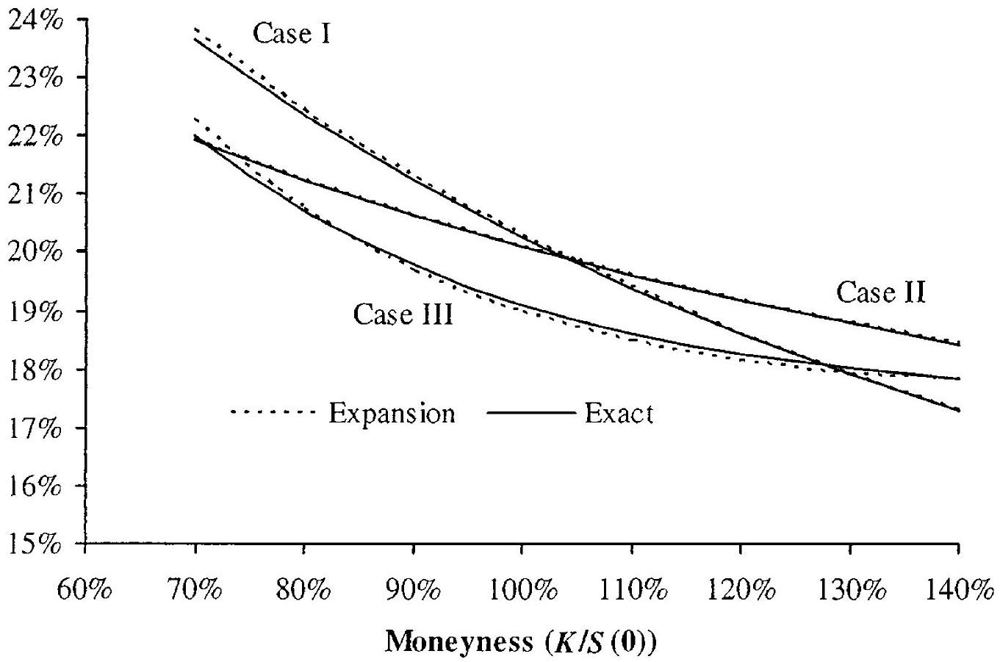
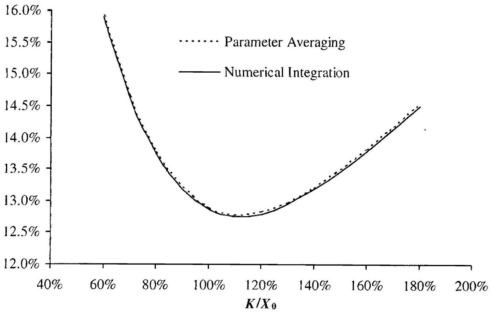

## Vanilla Models with Local Volatility

We have shown in Section 5.10 that European swaptions (and caplets/floorlets which we equate with one-period swaptions) can be valued as European options on forward swap rates. As a consequence, a full term structure model that specifies the dynamics of the whole yield curve through time is essentially unnecessary for European swaption valuation. Instead, we only need a model for the evolution - in fact, just a terminal distribution of a single swap rate in isolation. Models of this type shall be denoted vanilla models, to distinguish them from full term structure models. Vanilla models can be extended by copula methods to describe joint terminal distributions of more than one rate, as we discuss in Chapter 17. Ultimately, however, their primary purpose in this book is to serve as a foundation for development of more widely applicable full term structure models, that is, models which provide consistent dynamics for all points on the yield curve simultaneously. Term structure models are extensively covered later in the book.

In this chapter, we review one-factor diffusive models where our ability to alter the terminal distribution stems from a single source: a swap rate dependent diffusion function. Models of this type are often known as deterministic volatility function (DVF), or sometimes local volatility function (LVF), models. We first discuss the most common tractable specifications of such models - the CEV, displaced diffusion, and quadratic models and then move on to efficient numerical or expansion-based methods for European option pricing within the general DVF model class. The listed techniques and results will be frequently referenced in later chapters, especially in the context of model calibration.

### 7.1 General Framework

### 7.1.1 Model Dynamics

Let $S(t)$ denote a forward Libor or swap rate, and let $W(t)$ be a onedimensional Brownian motion under a measure P in which $S(\cdot)$ is a martingale. We assume that $S(t)$ follows the one-dimensional SDE

$$
\begin{equation*}
d S(t)=\lambda \varphi(S(t)) d W(t) \tag{7.1}
\end{equation*}
$$
^eq7-1

where $\lambda$ is a positive constant ${ }^{1}$ and $\varphi: \mathbb{R} \rightarrow \mathbb{R}$ satisfies regularity conditions, such as those in Theorem 1.6.1. In most applications we would ideally want $S(t)$ to be non-negative, which is easily seen to impose the restriction

$$
\begin{equation*}
\varphi(0)=0 . \tag{7.2}
\end{equation*}
$$
^eq7-2

In some cases we may consciously decide to violate (7.2) for the sake of model tractability.

When dealing with vanilla models, we primarily work in the measure P , so we typically abbreviate $\mathrm{E}^{\mathrm{P}}$ to E when there is no possibility of confusion.

### 7.1.2 Volatility Smile and Implied Density

The role of the function $\varphi$ is to match the distribution of $S$ to that observed through puts and calls traded in the market. Specifically, let $c(t, S ; T, K)$ denote the (non-deflated) time $t$ value of a $T$-maturity European call option struck at $K$ with $S(t)=S$, i.e.

$$
\begin{equation*}
c(t, S(t) ; T, K)=\mathrm{E}_{t}\left((S(T)-K)^{+}\right) \tag{7.3}
\end{equation*}
$$
^eq7-3

The time $t$ probability density of $S(T)$ can be derived from time $t$ observed values of $c$, as (proceeding heuristically)

$$
\begin{align*}
\mathrm{P}_{t}(S(T) \in d K) / d K & =\mathrm{E}_{t}(\delta(S(T)-K))  \tag{7.4}\\
& =\mathrm{E}_{t}\left(\frac{\partial^{2} c(T, S(T) ; T, K)}{\partial K^{2}}\right)=\frac{\partial^{2} c(t, S(t) ; T, K)}{\partial K^{2}} \tag{7.5}
\end{align*}
$$
^eq7-4
^eq7-5

where $\delta$ is the Dirac delta function. This classical result is due to Breeden and Litzenberger [1978] and allows us to construct the marginal density of $S(T)$ from prices of $T$-maturity call options for a continuum of strikes $K$.

In option markets, it is common to express the strike dependency of call (and put) options in terms of the so-called implied volatilities. Specifically,

[^109]for a given option price $c$ at strike $K$ and maturity $T$, we define the time $t$ implied volatility function $\sigma_{\mathrm{B}}(t, S ; T, K)$ as the solution to

$$
\begin{gather*}
c(t, S ; T, K)=S \Phi\left(d_{+}\right)-K \Phi\left(d_{-}\right)  \tag{7.6}\\
d_{ \pm}=\frac{\ln (S / K) \pm \frac{1}{2} \sigma_{\mathrm{B}}(t, S ; T, K)^{2}(T-t)}{\sigma_{\mathrm{B}}(t, S ; T, K) \sqrt{T-t}}
\end{gather*} .
$$
^eq7-6

We recognize the right-hand side of (7.6) as the Black-Scholes-Merton formula for a martingale process, i.e. the Black model (see Remark 1.9.4), with constant volatility $\sigma_{\mathrm{B}}(t, S ; T, K)$. The mapping $K \mapsto \sigma_{\mathrm{B}}(t, S ; T, K)$ is known as the $T$-maturity volatility smile ${ }^{2}$. In most established fixed income markets, the volatility smile is predominantly downward-sloping ${ }^{3}$ in $K$, although it is not uncommon for $\sigma_{\mathrm{B}}$ to eventually increase in $K$ for sufficiently large values of $K$.

### 7.1.3 Choice of $\varphi$

Had we allowed $\varphi$ to depend on time, results by Dupire [1994] and Andersen and Brotherton-Ratcliffe [1998] demonstrate that any arbitrage-free marginal distribution of $S(T)$ can be realized by suitable choice of $\varphi=\varphi(t, S)$, $t \in[0, T]$. Indeed, non-parametric expressions exist to uniquely imply $\varphi(t, K)$ from observations of $\sigma_{\mathrm{B}}(0, S(0) ; t, K)$ for the double continuum $(t, K) \in [0, T] \times[0, \infty)$. Unless the resulting $\varphi$ happens to be monotonically increasing or decreasing in $S$, however, the resulting model will imply non-stationary volatility smile behavior, which is contrary to typical behavior of actual markets. To expand on this issue, consider setting

$$
\begin{equation*}
\varphi(S)=a+(S-S(0))^{2} \tag{7.7}
\end{equation*}
$$
^eq7-7

where $a>0$. The function $\varphi(S)$ is thus a $U$-shaped function with a minimum value of $a$ at $S=S(0)$. Using formulas from Section 7.3 below, it can be verified (and is intuitively obvious) that the time 0 volatility smile $\sigma_{\mathrm{B}}$ produced by this parameterization is also $U$-shaped. Moving forward to time $t>0$, consider the smile generated at $t$ by (7.7) if $S(t) \gg S(0)$. At a large level of $S(t), \varphi(S)$ will appear to be a strongly increasing function of $S$, causing (7.7) to produce a volatility smile no longer $U$-shaped, but instead monotonically increasing at all statistically relevant strikes. Conversely, if $S(t)$ diffuses below $S(0)$ such that $S(t) \ll S(0)$, a monotonically decreasing smile will arise at time $t$.

[^110]Strong level-dependence of the basic volatility smile shape is often at odds with observable market behavior, and non-monotonic specifications of $\varphi(S)$ - such as (7.7) - should consequently be approached with some care. As a consequence, the basic model (7.1) is most appropriate for markets where the volatility smile is (close to) a monotonic function of $K$. A classical monotonic choice for $\varphi$ is the constant elasticity of variance (CEV) specification

$$
\begin{equation*}
\varphi(S)=S^{p} \tag{7.8}
\end{equation*}
$$
^eq7-8

for some constant $p$. As we proceed to show, this specification is analytically tractable.

### 7.2 CEV Model

### 7.2.1 Basic Properties

In this section, we examine the CEV specification (7.8) in detail. We start out with the following proposition:

Proposition 7.2.1. Consider the stochastic differential equation

$$
\begin{equation*}
d S(t)=\lambda S(t)^{p} d W(t) \tag{7.9}
\end{equation*}
$$
^eq7-9

where $p>0$ is constant and $W(t)$ is a one-dimensional Brownian motion. The following holds:

1. All solutions to (7.9) are non-explosive.
2. For $p \geq 1 / 2$, the SDE (7.9) has a unique solution.
3. For $0<p<1, S=0$ is an attainable boundary for (7.9); for $p \geq 1$, $S=0$ is an unattainable boundary for (7.9).
4. For $0
1, S(t)$ is a strict supermartingale.

Proof. Property 1 follows from a remark on page 332 and equation (5.5.19) in Karatzas and Shreve [1997], and Property 2 follows from Example 5.2.14 in Karatzas and Shreve [1997]. Property 3 can be proven using the classical Feller boundary classification techniques based on speed/scale measure integral, see Section 5.5 of Karatzas and Shreve [1997]; Andersen and Andreasen [2000b] have the details. Property 4 is proven in Sin [1998]. □More details on boundary characterization for CEV processes can be found in Davydov and Linetsky [2001].

Remark 7.2.2. For $p \geq 1 / 2$, the solution to (7.9) is unique. Hence, if the solution ever reaches the origin ( $S=0$ ), it stays there, i.e. is absorbed. For $0<p<1 / 2$, however, there are solutions that stay at origin if they reach it, and there are solutions that jump out if it. Hence, to define a unique
solution, a boundary condition at $S=0$ must be specified for (7.9). In practice, we set $S=0$ to be an absorbing barrier: if $S(t)$ hits 0 for the first time at $t=\tau, S(u)=0$ for all $u \geq \tau$. This condition is not only imposed to be consistent with the case of $p \geq 1 / 2$, but is also the only boundary condition consistent with the absence of arbitrage.

Remark 7.2.3. While it is common to require the parameter $p$ to be positive, the process is well-defined for negative $p, p<0$, as well, with the same absorbing boundary condition at $S=0$ as for the case $0<p<1 / 2$ above. This enlargement of the domain of applicability of the process is occasionally useful in the fixed income markets, although much less so than in equity or FX markets where the smiles can generally be much more downward sloping.

For $p<1$ and $t>0$, the time 0 probability that $S(t)=0$ is non-zero. In fact, it can be shown (see, for example, Cox [1996]) that if $\tau$, the first time $S(\cdot)$ hits 0 , is greater than $t$, then

$$
\mathrm{P}_{t}(\tau<T \mid \tau>t)=G\left(|\vartheta|, \frac{X(t)}{2 \lambda^{2}(T-t)}\right), \quad T>t,
$$

where

$$
\begin{align*}
\vartheta & =\frac{1}{2(p-1)}  \tag{7.10}\\
X(t) & =\frac{S(t)^{2(1-p)}}{(1-p)^{2}} \tag{7.11}
\end{align*}
$$
^eq7-10
^eq7-11

and $G$ is the complementary Gamma function

$$
G(a, x) \triangleq \frac{\Gamma(a, x)}{\Gamma(a)}
$$

with the incomplete Gamma function $\Gamma(a, x)$ given by

$$
\begin{equation*}
\Gamma(a, x)=\int_{x}^{\infty} u^{a-1} e^{-u} d u, \quad \Gamma(a)=\Gamma(a, 0) \tag{7.12}
\end{equation*}
$$
^eq7-12

If the absorption probability is substantial, one may want to consider regularizing the process to prevent absorption; see Section 7.2.3 for this.

Due to the result in Proposition 7.2.1, Property 4, we normally prefer to avoid using $p>1$. As $p>1$ will produce volatility smiles increasing in $K$ (and thereby different from those in fixed income markets), this restriction on $p$ is often of little practical concern.

The transition density of $S(\cdot)$ in (7.9) is known in closed form and is listed below for reference, along with a short proof that highlights the relationship between CEV processes and squared Bessel processes.

Lemma 7.2.4. Consider the SDE (7.9) for any $p \neq 1$ (including $p<0$ and $p>1$ ), and let $\vartheta$ and $X(t)$ be as in (7.10)-(7.11). Let $q(X(T) \mid X(t))$ be the conditional P -density of $X(T)$ given $X(t)>0, t<T$. If the level $S=0$ is defined to be an absorbing boundary for (7.9) when $p \leq 1 / 2$, then

$$
\begin{aligned}
q(X(T) \mid X(t))=\frac{1}{2 \lambda^{2}(T-t)} \exp & \left(-\frac{X(T)+X(t)}{2 \lambda^{2}(T-t)}\right) \\
& \times\left(\frac{X(t)}{X(T)}\right)^{-\vartheta / 2} I_{|\vartheta|}\left(\frac{\sqrt{X(T) X(t)}}{\lambda^{2}(T-t)}\right)
\end{aligned}
$$

where $I_{a}(x)$ is the modified Bessel function of the first kind of order $a$ :

$$
I_{a}(x)=\sum_{j=0}^{\infty} \frac{(x / 2)^{a+2 j}}{j!\Gamma(a+j+1)} .
$$

Proof. According to Ito's lemma, the process $X(t)$ satisfies the SDE

$$
d X(t)=\lambda^{2} \frac{1-2 p}{1-p} d t+2 \lambda \sqrt{X(t)} d W(t)
$$

Define the process $Y(v)$ by $Y(v)=X\left(v / \lambda^{2}\right)$. Applying a time change, it follows that

$$
d Y(v)=\frac{1-2 p}{1-p} d v+2 \sqrt{Y(v)} d \widetilde{W}(v)
$$

where $\widetilde{W}(\cdot)$ is a Brownian motion, up to the absorption time $\inf \{v>0: Y(v)=0\}$. The process for $Y$ can be identified as a so-called squared Bessel process of index $\vartheta$. Standard results for this process (see e.g. p. 117 of Borodin and Salminen [1996]) give the result in the lemma.

Remark 7.2.5. By the usual transformation rules for densities, the density for $S(T)$ conditional on $S(t)$ is

$$
q(X(T) \mid X(t)) \cdot 2 S(T)^{2(1-p)-1} /|1-p| .
$$

### 7.2.2 Call Option Pricing

Consider now the valuation of European call options in the CEV model, requiring evaluation of the expectation

$$
c_{\mathrm{CEV}}(t, S(t) ; T, K) \triangleq \mathrm{E}_{t}\left((S(T)-K)^{+}\right)
$$

for $S(\cdot)$ that follows (7.9). Using the definition (7.11), we can rewrite this as

$$
\begin{aligned}
c_{\mathrm{CEV}}(t, S(t) ; T, K)=\mathrm{E}_{t} & \left(\left(\left[(1-p)^{2} X(T)\right]^{-\vartheta}-K\right)^{+}\right) \\
& =\int_{0}^{\infty}\left(\left[(1-p)^{2} X\right]^{-\vartheta}-K\right)^{+} q(x \mid X(t)) d x
\end{aligned}
$$

where we have assumed $p \neq 1$ and the density $q(x \mid X(t))$ is given in Lemma 7.2.4. A straightforward, but tedious, integration exercise (see e.g. Schroder [1989] or Andersen and Andreasen [2000b]) yields the following result:
Proposition 7.2.6. Consider the CEV model (7.9). Let $\chi_{\nu}^{2}(\gamma)$ be a noncentral chi-square distributed variable with $\nu$ degrees of freedom and noncentrality parameter $\gamma$, and let $\gamma(x, \nu, \gamma)=\mathrm{P}\left(\chi_{\nu}^{2}(\gamma) \leq x\right)$ be the cumulative distribution function for $\chi_{\nu}^{2}(\gamma)$. Also define

$$
a=\frac{K^{2(1-p)}}{(1-p)^{2} \lambda^{2}(T-t)}, \quad b=|p-1|^{-1}, \quad c=\frac{S^{2(1-p)}}{(1-p)^{2} \lambda^{2}(T-t)}
$$

Then, for $0<p<1$ and an absorbing boundary at $S=0$ we have, for $K>0$,

$$
\begin{equation*}
c_{\mathrm{CEV}}(t, S ; T, K)=S(1-\Upsilon(a, b+2, c))-K \Upsilon(c, b, a) \tag{7.13}
\end{equation*}
$$
^eq7-13

Remark 7.2.7. The result above in fact holds for all $p<1$, including negative $p$. A complimentary result holds for $p>1$,

$$
\begin{equation*}
c_{\mathrm{CEV}}(t, S ; T, K)=S(1-\Upsilon(c, b, a))-K \Upsilon(a, b+2, c) \tag{7.14}
\end{equation*}
$$
^eq7-14

Remark 7.2.8. The special case $p=1$ leads to the Black pricing formula with volatility $\lambda$, see (1.43) and Remark 1.9.4), so that

$$
\begin{equation*}
c_{\mathrm{B}}(t, S ; T, K ; \lambda)=S \Phi\left(d_{+}\right)-K \Phi\left(d_{-}\right) \tag{7.15}
\end{equation*}
$$
^eq7-15

where

$$
d_{ \pm}=\frac{\ln (S / K) \pm \lambda^{2}(T-t) / 2}{\lambda \sqrt{T-t}}
$$

and $\Phi(\cdot)$ is the standard Gaussian CDF.
Remark 7.2.9. For the case $p=0$, if we remove the assumption of an absorbing barrier at the origin, $S(t)$ is a Gaussian process. In this case, it is straightforward to compute that the option pricing formula, sometimes called the Normal, Gaussian or Bachelier pricing formula with (Normal) volatility ${ }^{4} \lambda$, becomes

$$
\begin{equation*}
c_{\mathrm{N}}(t, S ; T, K ; \lambda)=(S-K) \Phi(d)+\lambda \sqrt{T-t} \phi(d), \quad d=\frac{S-K}{\lambda \sqrt{T-t}} \tag{7.16}
\end{equation*}
$$
^eq7-16

where $\Phi(\cdot)$ and $\phi(\cdot)$ are the standard Gaussian CDF and PDF, respectively.
Further details about the non-central chi-square distribution can be found in Chapter 3. A number of efficient numerical algorithms exist to compute $Y(x, \nu, \gamma)$; see Johnson et al. [1995] for a survey. A standard algorithm can be found in Ding [1992]. Figure 7.1 on page 298 gives some examples of volatility skews produced by the CEV model.

[^111]
### 7.2.3 Regularization

As discussed earlier, the CEV process implies a positive probability of absorption at $S=0$ (for $p<1$ ). This phenomenon is not necessarily a problem for pricing of simple European call options, but is obviously not desirable from an empirical standpoint ${ }^{5}$, and might also create some difficulties in pricing of more exotic structures. To avoid absorption, we can specify a regularized version of the CEV model by letting,

$$
\begin{equation*}
\varphi(x)=x \min \left(\varepsilon^{p-1}, x^{p-1}\right), \quad \varepsilon>0, p<1 . \tag{7.17}
\end{equation*}
$$
^eq7-17

Roughly speaking, when $S(t)$ crosses the level $\varepsilon$, the resulting process becomes (locally) a geometric Brownian motion with finite volatility $\varepsilon^{p-1}$. With $\varphi(x)$ now Lipschitz continuous, it is straightforward to verify that the process for $S(t)$ can no longer reach the origin. On the other hand, the specification (7.17) will not allow for closed-form call option pricing but will, in principle at least, require the usage of numerical methods such as the finite difference method (see Section 7.4). On the other hand, for small to moderate values of $\varepsilon$, we would expect the CEV pricing formulas from Proposition 7.2.6 to hold as a good approximation. Andersen and Andreasen [2000b] verify numerically that this holds quite robustly, for strikes not too far from the spot value of $S$. More formally, we have the following result:

Proposition 7.2.10. For $p<1$ and $\varepsilon>0$, let

$$
\begin{aligned}
d x(t) & =\lambda x(t)^{p} d W(t) \\
d y(t) & =\lambda y(t) \min \left(\varepsilon^{p-1}, y(t)^{p-1}\right) d W(t)
\end{aligned}
$$

where $x(0)=y(0)>0$ and $W(t)$ is a one-dimensional Brownian motion in measure P . For $p<1 / 2,0$ is assumed to be an absorbing boundary for $x$. For some $T>t$ and some constant $K$, we then have

$$
\begin{gathered}
\lim _{\varepsilon \downarrow 0}|\mathrm{P}(x(T)<h)-\mathrm{P}(y(T)<h)|=0, \\
\lim _{\varepsilon \downarrow 0}\left|\mathrm{E}\left((x(T)-K)^{+}\right)-\mathrm{E}\left((y(T)-K)^{+}\right)\right|=0 .
\end{gathered}
$$

The result is intuitive, but the proof is somewhat technical, and we skip it. Details can be found in Andersen and Andreasen [2000b].

[^112]
### 7.2.4 Displaced Diffusion Models

An easy extension of the CEV model that is sometimes useful involves adding a displacement constant to the CEV specification. Specifically, we write

$$
\begin{equation*}
\varphi(x)=(\alpha+x)^{p} \tag{7.18}
\end{equation*}
$$
^eq7-18

for some constant $\alpha$. In the process (7.1), (7.18), let us set $Z(t)=\alpha+S(t)$. By Ito's lemma, $Z(t)$ then satisfies the CEV SDE

$$
d Z(t)=\lambda Z(t)^{p} d W(t)
$$

With $Z(t)$ having an absorbing boundary at $0, S(t)$ then must have an absorbing boundary at $-\alpha$. Call option pricing with (7.18) is straightforward:

Proposition 7.2.11. Let

$$
c_{\mathrm{DCEV}}(t, S(t) ; T, K, \alpha)=\mathrm{E}_{t}\left((S(T)-K)^{+}\right)
$$

be the call option price associated with the displaced CEV process (7.1), (7.18). Then

$$
\begin{equation*}
c_{\mathrm{DCEV}}(t, S ; T, K, \alpha)=c_{\mathrm{CEV}}(t, S+\alpha ; T, K+\alpha), \quad S, K>-\alpha, \tag{7.19}
\end{equation*}
$$
^eq7-19

where the right-hand side is given by Proposition 7.2.6.
Proof. The result follows directly from the observation that

$$
\mathrm{E}_{t}\left((S(T)-K)^{+}\right)=\mathrm{E}_{t}\left((Z(T)-(K+\alpha))^{+}\right)
$$

where $Z(t)=\alpha+S(t)$ follows a regular CEV process.
Introduction of the displacement constant $\alpha$ allows for a (somewhat) richer family of volatility smiles than those of the pure CEV specification. In practice, however, the main use of displacement constants is for the special case of the displaced log-normal, or shifted log-normal, process where $p=1$. The call option price formula for this case is listed below, for later reference.

Proposition 7.2.12. Consider the displaced log-normal process

$$
\begin{equation*}
d S(t)=\lambda(\beta+\zeta S(t)) d W(t) \tag{7.20}
\end{equation*}
$$
^eq7-20

where $W(t)$ is a one-dimensional Brownian motion in measure P , and $\zeta, \lambda \neq 0$. Assuming $S(t), K>-\beta / \zeta$, we have

$$
\begin{aligned}
c_{\mathrm{DLN}}(t, S(t) ; T, K) & \triangleq \mathrm{E}_{t}\left((S(T)-K)^{+}\right) \\
& =\left(S(t)+\frac{\beta}{\zeta}\right) \Phi\left(d_{+}\right)-\left(K+\frac{\beta}{\zeta}\right) \Phi\left(d_{-}\right) \\
d_{ \pm} & =\frac{\ln \left(\frac{S(t)+\beta / \zeta}{K+\beta / \zeta}\right) \pm \frac{1}{2} \zeta^{2} \lambda^{2}(T-t)}{\zeta \lambda \sqrt{T-t}} .
\end{aligned}
$$

Proof. The result follows directly from the Black-Scholes equation (see Section 1.9) and (7.19), after setting $\alpha=\beta / \zeta$ and writing $\lambda(\beta+\zeta S(t))= \lambda \zeta(\alpha+S(t))$.

Remark 7.2.13. It is often convenient to rewrite the displaced log-normal process in a slightly different form

$$
\begin{equation*}
d S(t)=\sigma(b S(t)+(1-b) L) d W(t) \tag{7.21}
\end{equation*}
$$
^eq7-21

The parameter $L$ is often set to near, or exactly at, the initial value $S(0)$. In this parameterization, $\sigma$ is expressed in the units of relative volatility, just like in the Black model, because $b S(0)+(1-b) L \approx S(0)$. In particular, $\sigma$ always has the same scale for all values of $b$. Moreover, the effects of $\sigma$ and $b$ are almost "orthogonal", in the sense that the parameter $\sigma$ changes the overall level of the implied volatility smile but not its slope, whereas $b$ only changes the slope (skew) of the implied volatility smile but not its overall level (i.e. not the at-the-money implied volatility). We use the parameterization (7.21) extensively in later chapters.

Remark 7.2.14. Consider the general local volatility model (7.1). Expanding the local volatility function $\varphi(\cdot)$ around at-the-money to the first order, we obtain

$$
d S(t) \approx \lambda\left(\varphi(S(0))+\varphi^{\prime}(S(0))(S(t)-S(0))\right) d W(t)
$$

which we identify as being of the form (7.21) with

$$
\sigma=\lambda \frac{\varphi(S(0))}{S(0)}, \quad b=\varphi^{\prime}(S(0)) \frac{S(0)}{\varphi(S(0))}, \quad L=S(0) .
$$

Hence, a first-order approximation to any local volatility process is of displaced log-normal type. In view of this, displaced log-normal processes are extensively used in various types of approximations and asymptotic expansions.

The previous remark can be applied to the CEV process:

$$
\sigma=\lambda S(0)^{p-1}, \quad b=p, \quad L=S(0) .
$$

The approximation of the CEV process with (7.21) turns out to be particularly close, and we later use it to increase the tractability of certain stochastic volatility models. We also use it as a justification to freely switch from one type of process to the other. It is worth noting, however, that (7.20) has certain drawbacks relative to a pure CEV process. First, the process for $S(\cdot)$ can become negative if $\beta$ (as is usual) is positive. Second, in stochastic volatility applications the asymptotic linear growth of $\varphi(x)$ in $x$ can sometimes lead to technical problems and unbounded second moments of $S(\cdot)$. We shall return to this issue shortly, in Chapter 8.

### 7.3 Quadratic Volatility Model

In practice, volatility smiles in fixed income markets are not always perfectly monotonic in strike; indeed, as mentioned earlier, for sufficiently high strikes it is not uncommon for the smile to reverse direction and start increasing in strike. This type of behavior is inconsistent with a pure CEV model, but can, to some extent, be captured by the displaced CEV specification $\varphi(x)=(\alpha+x)^{p}$. Often, however, this model is hard to fit to actual data. A more powerful approach involves overlaying the CEV process with stochastic volatility, something that we turn to in Chapter 8. If we here wish to stay within the realm of DVF processes, one way to generate arbitrarily convex smiles is to use a quadratic volatility model, where

$$
\begin{equation*}
\varphi(x)=\alpha+\beta x+\gamma x^{2} \tag{7.22}
\end{equation*}
$$
^eq7-22

for constants $\alpha, \beta, \gamma$. We develop some aspects of this model here, but remind the reader of the caveats discussed in Section 7.1.3; in particular, for the model to be realistic, $\gamma$ should probably be small.

Before commencing with derivations, let us note that the behavior of a DVF model (7.1) equipped with volatility function (7.22) will depend strongly on the root configuration in the quadratic polynomial $\alpha+\beta x+\gamma x^{2}$. For instance, if $\varphi$ has two real roots $l, u, l<u$, straddling the initial value $S(0)$, it is clear that $S(t)$ will itself be bound to this range, i.e. $S(t) \in[l, u]$. Specifically, whenever $S(t)$ gets close to either $l$ or $u, \varphi(x)$ will approach zero and the diffusion for $S(t)$ will gradually slow down. As such range-bound dynamics are rather unrealistic for interest rate applications ${ }^{6}$, we do not consider it in the following.

### 7.3.1 Case 1: Two Real Roots to the Left of $S(0)$

We first consider the case where $\alpha+\beta x+\gamma x^{2}$ has two real roots $l$ and $u$, $l<u$, both lying to the left of $S(0)$. Without loss of generality, we may then consider the normalized process

$$
\begin{equation*}
d S(t)=\frac{(S(t)-u)(S(t)-l)}{u-l} d W(t), \quad S(0)>u>l \tag{7.23}
\end{equation*}
$$
^eq7-23

We start by listing a few lemmas.
Lemma 7.3.1. The range for $S(t)$ in (7.23) is $S(t) \in(u, \infty)$. In particular, the process for $S(t)$ does not explode in measure P .

[^113]Proof. That $S(t)$ cannot go below $u$ is obvious; further, Feller's boundary criteria (e.g. Karlin and Taylor [1981], Chapter 15.6) establishes that $u$ is not accessible when $S(0)>u$. As $S(t)$ is described by a time-homogeneous one-dimensional SDE, it cannot explode (Karatzas and Shreve [1997], p. 332). $\square$

While the process for $S(t)$ is non-explosive, the super-linear growth ${ }^{7}$ of $\varphi(x)$ causes some interesting technical problems, In particular, we have the following result, proved in Andersen [2010].

Lemma 7.3.2. The process (7.23) is a strict supermartingale in measure P.

As the process for $S$ is not a martingale, the usual pricing results require some modifications. For the purpose of pricing puts and calls, we need use the following.

Lemma 7.3.3. Suppose that $S(t)$ satisfies (7.23) in some measure P and assume that put-call parity holds. Then the prices at time 0 for the put (p) and call (c) are

$$
\begin{aligned}
& p(0, S(0) ; T, K)=\mathrm{E}\left((K-S(T))^{+}\right) \\
& c(0, S(0) ; T, K)=p(0, S(0) ; T, K)+S(0)-K>\mathrm{E}\left((S(T)-K)^{+}\right)
\end{aligned}
$$

Proof. (Sketch only). In the absence of arbitrage, the put price is a local martingale in measure $P$. As a bounded local martingale is a martingale and the put payout is bounded between 0 and $K-u$, it follows then that the put price in fact must be a true P -martingale. The expression for $p(0, S(0) ; T, K)$ follows. Applying put-call parity (see Chapter 1) yields the result for $c(0, S(0) ; T, K)$, where the inequality follows from Lemma 7.3.2. $\square$

We emphasize the non-standard result $c(0, S(0) ; T, K)> \mathrm{E}(c(T, S(T) ; T, K))$ which is a consequence of the supermartingale property of $S(t)$. The inequality holds for arbitrarily large strikes; indeed, rather counter-intuitively, $\lim _{K \rightarrow \infty} c(0, S(0) ; T, K)=S(0)-\mathrm{E}(S(T))>0$. We should also note that our assumption of put-call parity being valid is critical here, as it allows us to produce unique prices of both puts and calls. As described in Heston et al. [2007] and Andersen [2010], it is, however, possible to work with other assumptions without violating no-arbitrage.

With 7.3.3 we are now ready to tackle the derivation of an option pricing formula. We will be using the shorthand

$$
p(t) \triangleq p(t, S(t) ; T, K)
$$

and so forth. First, notice the useful relationship[^114]

$$
\begin{equation*}
S-K=\frac{(S-u)(K-l)-(K-u)(S-l)}{u-l}, \tag{7.24}
\end{equation*}
$$
^eq7-24
which allows us to write

$$
\begin{align*}
p(T)= & \frac{1}{u-l}((K-u)(S(T)-l)-(S(T)-u)(K-l))^{+} \\
= & \frac{(K-u)(S(T)-l)}{u-l} 1_{\{(K-u)(S(T)-l)-(S(T)-u)(K-l)>0\}} \\
& -\frac{(S(T)-u)(K-l)}{u-l} 1_{\{(K-u)(S(T)-l)-(S(T)-u)(K-l)>0\}} \\
\triangleq & p_{1}(T)-p_{2}(T) \tag{7.25}
\end{align*}
$$
^eq7-25

The payouts $p_{1}$ and $p_{2}$ have identical structure, so it suffices to focus our attention on pricing one of them, e.g. $p_{1}$.

From Lemma 7.3.3, we have $p_{1}(0)=\mathrm{E}\left(p_{1}(T)\right)$, which we rewrite as

$$
\begin{equation*}
p_{1}(0)=\frac{K-u}{u-l} \mathrm{E}\left((S(T)-l) 1_{\{(S(T)-u) /(S(T)-l)<(K-u) /(K-l)\}}\right) . \tag{7.26}
\end{equation*}
$$
^eq7-26

At this point our first instinct would be to perform a measure shift that eliminates that factor $S(T)-l$ in the expectation, i.e. we would like to introduce a new measure $\widetilde{\mathrm{P}}$ such that

$$
\widetilde{\mathrm{P}}(B)=\frac{1}{S(0)-l} \mathrm{E}((S(T)-l) B)
$$

for any $\mathcal{F}_{T}$-measurable event $B$. We recall, however, that $S(t)$ (and therefore $S(t)-l)$ is not a martingale in P , so such a measure shift cannot be performed outright. Let us nevertheless try. Proceeding mechanically as if $S(t)$ were a martingale, we would get, for the process $Y(t) \triangleq(S(t)-u) /(S(t)-l)$,

$$
\begin{equation*}
d Y(t) \stackrel{?}{=} Y(t) d \widetilde{W}(t), \quad Y(0)=\frac{S(0)-u}{S(0)-l}<1 \tag{7.27}
\end{equation*}
$$
^eq7-27

where $\widetilde{W}$ is a Brownian motion in $\widetilde{\mathrm{P}}$. Clearly, however, there are technical problems here: the range for $Y(t)$ in (7.27) is $[0, \infty)$, whereas we know that in measure P we have $Y(t) \in(0,1)$ (since $S(t) \in(u, \infty)$ ); the two measures therefore cannot be equivalent. For option pricing purposes, it turns out that the correct way to handle the technical conflict involves inserting an absorbing boundary at $Y=1$ in (7.27).

Proposition 7.3.4 Let

$$
d Y(t)=Y(t) d \widetilde{W}(t), \quad Y(0)=\frac{S(0)-u}{S(0)-l}<1
$$

be geometric Brownian motion in $\widetilde{\mathrm{P}}$. Define $\tau=\inf \{t>0: Y(t)=1\}$, and let $K>u$. Then $p_{1}(0)$ in (7.26) is given by

$$
\begin{equation*}
p_{1}(0)=\frac{(K-u)(S(0)-l)}{u-l} \mathrm{E}^{\widetilde{\mathrm{P}}}\left(1_{\{Y(T)<(K-u) /(K-l)\}} 1_{\{\tau>T\}}\right) . \tag{7.28}
\end{equation*}
$$
^eq7-28

Stated explicitly,

$$
\begin{equation*}
p_{1}(0)=K_{1} \Phi\left(\frac{-\ln \left(X_{1} / K_{1}\right)+T / 2}{\sqrt{T}}\right)-X_{2} \Phi\left(\frac{\ln \left(X_{2} / K_{2}\right)+T / 2}{\sqrt{T}}\right), \tag{7.29}
\end{equation*}
$$
^eq7-29

with $\Phi$ being the Gaussian cumulative distribution function, and

$$
\begin{array}{ll}
K_{1}=\frac{(K-u)(S(0)-l)}{u-l}, & X_{1}=\frac{(S(0)-u)(K-l)}{u-l} \\
K_{2}=\frac{(K-l)(S(0)-l)}{u-l}, & X_{2}=\frac{(S(0)-u)(K-u)}{u-l}
\end{array}
$$

Proof. The result (7.28) is proven in Andersen [2010]. The result (7.29) follows by direct calculations, similar to those leading to the Black-ScholesMerton formula.

Following similar steps leads to an expression for $p_{2}(0)$, which in turn leads to the following result for $p(0)=p_{1}(0)-p_{2}(0)$.

Proposition 7.3.5. Let $K_{i}, X_{i}, i=1,2$, be given as in Proposition 7.3.4. Assuming $K>u$, the put price $p(0)$ for the model (7.23) has the explicit representation

$$
\begin{gathered}
p(0, S(0) ; T, K)=K_{1} \Phi\left(-d_{-}^{(1)}\right)-X_{2} \Phi\left(d_{+}^{(2)}\right)-X_{1} \Phi\left(-d_{+}^{(1)}\right)+K_{2} \Phi\left(d_{-}^{(2)}\right) \\
d_{ \pm}^{(i)}=\frac{\ln \left(X_{i} / K_{i}\right) \pm T / 2}{\sqrt{T}}, \quad i=1,2
\end{gathered}
$$

An application of put-call parity then immediately gives the call price:
Corollary 7.3.6. Assuming put-call parity holds, the call price for the model (7.23) is

$$
c(0, S(0) ; T, K)=S(0)-K+p(0, S(0) ; T, K),
$$

with $p(0, S(0) ; T, K)$ given in Proposition 7.3.5.
We recall that Proposition 7.3.5 applies to (7.23), rather than our original process which, at the root configuration in question, is

$$
\begin{equation*}
d S(t)=\lambda \gamma(S(t)-u)(S(t)-l) d W(t)=q \frac{(S(t)-u)(S(t)-l)}{u-l} d W(t) \tag{7.30}
\end{equation*}
$$
^eq7-30

where $q=\lambda \gamma(u-l)$. The constant in front of the quadratic polynomial is easily handled by time-scaling: to price options in (7.30) we simply set the put price equal to $p\left(0, S(0) ; q^{2} T, K\right)$, where $p(0, S(0) ; \cdot, K)$ is given by the formula in Proposition 7.3.5.

### 7.3.2 Case 2: One Real Root to the Left of $S(0)$

If we let the single root to $\alpha+\beta x+\gamma x^{2}$ be denoted $u, u<S(0)$, it suffices to consider the normalized process

$$
\begin{equation*}
d S(t)=(S(t)-u)^{2} d W(t) \tag{7.31}
\end{equation*}
$$
^eq7-31

But this process is a special case, with power equal to 2 , of the displaced CEV model in Section 7.2.4, and the option pricing formulas from that section then apply directly. As these formulas are rather complicated in their dependence on the non-central chi-square distribution, it is worthwhile noticing that simple expressions exist for the special case of power equal to 2. The result is listed below.

Proposition 7.3.7. For the process (7.31), the put option price is

$$
\begin{aligned}
p(0, S(0) ; T, K)=(S(0)- & u)(K-u) \sqrt{T} \\
& \times\left\{d_{+} \Phi\left(d_{+}\right)+\phi\left(d_{+}\right)-d_{-} \Phi\left(d_{-}\right)-\phi\left(d_{-}\right)\right\}
\end{aligned}
$$

where $\phi(x)$ is the Gaussian density, and

$$
d_{ \pm}=\frac{ \pm \frac{1}{S(0)-u}-\frac{1}{K-u}}{\sqrt{T}}
$$

Proof. We observe that for the process

$$
d S(t)=(S(t)-u)(S(t)-l) d W(t), \quad l<u<S(0)
$$

the put price can be computed from the result in Proposition 7.3.5, after a time-change, from $T$ to $T(u-l)^{2}$; see the comments at the end of Section 7.3.1. Taking the limit of the put price as $l \uparrow u$ then establishes the result.

The call option price can, as before, be found by put-call parity. To establish put and call option prices for the original diffusion

$$
d S(t)=\lambda\left(\alpha+\beta S(t)+\gamma S(t)^{2}\right) d W(t)=\lambda \gamma(S(t)-u)^{2} d W(t)
$$

we simply change $T$ to $\lambda^{2} \gamma^{2} T$ in Proposition 7.3.7.

### 7.3.3 Extensions and Other Root Configurations

The results listed in Sections 7.3.1 and 7.3.2 have given a flavor of how to deal with quadratic volatility process, and shall suffice for the purposes of this book. Other root configurations are treated in detail in Andersen [2010], including the case where $\varphi(x)$ has no roots (in which case the put and call option price formulas are infinite sine-series). Andersen [2010] also discusses the case where an absorbing barrier has been inserted at the origin to prevent $S(t)$ from going negative.

### 7.4 Finite Difference Solutions for General $\varphi$

For general specifications of $\varphi$, closed-form solutions for European options will not exist. In such cases, we may instead rely on the finite difference methods discussed in Chapter 2. Consider again the evaluation of

$$
c(t, S(t) ; T, K)=\mathrm{E}_{t}\left((S(T)-K)^{+}\right)
$$

with $S(t)$ following (7.1). With suitable regularity conditions on $\varphi$, the Feynman-Kac theorem of Section 1.8 shows that $c(t, S)=c(t, S ; T, K)$ (with $T, K$ fixed) satisfies the PDE

$$
\begin{equation*}
\frac{\partial c(t, S)}{\partial t}+\frac{1}{2} \lambda^{2} \varphi(S)^{2} \frac{\partial^{2} c(t, S)}{\partial S^{2}}=0, \tag{7.32}
\end{equation*}
$$
^eq7-32

subject to the terminal condition

$$
\begin{equation*}
c(T, S)=(S-K)^{+} \tag{7.33}
\end{equation*}
$$
^eq7-33

This PDE can be solved numerically using, say, the Crank-Nicholson finite difference grid method in Chapter 2. A direct discretization of (7.32) is normally sufficient, but we note that it may occasionally be possible to take advantage of special forms of $\varphi$ and introduce transformations of $S$ to improve the properties of the finite difference scheme. For example, as we have already seen in Chapter 2, when $\varphi(S)=S$, it is customary (and appropriate) to introduce $y(S)=\ln S$ and discretize in $y$. More generally, for sufficiently regular $\varphi$, the transformation

$$
\begin{equation*}
y(S)=\int \frac{d S}{\varphi(S)} \tag{7.34}
\end{equation*}
$$
^eq7-34

(see (2.81)-(2.82)) might offer numerical advantages over a direct discretization provided, of course, that the inverse in (7.34) exists. The following semi-heuristic argument explains the rationale. With the transform (7.34), the SDE for $y(t)=y(S(t))$ is (ignoring the drift)

$$
d y(t)=O(d t)+\lambda d W(t)
$$

The diffusion coefficient in the process for $y$ is independent of the state of $S$, suggesting that a differential operator expressed in terms of $y$ may have better numerical properties than the one expressed in terms of $S$. Even if $y$ is not used for discretization, the transformation (7.34) suggests the discretization grid in the $S$-domain. In particular, $\left\{S_{n}\right\}_{n=0}^{m+1}$ can be defined by the condition that $y_{n}=y\left(S_{n}\right), n=0, \ldots, m+1$, are equidistant over $\left[y\left(S_{0}\right), y\left(S_{m+1}\right)\right]$. For $n=0, \ldots, m+1$ this gives $\left(y^{-1}(\cdot)\right.$ is the inverse transform of (7.34))

$$
\begin{aligned}
& y_{n}=y\left(S_{0}\right)+\frac{n}{m+1}\left(y\left(S_{m+1}\right)-y\left(S_{0}\right)\right) \\
& S_{n}=y^{-1}\left(y_{n}\right)=y^{-1}\left(y\left(S_{0}\right)+\frac{n}{m+1}\left(y\left(S_{m+1}\right)-y\left(S_{0}\right)\right)\right) .
\end{aligned}
$$

### 7.4.1 Multiple $\lambda$ and $T$

In applications, we often need to compute the values of $c(t, S ; T, K)$ for many different values of $T$ and/or $\lambda$. This need arises, for instance, in a standard model calibration exercise where we use a root-search algorithm to determine the value of $\lambda$ that will make the computed call prices at different maturities $T$ equal to values observed in the market. In such cases, we note that one should not simply solve (7.32) over and over (at great computational expense), but instead rely on the following observation:

Proposition 7.4.1. Let $g(\tau, x)$ solve the following PDE

$$
\begin{equation*}
-\frac{\partial g(\tau, x)}{\partial \tau}+\frac{1}{2} \varphi(x)^{2} \frac{\partial^{2} g(\tau, x)}{\partial x^{2}}=0 \tag{7.35}
\end{equation*}
$$
^eq7-35

with initial condition

$$
\begin{equation*}
g(0, x)=(x-K)^{+} \tag{7.36}
\end{equation*}
$$
^eq7-36

Let $c(t, S)$ solve the backward PDE (7.32)-(7.33) for a given value of $\lambda$. Then

$$
\begin{equation*}
c(t, S ; T, K)=g\left(\lambda^{2}(T-t), S\right) \tag{7.37}
\end{equation*}
$$
^eq7-37

Proof. Follows directly from a variable transformation $\tau(t)=\lambda^{2}(T-t)$ in (7.32)-(7.33), taking advantage of the time-homogeneity of $\varphi$.

Using finite difference techniques to solve the PDE (7.35), we can construct the function $g$ on a $(\tau, S)$-grid; once this grid is stored in memory, (7.37) is used to recover $c(t, S ; T, K)$ for arbitrary choices of $S, \lambda$ and $T$ by simple lookup or interpolation. We emphasize that this approach involves the numerical solution of only a single PDE. Also note that PDE is solved forward in time from a known initial condition, rather than backwards from a terminal condition.

### 7.4.2 Forward Equation for Call Options

While the function $g$ from (7.35) is conveniently independent of $T$ and $\lambda$, it does depend on $K$ through the initial condition (7.36). In some applications, we may wish to use different strikes for different values of $T$, in which case the approach in Section 7.4.1 requires us to numerically solve as many finite difference grids as there are different values of $K$. We can improve on this by replacing the backward equation (7.32) with the forward equation of Dupire [1994]. In this approach, calendar time $t$ and the initial value of $S$ are considered fixed, whereas maturity $T$ and strike $K$ are variable. In view of this, we define $c(T, K)=c(t, S ; T, K)$ for fixed $t, S$. We need the following proposition:

Proposition 7.4.2. Define the function $c(T, K) \triangleq c(t, S ; T, K)$ where $t, S$ are fixed and $c(t, S ; T, K)$ is defined by (7.3) for the model (7.1). Then $c(T, K)$ satisfies the forward PDE

$$
\begin{equation*}
-\frac{\partial c(T, K)}{\partial T}+\frac{1}{2} \lambda^{2} \varphi(K)^{2} \frac{\partial^{2} c(T, K)}{\partial K^{2}}=0 \tag{7.38}
\end{equation*}
$$
^eq7-38

for $T>t$, subject to the time $t$ initial condition

$$
c(t, K)=(S-K)^{+}
$$

Proof. In Dupire [1994], the result is proven by combining the FokkerPlanck equation (see Section 1.8) with the result (7.5), followed by a series of integrations. A more intuitive line of attack proceeds as follows. Consider the function $H(t)=(S(t)-K)^{+}$. While $H(t)$ clearly does not satisfy the smoothness requirements of Ito's lemma, the Tanaka extension nevertheless justifies the following result, obtained by formally applying Ito's lemma to $H$ :

$$
\begin{equation*}
d H(t)=1_{\{S(t)>K\}} \lambda \varphi(S(t)) d W(t)+\frac{1}{2} \delta(S(t)-K) \lambda^{2} \varphi(S(t))^{2} d t \tag{7.39}
\end{equation*}
$$
^eq7-39

That is,

$$
\begin{aligned}
H(T)= & H(t)+\int_{t}^{T} 1_{\{S(u)>K\}} \lambda \varphi(S(u)) d W(u) \\
& +\frac{1}{2} \int_{t}^{T} \delta(S(u)-K) \lambda^{2} \varphi(S(u))^{2} d u \\
= & H(t)+M(T)+\frac{1}{2} \int_{t}^{T} \delta(S(u)-K) \lambda^{2} \varphi(K)^{2} d u
\end{aligned}
$$

where $\delta$ is the Dirac delta function and $M(t)$ is a continuous martingale with $M(t)=0$. From (7.3), we have that

$$
\begin{aligned}
c(t, S(t) ; T, K) & =\mathrm{E}_{t}(H(T)) \\
& =H(t)+\frac{1}{2} \int_{t}^{T} \mathrm{E}_{t}(\delta(S(u)-K)) \lambda^{2} \varphi(K)^{2} d u \\
& =H(t)+\frac{1}{2} \lambda^{2} \varphi(K)^{2} \int_{t}^{T} \frac{\partial^{2} c(t, S(t) ; u, K)}{\partial K^{2}} d u
\end{aligned}
$$

where we have used the martingale property of $M$ as well as the result (7.5). Differentiating this equation with respect to $T$ gives the result in Proposition 7.4.2.

As mentioned in Chapter 1, the term $\int_{t}^{T} \delta(S(u)-K) d u$ in the expression for $H(T)$ is known as the local time of $S(\cdot)$ at the level $K$. Local time and the Tanaka extension are deep subjects (see Karatzas and Shreve [1997] for a
formal discussion) and have many interesting applications in finance, see for instance Andersen et al. [2002], Andersen and Andreasen [2000a], Andersen and Buffum [2003], Henderson and Hobson [2000], Carr and Jarrow [1990], Carr and Wu [2003], among many others.

We emphasize that while the backward equation (7.32) holds for European derivative securities on $S$ in general, the forward equation (7.38) is unique to calls and puts, as only put and call payouts allow for the basic result (7.5).

Equipped with Proposition 7.4.2, the following result immediately follows from the proof of Proposition 7.4.1. Notice the difference in the initial conditions (7.36) and (7.40).

Proposition 7.4.3. Let $h(\tau, x)$ solve the following PDE

$$
-\frac{\partial h(\tau, x)}{\partial \tau}+\frac{1}{2} \varphi(x)^{2} \frac{\partial^{2} h(\tau, x)}{\partial x^{2}}=0,
$$

with initial condition

$$
\begin{equation*}
h(0, x)=(S-x)^{+} \tag{7.40}
\end{equation*}
$$
^eq7-40

Then

$$
c(t, S ; T, K)=h\left(\lambda^{2}(T-t), K\right) .
$$

As long as the initial value of $S(t)$ is kept constant, the result in Proposition 7.4.3 allows us use a single finite difference grid to price call options with multiple maturities, strikes, and $\lambda$ 's. We note, however, that in many applications $S(t)$ may in fact be $T$-dependent, as $S$ will often represent, say, $T$-maturity Libor forward rates. In such cases, the question of whether Proposition 7.4.3 leads to a more efficient numerical scheme than Proposition 7.4.1 is settled by comparing the number of strikes and the number of spot levels involved.

### 7.5 Asymptotic Expansions for General $\varphi$

As we have shown, there are a number of "tricks" that can be employed to make the application of finite difference methods a computationally viable approach to pricing a large number of European call options. Nevertheless, there is significant convenience and computer code simplification associated with closed-form pricing formulas, so we now turn to the development of asymptotic approximations for the solution to the generic backward PDE (7.32). There are a number of approaches that can be taken, including the "most likely path" method in Gatheral [2001] (see also Gatheral [2006] and Section 22.1.7, and the singular perturbation techniques in Hagan and Woodward [1999b], Henry-Labordére [2008], Gatheral et al. [2009], to name a few. Our presentation here is based on a fairly straightforward, yet often highly accurate, asymptotic expansion in time to maturity.

### 7.5.1 Expansion around Displaced Log-Normal Process

As in Proposition 7.4.1, we start by writing $c(t, S ; T, K)=g(\tau, S)$, where $\tau=\lambda^{2}(T-t)$ and $g$ satisfies (7.35). Inspired by the known solution of (7.35) in Proposition 7.2.12 for the case $\varphi(x)=\beta+\zeta x, \zeta \neq 0$, let us guess at a solution of (7.35) of the form

$$
\begin{gather*}
g(\tau, S)=\left(S+\frac{\beta}{\zeta}\right) \Phi\left(z_{+}\right)-\left(K+\frac{\beta}{\zeta}\right) \Phi\left(z_{-}\right)  \tag{7.41}\\
z_{ \pm}=\frac{\ln \left(\frac{S+\beta / \zeta}{K+\beta / \zeta}\right) \pm \frac{1}{2} \Omega(\tau, S)^{2}}{\Omega(\tau, S)}
\end{gather*}
$$
^eq7-41

where the function $\Omega(\tau, S)$ is to be determined. In (7.41), note that we obviously must assume that $S, K>-\beta / \zeta$. Substituting (7.41) into (7.35) gives the following PDE for $\Omega(\tau, S)$ :

$$
\begin{align*}
(S & \left.+\frac{\beta}{\zeta}\right)^{2} \Omega \frac{\partial \Omega}{\partial \tau} \\
& =\frac{1}{2} \varphi(S)^{2}\left[\left(S+\frac{\beta}{\zeta}\right)^{2} \Omega \frac{\partial^{2} \Omega}{\partial S^{2}}+\left(1-h_{-3}\right)-h_{1}\left(1-h_{-1}\right)\right] \tag{7.42}
\end{align*}
$$
^eq7-42

where

$$
h_{i} \triangleq\left(S+\frac{\beta}{\zeta}\right) \frac{\partial \Omega}{\partial S}\left(\Omega^{-1} \ln \left(\frac{S+\beta / \zeta}{K+\beta / \zeta}\right)+\frac{1}{2} i \Omega\right), \quad i=-3,-1,1
$$

The PDE (7.42) does not generally allow for an explicit solution, so we resort to an asymptotic expansion in $\tau$.

Proposition 7.5.1. An asymptotic expansion for the solution of (7.35) is given by (7.41), with

$$
\begin{align*}
\Omega(\tau, S) & =\Omega_{0}(S) \tau^{1 / 2}+\Omega_{1}(S) \tau^{3 / 2}+O\left(\tau^{5 / 2}\right)  \tag{7.43}\\
\Omega_{0}(S) & =\ln \left(\frac{S+\beta / \zeta}{K+\beta / \zeta}\right)\left(\int_{K}^{S} \varphi(u)^{-1} d u\right)^{-1}  \tag{7.44}\\
\Omega_{1}(S) & =-\frac{\Omega_{0}(S)}{\left(\int_{K}^{S} \varphi(u)^{-1} d u\right)^{2}} \ln \left(\Omega_{0}(S)\left(\frac{(S+\beta / \zeta)(K+\beta / \zeta)}{\varphi(S) \varphi(K)}\right)^{1 / 2}\right) \tag{7.45}
\end{align*}
$$
^eq7-43
^eq7-44
^eq7-45

where the parameters $\beta$ and $\zeta$ can be chosen arbitrarily, subject to the constraints $S, K>-\beta / \zeta$ and $\zeta \neq 0$.

Proof. In (7.41) we clearly require $\Omega(\tau, S) \sim \tau^{1 / 2}$ as $\tau \rightarrow 0$, so we seek a small-time solution of the form

$$
\begin{equation*}
\Omega(\tau, S)=\sum_{i \geq 0} \tau^{i+1 / 2} \Omega_{\imath}(S) \tag{7.46}
\end{equation*}
$$
^eq7-46

Notice that (7.46) omits all integer powers of $\tau$ - it turns out that their weights are all identically 0 . Substituting (7.46) into (7.42) and matching terms of order $O(1)$ gives

$$
\begin{equation*}
(S+\beta / \zeta)^{2} \Omega_{0}^{2}=\varphi(S)^{2}\left(1-\frac{\Omega_{0}^{\prime}}{\Omega_{0}}(S+\beta / \zeta) \ln \left(\frac{S+\beta / \zeta}{K+\beta / \zeta}\right)\right)^{2} \tag{7.47}
\end{equation*}
$$
^eq7-47

where the prime denotes differentiation with respect to $S$. Taking the square root of the above equation and rearranging leads to two first-order ordinary differential equations of the Bernoulli type. Solving (7.47) subject to the boundary condition that the limit of $\Omega_{0}$ must be finite for $S \rightarrow K$ (and discarding the negative solution) leads to (7.44).

Progressing now to the $O(\tau)$ term in (7.42), we get

$$
\begin{aligned}
2(S+\beta / \zeta) \Omega_{1}= & \frac{1}{2} \varphi(S)^{2}\left((S+\beta / \zeta) \Omega_{0}^{\prime \prime}+\Omega_{0}^{\prime}\right) \\
& \quad-\varphi(S)(S+\beta / \zeta) \ln \left(\frac{S+\beta / \zeta}{K+\beta / \zeta}\right)\left(\frac{\Omega_{1}^{\prime}}{\Omega_{0}}-\frac{\Omega_{1} \Omega_{0}^{\prime}}{\Omega_{0}^{2}}\right)
\end{aligned}
$$

Inserting the result for $\Omega_{0}$ and rearranging again leads to a Bernoulli-type ODE, the explicit solution of which is (7.45). As before, we have ensured that the limit $S \rightarrow K$ is finite.

Remark 7.5.2. We notice that $\Omega_{0}(K)$ and $\Omega_{1}(K)$ in Proposition 7.5.1 exist by construction. Taking the limit $S \rightarrow K$ explicitly, we get

$$
\begin{aligned}
& \Omega_{0}(K)=\frac{\varphi(K)}{K+\beta / \zeta} \\
& \Omega_{1}(K)=\frac{1}{24} \Omega_{0}(K)^{3}\left[1+(K+\beta / \zeta)^{2} \varphi(K)^{-2}\left(2 \varphi(K) \varphi^{\prime \prime}(K)-\varphi^{\prime}(K)^{2}\right)\right]
\end{aligned}
$$

While Proposition 7.5.1 only includes two terms in the expansion for $\Omega$, it is possible to compute further terms if necessary. Such terms become increasingly cumbersome however, and typically do not add much further accuracy.

The best choice of the parameters $\beta$ and $\zeta$ is not always obvious. One choice is to use Remark 7.2.14. Alternatively, we could think of a more global approach and, roughly speaking, set them in such a way that the straight line $\beta+\zeta x$ would provide as good a fit to $\varphi(x)$ as possible, over the
statistically relevant range of $x$. Sometimes, we can use a Taylor expansion around $x=(S+K) / 2$, say, and set

$$
\zeta=\varphi^{\prime}((S+K) / 2), \quad \beta=\varphi((S+K) / 2)-\zeta(S+K) / 2 .
$$

We note that when $\beta=0, \Omega\left(\lambda^{2}(T-t), S(t)\right) / \sqrt{T-t}$ in Proposition 7.5.1 conveniently becomes the time $t$ implied Black volatility $\sigma_{\mathrm{B}}$ discussed earlier. For a few selected $\varphi$, Figure 7.1 below compares $\sigma_{\mathrm{B}}$ computed from the expansion in Proposition 7.5.1 (with $\beta=0$ ) against exact results. Despite the long option maturity used in the figure, precision of the expansion is excellent, especially for the CEV case.

Fig. 7.1. Implied Volatility

Notes: The graph shows the implied volatility for a 10 year option, as a function of option moneyness $K / S(0)$. The initial value of the underlying is $S(0)=6 \%$. Three DVF models are considered in the figure. Case I: $\varphi(x)=x^{0.1}, \lambda=1.59 \%$. Case II: $\varphi(x)=x^{0.5}, \lambda=4.90 \%$. Case III: $\varphi(x)=x\left(1+30 e^{-10 x}\right), \lambda=16.75 \%$. The "Expansion" numbers in the graph were computed from the result in Proposition 7.5.1 with $\beta=0$. For Case I and Case II, the "Exact" numbers were computed by the known CEV pricing formula in Proposition 7.2.6; for Case III the "Exact" numbers were computed in a Crank-Nicholson finite difference grid with 150 time steps and 250 spatial steps.

### 7.5.2 Expansion around Gaussian Process

For cases where $\varphi$ is close to a constant, one might like to base the asymptotic expansion on $\varphi(x)=\beta$, for some constant $\beta$. In this case (which violates
one of the restrictions in Proposition 7.5.1), we use the Gaussian formula (7.16), and write

$$
\begin{equation*}
g(\tau, S)=(S-K) \Phi(w)-\Psi(\tau, S) \phi(w), \quad w=\frac{S-K}{\Psi(\tau, S)} \tag{7.48}
\end{equation*}
$$
^eq7-48

For completeness, an asymptotic expansion of $\Psi(\tau, S)$ is given below.
Proposition 7.5.3. An asymptotic expansion for the solution of (7.35) is given by (7.48), with

$$
\begin{aligned}
\Psi(\tau, S) & =\Psi_{0}(S) \tau^{1 / 2}+\Psi_{1}(S) \tau^{3 / 2}+O\left(\tau^{5 / 2}\right) \\
\Psi_{0}(S) & =(S-K)\left(\int_{K}^{S} \varphi(u)^{-1} d u\right)^{-1} \\
\Psi_{1}(S) & =-\frac{\Psi_{0}(S)^{3}}{(S-K)^{2}} \ln \left(\Psi_{0}(S)(\varphi(S) \varphi(K))^{-1 / 2}\right)
\end{aligned}
$$

In Proposition 7.5.3, the limit $S \rightarrow K$ leads to the following expressions

$$
\begin{aligned}
\Psi_{0}(K) & =\varphi(K) \\
\Psi_{1}(K) & =\frac{1}{24} \varphi(K)\left(2 \varphi(K) \varphi^{\prime \prime}(K)-\varphi^{\prime}(K)^{2}\right)
\end{aligned}
$$

The proof of Proposition 7.5.3 is similar to that of Proposition 7.5.1 and is omitted. Note that $\Psi\left(\lambda^{2}(T-t), S(t)\right) / \sqrt{T-t}$ can be interpreted as an implied Normal volatility.

### 7.6 Extensions to Time-Dependent $\varphi$

So far, we have limited our discussion to the case where the function $\varphi$ is independent of calendar time $t$. While there is some danger in making $\varphi$ a function of $t$ - the model inevitably becomes less time-stationary - there are a number of applications where such an extension is necessary to improve the fit to market data. Unlike the non-parametric approaches in Dupire [1994], Derman and Kani [1994], and Andersen and Brotherton-Ratcliffe [1998] (and many others) where $\varphi(t, S)$ is calibrated to fit a double continuum of call option prices, the applications we have in mind are normally parametric, and are inspired by typical requirements of calibrating term structure models to swaptions and caplets.

By itself, swaption and caplet pricing does not require time-dependent parameters, as only the terminal distribution is relevant. From that point of view, vanilla models with time-dependent local volatility functions may appear to have limited use in fixed income modeling. However, they often arise as describing approximate dynamics of swap or Libor rates in term
structure models. Many examples of such approximations are given in later chapters (see Chapters 13 and 14, for instance), and handling time-dependent parameters in local volatility models is important for term structure model calibration.

### 7.6.1 Separable Case

Recall the basic SDE (7.1). Its simplest time-dependent extension specifies a time-dependent scaling volatility $\lambda, \lambda=\lambda(t)$ :

$$
\begin{equation*}
d S(t)=\lambda(t) \varphi(S(t)) d W(t) \tag{7.49}
\end{equation*}
$$
^eq7-49

This is the so-called separable case, as the local volatility function is represented as a product of two functions: $\lambda(\cdot)$, a function of the time variable only, and $\varphi(\cdot)$, a function of the state variable only. The separable form allows for application of the following simple time change argument:

Proposition 7.6.1. Define

$$
\tau(t)=\int_{0}^{t} \lambda(u)^{2} d u
$$

and define $s(\cdot)$ by $S(t)=s(\tau(t))$, with $S(t)$ following (7.49). Then

$$
\begin{equation*}
d s(\tau)=\varphi(s(\tau)) d \widetilde{W}(\tau), \quad s(0)=S(0) \tag{7.50}
\end{equation*}
$$
^eq7-50

where $\widetilde{W}$ is a Brownian motion.
Proof. The result follows directly from standard results for time-changed Brownian motion, see e.g. Karatzas and Shreve [1997].

Consider now the valuation of

$$
c(t, S(t) ; T, K)=\mathrm{E}_{t}\left((S(T)-K)^{+}\right)
$$

which in the notation of Proposition 7.6.1 can be written as

$$
c(t, s(\tau(t)) ; T, K)=\mathrm{E}\left((s(\tau(T))-K)^{+} \mid \widetilde{\mathcal{F}}_{\tau(t)}\right)
$$

where $\widetilde{\mathcal{F}}$ is the filtration generated by $\widetilde{W}$. As the process for $s(\cdot)$ in (7.50) is of the type (7.1) (with $\lambda=1$ ), all results from previous sections hold unchanged after the simple substitutions $\lambda \mapsto 1$ and $(T-t) \mapsto(\tau(T)-\tau(t))$. Equivalently, whenever the European option price results for constant $\lambda$ involve terms of the form $\lambda^{2}(T-t)$, they should be replaced with $\int_{t}^{T} \lambda(u)^{2} d u$ to accommodate a time-varying $\lambda(\cdot)$.

### 7.6.2 Skew Averaging

While the separable case can be handled quite easily. it is often too restrictive to be truly useful. Consider therefore the general case

$$
\begin{equation*}
d S(t)=\varphi(t, S(t)) d W(t) \tag{7.51}
\end{equation*}
$$
^eq7-51

for $\varphi(t, x)$ satisfying the standard regularity conditions. European options could be valued in this model by PDE methods without much difficulty. However, with calibration applications in mind, this may be too slow or insufficiently accurate.

In this section, we develop European option approximations based on the idea of time averaging. Given the SDE (7.51), we look for a model with a time-independent local volatility function that yields European option prices approximately matching prices from the time-dependent model. The time-independent local volatility function can then be interpreted as a time average of the time-dependent function. This reduces the problem to one we know how to solve.

We have already seen a flavor of the averaging results that we are looking for. As demonstrated in Section 7.6.1, the values of $T$-expiry European options in the model

$$
\begin{equation*}
d S(t)=\lambda(t) \varphi(S(t)) d W(t) \tag{7.52}
\end{equation*}
$$
^eq7-52

are the same as in the model

$$
d S(t)=\bar{\lambda} \varphi(S(t)) d W(t)
$$

where $\bar{\lambda}$ is given by

$$
\bar{\lambda}^{2}=\int_{0}^{T} \lambda(u)^{2} d u
$$

Thus, $\bar{\lambda}$ is an effective volatility for expiry $T$ for the model (7.52).
Given the comments on $U$-shaped local volatility functions in Section 7.1.3, our initial focus shall be on functions that are monotonic in the state variable (see Section 7.6.3 for extensions). Such functions are typically welldescribed by two parameters, with the first parameter governing the overall level of volatility and the second the slope of the volatility smile (or skew). In the general case, both parameters are time-dependent. Let us concentrate on finding the averaging result for the time-dependent skew or, equivalently, on finding the effective skew formula.

We apply asymptotic expansion techniques with the slope of the local volatility function being the small parameter. Let us denote

$$
X_{0}=S(0), \quad \lambda(t)=\varphi\left(t, X_{0}\right), \quad g(t, x)=\frac{\varphi(t, x)}{\varphi\left(t, X_{0}\right)} .
$$

Then (7.51) can be rewritten as

$$
\begin{equation*}
d S(t)=\lambda(t) g(t, S(t)) d W(t), \tag{7.53}
\end{equation*}
$$
^eq7-53

where

$$
\begin{equation*}
g\left(t, X_{0}\right)=1 . \tag{7.54}
\end{equation*}
$$
^eq7-54

Let us fix a time horizon $T>0$ and attempt to derive conditions that a time-independent function $\bar{g}(x)$ needs to satisfy so that the $\mathrm{SDE}(7.53)$ can be replaced with

$$
\begin{equation*}
d S(t)=\lambda(t) \bar{g}(S(t)) d W(t) \tag{7.55}
\end{equation*}
$$
^eq7-55

for the purposes of valuing $T$-expiry European options of all strikes. Without loss of generality, the function $\bar{g}(x)$ is assumed to satisfy

$$
\bar{g}\left(X_{0}\right)=1 .
$$

Choose $\epsilon \geq 0$, the small slope parameter, and define

$$
g^{\epsilon}(t, x)=g\left(t, X_{0}+\left(x-X_{0}\right) \epsilon\right), \quad \bar{g}^{\epsilon}(x)=\bar{g}\left(X_{0}+\left(x-X_{0}\right) \epsilon\right) .
$$

Next, define two sets of processes

$$
\begin{aligned}
& d X^{\epsilon}(t)=\lambda(t) g^{\epsilon}\left(t, X^{\epsilon}(t)\right) d W(t), \quad X^{\epsilon}(0)=X_{0} \\
& d Y^{\epsilon}(t)=\lambda(t) \bar{g}^{\epsilon}\left(Y^{\epsilon}(t)\right) d W(t), \quad Y^{\epsilon}(0)=X_{0}
\end{aligned}
$$

The requirement that the prices of European options on $X^{\epsilon}(T)$ and $Y^{\epsilon}(T)$ across all strikes be close can be reformulated as the requirement that the distributions of $X^{\epsilon}(T)$ and $Y^{\epsilon}(T)$ be close. This can be formalized as finding $\bar{g}(\cdot)$ such that

$$
q(\epsilon) \rightarrow \min ,
$$

where

$$
\begin{equation*}
q(\epsilon) \triangleq \mathrm{E}\left(\left(X^{\epsilon}(T)-Y^{\epsilon}(T)\right)^{2}\right) . \tag{7.56}
\end{equation*}
$$
^eq7-56

Considering the small slope limit $\epsilon \rightarrow 0$, we expand $q(\epsilon)$ in powers of $\epsilon$ to obtain

$$
q(\epsilon)=q(0)+q^{\prime}(0) \epsilon+\frac{1}{2} q^{\prime \prime}(0) \epsilon^{2}+O\left(\epsilon^{3}\right) .
$$

As part of the proof below we will show that $q(0)=q^{\prime}(0)=0$. Hence, the minimization problem simplifies to

$$
q^{\prime \prime}(0) \rightarrow \min .
$$

The (necessary) minimum condition is given in the following result.
Proposition 7.6.2. Any function $\bar{g}$ that minimizes $q^{\prime \prime}(0)$ must satisfy the condition

$$
\begin{equation*}
\frac{\partial \bar{g}\left(X_{0}\right)}{\partial x}=\int_{0}^{T} \frac{\partial g\left(t, X_{0}\right)}{\partial x} w_{T}(t) d t, \tag{7.57}
\end{equation*}
$$
^eq7-57

where

$$
\begin{equation*}
w_{T}(t)=\frac{v(t)^{2} \lambda(t)^{2}}{\int_{0}^{T} v(t)^{2} \lambda(t)^{2} d t}, \quad v(t)^{2} \triangleq \mathrm{E}\left(\left(X^{0}(t)-X_{0}\right)^{2}\right) \tag{7.58}
\end{equation*}
$$
^eq7-58

Proof. By Theorem 1.1.3, $q(\epsilon)$ as defined by (7.56) must equal

$$
q(\epsilon)=\mathrm{E}\left(\int_{0}^{T}\left(g^{\epsilon}\left(t, X^{\epsilon}(t)\right)-\bar{g}^{\epsilon}\left(Y^{\epsilon}(t)\right)\right)^{2} \lambda(t)^{2} d t\right)
$$

Differentiating with respect to $\epsilon$, we get (omitting arguments on $g^{\epsilon}$ and $\bar{g}^{\epsilon}$ for brevity)

$$
\begin{align*}
q^{\prime}(\epsilon)= & 2 \mathrm{E}\left(\int_{0}^{T}\left(g^{\epsilon}-\bar{g}^{\epsilon}\right) \times\left(\frac{\partial}{\partial \epsilon} g^{\epsilon}-\frac{\partial}{\partial \epsilon} \bar{g}^{\epsilon}\right) \lambda(t)^{2} d t\right)  \tag{7.59}\\
q^{\prime \prime}(\epsilon)= & 2 \mathrm{E}\left(\int_{0}^{T}\left(\frac{\partial}{\partial \epsilon} g^{\epsilon}-\frac{\partial}{\partial \epsilon} \bar{g}^{\epsilon}\right)^{2} \lambda(t)^{2} d t\right) \\
& +2 \mathrm{E}\left(\int_{0}^{T}\left(g^{\epsilon}-\bar{g}^{\epsilon}\right)\left(\frac{\partial^{2}}{\partial \epsilon^{2}} g^{\epsilon}-\frac{\partial^{2}}{\partial \epsilon^{2}} \bar{g}^{\epsilon}\right) \lambda(t)^{2} d t\right)
\end{align*}
$$
^eq7-59

Since $g^{0}(t, x)=\bar{g}^{0}(x)=1$, it follows that $q(0), q^{\prime}(0)$ and the second term in the expression for $q^{\prime \prime}(0)$ are zero. Hence,

$$
q^{\prime \prime}(0)=2 \mathrm{E}\left(\int_{0}^{T}\left(\left.\frac{\partial}{\partial \epsilon} g^{\epsilon}\left(t, X^{\epsilon}(t)\right)\right|_{\epsilon=0}-\left.\frac{\partial}{\partial \epsilon} \bar{g}^{\epsilon}\left(Y^{\epsilon}(t)\right)\right|_{\epsilon=0}\right)^{2} \lambda(t)^{2} d t\right)
$$

Note that

$$
\begin{aligned}
\frac{\partial}{\partial \epsilon} g^{\epsilon}\left(t, X^{\epsilon}(t)\right)= & {\left[\epsilon\left(\frac{\partial X^{\epsilon}}{\partial \epsilon}\right)(t)+\left(X^{\epsilon}(t)-X_{0}\right)\right] } \\
& \times \frac{\partial g}{\partial x}\left(t, X_{0}+\epsilon\left(X^{\epsilon}(t)-X_{0}\right)\right) \\
\frac{\partial}{\partial \epsilon} \bar{g}^{\epsilon}\left(Y^{\epsilon}(t)\right)= & {\left[\epsilon\left(\frac{\partial Y^{\epsilon}}{\partial \epsilon}\right)(t)+\left(Y^{\epsilon}(t)-X_{0}\right)\right] } \\
& \times \frac{\partial \bar{g}}{\partial x}\left(X_{0}+\epsilon\left(Y^{\epsilon}(t)-X_{0}\right)\right)
\end{aligned}
$$

In particular, as $Y^{0}(t)=X^{0}(t)$,

$$
\begin{aligned}
\left.\frac{\partial}{\partial \epsilon} g^{\epsilon}\left(t, X^{\epsilon}(t)\right)\right|_{\epsilon=0} & =\left(X^{0}(t)-X_{0}\right) \frac{\partial g}{\partial x}\left(t, X_{0}\right) \\
\left.\frac{\partial}{\partial \epsilon} \bar{g}^{\epsilon}\left(Y^{\epsilon}(t)\right)\right|_{\epsilon=0} & =\left(X^{0}(t)-X_{0}\right) \frac{\partial \bar{g}}{\partial x}\left(X_{0}\right)
\end{aligned}
$$

Thus,

$$
\begin{aligned}
q^{\prime \prime}(0) & =2 \int_{0}^{T} \mathrm{E}\left(\left(X^{0}(t)-X_{0}\right)^{2} \lambda(t)^{2}\right)\left(\frac{\partial g}{\partial x}\left(t, X_{0}\right)-\frac{\partial \bar{g}}{\partial x}\left(X_{0}\right)\right)^{2} d t \\
& =2 \int_{0}^{T} v(t)^{2} \lambda(t)^{2}\left(\frac{\partial g}{\partial x}\left(t, X_{0}\right)-\frac{\partial \bar{g}}{\partial x}\left(X_{0}\right)\right)^{2} d t
\end{aligned}
$$

with $v(t)^{2}$ defined in (7.58). Differentiating with respect to the slope $\partial \bar{g}\left(X_{0}\right) / \partial x$ and setting the resulting derivative to zero, we obtain a condition for the minimum of $q^{\prime \prime}(0)$. This gives (7.57).

It follows from the proposition that for the purposes of (approximately) pricing $T$-expiry European options, (7.53) can be replaced with (7.55), where $\bar{g}(\cdot)$ is a function whose slope (skew) at-the-money, $\partial \bar{g}(S(0)) / \partial x$, is a weighted average of the time-dependent at-the-money slopes (skews) of the original function $\partial g(t, S(0)) / \partial x, t \in[0, T]$. The weights $w_{T}(t)$ to be used in forming the slope-average are the weights $w_{T}(t)$ in (7.58). Once the SDE of the form (7.53) has been approximated with (7.55), various tools developed in the first part of the chapter become available, and European option prices can be computed efficiently.

### 7.6.2.1 Examples

The time-dependent local volatility function $g(t, x)$ is often defined to be a time-indexed collection of functions from the same family. Examples include the time-dependent displaced log-normal function

$$
\begin{equation*}
g(t, x)=b(t) \frac{x}{S(0)}+(1-b(t)), \quad t \in[0, T] \tag{7.60}
\end{equation*}
$$
^eq7-60

or the time-dependent CEV function

$$
\begin{equation*}
g(t, x)=\left(\frac{x}{S(0)}\right)^{p(t)}, \quad t \in[0, T] \tag{7.61}
\end{equation*}
$$
^eq7-61

Note that the functions in the formulas have been scaled to satisfy (7.54). The condition (7.57) does not define the function $\bar{g}$ uniquely. To improve the accuracy of the approximation, it is often beneficial to choose $\bar{g}$ from the same family as the functions they approximate. In particular, for $g$ of the type (7.60), the function $\bar{g}$ is best chosen to be of the same displaced log-normal type

$$
\begin{equation*}
\bar{g}(x)=\bar{b} \frac{x}{S(0)}+(1-\bar{b}) \tag{7.62}
\end{equation*}
$$
^eq7-62

In the same vein, for the CEV case (7.61), a natural choice for $\bar{g}$ is

$$
\begin{equation*}
\bar{g}(x)=\left(\frac{x}{S(0)}\right)^{\bar{p}} \tag{7.63}
\end{equation*}
$$
^eq7-63

Both the displaced log-normal parameter $b$ and the CEV parameter $p$ are used as a measure of the skew in the implied volatility smile. The next
corollary expressed the averaging result directly in terms of these parameters. and also explicitly derives the averaging weights.
Corollary 7.6.3. Over the time-horizon $[0, T]$, the effective skew $\bar{b}$ in (7.62) for the model defined by the time-dependent local volatility function (7.60) is given by

$$
\begin{equation*}
\bar{b}=\int_{0}^{T} b(t) w_{T}(t) d t \tag{7.64}
\end{equation*}
$$
^eq7-64

where

$$
\begin{equation*}
w_{T}(t)=\frac{v(t)^{2} \lambda(t)^{2}}{\int_{0}^{T} v(t)^{2} \lambda(t)^{2} d t}, \quad v(t)^{2}=\int_{0}^{t} \lambda(s)^{2} d s \tag{7.65}
\end{equation*}
$$
^eq7-65

Proof. For $g(t, x)$ and $\bar{g}(x)$ given by (7.60) and (7.62), we have

$$
\frac{\partial g}{\partial x}(t, S(0))=\frac{b(t)}{S(0)}, \quad \frac{\partial \bar{g}}{\partial x}(S(0))=\frac{\bar{b}}{S(0)} .
$$

Thus, (7.64) follows from (7.57). The formula (7.65), and in particular the expression for $v(t)^{2}$, follows from the definition

$$
v(t)^{2}=\mathrm{E}\left(\left(X^{0}(t)-X_{0}\right)^{2}\right)
$$

and the fact that $X^{0}(t)$ satisfies

$$
d X^{0}(t)=\lambda(t) g^{0}\left(t, X^{0}(t)\right) d W(t)
$$

with

$$
g^{0}\left(t, X^{0}(t)\right) \equiv 1
$$

Remark 7.6.4. An identical result holds for the effective CEV parameter $\bar{p}$,

$$
\bar{p}=\int_{0}^{T} p(t) w_{T}(t) d t
$$

where $p(\cdot)$ and $\bar{p}$ are the parameters in (7.61) and (7.63), and $w_{T}(t)$ is as given in (7.65).

Example 7.6.5. Assuming constant volatility $\lambda(t) \equiv \lambda$, we obtain particularly simple formulas for the effective skew,

$$
v(t)^{2}=\lambda^{2} t, \quad w_{T}(t)=\frac{t}{\int_{0}^{T} t d t}=\frac{t}{T^{2} / 2}
$$

so that

$$
\bar{b}=\frac{1}{T^{2} / 2} \int_{0}^{T} t b(t) d t
$$

This demonstrates that instantaneous skews $b(t)$ for larger $t$ contribute more to $\bar{b}$ than those for lower $t$. Intuitively, the process needs to build up its variance before the changes in the instantaneous slopes start having an effect on the effective slope of the local volatility.

### 7.6.2.2 A Caveat About the Process Domain

Even though the skew averaging result is obtained in the small slope limit, practical experience validates its broad applicability in option pricing problems. Some typical results can be found in Piterbarg [2005c] and Piterbarg [2006]. Still, the equivalence between the original time-dependent model and the time-averaged one should not be taken too far, as we now proceed to demonstrate. For this, we focus on the simple displaced diffusion model from the previous section, i.e. we consider the time-dependent SDE

$$
\begin{equation*}
d S(t)=\lambda(b(t) S(t)+(1-b(t)) S(0)) d W(t) \tag{7.66}
\end{equation*}
$$
^eq7-66

and approximate it with

$$
\begin{equation*}
d S(t)=\lambda(\bar{b} S(t)+(1-\bar{b}) S(0)) d W(t) \tag{7.67}
\end{equation*}
$$
^eq7-67

where $\bar{b}$ is set as in Corollary 7.6.3. While the two SDEs (7.66) and (7.67) may have similar properties in the neighborhood of $S(0)$, they generally do not even have the same range for $S(t)$. For the constant parameter case (7.67) with $\bar{b}>0$, the process $S(t)$ has a lower bound, the root of the local volatility function: $S(t) \in(S(0)(\bar{b}-1) / \bar{b}, \infty)$. The same is not necessarily true for the time-dependent SDE (7.66), as should be reasonably clear from the following heuristic argument. If at a given time $t, S(t)$ is close to the root of the local volatility function but still above it, i.e.

$$
S(t) \gtrsim S(0)(b(t)-1) / b(t)
$$

it may so happen that at $t+d t, S(t+d t)$ is actually below the root of the local volatility function,

$$
S(t+d t)<S(0)(b(t+d t)-1) / b(t+d t)
$$

due to the change in the function $b(\cdot)$. The range

$$
(-\infty, S(0)(b(t+d t)-1) / b(t+d t))
$$

will then be reachable by $S(\cdot)$. The following proposition provides formal justification.

Proposition 7.6.6. Consider the SDE

$$
\begin{equation*}
d X(t)=(a(t)+b(t) X(t)) d W(t) \tag{7.68}
\end{equation*}
$$
^eq7-68

with $X(0) \geq a(0)$. If $a^{\prime}(u) \leq 0$ for all $u \in[0, t]$, then $X(t)>a(t)$ a.s. If there exists $u, 0<u<t$, such that $a^{\prime}(u)>0$, then $\mathrm{P}(X(t)<l)>0$ for any $l \in \mathbb{R}$.

Proof. Define

$$
\zeta(t)=\int_{0}^{t} b(u) d W(u)-\frac{1}{2} \int_{0}^{t} b^{2}(u) d u, \quad Z(t)=\exp (\zeta(t))
$$

Then the solution to the SDE (7.68) is given by

$$
X(t)=Z(t)\left[X(0)+\int_{0}^{t} a(u) d(1 / Z(u))\right]
$$

as can either be checked directly or obtained from Section 5.6.C of Karatzas and Shreve [1997]. Integrating by parts yields

$$
X(t)=Z(t)(X(0)-a(0))+a(t)-Z(t) \int_{0}^{t} \frac{a^{\prime}(u)}{Z(u)} d u
$$

With $X(0) \geq a(0)$,

$$
Z(t)(X(0)-a(0))+a(t)
$$

is bounded from below by $a(t)$. If $a^{\prime}(u) \leq 0$ for all $u \in[0, t]$ then the remaining term

$$
-Z(t) \int_{0}^{t} \frac{a^{\prime}(u)}{Z(u)} d u
$$

is positive and $X(t)$ is bounded from below by $a(t)$. If, however, there exists $u$ such that $a^{\prime}(u)>0$, this term can be arbitrarily negative with positive probability.

In practice, the likelihood of actually breaching the lower boundary is typically small and we can often safely ignore this possibility. If needed, one can always "regularize" the time-dependent process to limit its range, along the same lines as done in Section 7.2.3.

### 7.6.3 Skew and Convexity Averaging by Small-Noise Expansion

The technique used in the previous section to derive Proposition 7.6.2 is not the only route to go. An alternative approach relies on small-noise expansion, a concept closely related to the Ito-Taylor expansion in Chapter 3. To illustrate the versatility of this method, we shall use it to derive not only the skew averaging result in Corollary 7.6.3, but also to demonstrate how to compute average convexity in a time-dependent quadratic model.

As our starting point, we define, for some constant $X_{0}$, the quadratic form

$$
\begin{aligned}
\varphi(t, X(t)) & =\varphi(b(t), c(t), X(t)) \\
& =(1-b(t)) X_{0}+b(t) X(t)+\frac{1}{2} c(t)\left(X(t)-X_{0}\right)^{2}
\end{aligned}
$$

and then introduce the following two processes:

$$
\begin{align*}
d X(t) & =\lambda(t) \varphi(b(t), c(t), X(t)) d W(t), \quad X(0)=X_{0}  \tag{7.69}\\
d Y(t) & =\lambda(t) \varphi(\bar{b}, \bar{c}, Y(t)) d W(t), \quad Y(0)=X_{0} \tag{7.70}
\end{align*}
$$
^eq7-69
^eq7-70

where $W(t)$ is a Brownian motion in some probability measure. We can characterize the process for $X(t)$ as having quadratic local volatility with time-dependent slope $b(t)$ and time-dependent convexity $c(t)$; for a fixed value of $T$, we are interested in establishing how to set the constants $\bar{b}$ in $\bar{c}$ in the process for $Y$ such that $Y(T)$ is a good approximation to $X(T)$.

We will answer the question posed above in the small-noise limit. For that, set

$$
\begin{align*}
d X^{\epsilon}(t) & =\epsilon \lambda(t) \varphi\left(b(t), c(t), X^{\epsilon}(t)\right) d W(t)  \tag{7.71}\\
d Y^{\epsilon}(t) & =\epsilon \lambda(t) \varphi\left(\bar{b}, \bar{c}, Y^{\epsilon}(t)\right) d W(t) \tag{7.72}
\end{align*}
$$
^eq7-71
^eq7-72

with $Y^{\epsilon}(0)=X^{\epsilon}(0)=X_{0}$. Notice that $X^{1}(t)=X(t)$ and $Y^{1}(t)=Y(t)$, and that $X^{0}(t)=Y^{0}(t)=X_{0}$.

Lemma 7.6.7. For the SDE (7.71), we have the formal expansion

$$
X^{\epsilon}(T)=X_{0}+\epsilon A_{X}(T)+\frac{1}{2} \epsilon^{2} B_{X}(T)+\frac{1}{6} \epsilon^{3} C_{X}(T)+O\left(\epsilon^{4}\right)
$$

where

$$
\begin{aligned}
A_{X}(T) & =X_{0} \int_{0}^{T} \lambda(t) d W(t) \\
B_{X}(T) & =2 \int_{0}^{T} \lambda(t) b(t) A_{X}(t) d W(t) \\
C_{X}(t) & =3 \int_{0}^{T} \lambda(t) c(t) A_{X}(t)^{2} d W(t)+3 \int_{0}^{T} \lambda(t) b(t) B_{X}(t) d W(t)
\end{aligned}
$$

Proof. We rely on standard asymptotic expansion techniques (e.g. Yoshida [1992]) to construct a Taylor series of $X^{\epsilon}(T)$ around $\epsilon=0$. Dropping the arguments of $\varphi(t)=\varphi\left(b(t), c(t), X^{\epsilon}(t)\right)$ for brevity, we get

$$
\begin{aligned}
A_{X}(T) & =\left.\frac{\partial X^{\epsilon}(T)}{\partial \epsilon}\right|_{\epsilon=0} \\
& =\left.\left(\int_{0}^{T} \lambda(t) \varphi(t) d W(t)+\epsilon \int_{0}^{T} \lambda(t) \frac{\partial \varphi(t)}{\partial X^{\epsilon}(t)} \frac{\partial X^{\epsilon}(t)}{\partial \epsilon} d W(t)\right)\right|_{\epsilon=0} \\
& =\int_{0}^{T} \lambda(t) \varphi\left(b(t), c(t), X_{0}\right) d W(t)=X_{0} \int_{0}^{T} \lambda(t) d W(t)
\end{aligned}
$$

Similarly,

$$
\begin{aligned}
& B_{X}(T)=\left.\frac{\partial^{2} X^{\epsilon}(T)}{\partial \epsilon^{2}}\right|_{\epsilon=0} \\
& =\left.\left(\int_{0}^{T} \lambda(t) \frac{\partial \varphi(t)}{\partial X^{\epsilon}(t)} \frac{\partial X^{\epsilon}(t)}{\partial \epsilon} d W(t)+\int_{0}^{T} \lambda(t) \frac{\partial \varphi(t)}{\partial X^{\epsilon}(t)} \frac{\partial X^{\epsilon}(t)}{\partial \epsilon} d W(t)\right)\right|_{\epsilon=0} \\
& \quad+\left.\epsilon \int_{0}^{T} \lambda(t) \frac{\partial^{2} \varphi(t)}{\partial X^{\epsilon}(t)^{2}}\left(\frac{\partial X^{\epsilon}(t)}{\partial \epsilon}\right)^{2} d W(t)\right|_{\epsilon=0} \\
& \quad+\left.\epsilon \int_{0}^{T} \lambda(t) \frac{\partial \varphi(t)}{\partial X^{\epsilon}(t)} \frac{\partial^{2} X^{\epsilon}(t)}{\partial \epsilon^{2}} d W(t)\right|_{\epsilon=0} \\
& =2 \int_{0}^{T} \lambda(t) b(t) A_{X}(t) d W(t)
\end{aligned}
$$

where we have used the fact that $\partial \varphi(t) / \partial X^{\epsilon}(t)=b(t)$ when $X^{\epsilon}(t)=X_{0}$. The result for $C_{X}(T)$ follows in the same fashion.

For the variable $Y^{\epsilon}$ in (7.72), we get

$$
Y^{\epsilon}(T)=X_{0}+\epsilon A_{X}(T)+\frac{1}{2} \epsilon^{2} B_{Y}(T)+\frac{1}{6} \epsilon^{3} C_{Y}(T)+O\left(\epsilon^{4}\right)
$$

where $B_{Y}$ and $C_{Y}$ are found by substituting $\bar{b}$ for $b(t)$ and $\bar{c}$ for $c(t)$ in the expressions for $B_{X}$ and $C_{X}$ in Lemma 7.6.7. We therefore immediately have the following result.

Lemma 7.6.8. Consider the $\epsilon$-indexed processes (7.71)-(7.72). Then, for $T>0$,

$$
X^{\epsilon}(T)-Y^{\epsilon}(T)=\epsilon^{2} I_{1}(\bar{b} ; T)+\epsilon^{3} I_{2}(\bar{b}, \bar{c} ; T)+O\left(\epsilon^{4}\right)
$$

where we have defined zero-mean random variables

$$
\begin{aligned}
I_{1}(\bar{b} ; T)= & \int_{0}^{T} \lambda(t)(b(t)-\bar{b}) A_{X}(t) d W(t) \\
I_{2}(\bar{b}, \bar{c} ; T)= & \frac{1}{2} \int_{0}^{T} \lambda(t)(c(t)-\bar{c}) A_{X}(t)^{2} d W(t) \\
& +\frac{1}{2} \int_{0}^{T} \lambda(t) b(t) B_{X}(t) d W(t)-\frac{1}{2} \bar{b} \int_{0}^{T} \lambda(t) B_{Y}(t) d W(t)
\end{aligned}
$$

There are numerous ways in which we can use the results of the previous section to determine the values of $\bar{b}$ and $\bar{c}$ that will make $Y^{\epsilon}(T)$ best approximate $X^{\epsilon}(T)$. Starting with $\bar{b}$, we here elect to set it such that the variance of the $O\left(\epsilon^{3}\right)$ term (the "skew term") in Lemma 7.6.8 is minimized. That is, our optimal choice $\bar{b}^{*}$ for $\bar{b}$ is characterized by

$$
\begin{equation*}
\bar{b}^{*}=\underset{\bar{b}}{\operatorname{argmin}} \mathrm{E}\left(I_{1}(\bar{b} ; T)^{2}\right) \tag{7.73}
\end{equation*}
$$
^eq7-73

Proposition 7.6.9. The solution to (7.73) is

$$
\bar{b}^{*}=\int_{0}^{T} b(t) w_{T}(t) d t, \quad w_{T}(t)=\frac{\lambda(t)^{2} v(t)^{2}}{\int_{0}^{T} \lambda(t)^{2} v(t)^{2} d t}
$$

where $v(\cdot)^{2}$ is defined in (7.65).
Proof. First, we need to establish the expectation of the random variable $I_{1}(\bar{b} ; T)^{2}$. From elementary properties of the Ito integral (see Theorem 1.1.3), we know that

$$
\begin{aligned}
\mathrm{E}\left(I_{1}(\bar{b} ; T)^{2}\right) & =\mathrm{E}\left(\left(\int_{0}^{T} \lambda(t)(b(t)-\bar{b}) A_{X}(t) d W(t)\right)^{2}\right) \\
& =\int_{0}^{T} \lambda(t)^{2}(b(t)-\bar{b})^{2} \mathrm{E}\left(A_{X}(t)^{2}\right) d t
\end{aligned}
$$

Since $A_{X}(t)$ is a Gaussian random variable with mean 0 and variance $X_{0}^{2} v(t)^{2}$, it follows that

$$
\mathrm{E}\left(I_{1}(\bar{b} ; T)^{2}\right)=X_{0}^{2} \int_{0}^{T} \lambda(t)^{2}(b(t)-\bar{b})^{2} v(t)^{2} d t
$$

The (necessary) condition for a minimum is

$$
\frac{1}{X_{0}^{2}} \frac{\partial \mathrm{E}\left(I_{1}(\bar{b} ; T)^{2}\right)}{\partial \bar{b}}=2 \bar{b} \int_{0}^{T} \lambda(t)^{2} v(t)^{2} d t-2 \int_{0}^{T} \lambda(t)^{2} b(t) v(t)^{2} d t=0
$$

from which the result in Proposition 7.6.9 follows.
As advertised, the result of Proposition 7.6.9 is identical to that of Corollary 7.6.3.

It remains to find $\bar{c}$. We fundamentally wish to fix it such that the variance of the $O\left(\epsilon^{4}\right)$ term (the "convexity term") in Lemma 7.6.8 is minimized, given $\bar{b}=\bar{b}^{*}$. When $\bar{b}=\bar{b}^{*}$, however, we can observe that

$$
I_{2}\left(\bar{b}^{*}, \bar{c} ; T\right)^{2} \approx \frac{1}{2} \int_{0}^{T} \lambda(t)(c(t)-\bar{c}) A_{X}(t)^{2} d W(t)
$$

which suggests the simplified condition ${ }^{8}$

$$
\begin{equation*}
\bar{c}^{*}=\underset{\bar{c}}{\operatorname{argmin}} \mathrm{E}\left(\left(\frac{1}{2} \int_{0}^{T} \lambda(t)(c(t)-\bar{c}) A_{X}(t)^{2} d W(t)\right)^{2}\right) \tag{7.74}
\end{equation*}
$$
^eq7-74

[^115]Proposition 7.6.10. The value $\bar{c}^{*}$ that satisfies (7.74) is

$$
\bar{c}^{*}=\int_{0}^{T} c(t) q_{T}(t) d t, \quad q_{T}(t) \triangleq \frac{\lambda(t)^{2} v(t)^{4}}{\int_{0}^{T} \lambda(t)^{2} v(t)^{4} d t}
$$

where $v(\cdot)^{2}$ is defined in (7.65).
Proof. We note that

$$
\begin{aligned}
& \mathrm{E}\left(\left(\frac{1}{2} \int_{0}^{T} \lambda(t)(c(t)-\bar{c}) A_{X}(t)^{2} d W(t)\right)^{2}\right) \\
& \quad=\frac{1}{4} \int_{0}^{T} \lambda(t)^{2}(c(t)-\bar{c})^{2} \mathrm{E}\left(A_{X}(t)^{4}\right) d t
\end{aligned}
$$

From a standard property of Gaussian random variables, we have

$$
\mathrm{E}\left(A_{X}(t)^{4}\right)=3 X_{0}^{4} v(t)^{4}
$$

Applying this result, the (necessary) condition for a minimum is

$$
\frac{1}{2} \bar{c} \int_{0}^{T} \lambda(t)^{2} v(t)^{4} d t-\frac{1}{2} \int_{0}^{T} \lambda(t)^{2} c(t) v(t)^{4} d t=0
$$

The Proposition 7.6.10 follows.
Remark 7.6.11. For the special case where $\lambda$ is constant, we have $v(t)^{2}=\lambda^{2} t$ and therefore

$$
\bar{b}^{*}=\frac{2 \int_{0}^{T} b(t) t d t}{T^{2}}, \quad \bar{c}^{*}=\frac{3 \int_{0}^{T} c(t) t^{2} d t}{T^{3}}
$$

Note that the contribution of the instantaneous convexity $c(t)$ to the effective local volatility convexity grows with $t$ at a faster rate $\left(O\left(t^{2}\right)\right)$ than the contribution of $b(t)$ to the effective local volatility skew $(O(t))$.

### 7.6.4 Numerical Example

A brief numerical example is now in order. To provide a simple setup in which we can test our averaging results, we consider a two-period case where

$$
\lambda(t)=\left\{\begin{array}{l}
\lambda_{0}, t \in\left[0, T^{\prime}\right],  \tag{7.75}\\
\lambda^{\prime}, t \in\left(T^{\prime}, T\right],
\end{array} \quad b(t)=\left\{\begin{array}{l}
b_{0}, t \in\left[0, T^{\prime}\right], \\
b^{\prime}, t \in\left(T^{\prime}, T\right],
\end{array} \quad c(t)=\left\{\begin{array}{l}
0, t \in\left[0, T^{\prime}\right] \\
c^{\prime}, t \in\left(T^{\prime}, T\right]
\end{array}\right.\right.\right.
$$
^eq7-75

The advantage of this setup is that it allows for high precision call option pricing without the need for finite difference grids or Monte Carlo methods. In particular, by having $c(t)=0$ for $t \in\left[0, T^{\prime}\right]$, it follows that

$$
d X(t)=\left(b_{0} X(t)+\left(1-b_{0}\right) X_{0}\right) \lambda_{0} d W(t), \quad t \in\left[0, T^{\prime}\right]
$$

such that, from the fact that these dynamics are those of a simple displaced log-normal process,

$$
X\left(T^{\prime}\right)= \begin{cases}b_{0}^{-1}\left(X_{0} \exp \left(-\frac{1}{2} b_{0}^{2} \lambda_{0}^{2} T^{\prime}+b_{0} \lambda_{0} W\left(T^{\prime}\right)\right)-\left(1-b_{0}\right) X_{0}\right), & b_{0} \neq 0  \tag{7.76}\\ X_{0}+X_{0} \lambda_{0} W\left(T^{\prime}\right), & b_{0}=0\end{cases}
$$
^eq7-76

Let ${ }^{9} C(t, x ; K, T)$ be the time $t$ price of a $K$-strike, $T$-maturity call option when $X(t)=x$. Clearly (assuming zero interest rates)

$$
C\left(0, X_{0}: K, T\right)=\mathrm{E}\left(C\left(T^{\prime}, X\left(T^{\prime}\right) ; K, T\right)\right) .
$$

At time $T^{\prime}$, process parameters switch to constant values $\lambda^{\prime}, c^{\prime}, b^{\prime}$ so for any value of $X\left(T^{\prime}\right)$ computation of $C\left(T^{\prime}, X\left(T^{\prime}\right) ; K, T\right)$ can be done using the formulas for call options in the quadratic model (see Section 7.3 and Andersen [2010]). From (7.76), computation of $C\left(0, X_{0} ; K, T\right)$ can then easily be performed by numerical integration. Figure 7.2 below shows a sample fit for a high-convexity case ( $X_{0}=1, c^{\prime}=4$ ).

The constant-parameter approximation here does an excellent job of matching the volatility smile of the true model. For even higher precision especially for the (rare) case where convexity is very large and rapidly changing in time - additional correction terms may be required; see Andersen and Hutchings [2010] for the details and more numerical tests.

[^116]Fig. 7.2. Implied Volatility Smile

Notes: Parameters are as in (7.75), with $T^{\prime}=1, T=2, \lambda_{0}=10 \%, \lambda^{\prime}=15 \%$, $b_{0}=0, b^{\prime}=0.75, c^{\prime}=4$. The $x$-axis denotes relative strike $K / X_{0}$, with $X_{0}=1$. The "Numerical Integration" graph is the 2 year implied volatility smile for the time-dependent model, computed as outlined in the text (100 integration nodes). The "Parameter Averaging" graph computes the 2 year volatility smile from a constant-parameter quadratic model with parameters set as in Propositions 7.6.9 and 7.6.10.

