## Vanilla Models with Stochastic Volatility I

In Chapter 7 we introduced and studied diffusive single-factor vanilla models where the volatility is a deterministic function of the underlying rate. While such level-dependence of volatility is observable in interest rate markets implied Black volatility is normally higher when rates are low - there is strong empirical evidence for additional sources of randomness in interest rate volatilities. To make our model setup more realistic, and to improve our ability to fit models to market-implied volatility smiles, we continue our investigation of vanilla models by enlarging the DVF models from the previous chapter to allow the volatility to be driven by a separate Brownian motion. The resulting models are said to have stochastic volatility.

Beyond raising the dimension of our models dynamics from one to two, the introduction of stochastic volatility brings with it a number of technical complications and, for many important models, the need to work with Fourier transforms when pricing options. We discuss these issues in detail in this chapter, paying particular attention to the displaced log-normal Heston model which has good analytical tractability and often provides an excellent fit to market observations.

Stochastic volatility constitutes a large and important topic in contemporary fixed income modeling, and we shall need two chapters of this book to lay the proper foundation for later work. In this chapter, our focus is on basic material and on the development of Fourier integration methods in a time-homogeneous setting. More advanced topics - including many numerical methods and the extension to time-dependent parameters - are postponed to Chapter 9.

### 8.1 Model Definition

As in Chapter 7, let $S(t)$, the "underlying" as we shall often call it, denote a forward Libor or swap rate. Also, let $Z(t), W(t)$ be two different one-dimensional Brownian motions under a measure P in which $S(t)$ is a
martingale; we assume that $Z(t)$ and $W(t)$ are correlated with constant correlation $\rho$. As before, we use E instead of $\mathrm{E}^{\mathrm{P}}$ for the expected value operator under measure P if there is no possibility of confusion. A fairly general family of stochastic volatility models ${ }^{1}$ is obtained by specifying

$$
\begin{align*}
d S(t) & =\lambda \varphi(S(t)) \sqrt{z(t)} d W(t)  \tag{8.1}\\
d z(t) & =\theta(m(t)-z(t)) d t+\eta \psi(z(t)) d Z(t), \quad z(0)=z_{0} \tag{8.2}
\end{align*}
$$
^eq8-1
^eq8-2

where $\lambda, \theta, \eta$ are positive constants, $m(\cdot)$ a positive deterministic function of time, and $\varphi(\cdot)$ and $\psi(\cdot)$ two smooth deterministic functions. In these SDEs, $z(\cdot)$ is a stochastic variance process, the square root of which scales a DVF diffusion term similar to that discussed in Chapter 7.

We notice that the drift term of $z(\cdot)$ is such that $z(t)$ gets pulled towards the level $m(t)$ at an exponential rate of $\theta$, known as the mean reversion speed (or sometimes just the mean reversion). The parameter $\eta$ is the volatility of variance, and $\psi(z)$ is a skew function for the stochastic variance. We shall later discuss in more detail the roles and effects of the individual parameters in the dynamics for $z(t)$, but before doing so let us try to indicate what constitutes a reasonable model specification. First, since the effect of $z(\cdot)$ on the volatility of $S(\cdot)$ is multiplicative, the initial value $z_{0}$ and the value $m(t)$ to which it mean-reverts can be scaled to arbitrary level; for convenience ${ }^{2}$ we typically set $m(t) \equiv z_{0}=1$. As for the functions $\psi(\cdot)$ and $\varphi(\cdot)$, there are many empirically reasonable choices, but convenience and efficiency of available valuation algorithms for European options need to be considered. Typically, the function $\psi(\cdot)$ is chosen to be the square root function, making the process for $z(t)$ affine and improving analytical tractability. That said, other power functions, nevertheless, can be used and sometimes may be preferred, for reasons explained later (see, e.g., the end of Section 8.3). Analytical tractability also suggests using a linear function for $\varphi(\cdot)$, such that the underlying DVF model is a standard displaced log-normal model, see Section 7.2.4.

It only remains to comment on the correlation parameter $\rho$. In interest rate applications, the correlation $\rho$ between the Brownian motions driving the stochastic variance and the underlying is often set to 0 due to undesirable effects of common measure changes on the stochastic variance process when correlation is non-zero, see Proposition 8.3.9. This is rarely a limitation,

[^117]as the effect of correlation on option prices and their implied volatilities ${ }^{3}$ can typically be captured in parameters of the function $\varphi(\cdot)$. From the perspective of matching the implied volatility smile, non-zero correlation is thus largely superfluous. Provided that we define our hedge sensitivities in a certain, natural way, this observation also holds for hedging, a point we shall return to in Section 8.9.2. To keep our discussion general, we nevertheless keep correlation non-zero for much of the discussion that follows.

With the parameter specializations described above, the simplified model we shall concentrate most of our efforts on is defined as

$$
\begin{align*}
d S(t) & =\lambda(b S(t)+(1-b) L) \sqrt{z(t)} d W(t)  \tag{8.3}\\
d z(t) & =\theta\left(z_{0}-z(t)\right) d t+\eta \sqrt{z(t)} d Z(t), \quad z(0)=z_{0}=1 \tag{8.4}
\end{align*}
$$
^eq8-3
^eq8-4

with $\langle d Z(t), d W(t)\rangle=\rho d t$. Going forward, this model will be referred to as simply the $S V$ model. For the case where $b=1$, the model becomes identical to the so-called Heston model; see Heston [1993]. To avoid degenerate situations, we make the following assumption:

Assumption 8.1.1. All parameters $b, \theta, \eta, \lambda$ are strictly positive, and $|\rho|<1$.

### 8.2 Model Parameters

We proceed to a more detailed discussion of the parameters in the model (8.3)-(8.4). First, recall that in the local volatility model of the displaced log-normal type (7.21), the parameter $\lambda$ is responsible for the overall level of the implied volatility smile, while the parameter $b$ is responsible for its slope. This interpretation of the parameters carries over to the stochastic volatility case (8.3)-(8.4), and we often refer to $\lambda$ and $b$ as the $S V$ volatility and the skew, respectively.

The volatility of variance parameter $\eta$ controls the curvature of the volatility smile, see Section 8.7. The effect of $\eta$ on the volatility smile is similar to that of the second-order, or convexity, term in a quadratic DVF model of Section 7.3, although the dynamics of the volatility smile are quite different in the two models, a point we shall return to later, in Section 8.8.

The mean reversion of variance, $\theta$, controls the speed at which deviations of $z(\cdot)$ away from $z_{0}$ are pulled back towards this level. Increasing $\theta$ decreases the long-term variance of $z(\cdot)$ and limits the effect of the stochastic variance process on the volatility smile for medium- and long-dated maturities. In essence, $\theta$ controls the speed of decay of the volatility smile convexity.

[^118]The local volatility function $\varphi(x)=b x+(1-b) L$ involves a quantity $L$, the level parameter. As discussed in the previous chapter, we normally set this to a number equal or close to ${ }^{4} S(0)$, to ensure that $\lambda$ will have the dimension of implied Black volatility, irrespective of the setting of $b$. This decoupling of parameters is particularly convenient in a calibration context.

As in the (local volatility) displaced log-normal model, $\lambda$ is expressed in the units of relative volatility, while the skew $b$ is typically confined to a range between $0 \%$ to $100 \%$, although the "super-Normal" ( $b<0$ ) and "super-log-normal" ( $b>1$ ) settings may occasionally be useful. For $b<0$ or $b>1$, our earlier discussion in Section 7.6.2.2 shows that if $L>0$, the state space for $S(\cdot)$ is bounded (above or below depending on the sign of $b$ ) by the value $-L(1-b) / b$. The existence of such a bound is somewhat unrealistic; however, the advantages of being able to use values of $b$ outside of [ 0,1 ] usually outweigh this concern.

The parameter $\eta$ is expressed in the units of annualized relative volatility of variance. Sometimes it is more natural to think in terms of the volatility of volatility, i.e. the volatility of the process for $\sqrt{z(t)}$. By Ito's lemma,

$$
d \sqrt{z(t)}=O(d t)+\frac{\eta}{2} d Z(t)
$$

When $z(t)$ has unit magnitude, $\eta / 2$ can loosely be thought of as the volatility of volatility. For example, a value of $100 \%$ for $\eta$ associates the implied Black volatility of the model with an instantaneous relative annualized volatility of about $50 \%$. The related parameter $\theta$, the speed of mean reversion, is expressed in percentage points per year. The inverse quantity $\theta^{-1}$ is measured in years and is related to the time over which a volatility shock dissipates. Specifically, the half-life of a volatility shock is

$$
t_{1 / 2}=\frac{\ln 2}{\theta}
$$

All major interest rate markets exhibit high volatility of variance/low mean reversion of variance parameters, with $\eta=150 \%$ and $\theta=10 \%$ being typical parameter settings. While a half-life of a volatility shock of $10 \ln 2 \approx 7$ years may appears quite unrealistic, one should not forget that the pricing measure $P$ will rarely represent real-world probabilities whereby the drift in the process for $z(\cdot)$ will likely contain strong market price of risk adjustment. The impact of measure changes on the speed of mean reversion for the variance is highlighted in Proposition 8.3.9.

[^119]
### 8.3 Basic Properties

In this section we collect several important facts about the distribution and other relevant characteristics of $z(\cdot)$ and $S(\cdot)$ in the model (8.3)-(8.4). First, we look at the regularity properties of the process for the stochastic variance $z(\cdot)$; the results below should be compared to Proposition 7.2.1.
Proposition 8.3.1. The SDE (8.4) has a unique solution. If $2 z_{0} \theta \geq \eta^{2}$, i.e. the so-called Feller condition holds, $z=0$ is unattainable. If the Feller condition is violated, $2 z_{0} \theta<\eta^{2}$, then $z=0$ is an attainable boundary but is strongly reflecting.

Proof. See Revuz and Yor [1999] or Andersen and Piterbarg [2007].
The transition distribution for the variance process $z(\cdot)$ given by (8.4) was derived in Cox et al. [1985] is listed below.
Proposition 8.3.2. Let $Y(z ; \nu, \gamma)$ be the cumulative distribution function for the non-central chi-square distribution with $\nu$ degrees of freedom and non-centrality parameter $\gamma$ :

$$
\begin{equation*}
\Upsilon(z ; \nu, \gamma)=e^{-\gamma / 2} \sum_{j=0}^{\infty} \frac{(\gamma / 2)^{j}}{j!2^{\nu / 2+j} \Gamma(\nu / 2+j)} \int_{0}^{z} y^{\nu / 2+j-1} e^{-y / 2} d y \tag{8.5}
\end{equation*}
$$
^eq8-5

For the process (8.4) define

$$
\begin{equation*}
d=4 \theta z_{0} / \eta^{2}, \quad n(t, T)=\frac{4 \theta e^{-\theta(T-t)}}{\eta^{2}\left(1-e^{-\theta(T-t)}\right)}, \quad T>t \tag{8.6}
\end{equation*}
$$
^eq8-6

Let $T>t$. Conditional on $z(t), z(T)$ is distributed as $e^{-\theta(T-t)} / n(t, T)$ times a non-central chi-square distributed random variable with $d$ degrees of freedom and non-centrality parameter $z(t) n(t, T)$,

$$
\mathrm{P}(z(T)<x \mid z(t))=\Upsilon\left(\frac{x \cdot n(t, T)}{e^{-\theta(T-t)}} ; d, z(t) n(t, T)\right)
$$

Of particular importance, especially in Monte Carlo methods discussed later in Section 9.5, are the conditional moments of $z(\cdot)$. From the known properties of the non-central chi-square distribution, the following corollary easily follows ${ }^{5}$ :

Corollary 8.3.3. For $T>t, z(T)$ has the following first two conditional moments:

$$
\begin{align*}
\mathrm{E}(z(T) \mid z(t)) & =z_{0}+\left(z(t)-z_{0}\right) e^{-\theta(T-t)}  \tag{8.7}\\
\operatorname{Var}(z(T) \mid z(t)) & =\frac{z(t) \eta^{2} e^{-\theta(T-t)}}{\theta}\left(1-e^{-\theta(T-t)}\right)+\frac{z_{0} \eta^{2}}{2 \theta}\left(1-e^{-\theta(T-t)}\right)^{2} \tag{8.8}
\end{align*}
$$
^eq8-7
^eq8-8

[^120]The transition distribution is useful for setting numerical bounds for PDE and Monte Carlo methods. Because it is somewhat complicated, we often find it convenient to use the stationary distribution of $z(t)$ (that is, the distribution of $z(\infty)$ ) instead, as an approximation.

Proposition 8.3.4. The stationary distribution of $z(\cdot)$ in (8.4) is a Gamma distribution, see (3.9), and the stationary density $\pi(z)$ is given by

$$
\pi(z)=\frac{z^{\alpha-1} e^{-\beta x}}{\Gamma(\alpha) \beta^{-\alpha}}
$$

where

$$
\alpha=2 \theta z_{0} / \eta^{2}, \quad \beta=2 \theta / \eta^{2} .
$$

In particular, the mean of the stationary distribution is given by

$$
\int_{0}^{\infty} z \pi(z) d z=\frac{\alpha}{\beta}=z_{0}
$$

and the variance by

$$
\int_{0}^{\infty}\left(z-z_{0}\right)^{2} \pi(z) d z=\frac{\alpha}{\beta^{2}}=\frac{z_{0} \eta^{2}}{2 \theta}
$$

Proof. Follows directly from Proposition 8.3.2 and Corollary 8.3.3, by taking the limit $T-t \rightarrow \infty$.

Now let us look at the properties of the process $S(\cdot)$ for the underlying. The martingale property for $S(\cdot)$ should not be taken for granted in stochastic volatility models, but fortunately holds in our case:

Proposition 8.3.5. The process $S(\cdot)$ given by (8.3)-(8.4) is a proper martingale.

Proof. See Andersen and Piterbarg [2007].
The SDE (8.3) for $S(\cdot)$ can be integrated explicitly:
Proposition 8.3.6. In the model (8.3)-(8.4), we have

$$
S(t)=\frac{1}{b}[(b S(0)+(1-b) L) X(t)-(1-b) L]
$$

where

$$
d X(t) / X(t)=\lambda b \sqrt{z(t)} d W(t), \quad X(0)=1
$$

i.e.,

$$
\begin{equation*}
\ln X(t)=\lambda b \int_{0}^{t} \sqrt{z(s)} d W(s)-\frac{1}{2} \lambda^{2} b^{2} \int_{0}^{t} z(s) d s \tag{8.9}
\end{equation*}
$$
^eq8-9

Proof. Follows by applying Ito's lemma to $\ln (b S(t)+(1-b) L)$.
The moment-generating function of $\ln X(t)$ in (8.9) is of fundamental importance for European option pricing in the model (8.3)-(8.4), and is linked to the moment-generating function of the integrated variance process, as the following proposition demonstrates.

Proposition 8.3.7. Define

$$
\begin{equation*}
\Psi_{X}(u ; t) \triangleq \mathrm{E}\left(e^{u \ln X(t)}\right)=\mathrm{E}\left(X(t)^{u}\right) \tag{8.10}
\end{equation*}
$$
^eq8-10

In the model (8.3)-(8.4), for any $u \in \mathbb{C}$ for which the right-hand side exists, we have

$$
\Psi_{X}(u ; t)=\Psi_{\bar{z}}\left(\frac{1}{2}(\lambda b)^{2} u(u-1), u ; t\right)
$$

where we have denoted

$$
\begin{equation*}
\Psi_{\bar{z}}(v, u ; t) \triangleq \mathrm{E}^{\widetilde{\mathrm{P}}}\left(e^{v \bar{z}(t)}\right), \quad \bar{z}(t) \triangleq \int_{0}^{t} z(s) d s \tag{8.11}
\end{equation*}
$$
^eq8-11

Under the new probability measure $\widetilde{\mathrm{P}}$ the process for $z(\cdot)$ is

$$
\begin{equation*}
d z(t)=\left(\theta\left(z_{0}-z(t)\right)+\rho \eta \lambda b u z(t)\right) d t+\eta \sqrt{z(t)} d \widetilde{Z}(t), \quad z(0)=z_{0} \tag{8.12}
\end{equation*}
$$
^eq8-12

with $\widetilde{Z}$ a $\widetilde{\mathrm{P}}$-Brownian motion. If $\rho=0$, then $\widetilde{\mathrm{P}}=\mathrm{P}$ and $z(\cdot)$ in (8.11) follows (8.4) rather than (8.12).

Proof. From (8.9) we get

$$
\mathrm{E}\left(e^{u \ln X(t)}\right)=\mathrm{E}\left(\varsigma(t) \exp \left(\frac{1}{2} u(u-1) \lambda^{2} b^{2} \int_{0}^{t} z(s) d s\right)\right)
$$

where $\varsigma(t)$ is the exponential martingale

$$
\begin{aligned}
\varsigma(t) & =\mathcal{E}\left(u \lambda b \int_{0}^{t} \sqrt{z(s)} d W(s)\right) \\
& =\exp \left(u \lambda b \int_{0}^{t} \sqrt{z(s)} d W(s)-\frac{1}{2} u^{2} \lambda^{2} b^{2} \int_{0}^{t} z(s) d s\right)
\end{aligned}
$$

Letting $\varsigma(t)$ be the density process for a measure change, Proposition 8.3.7 follows from Girsanov's theorem, see Theorem 1.5.1.

A version of the proposition above also holds for a more general process (8.2) for $z(\cdot)$, see Andersen and Piterbarg [2007]. What makes the specification (8.4) particularly useful is the availability of a closed-form expression for $\Psi_{\bar{z}}(v, u ; t)$.

Proposition 8.3.8. For $\Psi_{\bar{z}}(v, u ; t)$ defined by (8.11) we have that

$$
\begin{aligned}
\ln \Psi_{\bar{z}}(v, u ; t) & =A(v, u)+B(v, u) z_{0} \\
A(v, u) & =\frac{\theta z_{0}}{\eta^{2}}\left[2 \ln \left(\frac{2 \gamma}{\theta^{\prime}+\gamma-e^{-\gamma T}\left(\theta^{\prime}-\gamma\right)}\right)+\left(\theta^{\prime}-\gamma\right) T\right], \\
B(v, u) & =\frac{2 v\left(1-e^{-\gamma T}\right)}{\left(\theta^{\prime}+\gamma\right)\left(1-e^{-\gamma T}\right)+2 \gamma e^{-\gamma T}}, \\
\gamma=\gamma(v, u) & =\sqrt{\left(\theta^{\prime}\right)^{2}-2 \eta^{2} v}, \\
\theta^{\prime}=\theta^{\prime}(u) & =\theta-\rho \eta \lambda b u .
\end{aligned}
$$

Proof. The process (8.12) is of the form

$$
d z(t)=\left(\theta z_{0}-\theta^{\prime} z(t)\right) d t+\eta \sqrt{z(t)} d \widetilde{Z}(t), \quad \theta^{\prime}=\theta-\rho \eta \lambda b u,
$$

which is of the same form as the short rate process in Cox et al. [1985], see Section 10.2. As demonstrated by, e.g., Dufresne [2001], the discount bond pricing result from Cox et al. [1985] (derived via PDE methods) immediately establishes the moment-generating function of the time integral of $z(\cdot)$. $\square$

Beyond being useful in the proof of Proposition 8.3.7, measure changes are of primary importance in interest rate modeling, where a stochastic volatility model would typically be "embedded" in a full term structure model. To get a feel for issues that arise in this context, let us consider the impact of measure changes on the stochastic variance process. For this, let $V(t, X(t))$ be the numeraire-deflated price process for some asset in the model (8.3)-(8.4), where $V(t, x)$ is a deterministic function. Implicit in the notation is the assumption that the price does not depend on the stochastic variance process $z(\cdot)$, an assumption that holds true in the cases of interest to us. Assuming the price process is positive, it can be used as a numeraire, defining a new measure $\widetilde{\mathrm{P}}$, see Section 1.3. Since we have

$$
d V(t, X(t)) / V(t, X(t))=\lambda b X(t) \frac{\partial \ln (V(t, X(t)))}{\partial x} \sqrt{z(t)} d W(t)
$$

the process

$$
\begin{aligned}
& (d \widetilde{W}(t), d \widetilde{Z}(t))^{\top}=(d W(t), d Z(t))^{\top} \\
& -\left(\lambda b X(t) \frac{\partial \ln (V(t, X(t)))}{\partial x} \sqrt{z(t)}, \rho \lambda b X(t) \frac{\partial \ln (V(t, X(t)))}{\partial x} \sqrt{z(t)}\right)^{\top} d t
\end{aligned}
$$

is a two-dimensional Brownian motion under the measure $\widetilde{\mathrm{P}}$, see Theorem 1.5.1, and we obtain the following result.

Proposition 8.3.9. In the model (8.3)-(8.4), the dynamics of the stochastic variance process $z(\cdot)$ under a measure $\widetilde{\mathrm{P}}$ defined by a numeraire $V(t, X(t))$ are given by

$$
d z(t)=\tilde{\theta}(t, X(t))(\tilde{f}(t, X(t))-z(t)) d t+\eta \sqrt{z(t)} d \tilde{Z}(t)
$$

where

$$
\tilde{\theta}(t, x)=\theta-\eta \rho \lambda b x \frac{\partial \ln (V(t, x))}{\partial x}, \quad \tilde{f}(t, x)=\frac{\theta z_{0}}{\tilde{\theta}(t, x)}
$$

and $\widetilde{Z}(\cdot)$ is a $\widetilde{\mathrm{P}}$-Brownian motion.
We note that if $\rho \neq 0$, not only do the speed of mean reversion and the mean reversion level get altered by the measure change, they become dependent on the process for the underlying $S(\cdot)$ itself. As mentioned before, this makes it difficult, if not impossible, to relate statistically-observed stochastic variance parameters to the risk-neutral ones. Additionally, non-zero value of the correlation $\rho$ introduces technical complications in interest rate modeling due to the heavy use of measure change machinery, complications that we normally avoid by setting $\rho$ to 0 .

Returning to the examination of the properties of the $S$-process, we note that while $S(\cdot)$ in (8.3)--(8.4) is always a martingale (see Proposition 8.3.5), some of its higher-order moments may become infinite with time. This has important implications in interest rate modeling where values of some common types of contracts require finite second-order moments, see Chapter 16 on convexity derivatives. The following proposition gives sharp conditions on moment existence.

Proposition 8.3.10. Consider the model (8.3)-(8.4). For a given $u>1$, set $v=(\lambda b)^{2} u(u-1) / 2 \geq 0$ and define

$$
\beta=2 v / \eta^{2}>0, \quad \alpha=2(\rho \eta \lambda b u-\theta) / \eta^{2}, \quad D=\alpha^{2}-4 \beta
$$

The moment $\mathrm{E}\left(S(T)^{u}\right)$ will be finite for $T<T^{*}$ and infinite for $T \geq T^{*}$, where $T^{*}$ is given by

1. $D \geq 0, \alpha<0$ :

$$
T^{*}=\infty
$$

2. $D \geq 0, \alpha>0$ :

$$
T^{*}=\gamma_{+}^{-1} \eta^{-2} \ln \left(\frac{\alpha / 2+\gamma_{+}}{\alpha / 2-\gamma_{+}}\right), \gamma_{+} \triangleq \frac{1}{2} \sqrt{D}
$$

3. $D<0$ :

$$
T^{*}=2 \gamma_{-}^{-1} \eta^{-2} \times\left(\pi 1_{\{\alpha<0\}}+\arctan \left(2 \gamma_{-} / \alpha\right)\right), \gamma_{-} \triangleq \frac{1}{2} \sqrt{-D} .
$$

Proof. See Andersen and Piterbarg [2007].
The problem of moment explosions in the SV model (8.3)-(8.4) can be resolved by replacing (8.4) with a slightly more general specification (8.2) with $\psi(z)=z^{p}$ for $p<1 / 2$, at a cost of losing some analytical tractability.

There are a number of subtle but important issues related to stochastic volatility processes with $\psi(z)=z^{p}$; the reader is referred to Andersen and Piterbarg [2007] for a comprehensive discussion. While somewhat outside the main focus of our exposition, we list some relevant results in Appendix 8.A.

### 8.4 Fourier Integration

Having covered the basics, we now turn to the problem of establishing of accurate pricing methods for the SV model. The method we present here is based on the application of Fourier integration methods, and is largely taken from Lewis [2000], with some modifications. Carr and Madan [1999], Lipton [2002], and Lee [2004], among many others, can be consulted for additional details.

### 8.4.1 General Theory

The following general result shows how to calculate call option prices when a moment-generating function is available for the logarithm of the underlying.

Theorem 8.4.1. Let $\xi$ be a random variable, and define its momentgenerating function by $\chi(u)$,

$$
\chi(u)=\mathrm{E}\left(e^{u \xi}\right)
$$

Then for $k \in \mathbb{R}$,

$$
\begin{equation*}
E\left(\left(e^{\xi}-e^{k}\right)^{+}\right)=\chi(1)-\frac{e^{k}}{2 \pi} \int_{-\infty}^{\infty} \frac{e^{-k(\alpha+i \omega)} \chi(\alpha+i \omega)}{(\alpha+i \omega)(1-\alpha-i \omega)} d \omega \tag{8.13}
\end{equation*}
$$
^eq8-13

for any $0<\alpha<1$ for which the right-hand side exists.
Proof. Let

$$
c(k)=\mathrm{E}\left(\left(e^{\xi}-e^{k}\right)^{+}\right)
$$

To improve regularity of our eventual numerical scheme, we split out a bounded component $\min \left(e^{\xi-k}, 1\right)$ from the unbounded function $\left(e^{\xi}-e^{k}\right)^{+}$, writing

$$
\begin{aligned}
c(k) & =\mathrm{E}\left(\max \left(e^{\xi}-e^{k}, 0\right)\right) \\
& =\mathrm{E}\left(e^{\xi}-e^{k} \min \left(e^{\xi-k}, 1\right)\right) \\
& =\chi(1)-e^{k} \mathrm{E}\left(\min \left(e^{\xi-k}, 1\right)\right) .
\end{aligned}
$$

Our intention is now to apply Fourier transforms in the computation of $\mathrm{E}\left(\min \left(e^{\xi-k}, 1\right)\right)$. While the function $\min \left(e^{x-k}, 1\right)$ is bounded by design, it
is not integrable - it equals 1 for all $x \geq k$. To work around this, we can follow Carr and Madan [1999] and write, with $p(x)$ being the density of $\xi$,

$$
\mathrm{E}\left(\min \left(e^{\xi-k}, 1\right)\right)=e^{-\alpha k} \int_{-\infty}^{\infty}\left[\min \left(e^{-(k-x)}, 1\right) e^{\alpha(k-x)}\right]\left[e^{\alpha x} p(x)\right] d x
$$

where $\alpha>0$ is a classical dampening constant. Note that this integral is a convolution

$$
\left(f_{1} * f_{2}\right)(k) \triangleq \int_{-\infty}^{\infty} f_{1}(k-x) f_{2}(x) d x
$$

of two functions,

$$
f_{1}(x)=\min \left(e^{-x}, 1\right) e^{\alpha x}
$$

and

$$
f_{2}(x)=e^{\alpha x} p(x)
$$

evaluated at $k$. Let $\mathcal{F}$ be Fourier transform and $\mathcal{F}^{-1}$ its inverse, i.e.,

$$
\begin{align*}
(\mathcal{F} f)(\omega) & \triangleq \int_{-\infty}^{\infty} e^{i \omega x} f(x) d x  \tag{8.14}\\
\left(\mathcal{F}^{-1} g\right)(x) & \triangleq \frac{1}{2 \pi} \int_{-\infty}^{\infty} e^{-i \omega x} g(\omega) d \omega \tag{8.15}
\end{align*}
$$
^eq8-14
^eq8-15

As is well known, the Fourier transform of a convolution is a product of Fourier transforms, so

$$
\begin{aligned}
& \int_{-\infty}^{\infty}\left[\min \left(e^{-(k-x)}, 1\right) e^{\alpha(k-x)}\right]\left[e^{\alpha x} p(x)\right] d x \\
& \quad=\left(f_{1} * f_{2}\right)(k)=\left(\mathcal{F}^{-1}\left(\mathcal{F}\left(f_{1} * f_{2}\right)\right)\right)(k)=\left(\mathcal{F}^{-1}\left(g_{1}(\omega) g_{2}(\omega)\right)\right)(k)
\end{aligned}
$$

where

$$
\begin{aligned}
& g_{1}(\omega)=\int_{-\infty}^{\infty} e^{i \omega x} \min \left(e^{-x}, 1\right) e^{\alpha x} d x \\
& g_{2}(\omega)=\int_{-\infty}^{\infty} e^{i \omega x} e^{\alpha x} p(x) d x
\end{aligned}
$$

Simple calculations lead to

$$
\begin{aligned}
g_{1}(\omega) & =\int_{-\infty}^{0} e^{x(\alpha+i \omega)} d x+\int_{0}^{\infty} e^{x(-1+\alpha+i \omega)} d x \\
& =\frac{1}{\alpha+i \omega}-\frac{1}{\alpha-1+i \omega} \\
& =\frac{1}{(\alpha+i \omega)(1-\alpha-i \omega)} \\
g_{2}(\omega) & =\chi(\alpha+i \omega)
\end{aligned}
$$

where the convergence of integrals follows from the fact that $0<\alpha<1$. Therefore,

$$
\mathrm{E}\left(\min \left(e^{\xi-k}, 1\right)\right)=\frac{1}{2 \pi} \int_{-\infty}^{\infty} \frac{e^{-k(\alpha+i \omega)} \chi(\alpha+i \omega)}{(\alpha+i \omega)(1-\alpha-i \omega)} d \omega
$$

and the theorem follows.
Remark 8.4.2. The formula (8.13) from Theorem 8.4.1 can be re-written as

$$
\mathrm{E}\left(\left(e^{\xi}-e^{k}\right)^{+}\right)=\chi(1)-\frac{e^{k}}{\pi} \int_{0}^{\infty} \operatorname{Re}\left(\frac{e^{-k(\alpha+i \omega)} \chi(\alpha+i \omega)}{(\alpha+i \omega)(1-\alpha-i \omega)}\right) d \omega
$$

a form that is used in, say, Attari [2004] and may yield computational benefits.

Proof. Let $\bar{x}$ be the complex conjugate of $x, x \in \mathbb{C}$. If $H(\omega)$ is such that

$$
\begin{equation*}
H(-\omega)=\overline{H(\omega)} \tag{8.16}
\end{equation*}
$$
^eq8-16

then

$$
\begin{aligned}
\int_{-\infty}^{\infty} H(\omega) d \omega & =\int_{-\infty}^{0} H(\omega) d \omega+\int_{0}^{\infty} H(\omega) d \omega \\
& =\frac{\int_{0}^{\infty} H(-\omega) d \omega+\int_{0}^{\infty} H(\omega) d \omega}{} \\
& =\int_{0}^{\infty} H(\omega) d \omega+\int_{0}^{\infty} H(\omega) d \omega \\
& =2 \operatorname{Re}\left(\int_{0}^{\infty} H(\omega) d \omega\right)
\end{aligned}
$$

Since

$$
\overline{\chi(\alpha+i \omega)}=\mathrm{E}\left(\overline{e^{(\alpha+i \omega) \xi}}\right)=\mathrm{E}\left(e^{(\alpha-i \omega) \xi}\right)=\chi(\alpha-i \omega)
$$

the integrand in (8.13) satisfies (8.16) and the result follows.
A result complimentary to Theorem 8.4.1 holds for a call option on $\xi$ rather than $e^{\xi}$.

Theorem 8.4.3. In the notations of Theorem 8.4.1,

$$
\mathrm{E}\left((\xi-k)^{+}\right)=\left.\frac{d \chi(k)}{d k}\right|_{k=0}-k+\frac{1}{2 \pi} \int_{-\infty}^{\infty} \frac{e^{-k(-\alpha+i \omega)} \chi(-\alpha+i \omega)}{(-\alpha+i \omega)^{2}} d \omega
$$

for any $\alpha>0$ for which the right-hand side exists.

Proof. As in the proof of Theorem 8.4.1, denote

$$
c(k)=\mathrm{E}\left((\xi-k)^{+}\right)
$$

While not strictly necessary, to keep the presentation consistent with the proof of Theorem 8.4.1, we manipulate this expression to obtain a bounded payoff inside the expected value,

$$
\begin{aligned}
c(k) & =\mathrm{E}(\max (\xi-k, 0)) \\
& =\mathrm{E}(\xi-\min (\xi, k)) \\
& =\chi^{\prime}(0)-k-\mathrm{E}(\min (\xi-k, 0))
\end{aligned}
$$

where $\chi^{\prime}(\cdot)$ is the first-order derivative of the moment-generating function. Choosing $\alpha>0$ and dampening the integrand with an exponential function, we obtain

$$
\begin{aligned}
\mathrm{E}\left((\xi-k)^{+}\right)= & \chi^{\prime}(0)-k \\
& -e^{\alpha k} \int_{-\infty}^{\infty}\left[\min (-(k-x), 0) e^{-\alpha(k-x)}\right]\left[e^{-\alpha x} p(x)\right] d x
\end{aligned}
$$

where $p(x)$ is the density of $\xi$. By the same arguments as in the proof of Theorem 8.4.1,

$$
\mathrm{E}\left((\xi-k)^{+}\right)=\chi^{\prime}(0)-k-e^{\alpha k}\left(\mathcal{F}^{-1}\left(g_{1}(\omega) g_{2}(\omega)\right)\right)(k)
$$

where

$$
\begin{aligned}
& g_{1}(\omega)=\int_{-\infty}^{\infty} e^{i \omega x} \min (-x, 0) e^{-\alpha x} d x \\
& g_{2}(\omega)=\int_{-\infty}^{\infty} e^{i \omega x} e^{-\alpha x} p(x) d x
\end{aligned}
$$

Simple calculations lead us to

$$
\begin{aligned}
& g_{1}(\omega)=-\int_{0}^{\infty} x e^{x(-\alpha+i \omega)} d x=-\frac{1}{(-\alpha+i \omega)^{2}} \\
& g_{2}(\omega)=\chi(-\alpha+i \omega)
\end{aligned}
$$

and the theorem follows.

### 8.4.2 Applications to SV Model

Combining Theorem 8.4.1 with the closed-form expression for the momentgenerating function in the SV model (Propositions 8.3.6, 8.3.7, and 8.3.8), we obtain an efficient formula for pricing European call and put options in
the model (8.3)-(8.4). As suggested in Andersen and Andreasen [2002], its numerical properties can be enhanced by a type of control variate method where we add the Black formula and subtract its Fourier representation, reducing the discretization errors in the process. We present the call price result in this form.

Theorem 8.4.4. The price of a call option $c_{\mathrm{SV}}(0, S ; T, K)$ in the $S V$ model (8.3)-(8.4) is given by

$$
\begin{align*}
c_{\mathrm{SV}}(0, S ; T, K)= & \frac{1}{b} c_{\mathrm{B}}\left(0, S^{\prime} ; T, K^{\prime}, \lambda b\right) \\
& -\frac{K^{\prime}}{2 \pi b} \int_{-\infty}^{\infty} \frac{e^{(1 / 2+i \omega) \ln \left(S^{\prime} / K^{\prime}\right)} q(1 / 2+i \omega)}{\omega^{2}+1 / 4} d \omega, \tag{8.17}
\end{align*}
$$
^eq8-17

where $c_{\mathrm{B}}\left(0, S^{\prime} ; T, K^{\prime}, \sigma\right)$ is the Black formula for spot $S^{\prime}$, strike $K^{\prime}$, expiry $T$ and volatility $\sigma$, with

$$
S^{\prime}=b S+(1-b) L, \quad K^{\prime}=b K+(1-b) L .
$$

Also, we have defined

$$
\begin{equation*}
q(u)=\Psi_{\bar{z}}\left(\frac{1}{2}(\lambda b)^{2} u(u-1), u ; T\right)-e^{\frac{1}{2} \lambda^{2} b^{2} z_{0} T u(u-1)} \tag{8.18}
\end{equation*}
$$
^eq8-18

with $\Psi_{\bar{z}}$ given in Proposition 8.3.8.
Remark 8.4.5. In (8.17) we use volatility $\lambda b$ in the Black model. As a further refinement, one can use the ATM volatility implied by the SV model instead. The ATM volatility can, for instance, be approximated by an expansion approach, as explained in Sections 8.7 and 9.2.

Proof. From Proposition 8.3.6,

$$
\begin{aligned}
c_{\mathrm{SV}}(0, S ; T, K) & =\mathrm{E}(S(T)-K)^{+} \\
& =\frac{1}{b} \mathrm{E}\left(S^{\prime} e^{\ln X(T)}-K^{\prime}\right)^{+} \\
& =\frac{S^{\prime}}{b} \mathrm{E}\left(e^{\ln X(T)}-e^{\ln \left(K^{\prime} / S^{\prime}\right)}\right)^{+}
\end{aligned}
$$

By Theorem 8.4.1 and the definition (8.10) of $\Psi_{X}(u ; t)$,

$$
\begin{equation*}
c_{\mathrm{SV}}(0, S ; T, K)=\frac{1}{b}\left(S^{\prime}-\frac{K^{\prime}}{2 \pi} \int_{-\infty}^{\infty} \frac{e^{-(\alpha+i \omega) \ln \left(K^{\prime} / S^{\prime}\right)} \Psi_{X}(\alpha+i \omega ; T)}{(\alpha+i \omega)(1-\alpha-i \omega)} d \omega\right) \tag{8.19}
\end{equation*}
$$
^eq8-19

where we have used the fact that $\Psi_{X}(1 ; T)=1$. Applying this result to the SV model with $\eta=0$, we find that the value of the option in the displaced log-normal model $c_{\mathrm{DLN}}(0, S ; T, K)$ is given by

$$
\begin{equation*}
c_{\mathrm{DLN}}(0, S ; T, K)=\frac{1}{b}\left(S^{\prime}-\frac{K^{\prime}}{2 \pi} \int_{-\infty}^{\infty} \frac{e^{-(\alpha+i \omega) \ln \left(K^{\prime} / S^{\prime}\right)} \Psi_{X}^{0}(\alpha+i \omega ; T)}{(\alpha+i \omega)(1-\alpha-i \omega)} d \omega\right), \tag{8.20}
\end{equation*}
$$
^eq8-20

where

$$
\begin{equation*}
\Psi_{X}^{0}(u ; T) \triangleq \mathrm{E}\left(e^{u\left(\lambda b \sqrt{z_{0}} W(T)-\frac{1}{2} \lambda^{2} b^{2} z_{0} T\right)}\right)=e^{\frac{1}{2} \lambda^{2} b^{2} z_{0} T\left(u^{2}-u\right)} \tag{8.21}
\end{equation*}
$$
^eq8-21

On the other hand,

$$
c_{\mathrm{DLN}}(0, S ; T, K)=\frac{1}{b} c_{\mathrm{B}}\left(0, S^{\prime} ; T, K^{\prime}, \lambda b\right)
$$

so that

$$
\begin{aligned}
& \frac{1}{b} c_{\mathrm{B}}\left(0, S^{\prime} ; T, K^{\prime}, \lambda b\right) \\
& \quad-\frac{1}{b}\left(S^{\prime}-\frac{K^{\prime}}{2 \pi} \int_{-\infty}^{\infty} \frac{e^{-(\alpha+i \omega) \ln \left(K^{\prime} / S^{\prime}\right)} \Psi_{X}^{0}(\alpha+i \omega ; T)}{(\alpha+i \omega)(1-\alpha-i \omega)} d \omega\right)=0
\end{aligned}
$$

Adding the left-hand side of this identity, which is zero, to the right-hand side of (8.19), we obtain

$$
\begin{aligned}
c_{\mathrm{SV}}(0, S ; T, K)=\frac{1}{b} c_{\mathrm{B}}\left(0, S^{\prime} ; T, K^{\prime}, \lambda b\right) & \\
& -\frac{K^{\prime}}{2 \pi b} \int_{-\infty}^{\infty} \frac{e^{-(\alpha+i \omega) \ln \left(K^{\prime} / S^{\prime}\right)} q(\alpha+i \omega)}{(\alpha+i \omega)(1-\alpha-i \omega)} d \omega
\end{aligned}
$$

where

$$
q(u)=\Psi_{X}(u ; T)-\Psi_{X}^{0}(u ; T)
$$

Using Propositions 8.3.7 and 8.3.8 for $\Psi_{X}(u ; T)$ and (8.21) for $\Psi_{X}^{0}(u ; T)$, and setting $\alpha=1 / 2$, the result follows.

Remark 8.4.6. The choice of $\alpha=1 / 2$ in Theorem 8.4.4 is common in practice (see Lipton [2002]) and appears to give robust and stable results in most situations. As first pointed out by Lewis [2001], the value of $\alpha$ can be seen to define an integration contour in the complex plane, and values of $\alpha$ other than $1 / 2$ can be used as long as $\alpha+i \omega$ for all $\omega \in \mathbb{R}$ lie in the so-called strip of convergence ${ }^{6}$. One can attempt to optimize $\alpha$ to improve the numerical properties of the integral, see, e.g., Lee [2004] or Lord and Kahl [2007] for details. Moreover, integration contours are not restricted to straight lines. Lucic [2007] shows that all singularities of the function $q(u)$ are real (for our definition of $q$ ), paving the way for finding better - curvilinear - contours.

[^121]Remark 8.4.7. Integrating complex values functions, such as $q(\alpha+i \omega)$, in a complex domain typically requires some care. Particularly troublesome are multi-valued functions such as the complex logarithm, as present in the expression for $\Psi_{\bar{z}}$ in Proposition 8.3.8. Should an integration contour cross a branching cut of such a function, the value will jump to a different branch, typically leading to wrong results. Fortunately the moment-generating function as presented in Proposition 8.3.8 is free of such problems. This is not the case for other, mathematically equivalent, expressions, such as, say, the onc given in the original paper Heston [1993] - the reader is referred to Albrecher et al. [2007] for proofs and a detailed discussion of related issues.

Remark 8.4.8. By Assumption 8.1.1, Theorem 8.4.4 does not cover the case $b=0$. If needed, this case can be handled by utilizing Theorem 8.4.3 instead of Theorem 8.4.1.

### 8.4.3 Numerical Implementation

The Fourier integral in (8.17) can be evaluated directly by any numerical integration scheme, in what is sometimes called the direct integration approach, see Kilin [2007]. With suitable restrictions on the integration technique and the integration grid spacing, one can formulate the pricing formula as a discrete Fourier transform (DFT), allowing for the usage of the Fast Fourier Transform (FFT) method, see Press et al. [1992]. The FFT method is developed in Section 8.4.5 below for applications requiring calculations of option prices for multiple strikes - such as volatility smile calibration or evaluation of European payoffs beyond simple puts and calls. The FFT method is certainly not competitive for calculating a single call option price, so here we focus on the direct integration method.

A direct numerical integration of (8.17) involves a scheme to discretize the integral and to handle the infinite integration domain. Many algorithms of varying degrees of sophistication have been proposed, some of which involve adaptive error control, optimal choice of dampening parameter $\alpha$, and the mapping of the infinite integration domain on to a finite one. Lee [2004], Kilin [2007], Kahl and Jäckel [2005], Lord and Kahl [2007] contain sample algorithms, none of which employ the Black control variate inherent in our formulation (Theorem 8.4.4). As the control variate produces powerful error cancellations, we find that its inclusion allows for excellent results even when much simpler integration schemes are employed. We outline one such approach here.

Turning first to the integration bounds, we focus on the behavior of the integrand in (8.17) for large $|\omega|$; in fact, by Remark 8.4.2, only the limit $\omega \rightarrow+\infty$ needs to be explored. It turns out that the function $q(1 / 2+i \omega)$ decays exponentially for large $\omega$. In particular, as we can write

$$
|q(1 / 2+i \omega)|=e^{\operatorname{Re}(\ln (q(1 / 2+i \omega)))},
$$

we have the following result for $\ln (q(1 / 2+i \omega)$.
Proposition 8.4.9. Under our standard assumption that $|\rho|<1$, for $q(\cdot)$ defined as in Theorem 8.4.4 we have

$$
\lim _{\omega \rightarrow+\infty} \frac{1}{\omega} \ln (q(1 / 2+i \omega))=-q_{\infty}
$$

where we have defined

$$
\begin{equation*}
q_{\infty} \triangleq \frac{\lambda b z_{0}}{\eta}\left(\sqrt{1-\rho^{2}}+i \rho\right)(1+\theta T) \tag{8.22}
\end{equation*}
$$
^eq8-22

Proof. The proof is obtained by applying simple calculus to formulas from Proposition 8.3.8; here we merely sketch it following the ideas of Kahl and Jäckel [2005]. We consider the limit of large positive $\omega$. Let us denote

$$
u(\omega)=1 / 2+i \omega, \quad v(\omega)=\frac{1}{2}(\lambda b)^{2} u(\omega)(u(\omega)-1)=-\frac{1}{2}(\lambda b)^{2}\left(\omega^{2}+1 / 4\right) .
$$

Using the notations of Proposition 8.3.8, we have (we use " $\sim$ " to denote equivalence in the limit $\omega \rightarrow+\infty$ ),

$$
\theta^{\prime}(u(\omega)) \sim-i \rho \eta \lambda b \omega, \quad \gamma(v(\omega), u(\omega)) \sim \rho^{c} \eta \lambda b \omega,
$$

where

$$
\begin{equation*}
\rho^{c} \triangleq\left(1-\rho^{2}\right)^{1 / 2} . \tag{8.23}
\end{equation*}
$$
^eq8-23

From the asymptotic behavior of $\gamma(\cdot, \cdot)$ it follows that the term $e^{-\gamma T}$ in the expressions for $A(\cdot, \cdot), B(\cdot, \cdot)$ in Proposition 8.3.8 tends to zero as $\omega \rightarrow+\infty$. Therefore,

$$
B(v(\omega), u(\omega)) \sim-\frac{\lambda b}{\eta}\left(\rho^{c}+i \rho\right) \omega
$$

and the logarithm in the definition of $A(\cdot, \cdot)$ tends to a constant,

$$
\lim _{\omega \rightarrow+\infty} \ln \left(\frac{2 \gamma}{\theta^{\prime}+\gamma-e^{-\gamma T}\left(\theta^{\prime}-\gamma\right)}\right)=\ln \left(\frac{2 \rho^{c}}{\rho^{c}-i \rho}\right) .
$$

Therefore, only the term $\left(\theta^{\prime}-\gamma\right) T$ in the expression for $A(\cdot, \cdot)$ grows with $\omega$, and thus

$$
A(v(\omega), u(\omega)) \sim-\frac{\lambda b z_{0}}{\eta} \theta\left(i \rho+\rho^{c}\right) T \omega .
$$

Hence,

$$
\begin{aligned}
-\frac{1}{\omega} \ln \left(\Psi_{X}(1 / 2+i \omega ; T)\right) & =-\frac{1}{\omega} \ln \left(\Psi_{\bar{z}}(v(\omega), u(\omega) ; T)\right) \\
& =\frac{1}{\omega}\left(A(v(\omega), u(\omega))+z_{0} B(v(\omega), u(\omega))\right) \\
& \rightarrow \frac{\lambda b z_{0}}{\eta}\left(\rho^{c}+i \rho\right)(1+\theta T)
\end{aligned}
$$

as $\omega \rightarrow+\infty$. Clearly, $\Psi_{X}^{0}(1 / 2+i \omega ; T)$ decays faster than that, as $e^{- \text {const } \times \omega^{2}}$, so $q(\cdot)$ inherits its tail behavior from $\Psi_{X}(\cdot ; T)$, and the result follows.

The indefinite integral in Theorem 8.4.4 needs to be truncated before it can be evaluated numerically. Let $\omega_{\max }>0$ be the upper truncation limit. We have the following simple tail estimate,

$$
\begin{aligned}
& \left|\int_{\omega_{\max }}^{\infty} \frac{e^{(1 / 2+i \omega) \ln \left(S^{\prime} / K^{\prime}\right)} q(1 / 2+i \omega)}{\omega^{2}+1 / 4} d \omega\right| \\
& \quad \leq \int_{\omega_{\max }}^{\infty}\left|e^{(1 / 2+i \omega) \ln \left(S^{\prime} / K^{\prime}\right)}\right| \frac{|q(1 / 2+i \omega)|}{\omega^{2}} d \omega \\
& \quad \leq \sqrt{\frac{S^{\prime}}{K^{\prime}}} e^{-\operatorname{Re}\left(q_{\infty}\right) \omega_{\max }} \int_{\omega_{\max }}^{\infty} \frac{d \omega}{\omega^{2}} \\
& \quad=\sqrt{\frac{S^{\prime}}{K^{\prime}}} \frac{e^{-\operatorname{Re}\left(q_{\infty}\right) \omega_{\max }}}{\omega_{\max }}
\end{aligned}
$$

If $\varepsilon_{\omega}>0$ is the absolute tolerance for computing the option price via (8.17) (a value of $\varepsilon_{\omega}=10^{-3}$ to $10^{-6}$ is a reasonable choice), then we set the upper truncation limit $\omega_{\text {max }}$ by the condition

$$
\begin{equation*}
\frac{e^{-\operatorname{Re}\left(q_{\infty}\right) \omega_{\max }}}{b \omega_{\max }}=\varepsilon_{\omega} \tag{8.24}
\end{equation*}
$$
^eq8-24

where $q_{\infty}$ is as given in Proposition 8.4.9. With Remark 8.4.2 in mind and a computational budget of $N_{\omega}$ points ( $N_{\omega}$ is usually of the order of 100 ), we proceed to discretize uniformly over $\left[0, \omega_{\text {max }}\right]$ and apply the rectangular rule

$$
\begin{align*}
& \operatorname{Re}\left(\int_{0}^{\infty} \frac{e^{(1 / 2+i \omega) \ln \left(S^{\prime} / K^{\prime}\right)} q(1 / 2+i \omega)}{\omega^{2}+1 / 4} d \omega\right) \\
& \quad \approx \frac{\omega_{\max }}{N_{\omega}} \sum_{n=0}^{N_{\omega}-1} \frac{e^{\ln \left(S^{\prime} / K^{\prime}\right) / 2}}{\omega_{n}^{2}+1 / 4} \operatorname{Re}\left(e^{i \omega_{\prime \prime} \ln \left(S^{\prime} / K^{\prime}\right)} q\left(1 / 2+i \omega_{n}\right)\right) \tag{8.25}
\end{align*}
$$
^eq8-25

where

$$
\omega_{n}=\omega_{\max } n / N_{\omega}, \quad n=0, \ldots, N_{\omega}-1 .
$$

Other quadrature rules (e.g. the trapezoidal rule) can, of course, be used instead of the rectangular one.

### 8.4.4 Refinements of Numerical Implementation

While the method of Section 8.4.3 is simple and robust, numerical experiments show that the integration interval $\left[0, \omega_{\max }\right]$, with $\omega_{\max }$ obtained in (8.24), is often too wide, in the sense that a large proportion of the $N_{\omega}$ integration points are located in the region of integration where the integrand is so small that contributions to the integral are immaterial. To rectify
this, we can contemplate using an adaptive integration scheme, which by design would focus the computational work in regions where the integrand is material. Alternatively, we can refine our analysis of the integrand to provide guidance for where an ordinary integration scheme should spend its time. The latter is more involved but also more illuminating, so we pursue this approach here. Much of the material is based on Bang [2009], which can be consulted for additional details. As noted earlier, the ultimate benefit of sophisticated integration schemes (including the one proposed here) tends to be rather limited in practice, as long as the Black-Scholes control variate is properly employed.

We start by stating the following refinement of Proposition 8.4.9.
Proposition 8.4.10. Let $q(\cdot)$ be defined as in Theorem 8.4.4 and assume, as always, that $|\rho|<1$. Then for any $\epsilon>0$ there exists $\Omega_{\epsilon}>0$ such that, for any $\omega$ that satisfies

$$
\omega \geq \max \left(\Omega_{\epsilon}, \frac{5}{\eta \lambda b \rho^{c T}}\right),
$$

we have

$$
\begin{equation*}
\frac{1-\epsilon}{\omega^{2}} \leq\left|\ln (q(1 / 2+i \omega))-\left(-q_{\infty} \omega+q_{0}-\frac{q_{-1}}{\omega}\right)\right| \leq \frac{1+\epsilon}{\omega^{2}}, \tag{8.26}
\end{equation*}
$$
^eq8-26

where (compare to (8.22))

$$
\begin{aligned}
q_{\infty} & =\frac{\lambda b z_{0}}{\eta}\left(\rho^{c}+i \rho\right)(1+\theta T) \\
q_{0} & =\frac{z_{0}}{\rho^{c} \eta^{2}}\left(\rho^{c}+i \rho\right) \widehat{\theta}(1+\theta T)+\frac{2 \theta z_{0}}{\eta^{2}}\left(\ln \left(2 \rho^{c}\right)+i \arctan \left(\frac{\rho}{\rho^{c}}\right)\right) \\
q_{-1} & =\frac{\theta z_{0}}{\eta^{2}}\left(T \mu \eta \lambda b+2 \widehat{\theta} \frac{\rho^{c}+i \rho}{\left(\rho^{c}\right)^{2} \eta \lambda b}\right)+\mu \frac{\lambda b z_{0}}{\eta} \\
\mu & =\frac{\widehat{\theta}^{2}}{2 \eta^{2}(\lambda b)^{2}\left(\rho^{c}\right)^{3}}+\frac{1}{8 \rho^{c}}
\end{aligned}
$$

Here $\rho^{c}=\left(1-\rho^{2}\right)^{1 / 2}$ is given by (8.23) and $\widehat{\theta}=\theta^{\prime}(1 / 2)$, where $\theta^{\prime}(u)= \theta-\rho \eta \lambda b u$ is defined in Proposition 8.3.8.

Proof. The proof is by expanding $\ln (q(1 / 2+i \omega))$ into a series in $1 / \omega$ for small values of $1 / \omega$, along the lines of the proof of Proposition 8.4.9. Full details are available in Bang [2009].

Let us denote

$$
r(\omega)=\ln (q(1 / 2+i \omega))
$$

and by $r_{\infty}(\omega)$ its expansion to the zeroth order for large $\omega$ (see(8.26)),

$$
r_{\infty}(\omega)=-q_{\infty} \omega+q_{0} .
$$

Consider the integral on the left-hand side of (8.25), and let us split out a part that covers the region of (approximate) validity for the asymptotic approximation $\ln (q(1 / 2+i \omega)) \approx r_{\infty}(\omega)$. To define this region, let us choose $\varepsilon_{\omega}^{\prime}>0$ reasonably small (of the order $10^{-2}$ ) and pick $\omega_{\text {max }}^{\prime}>0$ such that the following two conditions are simultaneously met:

$$
\begin{equation*}
\omega_{\max }^{\prime}>\max \left(\frac{5}{\eta \lambda b \rho^{c} T}\right) \tag{8.27}
\end{equation*}
$$
^eq8-27

and, for any $\omega>\omega_{\text {max }}^{\prime}$,

$$
\begin{equation*}
\frac{\left|q_{-1}\right|}{\omega} \leq\left|r_{\infty}(\omega)\right| \varepsilon_{\omega}^{\prime} . \tag{8.28}
\end{equation*}
$$
^eq8-28

Then, from Proposition 8.4.10,

$$
\frac{\left|\ln (q(1 / 2+i \omega))-r_{\infty}(\omega)\right|}{\left|r_{\infty}(\omega)\right|} \approx \frac{\left|q_{-1}\right|}{\omega\left|r_{\infty}(\omega)\right|} \leq \varepsilon_{\omega}^{\prime}
$$

and, thus, for $\omega>\omega_{\max }^{\prime}$, the function $\ln (q(1 / 2+i \omega))$ is indeed wellapproximated by $r_{\infty}(\omega)$. Accordingly, we write

$$
\begin{equation*}
\int_{0}^{\infty} \frac{e^{(1 / 2+i \omega) \ln \left(S^{\prime} / K^{\prime}\right) q(1 / 2+i \omega)}}{\omega^{2}+1 / 4} d \omega=I_{1}+I_{2}+I_{3} \tag{8.29}
\end{equation*}
$$
^eq8-29

where

$$
\begin{align*}
& I_{1}=\int_{0}^{\omega_{\max }^{\prime}} \frac{e^{(1 / 2+i \omega) \ln \left(S^{\prime} / K^{\prime}\right)} q(1 / 2+i \omega)}{\omega^{2}+1 / 4} d \omega,  \tag{8.30}\\
& I_{2}=\int_{\omega_{\max }^{\prime}}^{\infty} \frac{e^{(1 / 2+i \omega) \ln \left(S^{\prime} / K^{\prime}\right)}}{\omega^{2}+1 / 4}\left(q(1 / 2+i \omega)-e^{r_{\infty}(\omega)}\right) d \omega,  \tag{8.31}\\
& I_{3}=\int_{\omega_{\max }^{\prime}}^{\infty} \frac{e^{(1 / 2+i \omega) \ln \left(S^{\prime} / K^{\prime}\right)}}{\omega^{2}+1 / 4} e^{r_{\infty}(\omega)} d \omega . \tag{8.32}
\end{align*}
$$
^eq8-30
^eq8-31
^eq8-32

As it turns out, the integral $I_{3}$ in (8.32) can be expressed through special functions. Let $E_{1}(z)$ be the so-called exponential integral (see Abramowitz and Stegun [1965]), i.e. an analytic continuation of the integral

$$
E_{1}(z)=\int_{1}^{+\infty} \frac{e^{-z k}}{z} d k
$$

to the complex plane. We then have the following result.
Lemma 8.4.11. Let $a$ and $c$ be two non-negative real numbers and let $z$ be a complex number such that $\operatorname{Re}(z)>0$. Then

$$
\begin{aligned}
R(z, a, c) & \triangleq \int_{c}^{\infty} \frac{e^{-z k}}{k^{2}+a^{2}} d k \\
& =\frac{1}{2 i a}\left(e^{-i a z} E_{1}(z(c-i a))-e^{i a z} E_{1}(z(c+i a))\right)
\end{aligned}
$$

Proof. Follows by standard contour integration methods of complex analysis. Details are in Bang [2009].

Remark 8.4.12. The function $E_{1}(\cdot)$ can be evaluated numerically using an algorithm from Press et al. [1992]. Bang [2009] also recommends an efficient algorithm available from http://jin.ece.uiuc.edu.

With the help of Lemma 8.4.11, we can rewrite $I_{3}$ in (8.32) as

$$
\begin{aligned}
\int_{\omega_{\max }^{\prime}}^{\infty} \frac{e^{(1 / 2+i \omega) \ln \left(S^{\prime} / K^{\prime}\right)}}{\omega^{2}+1 / 4} e^{r_{\infty}(\omega)} d \omega= & e^{q_{0}+\ln \left(S^{\prime} / K^{\prime}\right) / 2} \\
& \times R\left(q_{\infty}-i \ln \left(S^{\prime} / K^{\prime}\right), 1 / 2, \omega_{\max }^{\prime}\right)
\end{aligned}
$$

and calculate it efficiently using Remark 8.4.12.
Turning next to the integral $I_{2}$ in (8.29), we wish to employ a quadrature rule designed to handle the oscillations of the integrand in (8.31). To that end, and following Bang [2009], we introduce a step size

$$
\delta_{\omega}=\frac{\left(\lambda b z_{0} \sqrt{T}\right)^{-1}}{2 N_{\mathrm{stdev}}},
$$

where $N_{\text {stdev }}$ is a user-specified range in standard deviations ${ }^{7}$ (typically 5-6), set the number of points to be $N_{\omega}^{\prime \prime}$ (to be specified shortly), define

$$
\omega_{n}^{\prime \prime}=\omega_{\max }^{\prime}+\delta_{\omega} n, \quad n=0, \ldots, N_{\omega}^{\prime \prime}
$$

and write

$$
\begin{aligned}
I_{2} & \approx e^{q_{0}} \sqrt{\frac{S^{\prime}}{K^{\prime}}} \int_{\omega_{\max }^{\prime}}^{\omega_{\max }^{\prime}+\delta_{\omega} N_{\omega}^{\prime \prime}} \frac{e^{\omega\left(-q_{\infty}+i \ln \left(S^{\prime} / K^{\prime}\right)\right)}}{\omega^{2}+1 / 4}\left(e^{r(\omega)-r_{\infty}(\omega)}-1\right) d \omega \\
& =e^{q_{0}} \sqrt{\frac{S^{\prime}}{K^{\prime}}} \sum_{n=0}^{N_{\omega}^{\prime \prime}-1} \int_{\omega_{n}^{\prime \prime}}^{\omega_{n+1}^{\prime \prime}} \frac{e^{\omega\left(-q_{\infty}+i \ln \left(S^{\prime} / K^{\prime}\right)\right)}}{\omega^{2}+1 / 4}\left(e^{r(\omega)-r_{\infty}(\omega)}-1\right) d \omega
\end{aligned}
$$

so that[^122]

$$
\begin{align*}
& I_{2} \approx e^{q_{0}} \sqrt{\frac{S^{\prime}}{K^{\prime}}} \sum_{n=0}^{N_{\omega}^{\prime \prime}-1} \frac{e^{r\left(\omega_{n}^{\prime \prime}\right)-r_{\infty}\left(\omega_{n}^{\prime \prime}\right)}-1}{\left(\omega_{n}^{\prime \prime}\right)^{2}+1 / 4} \int_{\omega_{n}^{\prime \prime}}^{\omega_{n+1}^{\prime \prime}} e^{\omega\left(-q_{\infty}+i \ln \left(S^{\prime} / K^{\prime}\right)\right)} d \omega \\
&= e^{q_{0}} \sqrt{\frac{S^{\prime}}{K^{\prime}}} \sum_{n=0}^{N_{\omega}^{\prime \prime}-1} \frac{e^{r\left(\omega_{n}^{\prime \prime}\right)-r_{\infty}\left(\omega_{n}^{\prime \prime}\right)}-1}{\left(\omega_{n}^{\prime \prime}\right)^{2}+1 / 4} \\
& \times \frac{e^{\omega_{n+1}^{\prime \prime}}\left(-q_{\infty}+i \ln \left(S^{\prime} / K^{\prime}\right)\right)}{-e^{\omega_{n}^{\prime \prime}}\left(-q_{\infty}+i \ln \left(S^{\prime} / K^{\prime}\right)\right)}  \tag{8.33}\\
&-q_{\infty}+i \ln \left(S^{\prime} / K^{\prime}\right)
\end{align*}
$$
^eq8-33

Note how we integrated analytically the oscillatory part of the integrand on the last step. With this scheme in place, we calculate $I_{2}$ using the quadrature rule (8.33) with $N_{\omega}^{\prime \prime}$ terms of the sum where we choose $N_{\omega}^{\prime \prime}$ adaptively by stopping when incremental changes from new terms in the sum are small σήσιαำ.

Finally, let us discuss the term $I_{1}$ in (8.29), defined by (8.30). Here nothing special ${ }^{8}$ is needed and we can just use a quadratic or trapezoidal rule with a given budget of $N_{\omega}^{\prime}$ points (say, around 50 or so) along the same lines as we did in (8.25).

In conclusion, let us summarize the complete algorithm for calculating the integral in (8.29). First we choose a small $\varepsilon_{\omega}^{\prime}>0$ (of the order $10^{-2}$ ) and find the cutoff point $\omega_{\max }^{\prime}$ that satisfies (8.27)-(8.28). Then we decompose the integral in (8.29) into three parts. The first integral $I_{1}$ is calculated by the standard quadratic or trapezoidal rule, similarly to (8.25). The second integral $I_{2}$ is calculated by the quadrature rule (8.33) with the number of points determined by the convergence criteria (relative or absolute). Finally the term $I_{3}$ is calculated per Remark 8.4.12. We note that while this scheme is more complex than what we described in Section 8.4.3, it does result in a faster and more accurate algorithm with a better utilization of the computational budget.

### 8.4.5 Fourier Integration for Arbitrary European Payoffs

Consider the problem of computing prices of European-style options with arbitrary payoffs. In particular, let $f(x)$ be a payoff function, and consider the problem of computing the following expected value,

$$
\mathrm{E}(f(S(T)))
$$

Clearly,[^123]

$$
\mathrm{E}(f(S(T)))=\int f(K) \mathrm{P}(S(T) \in d K)
$$
and, by (7.5),

$$
\begin{equation*}
\mathrm{E}(f(S(T)))=\int f(K) \frac{\partial^{2} c(0, S(0) ; T, K)}{\partial K^{2}} d K \tag{8.34}
\end{equation*}
$$
^eq8-34
where $c(0, S ; T, K)$ is the European call option value for the process $S(\cdot)$. Integrating by parts, we obtain a useful representation of a general European payoff in terms of European calls and puts.

Proposition 8.4.13. For any twice-continuously differentiable ${ }^{9} f(x)$, the value of a European option with payoff $f(\cdot)$ and expiry $T$ is equal to the weighted integral of call and put options with weights equal to the second derivative of $f(\cdot)$,

$$
\begin{align*}
& \mathrm{E}(f(S(T)))=f\left(K^{*}\right)+f^{\prime}\left(K^{*}\right)\left(S(0)-K^{*}\right) \\
& \quad+\int_{-\infty}^{K^{*}} p(0, S(0) ; T, K) f^{\prime \prime}(K) d K+\int_{K^{*}}^{\infty} c(0, S(0) ; T, K) f^{\prime \prime}(K) d K \tag{8.35}
\end{align*}
$$
^eq8-35

for any $K^{*}$.
Proof. Follows by integration by parts of (8.34).
A combination of the suitably-discretized integral representation from Proposition 8.4.13 and Theorem 8.4.4 gives us an algorithm for computing values of European-style options with arbitrary payoffs. With the need to simultaneously compute call option prices of different strikes, the FFT method may deserve a closer look. In order to apply FFT, the discretization scheme of the integrals in (8.35) should be chosen carefully. From Theorem 8.4.4, the integrals to evaluate are

$$
\begin{equation*}
I\left(K^{\prime}\right)=\int_{-\infty}^{\infty} \frac{e^{(1 / 2+i \omega) \ln \left(S^{\prime} / K^{\prime}\right)}}{\omega^{2}+1 / 4} q(1 / 2+i \omega) d \omega \tag{8.36}
\end{equation*}
$$
^eq8-36

for various $K^{\prime}$. We set $K^{*}=S(0)$ in (8.35) and discretize $K$ in such a way that $\ln \left(S^{\prime} / K^{\prime}\right)$ in (8.36) are equidistant. In particular, we choose $\delta>0$, the discretization step, and define

$$
x_{n}=\delta n, \quad K_{n}^{\prime}=S^{\prime} e^{x_{n}}, \quad n=-N, \ldots, N .
$$

This leads to

$$
b K_{n}+(1-b) L=(b S+(1-b) L) e^{x_{n}}
$$

or[^124]

$$
K_{n}=\left(S+\frac{1-b}{b} L\right) e^{x_{n}}-\frac{1-b}{b} L
$$

Then

$$
\begin{aligned}
& I_{n} \triangleq I\left(K_{n}^{\prime}\right)=\int_{-\infty}^{\infty} \frac{e^{-(1 / 2+i \omega) \delta n}}{\omega^{2}+1 / 4} q(1 / 2+i \omega) d \omega=e^{-0.5 \delta n} J_{n} \\
& J_{n} \triangleq \int_{-\infty}^{\infty} e^{-i \omega \delta n} \frac{q(1 / 2+i \omega)}{\omega^{2}+1 / 4} d \omega
\end{aligned}
$$

At a computational effort of $O(N \ln N)$, all $J_{n}$ 's can now be evaluated by applying (inverse) FFT to the function

$$
\frac{q(1 / 2+i \omega)}{\omega^{2}+1 / 4}
$$

Once the $J_{n}$ are computed, all

$$
p_{\mathrm{SV}}\left(0, S ; T, K_{n}\right), \quad c_{\mathrm{SV}}\left(0, S ; T, K_{n}\right), \quad n=-N, \ldots, N
$$

can be calculated easily. The value of the option with any payoff $f(\cdot)$ is then obtained by discretizing the integrals in (8.35). We state the result as a proposition.
Proposition 8.4.14. Fix $\delta>0$. Let $K_{n}, K_{n}^{\prime}, n=-N, \ldots, N$, be defined by

$$
K_{n}=\left(S+\frac{1-b}{b} L\right) e^{\delta n}-\frac{1-b}{b} L, \quad K_{n}^{\prime}=S^{\prime} e^{\delta n}
$$

Then the value of a call option with payoff $f(\cdot)$ at time $T$ in the $S V$ model (8.3)-(8.4), is approximately given by

$$
\begin{aligned}
\mathrm{E}(f(S(T))) \approx f(S(0)) & +\sum_{n=-N}^{-1} p_{\mathrm{SV}}\left(0, S ; T, K_{n}\right) f^{\prime \prime}\left(K_{n}\right)\left(K_{n+1}-K_{n}\right) \\
& +\sum_{n=0}^{N-1} c_{\mathrm{SV}}\left(0, S ; T, K_{n}\right) f^{\prime \prime}\left(K_{n}\right)\left(K_{n+1}-K_{n}\right)
\end{aligned}
$$

where

$$
\begin{aligned}
c_{\mathrm{SV}}\left(0, S ; T, K_{n}\right) & =\frac{1}{b} c_{\mathrm{B}}\left(0, S^{\prime} ; T, K_{n}^{\prime}, \lambda b\right)-\frac{K_{n}^{\prime}}{2 \pi b} e^{-0.5 \delta n} J_{n} \\
p_{\mathrm{SV}}\left(0, S ; T, K_{n}\right) & =\frac{1}{b} p_{\mathrm{B}}\left(0, S^{\prime} ; T, K^{\prime}, \lambda b\right)-\frac{K_{n}^{\prime}}{2 \pi b} e^{-0.5 \delta n} J_{n}
\end{aligned}
$$

with $\left\{J_{n}\right\}_{n=-N}^{N}$ evaluated by an inverse FFT transform of the function

$$
\frac{q(1 / 2+i \omega)}{\omega^{2}+1 / 4}
$$

and $q(u)$ given in Theorem 8.4.4.

Using FFT to compute the $2 N+1 J_{n}$-integrals improves numerical effort of a direct integration scheme, from $O\left(N^{2}\right)$ to $O(N \ln N)$. On the other hand, FFT has several potential drawbacks, including the fact that it imposes quite onerous requirements on the discretization of the strike domain, requiring that $N$ be a power of 2 and that the grid be equidistant in $\ln \left(S^{\prime} / K^{\prime}\right)$. Also, by the nature of FFT , an equidistant grid of the same size is then used to discretize the frequency domain. Both choices are often suboptimal - for example, we may want to choose a strike grid to take into account particular features of the payoff $f(\cdot)$, and we may want to discretize the frequency domain with a different number of grid points and/or nonequidistant spacing. In fact, Kilin [2007] observes that the integration effort is dominated by the calculation of the values of $q(1 / 2+i \omega)$ for different $\omega$ and that they, critically, do not depend on strike. Kilin [2007] convincingly demonstrates that a careful implementation of the direct integration method of (8.17), even for multiple strikes, is often more efficient than FFT, provided that i) the values of $q(\cdot)$ are cached and reused when valuing different options, and ii) better discretization schemes are employed in the strike/frequency domains than those required by the FFT method.

### 8.5 Integration in Variance Domain

Under the assumption $\rho=0$, a well-known "mixing" result (see e.g. Hull and White [1987]) represents the value of a European call option in the SV model (8.3)-(8.4) as an integral of the values of call options under the displaced log-normal model against the distribution of integrated variance. Specifically, the following lemma holds.

Lemma 8.5.1. In the $S V$ model (8.3)-(8.4) with $\rho=0$, the value of a call option is given by

$$
\begin{equation*}
c_{\mathrm{SV}}(0, S ; T, K)=\frac{1}{b} \mathrm{E}\left(c_{\mathrm{B}}(0, S ; T, K, \lambda b \sqrt{\bar{z}(T) / T})\right) \tag{8.37}
\end{equation*}
$$
^eq8-37

where (see (8.11))

$$
\bar{z}(T)=\int_{0}^{T} z(t) d t
$$

and $c_{\mathrm{B}}(\cdot, \cdot \cdot \cdot, \cdot, \sigma)$ is the value of a call option in the Black model with volatility $\sigma$.

Proof. Follows by conditioning on the trajectory of $z(\cdot)$ and using the independence of the Brownian motion $W(\cdot)$ of $z(\cdot)$.

Remark 8.5.2. An extension of this result to non-zero correlation $\rho$ exists, see Proposition A.3.7 and in particular equation (A.39). Unfortunately it cannot be used for our purposes here, as the more general formula involves not only the time integral of $z(\cdot)$ but also other random variables.

It is natural to treat the function under the expected value operator in (8.37) as a function of $\bar{z}(T)$,

$$
\begin{equation*}
c_{\mathrm{SV}}(0, S ; T, K)=\mathrm{E}(C(\bar{z}(T))), \quad C(U)=\frac{1}{b} c_{\mathrm{B}}(0, S ; T, K, \lambda b \sqrt{U / T}) \tag{8.38}
\end{equation*}
$$
^eq8-38

As the moment-generating function $\Psi_{\bar{z}}(u, 0 ; T)$ of $\bar{z}(T)$ is known from Proposition 8.3.8, the expected value in (8.38) can be computed by Fourier integration. In particular, denoting by $p_{\bar{z}}(U)$ the probability density function of $\bar{z}(T)$, consider using (8.38) to argue that

$$
\begin{aligned}
c_{\mathrm{SV}}(0, S ; T, K) & =\int_{0}^{\infty} C(U) p_{\bar{z}}(U) d U \\
& =\frac{1}{2 \pi} \int_{0}^{\infty} C(U) \int_{-\infty}^{\infty} e^{-i \omega U} \Psi_{\bar{z}}(i \omega, 0 ; T) d \omega d U \\
& =\frac{1}{2 \pi} \int_{-\infty}^{\infty} \Psi_{\bar{z}}(i \omega, 0 ; T)\left(\int_{0}^{\infty} C(U) e^{-i \omega U} d U\right) d \omega \\
& =\frac{1}{2 \pi} \int_{-\infty}^{\infty} \Psi_{\bar{z}}(i \omega, 0 ; T)(\mathcal{F} C)(-\omega) d \omega
\end{aligned}
$$

where

$$
\begin{equation*}
(\mathcal{F} C)(\omega) \triangleq \int_{0}^{\infty} e^{i \omega U} C(U) d U \tag{8.39}
\end{equation*}
$$
^eq8-39

is the Fourier transform of $C(U)$ and we have used in the second equality the fact that $\Psi_{\bar{z}}$ is the Fourier transform of $p_{\bar{z}}$.

This argument demonstrates the main idea behind Fourier integration in the variance domain, but suffers from the fundamental problem that the function $C(\cdot)$ is not integrable, whereby the Fourier transform (8.39) is not well-defined. Fortunately we can solve the problem by the standard remedy of introducing a dampening function $e^{-\alpha U}$ in the integrand, as the following proposition demonstrates.

Proposition 8.5.3. For $\alpha>0$ such that $\Psi_{\overline{z_{\alpha}}}(\alpha, 0 ; T)$, exists, the followinq holds,

$$
c_{\mathrm{SV}}(0, S ; T, K)=\frac{1}{2 \pi} \int_{-\infty}^{\infty} \Psi_{\bar{z}}(\alpha+i \omega, 0 ; T)(\mathcal{F} \widehat{C})(-\omega) d \omega
$$

where

$$
\begin{equation*}
\widehat{C}(U)=C(U) e^{-\alpha U} \tag{8.40}
\end{equation*}
$$
^eq8-40

and $\Psi_{\bar{z}}(u, 0 ; T)$ is given in Proposition 8.3.8.
Proof. We have

$$
\begin{aligned}
c_{\mathrm{SV}}(0, S ; T, K) & =\int_{0}^{\infty} C(U) e^{-\alpha U}\left(e^{\alpha U} p_{\bar{z}}(U)\right) d U \\
& =\frac{1}{2 \pi} \int_{0}^{\infty} C(U) e^{-\alpha U}\left(\int_{-\infty}^{\infty} e^{-i \omega U} \Psi_{\bar{z}}(\alpha+i \omega, 0 ; T) d \omega\right) d U \\
& =\frac{1}{2 \pi} \int_{-\infty}^{\infty} \Psi_{\bar{z}}(\alpha+i \omega, 0 ; T)\left(\int_{0}^{\infty} C(U) e^{-\alpha U} e^{-i \omega U} d U\right) d \omega \\
& =\frac{1}{2 \pi} \int_{-\infty}^{\infty} \Psi_{\bar{z}}(\alpha+i \omega, 0 ; T)(\mathcal{F} \widehat{C})(-\omega) d \omega
\end{aligned}
$$

It is probably the case that the numerical method based on the result of Proposition 8.5.3 is not as speedy as the direct integration method in Section 8.4, but it allows for interesting generalizations to arbitrary payoff functions and arbitrary skew functions, a setup where it compares favorably to Monte Carlo or PDE methods. With this generalization in mind, consider the general model specification (8.1)-(8.2), where we have the following counterpart to Lemma 8.5.1.

Lemma 8.5.4. For a positive constant $v$, let $g(t, S ; v)$ satisfy the PDE

$$
\begin{equation*}
\frac{\partial g(t, S ; v)}{\partial S}+\frac{1}{2} v \varphi(S)^{2} \frac{\partial^{2} g(t, S ; v)}{\partial S^{2}}=0 \tag{8.41}
\end{equation*}
$$
^eq8-41

subject to the terminal boundary condition $g(T, S ; v)=f(S)$. For the general stochastic volatility model dynamics (8.1)-(8.2) with $\rho=0$ we have

$$
\begin{equation*}
\mathrm{E}(f(S(T)))=\mathrm{E}\left(g\left(0, S(0) ; T^{-1} \lambda^{2} \bar{z}(T)\right)\right) \tag{8.42}
\end{equation*}
$$
^eq8-42

Consistent with (8.39) and (8.40), we proceed to introduce a Fourier transform of a dampened function $g$,

$$
\begin{equation*}
(\mathcal{F} \widehat{g})(\omega)=\int_{-\infty}^{\infty} e^{i \omega U} e^{-\alpha U} g\left(0, S(0) ; T^{-1} \lambda^{2} U\right) d U \tag{8.43}
\end{equation*}
$$
^eq8-43

where $\alpha>0$ is as in Proposition 8.5.3. Then we have the following generalization of Proposition 8.5.3.

Proposition 8.5.5. Consider the system (8.1)-(8.2), with $\psi(z)=\sqrt{z}$. Let $g(t, S ; v)$ be as in (8.41) and ( $\mathcal{F} \widehat{g}$ ) as in (8.43) for $\alpha>0$ such that $\Psi_{\bar{z}}(\alpha+ i \omega, 0 ; T)$ is finite for all $\omega$. Then

$$
\mathrm{E}(f(S(T)))=\frac{1}{2 \pi} \int_{-\infty}^{\infty}(\mathcal{F} \widehat{g})(-\omega) \Psi_{\bar{z}}(\alpha+i \omega, 0 ; T) d \omega
$$

where $\Psi_{\bar{z}}(u, 0 ; T)$ is given in Proposition 8.3.8.

The proposition gives us a way to compute values of arbitrary European options in a model with an essentially arbitrary volatility function $\varphi(\cdot)$. In calculating the integral in (8.43), we need a way to efficiently compute the function $g(0, S(0) ; v)$ from (8.41) for many different values of $v$. Fortunately, in Chapter 7 we developed many such methods, ranging from analytical expressions, to expansions and finite difference methods ${ }^{10}$. We note that if the function $\varphi(\cdot)$ is complicated enough to require finite difference methods, it is crucial that we use the "trick" of Section 7.4.1 to ensure that only a single finite difference grid is solved.

Remark 8.5.6. It can be verified that the moment-generating function $\Psi_{\bar{z}}(u, 0 ; T)$ is finite in a neighborhood around $u=0$. Moments of arbitrary order of $\bar{z}(T)$ consequently exist and can be computed by differentiation

$$
\mathrm{E}\left(\bar{z}(T)^{n}\right)=\left.\frac{d^{n}}{d u^{n}} \Psi_{\bar{z}}(u, 0 ; T)\right|_{u=0}, \quad n=1,2, \ldots
$$

Among other things, these moments can be used to dimension the $U$-grid used for the integration algorithm. For instance, for a given confidence multiplier $\gamma$ (e.g. 5 or 10 ) we can, somewhat crudely, set

$$
U_{\max }=\mathrm{E}(\bar{z}(T))+\gamma \sqrt{\operatorname{Var}(\bar{z}(T))}, \quad U_{\min }=(\mathrm{E}(\bar{z}(T))-\gamma \sqrt{\operatorname{Var}(\bar{z}(T))})^{+} .
$$

More elaborate schemes are also possible.
We note that Proposition 8.5.5 can also be applied to the case $\psi(z)= \sqrt{z-v}$, where $v>0$ is a constant and where we enforce the additional constraint that $v<z_{0}$. To see this, consider the SDE

$$
d z(t)=\theta\left(z_{0}-z(t)\right) d t+\eta \sqrt{z(t)-v} d Z(t)
$$

and set $z^{*}(t)=z(t)-v$. Then

$$
\begin{equation*}
d z^{*}(t)=\theta\left(z_{0}^{*}-z^{*}(t)\right) d t+\eta \sqrt{z^{*}(t)} d Z(t), \quad z_{0}^{*}=z_{0}-v>0 \tag{8.44}
\end{equation*}
$$
^eq8-44

and

$$
\begin{aligned}
\mathrm{E}\left(e^{u \int_{0}^{\eta^{\prime}} z(t) d t}\right) & =\mathrm{E}\left(e^{u \int_{0}^{\prime} T^{\prime}\left(z^{*}(t)+v\right) d t}\right) \\
& =e^{u v T} \mathrm{E}\left(e^{u \int_{0}^{\prime T} z^{*}(t) d t}\right)=e^{u v T} \Psi_{\bar{z}}(u, 0 ; T)
\end{aligned}
$$

where $\Psi_{\bar{z}}(u, 0 ; T)$ is computed as in Proposition 8.3.8 with the substitution $z_{0} \rightarrow z_{0}-v$. The form $\psi(x)=\sqrt{x-v}$ is useful if we wish to keep the process

[^125]$z(t)$ away from $z=0$ : it easily follows from (8.44) and $z(t)=z^{*}(t)+v$ that $z(t)$ will never go below $v$. According to Proposition 8.A.1, another way to keep $z(\cdot)$ away from the origin is to use $\psi(x)=x^{p}, 1 / 2<p<1$. This case, however, has no analytical tractability.

For general $\psi(\cdot)$, let us consider ways to characterize the function $\Psi_{\bar{z}}(u, 0 ; T)$ that we now define by (8.11) for a general $z(\cdot)$ in (8.2). A useful starting point is the following result, easily proven from the Feynman-Kac formula in Section 1.8.

Lemma 8.5.7. Let

$$
d z(t)=\theta\left(z_{0}-z(t)\right) d t+\eta \psi(z(t)) d Z(t)
$$

Then $\Psi_{\bar{z}}(u, 0 ; T)=L\left(0, z_{0} ; u\right)$, where $L(t, z ; u)$ satisfies the PDE

$$
\frac{\partial L}{\partial t}+\theta\left(z_{0}-z\right) \frac{\partial L}{\partial z}+\frac{1}{2} \eta^{2} \psi(z)^{2} \frac{\partial^{2} L}{\partial z^{2}}+u z L=0
$$

subject to the boundary condition $L(T, z ; u)=1$.
Solution of the PDE in Lemma 8.5.7 can, of course, be done by finite difference methods, but at considerable numerical expense. An asymptotic expansion approach with decent precision is possible, however, and shall be demonstrated in Section 9.2 for the more general case of time-dependent $\lambda$. As it turns out, for many choices of $\psi(\cdot)$ - most notably for $\psi(z)=z^{p}$ naively writing

$$
\psi(z(t)) \approx \sqrt{z(t)} \psi(z(0)) / \sqrt{z(0)}
$$

and then using the expression for $\Psi_{\bar{z}}(u, 0 ; T)$ from Proposition 8.3.8 often gives good results. Indeed, as shown in Andersen and Brotherton-Ratcliffe [2005], for call options, the dependence of option values on $p$ in the specification $\psi(z)=z^{p}$ is quite mild across a reasonably wide range of strikes.

For complicated functions $\varphi(\cdot)$ and $\psi(\cdot)$ - and for the case where $\rho \neq 0$ - we always have the option of abandoning Fourier methods altogether and instead opting for more generally applicable numerical techniques, such as Monte Carlo and two-dimensional finite difference methods. We cover the application of these schemes to stochastic volatility models later on, in Sections 9.5 and 9.4 , respectively.

### 8.6 CEV-Type Stochastic Volatility Models and SABR

As discussed earlier, certain choices of $\varphi(\cdot)$ and $\psi(\cdot)$ introduce technical problems, such as exploding higher-order moments of $S(\cdot)$, non-zero probability of generating negative $S(\cdot)$, or non-zero probability of the variance process $z(\cdot)$ being absorbed at zero. In practice, moment explosion is often the thorniest of these issues, as it has the potential to produce severe errors
for certain common securities (see Section 16.9). As it turns out, a simple switch from a linear function for $\varphi(\cdot)$ to a CEV-type specification prevents moment explosions that exist (Proposition 8.3.10) in the SV model. This is a useful result, so let us state it formally below. The proof is in Andersen and Piterbarg [2007].

Proposition 8.6.1. Consider the model (8.1)-(8.2) with $\varphi(x)=x^{c}$ and $\psi(z)=z^{p}$, with $0<c<1$ and $p>0$. Then for all $T \geq 0$ and $u \geq 0$,

$$
\mathrm{E}\left(S(T)^{u}\right)<\infty .
$$

A particular CEV-type stochastic volatility model that has gained popularity with many practitioners is the so-called SABR model, see Hagan et al. [2002]. In Hagan et al. [2002], the SABR model is defined as

$$
\begin{align*}
d S(t) & =S(t)^{c} u(t) d W(t)  \tag{8.45}\\
d u(t) & =\nu u(t) d Z(t) \tag{8.46}
\end{align*}
$$
^eq8-45
^eq8-46

with $\langle d W(t), d Z(t)\rangle=\rho d t$ and $0<c<1$. Note that the stochastic volatility $u(\cdot)$ is here modeled as simple geometric Brownian motion with zero drift. To translate the SDE (8.45)-(8.46) into more familiar terms, set $u(t)=\lambda \sqrt{z(t)}$, where $\lambda=u(0) / \sqrt{z_{0}}$. Then, with $\eta=2 \nu$,

$$
\begin{aligned}
d S(t) & =\lambda S(t)^{c} \sqrt{z(t)} d W(t) \\
d z(t) & =\frac{1}{4} \eta^{2} z(t) d t+\eta z(t) d Z(t)
\end{aligned}
$$

We recognize this as a special case of our set-up (8.1)-(8.2) with $\psi(z)=z$, $m(t)=0$, and negative mean reversion speed $\theta=-\eta^{2} / 4$. The drift term in the process for $z(\cdot)$ is rather unattractive but allows for some tractability, as we shall see below. While higher-order moments can be very large in the SABR model, it follows from Proposition 8.6.1 that all positive moments of $S(t)$ exist (the fact that the mean reversion is negative can be shown to not influence the result in the proposition). Notice also that in the SABR model $S(\cdot)$ cannot go negative (although absorption at zero is a possibility) and that the variance process is strictly positive.

The main justification for the form of the equations (8.1)-(8.2) is that it allows for fairly accurate asymptotic expansions for European option prices. Hagan et al. [2002] obtained the first such expansion result by combining classical perturbation methods with, in the words of Obloj [2008], "impressive intuition". Still, the result in Hagan et al. [2002] suffers from an internal inconsistency as $c \rightarrow 1$ and has later been revised by authors relying on more formal approaches. The result we list below is proven in Obloj [2008], based on earlier theoretical results in Berestycki et al. [2004] and HenryLabordére [2005]. A similar result has been proven by Osajima [2007], using the small-noise expansion technique that we employed in Section 7.6.3.

Proposition 8.6.2. For the model (8.45)-(8.46), the implied volatility smile is

$$
\sigma_{\mathrm{B}}(t, S(t) ; K, T)=I^{0}\left(1+(T-t) I^{1}\right)+O\left((T-t)^{2}\right)
$$

where

$$
\begin{aligned}
I^{0} & =\frac{-\nu \ln (K / S(t))}{\ln \left(\frac{\sqrt{1-2 \rho q+q^{2}}+q-\rho}{1-\rho}\right)}, \quad q=\frac{\nu}{u(t)} \frac{S(t)^{1-c}-K^{1-c}}{1-c} \\
I^{1} & =\frac{(c-1)^{2}}{24} \frac{u(t)^{2}}{(S(t) K)^{1-c}}+\frac{1}{4} \frac{\rho \nu u(t) c}{(S(t) K)^{(1-c) / 2}}+\frac{2-3 \rho^{2}}{24} \nu^{2}
\end{aligned}
$$

Due to its lack of a mean reversion parameter, the SABR model often has difficulty matching smiles at different maturities when only a single set of calibration parameters ( $\nu, c, \rho, u(0)$ ) is used. In practice, many financial institutions therefore maintain $T$-indexed vectors of these parameters, using the model primarily as a tool to interpolate and extrapolate the volatility smile. Some care must be exercised here, since the expansion listed above is not necessarily arbitrage-free; indeed, it is known that the expansion above may imply negative state price densities for low strikes and large maturities ${ }^{11}$. These issues could potentially be rectified by ad-hoc methods for modifying the density, see Section 16.9 for an example.

### 8.7 Numerical Examples: Volatility Smile Statics

Having established a valuation formula for European options in the SV model, let us proceed to put it to work on some concrete model parameterizations. In doing so, we pay special attention to the way the various parameters of the SV model effect the implied volatility smile $\sigma_{B}(0, S(0) ; K, T)$. The results here provide additional color to the qualitative parameter discussion in Section 8.2. To aid our discussion, we start by listing a small- $T$ expansion for the implied volatility of the SV model. The expansion is not particularly precise for medium and long-dated securities, but it suffices for the largely qualitative analysis in this section. As the expansion relies on techniques that we discuss in detail later (in Section 9.2) we skip the proof and also omit, for now, a precise characterization of the approximation convergence as $T \rightarrow 0$.

Lemma 8.7.1. Define log-moneyness $\chi \triangleq \ln (K / S(0))$ and consider writing the implied Black volatility as[^126]

$$
\sigma_{\mathrm{B}}(0, S(0) ; T, K)=\sigma_{\mathrm{ATM}}+R \cdot \chi+\frac{1}{2} B \cdot \chi^{2}+\ldots
$$
for certain constants $R$ and $B$. For small $T$ and small $\chi$, in the $S V$ model (8.3)-(8.4) with $L=S(0)$ we have

$$
\begin{aligned}
\sigma_{\mathrm{ATM}} & \approx \lambda, \quad R \approx \frac{\lambda}{2}\left(-(1-b)+\frac{\eta \rho}{2 \lambda}\right), \\
B & \approx \lambda\left(\frac{1-b^{2}}{6}+\frac{\eta^{2}\left(2-5 \rho^{2}\right)}{24 \lambda^{2}}\right) .
\end{aligned}
$$

Armed with Lemma 8.7.1, we start out with an example of how the volatility of variance parameter $\eta$ affects the convexity of the volatility smile. As discussed previously, $\eta$ serves to generate convexity in the volatility smile, an effect that is obvious from the approximation for $B$ in Lemma 8.7.1 and also clearly visible in Figure 8.1.

Fig. 8.1. 1 Year Volatility Smile
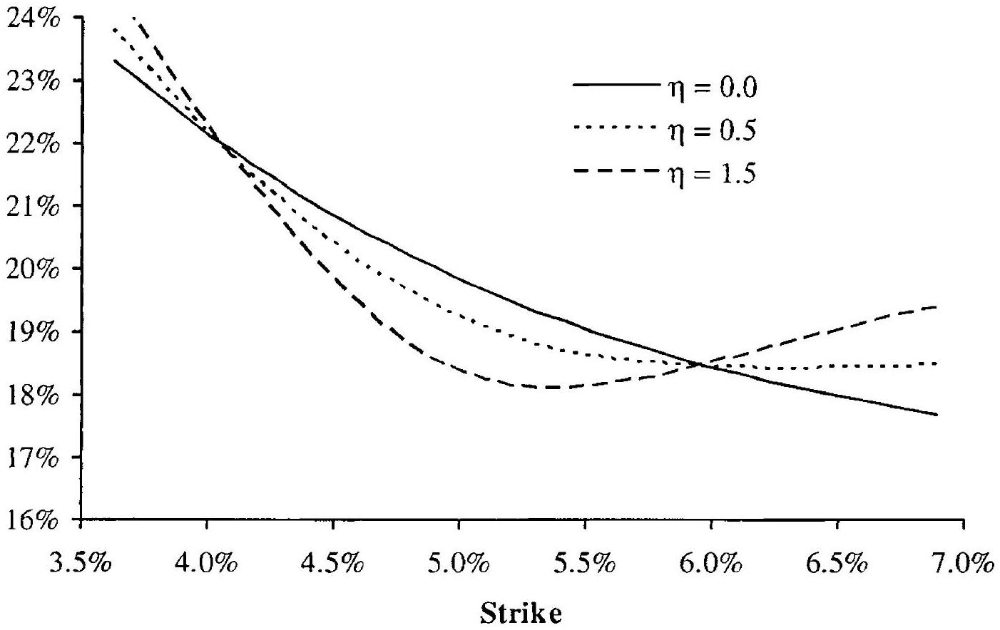

Notes: Implied volatility smile for SV model with $T=1, S(0)=L=5 \%, z_{0}=1$, $b=0.1, \lambda=20 \%, \theta=0.1$, and $\rho=0$. The volatility of variance parameter $\eta$ varies as shown in the graph.

In Figure 8.1, the variance process is uncorrelated to the rate process, whereby Lemma 8.7.1 tells us that the slope (or skew) of the volatility smile at the at-the-money strike (5\%) is generated solely by the slope parameter $b=0.1$ in the local volatility function of the SV model. The stochastic volatility process can, of course, contribute to the skew if we use non-zero
correlation; see Figure 8.2 for a numerical example. As expected, lowering correlation rotates the smile clockwise, qualitatively similar to the impact of $b$. Another effect is also evident in Figure 8.2: when $\rho$ moves away from zero, the convexity of the smile around the ATM strike is reduced. This effect is consistent with the expression for $B$ in Lemma 8.7.1 which shows that the convexity (approximately) scales with ${ }^{12} 2-5 \rho^{2}$.

Fig. 8.2. 1 Year Volatility Smile
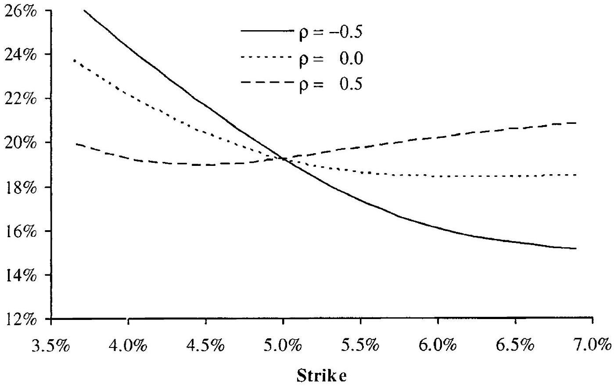

Notes: Implied volatility smile for SV model with $T=1, S(0)=L=5 \%, z_{0}=1$, $b=0.1, \lambda=20 \%, \theta=0.1$, and $\eta=1$. The correlation parameter $\rho$ varies as shown in the graph.

The examples shown in Figures 8.1 and 8.2 both list the 1 year volatility smile only. To examine how the volatility smile $\sigma_{B}(0, S(0) ; K, T)$ in the SV model depends on $T$, consider first the case where $\rho=0$; representative data are shown in Figure 8.3. The convexity of the smile, which originates with the stochastic volatility process, here clearly decays away as maturity is increased. As hinted at by Lemma 8.5.1, the convexity of the smile at time $T$ is roughly proportional to the variance of the normalized realized variance $T^{-1} \int_{0}^{T} z(t) d t$. The convexity decay can therefore be interpreted as a mean reversion effect, since the variance of the normalized realized variance itself decays to a long-term (stationary) level, as can be seen from Corollary 8.3.3.

[^127]The speed of the decay is controlled by manipulating mean reversion speed $\theta$; the higher $\theta$ is, the quicker the smile convexity decays in the $T$-direction.

Fig. 8.3. 'Term Structure of Volatility Smiles
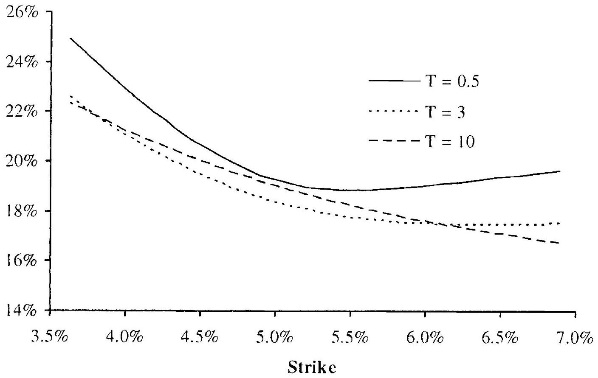

Notes: Implied volatility smile for SV model with $S(0)=L=5 \%, z_{0}=1, \rho=0.0$, $\lambda=20 \%, \theta=0.5, b=0.1$, and $\eta=1.5$. The smile maturity $T$ varies as shown in the graph.

We note in passing that the ATM volatility of a constant parameter SV model is not a monotonic function of option maturity, as a quick glance at Figure 8.3 will confirm. For an analysis of the ATM volatility level and its dependence on maturity, see Lewis [2000].

In Figure 8.3 the slope of the smile around the ATM point is generated only from the parameter $b$ in the local volatility function and consequently shows little decay in $T$. If, on the other hand, we had used a negative variancespot correlation to generate the skew, we would expect the volatility smile to flatten out in $T$, for the same reason that the smile convexity decays. Figure 8.4 confirms this intuition.

### 8.8 Numerical Examples: Volatility Smile Dynamics

As we mentioned earlier, one rationale for introducing stochastic volatility into an LV model is the desire to generate realistic smile dynamics. In Section 7.1.3, we listed some qualitative reasons for the failure of LV models to generate reasonable model dynamics in certain cases; we are now in a

Fig. 8.4. Term Structure of Volatility Smiles
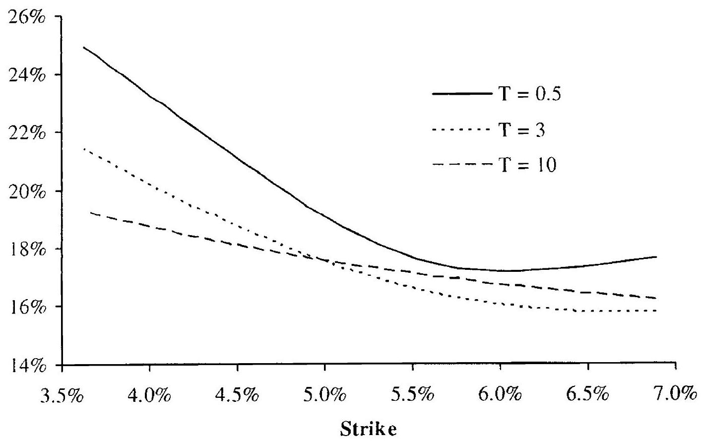

Notes: Implied volatility smile for SV model with $S(0)=5 \%, z_{0}=1, \rho=-0.5$, $\lambda=20 \%, \theta=0.5, b=1$, and $\eta=1.5$. The smile maturity $T$ varies as shown in the graph.
position to expand on this discussion and to show some concrete results. Specifically, we here wish to compare how the volatility smile moves with the underlying rate process, for two models: i) an ordinary (log-normal) Heston model obtained by setting $b=1$ in the SV model (8.3)-(8.4); and ii) a pure LV model with quadratic volatility,

$$
\begin{equation*}
d S(t)=\lambda\left((1-b) L+b S(t)+\frac{1}{2} c(S(t)-L)^{2}\right) d W(t) \tag{8.47}
\end{equation*}
$$
^eq8-47

For our numerical experiments, we move calendar time forward to some arbitrary value $t$ and examine how the smile looks for several levels of $S(t)$. In performing this analysis for the Heston model, we shall initially assume that $z(t)$ stays equal to its initial value $z_{0}$, but we relax this assumption later.

First, we consider the case of a (near) symmetric smile which in the local volatility model (8.47) can be obtained by setting $b=1$. The effect of a 50 bps downward move in $S(0)$ (i.e. $S(t)=S(0)-0.5 \%$ ) on a specific LV model is shown in Figure 8.5. Starting from a symmetric smile when the forward rate $S(t)=S(0)=5 \%$, a shift down to $4.5 \%$ causes an overall increase in volatility levels, as well as a clock-wise tilt of the previously symmetric smile. This is readily understood. as the quadratic local volatility function
will itself increase and loose its symmetry when $S(t)$ is reduced from $5 \%$ to $4.5 \%$.

Fig. 8.5. Volatility Smile Dynamics in Quadratic LV Model
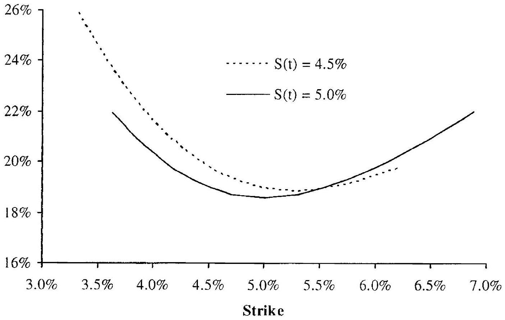

Notes: Time $t$ implied volatility smile for quadratic LV model with ' $T=t+1$, $S(0)=L=5 \%, b=1, \lambda=18 \%$, and $c=0.6$. T'wo different values for the forward rate $S(t)$ are used, as indicated in the graph.

Turning now to the Heston model, we first make the observation from Theorem 8.4.4 that European put and call option values normalized by spot $S$ in both the Heston and Black models - and thereby the implied volatility smile of the Heston model - depend on strike $K$ and forward rate $S(t)$ only through the ratio $K / S(t)$. Specifically, we have $\sigma_{B}(t, S(t) ; K, T)= g(K / S(t), T-t)$, for some function $g(\cdot, \cdot)$. In trader lingo, this is known as a "sticky delta" volatility smile ${ }^{13}$, and implies that the $T=t+\Delta$ volatility smile expressed in moneyness $K / S(t)$, or log-moneyness $\ln (K / S(t))$, is independent of $t$ and $S(t)$, as long as $z(t)$ remains unchanged at its initial value $z_{0}$. This fact makes it easy to construct the Heston model dynamics of the volatility smile in strike space; Figure 8.6 shows an example for a case where the correlation $\rho$ has been set to zero to make the smile is symmetric in log-moneyness. Notice that as $S(t)$ drops from $5 \%$ to $4.5 \%$, the volatility smile floats to the left, in tandem with the move in $S(t)$ such that the bottom of the smile remains centered at the forward rate.

[^128]Fig. 8.6. Volatility Smile Dynamics in Heston SV Model
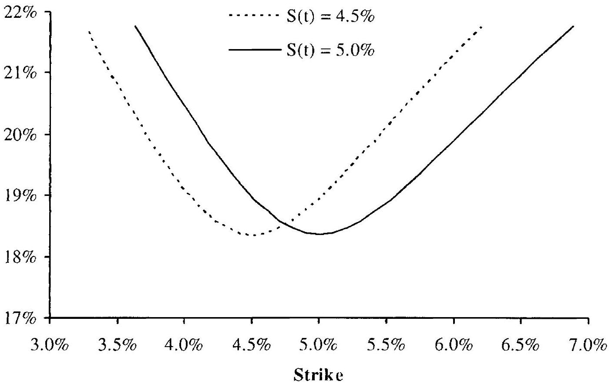

Notes: Time $t$ implied volatility smile for SV model with $T^{\prime}=t+1, S(0)=5 \%$, $z(t)=z_{0}=1, b=1, \lambda=20 \%, \theta=0.1, \rho=0$, and $\eta=1.5$. Two different values for the forward rate $S(t)$ are used, as indicated in the graph.

While Figures 8.5 and 8.6 are interesting and highlight some important differences between local and stochastic volatility models, it is more relevant in an interest rate setting to consider the case where the volatility smile has significant skew. First, we consider the local volatility case, see Figure 8.7. A shift down in $S(t)$ will increase the level of the local volatility function and raise the level of the smile; alternatively, we can interpret the move as a slide to the right. As convexity is relatively low in the graph relative to the skew, the move in $S(t)$ has little effect on the slope of the graph.

In Figure 8.8 we examine the smile dynamics of a Heston model with a significant downward skew, induced by a non-zero correlation $\rho$. The sticky-delta dynamics of the smile are still in effect here, causing a slide to the left when $S(t)$ is lowered, in a manner identical to that of the symmetric case in Figure 8.6.

The dynamics on display in Figures 8.7 and 8.8 appear to be diametrically opposite of each other: the smile shifts to the right in the local volatility model and to the left in the stochastic volatility model. In reality, however, differences in model dynamics are less dramatic than these graphs show. In particular, we recall that when we computed Figure 8.8, we kept $z(t)$ constant at the value $z_{0}$. However, as $z(t)$ and $S(t)$ are negatively correlated in the model used in Figure 8.8, keeping one process constant while the other moves will clearly be wrong "on average". A more representative

Fig. 8.7. Volatility Smile Dynamics in Quadratic LV Model
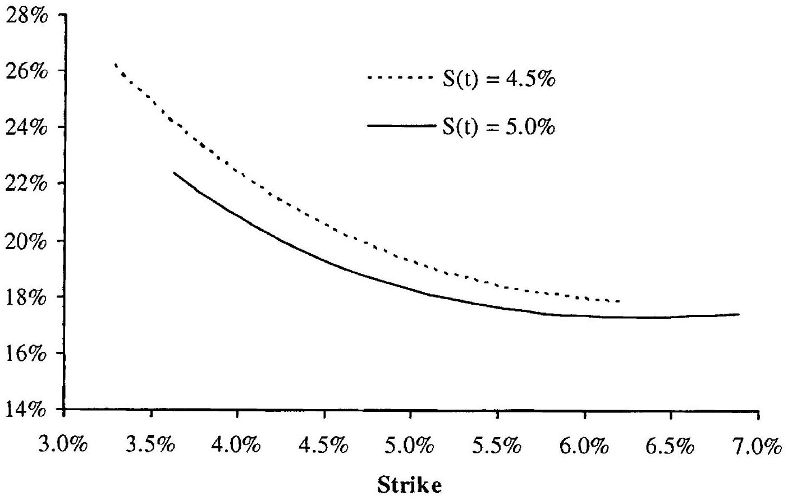

Notes: Time $t$ implied volatility smile for quadratic LV model with $T=t+1$, $S(0)=L=5 \%, b=0.1, \lambda=18 \%$, and $c=0.25$. Two different values for the forward rate $S(t)$ are used, as indicated in the graph.
characterization of the smile dynamics of the Heston process would move the variance process to its most likely outcome, given the move in the underlying. That is, we wish to set $z(t)$ equal to

$$
\mathrm{E}(z(t) \mid S(t))
$$

which we here compute by a simple Gaussian approximation that ignores mean reversion,

$$
\begin{equation*}
\mathrm{E}(z(t) \mid S(t)) \approx z_{0}+\frac{\eta \rho}{\lambda} \frac{S(t)-S(0)}{S(0)} \tag{8.48}
\end{equation*}
$$
^eq8-48

Performing this modification on the data in Figure 8.8 results in the data in Figure 8.9.

With the rule in (8.48), the volatility smile shift of Figure 8.8 has reversed direction in Figure 8.9 and now looks quite similar to that of the local volatility dynamics of Figure 8.7. In other words, for volatility smiles that are "skew-dominated", i.e. the skew is significant and the convexity is modest, smile dynamics of local and stochastic volatility models are quite similar on average. This observation is emphasized by Dupire [2006] and to some extent goes against common wisdom (see e.g. Hagan et al. [2002]) which tends to emphasize the sticky strike behavior of the stochastic volatility model. Of course, while the behavior in Figure 8.9 may be more likely

Fig. 8.8. Volatility Smile Dynamics in Heston SV Model
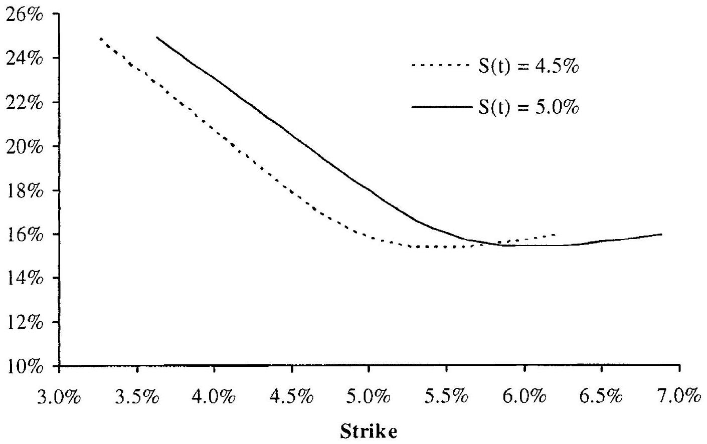

Notes: Time $t$ implied volatility smile for SV model with $T=t+1, z(t)=z_{0}=1$, $S(0)=5 \%, b=1, \lambda=20 \%, \theta=0.1, \rho=-0.6$, and $\eta=1.5$. Two different values for the forward rate $S(t)$ are used, as indicated in the graph.
than that of Figure 8.8, both are feasible in a stochastic variance setting, depending on what value $z(t)$ happens to take. For derivatives that have convexity with respect to volatility smile moves ${ }^{14}$, what most reasonably represents "average" smile behavior is obviously less important than the fact that variance is random.

We finish this section by noting that the ideas behind (8.48) are also relevant for hedge construction in presence of stochastic volatility. We return to this topic in Section 8.9.2.

### 8.9 Hedging in Stochastic Volatility Models

### 8.9.1 Hedge Construction, Delta and Vega

Having now treated the subject of option pricing with stochastic volatility in quite some detail, let us make a foray into the topic of hedge construction. With their two generally non-collinear sources of randomness $W$ and $Z$, it

[^129]Fig. 8.9. Volatility Smile Dynamics in Heston SV Model
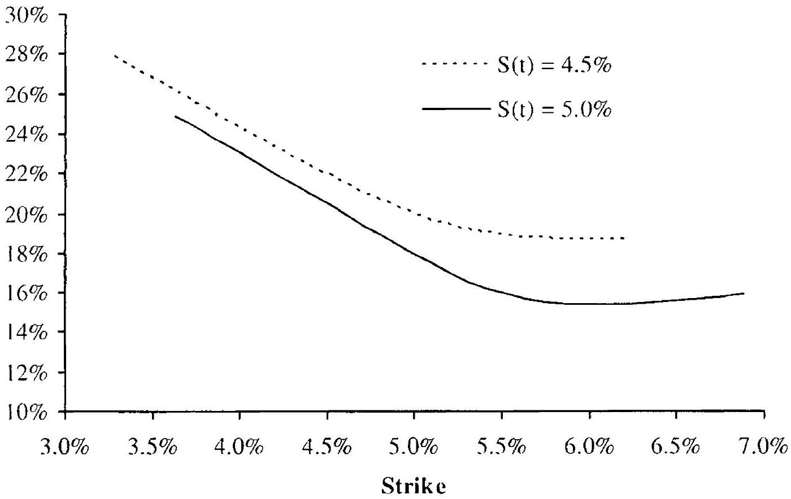

Notes: 'T'ime $t$ implied volatility smile for the SV model in Figure 8.8, but now with $z(t)$ set as computed from formula (8.48).
should be clear that stochastic volatility models of the type (8.1)-(8.2) are not complete (in the sense defined in Section 1.4) if we limit ourselves to simple delta hedging with positions only in $S(t)$ itself. However, if options with volatility sensitivity are available for trading, these can be included into the hedge portfolio to complete the market.

Assuming general dynamics (8.1)-(8.2), we proceed to consider hedging of a contingent claim $V(t)$ that depends on both $S(t)$ and $z(t)$, i.e. we write $V(t)=V(t, S(t), z(t))$. We assume existence of two traded securities $U_{1}(t)=U_{1}(t, S(t), z(t))$ and $U_{2}(t)=U_{2}(t, S(t), z(t))$. Using the framework of Section 1.7, we associate $U_{1}(t), U_{2}(t)$ with the elements of the asset vector $X(t)$ from that section. Forming a hedging portfolio $\Pi$ consisting of $-\pi_{1}(t)$ units of $U_{1}(t)$ and $-\pi_{2}(t)$ units of $U_{2}(t)$, we obtain from (1.26) that

$$
\pi_{i}=\frac{\partial V}{\partial U_{\imath}}, \quad i=1,2 .
$$

A bit of calculus leads us to expressions for the hedge ratios in terms of sensitivities to the primitives $S, z$ of the model, and the following result follows.

Lemma 8.9.1. The portfolio $\Pi(t)=V(t)-\pi_{1}(t) U_{1}(t)-\pi_{2}(t) U_{2}(t)$ is locally riskless if

$$
\begin{align*}
& \pi_{1}=\left(\frac{\partial V}{\partial S} \frac{\partial U_{2}}{\partial z}-\frac{\partial U_{2}}{\partial S} \frac{\partial V}{\partial z}\right)\left(\frac{\partial U_{1}}{\partial S} \frac{\partial U_{2}}{\partial z}-\frac{\partial U_{2}}{\partial S} \frac{\partial U_{1}}{\partial z}\right)^{-1},  \tag{8.49}\\
& \pi_{2}=\left(\frac{\partial V}{\partial S} \frac{\partial U_{1}}{\partial z}-\frac{\partial U_{1}}{\partial S} \frac{\partial V}{\partial z}\right)\left(\frac{\partial U_{2}}{\partial S} \frac{\partial U_{1}}{\partial z}-\frac{\partial U_{1}}{\partial S} \frac{\partial U_{2}}{\partial z}\right)^{-1} . \tag{8.50}
\end{align*}
$$
^eq8-49
^eq8-50

Remark 8.9.2. In practice, the first security $U_{1}$ would often be chosen to not depend on $z$ - for example the swap from which $S(t)$ is computed could be used as $U_{1}$ - in which case the hedge weights simplify. In particular,

$$
\pi_{1}=\frac{\partial V / \partial S}{\partial U_{1} / \partial S}-\frac{\partial V / \partial z}{\partial U_{2} / \partial z} \frac{\partial U_{2} / \partial S}{\partial U_{1} / \partial S}, \quad \pi_{2}=\frac{\partial V / \partial z}{\partial U_{2} / \partial z}
$$

as one would expect.
Remark 8.9.3. The sensitivity of a given security to volatility is often called its vega. Even for a model with non-stochastic volatility, such as the Black model, a vega can be computed, but will not enter the hedge balance equation (1.28). In a stochastic volatility model, a vega can conveniently ${ }^{15}$ be defined to be $\partial / \partial z$ - which will enter the hedge balance equation. It follows that the choice (8.49)-(8.50) ensures that the hedged portfolio $\Pi$ is delta-neutral, in the sense that

$$
\frac{\partial \Pi(t)}{\partial S}=0
$$

as well as vega-neutral,

$$
\frac{\partial \Pi(t)}{\partial z}=0 .
$$

### 8.9.2 Minimum Variance Delta Hedging

While the theoretical notion of "delta" assumes that the stochastic variance process $z$ is kept fixed under perturbations of $S$, we saw earlier in Section 8.8 (see, in particular, Figure 8.9 and the discussion around it) that it sometimes might be more natural to let $z$ float along with $S$, in a manner determined by the correlation between these quantities. Indeed, to the extent that our hedging strategy were to employ a position in $S$ only, and not to separately hedge the exposure to $z$, the "best" hedging strategy - in the sense of locally minimizing hedging errors - is one based on such a joint move in $z$ and $S$. We proceed to present this idea, using rather ad-hoc (or "deceptively simple", to paraphrase Ewald et al. [2007]) techniques; for a full account and for a connection to the concept of the minimal martingale measure, see Follmer and Schweizer [1990] and Ewald et al. [2007].

First, let us return to the model (8.1)-(8.2), but now use a Cholesky decomposition to rewrite the process for $z(t)$ as[^130]

$$
d z(t)=O(d t)+\sigma_{z}(t)\left(\rho d W(t)+\sqrt{1-\rho^{2}} d B(t)\right)
$$
where $B$ is a Brownian motion that is independent of $W$, and we use $\sigma_{z}(t)=\eta \psi(z(t))$ and $\sigma_{S}(t)=\lambda \varphi(S(t)) \sqrt{z(t)}$ for notational clarity. Consider now a claim

$$
V(t)=V(t, S(t), z(t))
$$
where, by Ito's lemma,

$$
d V(t)=O(d t)+\frac{\partial V(t)}{\partial S} d S(t)+\frac{\partial V(t)}{\partial z} \sigma_{z}(t)\left(\rho d W(t)+\sqrt{1-\rho^{2}} d B(t)\right)
$$

Let us form a portfolio $\Pi$ of the claim $V$ and a position of $-\pi(t)$ in $S(t)$; that is,

$$
\begin{equation*}
d \Pi(t)=-\pi(t) d S(t)+d V(t) \tag{8.51}
\end{equation*}
$$
^eq8-51

We wish to set $\pi(t)$ such that $\operatorname{Var}_{t}(d \Pi(t))$ is minimized.
Lemma 8.9.4. With $d \Pi(t)$ defined in (8.51), the variance $\operatorname{Var}_{t}(d \Pi(t))$ is minimized by setting $\pi(t)=\pi_{\mathrm{mv}}(t)$, where

$$
\pi_{\mathrm{mv}}(t)=\frac{\partial V(t)}{\partial S}+w(t), \quad w(t)=\frac{\partial V(t)}{\partial z} \frac{\rho \sigma_{z}(t)}{\sigma_{S}(t)}
$$

and $\sigma_{z}(t)=\eta \psi(z(t)), \sigma_{S}(t)=\lambda \varphi(S(t)) \sqrt{z(t)}$.
Proof. It is easily seen that

$$
\begin{aligned}
\operatorname{Var}_{t}(d \Pi(t))=\left(-\pi(t) \sigma_{S}(t)+\frac{\partial V(t)}{\partial S}\right. & \left.\sigma_{S}(t)+\frac{\partial V(t)}{\partial z} \sigma_{z}(t) \rho\right)^{2} d t \\
& +\left(\frac{\partial V(t)}{\partial z}\right)^{2} \sigma_{z}(t)^{2}\left(1-\rho^{2}\right) d t
\end{aligned}
$$

The first-order condition for the minimum is therefore

$$
0=-2 \sigma_{S}(t)\left(-\pi(t) \sigma_{S}(t)+\frac{\partial V(t)}{\partial S} \sigma_{S}(t)+\frac{\partial V(t)}{\partial z} \sigma_{z}(t) \rho\right)
$$

from which the lemma follows.
We notice that $w(t)$ in Lemma 8.9.4 can be written informally as

$$
w(t)=\frac{\partial V(t)}{\partial z} \frac{\mathrm{E}_{t}(d z(t) \mid d S(t)=d S)}{d S}
$$

which shows that the minimum-variance (MV) hedge ratio is obtained, in effect, by moving the $z$-process to its expected value, given an infinitesimal perturbation in the $S$-process. In other words, the hedge represents our best guess for a position in the underlying that will hedge moves in $V(t)$ caused by changes in both $S(t)$ and $z(t)$, as in Figure 8.9.

To further characterize the properties of the MV hedge weight, we insert the result of Lemma 8.9 .4 into (8.51), which yields

$$
d \Pi(t)=O(d t)+\frac{\partial V(t)}{\partial z} \sigma_{z}(t) \sqrt{1-\rho^{2}} d B(t)
$$

In other words, the MV hedge produces a portfolio that is not exposed to $W(t)$ but only to the orthogonal Brownian motion $B(t)$. If one thinks of $W(t)$ as "market" noise, we can say - in the language of the classical CAPM ${ }^{16}$ analysis - that the hedged portfolio has no beta. For this reason, the hedge construction in Lemma 8.9.4 is also sometimes known as a zero-beta hedge.

### 8.9.3 Minimum Variance Hedging: an Example

To better understand the practical ramifications of MV hedging, let us do a concrete example based on the SABR model from Section 8.6, which we here parameterize as

$$
\begin{aligned}
d S(t) & =\lambda \sqrt{z(t)} S(t)^{c} d W(t) \\
d z(t) & =\frac{1}{4} \eta^{2} z(t) d t+\eta z(t)\left(\rho d W(t)+\sqrt{1-\rho^{2}} d B(t)\right), \quad z(0)=1
\end{aligned}
$$

According to Lemma 8.9.4, the MV hedge ratio in SABR is

$$
\pi_{\mathrm{mv}}(t)=\frac{\partial V(t)}{\partial S}+\eta \sqrt{z(t)} \rho \frac{\partial V(t)}{\partial z} \frac{1}{\lambda S(t)^{c}}
$$

In a typical interest rate application $z(t) \approx 1, \lambda S(t)^{c} \approx 0.01$ and $\eta \approx 1$, such that, as a rule of thumb,

$$
\pi_{\mathrm{mv}}(t) \approx \frac{\partial V(t)}{\partial S}+100 \times \rho \frac{\partial V(t)}{\partial z}
$$

For call and put options, the hedge adjustment to the "pure" delta $\partial V / \partial S$ is here typically negative, as we have $\partial V / \partial z>0$ and, in normal market conditions, $\rho<0$. This is consistent with Figure 8.8.

We now perform the following small experiment: we lock the correlation parameter at a pre-fixed value and then least-squares calibrate the SABR model to an actual market Black volatility smile. For a range of correlation parameters, we then compute "pure" deltas ( $\partial V / \partial S$ ) and MV deltas ( $\pi_{\mathrm{mv}}$ ) for swaptions with different strikes. Using market data roughly consistent with the $5 y \times 5 y$ swaption volatility smile in the summer of 2005, the calibration results are in Table 8.1.

As one would expect, making correlation progressively more negative causes the skew power $c$ to increase, from about $20 \%$ at $\rho=0$ to nearly

[^131]| $\rho$ | 0 | -0.1 | -0.2 | -0.3 | -0.35 |
| :---: | :---: | :---: | :---: | :---: | :---: |
| $\lambda S(0)^{1-c}$ | 0.135 | 0.136 | 0.137 | 0.139 | 0.140 |
| $c$ | 0.223 | 0.432 | 0.648 | 0.877 | 0.999 |
| $\eta$ | 0.684 | 0.686 | 0.696 | 0.712 | 0.726 |

Table 8.1. SABR Calibration Results

$90 \%$ at $\rho=-0.3$, with other parameters being quite stable across different correlation choices. Figures 8.10 and 8.11 show the pure delta $\partial V / \partial S$ and the minimum variance delta $\pi_{\mathrm{mv}}$ for selected strikes and correlations. Clearly, the MV delta is here virtually independent of the choice of $\rho$, whereas the pure delta can increase quite substantially as correlation becomes more negative. It is clear from the figures that as long as hedge ratios are computed to be MV deltas, rather than pure deltas, the precise blend of local and stochastic volatility may not be critical, at least not for vanilla-like options in a skew-dominated market. This confirms a point we made earlier, in Section 8.1.

Fig. 8.10. Pure Delta
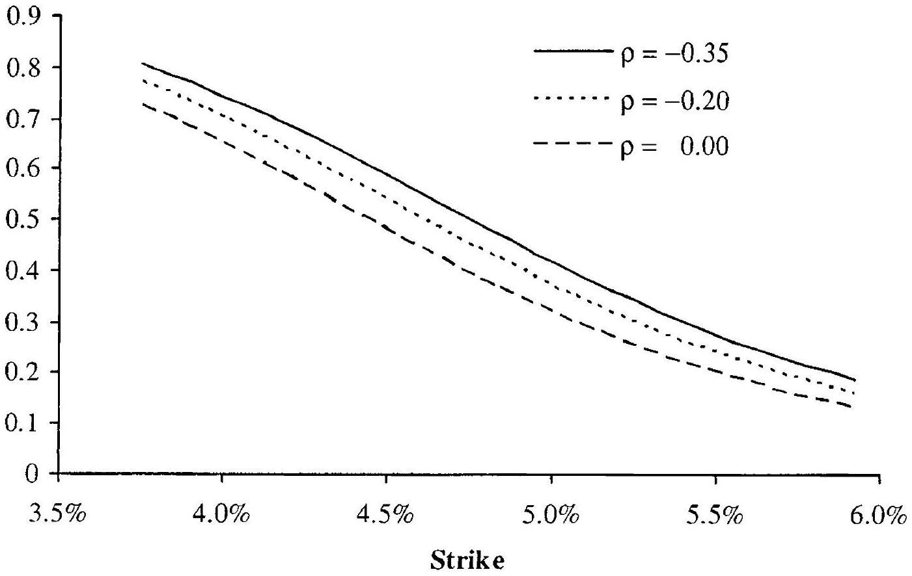

Notes: The figure shows the pure delta for the SABR models in Table 8.1.

Fig. 8.11. Minimum Variance Delta
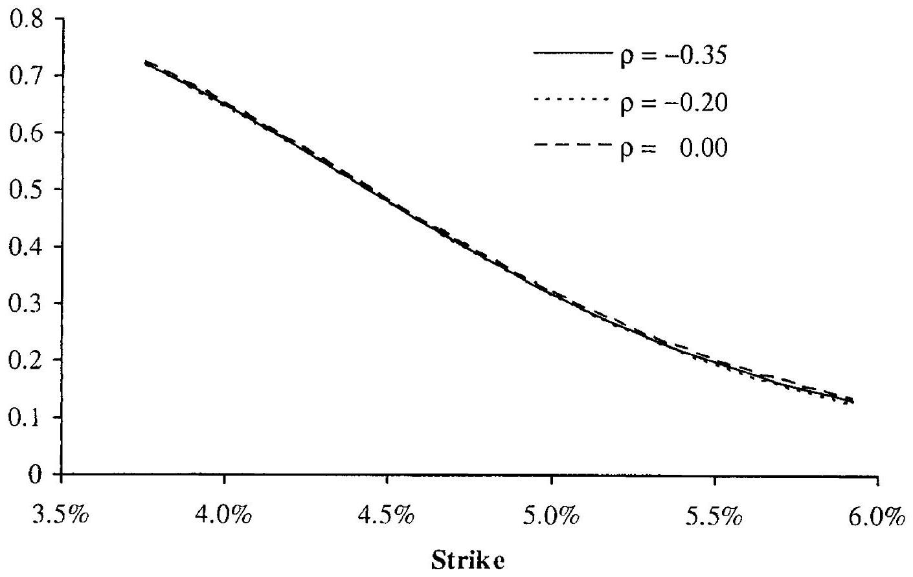

Notes: The figure shows the minimum variance (MV) delta for the SABR models in Table 8.1.

## 8. A Appendix: Martingale Characterization, Moment Stability, and Other Fundamental Properties for General Variance Processes

As explained in Section 8.3, it is sometimes beneficial to consider a specification of the stochastic volatility model that is more general than (8.3)-(8.4). Let us consider a general power function for $\psi(z)$ in (8.2),

$$
\begin{align*}
d S(t) & =\lambda(b S(t)+(1-b) L) \sqrt{z(t)} d W(t)  \tag{8.52}\\
d z(t) & =\theta\left(z_{0}-z(t)\right) d t+\eta z(t)^{p} d Z(t) \tag{8.53}
\end{align*}
$$
^eq8-52
^eq8-53

with $\langle d Z(t), d W(t)\rangle=\rho d t$. We assume $p>0$. In this section we briefly outline important properties of such models. For more comprehensive treatment the reader is referred to Andersen and Piterbarg [2007]. Our first result spells out the boundary behavior of the stochastic variance process.

Proposition 8.A.1. For the process (8.53), the following holds:

1. 0 is always an attainable boundary for $0<p<1 / 2$.
2. 0 is an attainable boundary for $p=1 / 2$, if $2 z_{0} \theta<\eta^{2}$.
3. 0 is an unattainable boundary for $p>1 / 2$.
4. $\infty$ is an unattainable boundary for all values of $p>0$.

When $0<p<1 / 2$, the origin is always accessible and we need to impose a boundary condition at $z=0$ to make the process unique. To ensure that the process for $z(\cdot)$ has a stationary distribution, we make the following natural choice:

Assumption 8.A.2. For $0<p<1 / 2$, the process (8.53) for $z(\cdot)$ is reflected at the origin.

The marginal one-dimensional distribution of $z(t)$ can in principle be computed numerically by various methods, such as PDE methods or by Fourier inversion of a characteristic function. It is often convenient, however. to have an easily-computable approximation. For that purpose, a stationary distribution, if one exists, can be useful. A stationary distribution for $z(\cdot)$ does indeed exist and can be easily computed.

Proposition 8.A.3. Let $\pi(y)$ be the stationary distribution density for $z(\cdot)$ in (8.53). Under the assumptions listed above,

$$
\pi(y)=C(p) y^{-2 p} e^{Q(y ; p)}, \quad C(p)^{-1} \triangleq \int_{0}^{\infty} y^{-2 p} e^{Q(y ; p)} d y
$$

where the function $Q(y ; p)$ is given by
$1.0<p<1 / 2$ or $1 / 2<p<1$ or $p>1$ :

$$
Q(y ; p)=\frac{2 \theta}{\eta^{2}}\left(\frac{z_{0} y^{1-2 p}}{1-2 p}-\frac{y^{2-2 p}}{2-2 p}\right) .
$$

2. $p=1 / 2$ :

$$
Q(y ; p)=\frac{2 \theta}{\eta^{2}}\left(z_{0} \ln y-y\right) .
$$

3. $p=1$ :

$$
Q(y ; p)=\frac{2 \theta}{\eta^{2}}\left(-z_{0} / y-\ln y\right) .
$$

A-priori, $S(\cdot)$ defined by (8.52)-(8.53) is only a local martingale. In fact, under some circumstances, $S(\cdot)$ is a strict local martingale, , usually a significant technical complication. Specifically, we have the following result.

Proposition 8.A.4. When $p \leq 1 / 2$ or $p>3 / 2, S(\cdot)$ is a proper martingale. When $1 / 2<p<3 / 2, S(\cdot)$ is a martingale for $\rho \leq 0$ and a strict supermartingale for $\rho>0$. For $p=3 / 2, S(\cdot)$ is a martingale for $\rho \leq \frac{1}{2} \eta(\lambda b)^{-1}$ and a strict supermartingale for $\rho>\frac{1}{2} \eta(\lambda b)^{-1}$.

What this proposition states is that the set of parameters $1 / 2<p<3 / 2$, $\rho>0$, should be avoided in practical modeling. The SV model (8.3)-(8.4), as already noted, has no issues in this regard. If we use $\rho=0$ - a typical choice in interest rate modeling as explained previously - all values of $p$
between 0 and $3 / 2$ are acceptable, at least as far as the martingale property is concerned.

In the model with $p=1 / 2$, some moments of $S(\cdot)$ can become infinite, as stated in Proposition 8.3.10. With $p<1 / 2$, this is no longer an issue:

Proposition 8.A.5. In the model (8.52)-(8.53), if $p<1 / 2$, moments $\mathrm{E}\left(S(T)^{u}\right)$ of all orders $u \geq 1$ for all times $T$ are finite.

On the other hand, if $p>1 / 2$ moments may be unstable. For instance:
Proposition 8.A.6. In the model (8.52)-(8.53), if $p>1 / 2$ and $\rho=0$, all moments $\mathrm{E}\left(S(T)^{u}\right)$ of all orders $u>1$ for all times $T$ are infinite.

The case of non-zero correlation and $p>1 / 2$ is more complicated; we refer the reader to Andersen and Piterbarg [2007].

