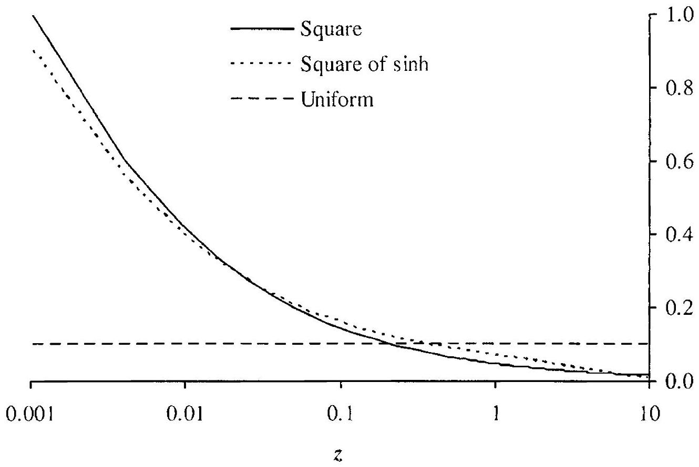
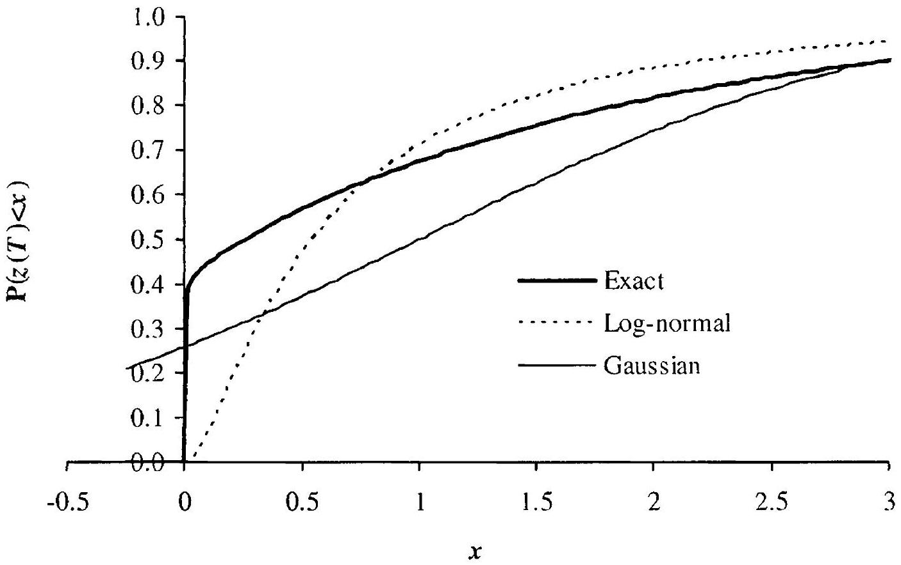
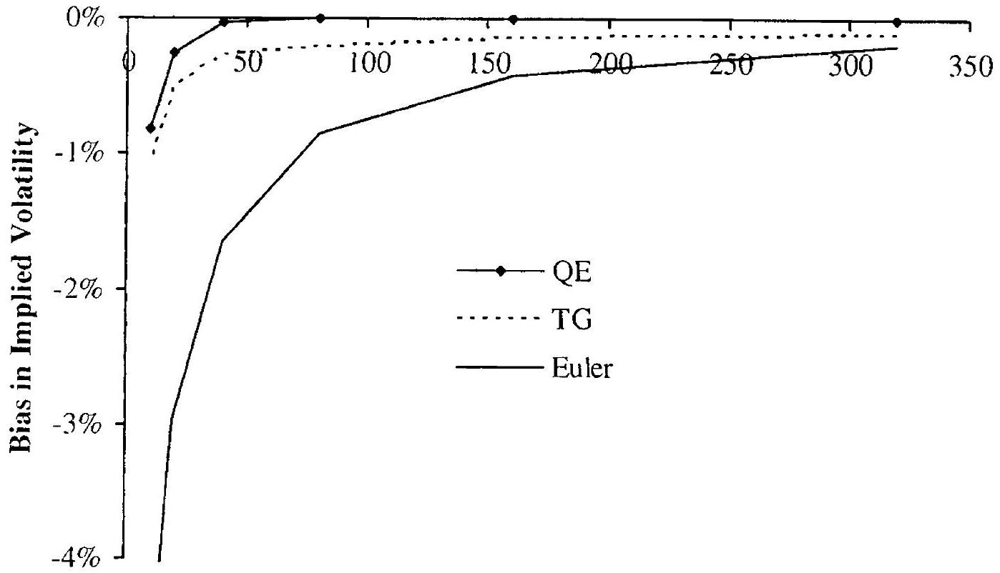

## Vanilla Models with Stochastic Volatility II

Having covered stochastic volatility models with time-homogeneous dynamics in Chapter 8, we are now ready to proceed with an analysis of the time-dependent case. As we shall see many examples of later in this book, stochastic volatility models with time-dependent parameters emerge naturally when vanilla models are used to approximate interest rate dynamics in a full term structure model.

In this chapter, we start out by modifying the Fourier analysis of Chapter 8 to cover time-dependent model parameters. We then proceed to introduce several approximation techniques that can speed up the calibration of model parameters to observable option prices. In particular, we continue our development of parameter averaging techniques, extending their scope to cover stochastic volatility and outlining in detail their usage in model calibration. Finally, the chapter gives detailed coverage of PDE and MC methods for general derivatives pricing; both of these numerical techniques are, as it turns out, rather tricky to apply to models with stochastic volatility, and an efficient implementation requires careful attention to detail.

### 9.1 Fourier Integration with Time-Dependent Parameters

As a start, let us consider extending the basic SV model (8.3)-(8.4) to allow for time-dependence of the volatility parameter ${ }^{1} \lambda$. That is, we now consider the P -measure dynamics

$$
\begin{align*}
d S(t) & =\lambda(t)(b S(t)+(1-b) L) \sqrt{z(t)} d W(t),  \tag{9.1}\\
d z(t) & =\theta\left(z_{0}-z(t)\right) d t+\eta \sqrt{z(t)} d Z(t), \tag{9.2}
\end{align*}
$$
^eq9-1
^eq9-2

[^132]where $\langle d Z(t), d W(t)\rangle=\rho d t$.
The model (9.1)-(9.2) still allows for call option pricing by the Fourier integration method of Section 8.4, provided that we can establish the momentgenerating function (mgf) of $\ln X(t)$, with $X(t)$ being the linear function of $S(t)$ defined in Proposition 8.3.6. Let us retain the notation $\Psi_{X}(u ; t)$ for

$$
\Psi_{X}(u ; t)=\mathrm{E}\left(e^{u \ln X(t)}\right)
$$
where the process for $X(t)$ now is modified from that of Proposition 8.3.6 to include time-dependence in $\lambda$ :

$$
d X(t) / X(t)=b \lambda(t) \sqrt{z(t)} d W(t), \quad X(0)=1
$$

The following counterpart to Proposition 8.3.7 is easily proven.
Proposition 9.1.1. In the model (9.1)-(9.2), for any $u \in \mathbb{C}$ for which the right-hand side exists, we have

$$
\Psi_{X}(u ; t)=\Psi_{z \lambda^{2}}\left(\frac{1}{2} b^{2} u(u-1), u ; t\right)
$$

where we have defined

$$
\begin{equation*}
\Psi \overline{z \lambda^{2}}(v, u ; t) \triangleq \mathrm{E}^{\widetilde{\mathrm{P}}}\left(e^{v \overline{z \lambda^{2}}(t)}\right), \quad \overline{z \lambda^{2}}(t) \triangleq \int_{0}^{t} z(s) \lambda(s)^{2} d s \tag{9.3}
\end{equation*}
$$
^eq9-3

and under the new probability measure $\widetilde{\mathrm{P}}$ the process for $z(t)$ is

$$
\begin{equation*}
d z(t)=\left(\theta\left(z_{0}-z(t)\right)+\rho \eta \lambda(t) b u z(t)\right) d t+\eta \sqrt{z(t)} d \widetilde{Z}(t), \quad z(0)=z_{0} \tag{9.4}
\end{equation*}
$$
^eq9-4

with $\widetilde{Z}(t)$ a $\widetilde{\mathrm{P}}$-Brownian motion. If $\rho=0, \widetilde{\mathrm{P}}=\mathrm{P}$ and $z(t)$ in (9.3) follows (9.2) rather than (9.4).

The following proposition demonstrates how to compute the momentgenerating function of $\overline{z \lambda^{2}}(T)$.
Proposition 9.1.2. The function $\Psi_{\overline{z \lambda^{2}}}(v, u ; T)$ defined by (9.3) is given by

$$
\Psi_{\overline{z \lambda^{2}}}(v, u ; T)=\exp \left(A(0, T)+z_{0} B(0, T)\right)
$$

where ( $A(t, T), B(t, T)$ ) solve the system of Riccati ODEs

$$
\begin{align*}
\frac{d}{d t} A(t, T)+\theta z_{0} B(t, T) & =0  \tag{9.5}\\
\frac{d}{d t} B(t, T)-(\theta-\rho \eta b u \lambda(t)) B(t, T)+\frac{\eta^{2}}{2} B(t, T)^{2}+v \lambda(t)^{2} & =0 \tag{9.6}
\end{align*}
$$
^eq9-5
^eq9-6

with the terminal conditions

$$
B(T, T)=A(T, T)=0
$$

Proof. Let us define

$$
G(t, z) \triangleq \mathrm{E}^{\widetilde{\mathrm{P}}}\left(e^{v \int_{t}^{T} \lambda(s)^{2} z(s) d s} \mid z(t)=z\right)
$$

Clearly,

$$
\Psi_{\overline{z \lambda^{2}}}(v, u ; T)=G\left(0, z_{0}\right)
$$

On the other hand, by the Feynman-Kac formula, $G(t, z)$ satisfies the following PDE,

$$
\begin{align*}
& \frac{\partial}{\partial t} G(t, z)+\left(\theta z_{0}-(\theta-\rho \eta b u \lambda(t)) z\right) \frac{\partial}{\partial z} G(t, z) \\
& \quad+\frac{\eta^{2}}{2} z \frac{\partial^{2}}{\partial z^{2}} G(t, z)+v \lambda(t)^{2} z G(t, z)=0 \tag{9.7}
\end{align*}
$$
^eq9-7

with the terminal condition

$$
\begin{equation*}
G(T, z)=1, \quad z \geq 0 \tag{9.8}
\end{equation*}
$$
^eq9-8

The PDE (9.7) is affine in $z$, i.e. all coefficients are linear functions of $z$. To solve it, we make the ansatz that the solution $G(t, z)$ is of the exponential form

$$
G(t, z)=\exp (A(t, T)+z B(t, T))
$$

Substituting this conjectured solution into the PDE (9.7) and dividing by $G$, we get

$$
\begin{aligned}
& \frac{d}{d t} A(t, T)+z \frac{d}{d t} B(t, T)+\left(\theta z_{0}-(\theta-\rho \eta b u \lambda(t)) z\right) B(t, T) \\
& \quad+\frac{\eta^{2}}{2} z B(t, T)^{2}+v \lambda(t)^{2} z=0
\end{aligned}
$$

By collecting the coefficients on different powers of $z$, the two ODEs (9.5)(9.6) emerge. Boundary conditions follow from (9.8).

The system of ODEs (9.5)-(9.6) can be solved numerically using the Runge-Kutta method, see e.g. Press et al. [1992]. In practice, it is common for the time-dependent volatility $\lambda(t)$ to be piecewise constant,

$$
\lambda(t)=\lambda_{i}, \quad t \in\left(t_{i-1}, t_{i}\right]
$$

for some $0=t_{0}<t_{1}<\ldots<t_{I}=T$. In this case, on each of the intervals $\left(t_{i-1}, t_{i}\right]$, the ODEs (9.5)-(9.6) can be solved in closed form, using the formulas from Proposition 8.3.8. By piecing these solutions together ${ }^{2}$, we obtain the exact solution to the ODEs over the whole time interval $[0, T]$. However, for a given tolerance on accuracy, the Runge-Kutta method may still be faster than exact solution of the ODEs, as it avoids expensive evaluations of functions exp, ln, etc.

[^133]Remark 9.1.3. So far, we assumed that $\eta, \rho$, and $\theta$ were constants. However. it follows easily from the proof of Proposition 9.1.2 that incorporation of time-dependence in $\eta, \rho$ and $\theta$ is merely a matter of changing the ODEs (9.5)-(9.6) to

$$
\begin{aligned}
\frac{d}{d t} A(t, T)+\theta(t) z_{0} B(t, T) & =0 \\
\frac{d}{d t} B(t, T)-(\theta(t)-\rho(t) \eta(t) b u \lambda(t)) B(t, T)+\frac{\eta(t)^{2}}{2} B(t, T)^{2}+v \lambda(t)^{2} & =0
\end{aligned}
$$

No matter which scheme is ultimately used to solve (9.5)-(9.6), combining the integration method of Theorem 8.4.4 with the integrand in Proposition 9.1.2 - possibly extended as in Remark 9.1.3 - allows for the pricing of call options by the Fourier methods in Section 8.4.

### 9.2 Asymptotic Expansion with Time-Dependent Volatility

As demonstrated in previous sections, the Fourier method constitutes a powerful tool for establishing a pricing algorithm for European options. provided that the underlying stochastic volatility process is of a sufficiently simple form. Should, say, the volatility function $\psi(z)$ for $z(t)$ be something other than $\sqrt{z}$, or should the skew function $\varphi(x)$ be more complicated than a linear form, analytic tractability (as in Proposition 9.1.2) is often lost and the Fourier method may not be feasible. However, asymptotic expansion methods can still be used in some situations and may, even for cases where Fourier methods do apply, offer a compelling (and very fast) approach to European option pricing.

To develop the asymptotic expansion approach, we return to the general skew functions $\varphi(x)$ and $\psi(z)$ in (8.1)-(8.2), under the simplifying (yet practically relevant) assumption that $\rho=0$. As in the previous section, we will assume that the volatility $\lambda(t)$ is time-dependent. To summarize, the SDE system under consideration will be

$$
\begin{align*}
d S(t) & =\lambda(t) \varphi(S(t)) \sqrt{z(t)} d W(t)  \tag{9.9}\\
d z(t) & =\theta\left(z_{0}-z(t)\right) d t+\eta \psi(z(t)) d Z(t), \quad z(0)=z_{0} \tag{9.10}
\end{align*}
$$
^eq9-9
^eq9-10

where $\langle d Z(t), d W(t)\rangle=0$. The form of the time-dependence - as introduced here exclusively in $\lambda(t)$ - allows us to use time-change arguments similar to those in Section 7.6.1 to show that Lemma 8.5.4 as well as Proposition 8.5.5 still apply.

Lemma 9.2.1. For the system (9.9)-(9.10) the results of Lemma 8.5.4 and Proposition 8.5.5 hold unchanged, provided we redefine (8.43) to

$$
(\mathcal{F} g)(\omega)=\int_{-\infty}^{\infty} e^{i \omega U} g\left(0, S(0) ; T^{-1} U\right) d U
$$

and make the substitutions

$$
\lambda^{2} \bar{z}(T) \rightarrow \overline{z \lambda^{2}}(T), \quad \lambda^{2} U \rightarrow U, \quad \Psi_{\bar{z}} \rightarrow \Psi_{z \lambda^{2}}
$$

For the special case $\psi(z)=\sqrt{z}$, Proposition 9.1.2 derives the expression for $\Psi_{z \lambda^{2}}(u, 0 ; T)$. For more general choices of $\psi(z)$, we can rely on the PDE from Leinma 8.5.7, appropriately extended to time-dependent $\lambda(t)$. Specifically, $\Psi_{\overline{z \lambda^{2}}}(u, 0 ; T)=L\left(0, z_{0} ; u\right)$, where $L(t, z ; u)$ satisfies the PDE

$$
\begin{equation*}
\frac{\partial L}{\partial t}+\theta\left(z_{0}-z\right) \frac{\partial L}{\partial z}+\frac{\eta^{2}}{2} \psi(z)^{2} \frac{\partial^{2} L}{\partial z^{2}}+u \lambda(t)^{2} z L=0 \tag{9.11}
\end{equation*}
$$
^eq9-11

subject to the boundary condition $L(T, z ; u)=1$. The equation can be solved numerically, or we can attempt to derive approximations. For the latter, we first introduce a centered transform

$$
\begin{equation*}
l(t, z ; u) \triangleq L(t, z ; u) e^{-u \mu \overline{z \lambda^{2}}(t, z)} \tag{9.12}
\end{equation*}
$$
^eq9-12

where, under mild regularity conditions on $\psi(z)$,

$$
\begin{aligned}
\mu_{z \lambda^{2}}(t, z) & \triangleq \mathrm{E}\left(\int_{t}^{T} \lambda(s)^{2} z(s) d s \mid z(t)=z\right) \\
& =\int_{t}^{T} \lambda(s)^{2} \mathrm{E}(z(s) \mid z(t)=z) d s \\
& =\int_{t}^{T} \lambda(s)^{2}\left(z_{0}+\left(z-z_{0}\right) e^{-\theta(s-t)}\right) d s
\end{aligned}
$$

Introduction of $l(t, z ; u)$ focuses attention on deviations of $\overline{z \lambda^{2}}(t)$ away from its mean, which can be expected to be small if $\eta$ is small - a limit that we shall shortly examine. Insertion of (9.12) into (9.11) reveals that $l(t, z ; u)$ satisfies

$$
\begin{equation*}
\frac{\partial l}{\partial t}+\theta\left(z_{0}-z\right) \frac{\partial l}{\partial z}+\frac{\eta^{2}}{2} \psi(z)^{2}\left\{\frac{\partial^{2} l}{\partial z^{2}}+l u^{2} p(t)^{2}+2 u p(t) \frac{\partial l}{\partial z}\right\}=0 \tag{9.13}
\end{equation*}
$$
^eq9-13

where

$$
\begin{equation*}
p(t)=\int_{t}^{T} \lambda(s)^{2} e^{-\theta(s-t)} d s \tag{9.14}
\end{equation*}
$$
^eq9-14

and $l(T, z ; u)=1$.
Lemma 9.2.2. Let $p(t)$ be as in (9.14), and define $\widetilde{\psi}(z)=\frac{1}{2} \psi(z)^{2}$ and $h(s, z)=z_{0}+\left(z-z_{0}\right) e^{\theta(t-s)}$. An asymptotic expansion for the solution to (9.13) in terms of $\eta^{2}$ is given by

$$
l(t, z ; u)=1+\eta^{2} l_{1}(t, z ; u)+\eta^{4} l_{2}(t, z ; u)+O\left(\eta^{6}\right)
$$

where

$$
\begin{aligned}
& l_{1}(t, z ; u)=u^{2} l_{1,2}(t, z) \\
& l_{2}(t, z ; u)=u^{2} l_{2,2}(t, z)-u^{3} l_{2,3}(t, z)+\frac{1}{2} u^{4}\left(l_{1,2}(t, z)\right)^{2}
\end{aligned}
$$

and

$$
\begin{aligned}
& l_{1,2}(t, z)=\int_{t}^{T} p(s)^{2} \widetilde{\psi}(h(s, z)) d s \\
& l_{2,2}(t, z)=\int_{t}^{T} e^{2 \theta s} \widetilde{\psi}(h(s, z)) \int_{s}^{T} e^{-2 \theta v} p(v)^{2} \widetilde{\psi}^{\prime \prime}(h(v, z)) d v d s \\
& l_{2,3}(t, z)=-2 \int_{t}^{T} e^{\theta s} p(s) \widetilde{\psi}(h(s, z)) \int_{s}^{T} e^{-\theta v} p(v)^{2} \widetilde{\psi}^{\prime}(h(v, z)) d v d s
\end{aligned}
$$

Proof. Let

$$
l(t, z ; u)=1+\sum_{i \geq 1} l_{i}(t, z ; u) \eta^{2 i}
$$

Notice that odd powers of $\eta$ are not used in the expansion, as only $\eta^{2}$ figures in the PDE (9.13). Inserting into (9.13) and collecting terms of order $\eta^{2}$ gives

$$
\frac{\partial l_{1}}{\partial t}+\theta\left(z_{0}-z\right) \frac{\partial l_{1}}{\partial z}+\frac{1}{2} u^{2} p(t)^{2} \psi(z)^{2}=0
$$

with terminal condition $l_{1}(T, z)=0$. This simple PDE can be solved in closed form, yielding the solution listed in the lemma. The result for $l_{2}$ is established by collecting terms of order $\eta^{4}$ and proceeding as for $l_{1}$. $\square$

While somewhat complicated in appearance, the expressions for the integrals $l_{1,2}, l_{2,2}$, and $l_{2,3}$ are trivial to implement on a computer. Indeed, due to the nested nature of the double integrals $l_{2,2}$ and $l_{2,3}$, all integrals can be computed in a single numerical integration loop, at negligible computational cost. In doing the integrals we start from the back, at time $T$, allowing us at each integration step to update the outer integral, as well as to resolve the inner integrals. In some cases of practical interest it is also possible to evaluate the integrals analytically.

Apart from potential direct application in the Fourier technique in Proposition 8.5.5, the result of Lemma 9.2.2 allows us to compute central moments as follows:

$$
\begin{equation*}
\mathrm{E}\left(\left(\overline{z \lambda^{2}}(T)-\mu_{\overline{z \lambda^{2}}}\left(0, z_{0}\right)\right)^{n}\right)=\left.\frac{\partial^{n} l\left(0, z_{0} ; u\right)}{\partial u^{n}}\right|_{u=0}, \quad n=1,2, \ldots \tag{9.15}
\end{equation*}
$$
^eq9-15

There are many ways to turn these moments into an option price expression. For instance, we could rely on a classical Gram-Charlier expansion (see

Ochi [1990]) or perhaps some parametric density family to express the full density of $z \lambda^{2}(T)$, to be used directly in (time-dependent generalizations of) equations (8.37) or (8.42). Alternatively, we can use Taylor expansions for a closed-form asymptotic result. Specifically, if the function $g$ is defined as in Lemma 8.5.4, we can write

$$
\begin{aligned}
\mathrm{E}(f(S(T)))=g(0, S(0) ; \bar{v}) & \\
& +\left.\sum_{n=1}^{\infty} \frac{1}{n!T^{n}} \frac{\partial^{n} g}{\partial v^{n}}\right|_{v=\bar{v}} \mathrm{E}\left(\left(\overline{z \lambda^{2}}(T)-\mu_{\overline{z \lambda^{2}}}\left(0, z_{0}\right)\right)^{n}\right)
\end{aligned}
$$

where the derivatives are to be evaluated at $\bar{v} \triangleq \mu_{z \lambda^{2}}\left(0, z_{0}\right) / T$.
From (9.15) and the expansion formula in Lemma 9.2.2, a few manipulations give the required result.

Lemma 9.2.3. With $g(t, S ; v)$ defined as in Lemma 8.5.4, we have to order $O\left(\eta^{4}\right)$

$$
\begin{aligned}
\mathrm{E}(f(S(T)))=g(0, S(0) ; \bar{v})+T^{-2} & \left(\eta^{2} l_{1.2}+\eta^{4} l_{2.2}\right) \frac{\partial^{2} g}{\partial v^{2}} \\
& -\eta^{4} T^{-3} l_{2,3} \frac{\partial^{3} g}{\partial v^{3}}+\frac{1}{2} \eta^{4} T^{-4} l_{1,2}^{2} \frac{\partial^{4} g}{\partial v^{4}}
\end{aligned}
$$

where all derivatives are evaluated at $\bar{v}=\mu_{\overline{z \lambda^{2}}}\left(0, z_{0}\right) / T$.
To show an application of this lemma, consider the important special case of a call option $f(x)=(x-K)^{+}$.

Proposition 9.2.4. Define the log-moneyness $k=\ln (K / S(0))$ and set $\tau= \int_{0}^{T} \lambda(s)^{2} d s$. Also set

$$
\begin{align*}
q_{1}= & \mu \overline{z \lambda^{2}}\left(0, z_{0}\right) / T+\alpha_{0} \eta^{2}+\alpha_{1} \eta^{2} k^{2}+O\left(\eta^{4}\right)  \tag{9.16}\\
q_{2}= & \mu \overline{z \lambda^{2}}\left(0, z_{0}\right) / T+\left(\alpha_{0} \eta^{2}+\beta_{0} \eta^{4}\right) \\
& +\left(\alpha_{1} \eta^{2}+\beta_{1} \eta^{4}\right) k^{2}+\beta_{2} \eta^{4} k^{4} e^{-\Lambda \eta^{2} k^{2}}+O\left(\eta^{6}\right) \tag{9.17}
\end{align*}
$$
^eq9-16
^eq9-17

where $\Lambda$ is an arbitrary positive number and the coefficients $\alpha_{0}, \alpha_{1}, \beta_{0}, \beta_{1}, \beta_{2}$ are given in Appendix 9.B. Then the value of a European call option in the model (9.9)-(9.10) is given by

$$
\begin{align*}
c(0, S ; T, K) & \approx S(0) \Phi\left(d_{+}\right)-K \Phi\left(d_{-}\right)  \tag{9.18}\\
d_{ \pm} & =\frac{-k \pm \sigma_{\mathrm{imp}}^{2} T / 2}{\sigma_{\mathrm{imp}} \sqrt{T}}
\end{align*}
$$
^eq9-18

where, to order $\eta^{2}$,

$$
\sigma_{\mathrm{imp}}=\Omega_{0} \sqrt{q_{1}}+\Omega_{1} q_{1}^{3 / 2} T+O\left(T^{2}\right)
$$

or , to order $\eta^{4}$,

$$
\sigma_{\mathrm{imp}}=\Omega_{0} \sqrt{q_{2}}+\Omega_{1} q_{2}^{3 / 2} T+O\left(T^{2}\right)
$$

Also, we have

$$
\begin{aligned}
\Omega_{0} & =\frac{-k}{\int_{K}^{S(0)} \varphi(u)^{-1} d u} \\
\Omega_{1} & =-\frac{\Omega_{0}}{\left(\int_{K}^{S(0)} \varphi(u)^{-1} d u\right)^{2}} \ln \left(\Omega_{0}\left(\frac{K S(0)}{\varphi(K) \varphi(S(0))}\right)^{1 / 2}\right)
\end{aligned}
$$

Proof. (Sketch). For the case of a call option, the function $g$ can be approximated using the small-time expansion result in Proposition 7.5.1; we here choose to expand around a log-normal model, so $\beta=0$ in the proposition. Using the resulting expression to evaluate the terms in Lemma 9.2.3 yields, after some work, a direct expansion for the call option price. It is often more accurate to convert the price expansion into an expansion in implied "skew variance" $v^{*}$, where $v^{*}$ satisfies

$$
\begin{equation*}
\mathrm{E}\left((S(T)-K)^{+}\right)=g\left(0, S(0) ; v^{*}\right) \tag{9.19}
\end{equation*}
$$
^eq9-19

We write

$$
\begin{equation*}
v^{*}=\bar{v}+\eta^{2} v_{1}^{*}+\eta^{4} v_{2}^{*}+\ldots \tag{9.20}
\end{equation*}
$$
^eq9-20

insert this expression into (9.19) and Taylor-expand around $\bar{v}$. Matching the resulting expression against the direct expansion for the call option price yields closed-form expressions for $v_{1}^{*}$ and $v_{2}^{*}$. These results are such that

$$
\bar{v}+\eta^{2} v_{1}^{*}=q_{1}, \quad \bar{v}+\eta^{2} v_{1}^{*}+\eta^{4} v_{2}^{*}=q_{2}
$$

where $q_{1}$ and $q_{2}$ are defined in (9.16) and (9.17), respectively. Another application of Proposition 7.5.1 turns the skew variance into an implied Black volatility,

$$
\sigma_{\mathrm{imp}} \sqrt{T}=\Omega_{0} \sqrt{v^{*} T}+\Omega_{1}\left(v^{*} T\right)^{3 / 2}+\ldots
$$

The proposition follows.
Remark 9.2.5. Full details for the proof of Proposition 9.2.4 and tests of the precision of the expansion can be found in Andersen and Brotherton-Ratcliffe [2005].

### 9.3 Averaging Methods

The Fourier integration method from Section 9.1 involves numerical integration of a function that itself is calculated numerically by solving a coupled system of ODEs. If both the integral and the ODEs are discretized with $N$ steps, the complexity of the scheme $O\left(N^{2}\right)$, which could be costly. On the other hand, the asymptotic expansion method from Section 9.2 is fast but may not be accurate enough for certain values of model parameters, especially high $\eta$. In this section we develop the parameter averaging approach to time-dependent model parameters that is both fast and accurate. We have seen applications of the method to local volatility models already, in Section 7.6.2.

### 9.3.1 Volatility Averaging

We initially work with the model (9.1)-(9.2) with zero correlation, $\rho=0$. Our goal is to replace the time-dependent $\lambda(t)$ with a constant $\bar{\lambda}$ in such a way that pricing of vanilla options at a given maturity $T$ is preserved to good approximation. For this, we first notice that a European option price can be represented as an integral of a known function against the distribution of the term stochastic variance, a representation we have already fruitfully used in Sections 8.5 and 9.2. In particular, for an at-the-money option, where $K=S(0)$,

$$
\begin{equation*}
\mathrm{E}\left((S(T)-S(0))^{+}\right)=\mathrm{E}\left(\mathrm{E}\left((S(T)-S(0))^{+}\{\{z(t), t \in[0, T]\})\right)\right. \tag{9.21}
\end{equation*}
$$
^eq9-21

Because the Brownian motion that drives $z(t)$ is independent of the Brownian motion that drives $S(t)$, the distribution of $S(T)$ in the model (9.2) is displaced log-normal when conditioned on a particular path of $z(t)$. Hence, the inner conditional expectation in (9.21) can be evaluated easily to yield

$$
\begin{equation*}
\mathrm{E}\left((S(T)-S(0))^{+}\right)=\mathrm{E}\left(h\left(\overline{z \lambda^{2}}(T)\right)\right) \tag{9.22}
\end{equation*}
$$
^eq9-22

where $\overline{z \lambda^{2}}(T)$ is defined by (9.3) and the function $h(x)$ is the displaced log-normal at-the-money option value as function of variance:

$$
\begin{equation*}
h(x)=\frac{b S(0)+(1-b) L}{b}(2 \Phi(b \sqrt{x} / 2)-1) \tag{9.23}
\end{equation*}
$$
^eq9-23

Given the practical importance of correctly pricing at-the-money options, the problem of finding the effective, time-independent model volatility can be cast into the problem of finding such $\bar{\lambda}$ that

$$
\begin{equation*}
\mathrm{E}\left(h\left(\int_{0}^{T} \lambda(t)^{2} z(t) d t\right)\right)=\mathrm{E}\left(h\left(\bar{\lambda}^{2} \int_{0}^{T} z(t) d t\right)\right) \tag{9.24}
\end{equation*}
$$
^eq9-24

or, in our notations,

$$
\mathrm{E}\left(h\left(\overline{z \lambda^{2}}(T)\right)\right)=\mathrm{E}\left(h\left(\bar{\lambda}^{2} \bar{z}(T)\right)\right)
$$

Neither of the expected values in (9.24) is available in closed form. However. the moment-generating functions of both $\overline{z \lambda^{2}}(T)$ and $\bar{z}(T)$ are available in closed form and as a solution to a system of ODEs, respectively (see Propositions 8.3.8 and 9.1.2). This observation suggests approximating $h(x)$ with a function of exponential form

$$
\begin{equation*}
h(x) \approx a+b e^{c x} \tag{9.25}
\end{equation*}
$$
^eq9-25

We choose the coefficients $a, b, c$ to get the best local second-order fit at the mean of $\overline{z \lambda^{2}}(T)$,

$$
\begin{equation*}
h\left(\zeta_{T}\right)=a+b e^{c \zeta_{T}}, \quad h^{\prime}\left(\zeta_{T}\right)=b c e^{c \zeta_{T}}, \quad h^{\prime \prime}\left(\zeta_{T}\right)=b c^{2} e^{c \zeta_{T}} \tag{9.26}
\end{equation*}
$$
^eq9-26

where

$$
\zeta_{T}=\mathrm{E}\left(\overline{z \lambda^{2}}(T)\right)=\mu_{z \lambda^{2}}\left(0, z_{0}\right)=z_{0} \int_{0}^{T} \lambda(t)^{2} d t
$$

Clearly

$$
\begin{equation*}
c=\frac{h^{\prime \prime}\left(\zeta_{T}\right)}{h^{\prime}\left(\zeta_{T}\right)} \tag{9.27}
\end{equation*}
$$
^eq9-27

and the problem (9.24) can be approximated with

$$
\begin{equation*}
a+b \mathrm{E}\left(e^{c \overline{z \bar{\lambda}^{2}}(T)}\right)=a+b \mathrm{E}\left(e^{c \bar{\lambda}^{2} \bar{z}(T)}\right) \Rightarrow \mathrm{E}\left(e^{c \overline{z \lambda^{2}}(T)}\right)=\mathrm{E}\left(e^{c \bar{\lambda}^{2} \bar{z}(T)}\right) \tag{9.28}
\end{equation*}
$$
^eq9-28

which gives us an effective volatility approximation result that we formulate as a theorem.

Theorem 9.3.1. Values of European options with expiry $T$ in the model (9.1)-(9.2) are well approximated by their values in the model (8.3)-(8.4) with $\lambda$ set to the effective $S V$ volatility $\bar{\lambda}$, which solves the equation

$$
\begin{equation*}
\Psi_{\bar{z}}\left(\frac{h^{\prime \prime}\left(\zeta_{T}\right)}{h^{\prime}\left(\zeta_{T}\right)} \bar{\lambda}^{2}, 0 ; T\right)=\Psi_{\overline{z \lambda^{2}}}\left(\frac{h^{\prime \prime}\left(\zeta_{T}\right)}{h^{\prime}\left(\zeta_{T}\right)}, 0 ; T\right) \tag{9.29}
\end{equation*}
$$
^eq9-29

where

$$
\zeta_{x}=z_{0} \int_{0}^{T} \lambda(t)^{2} d t
$$

the function $h(x)$ is given by (9.23), and the moment-generating functions $\Psi_{\bar{z}}$ and $\Psi_{\overline{z \lambda^{2}}}$ are given by Propositions 8.3 .8 and 9.1.2, respectively.

Proof. Follows after replacing the problem (9.24) with (9.28), using the expression (9.27) for $c$.

Remark 9.3.2. The expression on the left-hand side of (9.29) can be computed in closed form; the right-hand side is straightforward to calculate from Proposition 9.1.2 and the accompanying remarks. Equation (9.29) can be solved for $\bar{\lambda}^{2}$ in just a couple of Newton-Raphson iterations, starting from an initial guess of $T^{-1} \int_{0}^{T} \lambda(t)^{2} d t$.

Remark 9.3.3. The effective volatility $\bar{\lambda}$ as given by Theorem 9.3.1 is secondorder accurate in the sense that the approximation (9.25) is second-order accurate with the choice of parameters in (9.26). We note that the method does not readily lend itself to higher-order approximations but this is of little relevance as the quality of the approximation is excellent as is.

### 9.3.2 Skew Averaging

The slope of the volatility smile in the SV model (8.3)-(8.4) is controlled by the skew parameter $b$. In this section we make the skew parameter time-dependent, and consider a model driven by the SDEs

$$
\begin{align*}
d S(t) & =\lambda(t)(b(t) S(t)+(1-b(t)) L) \sqrt{z(t)} d W(t)  \tag{9.30}\\
d z(t) & =\theta\left(z_{0}-z(t)\right) d t+\eta \sqrt{z(t)} d Z(t) \tag{9.31}
\end{align*}
$$
^eq9-30
^eq9-31

with $\langle d Z(t), d W(t)\rangle=0$. In Section 7.6.2 we derived the formula for the effective, or average, skew for local volatility models, see Proposition 7.6.2 and Corollary 7.6.3. The extension of these results to stochastic volatility models is straightforward, leading to a similar expression with somewhat more complicated averaging weights, as the following proposition demonstrates.

Proposition 9.3.4. The effective skew $\bar{b}$ for the equation

$$
d S(t)=\lambda(t)(b(t) S(t)+(1-b(t)) S(0)) \sqrt{z(t)} d W(t)
$$

over a time horizon $[0, T]$ is given by

$$
\begin{equation*}
\bar{b}=\int_{0}^{T} b(t) w_{T}(t) d t \tag{9.32}
\end{equation*}
$$
^eq9-32

where the weights $w_{T}(t)$ are given by

$$
\begin{align*}
w_{T}(t) & =\frac{v(t)^{2} \lambda(t)^{2}}{\int_{0}^{T} v(t)^{2} \lambda(t)^{2} d t}  \tag{9.33}\\
v(t)^{2} & =z_{0}^{2} \int_{0}^{t} \lambda(s)^{2} d s+z_{0} \eta^{2} e^{-\theta t} \int_{0}^{t} \lambda(s)^{2} \frac{e^{\theta s}-e^{-\theta s}}{2 \theta} d s
\end{align*}
$$
^eq9-33

The result in Proposition 9.3.4 can be derived by the same technique that lead to Proposition 7.6.2 and Corollary 7.6.3. Alternatively, it can be found by the small-noise expansion method in Section 7.6.3. We leave the details of these derivations to the reader and, for instructional value, instead list a third proof based on Markovian semi-groups in Appendix 9.A, see also Piterbarg [2005b]. The fact that the same result is obtained as a solution to a number of differently posed problems of skew averaging suggests robustness and general applicability.

It will be useful for the next section to derive an extension of Proposition 9.3.4 to cover the process $z(t)$ with time-dependent volatility of variance. Specifically, let us use the following dynamics for the stochastic variance process

$$
\begin{equation*}
d z(t)=\theta\left(z_{0}-z(t)\right) d t+\eta(t) \sqrt{z(t)} d Z(t) \tag{9.34}
\end{equation*}
$$
^eq9-34

Corollary 9.3.5. The effective skew $\bar{b}$ for the equation

$$
d S(t)=\lambda(t)(b(t) S(t)+(1-b(t)) S(0)) \sqrt{z(t)} d W(t)
$$

with $z(t)$ following (9.34) over a time horizon $[0, T]$ is given by

$$
\begin{equation*}
\bar{b}=\int_{0}^{T} b(t) w_{T}(t) d t \tag{9.35}
\end{equation*}
$$
^eq9-35

where the weights $w_{T}(t)$ are given by

$$
\begin{align*}
w_{T}(t) & =\frac{\widehat{v}(t)^{2} \lambda(t)^{2}}{\int_{0}^{T} \widehat{v}(t)^{2} \lambda(t)^{2} d t}  \tag{9.36}\\
\widehat{v}(t)^{2} & =z_{0}^{2} \int_{0}^{t} \lambda(s)^{2} d s+z_{0} e^{-\theta t} \int_{0}^{t} \lambda(s)^{2} e^{-\theta s} \int_{0}^{s} \eta(u)^{2} e^{2 \theta u} d u d s
\end{align*}
$$
^eq9-36

Proof. The proof or the corollary proceeds as the proof (in Appendix 9.A) of Proposition 9.3.4, but using

$$
\begin{equation*}
\mathrm{E}\left(z(t)^{2}\right)=z_{0}^{2}+z_{0} \int_{0}^{t} \eta(u)^{2} e^{-2 \theta(t-u)} d u \tag{9.37}
\end{equation*}
$$
^eq9-37

instead of (9.100) in (9.101) for $z(t)$ given by (9.34).

### 9.3.3 Volatility of Variance Averaging

Finally, we turn our attention to the problem of averaging the volatility of variance $\eta$ in (9.1). More precisely, suppose we have a stochastic variance process with time-dependent volatility of variance (9.34). We would like to find a constant parameter $\bar{\eta}$ such that the model (9.30), (9.34) is approximated by the model (9.30), (9.31) with $\eta=\bar{\eta}$.

Before discussing our proposed solution method, we note that usage of time-dependent volatility of variance $\eta(t)$ for model calibration purposes may not be quite as necessary as for other parameters. Fundamentally, a time-dependent $\eta$ will allow us to control the term structure of volatility smile convexity in the maturity direction. On the other hand, we already have control over the curvatures of volatility smiles at different times $T$ via $\theta$, the mean reversion of variance parameter: higher values of $\theta$ make implied volatility smiles flatten faster as option expiries increase, while lower values make them flatten slower, see Sections 8.2 and 8.7. Even though the level of control granted through $\theta$ is rather crude, it is often sufficient in practice, all the more so since the volatility smile curvatures are typically not observable to a high degree of precision.

The curvature of the volatility smile is related to the kurtosis of the distribution of $S(T)$ which, in stochastic volatility models, is controlled by the variance of the quantity

$$
\overline{z \lambda^{2}}(T)=\int_{0}^{T} \lambda(t)^{2} z(t) d t
$$

i.e. the integrated stochastic variance to expiry time $T$. Since the curvature of the smile is the main effect of the volatility of variance parameter $\eta$, a representative constant volatility of variance $\bar{\eta}$ should intuitively be chosen as the solution to

$$
\begin{equation*}
\mathrm{E}\left(\left(\int_{0}^{T} \lambda(t)^{2} \widehat{z}(t) d t\right)^{2}\right)=\mathrm{E}\left(\left(\int_{0}^{T} \lambda(t)^{2} z(t) d t\right)^{2}\right) \tag{9.38}
\end{equation*}
$$
^eq9-38

where $z(t)$ follows (9.34) and $\widehat{z}(t)$ follows (9.31).
Theorem 9.3.6. For (9.34), the effective volatility of variance to maturity $T$, derived from the condition (9.38), is given by

$$
\bar{\eta}^{2}=\frac{\int_{0}^{T} \eta(t)^{2} \rho_{T}(t) d t}{\int_{0}^{T} \rho_{T}(t) d t}
$$

where the weight function $\rho_{T}(t)$ is given by

$$
\rho_{T}(r)=\int_{r}^{T} d s \int_{s}^{T} d t \lambda(t)^{2} \lambda(s)^{2} e^{-\theta(t-s)} e^{-2 \theta(s-r)}
$$

Proof. While the proof is straightforward, we here provide full details in order to demonstrate some generally useful manipulations for the computations of moments in stochastic volatility models. First, we have

$$
\begin{aligned}
& \mathrm{E}\left(\left(\int_{0}^{T} \lambda(t)^{2} z(t) d t\right)^{2}\right) \\
& \quad=2 \int_{0}^{T} d t \int_{0}^{t} d s \lambda(t)^{2} \lambda(s)^{2} \mathrm{E}(z(t) z(s)) \\
& \quad=2 \int_{0}^{T} d t \int_{0}^{t} d s \lambda(t)^{2} \lambda(s)^{2} e^{-\theta(t-s)} \mathrm{E}\left(z(s)^{2}\right) \\
& \quad+2 \int_{0}^{T} d t \int_{0}^{t} d s \lambda(t)^{2} \lambda(s)^{2}\left(1-e^{-\theta(t-s)}\right) z_{0} \mathrm{E}(z(s))
\end{aligned}
$$

Using (9.37) for $\mathrm{E}\left(z(s)^{2}\right)$ we get

$$
\begin{aligned}
& \mathrm{E}\left(\left(\int_{0}^{T} \lambda(t)^{2} z(t) d t\right)^{2}\right)=2 z_{0}^{2} \int_{0}^{T} d t \int_{0}^{t} d s \lambda(t)^{2} \lambda(s)^{2} e^{-\theta(t-s)} \\
& \quad+2 z_{0} \int_{0}^{T} d t \int_{0}^{t} d s \lambda(t)^{2} \lambda(s)^{2} e^{-\theta(t-s)} \int_{0}^{s} \eta(r)^{2} e^{-2 \theta(s-r)} d r \\
& \quad+2 \int_{0}^{T} d t \int_{0}^{t} d s \lambda(t)^{2} \lambda(s)^{2}\left(1-e^{-\theta(t-s)}\right) z_{0} \mathrm{E}(z(s))
\end{aligned}
$$

Changing the order of integration for the second term, we obtain

$$
\begin{aligned}
& \mathrm{E}\left(\left(\int_{0}^{T} \lambda(t)^{2} z(t) d t\right)^{2}\right)=2 z_{0}^{2} \int_{0}^{T} d t \int_{0}^{t} d s \lambda(t)^{2} \lambda(s)^{2} e^{-\theta(t-s)} \\
& \quad+2 z_{0} \int_{0}^{T} d r \eta(r)^{2} \int_{r}^{T} d s \int_{s}^{T} d t \lambda(t)^{2} \lambda(s)^{2} e^{-\theta(t-s)} e^{-2 \theta(s-r)} \\
& \quad+2 \int_{0}^{T} d t \int_{0}^{t} d s \lambda(t)^{2} \lambda(s)^{2}\left(1-e^{-\theta(t-s)}\right) z_{0} \mathrm{E}(z(s))
\end{aligned}
$$

If we define

$$
\rho_{T}(r)=\int_{r}^{T} d s \int_{s}^{T} d t \lambda(t)^{2} \lambda(s)^{2} e^{-\theta(t-s)} e^{-2 \theta(s-r)}
$$

the equation (9.38) can be rewritten in the form

$$
\int_{0}^{T} \bar{\eta}^{2} \rho_{T}(t) d t=\int_{0}^{T} \eta(t)^{2} \rho_{T}(t) d t
$$

The theorem is proved.
Remark 9.3.7. While we used zero correlation between the underlying and its stochastic variance both in motivating our results and in deriving them,
the same approach can be applied in the non-zero correlation case. Some results, in particular Proposition 9.3.4 and Theorem 9.3.6, remain unchanged. On the other hand, the effective volatility formula in Theorem 9.3.1 is based on the representation ( 9.22 ) which, clearly, does not hold with non-zero correlation; despite that, the formula can still be used with good accuracy.

### 9.3.4 Calibration by Parameter Averaging

The main application of the averaging formulas developed above is in creating efficient model calibration algorithms. In this section, we discuss in some detail how such an algorithm could proceed; the principles that we outline here shall be used repeatedly later in this book. Now, suppose a collection of expiries

$$
0=T_{0}<T_{1}<T_{2}<\ldots<T_{N}
$$

is given, as well as a collection of strikes $K_{1}, \ldots, K_{M}$. Let the market values of European call options with expiries $T_{n}$ and strikes $K_{m}$ be denoted by

$$
\left\{\widehat{c}_{n, m}, \quad n=1, \ldots, N, \quad m=1, \ldots, M\right\} .
$$

Our objective is to find time-dependent model parameters $\lambda(t), b(t)$, and $\eta(t)$ such that the model

$$
\begin{align*}
d S(t) & =\lambda(t)(b(t) S(t)+(1-b(t)) L) \sqrt{z(t)} d W(t)  \tag{9.39}\\
d z(t) & =\theta\left(z_{0}-z(t)\right) d t+\eta(t) \sqrt{z(t)} d Z(t) \tag{9.40}
\end{align*}
$$
^eq9-39
^eq9-40

values European options with expiries $T_{n}, n=1, \ldots, N$, and strikes $K_{m}$, $m=1, \ldots, M$, as closely as possible to their market values ${ }^{3}\left\{\widehat{c}_{n, m}\right\}$.

Let us denote the prices of options in the model (9.39)-(9.40) by

$$
c_{n, m}=c_{n, m}(\mathcal{X})
$$

where by $\mathcal{X}$ we denote the state of the model,

$$
\mathcal{X}=\{\lambda(\cdot), b(\cdot), \eta(\cdot)\}
$$

Typically, calibration would be performed by solving the following non-linear optimization problem

$$
\begin{equation*}
\{\lambda(\cdot), b(\cdot), \eta(\cdot)\}=\operatorname{argmin} \sum_{n, m}\left(c_{n, m}(\mathcal{X})-\widehat{c}_{n, m}\right)^{2} \tag{9.41}
\end{equation*}
$$
^eq9-41

[^134]where ${ }^{4} c_{n, m}(\mathcal{X})$ 's are obtained in some sort of numerical procedure. With the averaging formulas, an appealing alternative is available. To describe it, let us denote triples of SV "market" parameter values by $\left\{\widehat{\lambda}_{n}, \widehat{b}_{n}, \widehat{\eta}_{n}\right\}$ : $n=1, \ldots, N$, determined such that the market prices of European options expiring at time $T_{n}$, i.e. $\left\{\widehat{c}_{n, m}, m=1, \ldots, M I\right\}$, match prices obtained in the model

$$
\begin{align*}
d S(t) & =\widehat{\lambda}_{n}\left(\widehat{b}_{n} S(t)+\left(1-\widehat{b}_{n}\right) L\right) \sqrt{z(t)} d W(t)  \tag{9.42}\\
d z(t) & =\theta\left(z_{0}-z(t)\right) d t+\widehat{\eta}_{n} \sqrt{z(t)} d Z(t) \tag{9.43}
\end{align*}
$$
^eq9-42
^eq9-43

Sets of market parameters are routinely maintained and updated by trading desks, and instead of considering $\left\{\widehat{c}_{n, m}\right\}$ to be fundamental market inputs. we can think of $\left\{\widehat{\lambda}_{n}, \widehat{b}_{n}, \widehat{\eta}_{n}\right\}, n=1, \ldots, N$, as such. We often refer to them as "term" parameters to highlight the fact that they are constant for the whole "term", or life, of the relevant options.

Critically, the averaging formulas link time-dependent parameters $\{\lambda(t), b(t), \eta(t)\}$ to constant parameters $\left\{\widehat{\lambda}_{n}, \widehat{b}_{n}, \widehat{\eta}_{n}\right\}, n=1, \ldots, N$, directly without referencing option values. To take advantage of this, let us denote by

$$
\left\{\bar{\lambda}_{n}(\mathcal{X}), \bar{b}_{n}(\mathcal{X}), \bar{\eta}_{n}(\mathcal{X})\right\}
$$

the averaged parameters (to time $T_{n}$ ) for the model (9.39)-(9.40). Then the optimization problem (9.41) can be replaced by a more convenient one,

$$
\begin{align*}
& \{\lambda(\cdot), b(\cdot), \eta(\cdot)\}=\operatorname{argmin}\left(W_{\lambda} \sum_{n}\left(\bar{\lambda}_{n}(\mathcal{X})-\widehat{\lambda}_{n}\right)^{2}\right. \\
& \left.\quad+W_{b} \sum_{n}\left(\bar{b}_{n}(\mathcal{X})-\widehat{b}_{n}\right)^{2}+W_{n} \sum_{n}\left(\bar{\eta}_{n}(\mathcal{X})-\widehat{\eta}_{n}\right)^{2}\right) \tag{9.44}
\end{align*}
$$
^eq9-44

where $W_{\lambda}, W_{b}$, and $W_{\eta}$ are weights linked to relative importance of matching particular parameters. Compared to (9.41), this norm formulation is both more intuitive to traders - who often tend to think about the state of the market in terms of model parameters, rather than in terms of absolute option prices - and computationally advantageous, insofar as the norm requires no outright computation of option values.

In practice, the calibration (9.44) needs not be performed by brute-force optimization. By carefully choosing the order of calculations, calibration can be split into independent sub-calibrations: one for volatility of variance ( $\eta$ ); one for skewness ( $b$ ); and one for volatility ( $\lambda$ ). Skew and volatility of variance calibrations can be performed by matrix manipulations, and the volatility calibration can be split into a sequence of numerically solved one-dimensional equations. To describe this calibration idea in more detail,

[^135]let us first collect all relevant averaging results for easy reference. For the volatility of variance, we have from Theorem 9.3.6,

$$
\begin{equation*}
\bar{\eta}_{n}(\mathcal{X})^{2}=\frac{\int_{0}^{T_{n}} \eta(t)^{2} \rho_{T_{n}}(t ; \lambda(\cdot)) d t}{\int_{0}^{T_{n}} \rho_{T_{n}}(t ; \lambda(\cdot)) d t}, \quad n=1, \ldots, N \tag{9.45}
\end{equation*}
$$
^eq9-45
where we have now explicitly indicated the dependence of weights $\rho_{T}(t ; \lambda(\cdot))$ on the volatility function $\lambda(t)$. For the skews, we have from Corollary 9.3.5,

$$
\begin{equation*}
\bar{b}_{n}(\mathcal{X})=\int_{0}^{T_{n}} b(t) w_{T_{n}}(t ; \lambda(\cdot), \eta(\cdot)) d t, \quad n=1, \ldots, N \tag{9.46}
\end{equation*}
$$
^eq9-46
where again the dependence of weights $w_{T}(t ; \lambda(\cdot), \eta(\cdot))$ on model parameters is highlighted. Finally, the equations for volatilities from Theorem 9.3.1 are

$$
\begin{equation*}
\bar{\lambda}_{n}(\mathcal{X})=F\left(\lambda(\cdot) ; \bar{b}_{n}(\mathcal{X}), \bar{\eta}_{n}(\mathcal{X})\right), \quad n=1, \ldots, N, \tag{9.47}
\end{equation*}
$$
^eq9-47
where, in the notation of Theorem 9.3.1,

$$
\begin{aligned}
F\left(\lambda(\cdot) ; \bar{b}_{n}(\mathcal{X}), \bar{\eta}_{n}(\mathcal{X})\right) & =\sqrt{\frac{h^{\prime}\left(\zeta_{T_{n}}\right)}{h^{\prime \prime}\left(\zeta_{T_{n}}\right)} \times \Psi_{\bar{z}}^{-1}\left(\Psi_{\overline{z \lambda^{2}}}\left(\frac{h^{\prime \prime}\left(\zeta_{T_{n}}\right)}{h^{\prime}\left(\zeta_{T_{n}}\right)}, 0 ; T\right), 0 ; T\right)} \\
\zeta_{T_{n}} & =z_{0} \int_{0}^{T_{n}} \lambda(t)^{2} d t
\end{aligned}
$$

Note that the function $F$ depends on $\bar{b}_{n}$ through $h$, and on $\bar{\eta}_{n}$ through $\Psi_{\overline{z \lambda^{2}}}$ and $\Psi_{\bar{z}}$.

Equations (9.45)-(9.47) can be discretized if the model parameters are constant between option expiry dates $\left\{T_{n}\right\}_{n=1}^{N}$, a common assumption in practice. In this case, we can define $\lambda_{i}, b_{i}$ and $\eta_{i}$ by

$$
\begin{aligned}
& \lambda(t)=\sum_{i=1}^{N} \lambda_{i} 1_{\left\{t \in\left(T_{i-1}, T_{i}\right]\right\}}, \\
& b(t)=\sum_{i=1}^{N} b_{i} 1_{\left\{t \in\left(T_{i-1}, T_{i}\right]\right\}}, \\
& \eta(t)=\sum_{i=1}^{N} \eta_{i} 1_{\left\{t \in\left(T_{i-1}, T_{i}\right]\right\}} .
\end{aligned}
$$

In addition, we discretize the weights and define $\rho_{n, i}(\lambda(\cdot))$ and $w_{n, i}(\lambda(\cdot), \eta(\cdot))$ by

$$
\begin{aligned}
\rho_{T_{n}}(t ; \lambda(\cdot)) & =\sum_{i=1}^{n} \rho_{n, i}(\lambda(\cdot)) 1_{\left\{t \in\left(T_{\iota-1}, T_{\iota}\right]\right\}} \\
w_{T_{n}}(t ; \lambda(\cdot), \eta(\cdot)) & =\sum_{i=1}^{n} w_{n, i}(\lambda(\cdot), \eta(\cdot)) 1_{\left\{t \in\left(T_{\imath-1}, T_{i}\right]\right\}}
\end{aligned}
$$

Denote

$$
\bar{\rho}_{n, i}(\lambda(\cdot))=\frac{\rho_{n, i}(\lambda(\cdot))}{\int_{0}^{T_{n}} \rho_{T_{n}}(t ; \lambda(\cdot)) d t}
$$

Our goal is to solve three systems of equations:

$$
\begin{align*}
\sum_{i=1}^{n} \bar{\rho}_{n, i}(\lambda(\cdot))\left(T_{i}-T_{i-1}\right) \eta_{i}^{2} & =\left(\widehat{\eta}_{n}\right)^{2},  \tag{9.48}\\
\sum_{i=1}^{n} w_{n, i}(\lambda(\cdot), \eta(\cdot))\left(T_{i}-T_{i-1}\right) b_{i} & =\widehat{b}_{n},  \tag{9.49}\\
F\left(\lambda(\cdot) ; \bar{b}_{n}(\mathcal{X}), \bar{\eta}_{n}(\mathcal{X})\right) & =\widehat{\lambda}_{n}, \tag{9.50}
\end{align*}
$$
^eq9-48
^eq9-49
^eq9-50

for $n=1, \ldots, N$. At first glance this does not seem entirely straightforward. For example, the system (9.48) appears to be a linear system of equations in $\eta_{1}^{2}, \ldots, \eta_{N}^{2}$, but the coefficients $\bar{\rho}_{n, i}(\lambda(\cdot))$ depend on $\lambda(t)$, another unknown model parameter. However, by iteratively solving these equations in the right order, we can design a very efficient algorithm, which we now proceed to describe in detail.

First, we note that the equations on volatilities (9.50) do not depend on any other model parameters. They do depend on term parameters $\bar{b}_{n}(\mathcal{X})$, $\bar{\eta}_{n}(\mathcal{X})$, which we just replace with their market values, thus solving

$$
F\left(\lambda(\cdot) ; \widehat{b}_{n}, \widehat{\eta}_{n}\right)=\widehat{\lambda}_{n}, \quad n=1, \ldots, N .
$$

The $n$-th equation in this series only involves $\lambda_{i}$ 's for $i=1, \ldots, n$, so the $n$-th equation can be rewritten as

$$
F\left(\lambda_{1}, \ldots, \lambda_{n} ; \hat{b}_{n}, \hat{\eta}_{n}\right)=\hat{\lambda}_{n}
$$

The case $n=1$ has the trivial solution

$$
\lambda_{1}^{*}=\widehat{\lambda}_{1}
$$

Proceeding iteratively in $n$, the $n$-th equation is reduced to

$$
\begin{equation*}
F\left(\lambda_{1}^{*}, \ldots, \lambda_{n-1}^{*}, \lambda_{n} ; \hat{b}_{n}, \hat{\eta}_{n}\right)=\hat{\lambda}_{n} \tag{9.51}
\end{equation*}
$$
^eq9-51

where the $\lambda_{i}^{*}, i=1, \ldots, n-1$, are the model parameters already solved for. Thus, the first step of calibration consists of solving the system of equations (9.50) as $N$ decoupled one-dimensional equations (9.51).

On the second step, we solve the linear system (9.48) for $\eta_{i}^{2}, i=1, \ldots, N$. The coefficients of the system depend on $\lambda_{i}$ 's which have already been computed, and we solve

$$
\sum_{i=1}^{n} \bar{\rho}_{n, i}\left(\lambda^{*}(\cdot)\right)\left(T_{i}-T_{i-1}\right) \eta_{i}^{2}=\left(\widehat{\eta}_{n}\right)^{2}, \quad n=1, \ldots, N .
$$

The solution $\eta_{i}^{*}, i=1, \ldots, N$, to this system can either be found by matrix methods, or by simple sequential substitution since the $n$-th equation involves $\eta_{i}^{2}$ for $i=1, \ldots, n$ only.

Finally, on the third step, we solve the linear system

$$
\begin{equation*}
\sum_{i=1}^{n} w_{n, i}\left(\lambda^{*}(\cdot), \eta^{*}(\cdot)\right)\left(T_{i}-T_{i-1}\right) b_{i}=\widehat{b}_{n}, \quad n=1, \ldots, N, \tag{9.52}
\end{equation*}
$$
^eq9-52

for $b_{i}, i=1, \ldots, N$. This system is obtained from (9.49) by substituting $\lambda(\cdot), \eta(\cdot)$ with their solved-for values $\lambda^{*}(\cdot), \eta^{*}(\cdot)$. Again, the system can be solved sequentially.

To prevent overfitting, it is often useful to regularize the optimization problem through introduction of smoothing terms in the objective function. This can help to, for example, dampen the noise that could be present in market-observed parameters. Taking (9.52) as an example and fixing a smoothing weight $W>0$, we can replace (9.52) with the minimization problem

$$
\begin{align*}
\sum_{n=1}^{N}\left(\sum_{i=1}^{n} w_{n, i}\left(\lambda^{*}(\cdot), \eta^{*}(\cdot)\right)\left(T_{i}-T_{i-1}\right) b_{i}-\widehat{b}_{n}\right)^{2} & \\
& +W \sum_{i=2}^{N}\left(b_{i}-b_{i-1}\right)^{2} \rightarrow \min . \tag{9.53}
\end{align*}
$$
^eq9-53

This is a simple quadratic minimization problem with no constraints and is easily solved by linear algebra methods, see Golub and van Loan [1989]. The same regularization idea could be applied to the problem of finding $\lambda(t)$ and $b(t)$.

If the regularization weight $W$ in (9.53) is too high then the averaged skew calculated by the model can be significantly different from the market skew, $\bar{b}_{n}\left(\mathcal{X}^{*}\right) \neq \widehat{b}_{n}, n=1, \ldots, N$. By itself this may not be such a bad thing as one may prefer a smoother model skew over the exact fit to market skews. However, this poses problems to the volatility calibration, as the equation for model volatility (9.51) used the "wrong" skew (and volatility of variance as well, were we to apply regularization to that). The exact fit to market volatilities is often much more important than the exact fit to skews or volatilities of variance. Fortunately, this problem is easy to rectify by solving the system (9.51) again, this time using the true model averaged skews $\bar{b}_{n}\left(\mathcal{X}^{*}\right)$ (and volatilities of variance) on the left-hand side of (9.51) which are available at this stage of the algorithm.

### 9.4 PDE Method

In the previous three sections, we discussed the development of methods for efficient model calibration and for the pricing of simple European options. In
the remainder of this chapter, we turn our attention to numerical techniques that allow a calibrated model to be used for pricing of general fixed income derivatives. We start out with the application of the PDE methods from Chapter 2.

### 9.4.1 PDE Formulation

The flexibility of the PDE method makes it applicable to a generalization of the specification (8.1)-(8.2) with a fully general time-dependent volatility function $\varphi(t, S)$. Let us therefore consider the following vector SDE

$$
\begin{align*}
d S(t) & =\varphi(t, S(t)) \sqrt{z(t)} d W(t)  \tag{9.54}\\
d z(t) & =\theta\left(z_{0}-z(t)\right) d t+\eta(t) \psi(z(t)) d Z(t) \tag{9.55}
\end{align*}
$$
^eq9-54
^eq9-55

where $\langle d Z(t), d W(t)\rangle=\rho d t$ and $z(0)=z_{0}$. Let $V(T)$ be an $\mathcal{F}_{T}$-measurable payoff and let $V(t, z, S)$ denote the numeraire-deflated value at time $t$, given $S(t)=S$ and $z(t)=z$, of a derivative that pays $V(T)$ at time $T, t \leq T$. By the usual arguments, $V(t, z, S)$ satisfies the following partial differential equation

$$
\begin{align*}
0= & \frac{\partial}{\partial t} V(t, z, S)+\theta\left(z_{0}-z\right) \frac{\partial}{\partial z} V(t, z, S)+\frac{\eta(t)^{2}}{2} \psi(z)^{2} \frac{\partial^{2}}{\partial z^{2}} V(t, z, S) \\
& +\frac{z}{2} \varphi(t, S)^{2} \frac{\partial^{2}}{\partial S^{2}} V(t, z, S)+\rho \eta(t) \psi(z) \sqrt{z} \varphi(t, S) \frac{\partial^{2}}{\partial z \partial S} V(t, z, S) \tag{9.56}
\end{align*}
$$
^eq9-56

This PDE holds for $t \in[0, T]$ and $(S, z) \in \mathbb{R} \times \mathbb{R}^{+}$.
Fundamentally, (9.56) can be solved numerically by an application of the two-dimensional ADI scheme with a predictor-corrector step, as developed in Section 2.11.2. In an actual implementation of the ADI method, however, several issues in grid design and choice of boundary conditions must be addressed, a task to which we now turn.

### 9.4.2 Range for Stochastic Variance

Fixing a small probability $q_{z}>0$, the range $\left[z_{\min }, z_{\max }\right]$ for $z$ in the ADI grid can be set to cover the fraction ( $1-q_{z}$ ) of the range of $z(T)$ in probability, i.e. from the conditions

$$
\mathrm{P}\left(z(T)<z_{\min }\right)=\mathrm{P}\left(z(T)>z_{\max }\right)=q_{z} / 2 .
$$

These probabilities are not known in closed form for $z(T)$ satisfying (9.55), so we will often have to resort to approximations. For instance, if $\psi$ is not too different from a square root, we can replace

$$
\begin{equation*}
\psi(z) \rightarrow \frac{\psi\left(z_{0}\right)}{\sqrt{z_{0}}} \sqrt{z} \tag{9.57}
\end{equation*}
$$
^eq9-57

to obtain a process of the square root type with time-dependent $\eta(t)$. From this representation, we can find an effective $\bar{\eta}$ to time horizon $T$ by Theorem 9.3.6 and then apply the exact distribution of $z(T)$ with time-constant parameters from Proposition 8.3.2. Of course an even simpler, Gaussian, approximation is available if $\psi$ is not too different from a constant.

A bit more crudely, but with less effort, we can also attempt to find the range for $z$ from the stationary distribution of $z(t)$. When available, stationary distributions are a good source of approximations for tail probabilities which is what we are interested in here - as we can often substitute large-z behavior with long-time behavior. The moments $\mathrm{E}(z(T)), \operatorname{Var}(z(T))$ of $z(T)$ that follows (9.55) are given by

$$
\mathrm{E}(z(T))=z_{0}, \quad \operatorname{Var}(z(T)) \approx \psi\left(z_{0}\right)^{2} \int_{0}^{T} \eta(t)^{2} e^{-2 \theta(T-t)} d t
$$

where we have applied the approximation (9.57). Assuming that (9.57) is reasonable, the stationary distribution of $z(t)$ can be approximated with the Gamma distribution of Proposition 8.3.4; we choose the parameters of the Gamma distribution to match the mean and variance of $z(T)$,

$$
\beta=\frac{\mathrm{E}(z(T))}{\operatorname{Var}(z(T))}, \quad \alpha=\beta \mathrm{E}(z(T))
$$

The range of $z$ in the ADI scheme can then be established by

$$
z_{\min }=F^{-1}\left(q_{z} / 2 ; \alpha, \beta\right), \quad z_{\max }=F^{-1}\left(1-q_{z} / 2 ; \alpha, \beta\right)
$$

where $F(q ; \alpha, \beta)$ is the Gamma CDF. Finally, we note that we can just use

$$
z_{\min }=0
$$

as long as we use one-sided discretization for boundary conditions at that point, as explained in Section 9.4.4 below.

### 9.4.3 Discretizing Stochastic Variance

Uniform discretization of $z$ in the PDE (9.56) is rarely the best choice. If we look at the important case of $\psi(z)=\sqrt{z}$, assuming $z(0)=z_{0}=1$, the interval $\left[z_{\text {min }}, z_{\text {max }}\right]$ would be something like $[0,10]$, with the mean of $z(t)$ being 1 . Uniformly discretizing the range $[0,10]$ would tend to put too few points in the interval $[0,1]$, resulting in poor resolution in an important part of the range (see also Figure 9.2 in Section 9.5.3.1). To provide a remedy, we may recall the discussion in Section 7.4, which considered the transform

$$
\begin{equation*}
u(t)=\Psi(z(t)), \quad \Psi(z)=\int_{z_{0}}^{z} \frac{d y}{\psi(y)} \tag{9.58}
\end{equation*}
$$
^eq9-58

Applying Ito's lemma, we get

$$
\begin{align*}
d u(t)= & \frac{1}{\psi\left(\Psi^{-1}(u(t))\right)} \\
& \times\left(\theta\left(z_{0}-\Psi^{-1}(u(t))\right)-\frac{1}{2} \frac{\psi^{\prime}\left(\Psi^{-1}(u(t))\right)}{\psi\left(\Psi^{-1}(u(t))\right)} \eta(t)^{2}\right) d t \\
& +\eta(t) d Z(t) \tag{9.59}
\end{align*}
$$
^eq9-59

Noticing that the diffusion coefficient of $u(t)$ is not state-dependent, it appears reasonable to construct the grid in $z$-space from a uniform discretization in $u$. For this, suppose $N_{z}+1$ points are used for the $z$-domain. We then define the grid $\left\{\zeta_{n}\right\}_{n=0}^{N_{z}}$ for $z$ by the condition that $u_{n} \triangleq \Psi\left(\zeta_{n}\right)$ are spaced uniformly over $\left[\Psi\left(z_{\text {min }}\right), \Psi\left(z_{\text {max }}\right)\right]$, so that

$$
\begin{aligned}
u_{n} & =\Psi\left(z_{\min }\right)+\frac{n}{N_{z}}\left(\Psi\left(z_{\max }\right)-\Psi\left(z_{\min }\right)\right) \\
\zeta_{n} & =\Psi^{-1}\left(u_{n}\right) \\
& =\Psi^{-1}\left(\Psi\left(z_{\min }\right)+\frac{n}{N_{z}}\left(\Psi\left(z_{\max }\right)-\Psi\left(z_{\min }\right)\right)\right), \quad n=0, \ldots, N_{z}
\end{aligned}
$$

To give an example, consider the square root case $\psi(z)=\sqrt{z}$ where we have

$$
\Psi(z)=\int_{z_{0}}^{z} \frac{d y}{\sqrt{y}}=2\left(\sqrt{z}-\sqrt{z_{0}}\right), \quad \Psi^{-1}(u)=\left(\frac{u}{2}+\sqrt{z_{0}}\right)^{2}
$$

such that

$$
\begin{equation*}
\zeta_{n}=\left(\sqrt{z_{\min }}+\frac{n}{N_{z}}\left(\sqrt{z_{\max }}-\sqrt{z_{\min }}\right)\right)^{2}, \quad n=0, \ldots, N_{z} . \tag{9.60}
\end{equation*}
$$
^eq9-60

Empirically, it appears that concentrating points around the mean $z=z_{0}$ further improves numerical properties. We can achieve this effect by applying the sinh transform, see p. 167 of Tavella and Randall [2000], and then using (9.60):

$$
\begin{align*}
\zeta_{n}= & \left(z_{0}+\sinh \left(\alpha_{\min }+\frac{n}{N_{z}}\left(\alpha_{\max }-\alpha_{\min }\right)\right)\right)^{2}  \tag{9.61}\\
& \alpha_{\min , \max }=\sinh ^{-1}\left(\sqrt{z_{\min , \max }}-z_{0}\right)
\end{align*}
$$
^eq9-61

To illustrate the discretization strategies above, Figure 9.1 shows the density of grid points over $\left[z_{\min }, z_{\max }\right]$ using uniform discretization, quadratic discretization (9.60), and the sinh-quadratic discretization (9.61). As discussed, the quadratic and sinh-quadratic discretizations both increase the density of points in $\left(0, z_{0}\right]$, relative to a uniform discretization. In addition,

Fig. 9.1. Grid Density

Notes: Density of grid points (number of grid points per unit length) as a function of $z$ for three different discretization schemes for $z$-domain: uniform, quadratic (9.60), and sinh-quadratic (9.61). We assume $z_{\text {min }}=0, z_{0}=1, z_{\text {max }}=10$. The abscissa axis is in logarithmic scale.
the sinh-quadratic scheme places more points around $z_{0}$ than does the quadratic scheme.

Let us finally note that instead of drawing on (9.58) as an inspiration for grid discretization in $z$, we could in principle use the variable $u$ directly in the ADI scheme. Indeed, all that would be required is to rewrite (9.56) in terms of $u, S$ and apply a uniform discretization to $u$. However, the drift of $u(t)$ is rather complicated and, importantly, grows to infinity as $u \rightarrow 0$ in the special case of $\psi(z)=\sqrt{z}$, see (9.59). A scheme that can handle large values of the drift robustly, such as the upwinding scheme from Section 2.6.1, would therefore be a necessity.

### 9.4.4 Boundary Conditions for Stochastic Variance

Practical experience shows that numerical schemes for solving the PDE (9.56) are quite robust with respect to the specifications of boundary conditions for $z$. Any reasonable choice from Chapter 2 appears to work well, including the standard $\partial^{2} V / \partial z^{2}=0$ for $z=z_{\min }, z=z_{\max }$. In the case of $\psi(z)=\sqrt{z}$, if $z_{\min }=0$, i.e. if we use $z=0$ as the lower bound on the grid, for best results we should derive the boundary conditions for $z_{\text {min }}$ from the PDE itself, see Section 2.2.2. Setting $z=0$ in (9.56) we obtain

$$
\begin{equation*}
0=\frac{\partial}{\partial t} V(t, 0, S)+\theta z_{0} \frac{\partial}{\partial z} V(t, 0, S) \tag{9.62}
\end{equation*}
$$
^eq9-62

a boundary condition of Neumann type. The validity of this boundary condition is intuitively justified by the fact that the solution to the SDE for $z(t)$ is unique, i.e. the behavior of $z(t)$ at the boundary $z=0$ is determined by the SDE itself - and hence the boundary condition is determined by setting $z=0$ in the $\mathrm{PDE}^{5}$. Incorporation of (9.62) into the finite difference solver would generally require one to discretize the $z$-derivative by one-sided differences; see Section 10.1.5.2 for details in a slightly more general setting.

Another, also reasonable, specification for the boundary $z=0$ is obtained from the fact that the square-root process for $z(t)$ is strongly reflecting at $z=0$, see Proposition 8.3.1. A reflection at the boundary translates into the boundary condition

$$
\frac{\partial}{\partial z} V(t, 0, S)=0
$$

(see Karatzas and Shreve [1997]), which is quite similar to (9.62) and is another reasonable choice.

Interestingly, using the correct boundary conditions for the forward PDE, i.e. the forward Kolmogorov equation that the density of the process satisfies, is crucial, especially when the Feller condition (Proposition 8.3.1) is violated. As we have no use for forward PDEs for stochastic volatility processes in this book, we refer the reader to Lucic [2008] for the details.

### 9.4.5 Range for Underlying

To obtain the range

$$
\left[S_{\min }, S_{\max }\right]
$$

for the underlying $S$, we need to compute the approximate distribution of $S(T)$. Replacing the stochastic variance process with its expected value $\mathrm{E}(z(t))=z_{0}$, we obtain

$$
d S(t) \approx \varphi(t, S(t)) \sqrt{z_{0}} d W(t)
$$

To proceed, we can for example use the connection between option prices and the probability density, and apply various asymptotic results for local volatility models from Section 7.5. In the important special case of a timedependent linear local volatility

$$
\begin{equation*}
\varphi(t, S)=\lambda(t)(b(t) S+(1-b(t)) L) \tag{9.63}
\end{equation*}
$$
^eq9-63

a reasonable approach is to replace time-dependent $b(t)$ with the effective time-independent skew $\bar{b}$ via Proposition 9.3.4, and then apply a Gaussian approximation:[^136]

$$
\begin{align*}
S(T) & \approx\left[(\bar{b} S(0)+(1-\bar{b}) L) e^{\xi}-(1-\bar{b}) L\right] / \bar{b}  \tag{9.64}\\
\xi & \sim \mathcal{N}\left(-\frac{z_{0} \bar{b}^{2}}{2} \int_{0}^{T} \lambda(t)^{2} d t, z_{0} \bar{b}^{2} \int_{0}^{T} \lambda(t)^{2} d t\right)
\end{align*}
$$
^eq9-64

As $\xi$ is Gaussian, it is easy to find $\left[\xi_{\min }, \xi_{\max }\right]$ so that

$$
\mathrm{P}\left(\xi<\xi_{\min }\right)=\mathrm{P}\left(\xi>\xi_{\max }\right)=q_{S} / 2
$$

for a given small probability $q_{S}>0$. This trivially translates into the range for $S(T)$.

### 9.4.6 Discretizing the Underlying

The representation (9.64) proves useful for discretizing $S$ as well. One approach is to discretize $S$ so that the grid is uniform in $\xi$,

$$
\begin{aligned}
S_{n} & =\left[(\bar{b} S(0)+(1-\bar{b}) L) e^{\xi_{n}}-(1-\bar{b}) L\right] / \bar{b} \\
\xi_{n} & =\xi_{\min }+\frac{n}{N_{S}}\left(\xi_{\max }-\xi_{\min }\right) \\
n & =0, \ldots, N_{S}
\end{aligned}
$$

where $N_{S}$ is the grid size. Alternatively, we can apply a transformation

$$
y(S)=\ln \left(\frac{\bar{b} S+(1-\bar{b}) L}{\bar{b} S(0)+(1-\bar{b}) L}\right)
$$

rewrite the PDE (9.56) in $y$ instead of $S$, and discretize in $y$ uniformly.
To conclude we note that even if $\varphi(t, S)$ is not of the form (9.63), we can always approximate it as such in order to compute the effective $\bar{b}$ that is then used in discretization for $S$ or in the mapping $S \rightarrow y$. Alternatively, we can always employ the same strategy (integral variable transform) that was advocated in Section 9.4.3 for $z$ - which is what we used in Section 7.4 for discretizing local volatility models as well.

### 9.5 Monte Carlo Method

For generic stochastic volatility models such as (9.54)-(9.55), little can be said about Monte Carlo simulation that has not already been covered in Chapter 3. For any particular model parameterization, however, specialpurpose discretization schemes can be constructed that have significant computational advantages over, say, the general-purpose Ito-Taylor schemes in Section 3.2.6. To demonstrate, we shall here specialize to the standard SV model, i.e. we consider the system

$$
\begin{align*}
d S(t) & =\lambda(b S(t)+(1-b) L) \sqrt{z(t)} d W(t)  \tag{9.65}\\
d z(t) & =\theta\left(z_{0}-z(t)\right) d t+\eta \sqrt{z(t)} d Z(t) \tag{9.66}
\end{align*}
$$
^eq9-65
^eq9-66

with $\langle d Z(t), d W(t)\rangle=\rho d t$ and $z(0)=z_{0}$. Our primary objective is to establish a scheme that allows us to time-discretize the SV model dynamics in an efficient manner; as it turns out, this is a surprisingly challenging, particularly for the $z$-process. We shall consequently deal with the Monte Carlo simulation of the SV model in a fairly careful manner, listing a number of schemes with different efficiency/bias trade-offs.

Remark 9.5.1. While we have assumed that parameters in the SV process are constants, all that is ultimately required is that parameters are piecewise constant on the simulation time line. As such, the schemes we suggest will also apply to time-dependent dynamics.

### 9.5.1 Exact Simulation of Variance Process

According to Proposition 8.3.2, the distribution of $z(t+\Delta)$ given $z(t)$ is known in closed form, and generation of a random sample of $z(t+\Delta)$ given $z(t)$ can be done entirely bias-free by sampling from a non-central chi-square distribution. Using the fact that a non-central chi-square distribution can be seen as a regular chi-square distribution with Poisson-distributed degrees of freedom (see Section 3.1.1.3), the following algorithm can be used.

1. Draw a Poisson random variable $N$, with mean $\frac{1}{2} z(t) n(t, t+\Delta)$ (here $n(t, T)$ is defined in (8.6)).
2. Given $N$, draw a regular chi-square random variable $\chi_{v}^{2}$, with $v=d+2 N$ degrees of freedom ( $d$ is defined in (8.6)).
3. Set $z(t+\Delta)=\chi_{v}^{2} \cdot \exp (-\theta \Delta) / n(t, t+\Delta)$.

Steps 1 and 3 of this algorithm are straightforward, and Step 2 can be accomplished using the acceptance-rejection technique discussed in Section 3.1.1.2.

As mentioned in Section 3.1.1.3, if $d>1$ it may be numerically advantageous to use a different algorithm, based on the relation

$$
\begin{equation*}
\chi_{d}^{\prime 2}(\gamma) \stackrel{d}{=}(Z+\sqrt{\gamma})^{2}+\chi_{d-1}^{2}, \quad d>1, \tag{9.67}
\end{equation*}
$$
^eq9-67

where $\stackrel{d}{=}$ denotes equality in distribution, $\chi_{d}^{\prime 2}(\gamma)$ is a non-central chi-square variable with $d$ degrees of freedom and non-centrality parameter $\gamma$, and $Z$ is an ordinary $\mathcal{N}(0,1)$ Gaussian variable. We trust that the reader can complete the details on application of (9.67) in a simulation algorithm for $z(t+\Delta)$.

One might think that the existence of an exact simulation scheme for $z(t+\Delta)$ would settle once and for all the question of how to generate paths
of the square-root process. In practice, however, several complications may arise with the application of the algorithm above. Indeed, the scheme is quite complex compared with many standard SDE discretization schemes and may not fit smoothly into existing software architecture for SDE simulation routines. Also, computational speed may be an issue, and the application of acceptance-rejection sampling will potentially cause a "scrambling effect" when process parameters are perturbed ${ }^{6}$, resulting in poor convergence of numerically computed sensitivities, see Section 3.3. While caching techniques can be designed to overcome some of these issues, storage, look-up, and interpolation of such a cache pose their own challenges. Further, the basic scheme above provides no explicit link between the paths of the Brownian motion $Z(t)$ and that of $z(t)$, complicating applications in which, say, multiple correlated Brownian motions need to be advanced through time.

In light of the discussion above, it seems reasonable to also investigate the application of simpler simulation algorithms. These will typically exhibit a bias - in the sense discussed in Section 3.2.8 - for finite values of $\Delta$, but convenience and speed may more than compensate for this, especially if the bias is small and easy to control by reduction of step size. We proceed to discuss several classes of such schemes.

### 9.5.2 Biased Taylor-Type Schemes for Variance Process

### 9.5.2.1 Euler Schemes

Going forward, let us use $\widehat{z}$ to denote a discrete-time (biased) approximation to $z$. A classical approach to simulating a path $\widehat{z}$ involves the application of Ito-Taylor expansions, suitably truncated, see Sections 3.2.3 and 3.2.6 for details. The simplest such scheme is the Euler scheme, a direct application of which would here give

$$
\begin{equation*}
\widehat{z}(t+\Delta)=\widehat{z}(t)+\theta\left(z_{0}-\widehat{z}(t)\right) \Delta+\eta \sqrt{\widehat{z}(t)} Z \sqrt{\Delta}, \tag{9.68}
\end{equation*}
$$
^eq9-68

where $Z$ is a $\mathcal{N}(0,1)$ Gaussian variable. One immediate (and fatal) problem with (9.68) is that the discrete process $\widehat{z}$ can become negative with non-zero probability. The first time this happens on a path, computation of $\sqrt{\widehat{z}(t)}$ will be impossible and the time-stepping scheme will fail. To get around this problem, several remedies have been proposed in the literature, starting with the suggestion in Kloeden and Platen [2000] that one simply replace $\sqrt{\widehat{z}(t)}$ in (9.68) with $\sqrt{|\widehat{z}(t)|}$. Lord et al. [2006] review a number of similar "fixes" and conclude that the following works best:

$$
\begin{equation*}
\widehat{z}(t+\Delta)=\widehat{z}(t)+\theta\left(z_{0}-\widehat{z}(t)^{+}\right) \Delta+\eta \sqrt{\widehat{z}(t)^{+}} Z \sqrt{\Delta} . \tag{9.69}
\end{equation*}
$$
^eq9-69

[^137]In Lord et al. [2006] this scheme is denoted "full truncation"; its main characteristic is that the process for $\widehat{z}$ is allowed to go below zero, at which point $\hat{z}$ becomes deterministic with an upward drift of $\theta z_{0}$.

### 9.5.2.2 Higher-Order Schemes

The scheme (9.69) has first-order weak convergence, i.e. expectations of functions of $\widehat{z}$ will approach their true values as $O(\Delta)$. To improve convergence. it is tempting to apply a Milstein scheme (see Section 3.2.6.3), the most basic of which is

$$
\widehat{z}(t+\Delta)=\widehat{z}(t)+\theta\left(z_{0}-\widehat{z}(t)\right) \Delta+\eta \sqrt{\widehat{z}(t)} Z \sqrt{\Delta}+\frac{1}{4} \eta^{2} \Delta\left(Z^{2}-1\right)
$$

As was the case for (9.68), this scheme has a positive probability of generating negative values of $\widehat{z}$ and therefore cannot be used without suitable modifications. Kahl and Jäckel [2006] list several other Milstein-type schemes, some of which allow for a certain degree of control over the likelihood of generating negative values. One interesting variation is the implicit Milstein scheme, defined as

$$
\begin{equation*}
\widehat{z}(t+\Delta)=\frac{\widehat{z}(t)+\theta z_{0} \Delta+\eta \sqrt{\widehat{z}(t)} Z \sqrt{\Delta}+\frac{1}{4} \eta^{2} \Delta\left(Z^{2}-1\right)}{1+\theta \Delta} \tag{9.70}
\end{equation*}
$$
^eq9-70

It is casy to verify that this discretization scheme will result in strictly positive paths for the $z$ process if $4 \theta z_{0}>\eta^{2}$. For cases where this bound does not hold, it will be necessary to modify (9.70) to prevent problems with the computation of $\sqrt{\widehat{z}(t)}$. For instance, whenever $\widehat{z}(t)$ drops below zero, we could use (9.69) rather than (9.70).

Under certain sufficient regularity conditions, we have seen in Chapter 3 that Milstein schemes have second-order weak convergence. Due to the presence of a square root in (9.66), these sufficient conditions are violated here, and one should not expect (9.70) to have second-order convergence for all parameter values, even the ones that satisfy $4 \theta z_{0}>\eta^{2}$. Numerical tests of Milstein schemes for square-root processes can be found in Kahl and Jäckel [2006] and Glasserman [2004]; overall these schemes perform fairly well in benign parameter regimes, but are typically less robust than the Euler scheme.

### 9.5.3 Moment Matching Schemes for Variance Process

### 9.5.3.1 Log-normal Approximation

The simulation schemes introduced in Section 9.5.2 all suffer to various degrees from an inability to keep the path of $z$ non-negative. One, rather obvious, way around this is to draw $\widehat{z}(t+\Delta)$ from a user-selected probability
distribution that i) is reasonably close to the true distribution of $z(t+\Delta)$; and ii) is certain not to produce negative values ${ }^{7}$. To ensure that i) is satisfied, it is natural to select the parameters of the chosen distribution to match one or more of the true moments for $z(t+\Delta)$, conditional upon $z(t)=\widehat{z}(t)$. For instance, if we assume that the true distribution of $z(t+\Delta)$ is well approximated by a log-normal distribution with parameters $\mu$ and $\sigma^{2}$, we write (see Andersen and Brotherton-Ratcliffe [2005])

$$
\begin{equation*}
\widehat{z}(t+\Delta)=e^{\mu+\sigma Z} \tag{9.71}
\end{equation*}
$$
^eq9-71

where $Z$ is a standard Gaussian random variable, and $\mu, \sigma$ are chosen to satisfy

$$
\begin{align*}
e^{\mu+\frac{1}{2} \sigma^{2}} & =\mathrm{E}(z(t+\Delta) \mid z(t)=\widehat{z}(t))  \tag{9.72}\\
e^{2\left(\mu+\frac{1}{2} \sigma^{2}\right)}\left(e^{\sigma^{2}}-1\right) & =\operatorname{Var}(z(t+\Delta) \mid z(t)=\widehat{z}(t)) \tag{9.73}
\end{align*}
$$
^eq9-72
^eq9-73

The results in Corollary 8.3.3 can be used to compute the right-hand sides of this system of equations, which can then easily be solved analytically for $\mu$ and $\sigma$.

As is the case for many other schemes, (9.71) works best if the Feller condition, as defined in Proposition 8.3.1, is satisfied. If not, the lower tail of the log-normal distribution is often too thin to capture the true distribution shape of $\widehat{z}(t+\Delta)$ - see Figure 9.2 for an example.

### 9.5.3.2 Truncated Gaussian

Figure 9.2 demonstrates that the density of $z(t+\Delta) \mid z(t)$ may sometimes be nearly singular at the origin. To accommodate this, one could contemplate inserting an actual singularity through outright truncation at the origin of a distribution that may otherwise go negative. Using a Gaussian distribution for this, say, one could write

$$
\begin{equation*}
\widehat{z}(t+\Delta)=(\mu+\sigma Z)^{+} \tag{9.74}
\end{equation*}
$$
^eq9-74

where $\mu$ and $\sigma$ are determined by moment-matching, along the same lines as in Section 9.5.3.1 above. While this moment-matching exercise cannot be done in entirely analytical fashion, a number of caching tricks outlined in Andersen [2008] can be used to make the determination of $\mu$ and $\sigma$ essentially instantaneous. As documented in Andersen [2008], the scheme

[^138]Fig. 9.2 Cumulative Distribution of $z$

Notes: The figure shows the cumulative distribution function for $z(T)$ given $z(0)$, with $T^{\prime}=0.1$. Model parameters were $z(0)=z_{0}=1, \theta=50 \%$, and $\eta=100 \%$. The log-normal and Gaussian distributions in the graph were parameterized by matching mean and variances to the exact distribution of $z(T)$.
(9.74) is robust and generally has attractive convergence properties when applied to standard option pricing problems. Being fundamentally Gaussian when $\widehat{z}(t)$ is far from the origin, (9.74) is qualitatively similar to the Euler scheme (9.69), although performance of (9.74) is typically somewhat better than (9.69). Unlike (9.69), the truncated Gaussian scheme (9.74) also ensures, by construction, that negative values of $\widehat{z}(t+\Delta)$ cannot be attained.

### 9.5.3.3 Quadratic-Exponential

We finish our discussion of biased schemes for (9.66) with a more elaborate moment-matched scheme, based on a combination of a squared Gaussian and an exponential distribution. In this scheme, for large values of $\widehat{z}(t)$, we write

$$
\begin{equation*}
\widehat{z}(t+\Delta)=a(b+Z)^{2} \tag{9.75}
\end{equation*}
$$
^eq9-75

where $Z$ is a standard Gaussian random variable, and $a$ and $b$ are certain constants, to be determined by moment-matching. The constants $a$ and $b$ will depend on the time step $\Delta$ and $\widehat{z}(t)$, as well as the parameters of the SDE for $z(t)$. While based on well-established asymptotics for the non-central chi-square distribution (see Andersen [2008]), formula (9.75) does not work well for low values of $\widehat{z}(t)$ - in fact, the moment-matching exercise fails to
work - so we supplement it with a scheme to be used when $\widehat{z}(t)$ is small. Examination of the true conditional density for $z(t+\Delta) \mid z(t)$ shows that the upper density tail decays exponentially, so a good choice is to approximate the distribution of $\widehat{z}(t+\Delta)$ with

$$
\begin{equation*}
\mathrm{P}(\widehat{z}(t+\Delta) \in[x, x+d x])=\left(p \delta(x)+\beta(1-p) e^{-\beta x}\right) d x, \quad x \geq 0 \tag{9.76}
\end{equation*}
$$
^eq9-76

where $\delta$ is the Dirac delta function, and $p$ and $\beta$ are non-negative constants to be determined. As in the scheme in Section 9.5.3.2, we have a probability mass at the origin, but now the strength of this mass $(p)$ is explicitly specified, rather than implied from other parameters. It can be verified that if $p \in[0,1]$ and $\beta \geq 0$, then (9.76) constitutes a valid density function.

Assuming that we have determined $a$ and $b$, Monte Carlo sampling from (9.75) is trivial. To draw samples in accordance with (9.76), we can generate a cumulative distribution function

$$
\begin{equation*}
\Psi(x)=\mathrm{P}(\widehat{z}(t+\Delta) \leq x)=p+(1-p)\left(1-e^{-\beta x}\right), \quad x \geq 0 \tag{9.77}
\end{equation*}
$$
^eq9-77

Here, the inverse of $\Psi$ is readily computable:

$$
\Psi^{-1}(u)=\Psi^{-1}(u ; p, \beta)= \begin{cases}0, & 0 \leq u \leq p  \tag{9.78}\\ \beta^{-1} \ln \left(\frac{1-p}{1-u}\right), & p<u<1\end{cases}
$$
^eq9-78

By the standard inverse distribution function method from Section 3.1.1.1, we thus get the simple sampling scheme

$$
\begin{equation*}
\widehat{z}(t+\Delta)=\Psi^{-1}\left(U_{z} ; p, \beta\right) \tag{9.79}
\end{equation*}
$$
^eq9-79

where $U_{z}$ is a draw from a uniform distribution. Note that this scheme is extremely fast to execute.

Equations (9.75) and (9.79) together define the QE (for QuadraticExponential) discretization scheme. What remains is the determination of the constants $a, b, p$, and $\beta$, as well as a rule for when to switch from (9.75) to (9.79). The first problem is easily settled by moment-matching techniques, as shown in the following two propositions. We omit their straightforward proofs, which can be found in Andersen [2008].

Proposition 9.5.2 Let

$$
m \triangleq \mathrm{E}(z(t+\Delta) \mid z(t)=\widehat{z}(t)), \quad s^{2} \triangleq \operatorname{Var}(z(t+\Delta) \mid z(t)=\widehat{z}(t))
$$

and set $\psi=s^{2} / m^{2}$. Provided that $\psi \leq 2$, set

$$
\begin{equation*}
b^{2}=2 \psi^{-1}-1+\sqrt{2 \psi^{-1}} \sqrt{2 \psi^{-1}-1} \geq 0 \tag{9.80}
\end{equation*}
$$
^eq9-80

and

$$
\begin{equation*}
a=\frac{m}{1+b^{2}} \tag{9.81}
\end{equation*}
$$
^eq9-81

Let $\widehat{z}(t+\Delta)$ be as defined in (9.75); then $\mathrm{E}(\widehat{z}(t+\Delta))=m$ and $\operatorname{Var}(\widehat{z}(t+\Delta))= s^{2}$.

Proposition 9.5.3. Let $m, s$, and $\psi$ be as defined in Proposition 9.5.2. Assume that $\psi \geq 1$ and set

$$
\begin{equation*}
p=\frac{\psi-1}{\psi+1} \in[0,1) \tag{9.82}
\end{equation*}
$$
^eq9-82

and

$$
\begin{equation*}
\beta=\frac{1-p}{m}=\frac{2}{m(\psi+1)}>0 . \tag{9.83}
\end{equation*}
$$
^eq9-83

Let $\widehat{z}(t+\Delta)$ be sampled from (9.79); then $\mathrm{E}(\widehat{z}(t+\Delta))=m$ and $\operatorname{Var}(\widehat{z}(t+ \Delta))=s^{2}$.

The terms $m, s, \psi$ defined in the two propositions above are explicitly computable from the result in Corollary 8.3.3. For any $\psi_{c}$ in [1,2], a valid switching rule is to use (9.75) if $\psi \leq \psi_{c}$ and to sample (9.77) otherwise. The exact value selected for $\psi_{c}$ is non-critical; $\psi_{c}=1.5$ is a natural choice.

### 9.5.3.4 Summary of QE Algorithm

As the QE algorithm is fairly complex, let us for convenience summarize the entire sampling algorithm step-by-step.

Assume that some arbitrary level $\psi_{c} \in[1,2]$ has been selected. The detailed algorithm for the QE simulation step from $\widehat{z}(t)$ to $\widehat{z}(t+\Delta)$ is then:

1. Given $z(t)=\widehat{z}(t)$, compute $m=\mathrm{E}(z(t+\Delta) \mid z(t)=\widehat{z}(t))$ and $s^{2}= \operatorname{Var}(z(t+\Delta) \mid z(t) \widehat{z}(t))$ from Corollary 8.3.3.
2. Compute $\psi=s^{2} / m^{2}$.
3. Draw a uniform random number $U_{z}$.
4. If $\psi \leq \psi_{c}$ :
a) Compute $a$ and $b$ from equations (9.81) and (9.80).
b) Compute $Z=\Phi^{-1}\left(U_{z}\right)$.
c) Use (9.75), i.e. set $\widehat{z}(t+\Delta)=a(b+Z)^{2}$.
5. Otherwise, if $\psi>\psi_{c}$ :
a) Compute $p$ and $\beta$ according to equations (9.82) and (9.83).
b) Use (9.79), i.e. set $\widehat{z}(t+\Delta)=\Psi^{-1}\left(U_{z} ; p, \beta\right)$, where $\Psi^{-1}$ is given in (9.78).

For efficiency, exponentials used in computation of $m$ and $s^{2}$ should be pre-cached. The inversion of the Gaussian CDF in Step 4 can be done using the techniques described in Section 3.1.1.1.

The quadratic-exponential (QE) scheme outlined above is typically the most accurate of the biased schemes discussed here. Indeed, in most practical application the bias introduced by the scheme is statistically undetectable at the levels of Monte Carlo noise typically encountered in practical applications; see Andersen [2008] for numerical tests under a range of challenging conditions. Variations on the QE scheme without an explicit singularity in zero can also be found in Andersen [2008].

### 9.5.4 Broadie-Kaya Scheme for the Underlying

At this point, we are done discussing simulation schemes for the $z$-process, and now turn to the underlying process (9.65) itself.

For numerical work, it is useful to work with a logarithmic transformation of $S(t)$, rather than $S(t)$ itself. Specifically, we set

$$
X(t)=\frac{b S(t)+(1-b) L}{b S(0)+(1-b) L}
$$

the logarithm of which, from Proposition 8.3.6, satisfies the SDE

$$
\begin{equation*}
d \ln X(t)=-\frac{1}{2} \lambda^{2} b^{2} z(t) d t+\lambda b \sqrt{z(t)} d W(t) \tag{9.84}
\end{equation*}
$$
^eq9-84

As demonstrated in Broadie and Kaya [2006], it is possible to simulate (9.84) bias-free. To show this, first integrate the SDE for $z(t)$ in (9.66) and rearrange:

$$
\begin{equation*}
\int_{t}^{t+\Delta} \sqrt{z(u)} d Z(u)=\frac{1}{\eta}\left(z(t+\Delta)-z(t)-\theta z_{0} \Delta+\theta \int_{t}^{t+\Delta} z(u) d u\right) \tag{9.85}
\end{equation*}
$$
^eq9-85

Performing a Cholesky decomposition we can also write

$$
d \ln X(t)=-\frac{1}{2} \lambda^{2} b^{2} z(t) d t+\lambda b\left(\rho \sqrt{z(t)} d Z(t)+\sqrt{1-\rho^{2}} \sqrt{z(t)} d B(t)\right)
$$

where $B$ is a Brownian motion independent of $Z$. An integration then yields

$$
\begin{align*}
& \ln X(t+\Delta)=\ln X(t)+\frac{\rho \lambda b}{\eta}\left(z(t+\Delta)-z(t)-\theta z_{0} \Delta\right) \\
& \quad+\left(\frac{\theta \rho \lambda b}{\eta}-\frac{\lambda^{2} b^{2}}{2}\right) \int_{t}^{t+\Delta} z(u) d u+\lambda b \sqrt{1-\rho^{2}} \int_{t}^{t+\Delta} \sqrt{z(u)} d B(u) \tag{9.86}
\end{align*}
$$
^eq9-86

where we have used (9.85). Conditional on $z(t+\Delta)$ and $\int_{t}^{t+\Delta} z(u) d u$, it is clear that the distribution of $\ln X(t+\Delta)$ is Gaussian with easily computable moments. After first sampling $z(t+\Delta)$ bias-free from the non-central chisquare distribution (as described in Section 9.5.1), one then performs the following steps:

1. Conditional on $z(t+\Delta)$ (and $z(t)$ ) draw a bias-free sample of $I= \int_{t}^{t+\Delta} z(u) d u$.
2. Conditional on $z(t+\Delta)$ and $I$, use (9.86) to draw a sample of $\ln X(t+\Delta)$ from a Gaussian distribution.

While execution of the second step is straightforward, the first one is decidedly not, as the conditional distribution of the integral $I$ is not known in closed form. In Broadie and Kaya [2006], the authors instead derive a characteristic function, which they numerically Fourier-invert to generate the cumulative distribution function for $I$, given $z(t+\Delta)$ and $z(t)$. Numerical inversion of this distribution function over a uniform random variable finally allows for generation of a sample of $I$. The total algorithm requires great care in numerical discretization to prevent introduction of noticeable biases and is further complicated by the fact that the characteristic function for $I$ contains two modified Bessel functions.

The Broadie-Kaya algorithm is bias-free by construction, but its complexity and lack of speed is problematic in many applications. Smith [2007] and Glasserman and Kim [2008] discuss various techniques to improve computational efficiency of the basic algorithm, but even with such improvements it is safe to say that the method is competitive only for applications that involve long time steps and require very high accuracy (and neither are the norm for fixed income applications).

### 9.5.5 Other Schemes for the Underlying

### 9.5.5.1 Taylor-Type Schemes

In their examination of "fixed" Euler-schemes, Lord et al. [2006] suggest simulation of the Heston model by combining (9.69) with the following scheme for $\ln X$ :

$$
\begin{equation*}
\ln \widehat{X}(t+\Delta)=\ln \widehat{X}(t)-\frac{1}{2} \lambda^{2} b^{2} \widehat{z}(t)^{+} \Delta+\lambda b \sqrt{\widehat{z}(t)^{+}} W \sqrt{\Delta} \tag{9.87}
\end{equation*}
$$
^eq9-87

where $W$ is a Gaussian $\mathcal{N}(0,1)$ draw, correlated to $Z$ in (9.69) with correlation coefficient $\rho$. For the periods where $\widehat{z}$ drops below zero in (9.69), the process for $\widehat{X}$ comes to a standstill.

Kahl and Jäckel [2006] examine the usage of Ito-Taylor expansions for joint simulation of $X(t)$ and $z(t)$, proposing several concrete schemes. As these schemes are rather complex, we simply refer the reader to Kahl and Jäckel [2006] for the details. Andersen [2008] tests the most prominent of the schemes in Kahl and Jäckel [2006] (the "IJK" scheme) and concludes that the scheme works well in benign parameter ranges, but has a tendency to deteriorate when parameters are made more extreme.

### 9.5.5.2 Simplified Broadie-Kaya

We recall from the discussion earlier that the complicated part of the BroadieKaya algorithm was the computation of $\int_{t}^{t+\Delta} z(u) d u$, conditional on $z(t)$ and $z(t+\Delta)$. Andersen [2008] suggests a naive, but effective, approximation, based on the idea that

$$
\begin{equation*}
\int_{t}^{t+\Delta} z(u) d u \approx \Delta\left[\gamma_{1} z(t)+\gamma_{2} z(t+\Delta)\right] \tag{9.88}
\end{equation*}
$$
^eq9-88

for certain constants $\gamma_{1}$ and $\gamma_{2}$. The constants $\gamma_{1}$ and $\gamma_{2}$ can be found by moment-matching techniques (using calculations similar to those from the proof of Theorem 9.3.6, or results from Dufresne [2001], p. 16), but Andersen [2008] presents evidence that it will often be sufficient to use either an Eulerlike setting ( $\gamma_{1}=1, \gamma_{2}=0$ ) or a central discretization ( $\gamma_{1}=\gamma_{2}=\frac{1}{2}$ ). In any case, (9.88) combined with (9.86) gives rise to a scheme for $Y$-simulation that can be combined with any basic algorithm that can produce $\widehat{z}(t)$ and $\widehat{z}(t+\Delta)$. Andersen [2008] contains numerical results for the case where $\widehat{z}(t)$ and $\widehat{z}(t+\Delta)$ are simulated by the algorithms in Sections 9.5.3.2 and 9.5.3.3; results are excellent, particularly when the QE algorithm in Section 9.5.3.3 is used to sample $\widehat{z}$. Figure 9.3 reproduces some sample convergence results from Andersen [2008].

Fig. 9.3. Convergence of Bias

## Number of Time Steps

Notes: The figure shows the convergence of the call option price bias in implied volatility terms, as a function of the number of time steps per path ( $=T / \Delta$ ). The Euler scheme graph was computed using the full truncation scheme in (9.69), and the QE scheme used $\gamma_{1}=\gamma_{2}=0.5$ and $\psi_{c}=1.5$. Model parameters: $S(0)=L=100, b=1, z(0)=z_{0}=1, \theta=0.5, \rho=-0.9, \eta=1, \lambda=20 \%$. The option maturity is $T=10$ and the strike is $K=100$. The bias was estimated from $1,000,000$ simulation paths, using the Fourier technique to establish exact prices.

### 9.5.5.3 Martingale Correction

Finally, let us note that some of the schemes outlined above, including the one in Section 9.5:5.2, will generally not lead to martingale behavior of $\widehat{X}$; that is, $\mathrm{E}(\widehat{X}(t+\Delta) \mid \widehat{X}(t)) \neq \widehat{X}(t)$. For the cases where the error $e=\mathrm{E}(\widehat{X}(t+\Delta) \mid \widehat{X}(t))-\widehat{X}(t)$ is analytically computable, it is, however, straightforward to remove the bias by simply adding $-e$ to the sample value for $\widehat{X}(t+\Delta)$. Andersen [2008] gives several examples of this idea and shows that, for the QE scheme at least, the improvements from martingale correction are minor.

## 9.A Appendix: Proof of Proposition 9.3.4

Let us fix a time horizon $T>0$. Let $f(t, x)$ be a local volatility function,

$$
f(t, x) \in C^{1}([0, T] \times \mathbb{R})
$$

satisfying the usual growth requirements. Let $\lambda(t), t \in[0, T]$, be a function of time only. Fix $x_{0} \in \mathbb{R}$. For any $\epsilon \geq 0$, define a rescaled local volatility function

$$
\begin{equation*}
f_{\epsilon}(t, x)=f\left(t \epsilon^{2}, x_{0}+\left(x-x_{0}\right) \epsilon\right) \tag{9.89}
\end{equation*}
$$
^eq9-89

Without loss of generality we can assume that

$$
f\left(t, x_{0}\right) \equiv 1, \quad t \in[0, T]
$$

which implies

$$
\begin{equation*}
f_{\epsilon}\left(t, x_{0}\right) \equiv 1, \quad t \in[0, T] \tag{9.90}
\end{equation*}
$$
^eq9-90

Let $w(t), t \in[0, T]$, be a weight function such that

$$
\begin{equation*}
\int_{0}^{T} w(t) d t=1 \tag{9.91}
\end{equation*}
$$
^eq9-91

and let us define an averaged local volatility function

$$
\begin{equation*}
\bar{f}_{\epsilon}(x)^{2}=\int_{0}^{T} f_{\epsilon}(t, x)^{2} w(t) d t \tag{9.92}
\end{equation*}
$$
^eq9-92

Define two families of diffusions indexed by $\epsilon$,

$$
\begin{aligned}
d X_{\epsilon}(t) & =f_{\epsilon}\left(t, X_{\epsilon}(t)\right) \sqrt{z(t)} \lambda(t) d W(t), \quad X_{\epsilon}(0)=x_{0} \\
d Y_{\epsilon}(t) & =\bar{f}_{\epsilon}\left(Y_{\epsilon}(t)\right) \sqrt{z(t)} \lambda(t) d W(t), \quad Y_{\epsilon}(0)=x_{0}
\end{aligned}
$$

for $t \in[0, T]$, where $z(t)$ is defined by (9.31). The following theorem can be found in Piterbarg [2005b].

Theorem 9.A.1. If the weight function $w(t)$ is set to equal $w_{T}(t)$, where

$$
\begin{align*}
w_{T}(t) & \triangleq \frac{v(t)^{2} \lambda(t)^{2}}{\int_{0}^{T} v(t)^{2} \lambda(t)^{2} d t}  \tag{9.93}\\
v(t)^{2} & =\mathrm{E}\left(z(t)\left(X_{0}(t)-x_{0}\right)^{2}\right)
\end{align*}
$$
^eq9-93

then, as $\epsilon \rightarrow 0$,

$$
\begin{align*}
& \mathrm{E}\left(\left(X_{\epsilon}(T)-x_{0}\right)^{2}\right)-\mathrm{E}\left(\left(Y_{\epsilon}(T)-x_{0}\right)^{2}\right)=o\left(\epsilon^{2}\right)  \tag{9.94}\\
& \mathrm{E}\left(\left(X_{\epsilon}(T)-x_{0}\right)^{3}\right)-\mathrm{E}\left(\left(Y_{\epsilon}(T)-x_{0}\right)^{3}\right)=o\left(\epsilon^{2}\right) \tag{9.95}
\end{align*}
$$
^eq9-94
^eq9-95

Proof. The stochastic variance process $z(t)$ is Markovian. We denote its infinitesimal generator by $L^{z}$,

$$
L^{z}: \phi \longmapsto \theta\left(z_{0}-z\right) \frac{\partial \phi}{\partial z}+\frac{1}{2} \eta^{2} z \frac{\partial^{2} \phi}{\partial z^{2}}
$$

We note that the process $X_{0}(t)\left(\equiv Y_{0}(t)\right)$ satisfies the following SDE,

$$
d X_{0}(t)=\sqrt{z(t)} \lambda(t) d W(t), \quad X_{0}(0)=x_{0}
$$

Let us denote the Markov semi-group of operators that corresponds to the process $\left(X_{0}(t), z(t)\right)$ by $P_{0}(s, t)$, and the time-dependent infinitesimal generator by $L_{0}(t)$,

$$
\begin{aligned}
{\left[P_{0}(s, t) \phi\right](x, z) } & =\mathrm{E}_{s}\left(\phi\left(X_{0}(t), z(t)\right) \mid X_{0}(s)=x, z(s)=z\right) \\
L_{0}(t) & : \phi \\
& \longmapsto \frac{1}{2} \lambda(t)^{2} z \frac{\partial^{2} \phi}{\partial x^{2}}+L^{z}
\end{aligned}
$$

Let us denote the same for $\left(X_{\epsilon}(t), z(t)\right)$ and for $\left(Y_{\epsilon}(t), z(t)\right)$ by $P_{\epsilon}^{X}(s, t)$, $L_{\epsilon}^{X}(t)$ and $P_{\epsilon}^{Y}(s, t), L_{\epsilon}^{Y}(t)$, respectively.

From the general operator semigroup theory (see Ethier and Kurtz [1986]) it follows that

$$
\begin{equation*}
P_{\epsilon}^{Y}(0, T)=P_{\epsilon}^{X}(0, T)+\int_{0}^{T} P_{\epsilon}^{Y}(0, t)\left(L_{\epsilon}^{Y}(t)-L_{\epsilon}^{X}(t)\right) P_{\epsilon}^{X}(t, T) d t \tag{9.96}
\end{equation*}
$$
^eq9-96

By Proposition 8.4.13 applied to $f(x)=\left(x-x_{0}\right)^{2} / 2$ and $f(x)=(x- \left.x_{0}\right)^{3} / 6$,

$$
\begin{aligned}
\frac{1}{2} \mathrm{E}\left(X_{\epsilon}(T)-x_{0}\right)^{2}= & \int_{-\infty}^{x_{0}} \mathrm{E}\left(K-X_{\epsilon}(T)\right)^{+} d K+\int_{x_{0}}^{\infty} \mathrm{E}\left(X_{\epsilon}(T)-K\right)^{+} d K \\
\frac{1}{6} \mathrm{E}\left(X_{\epsilon}(T)-x_{0}\right)^{3}= & \int_{-\infty}^{x_{0}}\left(K-x_{0}\right) \mathrm{E}\left(K-X_{\epsilon}(T)\right)^{+} d K \\
& +\int_{x_{0}}^{\infty}\left(K-x_{0}\right) \mathrm{E}\left(X_{\epsilon}(T)-K\right)^{+} d K
\end{aligned}
$$

and the same for $Y_{\epsilon}$. Expressed in terms of the Markovian semigroup,

$$
\frac{1}{(i+2)!} \mathrm{E}\left(X_{\epsilon}(T)-x_{0}\right)^{i+2}=\int_{-\infty}^{\infty}\left\langle\delta_{x_{0}, z_{0}},\left(K-x_{0}\right)^{i} P_{\epsilon}^{X}(0, T) \pi_{K}\right\rangle d K
$$

(and the same for $Y_{\epsilon}$ ) for $i=0,1$, where we have defined the payoff $\pi_{K}$ by

$$
\pi_{K}(x, z)=\left\{\begin{array}{l}
(x-K)^{+}, K \geq x_{0} \\
(K-x)^{+}, K<x_{0}
\end{array}\right.
$$

Let us denote

$$
\Delta(i)=\frac{1}{(i+2)!}\left(\mathrm{E}\left(Y_{\epsilon}(T)-x_{0}\right)^{i+2}-\mathrm{E}\left(X_{\epsilon}(T)-x_{0}\right)^{i+2}\right), \quad i=0,1
$$

To prove the theorem, we need to show that with the appropriate choice of weights $w_{T}(t)$,

$$
\begin{equation*}
\Delta(i)=o\left(\epsilon^{2}\right), \quad \epsilon \rightarrow 0, \quad i=0,1 . \tag{9.97}
\end{equation*}
$$
^eq9-97

Clearly,

$$
\Delta(i)=\int_{-\infty}^{\infty}\left(K-x_{0}\right)^{i}\left\langle\delta_{x_{0}, z_{0}},\left(P_{\epsilon}^{Y}(0, T)-P_{\epsilon}^{X}(0, T)\right) \pi_{K}\right\rangle d K
$$

By (9.96) we have,

$$
\begin{aligned}
\Delta(i)= & \int_{-\infty}^{\infty}\left(K-x_{0}\right)^{i} \\
& \times\left(\int_{0}^{T}\left\langle\delta_{x_{0}, z_{0}}, P_{\epsilon}^{Y}(0, t)\left(L_{\epsilon}^{Y}(t)-L_{\epsilon}^{X}(t)\right) P_{\epsilon}^{X}(t, T) \pi_{K}\right\rangle d t\right) d K
\end{aligned}
$$

After a series of manipulations (see Piterbarg [2005b] for details) we obtain, to order $o\left(\epsilon^{2}\right)$,

$$
\begin{equation*}
\Delta(i)=\frac{1}{2} \int_{0}^{T} \int \widehat{p}(x, z)\left(x-x_{0}\right)^{i}\left(\bar{f}_{\epsilon}(x)^{2}-f_{\epsilon}(t, x)^{2}\right) \lambda(t)^{2} d x d t \tag{9.98}
\end{equation*}
$$
^eq9-98

$\widehat{p}(t, x) \triangleq \mathrm{E}\left(z(t) \delta\left(X_{0}(t)-x_{0}\right)\right)$.
Expanding $f, \bar{f}$ to the first order around $\left(s, x_{0}\right)$, we obtain

$$
\begin{aligned}
\delta(t ; i) \triangleq & \int \widehat{p}(t, x)\left(x-x_{0}\right)^{i}\left(\bar{f}_{\epsilon}(x)^{2}-f_{\epsilon}(t, x)^{2}\right) d x \\
= & 2 \epsilon\left(\frac{\partial f\left(s \epsilon^{2}, x_{0}\right)}{\partial x}-\int_{0}^{T} \frac{\partial f\left(s \epsilon^{2}, x_{0}\right)}{\partial x} w(s) d s\right) \\
& \times \int \widehat{p}(t, x)\left(x-x_{0}\right)^{i+1} d x \\
+ & \epsilon^{2}\left(\left[\frac{\partial f\left(s \epsilon^{2}, x_{0}\right)}{\partial x}\right]^{2}-\int_{0}^{T}\left[\frac{\partial f\left(s \epsilon^{2}, x_{0}\right)}{\partial x}\right]^{2} w(s) d s\right) \\
& \times \int \widehat{p}(t, x)\left(x-x_{0}\right)^{i+2} d x \\
+ & o\left(\epsilon^{2}\right)
\end{aligned}
$$

Calculating the integrals, we obtain to order $o\left(\epsilon^{2}\right)$,

$$
\begin{aligned}
\delta(t ; i) & =2 \epsilon v(t)^{2}\left(\frac{\partial f\left(s \epsilon^{2}, x_{0}\right)}{\partial x}-\int_{0}^{T} \frac{\partial f\left(s \epsilon^{2}, x_{0}\right)}{\partial x} w(s) d s\right) \\
\Delta(i) & =\frac{1}{2} \int_{0}^{T} \delta(t ; i) \lambda(t)^{2} d t
\end{aligned}
$$

For $w(t)=w_{T}(t)$, we obtain $\Delta(i)=0, i=0,1$, and the theorem follows.
Proposition 9.3.4 is proved by applying Theorem 9.A. 1 to the equation (9.30). To compute $v(t)^{2}$, conditioning on $z(t)$ and using conditional independence of $X_{0}(t)$ and $z(t)$ we obtain,

$$
\begin{align*}
\mathrm{E}\left(\left(X_{0}(t)-x_{0}\right)^{2} z(t)\right) & =\mathrm{E}\left(z(t) \mathrm{E}\left(\left(X_{0}(t)-x_{0}\right)^{2} \mid z(\cdot)\right)\right)  \tag{9.99}\\
& =\mathrm{E}\left(z(t) \int_{0}^{t} z(s) \lambda(s)^{2} d s\right) \\
& =\int_{0}^{t} \lambda(s)^{2} \mathrm{E}(z(t) z(s)) d s
\end{align*}
$$
^eq9-99

Clearly

$$
z(t)-z_{0}=e^{-\theta(t-s)}\left(z(s)-z_{0}\right)+O(d W)
$$

so that

$$
\begin{aligned}
\mathrm{E}(z(t) z(s)) & =z_{0}^{2}+\mathrm{E}\left(e^{-\theta(t-s)}\left(z(s)-z_{0}\right) z(s)\right) \\
& =e^{-\theta(t-s)} \mathrm{E}\left(z(s)^{2}\right)+\left(1-e^{-\theta(t-s)}\right) z_{0}^{2}
\end{aligned}
$$

We also have that

$$
\begin{equation*}
\mathrm{E}\left(z(s)^{2}\right)=z_{0}^{2}+z_{0} \eta^{2} \frac{1-e^{-2 \theta s}}{2 \theta} \tag{9.100}
\end{equation*}
$$
^eq9-100

Substituting into (9.99) yields

$$
\begin{align*}
v(t)^{2}= & \mathrm{E}\left(\left(S(t)-x_{0}\right)^{2} z(t)\right)  \tag{9.101}\\
= & \int_{0}^{t} \lambda(s)^{2}\left(e^{-\theta(t-s)} \mathrm{E}\left(z(s)^{2}\right)+\left(1-e^{-\theta(t-s)}\right) z_{0}^{2}\right) d s \\
= & \int_{0}^{t} \lambda(s)^{2}\left(e^{-\theta(t-s)} z_{0}^{2}+e^{-\theta(t-s)} z_{0} \eta^{2} \frac{1-e^{-2 \theta s}}{2 \theta}\right.  \tag{9.102}\\
& \left.+z_{0}^{2}\left(1-e^{-\theta(t-s)}\right)\right) d s \\
= & \int_{0}^{t} \lambda(s)^{2}\left(z_{0}^{2}+z_{0} \eta^{2} e^{-\theta(t-s)} \frac{1-e^{-2 \theta s}}{2 \theta}\right) d s \\
= & z_{0}^{2} \int_{0}^{t} \lambda(s)^{2} d s+z_{0} \eta^{2} e^{-\theta t} \int_{0}^{t} \lambda(s)^{2} \frac{e^{\theta s}-e^{-\theta s}}{2 \theta} d s
\end{align*}
$$
^eq9-101
^eq9-102

## 9.B Appendix: Coefficients for Asymptotic Expansion

Set $\Omega=\Omega_{0} \bar{v}^{1 / 2} \tau^{1 / 2}+\Omega_{1} \bar{v}^{3 / 2} \tau^{3 / 2}$ where $\bar{v}=\mu_{z \lambda^{2}}\left(0, z_{0}\right) / T$. Also define the easily computed quantities

$$
\Omega_{m n}=\frac{\partial^{m} \Omega / \partial \bar{v}^{m}}{\partial^{n} \Omega / \partial \bar{v}^{n}} .
$$

Then the expansion coefficients in Proposition 9.2.4 are given by

$$
\alpha_{0}=\tau^{-2} l_{1,2}\left(\Omega_{21}-\frac{1}{4} \Omega^{2} \Omega_{10}\right), \quad \alpha_{1}=\tau^{-2} l_{1,2} \Omega^{-2} \Omega_{10}
$$

and

$$
\begin{aligned}
\beta_{0}= & \tau^{-2} l_{2,2}\left(\Omega_{21}-\frac{1}{4} \Omega^{2} \Omega_{10}\right) \\
& -\tau^{-3} l_{2,3}\left(\Omega_{31}-\Omega_{21}^{2}-\frac{1}{4} \Omega^{2}\left(\Omega_{20}+\Omega_{10}^{2}\right)+\left(\Omega_{21}-\frac{1}{4} \Omega^{2} \Omega_{10}\right)^{2}\right) \\
& +\frac{1}{2} \tau^{-4} l_{1,2}^{2}\left(\Omega_{41}-3 \Omega_{31} \Omega_{21}+2 \Omega_{21}^{2}-\frac{1}{4} \Omega^{2} \Omega_{30}-\frac{3}{4} \Omega^{2} \Omega_{10} \Omega_{20}\right) \\
& +\frac{3}{2} \tau^{-4} l_{1,2}^{2}\left(\Omega_{21}-\frac{1}{4} \Omega^{2} \Omega_{10}\right)\left(\Omega_{31}-\Omega_{21}^{2}-\frac{1}{4} \Omega^{2}\left(\Omega_{20}+\Omega_{10}^{2}\right)\right),
\end{aligned}
$$

$$
\begin{aligned}
\beta_{1} & =\Omega^{-2} \tau^{-2} l_{2,2} \Omega_{10} \\
& -\Omega^{-2} \tau^{-3} l_{2,3}\left(\Omega_{20}-3 \Omega_{10}^{2}+2 \Omega_{10}\left(\Omega_{21}-\frac{1}{4} \Omega^{2} \Omega_{10}\right)^{2}\right) \\
& +\Omega^{-2} \frac{1}{2} \tau^{-4} l_{1,2}^{2}\left(\Omega_{30}-9 \Omega_{10} \Omega_{20}+12 \Omega_{10}^{3}\right. \\
& \left.+3 \Omega_{10}\left(\Omega_{31}-\Omega_{21}^{2}-\frac{1}{4} \Omega^{2}\left(\Omega_{20}+\Omega_{10}^{2}\right)\right)\right) \\
& +\Omega^{-2} \frac{3}{2} \tau^{-4} l_{1,2}^{2}\left(\Omega_{21}-\frac{1}{4} \Omega^{2} \Omega_{10}\right)\left(\Omega_{20}-3 \Omega_{10}^{2}\right) \\
\beta_{2} & =-\Omega^{-4} \tau^{-3} l_{2,3} \Omega_{10}^{2}+\Omega^{-4} \frac{3}{2} \tau^{-4} l_{1,2}^{2} \Omega_{10}\left(\Omega_{20}-3 \Omega_{10}^{2}\right)
\end{aligned}
$$

[^0]:    ${ }^{1}$ To satisfy the "usual conditions", $\mathcal{F}_{t}$ must be right-continuous for all $t$, and $\mathcal{F}_{0}$ must contain all the null-sets of $\mathcal{F}$, i.e. all subsets of sets of zero P-probability.

[^1]:    ${ }^{2} \mathrm{An}$ event holds "almost surely" - often abbreviated by "a.s." - if the probability of the event is one.

[^2]:    ${ }^{3}$ The Stratonovich stochastic integral evaluates $\sigma$ at the mid-point of each interval.

[^3]:    ${ }^{4}$ Recall that a stopping time $\tau$ is simply a random time adapted to the given filtration, in the sense that the event $\{\tau \leq t\}$ belongs to $\mathcal{F}_{t}$.

[^4]:    ${ }^{5}$ A predictable process is one where we, loosely speaking, can "foretell" the value of the process at time $t$, given all information available up to, but not including, time $t$. All adapted continuous processes are thus predictable. For a technical definition of predictable processes, see Karatzas and Shreve [1997].

[^5]:    ${ }^{6}$ The technical restriction on trading positions imposed by only considering permissible trading strategies rules out certain pathological strategies, such as the

[^6]:    doubling strategy considered in Harrison and Kreps [1979]. A realistic resourceconstrained economy will always bound the size of the positions one can take in an asset, sufficing to ensure that predictable trading strategies are permissible.
    ${ }^{7}$ In a nutshell, Delbaen and Schachermayer [1994] show that absence of arbitrage implies only the existence of a local martingale measure.

[^7]:    ${ }^{8}$ Recall that the moment-generating function of a random variable $Y$ in some measure P is defined as the expectation $\mathrm{E}^{\mathrm{P}}(\exp (\alpha Y)), \alpha \in \mathbb{R}$. Unlike the characteristic function, the moment-generating function is not always well-defined for all values of the argument $\alpha$.

[^8]:    ${ }^{9}$ In this section, the process $X$ is generic and need not represent financial assets.
    ${ }^{10}$ In a strong solution, the Brownian motion is given and the solution is adapted to the filtration generated by it. If we are free to pick our own Brownian motion on some different probability space, we say that (1.19) holds in a weak sense. For financial applications where we normally only need the law of the underlying process, weak solutions are typically sufficient. The distinction between weak and strong solutions is of little importance for our purposes and we shall ignore it going forward.

[^9]:    ${ }^{11}$ Note that taking a position in $V$ and following a trading strategy with $\phi_{i}=-\partial V / \partial x_{i}, i=1, \ldots, p$ will effectively remove any exposure to $V$ (as we simultancously take a long position in $V$ and, through a trading strategy, a short position in $V$ ). This strategy is known as a delta hedge.

[^10]:    ${ }^{12}$ The reader may recognize the market price of risk $\theta$ as the Sharpe ratio of the stock $S$, a measure of how well the risk of stock (represented by $\sigma$ ) is compensated by excess return (represented by $\mu-r$ ).

[^11]:    ${ }^{13}$ We shall touch on the closely related concept of a futures price in Section 4.1.2.
    ${ }^{14}$ We use the notations $x^{+}=\max (x, 0), x^{-}=\min (x, 0)$ throughout this book.

[^12]:    ${ }^{15}$ This also follows directly from the fact that $F(u)$ is a log-normal random variable with moments given by (1.22) and (1.23).

[^13]:    ${ }^{16}$ Note that $x(t)$ is an abstract construct, and does not necessarily coincide with any asset price process.

[^14]:    ${ }^{17}$ In particular, there is no local time contribution to $d C_{A}(t)$ at the boundary.

[^15]:    ${ }^{1}$ Non-equidistant grids are often required in practice and will be covered in Section 2.4.

[^16]:    ${ }^{2}$ Recall that a function $f(h)$ is of order $O(e(h))$ if $|f(h)| /|e(h)|$ is bounded from above by a positive constant in the limit $h \rightarrow 0$.

[^17]:    ${ }^{3}$ For clarity, this chapter uses boldface type for all vectors and matrices.

[^18]:    ${ }^{4}$ Note that the error term $O\left(\Delta_{x}^{2}\right)$ is here to be interpreted as an $m$-dimensional vector. We will use such short-hand notation throughout this chapter.

[^19]:    ${ }^{5}$ The special case of an explicit scheme ( $\theta=0$ ) provides us with a direct expression for $V\left(t_{\imath}, x_{j}\right)$ in terms of $V\left(t_{\imath+1}, x_{j-1}\right), V\left(t_{i+1}, x_{j}\right)$, and $V\left(t_{i+1}, x_{j+1}\right)$, a scheme that is easily visualized as a "trinomial tree". The intuitive nature of the explicit scheme coupled with the fact that no matrix equation must be solved may explain the popularity of this scheme in the finance literature, despite its poor numerical qualities (see Section 2.3). We stress that the workload of the explicit scheme is still $O(m)$ per time step, as is the case for all theta schemes.

[^20]:    ${ }^{6}$ The spectral norm of a matrix $\mathbf{C}$ is defined as the largest absolute eigenvalue of $\left(\mathbf{C}^{\top} \mathbf{C}\right)^{1 / 2}$. The infinity norm is defined as $\max _{i} \sum_{j}\left|C_{i, j}\right|$.
    ${ }^{7}$ In the application to PDEs with non-constant coefficients, it may help to think of the von Neumann analysis as being applied to the PDE locally with "frozen" coefficients, followed by an examination of the worst case among all frozen coefficients.

[^21]:    ${ }^{8}$ If further $|\xi|$ approaches zero for $\Delta_{t} \rightarrow 0$, the scheme is said to be $L$-stable.

[^22]:    ${ }^{9}$ Well-posed means that the PDE we are solving has a unique solution that depends continuously on the problem data (PDE coefficients, domain, boundary conditions, etc.)

[^23]:    ${ }^{10}$ Recall that the linear Lagrange basis functions (also called "hat" functions) are simply small triangles given by $l_{j}(x)=1_{\left\{x_{j-1}<x \leq x_{j}\right\}} \cdot \frac{x-x_{j-1}}{x_{j}-x_{j-1}}+1_{\left\{x_{j}<x \leq x_{j+1}\right\}}$. $\frac{x_{j+1}-x}{x_{j+1}-x_{j}}, \quad j=1, \ldots, m$. For an algorithm to perform the $L^{2}$-projection, see Pooley et al. [2003].

[^24]:    ${ }^{11}$ It can be verified that the convergence order in $m$ is, as expected, close to 2 in this experiment.

[^25]:    ${ }^{12}$ An obvious twist to the algorithm involves using different spatial grids over $\left[0, T^{*}\right]$ and $\left[T^{*}, T\right]$, allowing for more flexibility in node placement. In this case, values computed by backward induction must, at time $T^{*}$, be interpolated from one $x$-grid to another. The interpolation rule should be at least third-order accurate; see the discussion in Section 2.7.3.

[^26]:    ${ }^{13}$ To prevent negative stock prices, it may be necessary to truncate the size of $d$ locally in the finite difference grid. For simplicity, we ignore this complication here.

[^27]:    ${ }^{14}$ If $h$ represents the value of a derivative security that has no closed-form pricing formula, it may be necessary to estimate this function by backward induction in the finite difference grid itself. Such a "preprocessing" step is typically straightforward to execute.

[^28]:    ${ }^{15}$ We have ignored a day count scaling constant in the payout. Also, in most cases payment takes place at time $T_{i+1}$, rather than at $T_{i}$; such a payment delay can be handled by a discount operation.

[^29]:    ${ }^{16}$ And, as advised earlier, adding trade event dates that fall into this period although we do not reflect this in our notations for simplicity.

[^30]:    ${ }^{17}$ There are exceptions. For instance, if fast Fourier transform (FFT) methods are applicable, the cost may be reduced to $O(m \ln (m))$. See Section 8.4 for details.

[^31]:    ${ }^{18}$ For simple densities (especially Gaussian), special-purpose methods exist to compute convolutions rapidly, typically involving payoff approximations through piecewise polynomials or other simple functions. We do not cover these methods in

[^32]:    ${ }^{19}$ One of the functions $\widetilde{V}^{-}\left(T^{*}, y\right), \widetilde{V}^{+}\left(T^{*}, y\right)$ is often known analytically and for all values of $y$ (rather than sampled on the grid); this is for instance the case for the Bermudan options of Section 2.7.4. The integration algorithm should obviously take advantage of this.

[^33]:    ${ }^{20}$ Recall that the solution of a general linear system with $m_{1} m_{2}$ unknowns is an $O\left(m_{1}^{2} m_{2}^{2}\right)$ operation. For, say, $m_{1}$ and $m_{2}$ in the order of 100 , this would involve around $1,000,000$ times more work than what is required for a one-dimensional (tri-diagonal) scheme $(O(m))$.
    ${ }^{21}$ To those versed in operator notation, we notice that the right- and left-hand sides both approximate, to identical order, $\exp \left( \pm 0.5 \Delta_{t}\left(\widehat{\mathcal{L}}_{1}+\widehat{\mathcal{L}}_{2}\right)\right)$.

[^34]:    ${ }^{22}$ We can run the iteration more than once if desired, but a single iteration will normally suffice.

[^35]:    ${ }^{1}$ Recall that a sequence of variables $X_{n}$ with cumulative distribution functions $F_{n}$ converge in distribution to a random variable $X$ with distribution $F$ if $\lim _{n \rightarrow \infty} F_{n}(x)=F(x)$ for all $x \in \mathbb{R}$ at which $F(x)$ is continuous.

[^36]:    ${ }^{2}$ Note that if a number $I_{k}=I_{i}$, the sequences starting from $I_{k}$ and $I_{i}$ are identical. In practice, we would want the generator to have full period, in the sense that the sequence would produce $m-1$ distinct values before repeating the sequence.
    ${ }^{3}$ For discrete random variables, the distribution function is discontinuous around each of the possible (discrete) outcomes of $Z$. We can handle this by simply defining $F^{-1}(u)=\inf \{z: F(z) \geq u\}$.

[^37]:    ${ }^{4}$ If even higher precision is required, we can use (3.6)-(3.7) as a guess for the root $y$ in the equation $\Phi(y)=x$. Any number of numerical root search routines (e.g. Newton-Raphson) can then be applied to improve the precision of the solution further. Typically only one or two iterations will be required to get the solution to within machine precision on a PC.

[^38]:    ${ }^{5}$ That is, all eigenvalues of $\Sigma$ are non-negative.

[^39]:    ${ }^{6}$ To keep notation manageable, we use a constant time step $\Delta$ in most of this chapter. All results are, however, easily extendable to non-equidistant grids.
    ${ }^{7}$ Strong consistency (which is of little use to us in this book) requires that (3.27) is satisfied, and that the variance of the difference between increments of the true process and the approximation vanish. The second requirement is stronger than (3.28).

[^40]:    ${ }^{8}$ A function $f: \mathbb{R}^{p} \rightarrow \mathbb{R}$ is polynomially bounded if $|f(x)| \leq k\left(1+|x|^{q}\right), x \in \mathbb{R}^{p}$, for constants $k$ and $q$.

[^41]:    ${ }^{9}$ The so-called strong convergence order of the Euler scheme is in fact only $1 / 2$. The concept of strong convergence order is defined in Kloeden and Platen [2000] and is of little importance to applications in this book.

[^42]:    ${ }^{10}$ For a dedicated treatment of the rather delicate problem of simulating squareroot process, see Chapter 9.

[^43]:    ${ }^{11}$ If $X(t)$ is the logarithm of the asset price, we replace this expression by $g(T)=1_{\left\{M_{[0, T]} \leq e^{H}\right\}}\left(e^{X(T)}-K\right)^{+}$, and similarly for the other payouts considered.

[^44]:    ${ }^{12}$ To get the timing of rebate payments right, the exact time that the barrier is breached must, in principle, be located. Andersen and Brotherton-Ratcliffe [1996] list analytical Brownian bridge hitting time results that can be used for this purpose. For reasonably fine discretizations, it will often suffice to set the hitting time to, say, the mid-point of the time bucket where the barrier is known to be breached.

[^45]:    ${ }^{13}\lfloor x\rfloor$ denotes the integer part of a real variable $x$.

[^46]:    ${ }^{14}$ Theoretically from $O(1 / \sqrt{N})$ to (nearly) $O(1 / N)$. Comparative tests on actual finance problems can be found in, for instance, Brotherton-Ratcliffe [1994], Paskov and Traub [1995], and Joy et al. [1996].
    ${ }^{15}$ Alternatively we can use regular pseudo-random numbers for this.

[^47]:    ${ }^{16}$ More precisely, we need uniform integrability in the difference coefficients $[Y(\alpha+\varepsilon)-Y(\alpha)] \varepsilon^{-1}$ and $\frac{1}{2}[Y(\alpha+\varepsilon)-Y(\alpha-\varepsilon)] \varepsilon^{-1}$. See Section 3.3.2.2 for more precise conditions.

[^48]:    ${ }^{17}$ Or for the evaluation of, say, the second derivative (gamma) of a call payout.

[^49]:    ${ }^{18}$ That is, differentiable everywhere except on some set $\mathcal{X}$ where $\mathrm{P}(X(\alpha) \in \mathcal{X})=0$.

[^50]:    ${ }^{19}$ But see Remark 3.3.3.

[^51]:    ${ }^{20}$ Besides, the Malliavin calculus itself, a very technical area of mathematics even for specialists, can be avoided altogether, as Chen and Glasserman [2007b] demonstrate.

[^52]:    ${ }^{21}$ As we discussed earlier, the quasi-random Monte Carlo method can theoretically achieve better convergence order than $O\left(n^{-1 / 2}\right)$.

[^53]:    ${ }^{22}$ Other methods include moment matching and importance sampling. We shall cover the latter strategy shortly; the former is discussed in Boyle et al. [1997], where it is concluded that control variates are superior, at least asymptotically.

[^54]:    ${ }^{23}$ It is also straightforward to introduce a measure shift that moves the means of the $Z_{\imath}$ to different means $\mu_{i}, i=1, \ldots, m$.

[^55]:    ${ }^{25}$ For many exotic interest rate options, the function $U(t, x(t))$ may actually not be known in closed form. We deal with this complication in Chapter 18.

[^56]:    ${ }^{26}$ At the last possible exercise date, we would, of course, always exercise the option if it is in-the-money.

[^57]:    ${ }^{27}$ In practice, a direct solution of linear equations in this fashion can be suboptimal if the matrix $\bar{\Psi}_{i}$ is ill-conditioned. Instead, one would use either truncated singular value decomposition (TSVD) or Tikhonov regularization to find $\widehat{\beta}_{i}$. We return to this issue in Chapter 18.

[^58]:    ${ }^{28}$ There is some evidence that the upper-bound method in Andersen and Broadie [2004] produces a bias that is often roughly opposite of that of the low-bound method from which the martingale $M$ in (3.116) is extracted.

[^59]:    ${ }^{1}$ Note that in reality the calculation of year fractions $\tau$ are governed by fairly complicated market conventions. A brief discussion of this topic can be found in Appendix 5.A.

[^60]:    ${ }^{2}$ This result should not be confused with the classical expectations hypothesis which states that futures (or sometimes forward) rates are unbiased estimators of future spot rates, in the real-life probability measure P: $\mathrm{E}_{t}^{\mathrm{P}}(r(T))=q(t, T)$. The expectations hypothesis amounts to a strong assumption about the market price of risk (see Chapter 1), whereas equation (4.19) is a preference-free arbitrage relationship.

[^61]:    ${ }^{3}$ The law of iterated conditional expectations, sometimes known as the tower rule, states that for an $\mathcal{F}_{\mathcal{T}}$-measurable random variable $X, E\left(E\left(X \mid \mathcal{F}_{s}\right) \mid \mathcal{F}_{t}\right)=E\left(X \mid \mathcal{F}_{t}\right)$, where $t \leq s \leq T$.

[^62]:    ${ }^{4}$ In the sense that the time $t$ expectations of functionals of $r(T)$ only require knowledge of $r(t)$ itself. In this case the process for $r(t)$ must be a diffusion characterized by an SDE $d r(t)=\mu_{r}(t, r(t)) d t+\sigma_{r}(t, r(t))^{\top} d W(t)$.

[^63]:    ${ }^{5}$ Indeed, we have already used this model in an equity context - see Section 1.9.3.2.

[^64]:    ${ }^{6}$ To see this, notice that $M>0$ guarantees that $d f(t, T)=0$ if $f(t, T)$ should ever reach 0 .

[^65]:    ${ }^{1}$ The target rate, set by the Federal reserve, is aptly called the target Fed funds rate.
    ${ }^{2}$ Io mitigate credit risk, many derivatives transactions require posting of collateral (normally cash or Treasury bonds) in the amount of the current mark-to-market. ISDA [2005] contains a detailed description of collateral agreements; according to ISDA [2009], in 2009 about $65 \%$ of all OTC derivatives transactions involved such agreements.

[^66]:    ${ }^{3}$ All figures from the report "Semiannual OTC derivatives statistics at end-December 2007" by Bank for International Settlements, available from www.bis.org.

[^67]:    ${ }^{4}$ As was mentioned earlier, the computation of $\tau$ from given start- and end-dates will involve certain formal day counting rules, see Appendix 5.A.

[^68]:    ${ }^{5}$ Typical market conventions call for a two business day payment delay, see Appendix 5.A for more details.

[^69]:    ${ }^{6} \mathrm{So}$, if the futures rate is $5 \%$, the quoted futures price is 95 .

[^70]:    ${ }^{7}$ This is true up to subtle but potentially important discounting issues. As we have pointed out in Section 5.3, the net payment of an FRA is contractually discounted using Libor rate from $T+\tau$ to $T$, whereas in a swap, the net payment for a given period is discounted at the money market account rate from the end to the beginning of the accrual period. The two types of discounting can in fact be different in the presence of discounting-index basis, see Sections 6.5.2 and 6.5.3.

[^71]:    ${ }^{8}$ This is a somewhat idealized expression. See Appendix 5.A for more details on market day counting conventions and related topics.

[^72]:    ${ }^{9}$ By a vanilla model we mean a model that specifies the dynamics (or just the terminal distribution) of only a single rate, or at most a few rates, in contrast to term structure models that specify consistent dynamics for the entire term structure of interest rates. Often vanilla models are borrowed from equity or FX modeling; having the underlying rate a martingale makes such borrowing painless. We discuss vanilla models in Chapters 7, 8,9 and 17.

[^73]:    ${ }^{10}$ This "volatility bootstrap" is by no means trivial; we discuss it in Section 16.2.

[^74]:    ${ }^{11}$ A bit confusingly, such a swaption is often said to have tenor $T_{n+m}-T_{n}$, a characterization it inherits from the underlying swap rate.

[^75]:    ${ }^{12}$ Nevertheless, this practice has been widespread until recently, and may still be in use in some institutions.

[^76]:    ${ }^{13}$ Upon exercise, the holder of a payer (receiver) Bermudan swaption will pay the fixed (floating) leg of the swap.

[^77]:    ${ }^{14}$ Indeed, this is the case for all the payouts listed above, a fact that we invite the reader to verify.

[^78]:    ${ }^{15}$ The call decision is most often made by the issuer's swap counterparty who is actually managing the risk, see next paragraph.

[^79]:    ${ }^{16}$ While, conceptually, the principal is deposited into a Libor-paying account, in practice it is used as part of cash management activities by the issuer. A structured note issuance program often provides cheaper funding to a bank than would be attainable by other means.

[^80]:    17 "Slices" in French; here meaning "similar securities offered as part of the same transaction".

[^81]:    ${ }^{18}$ I.e. disappearing upon some variable breaching a barrier from above; compare to up-and-out options discussed in Chapter 2.
    ${ }^{19}$ In the original TARN product, an inverse floating coupon (5.17) was used, but any structured coupon can be employed.

[^82]:    ${ }^{20}$ The same could be said about knock-out swaps previously defined.

[^83]:    ${ }^{21}$ Ignoring some small convexity effects and the difference between discrete vs. continuous shout option rights.

[^84]:    ${ }^{22}$ The term straddle is used to denote the sum of a put and a call option with identical strikes.
    ${ }^{23}$ Contracts paying implied log-normal, or Black, volatility are possible but less common, due to the common perception that interest rates are more Gaussian than $\log$-normal, i.e. the implied Gaussian volatility is less sensitive to the changes in the level of interest rates than the implied Black volatility.

[^85]:    ${ }^{24}$ Libor rates in other currencies may have different delays. For instance, GBP Libor has zero business day delay.

[^86]:    ${ }^{25}$ We assume that the fixed and floating legs pay interest on the same schedule, but in reality, this may not be the case. For instance, in USD, the standard frequency for the fixed leg is six months, and three months for the floating leg.

[^87]:    ${ }^{26}$ When counting days in the $30 / 360$ convention, each month is assumed to have 30 days. The number of days used to determine interest rate accrual will therefore differ from the actual number of days (which distinguishes $30 / 360$ from Actual/360).
    ${ }^{27}$ Another, often ignored, complication with the floating leg is that the periods that define the (payment) year fractions $\tau_{i}^{f l t}$ are sometimes slightly different from those that define forward Libor rates, due to certain conventions surrounding date adjustments. Again, see details in Mayle [1993] or Stigum and Robinson [1996].

[^88]:    ${ }^{1}$ For swaps where payment schedules do not coincide perfectly with the accrual periods of the Libor rates, the expression (6.2) is only an approximation, albeit a very good one. In practice we can construct the yield curve assuming that (6.2) holds, and then perform a small post-processing clean-up iteration, along the lines of the algorithm in Section 6.5.2.4.
    ${ }^{2}$ We note that Eurodollar futures contracts do not allow for a pricing expression of the form (6.1), so a pre-processing step is normally employed to convert the futures rate quote to a forward rate (FRA) quote. See Proposition 4.5.3 or Chapter 16 for more on this.

[^89]:    ${ }^{3}$ For extra clarity, throughout this chapter we use boldface type for vectors and matrices.
    ${ }^{4}$ See e.g. Shea [1984] for a discussion of the pitfalls associated with curve interpolators that work directly on the discount function $P(T)$.

[^90]:    ${ }^{5}$ Intuitively, this situation can arise if, say, two or more securities in the benchmark set have near-identical cash flows, yet have significantly different present values.

[^91]:    ${ }^{6}$ In actual markets, swap yields are most often increasing functions of the swap maturity, rather than humped as in Table 6.1. The data in Table 6.1 was picked to stress the curve construction algorithms, in order to emphasize their strengths and weaknesses.

[^92]:    ${ }^{7}$ For instance, as deal maturity crosses a point of discontinuity on the forward curve, the price of an FRA or a caplet on a short-tenor rate will jump.

[^93]:    ${ }^{8}$ For computational reasons, the terms multiplying the various $y$ and $y^{\prime \prime}$ in (6.14) should be pre-cached, to avoid wasting effort when we ultimately perform an iteration.

[^94]:    ${ }^{9}$ The exponential tension spline is not the only class of twice differentiable tension splines, but is probably the most common. Other classes are discussed in Kvasov [2000] and Andersen [2005].

[^95]:    ${ }^{10}$ Most fixed-income securities are quoted through some type of yield, e.g. $V_{2}=g_{i}\left(r_{i}\right)$ where $r_{2}$ is the quoted yield and $g_{i}$ is a function that encapsulates the quoting convention. The quantity $D_{i}=-d g_{i} / d r_{i}$ is known as the duration of $V_{i}$. Setting $W_{2}=1 / D_{2}$ in the least-squares norm will turn price deviations into yield deviations.

[^96]:    ${ }^{11}$ In Andersen [2005], the search for yield levels has been replaced by the more contemporary idea of searching for weights in a local basis representation of the spline.

[^97]:    ${ }^{12}$ There may be instances where $\mathcal{S}(0)>\gamma^{2}$. If the desired precision is unattainable, we can either increase $\gamma^{2}$ or perhaps prune the benchmark security set.

[^98]:    ${ }^{13}$ See the principal components analysis in Chapter 14 for more on this.
    ${ }^{14}$ In practice, rather than bumping the price $V_{i}$ outright, one may instead bump the yield of the $i$-th benchmark security (typically by 1 basis point). See also footnote 10.

[^99]:    ${ }^{15}$ Perturbations may also be performed on discretely, rather than continuously, compounded forward rates.

[^100]:    ${ }^{16}$ For a proper definition of the Gâteaux derivative, see Gâteaux [1913].

[^101]:    ${ }^{17}$ Sometimes traders deliberately wish to keep some risk on their books, as a way to speculate on interest rate movements. A non-zero target risk profile is easily accommodated by a change of the optimization target in (6.29).

[^102]:    ${ }^{18}$ Reflecting the average bank credit rating, it is common to think of the Libor curve as a proxy for a AA-rated funding curve. In reality, however, this is not quite accurate, as banks with deteriorating credit are eliminated from the consortium of banks polled when determining the Libor rates. As such, the medium- and long-term forwards of the Libor curve contain less credit risk adjustment than similar forwards for a curve used to discount obligations to a single AA-rated firm. For more on this, see Collin-Dufresne and Goldstein [2001].

[^103]:    ${ }^{19}$ Pricing of short-term deposits only involves the discount curve $P$, whereas FRAs can be treated as one-period swaps. We leave details to the reader.

[^104]:    ${ }^{20}$ The most common example of this is a swap with a short front stub, i.e. a swap where at inception the first payment period is shorter than subsequent ones.

[^105]:    ${ }^{21}$ Variations exist which use more elaborate finite difference style derivatives, taking into account the fact that the grid may be non-equidistant; see Chapter 2. Given the semi-heuristic nature of the Catmull-Rom spline, it is doubtful that much is gained by such extensions.

[^106]:    ${ }^{22}$ Such boundary conditions may be indirect and can, among other choices, take the form of specification of a gradient $f^{\prime}$ at $x_{1}$ or $x_{N}$. By differentiation of (6.61), a gradient specification can always be turned into a condition on $f^{\prime \prime}$ at $x_{1}$ or $x_{N}$.

[^107]:    ${ }^{23}$ Extension to non-uniform tension parameter is straightforward and involves replacing $\sigma$ with $\sigma_{i}$ in (6.63), with $\sigma_{i}$ then being a measure of the tension applied locally to the curve in the interval $\left[x_{i}, x_{i+1}\right]$.

[^108]:    ${ }^{24}$ Generalizing, suppose we introduce constraints on function values, first derivatives, or second derivatives. As long as these constraints are satisfied by piecewise linear interpolation, there will exist some value of the tension parameter $\sigma$ (possibly $\sigma=0$ ) which will make the tension spline satisfy the constraints. This observation is key to algorithms for automatic selection of $\sigma$ from externally specified function constraints. See, for instance, Lynch [1982] and Renka [1987] for details and efficient algorithms for automatic tension selection.

[^109]:    ${ }^{1}$ We allow for time dependence later in the chapter, starting in Section 7.6.

[^110]:    ${ }^{2}$ In case the smile is monotonically downward or upward sloping, i.e. not $U$ shaped, it is often called a volatility skew. Skew then refers to the slope of the smile.
    ${ }^{3}$ This is not necessarily true for emerging markets where the volatility smile, when observed, can be significantly upward sloping or convex.

[^111]:    ${ }^{4}$ Also known as Gaussian volatility; when applied to interest rates, Gaussian volatilities are often called basis-point, or $b p$, volatilities.

[^112]:    ${ }^{5}$ As the measure P is equivalent to the real-life (statistical) measure, a non-zero probability of absorption under P implies a non-zero probability of absorption under the real-life measure.

[^113]:    ${ }^{6}$ For an application of the range-bound quadratic model to FX markets (where currency controls may potentially create upper and lower bounds), see Ingersol [1997].

[^114]:    ${ }^{7}$ A similar issue is present in CEV processes with $p>1$, as noted earlier.

[^115]:    ${ }^{8}$ More rigorous results can be found in Andersen and Hutchings [2010], but the accuracy of (7.74) is typically sufficient for applications.

[^116]:    ${ }^{9}$ We temporarily use notation $C$ (rather than the usual $c$ ) for a call option, to distinguish it from the convexity function $c(t)$.

[^117]:    ${ }^{1}$ For non-linear functions $\varphi(x)$ or $\varphi(t, x)$ such models are sometimes called local stochastic volatility, or LSV, models. Occasionally the name is also used for models with linear $\varphi$.
    ${ }^{2}$ Note that setting $m(\cdot)$ to a constant different from $z_{0}$ defines a model with constant coefficients that has a somewhat richer term volatility structure than with $m(\cdot) \equiv z_{0}$. The utility of this is limited as we are ultimately interested in time-dependent model extensions anyway.

[^118]:    ${ }^{3}$ If the correlation is negative - i.e. if $z(t)$ tends to be high when $S(t)$ is low the model will imply a downward-sloping volatility smile, as should be intuitively clear.

[^119]:    ${ }^{4}$ The rationale for not letting $L=S(0)$ always is that computation of delta sensitivities $\partial / \partial S(0)$ would then perturb the constant in the linear form $\varphi(x)$ which may or may not be desirable. See Sections 16.1.1 and 16.1.2 for more details.

[^120]:    ${ }^{5}$ In Appendix A.A, p.1150, we also derive an expression for, and a numerical approximation to, $\mathrm{E}(\sqrt{z(t)})$.

[^121]:    ${ }^{6}$ The region of $u \in \mathbb{C}$ for which the moment-generating function $\chi(u)$ exists. Heston [1993] and Lewis [2000] establish the strip of convergence for the Heston model. The strip is directly related to moment existence, for the latter see Proposition 8.3.10.

[^122]:    ${ }^{7}$ This step size in Fourier space is inspired by a Fourier transform of a Gaussian distribution. If the "width" of a Gaussian PDF is given by its standard deviation $\sigma$, then the "width" of its characteristic function is given by $1 / \sigma$.

[^123]:    ${ }^{8}$ Of the two terms in the definition of $q(1 / 2+i \omega)$ in (8.18), the (second) one related to the Gaussian distribution decays much faster than the (first) one related to the SV model, as we already noted. Hence, we can stop sampling the second term for smaller values of $\omega$, to save a bit on calculation time. This is described in Bang [2009].

[^124]:    ${ }^{9}$ But see Section 16.6.1 for extensions.

[^125]:    ${ }^{10}$ Many of the methods in Chapter 7 were specific to calls, for which the boundary condition on the PDE is $f\left(S\left(T^{\prime}\right)\right)=\left(S\left(T^{\prime}\right)-K\right)^{+}$. Not only is this case by far the most important in practice, but also helps with pricing of other payouts via the replication approach (Proposition 8.4.13).

[^126]:    ${ }^{11}$ Relative to the original SABR expansion in Hagan et al. [2002], the expansion in Proposition 8.6.2 is more robust in the low-strike tail; see Obloj [2008] for some numerical comparisons.

[^127]:    ${ }^{12}$ Indeed, according to Lemma 8.7.1 the (short-maturity) smile convexity originating from stochastic volatility can become negative is $|\rho|>\sqrt{2 / 5} \approx 0.632$. This is easily verified numerically.

[^128]:    ${ }^{13} \mathrm{~A}$ reflection of the fact that the delta in the Black model, i.e. $\partial c_{\mathrm{B}} / \partial S$, only depends on $K / S$.

[^129]:    ${ }^{14}$ An option on implied volatility is an obvious example, although somewhat esoteric in an interest rate setting. A fairly common interest rate product with some volatility convexity is a barrier option. Many examples exist in other asset classes, such as reverse cliquets and Napoleons, see Jeffery [2004].

[^130]:    ${ }^{15}$ From a theoretical viewpoint. More practical definitions of vega are covered later in the book, see Chapter 26 in particular.

[^131]:    ${ }^{16}$ Capital Asset Pricing Model, see Sharpe [1964].

[^132]:    ${ }^{1}$ A further extension to time-dependence in $\eta, \rho$, and $\theta$ is trivial, and is covered in Remark 9.1.3.

[^133]:    ${ }^{2}$ The full procedure is described in Section 10.2.2.2.

[^134]:    ${ }^{3}$ In interest rate markets, the underlyings for options of different expiries are often different, in the sense that they represent swap rates of different tenors and fixing dates. We will deal with such complications in due time.

[^135]:    ${ }^{4}$ Often different terms are weighted differently.

[^136]:    ${ }^{5}$ A formal proof that (9.62) is theoretically correct, at least for payoffs that depend on $z$ only (and not on $S$ ), is given in Ekström and Tysk [2008].

[^137]:    ${ }^{6}$ After a perturbation of parameters, the number of rejected samples in the Monte Carlo trial will likely change.

[^138]:    ${ }^{7}$ As pointed out in Section 3.2.2, weak consistency - convergence of the first and second moments in the discretization scheme to those of the original SDE - is sufficient (together with some regularity conditions) for weak convergence. Hence, the actual distribution used for time-stepping can be chosen almost arbitrarily. Of course, matching other characteristics of the actual distribution may substantially improve the performance of the scheme.

