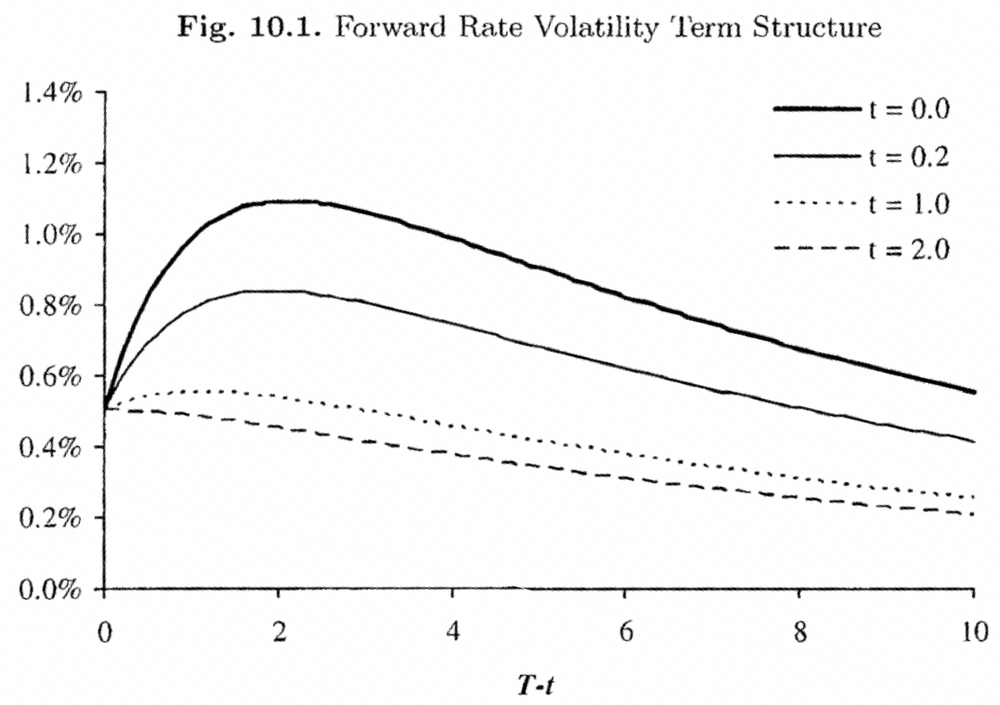

---
tags: [quant/knowledge]
---
## Part III

## Term Structure Models

## One-Factor Short Rate Models I

So far, our focus has been on vanilla models suitable for simple securities for which a change of measure allows the price to be expressed as an expectation of (a function of) a single random variable, typically a forward swap or Libor rate. However, many practically important securities, such as those that are callable or path-dependent, depend on interest rates in a substantially more complex manner, necessitating the construction of models for the dynamics of the entire discount curve - and not just a select few points on it. We have already, in Chapter 4, outlined the HJM theory that governs all dynamic discount curve models driven by vector-valued Brownian motions. The general HJM class with its infinite-dimensional Markovian dynamics is, however, too unwieldy to work with in practice, so it is of considerable interest to identify HJM model sub-classes that involve a finite number of Markov state variables only. We shall devote several chapters to this task, covering first the "classical" approach of writing down an explicit SDE for the short rate $r(t)$.

In our treatment of short rate models, we start out in this chapter with an in-depth analysis of the one-factor mean-reverting Gaussian model, providing a classical perspective on a model that we encountered in a modern HJM setting in Chapter 4. The chapter also covers the affine one-factor model, of which the Gaussian model is a special case. In Chapter 11, we generalize our discussion to arbitrary one-factor SDEs for the short rate, and finally, in Chapter 12, we introduce the class of multi-factor short rate models.

For derivatives pricing purposes, the short rate modeling approach has largely been superseded by newer approaches. Still, short rate models remain quite popular in empirical work, and a good understanding of these models provides a strong foundation for work with more sophisticated models.

### 10.1 The One-Factor Gaussian Short Rate Model

We recall that discount bond prices are given by the risk-neutral expectation

$$
\begin{equation*}
P(t, T)=\mathrm{E}_{t}^{\mathrm{Q}}\left(e^{-\int_{t}^{T} r(u) d u}\right) \tag{10.1}
\end{equation*}
$$
^eq10-1

so knowledge of the risk-neutral dynamics for $r(t)$ is in principle sufficient to compute time $t$ discount bond prices to all maturities $T>t$. In practice, the expectation in (10.1) may, of course, not be computable in closed form, so to make short rate models operational in practice we must look for the sub-class of models where (10.1) is either analytically tractable or, at the very least, amenable to fast numerical methods.

One approach for which (10.1) becomes particularly tractable is to model the short rate as a Gaussian random variable. The resulting Gaussian short rate (GSR) model has a long and distinguished history in the financial literature. While our applications focus leaves us little room for historical ruminations, we shall make a slight concession here, by developing the GSR model progressively from the historically important - yet ultimately impractical - special case in Ho and Lee [1986]. Our development of the model will also initially progress by classical "bottoms-up" means, developing the dynamics of the forward curve from an SDE for the short rate, rather than the other way around. Besides providing some historical perspective, our style of presentation involves several generally applicable techniques and should give the reader additional intuition about the mechanics of the models involved.

### 10.1.1 The Ho-Lee Model

### 10.1.1.1 Notations and First Steps

Starting from the fundamental assumption that the short rate $r(t)$ is adapted to a single Brownian motion $W(t)$, the simplest possible dynamics we can imagine is the martingale process $r(t)=r(0)+\sigma_{r} W(t)$, or

$$
\begin{equation*}
d r(t)=\sigma_{r} d W(t) \tag{10.2}
\end{equation*}
$$
^eq10-2

where $\sigma_{r}>0$ is a constant and $W(t)$ is a Brownian motion in the risk-neutral measure Q. From the basic risk-neutral pricing relationship (10.1), the time $t$ discount bond maturing at time $T$ then must have the price

$$
\begin{equation*}
P(t, T)=\mathrm{E}_{t}\left(e^{-\int_{t}^{T} r(u) d u}\right)=\mathrm{E}_{t}\left(e^{-r(0)(T-t)-\sigma_{r} \int_{t}^{T} W(u) d u}\right) \tag{10.3}
\end{equation*}
$$
^eq10-3

where $\mathrm{E}_{t}=\mathrm{E}_{t}^{\mathrm{Q}}$ is the time $t$ risk-neutral expectation operator.
Lemma 10.1.1. If $r(t)$ follows (10.2) in the risk-neutral measure, then

$$
\mathrm{E}_{t}\left(e^{-\int_{t}^{T} r(u) d u}\right)=\exp \left(-r(t)(T-t)+\frac{1}{6} \sigma_{r}^{2}(T-t)^{3}\right)
$$

Proof. We notice that

$$
r(u)=r(t)+\int_{t}^{u} \sigma_{r} d W(s), \quad u>t
$$

so that

$$
-\int_{t}^{T} r(u) d u=-r(t)(T-t)-\sigma_{r} \int_{t}^{T} \int_{t}^{u} d W(s) d u
$$

The order of integration can be changed by Fubini's theorem (see Duffie [2001]), such that

$$
\int_{t}^{T} \int_{t}^{u} d W(s) d u=\int_{t}^{T} \int_{s}^{T} d u d W(s)=\int_{t}^{T}(T-s) d W(s)
$$

By the Ito isometry, it then follows that $-\int_{t}^{T} r(u) d u$ is Gaussian with mean $-r(t)(T-t)$ and variance

$$
\operatorname{Var}_{t}\left(\int_{t}^{T} r(u) d u\right)=\sigma_{r}^{2} \int_{t}^{T}(T-s)^{2} d s=\frac{1}{3} \sigma_{r}^{2}(T-t)^{3}
$$

The result of the lemma then follows from basic moment properties of log-normal variables, see e.g. (1.22).

Let us define a yield $y(t, T)=-\ln P(t, T) /(T-t)$, such that

$$
y(t, T)=r(t)-\frac{1}{6} \sigma_{r}^{2}(T-t)^{2}
$$

The yield curve shapes that can be produced by the simple model in (10.2) are rather primitive, as is evident from this expression. In particular, the yield curve is always downward-sloping in $T-t$ and $y_{\infty}=\lim _{T \rightarrow \infty} y(t, T)=-\infty$.

### 10.1.1.2 Fitting the Term Structure of Discount Bonds

The model presented above effectively has only two parameters - $r(0)$ and $\sigma_{r}$ - with which one can attempt to fit the initial yield curve. It should be clear that this is insufficient to properly match observable discount bond prices, which effectively disqualifies the model from practical pricing applications. Fortunately, as realized in the paper Ho and Lee [1986], a remedy is quite straightforward ${ }^{1}$ : simply introduce a deterministic function $a(t)$ and alter the model to be

$$
\begin{equation*}
r(t)=r(0)+a(t)+\sigma_{r} W(t), \quad a(0)=0 \tag{10.4}
\end{equation*}
$$
^eq10-4

[^0]such that

$$
\begin{equation*}
d r(t)=a^{\prime}(t) d t+\sigma_{r} d W(t) \tag{10.5}
\end{equation*}
$$
^eq10-5
where $a^{\prime}(t)$ is the first-order derivative of $a(t)$. To match the discount bond curve at time $0, a(t)$ cannot be freely stipulated, but must be set as specified in Lemma 10.1.2 below.

Lemma 10.1.2. Let $r(t)$ be given as in (10.4), and assume that discount bond prices at time $0, P(0, T)$, are known for all $T>0$. Set

$$
a(t)=f(0, t)-r(0)+\frac{1}{2} \sigma_{r}^{2} t^{2}, \quad f(0, t)=-\frac{\partial \ln P(0, t)}{\partial t} .
$$

Then, for any $T>0$,

$$
\begin{equation*}
\mathrm{E}\left(e^{-\int_{0}^{T} r(u) d u}\right)=P(0, T) \tag{10.6}
\end{equation*}
$$
^eq10-6

Proof. Applying Lemma 10.1.1, we get

$$
\mathrm{E}\left(e^{-\int_{0}^{t} r(u) d u}\right)=\exp \left(-r(0) t+\frac{1}{6} \sigma_{r}^{2} t^{3}\right) \times \exp \left(-\int_{0}^{t} a(u) d u\right)
$$

from which it follows that (10.6) is satisfied if

$$
-\int_{0}^{t} a(u) d u=\ln P(0, t)+r(0) t-\frac{1}{6} \sigma_{r}^{2} t^{3}
$$

Taking derivatives with respect to $t$ yields

$$
a(t)=-\frac{\partial \ln P(0, t)}{\partial t}-r(0)+\frac{1}{2} \sigma_{r}^{2} t^{2}=f(0, t)-r(0)+\frac{1}{2} \sigma_{r}^{2} t^{2}
$$

The model (10.4) with $a(t)$ set as in Lemma 10.1.2 is known as the Ho-Lee model. We characterize the model further in the following proposition.

Proposition 10.1.3. In the Ho-Lee model, the risk-neutral process for $r(t)$ is

$$
\begin{equation*}
d r(t)=\left(\frac{\partial f(0, t)}{\partial t}+\sigma_{r}^{2} t\right) d t+\sigma_{r} d W(t) \tag{10.7}
\end{equation*}
$$
^eq10-7

and bond prices at time $t$ can be reconstituted from $r(t)$ through the expression

$$
P(t, T)=\frac{P(0, T)}{P(0, t)} \exp \left(-(r(t)-f(0, t))(T-t)-\frac{1}{2} \sigma_{r}^{2} t(T-t)^{2}\right)
$$

Proof. Equation (10.7) follows directly from (10.5) when $a(t)$ satisfies Lemma 10.1.2. To show the second part of the proposition, applying Lemma 10.1.1 to $r(t)-a(t)$ yields

$$
\begin{aligned}
& P(t, T) \\
& \quad=\exp \left(-(r(t)-a(t))(T-t)+\frac{1}{6} \sigma_{r}^{2}(T-t)^{3}\right) \\
& \quad \quad \times \exp \left(-\int_{t}^{T} a(u) d u\right) \\
& =\exp \left(-(r(t)-a(t))(T-t)+\frac{1}{6} \sigma_{r}^{2}(T-t)^{3}\right) \\
& \quad \times \exp \left(\ln P(0, T)+r(0) T-\frac{1}{6} \sigma_{r}^{2} T^{3}-\ln P(0, t)-r(0) t+\frac{1}{6} \sigma_{r}^{2} t^{3}\right) \\
& =\frac{P(0, T)}{P(0, t)} \exp \left(-(r(t)-a(t)-r(0))(T-t)+\frac{1}{2} \sigma_{r}^{2}\left(T t^{2}-T^{2} t\right)\right)
\end{aligned}
$$

In this expression $-a(t)-r(0)=-f(0, t)-\sigma_{r}^{2} t^{2} / 2$ from the definition of $a(t)$. The result follows.

### 10.1.1.3 Analysis and Comparison with HJM Approach

To gain a better understanding of the Ho-Lee model, let us examine the dynamics for bonds and forward rates implied by the model. From Proposition 10.1.3, we get

$$
\begin{equation*}
f(t, T)=-\frac{\partial \ln P(t, T)}{\partial T}=f(0, T)+r(t)-f(0, t)+\sigma_{r}^{2} t(T-t) \tag{10.8}
\end{equation*}
$$
^eq10-8

and

$$
\begin{equation*}
d f(t, T)=d r(t)+\left(\sigma_{r}^{2}(T-2 t)-\frac{\partial f(0, t)}{\partial t}\right) d t=\sigma_{r}^{2}(T-t) d t+\sigma_{r} d W(t) \tag{10.9}
\end{equation*}
$$
^eq10-9

In similar fashion, we get

$$
d P(t, T) / P(t, T)=r(t) d t-\sigma_{r}(T-t) d W(t)
$$

In the notations of Section 4.4, we have thus established that forward rate volatilities in the Ho-Lee model are $\sigma_{f}(t, T)=\sigma_{r}$ and discount bond volatilities are $\sigma_{P}(t, T)=\sigma_{r}(T-t)$. Due to the constancy of $\sigma_{f}(t, T)$, random perturbations of the forward curve from movement in the $d W$ term will thus be parallel ${ }^{2}$, in the sense that all points on the forward curve will move by identical amounts. Discount bond volatilities, on the other hand, approach

[^1]zero in linear fashion as $t \rightarrow T$, reflecting the pull to par phenomenon discussed earlier in Chapter 4.

Setting aside for a moment the question about whether the Ho-Lee model is a reasonable representation of the real world, let us make a brief interlude to point out that we could, in fact, have specified the model directly as an HJM model with $\sigma_{f}(t, T)=\sigma_{r}$ and a single Brownian motion. The HJM result, Lemma 4.4.1, then immediately establishes the drift in the SDE for $f(t, T)$ to be

$$
\mu_{f}(t, T)=\sigma_{r} \int_{t}^{T} \sigma_{r} d u=\sigma_{r}^{2}(T-t)
$$

consistent with (10.9) above. Integrating this equation establishes (10.8), from which the discount bond reconstitution formula in Proposition (10.1.3) follows. To establish (10.7), we simply write $r(t)=f(t, t)$ and differentiate:

$$
d r(t)=\left.d f(t, T)\right|_{T=t}+\left.\frac{\partial f(t, T)}{\partial T}\right|_{T=t} d t=\sigma_{r} d W(t)+\left(\frac{\partial f(0, t)}{\partial t}+\sigma_{r}^{2} t\right) d t
$$

where the second equality uses (10.8)-(10.9). Notice that arriving at Proposition 10.1.3 in this manner did not involve evaluation of any expectations.

The Ho-Lee model has several drawbacks that disqualifies it for most, if not all, pricing applications. We list some of them below.

- The constancy of forward rate volatilities as a function of forward rate maturity $(T-t)$ is unrealistic: long-dated forward rates are less volatile than short-dated ones.
- The constancy of forward rate volatilities as a function of calendar time $t$ gives the model time-stationary dynamics, but also results in the model having far too few degrees of freedom to allow for calibration to quoted option prices.
- Spot and forward interest rates are Gaussian and can therefore become negative, which is unrealistic.
- The model has only one driving Brownian motion and instantaneous moves of all forward rates are therefore perfectly correlated, contrary to empirical evidence.

The last objection is common for all one-factor short rate models and will disqualify these models for the pricing of options that have strong payoff dependency on non-parallel moves of the yield curve, e.g. spread options (see Chapter 17). The possibility of generating negative rates also cannot be helped unless we abandon the Gaussian setting (which we shall do later in this chapter), but we can address the problems associated with using constant forward rate volatility. We turn to this problem next.

### 10.1.2 The Mean-Reverting GSR Model

### 10.1.2.1 The Vasicek Model

Many empirical studies find that interest rates exhibit mean reversion, in the sense that if an interest rate is high by historical standards, it will most likely fall in the future (and vice versa if the interest rate is low). To model this phenomenon, Vasicek [1977] assumed that the short rate follows a one-factor Ornstein-Uhlenbeck process in the risk-neutral measure:

$$
\begin{equation*}
d r(t)=\varkappa(\vartheta-r(t)) d t+\sigma_{r} d W(t) \tag{10.10}
\end{equation*}
$$
^eq10-10

where $\varkappa, \vartheta, \sigma_{r}$ are positive constants. From results for the linear SDE in Section 1.6, it follows that the short rate can be written

$$
\begin{equation*}
r(t)=\vartheta+(r(0)-\vartheta) e^{-\varkappa t}+\sigma_{r} \int_{0}^{t} e^{-\varkappa(t-s)} d W(s) \tag{10.11}
\end{equation*}
$$
^eq10-11

It follows that $r(t)$ is a Gaussian random variable with moments

$$
\begin{align*}
\mathrm{E}(r(t)) & =\vartheta+(r(0)-\vartheta) e^{-\varkappa t},  \tag{10.12}\\
\operatorname{Var}(r(t)) & =\frac{\sigma_{r}^{2}}{2 \varkappa}\left(1-e^{-2 \varkappa t}\right) . \tag{10.13}
\end{align*}
$$
^eq10-12
^eq10-13

As $t \rightarrow \infty$, the mean of the short rate approaches $\vartheta$ and the variance goes to $\sigma_{r}^{2} /(2 \varkappa)$. Accordingly, $\vartheta$ is often known as the long-term level (or sometimes the mean reversion level) of the short rate. The speed at which the short rate can be expected to revert to its long-term level is determined by $\varkappa$, known as the mean reversion speed.

To establish a discount bond pricing formula in the Vasicek model, we use (10.11) to write

$$
\begin{aligned}
-\int_{0}^{t} r(u) d u=-\vartheta t-(r(0)-\vartheta)\left(1-e^{-\varkappa t}\right) / \varkappa & \\
& -\sigma_{r} \int_{0}^{t} \int_{0}^{u} e^{-\varkappa(u-s)} d W(s) d u
\end{aligned}
$$

Clearly $-\int_{0}^{t} r(u) d u$ is Gaussian, with mean

$$
-\vartheta t-(r(0)-\vartheta)\left(1-e^{-\varkappa t}\right) / \varkappa
$$

To establish the variance, we follow the approach in Lemma 10.1.1 and reverse the order of integration in the stochastic integral, followed by an application of the Ito isometry. The result is

$$
\begin{aligned}
\operatorname{Var}\left(\sigma_{r} \int_{0}^{t} \int_{0}^{u} e^{-\varkappa(u-s)} d W(s) d u\right) & =\sigma_{r}^{2} \int_{0}^{t} e^{2 \varkappa s}\left(\int_{s}^{t} e^{-\varkappa u} d u\right)^{2} d s \\
& =\frac{\sigma_{r}^{2}}{2 \varkappa^{3}}\left(-e^{-2 \varkappa t}+4 e^{-\varkappa t}+2 t \varkappa-3\right)
\end{aligned}
$$

From the usual result for log-normal variables, it follows that discount bond prices in the Vasicek model can be computed as

$$
\begin{aligned}
P(0, t)= & \exp \left(\mathrm{E}\left(-\int_{0}^{t} r(u) d u\right)+\frac{1}{2} \operatorname{Var}\left(-\int_{0}^{t} r(u) d u\right)\right) \\
= & \exp \left(-\frac{1-e^{-\varkappa t}}{\varkappa} r(0)-\vartheta t+\frac{\vartheta}{\varkappa}\left(1-e^{-\varkappa t}\right)\right) \\
& \times \exp \left(\frac{\sigma_{r}^{2}}{4 \varkappa^{3}}\left(-e^{-2 \varkappa t}+4 e^{-\varkappa t}+2 t \varkappa-3\right)\right)
\end{aligned}
$$

More generally, we have the following proposition, the proof of which is straightforward.

Proposition 10.1.4. Define

$$
\begin{aligned}
& B(t, T)=\frac{1-e^{-\varkappa(T-t)}}{\varkappa} \\
& A(t, T)=\left(\vartheta-\frac{\sigma_{r}^{2}}{2 \varkappa^{2}}\right)(B(t, T)-(T-t))-\frac{\sigma_{r}^{2} B(t, T)^{2}}{4 \varkappa}
\end{aligned}
$$

Then, in the Vasicek model (10.10),

$$
P(t, T)=\exp (A(t, T)-B(t, T) r(t))
$$

As we did for the model in Section 10.1.1.1, define $y(t, T)=$ - In $P(t, T) /(T-t)$, and notice that now a finite limit exists,

$$
y_{\infty}=\lim _{T \rightarrow \infty} y(t, T)=\vartheta-\sigma_{r}^{2} /\left(2 \varkappa^{2}\right)
$$

In the Vasicek model, three different yield curve shapes are possible.
Lemma 10.1.5. Let $y(t, T)=-\ln P(t, T) /(T-t)$. Then

- If $r(t)>\vartheta$, then $y(t, T)$ decreases in $T-t$.
- If $r(t)<y_{\infty}-\sigma_{r}^{2} /\left(4 \varkappa^{2}\right)$, then $y(t, T)$ increases in $T-t$.
- Otherwise, $y(t, T)$ first increases in $T$ - $t$ and then decreases (i.e. $y(t, T)$ is humped).

Proof. By straightforward, but tedious, calculus.
While this is certainly an improvement over the martingale model we encountered in Section 10.1.1.1, the Vasicek model is still not capable of fitting the observable yield curve accurately enough for pricing applications. It should be obvious that the way to solve this problem is to mimic the step that lead to the Ho-Lee model in Section 10.1.1.2: introduce a deterministic function of time into the definition (10.11). That is, we write

$$
r(t)=a(t)+\vartheta+(r(0)-\vartheta) e^{-\varkappa t}+\sigma_{r} \int_{0}^{t} e^{-\varkappa(t-s)} d W(s)=a(t)+r_{O U}(t)
$$

where $a(t)$ is a deterministic function and $r_{O U}(t)$ is the short rate in the Vasicek model. The function $a(t)$ is determined from the condition that

$$
\mathrm{E}\left(e^{-\int_{0}^{t} r_{o w}(u) d u}\right) e^{-\int_{0}^{t} a(u) d u}=P(0, t)
$$

where the right-hand side is assumed given. Further development of this model proceeds as in Section 10.1.1.2, and results are easily imagined; we skip the analysis as the resulting model is a special case of the more general setup in Section 10.1.2.2 below. We do note, however, that the Vasicek model - both with and without adjustment to fit the initial yield curve - is easily shown to have forward rate and discount bond volatilities of

$$
\sigma_{f}(t, T)=\sigma_{r} e^{-\varkappa(T-t)}, \quad \sigma_{P}(t, T)=\sigma_{r}\left(\frac{1-e^{-\varkappa(T-t)}}{\varkappa}\right)
$$

Introduction of mean reversion into the model will thus introduce exponential decay in the term structure of forward rate volatilities. From an empirical standpoint this is considerably more appealing than the maturityindependent forward rate volatilities in the Ho-Lee model, and also in qualitative agreement with the fact that short- and medium-maturity interest rate options trade at higher implied volatilities ${ }^{3}$ than do long-dated options. While this is a step up from the Ho-Lee model, the model still has too few degrees of freedom for many derivatives pricing applications, as the model will rarely calibrate well to observed prices of vanilla options (e.g. European swaptions and caps). We improve on this in the next section.

### 10.1.2.2 The General One-Factor GSR Model

The most general form of the one-factor GSR model is given by the SDE

$$
\begin{equation*}
d r(t)=\varkappa(t)(\vartheta(t)-r(t)) d t+\sigma_{r}(t) d W(t) \tag{10.14}
\end{equation*}
$$
^eq10-14

i.e. we have now allowed all parameters in the Vasicek model to depend on time. While this model can be developed by classical means (see e.g. Hull and White [1994a] for, often laborious, details), it is significantly easier to work within an HJM setting. In fact, we already showed in Section 4.5.2 that short rate dynamics of the form in (10.14) must originate from a "separable" HJM model of the form

$$
\begin{align*}
& d f(t, T)=\sigma_{f}(t, T)\left(\int_{t}^{T} \sigma_{f}(t, u) d u\right) d t+\sigma_{f}(t, T) d W(t)  \tag{10.15}\\
& \sigma_{f}(t, T)=\sigma_{r}(t) \exp \left(-\int_{t}^{T} \varkappa(u) d u\right)
\end{align*}
$$
^eq10-15

Chapter 4 also proved the following result for the function $\vartheta(t)$.

[^2]Proposition 10.1.6. For the general one-factor GSR model (10.14) to match the initial yield curve, we must have

$$
\vartheta(t)=\frac{1}{\varkappa(t)} \frac{\partial f(0, t)}{\partial t}+f(0, t)+\frac{1}{\varkappa(t)} \int_{0}^{t} e^{-2 \int_{u}^{t} \varkappa(s) d s} \sigma_{r}(u)^{2} d u
$$

Proof. Follows from Proposition 4.5.4, when $d=1$.
We notice the presence of $\partial f(0, t) / \partial t$ in the expression for $\vartheta(t)$ (a similar term was, of course, present in the Ho-Lee model) which can be a nuisance in applications where the initial forward curve is not smooth, as when we have used simple bootstrapping to construct the curve. To get rid of the term, we now switch variables, from $r(t)$ itself to $x(t)=r(t)-f(0, t)$. Dynamics for $x(t)$, as well as the bond reconstitution formula for (10.14) in terms of $x(t)$ are listed next.

Proposition 10.1.7. Define

$$
x(t) \triangleq r(t)-f(0, t)
$$

Then, for the model (10.14)-(10.15),

$$
\begin{equation*}
d x(t)=(y(t)-\varkappa(t) x(t)) d t+\sigma_{r}(t) d W(t), \quad x(0)=0 \tag{10.16}
\end{equation*}
$$
^eq10-16

where

$$
\begin{equation*}
y(t)=\int_{0}^{t} e^{-2 \int_{u}^{t} \varkappa(s) d s} \sigma_{r}(u)^{2} d u \tag{10.17}
\end{equation*}
$$
^eq10-17

The bond reconstitution formula is

$$
\begin{align*}
& P(t, T)=\frac{P(0, T)}{P(0, t)} \exp \left(-x(t) G(t, T)-\frac{1}{2} y(t) G(t, T)^{2}\right)  \tag{10.18}\\
& G(t, T)=\int_{t}^{T} e^{-\int_{t}^{u} \varkappa(s) d s} d u
\end{align*}
$$
^eq10-18

Proof. To simplify notation, define $K(t)=\int_{0}^{t} \varkappa(u) d u$, and set $g(t)= \sigma_{r}(t) e^{K(t)}, h(t)=e^{-K(t)}$. Then $\sigma_{f}(t, T)=g(t) h(T)$ and, by integration of (10.15),

$$
\begin{equation*}
f(t, T)=f(0, T)+h(T) \int_{0}^{t} g(u)^{2} \int_{u}^{T} h(s) d s d u+h(T) \int_{0}^{t} g(u) d W(u) \tag{10.19}
\end{equation*}
$$
^eq10-19

Set

$$
x(t)=h(t) \int_{0}^{t} g(u)^{2} \int_{u}^{t} h(s) d s d u+h(t) \int_{0}^{t} g(u) d W(u)
$$

and note that, by the Leibniz rule for differentiation of an integral,

$$
\begin{aligned}
d x(t)= & h^{\prime}(t)\left(\int_{0}^{t} g(u)^{2} \int_{u}^{t} h(s) d s d u\right) d t+h(t)^{2}\left(\int_{0}^{t} g(u)^{2} d u\right) d t \\
& +h(t) g(t) d W(t)+h^{\prime}(t) \int_{0}^{t} g(u) d W(u) d t \\
= & \left(\frac{h^{\prime}(t)}{h(t)} x(t)+y(t)\right) d t+h(t) g(t) d W(t) \\
= & (y(t)-\varkappa(t) x(t)) d t+\sigma_{r}(t) d W(t)
\end{aligned}
$$

where

$$
y(t)=h(t)^{2} \int_{0}^{t} g(u)^{2} d u
$$

was defined in (10.17). From (10.19) we have

$$
\begin{aligned}
f(t, T)= & f(0, T)+\frac{h(T)}{h(t)} x(t)+h(T) \int_{0}^{t} g(u)^{2} \int_{u}^{T} h(s) d s d u \\
& -h(T) \int_{0}^{t} g(u)^{2} \int_{u}^{t} h(s) d s d u \\
= & f(0, T)+\frac{h(T)}{h(t)} x(t)+h(T) \int_{t}^{T} h(s) d s \int_{0}^{t} g(u)^{2} d u \\
= & f(0, T)+\frac{h(T)}{h(t)}\left(x(t)+\frac{y(t)}{h(t)} \int_{t}^{T} h(s) d s\right)
\end{aligned}
$$

such that in particular $r(t)=f(t, t)=f(0, t)+x(t)$, as claimed earlier. Inserting the expression for $f(t, T)$ into the basic relation

$$
P(t, T)=\exp \left(-\int_{t}^{T} f(t, u) d u\right)
$$

produces (10.18) after a few rearrangements.
Remark 10.1.8. The discount bond dynamics for $P(t, T)$ are

$$
d P(t, T) / P(t, T)=r(t) d t-\sigma_{P}(t, T) d W(t), \quad \sigma_{P}(t, T)=\sigma_{r}(t) G(t, T)
$$

Remark 10.1.9. In the reconstitution formula (10.18), notice that

$$
G(t, T)=(G(0, T)-G(0, t)) e^{\int_{0}^{t} \varkappa(s) d s}
$$

a result that is often useful in grid-based numerical work (see Section 10.1.5).
Proposition 10.1.7 is an important result and shall serve as the foundation for most of the remaining discussion of Gaussian short rate models.

### 10.1.2.3 Time-Stationarity and Caplet Hump

A Gaussian HJM model is said to be time-stationary if the instantaneous volatility $\sigma_{f}(t, T)$ is only a function of $T-t$, i.e. the time to maturity rather than the time of maturity $T$. Time stationarity is an appealing feature, as it implies that the volatility term structure of forward rates will look the same in the future as it does today; in the absence of other information, this prediction is often very reasonable and in good agreement with empirical observation. In the setting of the one-factor GSR model, imposing timestationarity will require us to set both $\sigma_{r}(t)$ and $\varkappa_{(t)}$ to constants, such that

$$
\begin{equation*}
\sigma_{f}(t, T)=\sigma_{r} e^{-\varkappa(T-t)} \tag{10.20}
\end{equation*}
$$
^eq10-20

In other words, the only time-stationary forward rate volatility term structure that can be constructed in the GSR model is an exponentially decaying one. In practice, however, it is quite common to observe (from the caplet market, say) forward rate volatility structures that have a marked "hump", with short-dated options trading at very low volatilities. This effect can largely be attributed to central bank activity, as the extreme short end of the forward curve tends to move primarily in response to central bank changes to funding rates. As such changes are relatively infrequent and normally quite predictable ${ }^{4}$, short-dated forward rates are typically associated with relatively little uncertainty and, consequently, have low volatilities.

If we attempt to match a GSR model to a humped forward volatility structure, it follows from (10.20) that this cannot be done in a stationary manner and we are forced to let $\varkappa$ become a function of time. To see this, suppose that we at time 0 observe forward volatilities $\sigma_{f}(0, T)=b(T)$, where $b(T)$ is a humped function of $T$, i.e $b(T)$ initially increases in $T$ but ultimately decreases in $T$. Ideally, we would like to set $\sigma_{f}(t, T)=b(T-t)$, but this is not possible in the GSR setting, as explained above. To make the GSR model match $b(T)$ at time 0 , we instead are forced to make $\varkappa$ a function of time, determined from the relation

$$
\sigma_{f}(0, T)=\sigma_{r} e^{-\int_{0}^{T} \varkappa(u) d u}=b(T), \quad \sigma_{r}=b(0)
$$

Taking logarithms and differentiating gives

$$
\varkappa(t)=-\frac{d(\ln b(t))}{d t}=-\frac{b^{\prime}(t)}{b(t)}
$$

If $t_{p}$ is the time $t$ at which $b(t)$ reaches its peak (i.e. $b^{\prime}\left(t_{p}\right)=0$ ), it follows that $\varkappa(t)$ will be negative for all $t<t_{p}$ and positive for all $t>t_{p}$. At time $t>0$, our so-calibrated GSR model will produce instantaneous forward volatilities of

$$
\sigma_{f}(t, T)=\sigma_{r} e^{-\int_{t}^{T} \varkappa(u) d u}=\sigma_{r} b(T) / b(t)
$$
(On occasion there is significant uncertainty in the market about the intentions of monetary authorities, in which case the caplet hump may disappear temporarily)
Clearly $\sigma_{f}(t, T)$ is not stationary. In fact, once $t>t_{p}$ the model no longer produces a hump at all, as $b(T) / b(t)$ is monotonically decaying in $T-t$ for $t>t_{p}$. Figure 10.1 demonstrates this effect; notice also how volatilities become progressively lower as time t moves forward.

Fig. 10.1. Forward Rate Volatility Te

Notes: The figure shows the evolution of the GSR term structure of forward rate volatility with $t$. The model fit to the original term structure of volatility $(t=0)$ was done solely through the mean reversion function $\varkappa(t)$, as described in the text.

The lesson to be learned from the examination above is essentially this: in the GSR model and, in fact, in all short rate models, one should resist making $\varkappa$ a function of time lest one is willing to accept strongly non-stationary evolution of forward rate volatilities. Yet, working with perfectly time-stationary GSR models is often too constraining in practical applications, as the resulting model has too few degrees of freedom in its volatility characteristics to calibrate against observed vanilla option prices in a meaningful way. Our recommendation for most applications is to freeze $\varkappa$ at a constant value, but to allow $\sigma_r$ to be a function of time (see Section 13.1.8 for much more on mean reversion calibration). That is, we would set

$$
\sigma_f(t, T)=\sigma_r(t) e^{-\varkappa(T-t)}
$$

While the resulting model is not time-stationary, it retains through time a persistent exponential shape of its instantaneous forward volatility structure.

The reader may at this point reasonably ask whether models exist that can produce a time-stationary hump in instantaneous forward volatilities. The answer is yes, but such models would generally need more than a single Markov variable to characterize moves in the yield curve. We return to this issue in Chapter 12 and, indeed, in many later chapters on multi-factor models.

### 10.1.3 European Option Pricing

In the general one-factor GSR model (10.14), suppose that we fix the mean reversion function $\varkappa(t)$ exogenously, e.g. based on empirical observations or from observation of typical decay speed of implied volatilities with option maturity ${ }^{5}$. The function $\vartheta(t)$ in (10.14) is then uniquely fixed by the initial forward curve, so to complete the specification of the model it remains to determine the function $\sigma_{r}(t)$. In pricing applications, this function is normally found by calibration of the GSR model to observed prices of liquid European options, such as caps and swaptions. While we shall postpone most of the intricacies of volatility calibration to later chapters, it should be clear that for a calibration to caps and swaptions to be efficient, we need computationally efficient methods for the valuation of these instruments.

In Section 4.5.1, we showed that for any Gaussian HJM model - whether the short rate is Markov or not - caplets can be priced by simple BlackScholes formulas; see Proposition 4.5.2 for the details. Consequently, we here focus our attention on the pricing of swaptions. For concreteness, consider a payer swaption expiring at time $T_{0}$, with the underlying swap paying an annualized coupon $c$ at times $T_{1}<T_{2}<\ldots<T_{N}$, with $T_{1}>T_{0}$. We recall from Chapter 5 that the swaption payout at time $T_{0}$ is

$$
\begin{equation*}
V_{\text {swaption }}\left(T_{0}\right)=\left(1-P\left(T_{0}, T_{N}\right)-c \sum_{i=0}^{N-1} \tau_{i} P\left(T_{0}, T_{i+1}\right)\right)^{+}, \quad \tau_{i}=T_{i+1}-T_{i} . \tag{10.21}
\end{equation*}
$$
^eq10-21

### 10.1.3.1 The Jamshidian Decomposition

Our first approach is exact, and is based on a method developed by Jamshidian [1989]. The basic idea is to rewrite the swaption payout from an option on a sum of discount bonds to a sum of options on discount bonds. To develop the idea in detail, let us write $P\left(T_{0}, T_{N}\right)=P\left(T_{0}, T_{N}, x\left(T_{0}\right)\right)$ to recognize the dependence of $P\left(T_{0}, T_{N}\right)$ on $x\left(T_{0}\right)=r\left(T_{0}\right)-f\left(0, T_{0}\right)$ through the reconstitution formula (10.18). We also define a "critical" value $x^{*}$ for

[^4]which the swap at time $T_{0}$ is exactly zero; $x^{*}$ can be found by numerical root search on the equation

$$
\begin{equation*}
P\left(T_{0}, T_{N}, x^{*}\right)+c \sum_{i=0}^{N-1} \tau_{i} P\left(T_{0}, T_{\imath+1}, x^{*}\right)=1 \tag{10.22}
\end{equation*}
$$
^eq10-22

Finally, define "strikes"

$$
K_{i}=P\left(T_{0}, T_{i}, x^{*}\right), \quad i=1, \ldots, N ;
$$

it follows that

$$
\begin{equation*}
K_{N}+c \sum_{i=0}^{N-1} \tau_{i} K_{i+1}=1 \tag{10.23}
\end{equation*}
$$
^eq10-23

We are now ready to apply the Jamshidian "trick". Inspection of (10.18) shows that all zero-coupon bonds $P\left(T_{0}, T_{i}, x\left(T_{0}\right)\right)$ are monotonically decreasing in $x\left(T_{0}\right)$, whereby the swaption only pays out a positive amount if $x\left(T_{0}\right)>x^{*}$. That is,
$V_{\text {swaption }}\left(T_{0}\right)$

$$
\begin{aligned}
& =\left(1-P\left(T_{0}, T_{N}, x\left(T_{0}\right)\right)-c \sum_{i=0}^{N-1} \tau_{i} P\left(T_{0}, T_{i+1}, x\left(T_{0}\right)\right)\right) 1_{\left\{x\left(T_{0}\right)>x^{*}\right\}} \\
& =\left(K_{N}+c \sum_{i=0}^{N-1} \tau_{i} K_{i+1}-P\left(T_{0}, T_{N}, x\left(T_{0}\right)\right)\right. \\
& \left.\quad-c \sum_{i=0}^{N-1} \tau_{i} P\left(T_{0}, T_{i+1}, x\left(T_{0}\right)\right)\right) 1_{\left\{x\left(T_{0}\right)>x^{*}\right\}},
\end{aligned}
$$

where the second equality follows from (10.23). Thus,

$$
\begin{align*}
V_{\text {swaption }}\left(T_{0}\right)= & \left(K_{N}-P\left(T_{0}, T_{N}, x\left(T_{0}\right)\right)\right) 1_{\left\{x\left(T_{0}\right)>x^{*}\right\}} \\
& +c \sum_{i=0}^{N-1} \tau_{i}\left(K_{i+1}-P\left(T_{0}, T_{i+1}, x\left(T_{0}\right)\right)\right) 1_{\left\{x\left(T_{0}\right)>x^{*}\right\}} \\
= & \left(K_{N}-P\left(T_{0}, T_{N}, x\left(T_{0}\right)\right)\right)^{+} \\
& +c \sum_{i=0}^{N-1} \tau_{i}\left(K_{i+1}-P\left(T_{0}, T_{i+1}, x\left(T_{0}\right)\right)\right)^{+} \tag{10.24}
\end{align*}
$$
^eq10-24

where we used monotonicity of $P\left(T_{0}, T_{i}, x\left(T_{0}\right)\right)$ on the last step. With this result, we have decomposed the swaption payout into $N+1$ put options on zero-coupon bonds. Such options are easily valued using the formula from Proposition 4.5.1, allowing us to price the swaption in closed form.

### 10.1.3.2 Gaussian Swap Rate Approximation

While the Jamshidian approach above is perfectly adequate for many applications, its use of numerical root search and the need to price a potentially large amount of zero-coupon options can be cumbersome. One may wonder, then, whether perhaps a simpler approach is possible, given the simplicity of the dynamics of rates in the GSR framework. One obvious idea is to examine the SDE of the forward swap rate in an appropriate annuity measure, introducing approximations as needed to make the dynamics tractable. This idea shall be used many times in this book, often in combination with sophisticated techniques for simplification of the swap rate SDEs. Here, we have more modest aspirations and will be content with a simpler - yet still functional - approach. The reader shall consider this section a warm-up exercise for more accurate approximations to come, in particular in Sections 13.1.4 and 13.1.5 that also cover the GSR case.

We start by rewriting the swaption payout as

$$
V_{\text {swaption }}\left(T_{0}\right)=A\left(T_{0}\right)\left(S\left(T_{0}\right)-c\right)^{+}
$$

where $A(t)$ and $S(t)$ are the swap annuity and forward swap rate, respectively, see (5.13)-(5.14):

$$
A(t) \triangleq A_{0, N}(t)=\sum_{i=0}^{N-1} \tau_{i} P\left(t, T_{i+1}\right), S(t) \triangleq S_{0, N}(t)=\frac{P\left(t, T_{0}\right)-P\left(t, T_{N}\right)}{A(t)}
$$

Let $\mathrm{Q}^{A}$ be the measure induced by using $A(t)$ as the numeraire, such that

$$
\begin{equation*}
V_{\text {swaption }}(0)=A(0) \mathrm{E}^{A}\left(\left(S\left(T_{0}\right)-c\right)^{+}\right) \tag{10.25}
\end{equation*}
$$
^eq10-25

where $\mathrm{E}^{A}$ denotes expectation in measure $\mathrm{Q}^{A}$. To evaluate (10.25), we need to determine the dynamics of $S(t)$ in $\mathrm{Q}^{A}$. Lemma 4.2.4 establishes that $S(t)$ is a martingale under $Q^{A}$. From the reconstitution formula (10.18) we also know that $S(t)$ and $A(t)$ must be deterministic functions of $x(t)$ :

$$
S(t)=S(t, x(t)), \quad A(t)=A(t, x(t))
$$

so from Ito's lemma

$$
d S(t)=q(t, x(t)) \sigma_{r}(t) d W^{A}(t), \quad q(t, x)=\frac{\partial}{\partial x} \frac{P\left(t, T_{0}, x\right)-P\left(t, T_{N}, x\right)}{\sum_{i=0}^{N-1} \tau_{i} P\left(t, T_{i+1}, x\right)}
$$

where $W^{A}$ is a $\mathrm{Q}^{A}$-Brownian motion and where we use (10.18) to express the $P\left(t, T_{i}\right)$ 's as functions of $x$. Evaluating the partial derivatives yields

$$
\begin{align*}
q(t, x)= & -\frac{P\left(t, T_{0}, x\right) G\left(t, T_{0}\right)-P\left(t, T_{N}, x\right) G\left(t, T_{N}\right)}{A(t, x)} \\
& +\frac{S(t, x)}{A(t, x)} \sum_{i=0}^{N-1} \tau_{i} P\left(t, T_{i+1}, x\right) G\left(t, T_{i+1}\right) \tag{10.26}
\end{align*}
$$
^eq10-26

where we recall that

$$
G(t, T)=\int_{t}^{T} e^{-\int_{t}^{u} \varkappa(s) d s} d u
$$

The function $q(t, x)$ can be experimentally verified to be close to a constant in $x$-direction so, as a good approximation, we can write

$$
\begin{equation*}
q(t, x(t)) \approx q(t, \bar{x}(t)) \tag{10.27}
\end{equation*}
$$
^eq10-27

where $\bar{x}(t)$ is some deterministic proxy for $x(t)$. With this, the option formula in the Normal model, see Remark 7.2.9, immediately leads to the following lemma:

Lemma 10.1.10. Let $\bar{x}(t)$ be a deterministic function of time, and assume that (10.27) holds. Then

$$
V_{\text {swaption }}(0) \approx A(0)[(S(0)-c) \Phi(d)+\sqrt{v} \varphi(d)],
$$

where

$$
\begin{equation*}
d=\frac{S(0)-c}{\sqrt{v}}, \quad v=\int_{0}^{T_{0}} q(t, \bar{x}(t))^{2} \sigma_{r}(t)^{2} d t \tag{10.28}
\end{equation*}
$$
^eq10-28

It remains to choose $\bar{x}(t)$. An easy choice is to set $\bar{x}(t)=0$, which will yield good precision if $\sigma_{r}(t)$ is not too high. What also works reasonably well is to simply evaluate $q(t, \bar{x})$ at the forward discount bond curve, i.e. replace $P\left(t, T_{i}, \bar{x}\right)$ with $P\left(0, T_{i}\right) / P(0, t)$ in (10.26). More accurate choices for $\bar{x}(t)$, as well as refinements to the approximation (10.27), are developed in Sections 13.1.4 and 13.1.5.

### 10.1.4 Swaption Calibration

In a typical application of the model, the European option pricing formulas from Section 10.1.3 are used to calibrate the model, i.e. to find the volatility curve $\sigma_{r}(t)$ so as to match the market prices of one or more calibration targets, most often European swaptions.

Let us assume that we are given a collection of $N-1$ swaptions defined on a maturity grid $0=T_{0}<T_{1}<\ldots<T_{N}$ such that the $i$-th swaption expires at times $T_{i}, i=1, \ldots, N-1$. Such a collection ${ }^{6}$ is often called a swaption strip. A common choice of swaption strip (used, for instance, for Bermudan swaptions) would have the underlying swaps for all swaptions

[^5]mature on the same date $T_{N}$. If this is the case, the strip is called the coterminal swaption strip.

With the mean reversion $\varkappa(t)$ fixed, we can make the important observation that the value of the swaption expiring at time $T_{i}$ depends on the volatility curve $\sigma_{r}(s)$ for $s \in\left[0, T_{l}\right]$ only. This can be seen most clearly from the formula for $v$ in Lemma 10.1.10, but is also evident from the pricing formula (10.24) and the fact that the discount bond reconstitution formula (10.18) for $P(t, T)$ does not depend on $\sigma_{r}(s)$ for $s \geq t$.

The special structure of volatility dependence allows us to perform calibration for one swaption at a time, replacing a potentially multi-dimensional optimization problem with a series of one-dimensional root searches. Assume that $\sigma_{r}(t)$ is piecewise flat on the maturity grid, with $\sigma_{i}$ denoting the flat value on $\left[T_{i}, T_{i+1}\right]$. A possible algorithm based on the formula (10.24) would then work as follows.

1. Assume $\sigma_{0}, \ldots, \sigma_{\imath-1}$ have been found.
2. Set the value $\sigma_{\imath}$ such that the model price of the $(i+1)$-th swaption, i.e. a swaption that expiries at $T_{l+1}$, is equal its market price, by numerically inverting (10.24) for $\sigma_{1}$ while $\sigma_{0}, \ldots, \sigma_{1-1}$ are kept constant.
3. Repeat Step 2 for $i=0, \ldots, N-2$.

At first glance, it may appear that the pricing formula from Lemma 10.1.10 will give rise to a linear system on $\sigma_{0}^{2}, \ldots, \sigma_{N-2}^{2}$, allowing us to execute Step 2 above by simple matrix inversion. The reality, however, is slightly more complex as the weight functions $q(\cdot, \cdot)$ also depend on the volatility curve $\sigma_{r}(\cdot)$ through $P(t, T)$ 's dependence on $y(t)$ in (10.18). Nevertheless, even with the proper update of $y(t)$ through (10.17) in each step, the inversion in Step 2 above is simple fare for any one-dimensional root solver. Further details can be gleaned from Section 13.1.7 that discusses volatility calibration for the closely related quasi-Gaussian models.

We should note that the volatility calibration scheme above is not guaranteed to always work: a condition sometimes called a "volatility squeeze" may cause the inversion in Step 2 to fail if the market value of the $T_{i+1}$-expiry swaption is significantly below that of the swaption expiring at $T_{2}$. In practice, market data is rarely extreme enough for this to happen, and sometimes the problem can be cured by increasing the mean reversion speed $\varkappa(t)$. Some care must be exercised here, though, as the usage of unrealistically high mean reversions will impact the inter-temporal correlations of the model (see Chapter 13), which may lead to unrealistic prices for exotics options, as discussed in Chapter 18.

### 10.1.5 Finite Difference Methods

We round off our discussion of GSR models with some brief comments on numerical implementation. We start with finite difference methods here, and
turn to Monte Carlo applications in Section 10.1.6. Our discussion of both techniques is rather brief; for further analysis and alternatives we simply refer to Chapters 2 and 3.

### 10.1.5.1 PDE and Spatial Boundary Conditions

Our treatment of finite difference methods for the GSR model - and for short rate models in general, see Section 11.3.1 - essentially involves little outside of straightforward applications of schemes from Chapter 2. Still, let us start by noting that the algorithms we describe here nevertheless deviate quite markedly from the somewhat old-fashioned (and often suboptimal) tree-based schemes that abound in the short rate literature, even in recent work.

Consider a claim $V$ with the terminal payout $V(T)$ that depends on the discount curve at time $T$. As the discount curve at time $T$ can be reconstituted solely from knowledge of $x(T)$, we write $V(T)=V(T, x(T))$. By standard results (see Section 1.8), we write $V(t)=V(t, x(t))$, where $V(t, x)$ satisfies the PDE

$$
\begin{equation*}
\frac{\partial V}{\partial t}+(y(t)-\varkappa(t) x) \frac{\partial V}{\partial x}+\frac{1}{2} \sigma_{r}(t)^{2} \frac{\partial^{2} V}{\partial x^{2}}=(x+f(0, t)) V \tag{10.29}
\end{equation*}
$$
^eq10-29

subject to a known terminal (payout) condition for $V(T, x)$. This PDE can be solved numerically using finite difference methods, e.g. the Crank-Nicolson method in Section 2.2.

In setting up the finite difference scheme, we require knowledge of spatial boundary conditions in the $x$-domain. In the absence of contractually agreedupon boundary conditions (as would be the case for e.g. barrier options) one possibility is to set

$$
\begin{equation*}
\left.\frac{\partial^{2} V}{\partial x^{2}}\right|_{x=x_{\mathrm{min}}}=\left.\frac{\partial^{2} V}{\partial x^{2}}\right|_{x=x_{\max }}=0 \tag{10.30}
\end{equation*}
$$
^eq10-30

as recommended in Section 2.2.2, where $x_{\text {max }}$ and $x_{\text {min }}$ are the grid boundaries. The boundaries are typically determined by probabilistic means, e.g.

$$
\begin{equation*}
x_{\max }=\mathrm{E}(x(T))+\alpha \sqrt{\operatorname{Var}(x(T))}, \quad x_{\min }=\mathrm{E}(x(T))-\alpha \sqrt{\operatorname{Var}(x(T))}, \tag{10.31}
\end{equation*}
$$
^eq10-31

for some confidence multiplier $\alpha$. The moments required in this computation can be found from equations (10.12)-(10.13); see also (10.40)-(10.41).

While workable in practice, the specification (10.30) is not particularly accurate for many actual payout types. As a consequence, one often finds that $\alpha$ needs to be set quite large ${ }^{7}$ (e.g. at values of $5-6$, or larger) to

[^6]prevent mis-specification errors at the boundary from affecting the solution at $(t, x)=(0,0)$. This, in turn, implies that significant computational effort is spent in areas of the $x$-domain that are probabilistically insignificant. One way to improve on this situation is to rely on the PDE itself to generate boundary conditions, as described earlier in Section 2.2.2 (see also Section 9.4.4). We present the details of this idea in the next section.

### 10.1.5.2 Determining Spatial Boundary Conditions from PDE

We assume that the PDE (10.29) has been discretized on a spatial grid $\left\{x_{j}\right\}_{j=0}^{m+1}$, so that $V_{j}(t)=V\left(t, x_{j}\right)$, etc. Let us focus on establishing the boundary condition at $x_{0}=x_{\min }$, say. Using a $\theta$-method discretization scheme, as in Section 2.2, with an upward discretization of the $x$-derivatives we get, at some time step $[t, t+\delta]$,

$$
\begin{align*}
& \frac{V_{0}(t+\delta)-V_{0}(t)}{\delta}+\theta \mu\left(t, x_{0}\right) \frac{V_{1}(t)-V_{0}(t)}{x_{1}-x_{0}}  \tag{10.32}\\
& \quad+(1-\theta) \mu\left(t+\delta, x_{0}\right) \frac{V_{1}(t+\delta)-V_{0}(t+\delta)}{x_{1}-x_{0}} \\
& \quad+\frac{\theta}{2} \sigma_{r}(t)^{2}\left\{\frac{V_{2}(t)-V_{1}(t)}{x_{2}-x_{1}}-\frac{V_{1}(t)-V_{0}(t)}{x_{1}-x_{0}}\right\} \frac{1}{\frac{1}{2}\left(x_{2}-x_{0}\right)} \\
& \quad+\frac{1-\theta}{2} \sigma_{r}(t+\delta)^{2}  \tag{10.33}\\
& \quad \times\left\{\frac{V_{2}(t+\delta)-V_{1}(t+\delta)}{x_{2}-x_{1}}-\frac{V_{1}(t+\delta)-V_{0}(t+\delta)}{x_{1}-x_{0}}\right\} \frac{1}{\frac{1}{2}\left(x_{2}-x_{0}\right)} \\
& =\theta\left(x_{0}+f(0, t)\right) V_{0}(t)+(1-\theta)\left(x_{0}+f(0, t+\delta)\right) V_{0}(t+\delta) \tag{10.34}
\end{align*}
$$
^eq10-32
^eq10-33
^eq10-34

where $\mu(t, x) \triangleq y(t)-\varkappa(t) x$. This equation can be rearranged to write $V_{0}(t)$ as

$$
\begin{equation*}
V_{0}(t)=k_{1}(t) V_{1}(t)+k_{2}(t) V_{2}(t)+g_{0}(t+\delta) \tag{10.35}
\end{equation*}
$$
^eq10-35

where $k_{1}(t)$ and $k_{2}(t)$ are easily computed functions of the process parameters, and where $g_{0}(t+\delta)$ is a function of $V_{0}(t+\delta), V_{1}(t+\delta)$, and $V_{2}(t+\delta)$. We leave it to the reader to write out $k_{1}, k_{2}$, and $g$ in detail. Applying similar principles, we get

$$
\begin{equation*}
V_{m+1}(t)=k_{m-1}(t) V_{m-1}(t)+k_{m}(t) V_{m}(t)+g_{m+1}(t+\delta) \tag{10.36}
\end{equation*}
$$
^eq10-36

Comparing (10.35)-(10.36) with the equations (2.12)-(2.13), we see that the boundary conditions (10.35)-(10.36) can be incorporated into our usual tri-diagonal roll-back scheme by simply interpreting $\underline{f}\left(t, x_{0}\right)=g_{0}(t+\delta)$ and $\bar{f}\left(t, x_{m+1}\right)=g_{m+1}(t+\delta)$ in the scheme of Section 2.2. As we are rolling back in time (from $t+\delta$ to $t$ ) when using the finite difference equations, both $g_{0}(t+\delta)$ and $g_{m+1}(t+\delta)$ are known at time $t$, so this interpretation involves no difficulties.

### 10.1.5.3 Upwinding

For the PDE (10.29), notice that the condition (2.34) states that convection domination can cause spurious oscillations to creep into the finite difference scheme unless

$$
\begin{equation*}
|y(t)-\varkappa(t) x| \Delta_{x} \leq \sigma_{r}(t)^{2} \tag{10.37}
\end{equation*}
$$
^eq10-37

for all $x$ spanned by the finite difference grid. Since $\sigma_{r}(t)^{2}$ is typically a small number (around 0.001 ), it is not uncommon for this inequality to be violated at the edges of the finite difference grid (i.e. in the neighborhoods around $x_{0}$ and $x_{m+1}$ ) where the mean reversion pushes or pulls strongly at $x(t)$. To avoid numerical difficulties with the finite difference scheme, it is therefore recommended to apply the upwinding scheme in Section 2.6.1. While in principle this may reduce the spatial convergence order of the scheme, in practice the effect of upwinding on convergence is often minimal provided that the finite difference grid is dimensioned in such a way that (10.37) is only violated in a fairly small portion of the grid.

### 10.1.6 Monte Carlo Simulation

### 10.1.6.1 Exact Discretization

Consider the problem of pricing a derivative security that pays an amount $V(T)$ at time $T$, where $V(T)$ may be a function of the entire path of the discount curve over time interval $[0, T]$. Working in the risk-neutral measure, we are thus interested in computing

$$
\begin{align*}
& V(0)=\mathrm{E}\left(V(T) e^{-\int_{0}^{T} r(u) d u}\right) \\
& \quad=P(0, T) \mathrm{E}\left(V(T ;\{x(t): 0 \leq t \leq T\}) e^{-\int_{0}^{T} x(u) d u}\right) \tag{10.38}
\end{align*}
$$
^eq10-38

where the second equality shifts variables to $x(t)=r(t)-f(0, t)$ and emphasizes the dependence of $V(T)$ on the entire path of $x(t)$. Recall from the discussion in connection with Proposition 10.1.7 that there are distinct advantages to working with the variable $x(t)=r(t)-f(0, t)$ rather than $r(t)$. In the GSR model, the dynamics for $x(t)$ are given by (10.16), i.e.
$d x(t)=(y(t)-\varkappa(t) x(t)) d t+\sigma_{r}(t) d W(t), y(t)=\int_{0}^{t} e^{-2 \int_{\|}^{\prime} \varkappa(u) d u} \sigma_{r}(u)^{2} d u$.
For the purpose of Monte Carlo pricing of (10.38), we discretize the time-interval into a schedule $t_{0}<t_{1}<\ldots<t_{N}$, with $t_{0}=0$ and $t_{N}=T$. The exact choice of the schedule depends on the particulars of the payout $V(T)$; if, say, $V(T)$ only depends on the yield curve at time $T$, it suffices to set $N=1$. Now, we can solve the Gaussian SDE for $x(t)$ (see Section 1.6) to write

$$
\begin{align*}
x\left(t_{i+1}\right)=e^{-\int_{t_{i}}^{t_{i}+1} \varkappa(u) d u} x\left(t_{i}\right) & +\int_{t_{i}}^{t_{i+1}} e^{-\int_{s}^{t_{i}+1} \varkappa(u) d u} y(s) d s \\
& +\int_{t_{i}}^{t_{i+1}} e^{-\int_{s}^{t_{i}+1} \varkappa(u) d u} \sigma_{r}(s) d W(s) \tag{10.39}
\end{align*}
$$
^eq10-39

which we recognize as being a Gaussian random variable with moments

$$
\begin{align*}
\mathrm{E}\left(x\left(t_{i+1}\right) \mid x\left(t_{i}\right)\right) & =e^{-\int_{t_{i}}^{t_{i+1}} \varkappa(u) d u} x\left(t_{i}\right)+\int_{t_{i}}^{t_{i+1}} e^{-\int_{s}^{t_{i+1}} \varkappa(u) d u} y(s) d s \\
\operatorname{Var}\left(x\left(t_{i+1}\right) \mid x\left(t_{i}\right)\right) & =\int_{t_{i}}^{t_{i+1}}\left(e^{-\int_{s}^{t_{i+1}} \varkappa(u) d u} \sigma_{r}(s)\right)^{2} d s \tag{10.40}
\end{align*}
$$
^eq10-40

Advancement of $x(t)$ on the schedule can thus be done in bias-free manner, by writing

$$
x\left(t_{i+1}\right)=\mathrm{E}\left(x\left(t_{i+1}\right) \mid x\left(t_{i}\right)\right)+\sqrt{\operatorname{Var}\left(x\left(t_{i+1}\right) \mid x\left(t_{i}\right)\right)} Z_{i}, \quad i=0, \ldots, N-1,
$$

where $Z_{0}, \ldots, Z_{N-1}$ is a sequence of independent standard Gaussian random variables.

For every date on the simulated path $x\left(t_{0}\right), \ldots, x\left(t_{N}\right)$, we can use the reconstitution formula in Proposition 10.1.7 to reconstitute the entire discount curve, in turn allowing us to compute $V(T)$ on the path. To evaluate (10.38), it remains to simulate the quantity

$$
I(T)=-\int_{0}^{T} x(u) d u
$$

on the path. Given $x\left(t_{0}\right), \ldots, x\left(t_{N}\right)$, an obvious choice would be to compute $I(T)$ by quadrature (e.g. trapezoidal integration, or similar). As this inevitably introduces a discretization bias (see Andersen and Boyle [2000] for more analysis), it is preferable to use the following result.
Lemma 10.1.11. Let $G(t, T)$ be as in Proposition 10.1.7. Given $I\left(t_{i}\right)$ and $x\left(t_{i}\right), I\left(t_{i+1}\right)$ is Gaussian with moments

$$
\begin{align*}
& \mathrm{E}\left(I\left(t_{i+1}\right) \mid I\left(t_{i}\right), x\left(t_{i}\right)\right) \\
& \quad=I\left(t_{i}\right)-x\left(t_{i}\right) G\left(t_{i}, t_{i+1}\right)-\int_{t_{i}}^{t_{i+1}} \int_{t_{i}}^{u} e^{-\int_{s}^{u} x(v) d v} y(s) d s d u \tag{10.42}
\end{align*}
$$
^eq10-42

and

$$
\begin{align*}
& \operatorname{Var}\left(I\left(t_{i+1}\right) \mid I\left(t_{i}\right), x\left(t_{i}\right)\right) \\
& \quad=2 \int_{t_{i}}^{t_{i+1}} \int_{t_{i}}^{u} e^{-\int_{s}^{u} x(v) d v} y(s) d s d u-y\left(t_{i}\right) G\left(t_{i}, t_{i+1}\right)^{2} \tag{10.43}
\end{align*}
$$
^eq10-43

Also, we have

$$
\begin{aligned}
\operatorname{Cov}\left(x\left(t_{i+1}\right), I\left(t_{i+1}\right)\right. & \left.\mid I\left(t_{i}\right), x\left(t_{i}\right)\right) \\
& =\int_{t_{i}}^{t_{i+1}} \int_{t_{i}}^{u} \sigma_{r}(s)^{2} e^{-\int_{s}^{\prime \prime} \varkappa(v) d v} e^{-\int_{s}^{t_{i+1}} \varkappa(v) d v} d s d u
\end{aligned}
$$

Proof. Straightforward but tedious calculations for Gaussian random variables. $\square$

Over the time step $\left[t_{i}, t_{i+1}\right]$ we advance $I(t)$ according to the formula

$$
I\left(t_{i+1}\right)=\mathrm{E}\left(I\left(t_{i+1}\right) \mid I\left(t_{i}\right), x\left(t_{i}\right)\right)+\sqrt{\operatorname{Var}\left(I\left(t_{i+1}\right) \mid I\left(t_{i}\right), x\left(t_{i}\right)\right)} \widetilde{Z}_{i},
$$

where $\widetilde{Z}_{0}, \ldots, \widetilde{Z}_{N-1}$ is a sequence of independent standard Gaussian random variables, and where the required moments of $I\left(t_{i+1}\right)$ can be found in Lemma 10.1.11. To honor the covariance between the $x(t)$ and $I(t)$ processes, we require that the variables $Z_{i}$ and $\widetilde{Z}_{i}$ are correlated:

$$
\operatorname{Corr}\left(Z_{i}, \widetilde{Z}_{i}\right)=\frac{\operatorname{Cov}\left(I\left(t_{i+1}\right), x\left(t_{i+1}\right) \mid I\left(t_{i}\right), x\left(t_{i}\right)\right)}{\sqrt{\operatorname{Var}\left(I\left(t_{i+1}\right) \mid I\left(t_{i}\right), x\left(t_{i}\right)\right)} \sqrt{\operatorname{Var}\left(x\left(t_{i+1}\right) \mid I\left(t_{i}\right), x\left(t_{i}\right)\right)}} .
$$

As explained in Chapter 3, correlated Gaussian samples can be generated from uncorrelated samples through the Cholesky decomposition.

The scheme outlined above allows us to simulate bias-free paths of the variables $x(t)$ and $I(t)$, which in turn allows us to compute independent, unbiased samples of $V(T) e^{I(T)}$. Monte Carlo estimation of the expectation for $V(0)$ can then be performed in standard Monte Carlo fashion, by forming sample averages. The discretization scheme involves several time-integrals over dates in the observation schedule, many of them nested; it goes without saying that these integrals should be pre-computed before actual path simulations commence.

### 10.1.6.2 Approximate Discretization

For a quick-and-dirty implementation of the Gaussian model, we may elect to skip the algorithm in the previous section and instead apply one of the approximate discretization schemes in Section 3.2. As a starting point, we have the vector SDE

$$
d\binom{x(t)}{I(t)}=\binom{y(t)-\varkappa(t) x(t)}{-x(t)} d t+\binom{\sigma_{r}(t)}{0} d W(t) .
$$

A plain-vanilla Euler scheme from Section 3.2.3 would write

$$
\binom{\widehat{x}\left(t_{i+1}\right)}{\widehat{I}\left(t_{i+1}\right)}=\binom{\widehat{x}\left(t_{i}\right)}{\widehat{I}\left(t_{i}\right)}+\binom{y\left(t_{i}\right)-\varkappa\left(t_{i}\right) \widehat{x}\left(t_{i}\right)}{-\widehat{x}\left(t_{i}\right)} \Delta_{i}+\binom{\sigma_{r}\left(t_{i}\right)}{0} Z_{i} \sqrt{\Delta_{i}},
$$

where $\Delta_{i}=t_{i+1}-t_{i}$ and $Z_{\imath}$ is a standard Gaussian random variable. Unless $\varkappa$ is small, this scheme cannot be recommended due to the stability issues discussed in Section 3.2.3. As explained in Section 3.2.3.1, it is preferable to incorporate the fact that

$$
\begin{aligned}
\mathrm{E}\left(x\left(t_{l+1}\right) \mid x\left(t_{\imath}\right)\right) & =e^{-\int_{l_{i}}^{l_{i+1}} \varkappa(u) d u} x\left(t_{\imath}\right)+\int_{t_{,}}^{t_{i+1}} e^{-\int_{\imath}^{l_{i}+1} \varkappa(u) d u} y(s) d s \\
& \approx e^{-\varkappa\left(t_{i}\right)\left(t_{\imath+1}-t_{\eta}\right)} x\left(t_{i}\right)+\frac{1-e^{\varkappa\left(t_{i}\right)\left(t_{i+1}-t_{,}\right)}}{\varkappa\left(t_{i}\right)} y\left(t_{i}\right)
\end{aligned}
$$

That is, we write

$$
\binom{\widehat{x}\left(t_{i+1}\right)}{\widehat{I}\left(t_{i+1}\right)}=\binom{e^{-\varkappa\left(t_{1}\right) \Delta^{\prime}} x\left(t_{i}\right)+\frac{1-e^{\varkappa\left(t_{1}\right) \Delta_{i}}}{\varkappa\left(t_{i}\right)} y\left(t_{i}\right)}{\widehat{I}\left(t_{i}\right)-\widehat{x}\left(t_{i}\right) \Delta_{i}}+\binom{\sigma_{r}\left(t_{i}\right)}{0} Z_{i} \sqrt{\Delta_{i}} .
$$

This scheme has first-order (weak) convergence. Higher-order schemes can be found in Section 3.2, but are essentially obsolete here: if truly low bias is critically important, we should use the unbiased scheme from Section 10.1.6.1.

### 10.1.6.3 Using other Measures for Simulation

The need to simulate $I(t)$ can be avoided entirely by a suitable change of the probability measure. Switching to the terminal measure $Q^{T}$ (see Section 4.2.4), we rewrite (10.38) as

$$
V(0)=P(0, T) \mathrm{E}^{T}(V(T))
$$

and observe that we now need to simulate $x(t)$ only in order to calculate the payoff. The dynamics of $x(t)$ under the terminal measure $Q^{T}$ follow from (4.34),

$$
\begin{aligned}
d x(t) & =(y(t)-\varkappa(t) x(t)) d t+\sigma_{r}(t)\left(d W^{T}(t)-\sigma_{P}(t, T) d t\right) \\
& =\left(y(t)-\sigma_{r}(t)^{2} G(t, T)-\varkappa(t) x(t)\right) d t+\sigma_{r}(t) d W^{T}(t)
\end{aligned}
$$

with $W^{T}(t)$ being a $Q^{T}$-Brownian motion. The dynamics remain Gaussian and Markov under the terminal measure, and hence $x(t)$ can be simulated bias-free on the time grid $\left\{t_{i}\right\}_{i=1}^{N}$.

An alternative to the terminal measure that is "closer" in some ways to the risk-neutral measure, yet still allows one to avoid the simulation of $I(t)$, is the spot measure from Section 4.2.3. We recall that this measure is associated with the discretely compounded money market account $B(t)$,

$$
B(t)=P\left(t, t_{i+1}\right) \prod_{n=0}^{i} \frac{1}{P\left(t_{n}, t_{n+1}\right)}, \quad t \in\left(t_{\imath}, t_{i+1}\right]
$$

Under the spot measure $\mathrm{Q}^{B}$, we obtain

$$
V(0)=\mathrm{E}^{B}\left(\prod_{n=0}^{N-1} P\left(t_{n}, t_{n+1}, x\left(t_{n}\right)\right) V(T)\right),
$$

where we explicitly indicated the dependence of the discount bond on the state process $x(t)$. Notice that the random variable under the expectation operator is a function of $x(t)$ on the grid $\left\{t_{i}\right\}_{i=1}^{N}$ only. Moreover, over the interval $\left[t_{n}, t_{n+1}\right]$, the measure $\mathrm{Q}^{B}$ coincides with the $T_{n+1}$-forward measure, which gives us the dynamics of $x(t)$,

$$
\begin{aligned}
d x(t)=\left(y(t)-\sigma_{r}(t)^{2} G\left(t, t_{n+1}\right)-\varkappa(t)\right. & x(t)) d t \\
& +\sigma_{r}(t) d W^{B}(t), \quad t \in\left[t_{n}, t_{n+1}\right]
\end{aligned}
$$

with $W^{B}(t)$ a $Q^{B}$-Brownian motion. Again, we can generate a sample of $x\left(t_{n+1}\right)$ from $x\left(t_{n}\right)$ in a bias-free manner. We refer the reader to Chapter 14 for more details on numeraire simulation strategies.

### 10.2 The Affine One-Factor Model

Earlier (in Section 10.1.1.3) we identified the non-zero probability of negative interest rates as one of the drawbacks of the one-factor GSR model. Another problem is the lack of interest rate dependence in the GSR short rate volatility, leaving the user with no means of controlling the volatility skew implied by the model. While there are different ways of addressing these issues, one type of model that can, in part at least, address both of these shortcomings of the GSR model is the affine short rate model. This model - or, rather, model class - constitutes a significant extension of the GSR model (which in fact is a member of the affine class), yet retains a high degree of analytical tractability. Originally introduced by Duffie and Kan [1996], the affine class of short rate models enjoys high popularity among practitioners and academics alike, particularly for econometric work. The affine models are also quite useful for derivatives pricing, although ultimately the constraints one need to impose on diffusion dynamics can be too strong for some applications.

### 10.2.1 Basic Definitions

### 10.2.1.1 SDE

Consider a time-homogeneous one-factor short rate process of the form

$$
\begin{equation*}
d r(t)=\varkappa(\vartheta-r(t)) d t+\sigma v(r(t)) d W(t) \tag{10.44}
\end{equation*}
$$
^eq10-44

where $W(t)$ is a Brownian motion in the risk-neutral measure, $\varkappa>0, \sigma>0$, and $\vartheta$ are constants, and $v(\cdot): \mathbb{R} \rightarrow \mathbb{R}$ is a deterministic function of the level of the short rate. We notice that the drift of (10.44) is affine, i.e. linear, in $r(t)$. If the square of the diffusion term in (10.44) is also affine, we say that (10.44) is a time-homogeneous affine one-factor short rate model. Evidently, the function $v(r)$ is thus limited to the form

$$
\begin{equation*}
v(r)=\sqrt{\alpha+\beta r}, \tag{10.45}
\end{equation*}
$$
^eq10-45

for constants $\alpha$ and $\beta$. We notice that the special case of $\beta=0$ produces the GSR model of Section 10.1.2.2, whereas the case $\alpha=0$ produces a square-root type model similar to those encountered, for stochastic volatility modeling, in Chapter 8. The case $\alpha=0, \beta=1$ was first studied by Cox et al. [1985] and is known as the Cox-Ingersol-Ross (CIR) model.

### 10.2.1.2 Regularity Issues

Not all combinations of parameters in (10.44) and (10.45) produce a welldefined SDE. If $\beta=0$ for all $t$, we must require that $\alpha \geq 0$ for all $t$ to ensure that $v(r(t))$ is defined. If $\beta \neq 0$, for the square root in (10.45) to exist, we must ensure that the drift term in (10.44) has the same sign as $\beta$ whenever $\alpha+\beta r(t)=0$. That is,

$$
\begin{equation*}
\varkappa \beta(\vartheta+\alpha / \beta) \geq 0, \quad \beta \neq 0 \tag{10.46}
\end{equation*}
$$
^eq10-46

for all $t \geq 0$. Notice that if we wish for the volatility term in (10.45) to be strictly positive $(\alpha+\beta r(t)>0)$, we need to replace this condition with the stronger Feller condition (recall Proposition 8.3.1)

$$
\varkappa \beta(\vartheta+\alpha / \beta) \geq \frac{1}{2} \beta^{2} \sigma^{2}
$$

For the CIR model the requirement that $r(t)$ stays strictly positive can be seen to translate into the classical condition $2 \varkappa \vartheta \geq \sigma^{2}$.

For the purposes of modeling interest rates, it is most reasonable to assume that $\varkappa>0$ to ensure that rates are mean-reverting rather than mean-fleeing, and that $\beta \geq 0$. In this case, the domain of the short rate becomes

$$
\begin{equation*}
r(t) \in[-\alpha / \beta, \infty), \quad \beta>0, \tag{10.47}
\end{equation*}
$$
^eq10-47

and $r(t) \in(-\infty, \infty)$ for the case $\beta=0, \alpha>0$ (Gaussian model). Evidently, to keep $r(t)$ non-negative for all $t$, we need to set $\alpha \leq 0$, subject to the restriction that $-\alpha / \beta \leq r(0)$.

### 10.2.1.3 Volatility Skew

The parameters $\alpha$ and $\beta$ in (10.44) effectively determine the volatility skew behavior of the affine model. If both parameters are non-negative, the affine
model can generate skews ranging from a Gaussian process $(\alpha \gg \beta)$ to a square-root process $(\alpha \ll \beta)$. In the usual language, for non-negative $\alpha, \beta$, the skew "power" of the affine model thus ranges from 0 to 0.5 . By allowing $\alpha$ to be negative, effective skew powers above 0.5 are possible, although the allowed range of the underlying process $r(t)$ will then be floored at some positive level, which may have undesirable side effects if $\alpha / \beta$ is not close to zero.

### 10.2.1.4 Time-Dependent Parameters

The SDE (10.44) does not depend on time and hence will generally not match the initial yield curve at time 0 . As we did for the Gaussian model, we may extend the SDE to have time-dependent parameters, e.g.

$$
\begin{equation*}
d r(t)=\varkappa(t)(\vartheta(t)-r(t)) d t+\sigma(t) \sqrt{\alpha+\beta r(t)} d W(t) . \tag{10.48}
\end{equation*}
$$
^eq10-48

Notice that we have not introduced time-dependence in $\alpha$ and $\beta$, leaving the domain (10.47) unchanged ${ }^{8}$. Not all functions $\varkappa, \vartheta, \sigma$ produce a well-defined SDE; for instance, if $\varkappa(t)$ is positive (which is always the case in practice) and $\beta>0$, then (10.46) shows that we need

$$
\begin{equation*}
\varkappa(t) \beta \vartheta(t) \geq-\alpha \tag{10.49}
\end{equation*}
$$
^eq10-49

in order for (10.48) to be well-defined.
Remark 10.2.1. For generality we allow $\varkappa(t)$ to be a function of time throughout. As argued in Section 10.1.2.3, however, it is often most reasonable to let $\varkappa(t)$ be a constant.

### 10.2.2 Discount Bond Pricing and Extended Transform

Starting from the time-dependent SDE (10.48), we now turn to the search for a discount bond reconstitution formula, i.e. a formula that allows us to compute the risk-neutral expectation

$$
\begin{equation*}
P(t, T)=\mathrm{E}_{t}\left(e^{-\int_{t}^{T} r(u) d u}\right) \tag{10.50}
\end{equation*}
$$
^eq10-50

as an explicit function of $r(t)$. Rather than directly attacking (10.50), we turn to the more general problem of establishing the so-called extended transform $g\left(t, T ; c_{1}, c_{2}\right)$ defined by

$$
\begin{equation*}
g\left(t, T ; c_{1}, c_{2}\right)=\mathrm{E}_{t}\left(e^{-c_{1} r(T)-c_{2} \int_{t}^{T} r(u) d u}\right), \quad c_{1}, c_{2} \in \mathbb{C} \tag{10.51}
\end{equation*}
$$
^eq10-51

[^7]Notice how this generalizes the idea of the moment-generating function from Chapters 8 and 9. Also note that the knowledge of $g$ allows us to find discount bond prices as a special case,

$$
P(t, T)=g(t, T ; 0,1)
$$

For the values of $c_{1}$ and $c_{2}$ for which $g$ exists, we can use the following result, which is an extension of Proposition 9.1.2.

Proposition 10.2.2. For the model (10.48), whenever the extended transform $g$ in (10.51) is defined, it is given by

$$
\begin{equation*}
g\left(t, T ; c_{1}, c_{2}\right)=\exp \left(A\left(t, T ; c_{1}, c_{2}\right)-B\left(t, T ; c_{1}, c_{2}\right) r(t)\right) \tag{10.52}
\end{equation*}
$$
^eq10-52

where $A$ and $B$ satisfy a system of Riccati ODEs

$$
\begin{array}{r}
\frac{d A}{d t}-\varkappa(t) \vartheta(t) B+\frac{1}{2} \sigma(t)^{2} \alpha B^{2}=0 \\
-\frac{d B}{d t}+\varkappa(t) B+\frac{1}{2} \sigma(t)^{2} \beta B^{2}=c_{2} \tag{10.54}
\end{array}
$$
^eq10-54

subject to the terminal conditions $A\left(T ; T, c_{1}, c_{2}\right)=0, B\left(T ; T, c_{1}, c_{2}\right)=c_{1}$.
Proof. Follows that of Proposition 9.1.2 closely.
Remark 10.2.3. If the parameters $\alpha$ and $\beta$ are functions of time, Proposition 10.2.2 continues to hold if we simply replace $\alpha, \beta$ with $\alpha(t), \beta(t)$ in the Riccati equations for $A$ and $B$.

Proposition 10.2.2 establishes that the joint characteristic function of $r(T)$ and $\int_{0}^{T} r(u) d u$ is known analytically for the affine model, a result that accounts for much of its popularity in the financial literature. Solution of the Riccati equations (10.53)-(10.54) can be done quickly and robustly by any number of standard ODE schemes, such as the Runge-Kutta method (see Press et al. [1992]). For the case where parameters are piecewise constant in time, establishing $A$ and $B$ in Proposition 10.2.2 can also be done analytically; see Section 10.2.2.1 below.

### 10.2.2.1 Constant Parameters

We now turn to establishing the extended transform $g$ for the special case where all parameters in (10.48) are constants. As a warm-up case, we first list a result for the CIR case.

Proposition 10.2.4. Consider the CIR model

$$
\begin{equation*}
d r(t)=\varkappa(\vartheta-r(t)) d t+\sigma \sqrt{r(t)} d W(t) \tag{10.55}
\end{equation*}
$$
^eq10-55

and let $g\left(t, T ; c_{1}, c_{2}\right)$ be defined as in (10.51). Set

$$
\gamma=\gamma\left(c_{2}, \sigma\right)=\sqrt{\varkappa^{2}+2 \sigma^{2} c_{2}} .
$$

Then

$$
g\left(t, T ; c_{1}, c_{2}\right)=\exp \left(A_{\mathrm{CIR}}\left(t, T ; \vartheta, \sigma, c_{1}, c_{2}\right)-B_{\mathrm{CIR}}\left(t, T ; \vartheta, \sigma, c_{1}, c_{2}\right) r(t)\right)
$$

where

$$
\begin{aligned}
& A_{\mathrm{CIR}}\left(t, T ; \vartheta, \sigma, c_{1}, c_{2}\right)=\varkappa \vartheta \sigma^{-2}\left(\varkappa+\gamma\left(c_{2}, \sigma\right)\right)(T-t) \\
& \quad-2 \varkappa \vartheta \sigma^{-2} \ln \left(1+\frac{\left(\varkappa+\gamma\left(c_{2}, \sigma\right)-c_{1} \sigma^{2}\right)\left(e^{\gamma\left(c_{2}, \sigma\right)(T-t)}-1\right)}{2 \gamma\left(c_{2}, \sigma\right)}\right)
\end{aligned}
$$

and

$$
\begin{aligned}
& B_{\mathrm{CIR}}\left(t, T ; \vartheta, \sigma, c_{1}, c_{2}\right)= \\
& \quad \frac{\left(2 c_{2}-\varkappa c_{1}\right)\left(1-e^{-\gamma\left(c_{2}, \sigma\right)(T-t)}\right)+\gamma\left(c_{2}, \sigma\right) c_{1}\left(1+e^{-\gamma\left(c_{2}, \sigma\right)(T-t)}\right)}{\left(\varkappa+\gamma\left(c_{2}, \sigma\right)+c_{1} \sigma^{2}\right)\left(1-e^{-\gamma\left(c_{2}, \sigma\right)(T-t)}\right)+2 \gamma\left(c_{2}, \sigma\right) e^{-\gamma\left(c_{2}, \sigma\right)(T-t)}} .
\end{aligned}
$$

Proof. The result is a small extension of Proposition 8.3.8, and follows by direct solution of the ODEs (10.53)-(10.54).

Armed with this result, it is straightforward to extend it to the general constant-parameter case

$$
\begin{equation*}
d r(t)=\varkappa(\vartheta-r(t)) d t+\sigma \sqrt{\alpha+\beta r(t)} d W(t), \quad \beta>0 \tag{10.56}
\end{equation*}
$$
^eq10-56

In particular, we notice that if $y(t)=\alpha+\beta r(t)$, then $y(t)$ follows the SDE

$$
d y(t)=\beta d r(t)=\varkappa(\beta \vartheta+\alpha-y(t)) d t+\beta \sigma \sqrt{y(t)} d W(t)
$$

which is of the form (10.55). We also have

$$
\begin{aligned}
g\left(t, T ; c_{1}, c_{2}\right) & =\mathrm{E}_{t}\left(\exp \left(-c_{1} r(T)-c_{2} \int_{t}^{T} r(u) d u\right)\right) \\
& =\mathrm{E}_{t}\left(\exp \left(-c_{1}\left(\frac{y(T)-\alpha}{\beta}\right)-c_{2} \int_{t}^{T}\left(\frac{y(u)-\alpha}{\beta}\right) d u\right)\right) \\
& =e^{c_{1} \alpha / \beta} e^{c_{2} \alpha(T-t) / \beta} \mathrm{E}_{t}\left(\exp \left(-\frac{c_{1}}{\beta} y(T)-\frac{c_{2}}{\beta} \int_{t}^{T} y(u) d u\right)\right)
\end{aligned}
$$

The expectation involved in the last equality can here be evaluated directly from Proposition 10.2.4, leading to the following lemma.

Lemma 10.2.5. The extended transform for the constant parameter affine model (10.56) is

$$
g\left(t, T ; c_{1}, c_{2}\right)=\exp \left(A\left(t, T ; c_{1}, c_{2}\right)-B\left(t, T ; c_{1}, c_{2}\right) r(t)\right)
$$

where

$$
\begin{aligned}
A\left(t, T ; c_{1}, c_{2}\right)= & c_{1} \alpha / \beta+c_{2} \alpha(T-t) / \beta+A_{\mathrm{CIR}}\left(t, T ; \beta \vartheta+\alpha, \beta \sigma, \frac{c_{1}}{\beta}, \frac{c_{2}}{\beta}\right) \\
& -\alpha B_{\mathrm{CIR}}\left(t, T ; \beta \vartheta+\alpha, \beta \sigma, \frac{c_{1}}{\beta}, \frac{c_{2}}{\beta}\right) \\
B\left(t, T ; c_{1}, c_{2}\right)= & \beta B_{\mathrm{CIR}}\left(t, T ; \beta \vartheta+\alpha, \beta \sigma, \frac{c_{1}}{\beta}, \frac{c_{2}}{\beta}\right)
\end{aligned}
$$

and the functions $A_{\mathrm{CIR}}$ and $B_{\mathrm{CIR}}$ are given in Proposition 10.2.4.

### 10.2.2.2 Piecewise Constant Parameters

We can use the results established in Section 10.2.2.1 to compute extended transforms for the case where we are given a time grid $0=t_{0}<t_{1}<t_{2}<\ldots$, on which all model parameters $\varkappa$ and $\sigma$ can be assunced piecewise constant. The resulting recursive routine is a robust and efficient ${ }^{9}$ alternative to Runge-Kutta solvers.

For simplicity of notation, let us define $g\left(t_{i}, t_{j} ; c_{1}, c_{2}\right)=g_{i, j}\left(c_{1}, c_{2}\right)$, $A\left(t_{i}, t_{j} ; c_{1}, c_{2}\right)=A_{i, j}\left(c_{1}, c_{2}\right)$, and so on. Then, from Proposition 10.2.2,

$$
\begin{equation*}
g_{i, j}\left(c_{1}, c_{2}\right)=e^{A_{1, j}\left(c_{1}, c_{2}\right)-r\left(t_{1}\right) B_{i, j}\left(c_{1}, c_{2}\right)}, \quad j>i \tag{10.57}
\end{equation*}
$$
^eq10-57

and, using the law of iterated conditional expectations,

$$
\begin{aligned}
g_{i-1, j}\left(c_{1}, c_{2}\right) & =\mathrm{E}_{t_{i-1}}\left(e^{-c_{1} r\left(t_{j}\right)-c_{2} \int_{t_{i-1}^{\prime}}^{\prime} r(u) d u}\right) \\
& =\mathrm{E}_{t_{i-1}}\left(\mathrm{E}_{t_{i}}\left(e^{-c_{1} r\left(t_{j}\right)-c_{2} \int_{t_{i-1}^{\prime}}^{\prime} r(u) d u}\right)\right) \\
& =\mathrm{E}_{t_{i-1}}\left(e^{-c_{2} \int_{t_{i-1}^{\prime}}^{t_{i}} r(u) d u} \mathrm{E}_{t_{i}}\left(e^{-c_{1} r\left(t_{i}\right)-c_{2} \int_{t_{i}^{\prime}}^{\prime} r(u) d u}\right)\right) \\
& =\mathrm{E}_{t_{i-1}}\left(e^{-c_{2} \int_{t_{i-1}}^{t_{i}} r(u) d u} g_{i, j}\left(c_{1}, c_{2}\right)\right)
\end{aligned}
$$

Inserting (10.57) into the last equation then yields[^8]

$$
\begin{aligned}
g_{\imath-1, j}\left(c_{1}, c_{2}\right) & =\mathrm{E}_{t_{i-1}}\left(e^{-c_{2} \int_{l_{i-1}}^{t_{i}} r(\imath) d u} e^{A_{i, j}\left(c_{1}, c_{2}\right)-r\left(t_{i}\right) B_{i, j}\left(c_{1}, c_{2}\right)}\right) \\
& =e^{A_{i, j}\left(c_{1}, c_{2}\right)} g_{i-1, i}\left(B_{i, j}\left(c_{1}, c_{2}\right), c_{2}\right)
\end{aligned}
$$

Applying (10.57) to the right-hand side of this equation leads to

$$
\begin{aligned}
e^{A_{i-1 . j}\left(c_{1}, c_{2}\right)-} & r\left(t_{1-1}\right) B_{i-1 . j}\left(c_{1}, c_{2}\right) \\
& =e^{A_{\imath . j}\left(c_{1}, c_{2}\right)} e^{A_{i-1 . .}\left(B_{i . j}\left(c_{1}, c_{2}\right), c_{2}\right)-r\left(t_{i-1}\right) B_{i-1 . i}\left(B_{\imath . j}\left(c_{1}, c_{2}\right), c_{2}\right)}
\end{aligned}
$$

or, finally,

$$
\begin{align*}
A_{i-1, j}\left(c_{1}, c_{2}\right) & =A_{i, j}\left(c_{1}, c_{2}\right)+A_{i-1, i}\left(B_{i, j}\left(c_{1}, c_{2}\right), c_{2}\right)  \tag{10.58}\\
B_{\imath-1, j}\left(c_{1}, c_{2}\right) & =B_{i-1, i}\left(B_{i, j}\left(c_{1}, c_{2}\right), c_{2}\right) \tag{10.59}
\end{align*}
$$
^eq10-58
^eq10-59

As parameters are constant on the time grid, the functions $A_{i-1, i}$ and $B_{i-1, i}$ can be computed in closed form from the results of Lemma 10.2.5. For a fixed $j$, (10.58)-(10.59) can be used in backward fashion to establish $A_{i, j}$ and $B_{i, j}$ for $i=j-1, j-2, \ldots, 0$; the recursion starts with an application of Lemma 10.2.5 to compute $A_{j-1, j}$ and $B_{j-1, j}$.

### 10.2.3 Discount Bond Calibration

### 10.2.3.1 Change of Variables

In the affine SDE (10.48), the role of the mean reversion level $\vartheta(t)$ is to calibrate the model to the initial term structure of discount bonds. As we discussed in the context of the GSR model, $\vartheta(t)$ will depend on the derivative $\partial f(0, t) / \partial t$ which may, for many curve construction algorithms, be irregular. For practical applications of affine models, it is therefore strongly recommended to follow the advice of Section 10.1.2.2 and rewrite the model in terms of a variable that measures the difference between $r(t)$ and $f(0, t)$. Let this variable be $x(t)$, defined as

$$
x(t)=r(t)-f(0, t)
$$

The SDE for $x(t)$ becomes

$$
\begin{align*}
d x(t) & =d r(t)-\frac{\partial f(0, t)}{\partial t} d t \\
& =(\omega(t)-\varkappa(t) x(t)) d t+\sigma(t) \sqrt{\xi(t)+\beta x(t)} d W(t) \tag{10.60}
\end{align*}
$$
^eq10-60

where $x(0)=0, \xi(t)=\alpha+\beta f(0, t)$, and

$$
\omega(t)=\varkappa(t) \vartheta(t)-\partial f(0, t) / \partial t-\varkappa(t) f(0, t)
$$

The deterministic function $\omega(t)$ is likely to be smooth even if the forward curve is not.

Written in terms of $x(t)$, the extended transform in Proposition 10.2.2 becomes

$$
\begin{align*}
g\left(t, T ; c_{1}, c_{2}\right) & =e^{-c_{1} f(0, T)-c_{2} \int_{1}^{T} f(0, u) d u} \mathrm{E}_{t}\left(e^{-c_{1} x(T)-c_{2} \int_{t}^{T} x(u) d u}\right) \\
& =e^{-c_{1} f(0, T)} \frac{P(0, T)^{c_{2}}}{P(0, t)^{c_{2}}} \exp \left(C\left(t, T ; c_{1}, c_{2}\right)-x(t) B\left(t, T ; c_{1}, c_{2}\right)\right) \tag{10.61}
\end{align*}
$$
^eq10-61

where $B$ solves (10.54) and $C$ can, after suitable translation of the results in Proposition 10.2.2 to the process (10.60), be written as the solution to the Riccati ODE:

$$
\begin{equation*}
\frac{d C}{d t}-\omega(t) B+\frac{1}{2} \sigma(t)^{2} \xi(t) B^{2}=0 \tag{10.62}
\end{equation*}
$$
^eq10-62

### 10.2.3.2 Algorithm for $\omega(t)$

We now assume (but see Section 10.2.5) that $\alpha$ and $\beta$ have been fixed, and that $\mathcal{\varkappa}(t)$ and $\sigma(t)$ are known for all values of $t \geq 0$. In the SDE (10.60) for $x(t)$, it only remains to establish the function $\omega(t)$, which shall be done to match observed discount bond prices at time 0 .

To make matters more concise, let us set $b(t, T)=B(t, T ; 0,1)$ and $c(t, T)=C(t, T ; 0,1)$ such that, from the definition of $C(t, T)$,

$$
\begin{equation*}
P(t, T)=g(t, T ; 0,1)=\frac{P(0, T)}{P(0, t)} e^{c(t, T)-x(t) b(t, T)} \tag{10.63}
\end{equation*}
$$
^eq10-63

The functions $b$ and $c$ obviously satisfy a Riccati system,

$$
\begin{align*}
& \frac{d c}{d t}-\omega(t) b+\frac{1}{2} \sigma(t)^{2} \xi(t) b^{2}=0  \tag{10.64}\\
& -\frac{d b}{d t}+\varkappa(t) b+\frac{1}{2} \sigma(t)^{2} \beta b^{2}=1 \tag{10.65}
\end{align*}
$$
^eq10-64
^eq10-65

where $c(T, T)=b(T, T)=0$.
Setting $t=0$ in equation (10.63) establishes the fundamental calibration requirement that $c(0, T)=c(0, T ; \omega(\cdot))=0$ for all $T$ which, combined with (10.64), defines a so-called Volterra integral equation for $\omega(\cdot)$. We can solve it on a time grid $t_{0}<t_{1}<t_{2}<\ldots<t_{N}$ by iterative bootstrapping of the equation $c\left(0, t_{i} ; \omega(\cdot)\right)=0$. Assuming that $\omega(\cdot)$ is piecewise constant at a level $\omega_{i}$ over the time bucket $\left(t_{i}, t_{i+1}\right]$, we can use the following algorithm.

1. As a pre-processing step, find $b\left(t_{i}, t_{j}\right)$ for all $i, j, j>i$, by solving (10.65). This does not depend on $\omega(\cdot)$.
2. For a given $i$, assume that $\omega_{j}$ is known for $j<i$.
3. Compute $\Theta\left(t_{i}\right)=\frac{1}{2} \int_{0}^{t_{i+1}} \sigma(s)^{2} \xi(s) b\left(s, t_{i+1}\right)^{2} d s-\int_{0}^{t_{i}} \omega(s) b\left(s, t_{i+1}\right) d s$.
4. Compute $\omega_{i}$ as the solution to $\Theta\left(t_{i}\right)-\omega_{i} \int_{t_{2}}^{t_{2+1}} b\left(s, t_{i+1}\right) d s=0$.
5. Repeat steps $2-4$ for all $i=0,1, \ldots, N-1$.

Notice that no numerical root search is needed and that the computational complexity of the scheme is $O\left(N^{2}\right)$. By modifying Steps 3 and 4, other interpolation techniques can be supported, although stability issues might come into play. See also Press et al. [1992] for more general schemes to solve Volterra equations.

We should note that there may be cases where the algorithm above will fail, in the sense that the basic regularity condition (10.49) will prevent a valid solution for $\omega(\cdot)$ from existing. This is a fundamental issue with non-Gaussian affine short rate models, but is rarely observed as very strongly downward-sloping yield curves are required to trigger the problem (see the discussion in Hull and White [1994a]).

### 10.2.4 European Option Pricing

The short rate volatility function $\sigma(t)$ in the affine model (10.60) will normally be determined through calibration against swaptions and caps/floors. For such calibration to be computationally feasible it is, of course, important to establish fast methods for pricing European interest rate options.

For simple options such as caplets or, equivalently, options on zerocoupon bonds, the availability of the moment-generating function for the logarithm of the bond (see Proposition 10.2.2) allows for application of the Fourier methods ${ }^{10}$ of Section 8.4. Extensions to swaption pricing through the Jamshidian approach of Section 10.1.3.1 is possible in principle, but the need to perform Fourier integration of a large number of Riccati ODE solutions makes this approach impractical. Several approximation techniques have been proposed in the literature; see, for instance, Collin-Dufresne and Goldstein [2002a] for a survey and details on a method based on GramCharlier expansions. Our preferred approach to swaption pricing in the affine model borrows the techniques of Section 10.1.3.2 to work out an approximation for the swap rate martingale dynamics. We shall outline one straightforward and quite accurate approach here; as was the case for the GSR model, we again will stop short of the full-blown projection techniques that will be introduced later in this book for more realistic candidates for actual trading applications.

Let us, as in Section 10.1.3.2, start out by rewriting the swaption payout as

$$
\begin{equation*}
V_{\text {swaption }}\left(T_{0}\right)=A\left(T_{0}\right)\left(S\left(T_{0}\right)-c\right)^{+} \tag{10.66}
\end{equation*}
$$
^eq10-66

where[^9]

$$
A(t)=\sum_{i=0}^{N-1} \tau_{i} P\left(t, T_{i+1}\right), \quad S(t)=\frac{P\left(t, T_{0}\right)-P\left(t, T_{N}\right)}{A(t)} .
$$

Let $\mathrm{Q}^{A}$ be the measure induced by using $A(t)$ as the numeraire; in this measure $S(t)$ is a martingale. By the reconstitution result (10.63) we have

$$
\begin{equation*}
d S(t)=\frac{\partial S(t)}{\partial x} \sigma(t) \sqrt{\xi(t)+\beta x(t)} d W^{A}(t) \tag{10.67}
\end{equation*}
$$
^eq10-67

where $W^{A}(t)$ is a $\mathrm{Q}^{A}$-Brownian motion and

$$
\begin{aligned}
\frac{\partial S(t)}{\partial x}=-\frac{b\left(t, T_{0}\right) P\left(t, T_{0}\right)-b\left(t, T_{N}\right) P\left(t, T_{N}\right)}{A(t)} & \\
& +\frac{S(t)}{A(t)} \sum_{i=0}^{N-1} \tau_{i} b\left(t, T_{i+1}\right) P\left(t, T_{i+1}\right)
\end{aligned}
$$

The dynamics (10.67) are generally intractable, but $S(t)$ can - as was the case for the GSR model - be verified to often be well approximated by a linear function of $x(t)$, with slope and intercept being functions of time. Using a Taylor expansion around some point $\bar{x}$ (e.g. $\bar{x}=0$, but see the discussion in Section 10.1.3.2), we can find $\zeta(t), \chi(t)$ such that

$$
S(t) \approx \zeta(t)+\chi(t) x(t)
$$

and then (10.67) approximately reduces to an affine SDE for $S(t)$ :

$$
\begin{align*}
d S(t) & \approx \chi(t) \sigma(t) \sqrt{\xi(t)+\beta x(t)} d W^{A}(t) \\
& =\chi(t) \sigma(t) \sqrt{\xi(t)+\beta\left(\frac{S(t)-\zeta(t)}{\chi(t)}\right)} d W^{A}(t) \\
& =\sigma(t) \sqrt{\xi_{s}(t)+\beta_{s}(t) S(t)} d W^{A}(t) \tag{10.68}
\end{align*}
$$
^eq10-68

While valuation of the payout (10.66) cannot be accomplished in closed form when $S(t)$ follows the time-dependent affine $\operatorname{SDE}(10.68)$, we can always rely on transform-based methods. Indeed, it is evident that the characteristic function of $S\left(T_{0}\right)$ can be constructed by applying Proposition 10.2.2 and Remark 10.2.3 to (10.68), whereafter Theorem 8.4.3 gives us a way to calculate the required expected value in

$$
\begin{equation*}
V(0)=A(0) \mathrm{E}^{\mathrm{Q}^{A}}\left(\left(S\left(T_{0}\right)-c\right)^{+}\right) \tag{10.69}
\end{equation*}
$$
^eq10-69

We trust that the reader can see how this would work, so we omit the details. Instead, we proceed to further simplify matters, through time averaging of parameters.

First, we wish to reduce (10.68) to the simplified form

$$
\begin{equation*}
d S(t)=\sigma(t) \sqrt{\beta_{s}(t)} \sqrt{\psi+S(t)} d W^{A}(t), \tag{10.70}
\end{equation*}
$$
^eq10-70

where $\psi$ is a some constant. One approach for setting $\psi$ is to simply match quadratic variance of $S(t)$ over $\left[0, T_{0}\right]$, i.e.

$$
\int_{0}^{T_{0}} \sigma(t)^{2} \beta_{s}(t) \psi d t=\int_{0}^{T_{0}} \sigma(t)^{2} \beta_{s}(t) \xi_{s}(t) d t
$$

or

$$
\psi=\frac{\int_{0}^{T_{0}} \sigma(t)^{2} \beta_{s}(t) \xi_{s}(t) d t}{\int_{0}^{T_{0}} \sigma(t)^{2} \beta_{s}(t) d t}
$$

A more sophisticated alternative would be to rely on a small-noise expansion, as in Chapter 7. In any case, for the SDE (10.70), the expectation in (10.69) can be evaluated in closed form. To see this, simply define $y(t) \equiv \psi+S(t)$ and note that

$$
\begin{equation*}
d y(t)=\sigma(t) \sqrt{\beta_{s}(t)} \sqrt{y(t)} d W^{A}(t), \quad y(0)=\psi+S(0) \tag{10.71}
\end{equation*}
$$
^eq10-71

and

$$
\begin{equation*}
V(0)=A(0) \mathrm{E}^{\mathrm{Q}^{A}}\left(\left(S\left(T_{0}\right)-c\right)^{+}\right)=A(0) \mathrm{E}^{\mathrm{Q}^{A}}\left(\left(y\left(T_{0}\right)-c_{y}\right)^{+}\right) \tag{10.72}
\end{equation*}
$$
^eq10-72

with $c_{y} \triangleq \psi+c$. Since $y(t)$ in (10.71) is simply a (time-dependent) CEV process with CEV power 1/2, computation of the call option expectation in (10.72) can be carried out by the formulas in Section 7.2. Swaption prices produced this way are, in our experience, accurate and robust, and much more convenient to compute than by competing methods.

### 10.2.5 Swaption Calibration

As we showed in Section 10.1.4, calibration of the GSR model volatility to swaption prices is a matter of straightforward bootstrapping. Unfortunately, matters are more complicated for general affine models.

### 10.2.5.1 Basic Problem

To gain insight, let us first consider the simple problem of calibrating the model volatility function $\sigma(t)$ in (10.60) to match the time 0 price of a $\Delta$-tenor zero-coupon bond option maturing at $T$. Assuming that the initial yield curve is known at time 0 , how much volatility information is needed to price this option? The answer to this question depends on the specification of $\xi$ and $\beta$.

If $\beta=0$, we know that the function $b(T, T+\Delta)$ in the bond reconstitution formula (10.63) is independent of $\sigma$; see Proposition 10.1.7 (and adjust notation accordingly). It can also be verified that while $c(T, T+\Delta)$ in
(10.63) depends on the initial discount curve all the way to time $T+\Delta$, it only requires the specification of $\sigma(t)$ to time $T$. Further, the state of $x(T)$ only depends on $\sigma(t), t<T$. In total, when $\beta=0$, the discount bond option payout is only affected by $\{\sigma(t)\}_{0 \leq t \leq T}$, irrespective of the magnitude of the bond tenor $\Delta$. This is also obvious from the reconstitution formula (10.18).

If $\beta \neq 0$, however, we see from (10.65) that $b(T, T+\Delta)$ depends ${ }^{11}$ on the volatility $\{\sigma(t)\}_{0 \leq t \leq T+\Delta}$. This again makes $c(t, T+\Delta)$ depend on volatilities in $[t, T+\Delta]$, requiring the full knowledge of $\{\sigma(t)\}_{0 \leq t \leq T+\Delta}$ to price the option at time 0 . This fact has implications for calibration to, say, swaption prices as regular bootstrapping techniques cannot be employed.

### 10.2.5.2 Calibration Algorithm

Consider now the situation where we wish to calibrate our volatility function $\sigma(t)$ to a swaption strip defined on a maturity grid $0=T_{0}<T_{1}<\ldots<T_{N}$. Recall that a swaption strip consists of $N-1$ swaptions expiring at times $T_{i}, i=1, \ldots, N-1$; we here assume that all swaptions are written on swaps that mature at time $T_{N}$ (coterminal strip). According to the discussion above, pricing any one of these swaptions - even the short-dated ones in an affine model will require knowledge of $\{\sigma(t)\}_{0 \leq t \leq T_{N}}$. As it would be too slow to calibrate volatilities by simultaneous, multi-dimensional root search on all levels $\sigma\left(T_{i}\right), i=0,1, \ldots, N$, we instead notice that while, say, the swaption maturing on date $T_{2}$ depends on volatilities everywhere on $\left[0, T_{N}\right]$, its dependence on the volatilities in $\left[0, T_{i}\right]$ is much stronger than on the volatilities in the interval ( $T_{i}, T_{N}$ ]. Assuming that $\sigma(t)$ is piecewise constant on the maturity grid - with $\sigma_{i}$ denoting the flat value on ( $T_{i}, T_{i+1}$ ] - we can use this observation to propose the following iterative calibration approach.

1. Start out by setting all $\sigma_{i}, i=0, \ldots, N-1$, equal to a reasonably chosen constant, or equal to values approximated from a calibrated GSR ${ }^{12}$ model.
2. Compute $\omega(\cdot)$ to match time 0 prices of the $N$ discount bonds maturing on $T_{1}, T_{2}, \ldots, T_{N}$. One can use the algorithm in Section 10.2.3.2 for this.
3. Set the value $\sigma_{0}$ - but leave all other volatilities $\sigma_{i}, i=1, \ldots, N-1$, unchanged - such that the swaption maturing at time $T_{1}$ is priced correctly. We can use the pricing techniques in Section 10.2 .4 for this.
4. Repeat Step 3 for $\sigma_{1}, \sigma_{2}, \ldots, \sigma_{N-2}$, always leaving future (but not past) points on the volatility curve unchanged.
5. Repeat Step 2 and recompute all swaption prices.
6. Repeat Steps 3-5 until all swaptions are priced within given tolerances.
[^10]Notice that in Step 4, altering $\sigma_{i}$ will slightly distort the prices of swaptions maturing at dates earlier than $T_{i}$; this necessitates the iteration in Step 6.

We (re-)emphasize that the algorithm above, when applied to the Gaussian model, will converge within one iteration in Step 6. Finally, we note that the calibrated model needs to be checked against the regularity conditions discussed in Section 10.2.1.2; if conditions are violated, the problem may potentially be remedied by increasing $\alpha$.

### 10.2.6 Quadratic One-Factor Model

In conclusion, let us consider an interesting special case of an affine class. A quadratic Gaussian one-factor model is obtained by specifying the short rate to be a quadratic function of a linear Gaussian process,

$$
\begin{equation*}
r(t)=\alpha(t)+\beta(t) y(t)+\gamma(t) y(t)^{2} \tag{10.73}
\end{equation*}
$$
^eq10-73

where

$$
\begin{equation*}
d y(t)=-\varkappa(t) y(t) d t+\sigma(t) d W(t), \quad y(0)=0 \tag{10.74}
\end{equation*}
$$
^eq10-74

While this is not immediately obvious, the model is indeed of affine type, albeit in two factors. If we denote $u(t)=y(t)^{2}$, we see that $r(t)$ is a linear function of the state vector $(y(t), u(t))$, which follows the SDEs

$$
\begin{equation*}
d\binom{y(t)}{u(t)}=\binom{-\varkappa(t) y(t)}{\sigma(t)^{2}-2 \varkappa(t) u(t)} d t+\sigma(t)\binom{1}{2 y(t)} d W(t) \tag{10.75}
\end{equation*}
$$
^eq10-75

which is affine.
We consider multi-dimensional quadratic Gaussian models in a fair amount of detail in Chapter 12, so we shall be suitably brief here. The affine connection makes it unsurprising that bond reconstruction formulas exist for the quadratic model. In fact, we have that zero-coupon discount bonds are exponentials of a quadratic function of $y(t)$,

$$
P(t, T)=P(t, T ; y(t))=e^{a(t, T)-b(t, T) y(t)-c(t, T) y(t)^{2}}
$$

with the coefficients $a, b, c$ satisfying Riccati ODEs.
In some ways the parameterization (10.73)-(10.74) is more convenient than the general affine specification. For example, with the discount bonds known functions of a Gaussian factor $y(t)$, a swap rate - or a swap value is a known function of a Gaussian random variable, which allows us to price a swaption by a simple one-dimensional Gaussian integration. We return to this topic in Chapter 12.

### 10.2.7 Numerical Methods for the Affine Short Rate Model

Much of the material on numerical methods for the GSR model applies to the affine short rate processes, so we shall be brief. Turning first to finite difference methods, let us again emphasize that the spatial variable should be set to be $x(t)=r(t)-f(0, t)$ rather than $r(t)$ itself. The dynamics for $x(t)$ can be found in (10.60) and lead to the general derivatives pricing PDE

$$
\frac{\partial V}{\partial t}+(\omega(t)-\varkappa(t) x) \frac{\partial V}{\partial x}+\frac{1}{2} \sigma(t)^{2}(\xi(t)+\beta x) \frac{\partial^{2} V}{\partial x^{2}}=(x+f(0, t)) V,
$$

which can be solved by standard methods, given appropriate terminal and boundary conditions. We refer to Section 10.1.5 for general guidelines. Dimensioning of the spatial dimensions of the finite difference grid by probabilistic means will require estimates for the mean and variance of $x(T)$, with $T$ being the terminal horizon. We can compute these from the moment-generating functions established earlier, or, perhaps more easily, by approximating the SDE for $x(t)$ as being approximately Gaussian. If $r(t)$ is close to a CIR process, we can also use the analytical moment results established in Corollary 8.3.3. When establishing the terminal boundary function (i.e. the option payout), we can rely on the reconstitution formulas in (10.63) to turn values of $x$ in the finite difference lattice into the discount bond prices that are required to evaluate the payout.

As for Monte Carlo methods, many of the principles of Section 10.1.6 continue to apply, and we can draw on material in Chapter 8 to design schemes to advance $x(t)$ through time. To elaborate a bit on this, suppose that we are interested in advancing $x(t)$ from time $t_{i}$ to time $t_{i+1}$. Assume that all parameters in (10.60) are piecewise constant, such that

$$
d x(t) \approx \varkappa_{i}\left(q_{i}-x(t)\right) d t+\sigma_{i} \sqrt{\xi_{i}+\beta x(t)} d W(t), \quad t \in\left[t_{i}, t_{i+1}\right]
$$

where ${ }^{13} \varkappa_{i}=\varkappa\left(t_{i}\right), q_{i}=\omega\left(t_{i}\right) / \varkappa\left(t_{i}\right), \sigma_{i}=\sigma\left(t_{i}\right)$, and $\xi_{i}=\xi\left(t_{i}\right)$. Defining $y(t)=\xi_{i}+\beta x(t)$, it follows that we can approximate $x\left(t_{i+1}\right) \approx\left(y\left(t_{i+1}\right)-\right. \left.\xi_{i}\right) / \beta$, where

$$
\begin{equation*}
d y(t)=\varkappa_{i}\left(\beta q_{i}+\xi_{i}-y(t)\right) d t+\beta \sigma_{i} \sqrt{y(t)} d W(t), \quad y\left(t_{i}\right)=\xi_{i}+\beta x\left(t_{i}\right) \tag{10.76}
\end{equation*}
$$
^eq10-76

Simulation of this SDE, however, was discussed in detail in Section 9.5 where a number of practical algorithms were introduced. We should notice that typical parameterizations of (10.76) will rarely violate the Feller condition, making this SDE considerably easier to deal with numerically than the stochastic volatility applications in Section 9.5. Additional material on Monte Carlo simulation of generic short rate processes - most of which also applies to affine processes - can be found in Section 11.3.3.

[^11]
