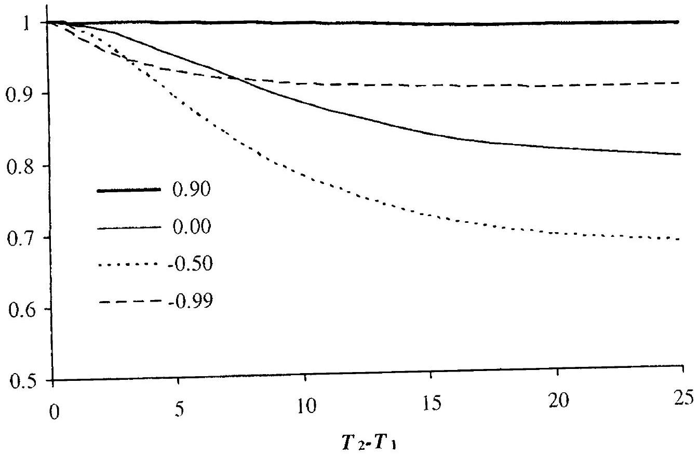
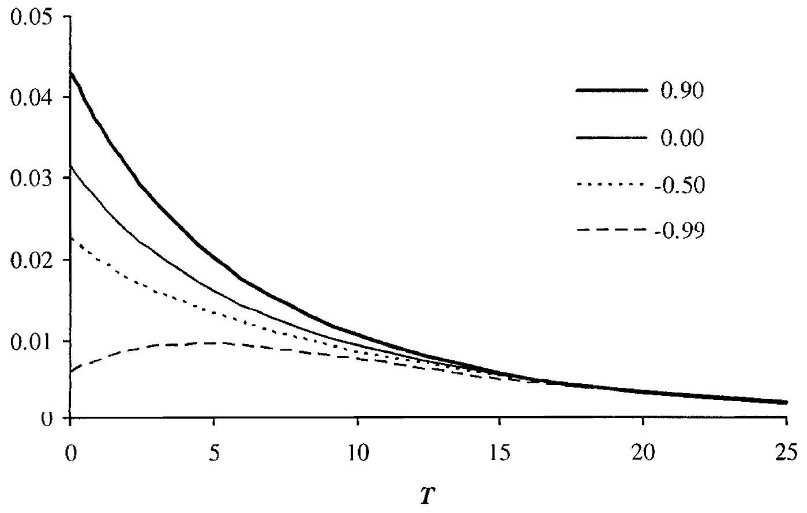
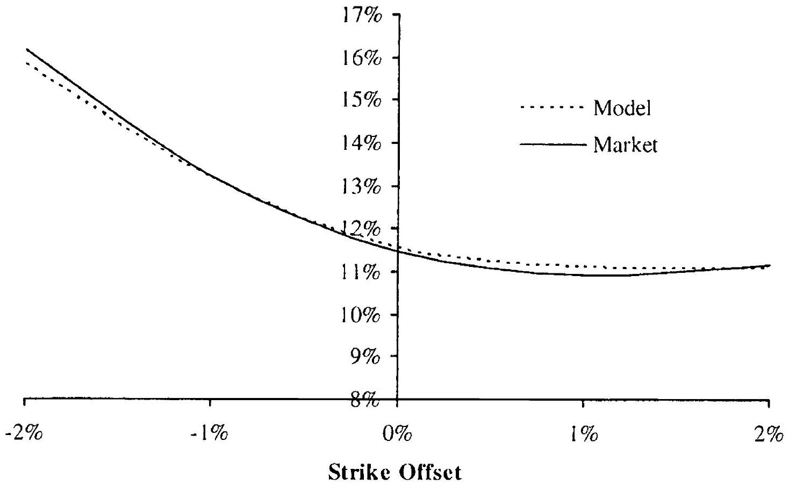

## Multi-Factor Short Rate Models

Short rate models with only a single driving Brownian motion imply that the instantaneous correlation between forward rates at different maturities is one, a prediction that is demonstrably contrary to reality, as we show in Chapter 14. While many standard securities are, as it turns out, only weakly affected by correlations across the term structure of forward rates, this may not be the case for exotic securities, especially the ones that depend in a non-linear way on the spread between rates of different maturities. Indeed, as a general rule all derivatives that have payouts ${ }^{1}$ exhibiting significant convexity to non-parallel moves of the forward curve must not be priced in a one-factor model.

In this chapter, we proceed to extend the material from Chapters 10 and 11 to cover the case of multiple driving Brownian motions. This will allow us to properly deal with securities that depend on non-parallel forward curve moves, and will also entail more subtle benefits, including the ability to model non-monotonic volatility term structures in fully time-stationary fashion. The role of the traditional multi-factor short rate models in modern derivatives pricing is, even more so than for the one-factor models, increasingly limited, as more sophisticated multi-factor frameworks have emerged over the last decade. We shall have ample opportunity to address these developments in future chapters, but a brief treatment here of the multi-factor short rate model class is still worthwhile.

As multi-factor short rate models are typically substantially more demanding to handle numerically than are one-factor models, analytical tractability is key to making multi-factor models operational. For instance, a completely generic SDE specification of a multi-factor model (along the

[^26]lines of Section 11.3) will require significant computational effort to calibrate to market yields and volatilities, rarely leading to a usable result. As a consequence, we here elect to stay entirely in the realm of models that will allow discount bonds to be priced in closed form from the state variables of the model.

This chapter is broken into three parts. The first part develops the multifactor Gaussian model in considerable generality, in the process demonstrating a number of features and techniques that apply to all short rate models. The second, much shorter, part provides a brief description of the multi-factor affine class, and the third part considers a particular class of quadratic-affine models that are well-suited for practical applications. For a fuller treatment of the multi-factor affine and affine-quadratic models, we refer the reader to Duffie et al. [2000], Duffie and Kan [1996], Duffie et al. [2003], Leippold and Wu [2002] and Ahn et al. [2002].

### 12.1 The Gaussian Model

As was the case for the one-factor Gaussian model, the multi-factor Gaussian model can be developed in two different ways: the "classical" way (from the bottom up) and the "modern" way (from a separability condition). As either technique leads to useful insights, we here show both.

### 12.1.1 Development from Separability Condition

A general $d$-factor Gaussian model can be written as

$$
d P(t, T) / P(t, T)=r(t) d t-\sigma_{P}(t, T)^{\top} d W(t)
$$

where $\sigma_{P}(t, T)$ is a bounded $d$-dimensional function of time, and $W(t)$ a $d$-dimensional Brownian motion in the risk-neutral measure Q. Written in terms of instantaneous forward rates, we get, from the HJM results in Chapter 4,

$$
\begin{align*}
d f(t, T) & =\sigma_{f}(t, T)^{\top} \sigma_{P}(t, T) d t+\sigma_{f}(t, T)^{\top} d W(t) \\
& =\sigma_{f}(t, T)^{\top} \int_{t}^{T} \sigma_{f}(t, u) d u d t+\sigma_{f}(t, T)^{\top} d W(t) \tag{12.1}
\end{align*}
$$
^eq12-1

This model is generally not Markovian, unless we impose additional restrictions. A relevant result is the following.

Proposition 12.1.1. Assume that $\sigma_{f}(t, T)$ is "separable", in the sense that it can be written as

$$
\begin{equation*}
\sigma_{f}(t, T)=g(t) h(T) \tag{12.2}
\end{equation*}
$$
^eq12-2

where $g$ is a $d \times d$ deterministic matrix-valued function, and $h$ is a $d$ dimensional deterministic vector. Then

$$
f(t, T)=f(0, T)+\Omega(t, T)+h(T)^{\top} z(t)
$$

where $\Omega(t, T)$ is a deterministic scalar given in (12.6) and $z(t)$ is a $d$ dimensional random vector satisfying

$$
\begin{equation*}
d z(t)=g(t)^{\top} d W(t), \quad z(0)=0 \tag{12.3}
\end{equation*}
$$
^eq12-3

In particular, we have

$$
\begin{equation*}
r(t)=f(0, t)+\Omega(t, t)+h(t)^{\top} z(t) \tag{12.4}
\end{equation*}
$$
^eq12-4

Proof. Inserting (12.2) into (12.1) and integrating over time, we get

$$
\begin{equation*}
f(t, T)=f(0, T)+\Omega(t, T)+h(T)^{\top} z(t) \tag{12.5}
\end{equation*}
$$
^eq12-5

where $z(t)=\int_{0}^{t} g(u)^{\top} d W(u)$ and

$$
\begin{equation*}
\Omega(t, T)=h(T)^{\top} \int_{0}^{t} g(s)^{\top} g(s) \int_{s}^{T} h(u) d u d s \tag{12.6}
\end{equation*}
$$
^eq12-6

Notice that the discount bond price volatility for the model in Proposition 12.1.1 becomes simply

$$
\sigma_{P}(t, T)=g(t) \int_{t}^{T} h(u) d u
$$

### 12.1.1.1 Mean-Reverting State Variables

Proposition 12.1.1 demonstrates that if (12.2) is satisfied, then the forward curve can be reconstructed from $d$ Gaussian martingale variables $z_{i}(t)$, $i=1, \ldots, d$, with joint SDE (12.3). The choice of $d$ state variables is, however, not unique, and may in fact have disadvantages in a numerical implementation since often the components of $g(t)$ grow exponentially with time. As a result, it is common to shift variables to explicitly have a meanreverting drift. To demonstrate one particular construction, set

$$
H(t)=\operatorname{diag}(h(t))=\left(\begin{array}{cccc}
h_{1}(t) & 0 & \ddots & 0  \tag{12.7}\\
0 & h_{2}(t) & \ddots & \ddots \\
\ddots & \ddots & \ddots & 0 \\
0 & \ddots & 0 & h_{d}(t)
\end{array}\right)
$$
^eq12-7

Assuming that for all $t$ we have $h_{i}(t) \neq 0, i=1, \ldots, d$, then $H(t)$ is invertible, and we can define a diagonal $d \times d$ matrix $\varkappa(t)$ by

$$
\begin{equation*}
\varkappa(t)=-\frac{d H(t)}{d t} H(t)^{-1} \tag{12.8}
\end{equation*}
$$
^eq12-8

Let us also set

$$
\begin{align*}
& x(t)=H(t) \int_{0}^{t} g(s)^{\top} g(s) \int_{s}^{t} h(u) d u d s+H(t) z(t)  \tag{12.9}\\
& y(t)=H(t)\left(\int_{0}^{t} g(s)^{\top} g(s) d s\right) H(t) \tag{12.10}
\end{align*}
$$
^eq12-9
^eq12-10

Notice that $x(t)$ is a $d$-dimensional random vector, and $y(t)$ is a deterministic $d \times d$ symmetric matrix. It is easily verified that $y(t)$ solves the ODE

$$
d y(t) / d t=H(t) g(t)^{\top} g(t) H(t)-\varkappa(t) y(t)-y(t) \varkappa(t)
$$

Proposition 12.1.2. Let the forward rate volatility be separable, as in Proposition 12.1.1. Let $\varkappa(t), x(t)$ and $y(t)$ be defined as in (12.8)(12.10), and assume that $H(t)=\operatorname{diag}(h(t))$ is invertible. Also define $\mathbf{1}=(1,1, \ldots, 1)^{\top} \in \mathbb{R}^{d}$. Then

$$
d x(t)=(y(t) \mathbf{1}-\varkappa(t) x(t)) d t+\sigma_{x}(t)^{\top} d W(t), \quad \sigma_{x}(t)=g(t) H(t)
$$

and, with $M(t, T) \triangleq H(T) H(t)^{-1} \mathbf{1}$,

$$
\begin{equation*}
f(t, T)=f(0, T)+M(t, T)^{\top}\left(x(t)+y(t) \int_{t}^{T} M(t, u) d u\right) \tag{12.11}
\end{equation*}
$$
^eq12-11

In particular, we have

$$
r(t)=f(t, t)=f(0, t)+\mathbf{1}^{\top} x(t)=f(0, t)+\sum_{i=1}^{d} x_{i}(t)
$$

Proof. Applying the Leibniz integration rule to the definition of $x(t)$ yields

$$
\begin{aligned}
d x(t)= & {\left[\frac{d H(t)}{d t} \int_{0}^{t} g(s)^{\top} g(s) \int_{s}^{t} h(u) d u d s\right] d t } \\
& \quad+\left[H(t) \int_{0}^{t} g(s)^{\top} g(s) h(t) d s\right] d t+\frac{d H(t)}{d t} z(t) d t+H(t) d z(t) \\
= & \frac{d H(t)}{d t} H(t)^{-1} x(t) d t+\left[H(t)\left(\int_{0}^{t} g(s)^{\top} g(s) d s\right) H(t) 1\right] d t \\
& \quad+H(t) g(t)^{\top} d W(t) \\
= & (y(t) \mathbf{1}-\varkappa(t) x(t)) d t+\sigma_{x}(t)^{\top} d W(t)
\end{aligned}
$$

Using the forward curve reconstitution formula in Proposition 12.1.1, we get

$$
\begin{aligned}
f(t, T)= & f(0, T)+h(T)^{\top} \int_{0}^{t} g(s)^{\top} g(s) \int_{s}^{T} h(u) d u d s+h(T)^{\top} z(t) \\
= & f(0, T)+\mathbf{1}^{\top} H(T) \int_{0}^{t} g(s)^{\top} g(s) \int_{s}^{T} h(u) d u d s+\mathbf{1}^{\top} H(T) z(t) \\
= & f(0, T)+\mathbf{1}^{\top}\left(H(T) \int_{0}^{t} g(s)^{\top} g(s) \int_{s}^{T} h(u) d u d s\right) \\
& \quad+\mathbf{1}^{\top}\left(H(T) H(t)^{-1} x(t)-H(T) \int_{0}^{t} g(s)^{\top} g(s) \int_{s}^{t} h(u) d u d s\right) \\
= & f(0, T)+\mathbf{1}^{\top} H(T) H(t)^{-1} x(t) \\
& \quad+\mathbf{1}^{\top} H(T) H(t)^{-1} y(t) H(t)^{-1} \int_{t}^{T} h(u) d u
\end{aligned}
$$

The result (12.11) follows from the definition of $M(t, T)$, the symmetry of $H(t)$, and the fact that $H(t)^{-1} h(u)=M(t, u)$.

If $H(t)$ fails to be invertible, it must be because one or more of the elements in $h(t)$ are (locally) equal to zero. From Proposition 12.1.1, if this is the case it follows that some of the $z_{i}$ 's must be locally redundant, in turn demonstrating that the model is not truly $d$-dimensional for all $t$. As this strongly hints at a mis-specification, the invertibility condition in the proposition above is not a strong one.

In Propositions 12.1.1 and 12.1.2, reconstitution of the discount curve from the Markov state variables is done through the instantaneous forward curve. Obviously, we can also proceed to write explicit expressions for discount bond prices. For instance, using Proposition 12.1.2 we get:

Corollary 12.1.3. In the setting of Proposition 12.1.2, define

$$
G(t, T)=\int_{t}^{T} M(t, u) d u
$$

Then

$$
P(t, T)=\frac{P(0, T)}{P(0, t)} \exp \left(-G(t, T)^{\top} x(t)-\frac{1}{2} G(t, T)^{\top} y(t) G(t, T)\right)
$$

Proof. From the expression (12.11) for $f(t, T)$, we get

$$
\begin{aligned}
P(t, T)= & \exp \left(-\int_{t}^{T} f(t, u) d u\right) \\
= & \exp \left(-\int_{t}^{T} f(0, u) d u-\left(\int_{t}^{T} M(t, u)^{\top} d u\right) x(t)\right) \\
& \times \exp \left(-\int_{t}^{T} M(t, u)^{\top} y(t) \int_{t}^{u} M(t, s) d s d u\right)
\end{aligned}
$$

so that

$$
\begin{aligned}
P(t, T) & =\frac{P(0, T)}{P(0, t)} \\
& \times \exp \left(-G(t, T)^{\top} x(t)-\int_{t}^{T} M(t, u)^{\top} y(t) \int_{t}^{u} M(t, s) d s d u\right)
\end{aligned}
$$

But here

$$
\int_{t}^{T} M(t, u)^{\top} y(t) \int_{t}^{u} M(t, s) d s d u=\int_{t}^{T} \frac{\partial G(t, u)^{\top}}{\partial u} y(t) G(t, u) d u
$$

As $y(t)$ is symmetric, standard matrix calculus shows that

$$
\begin{aligned}
\frac{\partial}{\partial u}\left(G(t, u)^{\top} y(t) G(t, u)\right) & =\frac{\partial G(t, u)^{\top}}{\partial u} y(t) G(t, u)+G(t, u)^{\top} y(t) \frac{\partial G(t, u)}{\partial u} \\
& =2 \frac{\partial G(t, u)^{\top}}{\partial u} y(t) G(t, u)
\end{aligned}
$$

such that, finally,

$$
\begin{aligned}
\int_{t}^{T} \frac{\partial G(t, u)}{\partial u}^{\top} y(t) G(t, u) d u & =\frac{1}{2} \int_{t}^{T} \frac{\partial}{\partial u}\left(G(t, u)^{\top} y(t) G(t, u)\right) d u \\
& =\frac{1}{2} G(t, T)^{\top} y(t) G(t, T)
\end{aligned}
$$

Let us examine some of the matrices involved in the multi-dimensional Gaussian model. As $\varkappa(t)$ is diagonal, we must have

$$
\varkappa(t)=\operatorname{diag}\left(\left(\varkappa_{1}(t), \varkappa_{2}(t), \ldots, \varkappa_{d}(t)\right)^{\top}\right)
$$

in which case (12.8) implies that

$$
\begin{equation*}
h(t)=\left(e^{-\int_{0}^{\prime} x_{1}(s) d s}, e^{-\int_{0}^{\prime} \varkappa_{2}(s) d s}, \ldots, e^{-\int_{0}^{\prime} \varkappa_{d}(s) d s}\right)^{\top} \tag{12.12}
\end{equation*}
$$
^eq12-12

Each element in the forward volatility vector $\sigma_{f}(t, T)$ is a time-weighted average of these $d$ exponentiated integrals. Also, we note that

$$
\begin{aligned}
M(t, T) & =H(T) H(t)^{-1} 1 \\
& =\left(e^{-\int_{1}^{r} \varkappa_{1}(s) d s}, e^{-\int_{1}^{r} \varkappa_{2}(s) d s}, \ldots, e^{-\int_{1}^{r} \varkappa_{d}(s) d s}\right)^{\top}
\end{aligned}
$$

$$
\begin{aligned}
y(t) & =\int_{0}^{t} H(t) H(s)^{-1} \sigma_{x}(s)^{\top} \sigma_{x}(s) H(s)^{-1} H(t) d s \\
& =\int_{0}^{t} \operatorname{diag}(M(s, t)) \sigma_{x}(s)^{\top} \sigma_{x}(s) \operatorname{diag}(M(s, t)) d s
\end{aligned}
$$

As all quantities in the dynamics for $x(t)$ and in the reconstitution formula for $f(t, T)$ and $P(t, T)$ evidently can be computed from knowledge of the $d$ deterministic mean reversions $\varkappa_{1}(t), \varkappa_{2}(t), \ldots, \varkappa_{d}(t)$ and the $d \times d$ volatility matrix $\sigma_{x}(t)$, it follows that specification of $\varkappa(t)$ and $\sigma_{x}(t)$ fully determines our $d$-dimensional Gaussian model.

A brief comment about computing the bond reconstitution formula in Corollary 12.1.3 is in order. The vector $G(t, T)$ takes the form

$$
G(t, T)=\left(\int_{t}^{T} e^{-\int_{t}^{u} \varkappa_{1}(s) d s} d u, \ldots, \int_{t}^{T} e^{-\int_{\ell}^{u} \varkappa_{d}(s) d s} d u\right)^{\top}
$$

where the individual components can, importantly, be rewritten as

$$
\begin{align*}
\int_{t}^{T} e^{-\int_{t}^{\prime \prime} \varkappa_{i}(s) d s} d u & =\left(\int_{0}^{T} e^{-\int_{0}^{\prime \prime} \varkappa_{\imath}(s) d s} d u-\int_{0}^{t} e^{-\int_{0}^{\prime \prime} \varkappa_{\imath}(s) d s} d u\right) e^{\int_{0}^{t} \varkappa_{\imath}(s) d s} \\
& \triangleq\left(\Lambda_{\imath}(T)-\Lambda_{i}(t)\right) e^{\int_{0}^{t} \varkappa_{i}(s) d s} \tag{12.13}
\end{align*}
$$
^eq12-13

In implementations, we would typically pre-cache the $2 d$ scalar functions

$$
\Lambda_{1}(t), \Lambda_{2}(t), \ldots, \Lambda_{d}(t), \exp \left(\int_{0}^{t} \varkappa_{1}(s) d s\right), \ldots, \exp \left(\int_{0}^{t} \varkappa_{d}(s) d s\right)
$$

on a suitable time grid, allowing subsequent discount bond pricing to be done quickly and conveniently for arbitrary $t$ and $T$.

Remark 12.1.4. The risk-neutral process for the discount bond $P(t, T)$ is log-normal

$$
d P(t, T) / P(t, T)=r(t) d t-G(t, T)^{\top} \sigma_{x}(t)^{\top} d W(t)
$$

### 12.1.1.2 Further Changes of Variables

Going back to Proposition 12.1.2, we note that its form is rather convenient as it writes the short rate $r(t)$ as its forward value $f(0, t)$ plus a straight sum of $d$ Gaussian mean-reverting variables, with each variable having a drift depending only on itself (since $\varkappa(t)$ is diagonal). This representation is, however, just one of many. If we allow the expression for $r(t)$ to be somewhat more complicated, then we are, for instance, free to use any mean reversion matrix - diagonal or not - that we would like. Before stating
this result, we need a little extra notation. Specifically, let us consider the generic homogeneous ODE system

$$
\frac{d p(t)}{d t}=-Q(t) p(t)
$$

where $Q(t)$ is a deterministic $d \times d$ matrix and $p$ a $d$-dimensional (column) vector. It is well-known that the solution to this equation can always be represented as

$$
\begin{equation*}
p(T)=J_{Q}(T) p(0) \tag{12.14}
\end{equation*}
$$
^eq12-14

where $J_{Q}(T)$ is a $d \times d$ deterministic matrix satisfying

$$
\begin{equation*}
\frac{d J_{Q}(t)}{d t}=-Q(t) J_{Q}(t) \tag{12.15}
\end{equation*}
$$
^eq12-15

The matrix $J_{Q}(t)$ is computable by classical ODE methods ${ }^{2}$ and satisfies the boundary condition $J_{Q}(0)=I$, where $I$ is the identity matrix. For the special case where $Q$ is independent of time, we have

$$
J_{Q}(t)=\exp (-Q t)
$$

as one would expect ${ }^{3}$. For later use, let us notice that, in general,

$$
\begin{equation*}
\frac{d\left(J_{Q}(t)^{-1}\right)}{d t}=\left(J_{Q}(t)^{-1}\right) Q(t) \tag{12.16}
\end{equation*}
$$
^eq12-16

Lemma 12.1.5. In the setup of Proposition 12.1.1, let us introduce some $d \times d$ mean reversion matrix $k(t)$ and assume that $J_{k}(t)$ (see(12.15)) exists and is invertible for all $t$. Then

$$
r(t)=f(0, t)+\Omega(t, t)+h(t)^{\top} J_{k}(t)^{-1} x(t)
$$

where

$$
d x(t)=-k(t) x(t) d t+\sigma_{x}(t)^{\top} d W(t), \quad \sigma_{x}(t)=g(t) J_{k}(t)^{\top}
$$

Proof. Set

$$
x(t)=J_{k}(t) z(t)
$$

such that $z(t)=J_{k}(t)^{-1} x(t)$ and, from (12.15),

$$
d x(t)=-k(t) x(t) d t+J_{k}(t) g(t)^{\top} d W(t)
$$

[^27]The result for $r(t)$ follows directly from Proposition 12.1.1.
The lemma shows that we can incorporate essentially any mean reversion matrix $k$ into the basic martingale setup in Proposition 12.1.1 by proper scaling of i) the weighting of the state variables in the expression of $r(t)$; and ii) the volatility matrix $g^{\top}$. For numerical applications, the best choice of mean reversion is typically one that leaves both $k(t)$ and $\sigma_{x}(t)$ close to constant.

### 12.1.2 Classical Development

The traditional approach to specification of a multi-dimensional short rate model does not go through a separability condition, but instead involves postulating that $r(t)$ is an affine function of a set of state variables satisfying a linear system of SDEs. That is, one would write

$$
\begin{equation*}
r(t)=b_{q}(t)+c_{q}(t)^{\top} q(t) \tag{12.17}
\end{equation*}
$$
^eq12-17

where $b_{q}(t) \in \mathbb{R}$ and $c_{q}(t) \in \mathbb{R}^{d}$ are deterministic, and the $d$-dimensional vector-valued process $q(t)$ satisfies the risk-neutral SDE

$$
\begin{equation*}
d q(t)=k(t)(m(t)-q(t)) d t+\sigma(t) d W(t) \tag{12.18}
\end{equation*}
$$
^eq12-18

with $m(t) \in \mathbb{R}^{d}$ and $k(t), \sigma(t) \in \mathbb{R}^{d \times d}$ all being deterministic. Using the definition of $J_{k}(t)$ given above, we can solve (12.18) explicitly.

Lemma 12.1.6. Let $q(t)$ be as given in (12.18). Then

$$
\begin{equation*}
q(t)=J_{k}(t)\left(q(0)+\int_{0}^{t} J_{k}(s)^{-1} k(s) m(s) d s+\int_{0}^{t} J_{k}(s)^{-1} \sigma(s) d W(s)\right) \tag{12.19}
\end{equation*}
$$
^eq12-19

i.e. $q(t)$ has a $d$-dimensional Gaussian distribution, with mean

$$
\mu_{q}(t)=J_{k}(t)\left(q(0)+\int_{0}^{t} J_{k}(s)^{-1} k(s) m(s) d s\right)
$$

and covariance matrix

$$
\Sigma_{q}(t)=J_{k}(t)\left(\int_{0}^{t} J_{k}(s)^{-1} \sigma(s) \sigma(s)^{\top}\left(J_{k}(s)^{-1}\right)^{\top} d s\right) J_{k}(t)^{\top}
$$

Proof. Set

$$
u(t)=J_{k}(t)^{-1} q(t)
$$

and observe, from (12.16), that

$$
d u(t)=J_{k}(t)^{-1} k(t) m(t) d t+J_{k}(t)^{-1} \sigma(t) d W(t)
$$

Setting $q(t)=J_{k}(t) u(t)$ and observing that $u(0)=q(0)$ leads to the result in the lemma.

Given Lemma 12.1.5 above, we would expect the class of models spanned by specification (12.17)-(12.18) to be identical to that of the separability condition in Proposition 12.1.1. For completeness, let us make this connection explicit.

Lemma 12.1.7. Let $r(t)$ and $q(t)$ be as in (12.17) and (12.18), and define the martingale process

$$
d z(t)=\sigma_{z}(t)^{\top} d W(t), \quad z(0)=q(0), \sigma_{z}(t)=\sigma(t)^{\top}\left(J_{k}(t)^{-1}\right)^{\top}
$$

Then

$$
r(t)=b_{z}(t)+c_{z}(t)^{\top} z(t)
$$

where

$$
\begin{aligned}
& b_{z}(t)=b_{q}(t)+c_{q}(t)^{\top} J_{k}(t) \int_{0}^{t} J_{k}(s)^{-1} k(s) m(s) d s \\
& c_{z}(t)=J_{k}(t)^{\top} c_{q}(t)
\end{aligned}
$$

Proof. If we set

$$
z(t)=J_{k}(t)^{-1} q(t)-w(t), \quad w(t) \triangleq \int_{0}^{t} J_{k}(s)^{-1} k(s) m(s) d s
$$

then Ito's lemma shows that

$$
d z(t)=J_{k}(t)^{-1} \sigma(t) d W(t)
$$

Notice that

$$
q(t)=J_{k}(t)(z(t)+w(t))
$$

insertion of this expression into (12.17) proves the lemma.
We emphasize that the form of the expression for $r(t)$ in Lemma 12.1.7 is identical to Proposition 12.1.1 once we align notation:

$$
b_{z}(t)=f(0, t)+\Omega(t, t), \quad c_{z}(t)=h(t), \quad g(t)=\sigma_{z}(t)=\sigma(t)^{\top}\left(J_{k}(t)^{-1}\right)^{\top} .
$$

Besides confirming that the classical approach is, indeed, equivalent to the approach in Section 12.1.1, we also note from Proposition 12.1.1 and Lemma 12.1.5 that we are free to change state variables to something other than $q(t)$ or $z(t)$.

### 12.1.2.1 Diagonalization of Mean Reversion Matrix

While we are looking at the traditional approach to multi-factor Gaussian models, let us for later use consider a standard question about this model class: if the model for $r(t)$ is time-homogeneous and the mean reversion matrix $k(t)=k$ is non-diagonal, can we transform the state variables in
such a way that the model remains time-homogeneous but has a diagonal mean reversion matrix? We know from Lemma 12.1.5 that such a change of variables is always possible if we can accept that the resulting model is not time-homogeneous. To retain time-homogeneity, however, we need to impose some regularity on $k$, as we show below.

Proposition 12.1.8. Consider the model (12.17) and (12.18) with parameters $c_{q}, k, \sigma$ being independent of time. Assume that $k$ is diagonalizable,

$$
k=L K L^{-1},
$$

where $K$ is a $d \times d$ diagonal matrix. Set $c_{Q}=L^{\top} c_{q}$ and $\sigma_{Q}=L^{-1} \sigma$. Then

$$
r(t)=b_{q}(t)+c_{Q}^{\top} Q(t)
$$

where

$$
d Q(t)=K\left(L^{-1} m(t)-Q(t)\right) d t+\sigma_{Q} d W(t)
$$

Proof. Follows immediately from the variable transformation $Q(t)= L^{-1} q(t)$.

In Proposition 12.1.8, we emphasize that the new mean reversion matrix $K$, as well as the volatility $\sigma_{Q}$ and the scaling vector $c_{Q}$ all are independent of time. We also remind the reader that a sufficient condition for $k$ to be diagonalizable is that $k$ has $d$ distinct real eigenvalues $\lambda_{1}, \lambda_{2}, \ldots, \lambda_{d}$; in this case $K=\operatorname{diag}\left(\left(\lambda_{1}, \lambda_{2}, \ldots, \lambda_{d}\right)^{\top}\right)$. See also Section 3.1.3.

A closely related question is as follows: if the model (12.17) for $r(t)$ has a constant, non-diagonal mean reversion matrix $k$ (but is otherwise not necessarily time-homogeneous), under which circumstances can we write $r(t)=f(0, t)+1^{\top} x(t)$ where $x(t)$ has a constant diagonal mean reversion matrix $\varkappa$ ? From Proposition 12.1.2, we know that this re-write is generally possible if we allow $\varkappa$ to depend on $t$. For $\varkappa$ to additionally be constant, the following result suffices.
Proposition 12.1.9. Consider the model (12.17) and (12.18) with $k$ independent of time and diagonalizable, i.e.

$$
k=L K L^{-1}
$$

where $K$ is a constant $d \times d$ diagonal matrix. Assume that $B(t)= \operatorname{diag}\left(e^{-K t} L^{\top} c_{q}\right)$ is invertible. Then

$$
r(t)=f(0, t)+1^{\top} x(t)
$$

where

$$
d x(t)=(y(t) \mathbf{1}-K x(t)) d t+\sigma_{x}(t)^{\top} d W(t)
$$

with

$$
\begin{aligned}
\sigma_{x}(t) & =\sigma(t)^{\top}\left(L^{-1}\right)^{\top} \operatorname{diag}\left(L^{\top} c_{q}\right) \\
y(t) & =\int_{0}^{t} e^{-K(t-s)} \sigma_{x}(s)^{\top} \sigma_{x}(s) e^{-K(t-s)} d s
\end{aligned}
$$

Proof. Using the same steps as in Proposition 12.1.8 above, we know that

$$
\begin{aligned}
r(t) & =b_{q}(t)+c_{Q}^{\top} Q(t) \\
d Q(t) & =K\left(L^{-1} m(t)-Q(t)\right) d t+L^{-1} \sigma(t) d W(t)
\end{aligned}
$$

An application of Ito's lemma to $e^{K t} Q(t)$ reveals that, in the notation of Section 12.1.1, this model is characterized by

$$
h(t)=e^{-K^{\top} t} c_{Q}=e^{-K t} L^{\top} c_{q}, \quad g(t)=\sigma(t)^{\top}\left(L^{-1}\right)^{\top} e^{K t} .
$$

As $K$ is diagonal, $\varkappa(t)$ in (12.8) becomes

$$
\varkappa(t)=\operatorname{diag}\left(K e^{-K t} L^{\top} c_{q}\right) \operatorname{diag}\left(e^{-K t} L^{\top} c_{q}\right)^{-1}=K
$$

and

$$
g(t) H(t)=\sigma(t)^{\top}\left(L^{-1}\right)^{\top} e^{K t} \operatorname{diag}\left(e^{-K t} L^{\top} c_{q}\right)=\sigma(t)^{\top}\left(L^{-1}\right)^{\top} \operatorname{diag}\left(L^{\top} c_{q}\right) .
$$

The result follows from Proposition 12.1.2.

### 12.1.3 Correlation Structure

As discussed earlier, one important motivation for the introduction of a multi-factor interest rate model is the ability to control correlations among various points on the forward curve. Let $\rho\left(t, T_{1}, T_{2}\right)$ denote the time $t$ instantaneous correlation between the forward rates $f\left(t, T_{1}\right)$ and $f\left(t, T_{2}\right)$. From the representation in Proposition 12.1.1, we get the following result, the proof of which is straightforward.

Lemma 12.1.10. Let the model for $r(t)$ be as in Proposition 12.1.1. Then

$$
\rho\left(t, T_{1}, T_{2}\right)=\frac{h\left(T_{1}\right)^{\top} g(t)^{\top} g(t) h\left(T_{2}\right)}{\sqrt{h\left(T_{1}\right)^{\top} g(t)^{\top} g(t) h\left(T_{1}\right)} \sqrt{h\left(T_{2}\right)^{\top} g(t)^{\top} g(t) h\left(T_{2}\right)}} .
$$

In a practical model, we generally would strongly prefer for this correlation structure to be time-stationary, in the sense that $\rho$ does not depend outright on $t$, but only on time to maturity $T_{1}-t$ and $T_{2}-t$, i.e.

$$
\rho\left(t, T_{1}, T_{2}\right)=\rho\left(T_{1}-t, T_{2}-t\right) .
$$

This restriction, if enforced, imposes a number of constraints on the model parameters; we return to this topic in Section 12.1.4.2 below.

While on the topic of correlation, let us remark that multi-factor Gaussian models are sometimes specified with the use of correlated Brownian motions. This setup, of course, can be translated to our setting quite easily. Specifically suppose that we start with a setup similar to that of (12.17) and (12.18), but now write

$$
d q(t)=k(t)(m(t)-q(t)) d t+\sigma(t) d W^{*}(t)
$$

where $W^{*}$ is a $d$-dimensional vector of correlated Brownian motions. Let $R(t)$ be the relevant correlation matrix of increments to $W^{*}(t)$ and let

$$
R(t)=C(t) C(t)^{\top}
$$

for a square root matrix $C(t)$. Then, from results in Section 3.1.2.1, we may write $d W^{*}(t)=C(t) d W(t)$ for a standard (uncorrelated) vector-valued Brownian motion $W(t)$, and thereby

$$
d q(t)=k(t)(m(t)-q(t)) d t+\sigma(t) C(t) d W(t)
$$

It follows, not surprisingly, that we can incorporate correlation in Brownian increments by a simple rotation of the volatility matrix (by $C(t)$ ).

### 12.1.4 The Two-Factor Gaussian Model

Having now outlined the general theory, let us make matters more concrete (and more practical) by focusing on the important case of $d=2$.

### 12.1.4.1 Some Basics

In practical applications, a reasonable way to specify a two-dimensional model would be to set, in the notation of Proposition 12.1.1,

$$
h(t)=\binom{e^{-\int_{0}^{t} \varkappa_{1}(u) d u}}{e^{-\int_{0}^{t} \varkappa_{2}(u) d u}}, \quad g(t)=\left(\begin{array}{ll}
\sigma_{11}(t) e^{\int_{0}^{t} \varkappa_{1}(u) d u} & \sigma_{12}(t) e^{\int_{0}^{t} \varkappa_{2}(u) d u} \\
\sigma_{21}(t) e^{\int_{0}^{t} \varkappa_{1}(u) d u} & \sigma_{22}(t) e^{\int_{0}^{t} \varkappa_{2}(u) d u}
\end{array}\right) .
$$

We may, without loss of generality, assume that $g(t)$ is lower diagonal ${ }^{4}$, i.e. we can set $\sigma_{12}(t)=0$ always. In this case, from Proposition 12.1.2 we have

$$
r(t)=f(0, t)+x_{1}(t)+x_{2}(t)
$$

where $x(t)=\left(x_{1}(t), x_{2}(t)\right)^{\top}$ satisfies (with $x(0)=0$ )

$$
d x(t)=(y(t) 1-\varkappa(t) x(t)) d t+\sigma_{x}(t)^{\top} d W(t), \quad \sigma_{x}(t)=\left(\begin{array}{cc}
\sigma_{11}(t) & 0  \tag{12.20}\\
\sigma_{21}(t) & \sigma_{22}(t)
\end{array}\right)
$$
^eq12-20

and where $\varkappa_{(t)}=\operatorname{diag}\left(\left(\varkappa_{1}(t), \varkappa_{2}(t)\right)^{\top}\right)$ and $y(t)$ is a deterministic $2 \times 2$ matrix.

We notice that the instantaneous correlation between $x_{1}(t)$ and $x_{2}(t)$ is

$$
\rho_{x}(t)=\frac{\sigma_{22}(t) \sigma_{21}(t)}{\sqrt{\sigma_{11}(t)^{2}+\sigma_{21}(t)^{2}} \sqrt{\sigma_{22}(t)^{2}}}
$$

[^28]so for convenience we may, as in Section 12.1.3, rewrite our model as

$$
\begin{equation*}
d x(t)=(y(t) 1-\varkappa(t) x(t)) d t+\sigma_{x}^{*}(t) d W^{*}(t) \tag{12.21}
\end{equation*}
$$
^eq12-21
where $\left\langle d W_{1}^{*}(t), d W_{2}^{*}(t)\right\rangle=\rho_{x}(t) d t$ and $\sigma_{x}^{*}(t)$ is diagonal with non-negative elements,

$$
\sigma_{x}^{*}(t)=\left(\begin{array}{cc}
\sqrt{\sigma_{11}(t)^{2}+\sigma_{21}(t)^{2}} & 0 \\
0 & \left|\sigma_{22}(t)\right|
\end{array}\right) \triangleq \operatorname{diag}\left(\left(\sigma_{1}(t), \sigma_{2}(t)\right)^{\top}\right) .
$$

The term $y(t)$ in (12.21) can be computed by numerical integration from the results in Proposition 12.1.2.

From Corollary 12.1.3, the reconstitution formula for the yield curve is

$$
\begin{align*}
f(t, T) & =f(0, T)+M(t, T)^{\top}(x(t)+y(t) G(t, T))  \tag{12.22}\\
P(t, T) & =\frac{P(0, T)}{P(0, t)} \exp \left(-G(t, T)^{\top} x(t)-\frac{1}{2} G(t, T)^{\top} y(t) G(t, T)\right)
\end{align*}
$$
^eq12-22

where

$$
G(t, T)=\int_{t}^{T} M(t, u) d u, \quad M(t, T)=\left(e^{-\int_{t}^{T} \varkappa_{1}(u) d u}, e^{-\int_{t}^{T} \varkappa_{2}(u) d u}\right)^{\top}
$$

The specification (12.21)-(12.22) is, we feel, the most intuitive representation of the two-factor Gaussian short rate model. For a complete model specification, we evidently must specify 5 functions of time: $\rho_{x}(t), \varkappa_{1}(t)$, $\varkappa_{2}(t), \sigma_{1}(t)$, and $\sigma_{2}(t)$. As discussed earlier, however, we may want to ensure that the model has a time-stationary correlation structure, in the sense defined in Section 12.1.3. We turn to this in Section 12.1.4.2 below.

### 12.1.4.2 Variance and Correlation Structure

According to Proposition 12.1.1, it follows that the model (12.21) has the forward rate process

$$
\begin{equation*}
d f(t, T)=O(d t)+\binom{\sigma_{1}(t) e^{-\int_{t}^{T} \varkappa_{1}(u) d u}}{\sigma_{2}(t) e^{-\int_{t}^{T} \varkappa_{2}(u) d u}}^{\top} d W^{*}(t) \tag{12.23}
\end{equation*}
$$
^eq12-23

where we recall that $\left\langle d W_{1}^{*}(t), d W_{2}^{*}(t)\right\rangle=\rho_{x}(t) d t$. From this representation, or from the results in Section 12.1.3, we get the following lemma.
Lemma 12.1.11. For the model (12.21), let

$$
\begin{aligned}
b\left(t, T_{1}, T_{2}\right) & =1+\rho_{x}(t) \frac{\sigma_{2}(t)}{\sigma_{1}(t)}\left(e^{-\int_{t}^{T_{1}}\left(\varkappa_{2}(u)-\varkappa_{1}(u)\right) d u}+e^{-\int_{t}^{T_{2}}\left(\varkappa_{2}(u)-\varkappa_{1}(u)\right) d u}\right) \\
& +\left(\frac{\sigma_{2}(t)}{\sigma_{1}(t)}\right)^{2} e^{-\int_{t}^{T_{1}}\left(\varkappa_{2}(u)-\varkappa_{1}(u)\right) d u-\int_{t}^{T_{2}}\left(\varkappa_{2}(u)-\varkappa_{1}(u)\right) d u}
\end{aligned}
$$

Then

$$
\begin{align*}
\operatorname{Var}_{t}(d f(t, T)) & =\sigma_{1}(t)^{2} e^{-2 \int_{t}^{T} \varkappa_{1}(u) d u} b(t, T, T) \\
\rho\left(t, T_{1}, T_{2}\right) & =\operatorname{Corr}_{t}\left(d f\left(t, T_{1}\right), d f\left(t, T_{2}\right)\right)=\frac{b\left(t, T_{1}, T_{2}\right)}{\sqrt{b\left(t, T_{1}, T_{1}\right) b\left(t, T_{2}, T_{2}\right)}} \tag{12.24}
\end{align*}
$$
^eq12-24

In particular, $\rho\left(t, T_{1}, T_{2}\right)$ is time-stationary if $\rho_{x}(t), \varkappa_{2}(t)-\varkappa_{1}(t)$, and $\sigma_{2}(t) / \sigma_{1}(t)$ are all constant.

We emphasize that if we chose to make our correlation structure timestationary, then Lemma 12.1.11 shows that only two functions of time $\left(\sigma_{1}(t)\right.$ and $\varkappa_{1}(t)$, say) and three constants ( $\rho_{x}, \varkappa_{2}(t)-\varkappa_{1}(t)$, and $\left.\sigma_{2}(t) / \sigma_{1}(t)\right)$ may be specified freely. Notice that if either i) $\rho_{x}=1$; ii) $\varkappa_{2}(t)-\varkappa_{1}(t)=0$; or iii) $\sigma_{2}(t) / \sigma_{1}(t)=0$; then $\rho\left(t, T_{1}, T_{2}\right)=1$, i.e. the model is reduced to having only one factor.

Figure 12.1 below shows some examples of the types of correlation term structures that can be generated in our two-factor Gaussian model.

Fig. 12.1. Forward Rate Correlation Term Structure

Notes: For the model (12.21), the figure graphs $\rho\left(0, T_{1}, T_{2}\right)$ from Lemma 12.1.11 against $T_{2}-T_{1}$, using four different values of the parameter $\rho_{x}$. Other parameters were: $T_{1}=0.1, \varkappa_{1}=0.1, \varkappa_{2}=0.25, \sigma_{1}=0.025$, and $\sigma_{2}=0.02$.

Note the fact that the forward rate correlation is not necessarily a monotonic function of $\rho_{x}$. For parameterization purposes, it is often helpful
to consider $\rho(t, t, \infty)$, the correlation between the short rate and a (very) long-dated forward rate. From (12.24) we get, assuming time-homogeneity in the correlation structure,

$$
\rho(t, t, \infty)=\frac{1+\rho_{x} c_{\sigma}}{\sqrt{1+2 \rho_{x} c_{\sigma}+c_{\sigma}^{2}}}, \quad c_{\sigma}=\sigma_{2}(t) / \sigma_{1}(t)
$$

an expression that does not depend on mean reversion speeds. Given either $\rho_{x}$ or $c_{\sigma}$, an exogenous specification of $\rho(t, t, \infty)$ allows us to back out $c_{\sigma}$ or $\rho_{x}$, respectively.

### 12.1.4.3 Volatility Hump

Besides allowing us to properly model the correlation between various points of the forward curve, the use of a two-factor Gaussian model has another benefit relative to a one-factor model: the ability to produce a time-stationary, non-monotonic term structure of forward rate volatilities. We recall from Section 10.1.2.3 that this was not possible in a one-factor model, where nonconstant mean reversion was required to produce a caplet volatility "hump". To provide some details, assume that $\varkappa_{1}$ and $\varkappa_{2}$ are fixed at non-negative constant values, with at least one being positive. Also assume that $\sigma_{1}$ and $\sigma_{2}$ are fixed at constant positive values. From Lemma 12.1.11 we have

$$
\begin{aligned}
\operatorname{Var}_{t}(d f(t, T)) & =\sigma_{1}^{2} e^{-2 \varkappa_{1}(T-t)}+\sigma_{2}^{2} e^{-2 \varkappa_{2}(T-t)}+2 \rho_{x} \sigma_{1} \sigma_{2} e^{-\left(\varkappa_{1}+\varkappa_{2}\right)(T-t)} \\
& \triangleq g(T-t)
\end{aligned}
$$

where

$$
\frac{1}{2} \frac{d g(\tau)}{d \tau}=-\varkappa_{1} \sigma_{1}^{2} e^{-2 \varkappa_{1} \tau}-\varkappa_{2} \sigma_{2}^{2} e^{-2 \varkappa_{2} \tau}-\rho_{x} \sigma_{1} \sigma_{2}\left(\varkappa_{1}+\varkappa_{2}\right) e^{-\left(\varkappa_{1}+\varkappa_{2}\right) \tau} .
$$

For positive values of $\rho_{x}$, the forward rate variance term structure will thus always be downward-sloping $(d g(\tau) / \partial \tau \leq 0)$. However, if we set $\rho_{x}$ sufficiently negative, there may be intermediate values for $\tau=T-t$ for which the variance will increase in $\tau$; Figure 12.2 shows an example.

### 12.1.4.4 Another Formulation of the Two-Factor Model

To round off our treatment of the two-factor Gaussian model, we note that the model traditionally has been developed and presented in a manner quite different from ours. Indeed, a common starting point (e.g. Hull and White [1994b]) for the model is the doubly mean-reverting form:

$$
\begin{align*}
d r(t) & =\varkappa_{r}(\vartheta(t)+\varepsilon(t)-r(t)) d t+\sigma_{r} d W_{r}(t)  \tag{12.25}\\
d \varepsilon(t) & =-\varkappa_{\varepsilon} \varepsilon(t) d t+\sigma_{\varepsilon} d W_{\varepsilon}(t)
\end{align*}
$$
^eq12-25

Fig. 12.2. Forward Rate Volatility Term Structure

Notes: For the model (12.21), the figure graphs $\sqrt{\operatorname{Var}(d f(0, T))}$ against $T$, using four different values of the parameter $p_{x}$. Other parameters were: $\varkappa_{1}=0.1$, $\varkappa_{2}=0.25, \sigma_{1}=0.025$, and $\sigma_{2}=0.02$.
where $\vartheta(t)$ is deterministic and $\left\langle d W_{r}(t), d W_{\varepsilon}(t)\right\rangle=\rho d t$, for some constant $\rho$. The model can be extended to time-dependent $\sigma_{r}$ and $\sigma_{\varepsilon}$, but we omit this for the sake of simplicity.

To write (12.25) in terms that are more compatible with our notation, let $q(t)=\left(q_{1}(t), q_{2}(t)\right)^{\top}$ be defined by

$$
\begin{align*}
d q(t) & =\left(\begin{array}{cc}
\varkappa_{r} & -\varkappa_{r} \\
0 & \varkappa_{\varepsilon}
\end{array}\right)\left(\binom{\vartheta(t)}{0}-q(t)\right) d t+\left(\begin{array}{cc}
\sigma_{r} & 0 \\
\sigma_{\varepsilon} \rho & \sigma_{\varepsilon} \sqrt{1-\rho^{2}}
\end{array}\right) d W(t) \\
& \triangleq k(m(t)-q(t)) d t+\sigma(t) d W(t) \tag{12.26}
\end{align*}
$$
^eq12-26

where the elements of $W(t)=\left(W_{1}(t), W_{2}(t)\right)^{\top}$ are independent. Clearly, if we set

$$
\begin{equation*}
r(t)=q_{1}(t), \quad \varepsilon(t)=q_{2}(t), \tag{12.27}
\end{equation*}
$$
^eq12-27

we replicate the model (12.25) above. But (12.26)-(12.27) is of the form in Section 12.1.2, with $b_{q}(t)=0$ and $c_{q}(t)=(1,0)^{\top}$, so we can use Propositions 12.1.8 and 12.1.9 to re-write the model in alternative formats. Some relevant characterizations are listed below.

Lemma 12.1.12. Assume that $\varkappa_{r} \neq \varkappa_{\varepsilon}$. The model (12.25) can be written as

$$
r(t)=Q_{1}(t)+Q_{2}(t) \frac{\varkappa_{r}}{\varkappa_{r}-\varkappa_{\varepsilon}},
$$

where

$$
\begin{aligned}
d Q(t) & =\left(\begin{array}{cc}
\varkappa_{r} & 0 \\
0 & \varkappa_{\varepsilon}
\end{array}\right)\left(\binom{\vartheta(t)}{0}-Q(t)\right) d t \\
& +\left(\begin{array}{cc}
\sigma_{r}-\rho \varkappa_{r} \frac{\sigma_{\varepsilon}}{\varkappa_{r}-\varkappa_{\varepsilon}} & -\varkappa_{r} \sigma_{\varepsilon} \frac{\sqrt{1-\rho^{2}}}{\varkappa_{r}-\varkappa_{\varepsilon}} \\
\rho \sigma_{\varepsilon} & \sigma_{\varepsilon} \sqrt{1-\rho^{2}}
\end{array}\right) d W(t)
\end{aligned}
$$

Proof. If $\varkappa_{r} \neq \varkappa_{\varepsilon}$, the matrix $k$ can be diagonalized as $k=L K L^{-1}$, where

$$
L=\left(\begin{array}{cc}
1 & \frac{\varkappa_{r}}{\varkappa_{r}-\varkappa_{\varepsilon}} \\
0 & 1
\end{array}\right), \quad K=\left(\begin{array}{cc}
\varkappa_{r} & 0 \\
0 & \varkappa_{\varepsilon}
\end{array}\right), \quad L^{-1}=\left(\begin{array}{cc}
1 & -\frac{\varkappa_{r}}{\varkappa_{1}-\varkappa_{\varepsilon}} \\
0 & 1
\end{array}\right) .
$$

The lemma then follows from Proposition 12.1.8.
Lemma 12.1.13. Assume that $\varkappa_{r} \neq \varkappa_{\varepsilon}$ and let $K$ be given in Lemma 12.1.12. The model (12.25) can be written as

$$
r(t)=f(0, t)+x_{1}(t)+x_{2}(t)
$$

where

$$
\begin{align*}
d x(t) & =(y(t) 1-K x(t)) d t+\sigma_{x}^{\top} d W(t)  \tag{12.28}\\
\sigma_{x} & =\left(\begin{array}{cc}
\sigma_{r}-\rho \sigma_{\varepsilon} \frac{\varkappa_{r}}{\varkappa_{1}-\varkappa_{\varepsilon}} & \rho \sigma_{\varepsilon} \frac{\varkappa_{1}}{\varkappa_{1}-\varkappa_{\varepsilon}} \\
-\sigma_{\varepsilon} \sqrt{1-\rho^{2}} \frac{\varkappa_{1}}{\varkappa_{1}-\varkappa_{\varepsilon}} & \sigma_{\varepsilon} \sqrt{1-\rho^{2}} \frac{\varkappa_{r}}{\varkappa_{1}-\varkappa_{\varepsilon}}
\end{array}\right)
\end{align*}
$$
^eq12-28

and

$$
y(t)=\int_{0}^{t} e^{-K(t-s)} \sigma_{x}^{\top} \sigma_{x} e^{-K(t-s)} d s
$$

The forward rate volatility is

$$
\sigma_{f}(t, T)=\binom{e^{-\varkappa_{r}(T-t)} \sigma_{r}+\left(e^{-\varkappa_{\varepsilon}(T-t)}-e^{-\varkappa_{1}(T-t)}\right) \rho \sigma_{\varepsilon} \frac{\varkappa_{r}}{\varkappa_{1}-\varkappa_{\varepsilon}}}{\left(e^{-\varkappa_{\varepsilon}(T-t)}-e^{-\varkappa_{r}(T-t)}\right) \sqrt{1-\rho^{2}} \sigma_{\varepsilon} \frac{\varkappa_{r}}{\varkappa_{1}-\varkappa_{\varepsilon}}}
$$

Proof. The representation for $d x(t)$ follows directly from Proposition 12.1.9, after applying Lemma 12.1.12. The forward rate volatility can be recovered from Proposition 12.1.1.

In Lemma 12.1.13, we note that $y(t)$ can be written in closed form; we leave this as an exercise to the reader. We also point out that in the dynamics for $x(t)$, we may translate back to the original correlated Brownian motions $W_{r}$ and $W_{\varepsilon}$ by an inverse Cholesky decomposition, writing

$$
d\binom{W_{1}(t)}{W_{2}(t)}=\left(\begin{array}{cc}
1 & 0 \\
-\frac{\rho}{\sqrt{1-\rho^{2}}} & \frac{1}{\sqrt{1-\rho^{2}}}
\end{array}\right) d\binom{W_{r}(t)}{W_{\varepsilon}(t)}
$$

Inserting this expression into (12.28) gives the simpler expression

$$
d x(t)=(y(t) \mathbf{1}-K x(t)) d t+\left(\begin{array}{cc}
\sigma_{r} & -\frac{\varkappa_{r}}{\varkappa_{r}-\varkappa_{\varepsilon}} \sigma_{\varepsilon}  \tag{12.29}\\
0 & \frac{\varkappa_{r}}{\varkappa_{r}-\varkappa_{\varepsilon}} \sigma_{\varepsilon}
\end{array}\right) d\binom{W_{r}(t)}{W_{\varepsilon}(t)}
$$
^eq12-29

By the same token, we can write

$$
\begin{equation*}
d f(t, T)=O(d t)+\binom{\sigma_{r} e^{-\varkappa_{r}(T-t)}}{\frac{\varkappa_{r}}{\varkappa_{1}-\varkappa_{\varepsilon}} \sigma_{\varepsilon}\left(e^{-\varkappa_{\varepsilon}(T-t)}-e^{-\varkappa_{r}(T-t)}\right)}^{\top} d\binom{W_{r}(t)}{W_{\varepsilon}(t)} \tag{12.30}
\end{equation*}
$$
^eq12-30

The discount bond reconstitution formula for the model (12.25) can be recovered from Corollary 12.1.3, using the representation in Lemma 12.1.13. The reconstitution formula can, of course, be re-stated in terms of the original $q_{i}$ variables, should we desire to do so.

Finally, let us note that the special case of $\sigma_{r}=0$ may be useful as a way to model the fact that central bank activities (which govern the dynamics of the short end of the forward curve) are often largely predictable. For the case $\sigma_{r}=0$, notice that we get, from (12.29),

$$
\begin{align*}
d x(t) & =O(d t)+\frac{\varkappa_{r}}{\varkappa_{r}-\varkappa_{\varepsilon}} \sigma_{\varepsilon}\binom{-1}{1} d W_{\varepsilon}(t)  \tag{12.31}\\
d f(t, T) & =O(d t)+\frac{\varkappa_{r}}{\varkappa_{r}-\varkappa_{\varepsilon}} \sigma_{\varepsilon}\left(e^{-\varkappa_{\varepsilon}(T-t)}-e^{-\varkappa_{r}(T-t)}\right) d W_{\varepsilon}(t)
\end{align*}
$$
^eq12-31

In other words, the two state variables $x_{1}$ and $x_{2}$ here become perfectly anti-correlated, and the forward curve dynamics are reduced to depending on only one Brownian motion. Despite this, notice that the model still requires two state variables ( $x_{1}$ and $x_{2}$ ); this is a consequence of having two mean reversions in the forward rate volatility.

### 12.1.5 Multi-Factor Statistical Gaussian Model

The single-Brownian-motion, two-state model discussed at the end of Section 12.1.4 highlights an interesting and important interpretation of the model parameters. Let us re-write the model slightly to make our point. We have, from (12.31), that

$$
d f(t, t+\tau)=O(d t)+l(\tau) d z(t)
$$

where we have denoted

$$
\begin{align*}
l(\tau) & =\frac{\varkappa_{r}}{\varkappa_{r}-\varkappa_{\varepsilon}}\left(e^{-\varkappa_{\varepsilon} \tau}-e^{-\varkappa_{r} \tau}\right)  \tag{12.32}\\
d z(t) & =\sigma_{\varepsilon} d W_{\varepsilon}(t)
\end{align*}
$$
^eq12-32

We can interpret $z(t)$ as the (single) factor that affects the movements of the forward rate curve $\{f(t, t+\tau)\}_{\tau \geq 0}$, and the function $l(\tau)$ as the response function, or a loading, whose value at time $\tau$ determines the impact of the
factor shock on a rate of tenor $\tau$. Note that in this parameterization, the loading is a function of the tenor $\tau$ only, i.e. is time-homogeneous. This opens up the possibility of linking it to the statistically-estimated properties of the movements of the yield curve, the connection that we shall explore momentarily ${ }^{5}$. First, however, let us develop some technical tools.

The exponential functions $\left\{e^{-\varkappa \tau}\right\}_{\varkappa \in \mathbb{R}}$ are dense in the space of all continuous functions. Hence, any continuous function $l(\tau)$ can be approximated by a linear combination of exponential functions to an arbitrary degree of precision. Assume such a function (recycling the notations) $l(\tau)$ is given. Then, we can find a set of coefficients $\left\{v_{i}\right\}_{i=1}^{n}$ and exponents $\left\{\varkappa_{i}\right\}_{i=1}^{n}$ such that, approximately,

$$
\begin{equation*}
l(\tau) \approx \sum_{i=1}^{n} v_{i} e^{-\varkappa_{i} \tau} \tag{12.33}
\end{equation*}
$$
^eq12-33

A moment of reflection on (12.32) and (12.33) shows that a model with the loading (12.33) could be represented as an $n$-state, single-Brownian-motion Gaussian model; we formalize this result as a proposition.

Proposition 12.1.14. Let

$$
\begin{gather*}
d f(t, t+\tau)=O(d t)+l(\tau) d z(t)  \tag{12.34}\\
l(\tau)=\sum_{i=1}^{n} v_{i} e^{-\varkappa_{i} \tau}, \quad d z(t)=\sigma_{1}(t) d W_{1}(t)
\end{gather*}
$$
^eq12-34

where $W_{1}(t)$ is a one-dimensional Brownian motion and $\sigma_{1}(t)$ is a onedimensional function of time. Then this model admits a Markovian representation in n state variables

$$
r(t)=f(0, t)+\sum_{i=1}^{n} x_{i}(t),
$$

where, with $x(t)=\left(x_{1}(t), \ldots, x_{n}(t)\right)^{\top}$ and $\varkappa=\operatorname{diag}\left(\left(\varkappa_{1}, \ldots, \varkappa_{n}\right)^{\top}\right)$, we have

$$
\begin{aligned}
& d x(t)=(y(t) 1-\varkappa x(t)) d t+\sigma_{x}(t)^{\top} d W(t) \\
\sigma_{x}(t)= & \sigma_{1}(t)\left(\begin{array}{cccc}
v_{1} & v_{2} & \cdots & v_{n} \\
0 & 0 & \cdots & 0 \\
\vdots & \vdots & \vdots & \vdots \\
0 & 0 & \cdots & 0
\end{array}\right), \quad W(t)=\left(W_{1}(t), 0, \ldots, 0\right)^{\top}
\end{aligned}
$$

and

$$
\begin{aligned}
y(t) & =H(t)\left(\int_{0}^{t} \sigma_{1}(s)^{2} H(s)^{-1} U H(s)^{-1} d s\right) H(t) \\
H(t) & =\operatorname{diag}\left(\left(e^{-\varkappa_{1} t}, \ldots, e^{-\varkappa_{n} t}\right)^{\top}\right) \\
U & =\left\{v_{k} v_{j}\right\}_{k, j=1}^{n}
\end{aligned}
$$

[^29]Proof. From (12.34),

$$
d f(t, T)=O(d t)+\sum_{i=1}^{n} e^{-\varkappa_{i} T}\left(e^{\varkappa_{i} t} \sigma_{1}(t) v_{i} d W_{1}(t)\right)
$$

Hence the model can be written in a separable form with

$$
h(t)=\left(\left(e^{-\varkappa_{1} t}, \ldots, e^{-\varkappa_{n} t}\right)^{\top}\right), \quad g(t)=\sigma_{x}(t) H(t)^{-1}
$$

where $H(t)$ and $\sigma_{x}(t)$ are given in the statement of the proposition. The result follows from Proposition 12.1.2, definition (12.10) for $y(t)$, and the fact that

$$
\sigma_{x}(t)^{\top} \sigma_{x}(t)=\sigma_{1}(t)^{2} U
$$

where $U$ is the $n \times n$ matrix defined above.
The model (12.34) allows for an essentially arbitrary loading $l(\tau)$, but employs only one factor to describe the dynamics of the yield curve, a restriction that we can easily relax. Suppose we believe that $m$ factors are needed to describe the dynamics of an interest rate curve. Also assume that we are given $m$ loadings, each describing the (linear) response of the forward rate curve to a given factor. Approximating each loading by a linear combination of exponentials, we arrive at a model of the form

$$
\begin{gather*}
d f(t, t+\tau)=O(d t)+\sum_{j=1}^{m} l_{j}(\tau) d z_{j}(t)  \tag{12.35}\\
l_{j}(\tau)=\sum_{i=1}^{n_{l}} v_{j, i} e^{-\varkappa_{l, .} \tau}, \quad d z_{j}(t)=\sigma_{j}(t) d W_{j}(t)
\end{gather*}
$$
^eq12-35

where $W_{j}$ 's are independent Brownian motions. By a simple (but laborious, and left as an exercise to the reader) extension of Proposition 12.1.14, the model (12.35) can be shown to be Markovian in a total of

$$
n=\sum_{j=1}^{m} n_{j}
$$

state variables.
Proposition 12.1.15. The model (12.35) admits a Markovian representation

$$
r(t)=f(0, t)+1^{\top} x(t)
$$

where $x(t)=\left(x_{1}(t), \ldots, x_{n}(t)\right)^{\top}$ satisfies

$$
d x(t)=(y(t) 1-\varkappa x(t)) d t+\sigma_{x}(t)^{\top} d W(t)
$$

with

$$
\begin{aligned}
\varkappa & =\operatorname{diag}\left(\left(\varkappa_{1,1}, \ldots, \varkappa_{1, n_{1}}, \varkappa_{2,1}, \ldots, \varkappa_{2, n_{2}}, \ldots, \varkappa_{m, n_{m}}\right)^{\top}\right) \\
\sigma(t) & =\operatorname{diag}\left(\left(\sigma_{1}(t), \ldots, \sigma_{1}(t), \sigma_{2}(t), \ldots, \sigma_{2}(t), \ldots, \sigma_{m}(t)\right)^{\top}\right) \\
h(t) & =\left(e^{-\varkappa_{1,1} t}, \ldots, e^{-\varkappa_{1, n_{1}} t}, e^{-\varkappa_{2,1} t}, \ldots, e^{-\varkappa_{2, n_{2}} t}, \ldots, e^{-\varkappa_{m, n_{m}} t}\right)^{\top}
\end{aligned}
$$

and

$$
\sigma_{x}(t)=v \sigma(t)
$$

where

$$
v=\left(\begin{array}{cccccccccc}
v_{1,1} & \cdots & v_{1, n_{1}} & 0 & \cdots & 0 & \cdots & 0 & \cdots & 0 \\
0 & \cdots & 0 & v_{2,1} & \cdots & v_{2, n_{2}} & \cdots & \vdots & \vdots & \vdots \\
\vdots & \vdots & \vdots & \vdots & \vdots & \vdots & \vdots & 0 & \cdots & 0 \\
0 & \cdots & 0 & 0 & 0 & 0 & \cdots & v_{m, 1} & \cdots & v_{m, n_{m}}
\end{array}\right) .
$$

Here $W(t)$ is an $m$-dimensional vector of independent Brownian motions

$$
W(t)=\left(W_{1}(t), W_{2}(t), \ldots, W_{m}(t)\right)^{\top}
$$

and

$$
y(t)=H(t)\left(\int_{0}^{t} H(s)^{-1} \sigma(s) v^{\top} v \sigma(s) H(s)^{-1} d s\right) H(t), H(t)=\operatorname{diag}(h(t))
$$

The representation (12.35) allows us to link the interest rate model parameterization to statistical properties of the movements of the yield curve. To demonstrate, let us fix $N_{\tau}$, the number of tenors of interest, and specify a set of tenors $\left\{\tau_{1}, \ldots, \tau_{N_{\tau}}\right\}$. Then we can observe from history how the vector of rates $f(t)=\left(f\left(t, t+\tau_{1}\right), \ldots, f\left(t, t+\tau_{N_{r}}\right)\right)^{\top}$ changed over time. With the application of principal components (PC) analysis ${ }^{6}$ we can identify a set of $m, m \leq N_{\tau}$, factors $\zeta(t)=\left(\zeta_{1}(t), \ldots, \zeta_{m}(t)\right)^{\top}$, and $m$ loadings $\lambda_{j}=\left(\lambda_{j}\left(\tau_{1}\right), \ldots, \lambda_{j}\left(\tau_{N_{\tau}}\right)\right)^{\top}, j=1, \ldots, m$, that we can use to represent

$$
\begin{equation*}
\Delta f(t) \approx \sum_{j=1}^{m} \lambda_{j} \Delta \zeta_{j}(t) \tag{12.36}
\end{equation*}
$$
^eq12-36

here $\Delta$ is a time-differencing operator, i.e. the day-to-day change of a given quantity. The PC analysis guarantees that the $m$ factors will be optimal in the sense that the $m$ factors will explain the largest possible variability of the vector of rates. As we shall see in Chapter 14, we can typically use a value $m$ that is much smaller than $N_{\tau}$, allowing for a significant reduction in dimension of the model. The loading vectors $\lambda_{j}$ here define the shapes of the forward curve shocks associated with each factor.

[^30]Once we have identified loading vectors $\lambda_{j}, j=1, \ldots, m$, the transition from (12.36) to (12.35) is merely an interpolation exercise where the functions $l_{j}(\tau)$ are extracted from the vectors $\lambda_{j}$ by tenor-interpolation and a best-fit approximation with a linear combination of exponentials. After this step, the model can be represented, and efficiently implemented, in Markovian state variables as outlined in Proposition 12.1.15. The remaining factor volatility parameters $\sigma_{j}(t), j=1, \ldots, m$, may, for instance, be found by calibrating the model to market prices of caps/swaptions; see Section 12.1.6 for swaption pricing formulas that would be needed for such a calibration.

As we demonstrate later in Chapter 14, in the model (12.35) it is often sufficient to choose $m$ to be 3 or 4, i.e. the yield curve movements through time are usually well explained by 3 to 4 factors. For each loading, the number of exponential terms required to match its shape is, typically, between 2 and 4 - the higher the loading number, the more complicated its shape typically is, and the more exponential terms are required. So, the overall number of state variables in the Markovian representation is typically around 10 or so.

The combination of statistical and risk neutral calibration, where some parameters (loadings) are obtained from historical data and others (factor volatilities) are market-implied, is an appealing characteristic of the model (12.35) and the parameterization strategy outlined above. Ultimately, however, (12.35), being nearly time-homogeneous, does not constitute a setup flexible enough for a precise calibration to all, or the majority of, market-quoted swaptions. In particular, historical loading shapes are often at odds with those consistent with the implied swaption volatilities. While, perhaps, not fully suitable as a model for interest rate exotics, (12.35) is still useful in settings where incorporation of historical information into pricing is of primary importance, such as risk management applications (such as VaR calculations, see Section 22.3), proprietary trading, or mortgage bonds valuation.

Remark 12.1.16. As an implementation note, we observe that working with instantaneous forward rates in the historical setting is inconvenient. Fortunately, (12.35) can be integrated in $\tau$ to obtain a similar linear representation for continuously compounded forward yields (see (4.1)), for which historical analysis can be performed more easily.

### 12.1.6 Swaption Pricing

While the parameterization (12.35) is just one of many for multi-factor interest rate models, it demonstrates a common strategy of specifying forward rate correlations exogenously and then calibrating the overall levels of model volatilities to European swaptions. We elaborate more on such calibration ideas in Section 12.1.7 and in Chapter 14. To make these ideas operational, we need to establish efficient pricing formulas for European swaptions. For
concreteness, we consider a payer swaption maturing at time $T_{0}>0$, with the underlying swap paying an annualized coupon $c$ at times $T_{1}<T_{2}<\ldots<T_{N}$. The swaption payout at time $T_{0}$ is thereby
$V_{\text {swaption }}\left(T_{0}\right)=\left(1-P\left(T_{0}, T_{N}\right)-c \sum_{i=0}^{N-1} \tau_{i} P\left(T_{0}, T_{i+1}\right)\right)^{+}, \quad \tau_{i}=T_{i+1}-T_{i}$.

### 12.1.6.1 Two-Dimensional Jamshidian Decomposition

Let us consider to what extent we can use the Jamshidian decomposition in Section 10.1.3.1 in the multi-dimension case. For simplicity, we focus on the two-factor case, and later indicate how to extend our arguments to higher dimensions. Throughout we work with the parameterization ${ }^{7}$ in Section 12.1.1.1, i.e. $r(t)=f(0, t)+x_{1}(t)+x_{2}(t)$, where $x_{1}$ and $x_{2}$ are state variables satisfying ${ }^{8}$

$$
\begin{align*}
& d x_{1}(t)=\left(\vartheta_{1}(t)-\varkappa_{1}(t) x_{1}(t)\right) d t+\sigma_{11}(t) d W_{1}(t)+\sigma_{12}(t) d W_{2}(t)  \tag{12.38}\\
& d x_{2}(t)=\left(\vartheta_{2}(t)-\varkappa_{2}(t) x_{2}(t)\right) d t+\sigma_{21}(t) d W_{1}(t)+\sigma_{22}(t) d W_{2}(t) \tag{12.39}
\end{align*}
$$
^eq12-38
^eq12-39

Expressions for $\vartheta_{1}(t)=y_{11}(t)+y_{12}(t)$ and $\vartheta_{2}(t)=y_{21}(t)+y_{22}(t)$ can be found in Section 12.1.1.1. We recall, in particular, the reconstitution formula

$$
\begin{equation*}
P(T, T+\Delta)=\frac{P(0, T+\Delta)}{P(0, T)} e^{A(T, T+\Delta)-x_{1}(T) G_{1}(T, T+\Delta)-x_{2}(T) G_{2}(T, T+\Delta)} \tag{12.40}
\end{equation*}
$$
^eq12-40

where $A, G_{1}, G_{2}$ are known deterministic functions given in Corollary 12.1.3.
We shall first need to establish the following result.
Lemma 12.1.17. Consider a put option on a discount bond, i.e. a derivative with $T_{0}$ payout

$$
p_{i}\left(T_{0} ; K\right)=\left(K-P\left(T_{0}, T_{i}\right)\right)^{+}, \quad T_{i}>T_{0}
$$

Let $\mathrm{E}^{T_{0}}$ denote expectation in the $T_{0}$-forward measure $\mathrm{Q}^{T_{0}}$, and define the $x_{2}$-conditional option price

$$
p_{i}\left(0 ; K, x_{2}\right)=P\left(0, T_{0}\right) \mathrm{E}^{T_{0}}\left(p_{i}\left(T_{0} ; K\right) \mid x_{2}\left(T_{0}\right)=x_{2}\right)
$$

Then[^31]

$$
\begin{aligned}
p_{i}\left(0 ; K, x_{2}\right)=P\left(0, T_{i}\right) e^{A\left(T_{0}, T_{i}\right)-} & x_{2} G_{2}\left(T_{0}, T_{i}\right) \\
& \times\left(K^{*} \Phi\left(-d_{+}\right)-e^{\Omega\left(T_{0}, T_{1}, x_{2}\right)} \Phi\left(-d_{-}\right)\right)
\end{aligned}
$$
where

$$
\begin{aligned}
d_{ \pm} & =\frac{\Omega\left(T_{0}, T_{i}, x_{2}\right)-\ln K^{*} \pm \frac{1}{2} G_{1}^{2}\left(T_{0}, T_{\imath}\right) s_{1}\left(T_{0}, x_{2}\right)^{2}}{G_{1}\left(T_{0}, T_{i}\right) s_{1}\left(T_{0}, x_{2}\right)} \\
K^{*} & =\frac{P\left(0, T_{0}\right)}{P\left(0, T_{i}\right)} e^{-A\left(T_{0}, T_{i}\right)+x_{2} G_{2}\left(T_{0}, T_{i}\right)} K \\
\Omega\left(T_{0}, T_{i}, x_{2}\right) & =-\mu_{1}\left(T_{0}, x_{2}\right) G_{1}\left(T_{0}, T_{i}\right)+\frac{1}{2} G_{1}^{2}\left(T_{0}, T_{i}\right) s_{1}\left(T_{0}, x_{2}\right)^{2}
\end{aligned}
$$
and $\mu_{1}\left(T_{0}, x_{2}\right)$ and $s_{1}\left(T_{0}, x_{2}\right)$ are given in (12.41)-(12.42) below.
Proof. A discount bond $P(t, T)$ has risk-neutral dynamics of the form (see Remark 12.1.4)

$$
d P(t, T) / P(t, T)=r(t) d t-\sigma_{P, 1}(t, T) d W_{1}(t)-\sigma_{P, 2}(t, T) d W_{2}(t)
$$
where

$$
\begin{aligned}
\sigma_{P, 1}(t, T) & =G_{1}(t, T) \sigma_{11}(t)+G_{2}(t, T) \sigma_{21}(t) \\
\sigma_{P, 2}(t, T) & =G_{1}(t, T) \sigma_{12}(t)+G_{2}(t, T) \sigma_{22}(t)
\end{aligned}
$$

From standard results (see Chapter 4), we know that $d W^{T_{0}}(t)=d W(t)+ \sigma_{P}\left(t, T_{0}\right) d t$, where $\sigma_{P}\left(t, T_{0}\right)=\left(\sigma_{P, 1}\left(t, T_{0}\right), \sigma_{P, 2}\left(t, T_{0}\right)\right)^{\top}$, is a Brownian motion in $\mathrm{Q}^{T_{0}}$. The $\mathrm{Q}^{T_{0}}$ dynamics for $x_{1}(t)$ and $x_{2}(t)$ therefore are

$$
\begin{aligned}
& d x_{1}(t)=\left(\vartheta_{1}^{T_{0}}(t)-\varkappa_{1}(t) x_{1}(t)\right) d t+\sigma_{11}(t) d W_{1}^{T_{0}}(t)+\sigma_{12}(t) d W_{2}^{T_{0}}(t) \\
& d x_{2}(t)=\left(\vartheta_{2}^{T_{0}}(t)-\varkappa_{2}(t) x_{2}(t)\right) d t+\sigma_{21}(t) d W_{1}^{T_{0}}(t)+\sigma_{22}(t) d W_{2}^{T_{0}}(t)
\end{aligned}
$$

where

$$
\begin{aligned}
& \vartheta_{1}^{T_{0}}(t)=\vartheta_{1}(t)-\sigma_{11}(t) \sigma_{P, 1}\left(t, T_{0}\right)-\sigma_{12}(t) \sigma_{P, 2}\left(t, T_{0}\right) \\
& \vartheta_{2}^{T_{0}}(t)=\vartheta_{2}(t)-\sigma_{21}(t) \sigma_{P, 1}\left(t, T_{0}\right)-\sigma_{22}(t) \sigma_{P, 2}\left(t, T_{0}\right)
\end{aligned}
$$

In measure $\mathrm{Q}^{T_{0}}, x_{1}\left(T_{0}\right)$ and $x_{2}\left(T_{0}\right)$ are jointly Gaussian, with moments

$$
\begin{aligned}
\mathrm{E}^{T_{0}}\left(x_{i}\left(T_{0}\right)\right)= & \int_{0}^{T_{0}} e^{-\int_{s}^{T_{0}} \varkappa_{\imath}(u) d u} \vartheta_{i}^{T_{0}}(s) d s, \quad i=1,2 \\
\operatorname{Var}^{T_{0}}\left(x_{1}\left(T_{0}\right)\right)= & \int_{0}^{T_{0}} e^{-\int_{s}^{T_{0}} 2 \varkappa_{1}(u) d u}\left(\sigma_{11}(s)^{2}+\sigma_{12}(s)^{2}\right) d s \\
\operatorname{Var}^{T_{0}}\left(x_{2}\left(T_{0}\right)\right)= & \int_{0}^{T_{0}} e^{-\int_{s}^{T_{0}} 2 \varkappa_{2}(u) d u}\left(\sigma_{21}(s)^{2}+\sigma_{22}(s)^{2}\right) d s \\
\operatorname{Cov}^{T_{0}}\left(x_{1}\left(T_{0}\right), x_{2}\left(T_{0}\right)\right)= & \int_{0}^{T_{0}} e^{-\int_{s}^{T_{0}}\left(\varkappa_{1}(u)+\varkappa_{2}(u)\right) d u} \\
& \times\left(\sigma_{11}(s) \sigma_{21}(s)+\sigma_{12}(s) \sigma_{22}(s)\right) d s
\end{aligned}
$$

Conditional upon $x_{2}\left(T_{0}\right), x_{1}\left(T_{0}\right)$ must therefore be Gaussian with moments

$$
\begin{align*}
\mathrm{E}^{T_{0}}\left(x_{1}\left(T_{0}\right) \mid x_{2}\left(T_{0}\right)=x_{2}\right) & =\mathrm{E}^{T_{0}}\left(x_{1}\left(T_{0}\right)\right)+\frac{\operatorname{Cov}^{T_{0}}\left(x_{1}\left(T_{0}\right), x_{2}\left(T_{0}\right)\right)}{\operatorname{Var}^{T_{0}}\left(x_{2}\left(T_{0}\right)\right)} x_{2} \\
& \triangleq \mu_{1}\left(T_{0}, x_{2}\right) \tag{12.41}
\end{align*}
$$
^eq12-41

and

$$
\begin{align*}
\operatorname{Var}^{T_{0}}\left(x_{1}\left(T_{0}\right) \mid x_{2}\left(T_{0}\right)=x_{2}\right) & =\operatorname{Var}^{T_{0}}\left(x_{1}\left(T_{0}\right)\right)-\frac{\operatorname{Cov}^{T_{0}}\left(x_{1}\left(T_{0}\right), x_{2}\left(T_{0}\right)\right)^{2}}{\operatorname{Var}^{T_{0}}\left(x_{2}\left(T_{0}\right)\right)} \\
& \triangleq s_{1}\left(T_{0}, x_{2}\right)^{2} \tag{12.42}
\end{align*}
$$
^eq12-42

Using (12.40) we get, after a little rearrangement,

$$
\begin{aligned}
p_{i}\left(0 ; K, x_{2}\right)=P(0, & \left.T_{i}\right) e^{A\left(T_{0}, T_{i}\right)-x_{2} G_{2}\left(T_{0}, T_{i}\right)} \\
& \quad \times \mathrm{E}^{T_{0}}\left(\left(K^{*}-e^{-x_{1}\left(T_{0}\right) G_{1}\left(T_{0}, T_{i}\right)}\right)^{+} \mid x_{2}\left(T_{0}\right)=x_{2}\right)
\end{aligned}
$$

where $K^{*}$ was defined above. The result of the lemma now follows from the standard results for log-normal random variables. $\square$

Conditional on a value for $x_{2}\left(T_{0}\right)$, the payer swaption payout is monotonically increasing in $x_{1}\left(T_{0}\right)$, allowing for application of the Jamshidian decomposition to break the (conditional) swaption price into a sum of (conditional) discount bond options. A subsequent numerical integration against the density of $x_{2}\left(T_{0}\right)$ will then uncover the unconditional swaption price.

To formally state our result for the swaption price, define a function $x_{1}^{*}\left(x_{2}\right)$ as the solution to the equation $V_{\text {swaption }}\left(T_{0}, x_{1}^{*}\left(x_{2}\right), x_{2}\right)=0$, or

$$
1-P\left(T_{0}, T_{N} ; x_{1}^{*}\left(x_{2}\right), x_{2}\right)-c \sum_{i=0}^{N-1} \tau_{i} P\left(T_{0}, T_{i+1} ; x_{1}^{*}\left(x_{2}\right), x_{2}\right)=0,
$$

where the functions $P\left(T_{0}, T_{i} ; x_{1}^{*}\left(x_{2}\right), x_{2}\right)$ are given in Corollary 12.1.3. Given $x_{1}^{*}\left(x_{2}\right)$, we also define $x_{2}$-dependent strikes

$$
\begin{equation*}
K_{i}\left(x_{2}\right)=P\left(T_{0}, T_{i} ; x_{1}^{*}\left(x_{2}\right), x_{2}\right), \quad i=1, \ldots, N . \tag{12.43}
\end{equation*}
$$
^eq12-43

Proposition 12.1.18. In the two-factor Gaussian model (12.38)-(12.39), let $K_{i}$ be given by (12.43), and let $x_{2}$-conditional discount bond put prices be given as in Lemma 12.1.17. Then, the swaption in (12.37) has price

$$
\begin{aligned}
V_{\text {swaption }}(0)=\int_{-\infty}^{\infty} \frac{p_{N}\left(0 ; K_{N}\left(\dot{x}_{2}\right), x_{2}\right)+c \sum_{i=0}^{N-1} \tau_{i} p_{i+1}\left(0 ; K_{i+1}\left(x_{2}\right), x_{2}\right)}{\sqrt{\operatorname{Var}^{T_{0}}\left(x_{2}\left(T_{0}\right)\right)}} & \\
& \times \phi\left(\frac{x_{2}-\mathrm{E}^{T_{0}}\left(x_{2}\left(T_{0}\right)\right)}{\sqrt{\operatorname{Var}^{T_{0}}\left(x_{2}\left(T_{0}\right)\right)}}\right) d x_{2}
\end{aligned}
$$

where $\phi(x)$ is the standard Gaussian density. The moments $\mathrm{E}^{T_{1}}\left(x_{2}\left(T_{0}\right)\right)$ and $\operatorname{Var}^{T_{0}}\left(x_{2}\left(T_{0}\right)\right)$ are given in Lemma 12.1.17.

Proof. Let $V\left(T_{0}, x_{2}\right)$ denote the swaption price at time $T_{0}$, conditional on $x_{2}\left(T_{0}\right)=x_{2}$. If $x_{2}\left(T_{0}\right)=x_{2}$, we note that the swaption only pays out a positive amount if $x_{1}\left(T_{0}\right)>x_{1}^{*}\left(x_{2}\right)$. Following the argument in Section 10.1.3.1, we can then easily decompose the swaption payout as follows,

$$
\begin{aligned}
V\left(T_{0}, x_{2}\right)= & \left(1-P\left(T_{0}, T_{N} ; x_{1}\left(T_{0}\right), x_{2}\right)-c \sum_{i=0}^{N-1} \tau_{i} P\left(T_{0}, T_{i+1} ; x_{1}\left(T_{0}\right), x_{2}\right)\right) \\
& \times 1_{\left\{x_{1}\left(T_{0}\right)>x_{1}^{*}\left(x_{2}\right)\right\}} \\
= & \left(K_{N}\left(x_{2}\right)-P\left(T_{0}, T_{N} ; x_{1}\left(T_{0}\right), x_{2}\right)\right)^{+} \\
& +c \sum_{i=0}^{N-1} \tau_{i}\left(K_{i+1}\left(x_{2}\right)-P\left(T_{0}, T_{i+1} ; x_{1}\left(T_{0}\right), x_{2}\right)\right)^{+}
\end{aligned}
$$

Clearly, then

$$
\begin{aligned}
V_{\text {swaption }}(0) & =P\left(0, T_{0}\right) \mathrm{E}^{T_{0}}\left(V_{\text {swaption }}\left(T_{0}\right)\right) \\
& =P\left(0, T_{0}\right) \int_{\mathbb{R}} \mathrm{E}^{T_{0}}\left(V\left(T_{0}, x_{2}\left(T_{0}\right)\right)\right) \mathrm{Q}^{T_{0}}\left(x_{2}\left(T_{0}\right) \in d x_{2}\right)
\end{aligned}
$$

and the result follows from the observation that $x_{2}\left(T_{0}\right)$ is Gaussian in measure $\mathrm{Q}^{T_{0}}$, with moments given in Lemma 12.1.17.

The technique behind Proposition 12.1.18 extends in straightforward fashion to dimension $d>2$, with the "unconditioning" step involving numerical integration against a ( $d-1$ )-dimensional Gaussian density. This is rarely practical - especially since the integrand involves root-search to establish trigger levels for exercise - so in a real application we would typically never use Jamshidian decomposition, but instead introduce fast approximations. We list one such approximation in the next section.

As indicated earlier (in footnote 7), it is possible to make the derivation of the two-dimensional Jamshidian decomposition a little smoother by choosing another set of Markov state variables. To sketch how one might proceed, notice that, in the $T_{0}$-forward measure,

$$
\begin{align*}
d P\left(t, T_{0}, T\right) / P\left(t, T_{0}, T\right) & =-\left(G(t, T)-G\left(t, T_{0}\right)\right)^{\top} \sigma_{x}(t)^{\top} d W^{T_{0}}(t) \\
& \left.=-\left(\Lambda(T)-\Lambda\left(T_{0}\right)\right)\right)^{\top} H(t) \sigma_{x}(t)^{\top} d W^{T_{0}}(t) \tag{12.44}
\end{align*}
$$
^eq12-44

where $\Lambda(t)=\left(\Lambda_{1}(t), \Lambda_{2}(t)\right)^{\mathrm{T}}$ is the two-dimensional vector given in (12.13), and $H(t)$ is the $2 \times 2$ diagonal matrix

$$
H(t)=\operatorname{diag}\left(\exp \left(\int_{0}^{t} \varkappa_{1}(s) d s\right), \exp \left(\int_{0}^{t} \varkappa_{2}(s) d s\right)\right)
$$

Defining the two-dimensional Gaussian process

$$
d z(t)=H(t) \sigma_{x}(t)^{\top} d W^{T_{0}}(t)
$$

it follows from (12.44) that we can express forward bonds as closed form expressions of the $\mathrm{Q}^{T_{0}}$-martingale process $z(t)$. The $\mathrm{Q}^{T_{0}}$-dynamics for $z(t)$ are simpler than those of $x(t)$ (listed in the proof of Lemma 12.1.17), making subsequent manipulations easier.

### 12.1.6.2 Gaussian Swap Rate Approximation

We now return to the $d$-dimensional setting of Section 12.1.1. As in Section 5.10, we start by rewriting the swaption payout to

$$
V_{\text {swaption }}\left(T_{0}\right)=A\left(T_{0}\right)\left(S\left(T_{0}\right)-c\right)^{+},
$$

where $A(t)=A_{0, N}(t)$ and $S(t)=S_{0, N}(t)$ are the swap annuity and par rate, respectively:

$$
A(t)=\sum_{i=0}^{N-1} \tau_{i} P\left(t, T_{i+1}\right), \quad S(t)=\frac{P\left(t, T_{0}\right)-P\left(t, T_{N}\right)}{A(t)}
$$

Let $\mathrm{Q}^{A}$ be the measure induced by using $A(t)$ as the numeraire, such that

$$
\begin{equation*}
V_{\text {swaption }}(0)=A(0) \mathrm{E}^{A}\left(\left(S\left(T_{0}\right)-c\right)^{+}\right) \tag{12.45}
\end{equation*}
$$
^eq12-45

where $\mathrm{E}^{A}$ denotes expectation in measure $\mathrm{Q}^{A}$. We know that $S(t)$ is a martingale in $\mathrm{Q}^{A}$ and, due to our Markov setting, a deterministic function of $x(t)$, i.e. $S(t)=S(t, x(t))$. It follows from Ito's lemma that

$$
\begin{equation*}
d S(t)=q(t, x(t))^{\top} \sigma_{x}(t)^{\top} d W(t) \tag{12.46}
\end{equation*}
$$
^eq12-46

where $q(t, x)$ is a $d$-dimensional column vector with elements

$$
q_{j}(t, x)=\frac{\partial S(t)}{\partial x_{j}}=\frac{\partial}{\partial x_{j}} \frac{P\left(t, T_{0}, x\right)-P\left(t, T_{N}, x\right)}{\sum_{i=0}^{N-1} \tau_{i} P\left(t, T_{i+1}, x\right)}, \quad j=1, \ldots, d .
$$

From the reconstitution formula in Corollary 12.1.3 we can evaluate the partial derivatives explicitly, yielding

$$
\begin{aligned}
q_{j}(t, x)=-\frac{P\left(t, T_{0}, x\right) G_{j}\left(t, T_{0}\right)-P\left(t, T_{N}, x\right) G_{j}\left(t, T_{N}\right)}{A(t, x)} & \\
& -\frac{S(t, x) \sum_{i=0}^{N-1} \tau_{i} P\left(t, T_{i+1}, x\right) G_{j}\left(t, T_{i+1}\right)}{A(t, x)},
\end{aligned}
$$

where we recall that

$$
G_{j}(t, T)=\int_{t}^{T} e^{-\int_{t}^{u} \varkappa_{j}(s) d s} d u
$$

The functions $q_{j}$ can be experimentally verified to be close to a constant ${ }^{9}$ so, as a good approximation, we can write

$$
\begin{equation*}
q_{j}(t, x(t)) \approx q_{j}(t, \bar{x}(t)), \quad j=1, \ldots, N \tag{12.47}
\end{equation*}
$$
^eq12-47

where $\bar{x}(t)$ is some deterministic proxy for the random vector $x(t)$. A reasonable approach is to set $\bar{x}(t)=0$, but see Chapter 13 for refinements. In any case, with the approximation (12.47), the following swaption pricing formula is easily proven.

Lemma 12.1.19. Let $\bar{x}(t)$ be a deterministic function of time, and assume that (12.47) holds. Then

$$
V_{\text {swaption }}(0)=A(0)[(S(0)-c) \Phi(d)+\sqrt{v} \phi(d)]
$$

where

$$
d=\frac{S(0)-c}{\sqrt{v}}, \quad v=\int_{0}^{T_{0}}\left\|q(t, \bar{x}(t))^{\top} \sigma_{x}(t)^{\top}\right\|^{2} d t
$$

Proof. Follows directly from the Bachelier pricing formula (7.16), expression for the swap rate volatility (12.46), and approximation (12.47).

### 12.1.7 Calibration and Parameterization via Benchmark Rates

With the swaption formulas developed in the previous sections, we have reached a point where we can entertain ideas of how to calibrate a multifactor Gaussian model. As one would expect, the basic principles of such a calibration are, for the most part, identical for all multi-factor models, and a detailed discussion is best postponed to later chapters when our model catalog is more complete. Nevertheless, it is useful to present here a few ideas that will align the Gaussian multi-factor model with later material, particular that in Chapter 14.

Using the fundamental model setup from Section 12.1.1, we first observe that the parameters $g(t)$ and $h(t)$ of the Gaussian model (in the parameterization from Proposition 12.1.1) affect both volatilities and correlations of market rates. Thus, should we desire to recover $g(t)$ and $h(t)$ via calibration to market instruments, we would need both caplet/swaptions (for overall level of volatility) and spread options ${ }^{10}$ (for correlation) as calibration targets. The former are much more liquid than the latter, so it would be

[^32]beneficial to be able to separate volatility and correlation calibration; such separation of different model parameters is a good idea anyway, for any model. The parameterization of Proposition 12.1.1 is somewhat awkward for this purpose, so let us attempt to reparameterize the model in quantities that are more closely related to market observations.

It is intuitively obvious that a model with $d$ stochastic factors is fully specified by volatilities and correlations of $d$ (different) forward rates. Let us select $d$ benchmark tenors $\delta_{1}<\ldots<\delta_{d}$, and define $d$ benchmark rates $f_{i}(t)=f\left(t, t+\delta_{i}\right), i=1, \ldots, d$. Notice that these forward rates are defined with "sliding" tenors, to encourage time-homogeneity. Let $\lambda_{i}(t)$ be the instantaneous volatility of the rate $f_{\imath}(t), i=1, \ldots, d$, and let $\chi_{i, j}(t)$ be the instantaneous correlation between rates $f_{i}(t)$ and $f_{j}(t)$. To recover model parameters from this data, we first observe that the instantaneous covariance matrix of the vector

$$
f(t)=\left(f_{1}(t), \ldots, f_{d}(t)\right)^{\top}
$$

is given by $R^{f}(t)=\left\{\lambda_{i}(t) \lambda_{j}(t) \chi_{\imath, j}(t)\right\}_{i, j=1}^{d}$. On the other hand, in the model parameterized as in Proposition 12.1.1, the instantaneous covariance matrix is given by (see (12.5))

$$
H^{f}(t) g(t)^{\top} g(t) H^{f}(t)^{\top},
$$

where the $d \times d$ matrix $H^{f}(t)$ is obtained by "stacking" vectors $h\left(t+\delta_{\imath}\right)$ together,

$$
H^{f}(t)=\left(\begin{array}{c}
h\left(t+\delta_{1}\right)^{\top} \\
\vdots \\
h\left(t+\delta_{d}\right)^{\top}
\end{array}\right)
$$

Let us assume that the vector $h(t)$ is directly parameterized, for instance by the specification of $d$ different (and typically constant) mean reversion parameters $\varkappa_{i}, i=1, \ldots, d$, to be applied in (12.12). It follows that the matrix $g(t)$ can then be recovered by solving

$$
\begin{equation*}
H^{f}(t) g(t)^{\top}=C^{f}(t)^{\top}, \tag{12.48}
\end{equation*}
$$
^eq12-48

where $C^{f}(t)$ is such that

$$
R^{f}(t)=C^{f}(t)^{\top} C^{f}(t) .
$$

While this completely determines the model parameterization, (12.48) is not the only way to specify $g(t)$. For computational reasons we could, for example, decide to determine $g(t)$ by fitting correlation rather than covariance, as suggested in Andreasen [2005]. Defining $X^{f}(t)=\left\{\chi_{i, j}(t)\right\}$ and $D^{f}(t)$ by $X^{f}(t)=D^{f}(t)^{\top} D^{f}(t)$, we then obtain the matrix $g(t)$ by solving

$$
\begin{equation*}
H^{f}(t) g(t)^{\top}=\operatorname{diag}\left(\left(\lambda_{1}(t), \ldots, \lambda_{d}(t)\right)^{\top}\right) D^{f}(t)^{\top} . \tag{12.49}
\end{equation*}
$$
^eq12-49

The computational advantage of (12.49) over (12.48) is that the matrix $D^{f}(t)$ does not depend on $\lambda_{i}(t)$ 's and, hence, does not need to be recomputed after each update of the volatilities $\lambda_{i}(t)$. (Such frequent updates happen, for example, during volatility calibration to quoted option prices.) The disadvantage of (12.49) is that the true instantaneous correlation matrix of the vector $f(t)$ is not going to be exactly equal to $X^{f}(t)$. (Similar issues are discussed at length in Section 14.3.4.) This is less of a concern if $X^{f}(t)$ itself is fit to the observed prices of correlation-dependent instruments such as spread options.

The ruminations above can be used to design a relatively straightforward calibration routine, a sketch of which is listed below. For full details, we again refer to Chapter 14.

1. Specify $h(t)$ via the mean reversion parameterization of Section 12.1.1.1, using $d$ different constant mean reversions. The choice of mean reversions defines the interpolation of volatilities and correlations, i.e. how the volatilities/correlations of non-benchmark rates are obtained from those of the benchmark ones. As such, mean reversions have rather limited impact on prices of exotic derivatives, as volatilities and correlations of benchmark rates - presumably chosen not at random but to represent the primary risk factors for a given pricing problem - are controlled directly in our setup. With that in mind, we advocate choosing mean reversions in such a way as to improve the numerical properties of the algorithm. In particular, as an inversion of the matrix $H^{f}(t)$ is implicit in (12.48) (or (12.49)), we suggest using mean reversions that are sufficiently different from each other so that the matrix $H^{f}(t)$ has a better-behaved inverse. Besides stable numerics, a good choice of mean reversions will generate volatility factors that are fundamentally consistent with observed swaption quotes, in the sense that calibrated volatilities $\lambda(t)$ will be close to time-stationary. Working with a fourfactor model, Andreasen [2005] suggests the following values:

$$
\begin{gathered}
\varkappa(t)=\operatorname{diag}\left((0.015,0.15,0.30,1.20)^{\top}\right), \\
\left\{\delta_{1}, \delta_{2}, \delta_{3}, \delta_{4}\right\}=\{6 m, 2 y, 10 y, 30 y\},
\end{gathered}
$$

which gives us a good example to follow.
2. Populate the correlation matrix $\left\{\chi_{i, j}(t)\right\}$ of benchmark rates. This may be done through a smooth functional form, as described in Chapter 14. Most often a time-homogeneous specification should be used. The parameters of the functional form may be found from historical analysis or through calibration to market prices of spread options.
3. Calibrate benchmark rate volatilities against swaptions, using the results of Section 12.1.6. For a discussion of optimization techniques and relevant calibration norms, see Chapter 14.
4. Recover $g(t)$, the diffusion matrix of factors, using (12.48) or (12.49).

With the function $h(t)$ and the correlation matrix $\left\{\chi_{i, j}(t)\right\}$ pre-specified, the model has enough parameters to calibrate $d$ swaption strips (see Section 10.1.4). In most applications, we recommend choosing $d$ strips with constant swap tenors matching benchmark tenors $\delta_{1}, \ldots, \delta_{d}$. An alternative would be to do a best-fit calibration to all available options (i.e., a global calibration).

### 12.1.8 Monte Carlo Simulation

Monte Carlo methods for the $d$-dimensional Gaussian model are straightforward, as all state variables are jointly Gaussian. To demonstrate, we adopt the parameterization in Section 12.1.1.1 and consider pricing a security that pays an amount $V(T)$ at time $T$, where $V(T)$ may be a function of the entire path of the discount curve on $[0, T]$. Working in the risk-neutral measure, we must compute

$$
\begin{align*}
V(0)= & \mathrm{E}^{\mathrm{Q}}\left(V(T) e^{-\int_{0}^{T} r(u) d u}\right) \\
& =P(0, T) \mathrm{E}^{\mathrm{Q}}\left(V(T ;\{x(t): 0 \leq t \leq T\}) e^{-\int_{0}^{T} 1^{\top} x(u) d u}\right) \tag{12.50}
\end{align*}
$$
^eq12-50

where we have used the relation $r(t)=f(0, t)+\mathbf{1}^{\top} x(t)$, and also have emphasized the dependence of $V(T)$ on the entire path of $x(\cdot)$. We assume that the determination of $V(T)$ involves observations of the yield curve on a discrete schedule $\left\{t_{i}\right\}_{i=0}^{N}$ with $t_{0}=0$ and $t_{N}=T$.

We recall from Proposition 12.1.2 that the risk-neutral dynamics for $x(t)=\left(x_{1}(t), \ldots, x_{d}(t)\right)^{\top}$ are

$$
d x(t)=(y(t) 1-\varkappa(t) x(t)) d t+\sigma_{x}(t)^{\top} d W(t), \quad x(0)=0
$$

for deterministic vectors/matrices $y(t), \varkappa(t), \sigma_{x}(t)$. Observe that $x\left(t_{i+1}\right)$, conditional on $x\left(t_{i}\right)$, is $d$-dimensional Gaussian with mean

$$
\mathrm{E}^{\mathrm{Q}}\left(x\left(t_{i+1}\right) \mid x\left(t_{i}\right)\right)=e^{-\int_{t_{i}}^{t_{i+1}}} \varkappa(u) d u x\left(t_{i}\right)+\int_{t_{i}}^{t_{i+1}} e^{-\int_{s}^{t_{i+1}}} \varkappa(u) d u y(s) 1 d s
$$

and covariance matrix

$$
\begin{equation*}
\operatorname{Var}\left(x\left(t_{i+1}\right) \mid x\left(t_{i}\right)\right)=\int_{t_{i}}^{t_{i+1}} e^{-\int_{n}^{t_{i}+1}} \varkappa(u) d u \sigma_{x}(s) \sigma_{x}(s)^{\top} e^{-\int_{s}^{t_{i+1}} \varkappa(u)^{\top} d u} d s \tag{12.51}
\end{equation*}
$$
^eq12-51

Let the square root of the covariance matrix be denoted $C$.
Advancement of $x(\cdot)$ from $t_{i}$ to $t_{i+1}$ can now proceed in an obvious fashion:

1. Draw $d$ independent Gaussian samples $Z=\left(Z_{1}, Z_{2}, \ldots, Z_{d}\right)^{\top}$.
2. Compute $Z^{*}=C Z$.
3. Set $x\left(t_{i+1}\right)=\mathrm{E}^{\mathrm{Q}}\left(x\left(t_{i+1}\right) \mid x\left(t_{i}\right)\right)+Z^{*}$.

At each time on the simulated path $x\left(t_{0}\right), \ldots, x\left(t_{N}\right)$, we can use the reconstitution formula in Corollary 12.1.3 to reconstruct the entire discount curve, in turn allowing us to compute $V(T)$ on the path. To evaluate (12.50), it remains to simulate the quantity

$$
I(T)=-\int_{0}^{T} 1^{\top} x(u) d u
$$

on the path. Clearly $I(t)$ is a Gaussian process, so we can work out the moments of $I\left(t_{i+1}\right)$ conditional on $I\left(t_{i}\right)$ and $x\left(t_{i}\right)$, allowing for bias-free joint time-stepping of $x(t)$ and $I(t)$ on the schedule $\left\{t_{i}\right\}_{i=0}^{N}$. The analysis proceeds as in Section 10.1.6.1, and is omitted for brevity. In practice, we find that it is often more convenient to change the measure (as in Section 10.1.6.3) or to compute $I(T)$ by numerical integration, i.e.

$$
I(T) \approx-1^{\top} \sum_{i=1}^{N} x\left(t_{i}\right) .
$$

While the last method obviously introduces some amount of bias, this is generally of little concern and can be controlled as needed through the insertion of extra dates in the schedule.

Finally, we remind the reader once again that all time integrals involved in the Monte Carlo discretization scheme above should be pre-computed before actual path simulations commence.

### 12.1.9 Finite Difference Methods

We finish our treatment of the multi-factor Gaussian short rate model with a brief discussion of finite difference applications. For this, let us consider a claim $V$ the terminal payout of which can be computed solely from knowledge of the yield curve at time $T$. We assume that the yield curve is driven by a multi-factor Gaussian model, in the form described in Section 12.1.1.1. In this model, the discount curve at time $T$ can be reconstituted solely from knowledge of the Markovian state variable vector $x(T)$, so we may write $V(T)=V(T, x(T))$. By standard results from Chapter 1, for $t<T$ we then have $V(t)=V(t, x(t))$ where $V(t, x)$ satisfies a $d$-dimensional PDE:

$$
\begin{equation*}
\mathcal{L} V-\left(f(0, t)+1^{\top} x\right) V=0 \tag{12.52}
\end{equation*}
$$
^eq12-52

where $\mathcal{L}$ is a partial differential operator,

$$
\mathcal{L} V=V_{t}+\varkappa(t)(y(t) 1-x(t))^{\top} V_{x}+\frac{1}{2} \operatorname{tr}\left(V_{x x} \sigma_{x}(t)^{\top} \sigma_{x}(t)\right)
$$

In the definition of $\mathcal{L}, \operatorname{tr}(\cdot)$ is the matrix trace operator, $V_{x}$ is a $d$-dimensional vector of first-order spatial derivatives, and $V_{x x}$ a $d \times d$ matrix of secondorder spatial derivatives. The $d$-dimensional PDE (12.52) is subject to a given terminal condition $V(T, x)$, the computation of which typically would involve usage of the discount bond reconstitution formulas in Corollary 12.1.3.

Numerical solution of (12.52) is practically feasible provided that $d$ does not exceed 3 or 4, say. We recommend the Craig-Sneyd scheme in Section 2.12. As this is a splitting scheme with only one dimension being computed non-explicitly in each split step, applications of the one-dimensional sideboundary conditions of Section 10.1.5 carry over in straightforward fashion. A similar comment holds for the application of upwinding in the edges of the finite difference grid.

### 12.2 The Affine Model

### 12.2.1 Introduction

In Section 10.2, we introduced the one-factor affine short rate model through the short rate SDE

$$
\begin{aligned}
d r(t) & =\mu(t, r(t)) d t+\sigma(t, r(t)) d W(t) \\
& =\varkappa(t)(\vartheta(t)-r(t)) d t+\sqrt{\alpha+\beta r(t)} d W(t)
\end{aligned}
$$

for deterministic parameters $\varkappa(t), \vartheta(t), \alpha, \beta$, subject to certain regularity conditions. The fact that both $\mu(t, r)$ and $\sigma(t, r)^{2}$ were linear (that is, affine) in $r$ allowed for a discount bond price formula that was exponentially affine in $r$. We are now interested in examining how we can extend this one-factor setup to a multi-dimensional one. Our discussion of this extension shall be quite brief though, as the general multi-factor affine class is of fairly limited practical relevance in securities pricing applications. A subset of affine models - those that can be rewritten as linear-quadratic interest rate models - have some uses in practice and shall receive a fuller treatment in Section 12.3.

### 12.2.2 Basic Model

Let us consider a time-homogeneous ${ }^{11}$ Markov system of state variables

$$
\begin{equation*}
d x(t)=\mu(x(t)) d t+\sigma(x(t)) d W(t) \tag{12.53}
\end{equation*}
$$
^eq12-53

[^33]where $x(t)=\left(x_{1}(t), \ldots, x_{d}(t)\right)^{\top}$ has state space $D \subseteq \mathbb{R}^{d} ; W$ is a $d$ dimensional Brownian motion in the risk-neutral probability measure Q; and where $\mu: D \rightarrow \mathbb{R}^{d}$ and $\sigma: D \rightarrow \mathbb{R}^{d} \times \mathbb{R}^{d}$ have sufficient regularity for (12.53) to have a unique solution. We further write

$$
\begin{equation*}
r(t)=F(x(t)) \tag{12.54}
\end{equation*}
$$
^eq12-54
for some deterministic function $F: D \rightarrow \mathbb{R}$.
For the one-dimensional affine model in Section 10.2, we concluded that discount bonds were exponential affine in the underlying state variables. It is of interest to establish the circumstances for which something similar holds for (12.53)-(12.54) That is, we wish to determine the form that $\mu, \sigma$, and $F$ must take such that $P(t, T)$ can be written ${ }^{12}$

$$
P(t, T)=\mathrm{E}\left(\exp \left(\int_{t}^{T} F(x(u)) d u\right)\right)=\exp \left(A(T-t)-B(T-t)^{\top} x(t)\right)
$$
for deterministic functions $A: \mathbb{R} \rightarrow \mathbb{R}$ and $B: \mathbb{R} \rightarrow \mathbb{R}^{d}$. The following result is shown in Duffie and Kan [1996].

Proposition 12.2.1. Suppose that in (12.53)-(12.54) $\mu, \sigma \sigma^{\top}$ and $F$ are affine functions of $x$. Then discount bond prices are exponential affine.

Remark 12.2.2. Under additional non-degeneracy assumptions, Duffie and Kan [1996] show that the converse of Proposition 12.2.1 holds. However, many interesting models, including those of Chapter 13, violate these conditions.

The proof of Proposition 12.2.1 follows the line of attack of Proposition 10.2.2 and is omitted for brevity.

Duffie and Kan [1996] demonstrate that if $\sigma \sigma^{\top}$ is affine one may, under some mild non-degeneracy conditions, rearrange the dynamics for $x(t)$ such that $\sigma(t)$ is diagonal. That is, we may write

$$
d x(t)=(a-b x(t)) d t+\Sigma\left(\begin{array}{cccc}
\sqrt{v_{1}(x(t))} & 0 & \ddots & 0  \tag{12.55}\\
0 & \sqrt{v_{2}(x(t))} & \ddots & \ddots \\
\ddots & \ddots & \ddots & 0 \\
0 & \ddots & 0 & \sqrt{v_{d}(x(t))}
\end{array}\right) d W(t)
$$
^eq12-55

where $a \in \mathbb{R}^{d}$ and $b, \Sigma \in \mathbb{R}^{d} \times \mathbb{R}^{d}$ and

$$
\begin{equation*}
v_{i}(x)=\alpha_{i}+\beta_{i}^{\top} x, \quad i=1, \ldots, d, \tag{12.56}
\end{equation*}
$$
^eq12-56

[^34]with $\alpha_{i}$ scalar and $\beta_{i} \in \mathbb{R}^{d}$. The representation (12.55) is convenient in practical work and going forward shall, together with an affine short rate specification

$$
\begin{equation*}
r(t)=\xi_{0}+\xi^{\top} x(t)=\xi_{0}+\sum_{i=1}^{d} \xi_{i} x_{i}(t) \tag{12.57}
\end{equation*}
$$
^eq12-57
constitute our working definition for a multi-factor affine model.

### 12.2.3 Regularity Issues

As was the case for the one-factor affine model, there are strong restrictions on which values of $\sum, \alpha_{i}, \beta_{i}, a, b$ allow for valid solutions to (12.55). To state these restrictions, we first establish the process for $v_{i}(x(t))$ to be

$$
\begin{equation*}
d\left(v_{i}(x(t))\right)=\beta_{i}^{\top} d x(t)=\beta_{i}^{\top}(a-b x(t)) d t+\beta_{i}^{\top} \Sigma v(x(t)) d W(t) \tag{12.58}
\end{equation*}
$$
^eq12-58

where $v(x(t))$ is the diagonal matrix in (12.55). It is clear that the volatility process $v_{i}(x(t))$ must be non-negative for all $i$ and $t$, i.e. the valid domain for $x(t)$ is

$$
\begin{equation*}
D=\left\{x \in \mathbb{R}^{d}: v_{\imath}(x) \geq 0, \quad i=1, \ldots, d\right\} \tag{12.59}
\end{equation*}
$$
^eq12-59

Clearly, when $x(t)$ is on the boundary $\partial_{i} D=\left\{x \in D: v_{i}(x)=0\right\}$, we must ensure that i) the chrift of $v_{i}(x(t))$ is positive; and ii) the instantaneous variance is zero. The first condition implies that, for all $i$,

$$
\beta_{i}^{\top}(a-b x) \geq 0, \quad \forall x \in \partial_{i} D .
$$

The second condition requires that, for all $i$,

$$
\beta_{i}^{\top} \Sigma v(x)=0, \quad \forall x \in \partial_{i} D .
$$

This evidently requires that for $j=1, \ldots, d$ either $v_{j}(x)=k v_{l}(x)$ for some constant $k$; or the $j$-th element of the row vector $\beta_{i}^{\top} \Sigma$ is zero, i.e. $\left(\beta_{i}^{\top} \Sigma\right)_{j}=0$. As the constant $k$ can be absorbed into the definition of $\Sigma$, we may simplify the first condition to $v_{j}(x)=v_{i}(x)$. These results motivate the following theorem, the detailed proof of which can be found in Duffie and Kan [1996].

Theorem 12.2.3. Consider the SDE (12.55) with domain $D$ given in (12.59) and assume that for all $i=1, \ldots, d$,

1. $\beta_{i}^{\top}(a-b x) \geq 0$ for all $x$ such that $v_{i}(x)=0$.
2. For all $j=1, \ldots, d$, if $\left(\beta_{i}^{\top} \Sigma\right)_{j} \neq 0$ then $v_{\imath}(x)=v_{j}(x)$.

Then there exists a unique strong solution to (12.55) with $x(t) \in D$. If additionally $x(0)$ is such that $v_{i}(x(0))>0$ for all $i$, then also $v_{i}(x(t))>0$ provided that we replace Condition 1 with the stronger criterion
$1^{*} \cdot \beta_{i}^{\top}(a-b x) \geq \beta_{i}^{\top} \Sigma \Sigma^{\top} \beta_{\imath} / 2$ for all $x$ such that $v_{i}(x)=0$.

Remark 12.2.4. We recognize the criterion 1* above as a multi-variate generalization of the Feller condition, first encountered in Section 8.3.

We should emphasize that the regularity conditions outlined in Theorem 12.2.3 for the affine state variable SDE to be well-defined are quite strong and rule out many seemingly reasonable model specifications. Section 12.2.5 list some concrete models that satisfy the conditions of the theorem.

### 12.2.4 Discount Bond Prices

As advertised earlier, the main advantage of affine multi-factor models is the existence of discount bond reconstitution formulas that involve only the solution of ordinary Riccati ODEs. To develop this result, let

$$
P(t, T, x)=\mathrm{E}\left(e^{-\int_{t}^{T} r(u) d u} \mid x(t)=x\right)
$$

with $r(t)$ computed from (12.57) and the dynamics of the state variable vector $x(t)$ given in (12.55). From the Feynman-Kac result, we must have

$$
\begin{equation*}
\mathcal{L} P-\left(\xi_{0}+\xi^{\top} x\right) P=0 \tag{12.60}
\end{equation*}
$$
^eq12-60

where, using the same notation as in Section 12.1.9, $\mathcal{L}$ is a partial differential operator

$$
\mathcal{L} P=P_{t}+(a-b x)^{\top} P_{x}+\frac{1}{2} \operatorname{tr}\left(P_{x x} \Sigma v(x) v(x)^{\top} \Sigma^{\top}\right)
$$

Earlier results from Section 10.2.2 strongly hint that we should look for a solution of the form

$$
\begin{equation*}
P(t, T, x)=e^{A(T-t)-B(T-t)^{\top} x} \tag{12.61}
\end{equation*}
$$
^eq12-61

where $A: \mathbb{R} \rightarrow \mathbb{R}$ and $B: \mathbb{R} \rightarrow \mathbb{R}^{d}$ are unknown deterministic functions. Inserting this solution into (12.60) and using the "matching principle" ${ }^{13}$ we get the following result.

Proposition 12.2.5. The solution to (12.60) is

$$
P(t, T, x)=\exp \left(A(T-t)-B(T-t)^{\top} x\right)
$$

where the real-valued function $A(\tau)$ and the vector-valued function $B(\tau)$ satisfy the system of Riccati ODE equations

$$
\begin{aligned}
\frac{d}{d \tau} B(\tau) & =-b^{\top} B(\tau)-\frac{1}{2} \beta^{\top} \operatorname{diag}\left(\Sigma^{\top} B(\tau)\right) \Sigma^{\top} B(\tau)+\xi \\
\frac{d}{d \tau} A(\tau) & =-a^{\top} B(\tau)+\frac{1}{2} \alpha^{\top} \operatorname{diag}\left(\Sigma^{\top} B(\tau)\right) \Sigma^{\top} B(\tau)-\xi_{0}
\end{aligned}
$$

[^35]with initial conditions $A(0)=0, B(0)=0$, where $\alpha=\left(\alpha_{1}, \ldots, \alpha_{d}\right)^{\top}$ and the $i$-th row of matrix $\beta$ is given by $\beta_{i}^{\top}, i=1, \ldots, d$. The ODE system can be written component-wise as

$$
\begin{aligned}
\frac{d}{d \tau} B_{i}(\tau)= & -\sum_{j=1}^{d} b_{j, i} B_{j}(\tau) \\
& -\frac{1}{2} \sum_{k=1}^{d} \beta_{k, i}\left(\sum_{j=1}^{d} \Sigma_{j, k} B_{j}(\tau)\right)^{2}+\xi_{i}, \quad i=1, \ldots, d \\
\frac{d}{d \tau} A(\tau)= & -\sum_{j=1}^{d} a_{j} B_{j}(\tau)+\frac{1}{2} \sum_{k=1}^{d} \alpha_{k}\left(\sum_{j=1}^{d} \Sigma_{j, k} B_{j}(\tau)\right)^{2}-\xi_{0}
\end{aligned}
$$

While analytical solution of the ODEs in Proposition 12.2.5 is sometimes possible (see Sections 12.2.5.2 and 12.2.5.3), in general one has to rely on numerical solution. The Runge-Kutta algorithm is a good choice for this.

An application of Proposition 12.2.5 reveals that discount bond price dynamics are

$$
d P(t, T) / P(t, T)=r(t) d t-B(T-t)^{\top} \Sigma v(x(t)) d W(t)
$$

and that forward rate dynamics are

$$
d f(t, T)=O(d t)+\frac{\partial B(T-t)^{\top}}{\partial T} \Sigma v(x(t)) d W(t)
$$

where the drift term can be computed from the HJM results in Section 4.4. It follows that
$\operatorname{Corr}\left(d f\left(t, T_{1}\right), d f\left(t, T_{2}\right)\right)$

$$
=\frac{Y\left(T_{1}-t, x(t)\right)^{\top} Y\left(T_{2}-t, x(t)\right)}{\sqrt{Y\left(T_{1}-t, x(t)\right)^{\top} Y\left(T_{1}-t, x(t)\right)} \sqrt{Y\left(T_{2}-t, x(t)\right)^{\top} Y\left(T_{2}-t, x(t)\right)}},
$$

where

$$
Y(T-t, x)=v(x) \Sigma^{\top} \frac{\partial B(T-t)}{\partial T}
$$

Unlike the forward rate correlations computed earlier for the multi-factor Gaussian model, we notice that in the affine model $\operatorname{Corr}\left(d f\left(t, T_{1}\right), d f\left(t, T_{2}\right)\right)$ generally depends on the random variable $x(t)$ and hence is stochastic.

Before moving on to concrete model examples, let us note that it is possible to extend the affine model to have time-dependent coefficients. In this case, the bond price equation would be

$$
P(t, T, x)=\exp \left(A(t, T)-\sum_{i=1}^{d} B_{i}(t, T) x_{i}\right)
$$

where, for $i=1,2, \ldots, d$,

$$
\begin{aligned}
\frac{d}{d t} B_{i}(t, T)= & \sum_{j=1}^{d} b_{j, i}(t) B_{j}(t, T) \\
& +\frac{1}{2} \sum_{k=1}^{d} \beta_{k, i}(t)\left(\sum_{j=1}^{d} \Sigma_{j, k}(t) B_{j}(t, T)\right)^{2}-\xi_{2}(t) \\
\frac{d}{d t} A(t, T)= & \sum_{j=1}^{d} a_{j}(t) B_{j}(t, T) \\
& -\frac{1}{2} \sum_{k=1}^{d} \alpha_{k}(t)\left(\sum_{j=1}^{d} \Sigma_{j, k}(t) B_{j}(t, T)\right)^{2}+\xi_{0}(t)
\end{aligned}
$$

subject to $A(T, T)=B_{1}(T, T)=\ldots=B_{d}(T, T)=0$. A certain amount of time-dependence would always be required in order to calibrate the model to the initial yield curve and to observed option prices.

### 12.2.5 Some Concrete Models

### 12.2.5.1 Fong-Vasicek Model

In Section 11.2.3 we encountered the two-factor model

$$
\begin{aligned}
& d r(t)=\varkappa_{r}\left(\vartheta_{r}-r(t)\right) d t+\sqrt{z(t)} d W_{1}(t) \\
& d z(t)=\varkappa_{z}\left(\vartheta_{z}-z(t)\right) d t+\eta \sqrt{z(t)}\left(\rho d W_{1}(t)+\sqrt{1-\rho^{2}} d W_{2}(t)\right)
\end{aligned}
$$

This model can be folded into the framework in Section 12.2 .2 by writing $r(t)=x_{1}(t)$ (i.e., $\xi_{0}=\xi_{2}=0, \xi_{1}=1$ in $(12.57)$ ), $z(t)=x_{2}(t)$, and

$$
\begin{aligned}
d\binom{x_{1}(t)}{x_{2}(t)}= & \left(\binom{\varkappa_{r} \vartheta_{r}}{\varkappa_{z} \vartheta_{z}}-\left(\begin{array}{cc}
\varkappa_{r} & 0 \\
0 & \varkappa_{z}
\end{array}\right)\binom{x_{1}(t)}{x_{2}(t)}\right) d t \\
& +\left(\begin{array}{cc}
1 & 0 \\
\eta \rho \eta \sqrt{1-\rho^{2}}
\end{array}\right)\left(\begin{array}{cc}
\sqrt{x_{2}(t)} & 0 \\
0 & \sqrt{x_{2}(t)}
\end{array}\right) d\binom{W_{1}(t)}{W_{2}(t)}
\end{aligned}
$$

Clearly this is of the form (12.55). It is easy to verify that the restrictions in Theorem 12.2.3 are all satisfied here.

### 12.2.5.2 Longstaff-Schwartz Model

Longstaff and Schwartz [1992] have proposed a two-factor extension of the CIR model we encountered in Section 10.2. In the language of $(12.55)-(12.57)$,
the Longstaff-Schwartz (LS) model can be written as $r(t)=x_{1}(t)+x_{2}(t)$ ( $\xi_{0}=0, \xi_{1}=\xi_{2}=1$ ) with risk-neutral dynamics of the form

$$
\begin{align*}
d\binom{x_{1}(t)}{x_{2}(t)}= & \left(\binom{\varkappa_{1} \vartheta_{1}}{\varkappa_{2} \vartheta_{2}}-\left(\begin{array}{cc}
\varkappa_{1} & 0 \\
0 & \varkappa_{2}
\end{array}\right)\binom{x_{1}(t)}{x_{2}(t)}\right) d t \\
& +\left(\begin{array}{cc}
\sigma_{1} & 0 \\
0 & \sigma_{2}
\end{array}\right)\left(\begin{array}{cc}
\sqrt{x_{1}(t)} & 0 \\
0 & \sqrt{x_{2}(t)}
\end{array}\right) d\binom{W_{1}(t)}{W_{2}(t)} . \tag{12.62}
\end{align*}
$$
^eq12-62

Again, it is easy to verify that the regularity conditions of Theorem 12.2.3 hold for (12.62). We notice that here the two state variables $x_{1}(t)$ and $x_{2}(t)$ are independent and both are time-homogeneous CIR. The independence assumption ensures that the analytical results from Section 10.2.2.1 can be used to solve the Riccati ODEs in Proposition 10.2.4 analytically. For completeness, we list the result below.

Lemma 12.2.6. For the LS model (12.62), discount bond prices can be computed by
$P(t, T)=\exp \left(A_{1}(T-t)+A_{2}(T-t)-B_{1}(T-t) x_{1}(t)-B_{2}(T-t) x_{2}(t)\right)$,
where, for $i=1,2$,

$$
\begin{aligned}
& A_{i}(\tau)=\varkappa_{i} \vartheta_{i} \sigma_{i}^{-2}\left(\varkappa_{i}+\gamma_{i}\right) \tau-2 \varkappa_{i} \vartheta_{i} \sigma_{i}^{-2} \ln \left(1+\frac{\left(\varkappa_{i}+\gamma_{i}\right)\left(e^{\gamma_{i} \tau}-1\right)}{2 \gamma_{i}}\right) \\
& B_{i}(\tau)=\frac{2\left(1-e^{-\gamma_{i} \tau}\right)}{\left(\varkappa_{i}+\gamma_{i}\right)\left(1-e^{-\gamma_{i} \tau}\right)+2 \gamma_{i} e^{-\gamma_{i} \tau}}
\end{aligned}
$$

with $\gamma_{i}=\sqrt{\varkappa_{i}^{2}+2 \sigma_{i}^{2}}$.
Proof. From independence

$$
P(t, T)=\mathrm{E}\left(e^{-\int_{t}^{T} r(u) d u}\right)=\mathrm{E}\left(e^{-\int_{t}^{T} x_{1}(u) d u}\right) \mathrm{E}\left(e^{-\int_{t}^{T} x_{2}(u) d u}\right)
$$

Application of the result in Proposition 10.2.4 (with $c_{1}=0$ and $c_{2}=1$ ) then proves the lemma.

We should note that it is common to reparameterize the LS model in terms of $r(t)$ and $v(t) \triangleq d \operatorname{Var}_{t}(d r(t)) / d t$, particularly when performing time series estimation. To quickly demonstrate the basic idea, notice that

$$
\begin{aligned}
d r(t)=\varkappa_{1}\left(\vartheta_{1}-x_{1}(t)\right) d t & +\varkappa_{2}\left(\vartheta_{2}-x_{2}(t)\right) d t \\
& +\sigma_{1} \sqrt{x_{1}(t)} d W_{1}(t)+\sigma_{2} \sqrt{x_{2}(t)} d W_{2}(t)
\end{aligned}
$$

such that

$$
\begin{equation*}
v(t)=\sigma_{1}^{2} x_{1}(t)+\sigma_{2}^{2} x_{2}(t) \tag{12.63}
\end{equation*}
$$
^eq12-63

Combining (12.63) with the equation $r(t)=x_{1}(t)+x_{2}(t)$ allows us to write, provided $\sigma_{1} \neq \sigma_{2}$,

$$
x_{1}(t)=\frac{\sigma_{2}^{2} r(t)-v(t)}{\sigma_{2}^{2}-\sigma_{1}^{2}}, \quad x_{2}(t)=\frac{v(t)-\sigma_{1}^{2} r(t)}{\sigma_{2}^{2}-\sigma_{1}^{2}}
$$

From this, it is possible to eliminate $x_{1}(t)$ and $x_{2}(t)$ from the SDEs for $r(t)$ and $v(t)$, resulting in a Markov model with $r(t)$ and $v(t)$ being the only state variables. We leave the details to the reader (or see Longstaff and Schwartz [1992]).

As shown in Longstaff and Schwartz [1992], the two-factor timehomogeneous specification (12.62) allows one to produce a substantially richer set of yield curve shapes than an ordinary one-factor CIR model. Of course, without the introduction of time-dependence in one or more parameters ${ }^{14}$ (or application of the Dybvig "trick" from Section 11.3.2.4), the model will still never be able to perfectly fit the market-observed yield curve. The question of how to make an LS model acceptable for derivatives pricing purposes (which would necessarily involve further time-dependence and a scheme to allow for calibration to option prices) is of limited interest to us here, so we skip it and just point to Sections 10.2 and 12.3 for some general ideas. See also Clewlow and Strickland [1994] where some practical issues in parameter estimation for the LS model are discussed.

As a final remark, let us mention that the time-homogeneous LS model allows for an analytical pricing formula for European options on discount bonds. As both $x_{1}(t)$ and $x_{2}(t)$ are non-central chi-square random variables (see Section 8.3), the pricing formulas involve a two-dimensional non-central chi-square distribution, the practical computation of which is discussed in Chen and Scott [1992]. As time-homogeneous specifications are of little interest to the applications in this book, we do not list the pricing formulas, but simply refer to Longstaff and Schwartz [1992] for the details.

### 12.2.5.3 Multi-Factor CIR Models

A $d$-factor extension of the two-factor model in Section 12.2.5.2 would involve a system of decoupled SDEs of the form

$$
\begin{equation*}
d x_{i}(t)=\varkappa_{i}\left(\vartheta_{i}-x_{i}(t)\right) d t+\sigma_{i} \sqrt{x_{i}(t)} d W_{i}(t), \quad i=1, \ldots, d \tag{12.64}
\end{equation*}
$$
^eq12-64

with $r(t)=\sum_{i} x_{i}(t)$ and all Brownian motions $W_{1}(t), \ldots, W_{d}(t)$ mutually independent. The model satisfies the regularity conditions in Theorem 12.2.3 and it is clear from results in Section 8.3 that the resulting model will imply a non-negative short rate process. In fact, the short rate process will be strictly positive provided that there exists at least one $i \in\{1, \ldots, d\}$ for which the Feller condition $2 \varkappa_{i} \vartheta_{i} \geq \sigma_{i}^{2}$ is satisfied. Discount bond pricing in the model (12.64) can be done analytically by re-using the one-factor results in Section 10.2.2.1, in the same manner as in Lemma 12.2.6. We leave the details to the reader. The uncoupled nature of the SDEs for the

[^36]various $x_{i}(t)$ in (12.64) is rather convenient as it allows us to reuse analytical and numerical techniques from Section 10.2. For instance, Monte Carlo simulation of (12.64) can proceed by simply simulating each $x_{\imath}(t)$ according to the scheme discussed in Section 10.2.7.

### 12.2.6 Brief Notes on Option Pricing

Pricing of contingent claims with no path-dependence can be done via the PDE (12.60), the solution of which would often proceed by finite difference methods, at least if the dimension $d$ is modest. See Section 12.1.9 for further details. When model dimension is high or the payout is pathdependent, Monte Carlo methods are required. In some cases (as in Section 12.2.5.3 above), Monte Carlo discretization of $d$-dimensional affine models is a straightforward application of one-dimensional schemes.

To calibrate affine models to market option data, it is, as always, important to have fast schemes for swaption pricing. Without going into details, we note that the ideas laid out earlier in Section 10.2 for the one-factor models may be applied to the multi-factor affine models as well. As our treatment of (and interest in) affine models is rather cursory, we just refer the reader to material in Section 12.3 and Chapter 13. We should also note the existence of several dedicated swaption approximations in the literature for affine models; see Collin-Dufresne and Goldstein [2002a] for an example and further references.

### 12.3 The Quadratic Gaussian Model

A sub-class of affine models called quadratic Gaussian (QG) models is particularly attractive for practical applications. While currently more familiar to academics than to practitioners (see Chen et al. [2004], Alm et al. [2002], Assefa [2007]) the quadratic Gaussian models have several appealing properties: they are Markovian in a finite number of state variables, the state variables are Gaussian facilitating fast simulation, and the models in this class are capable of generating volatility smiles that can be parameterized in an intuitive way.

A QG model is obtained by generalizing (12.4) to include a quadratic term:

$$
\begin{equation*}
r(t)=z(t)^{\top} \gamma(t) z(t)+h(t)^{\top} z(t)+a(t) \tag{12.65}
\end{equation*}
$$
^eq12-65

where $\gamma(t)$ is a $d \times d$ symmetric matrix and, as before, $h(t)$ is a $d$-dimensional vector. The scalar function $a(t)$ is used to fit the initial yield curve. The state variable vector $z(t)$ follows (12.3), i.e.

$$
\begin{equation*}
d z(t)=g(t)^{\top} d W(t), \quad z(0)=0 \tag{12.66}
\end{equation*}
$$
^eq12-66

with $W(t)$ a Brownian motion under the risk-neutral measure. Just like a linear Gaussian model, a quadratic model can be expressed in terms of mean-reverting state variables:

$$
\begin{equation*}
r(t)=x(t)^{\top} \widetilde{\gamma}(t) x(t)+\mathbf{1}^{\top} x(t)+a(t) \tag{12.67}
\end{equation*}
$$
^eq12-67

where

$$
\widetilde{\gamma}(t)=H(t)^{-1} \gamma(t) H(t)^{-1},
$$

and the transformed state variables $x(t)$, defined by $x(t)=H(t) z(t)$, follow

$$
d x(t)=-\varkappa(t) x(t) d t+(g(t) H(t))^{\top} d W(t)
$$

with $H(t)$ defined by (12.7) and $\varkappa(t)$ defined by (12.8). Other linear transformations, along the lines of Section 12.1.1.2, are also possible. Such representations may provide certain advantages for model implementation and numerical methods, as we often prefer to keep the diffusion term as constant in time as possible. Nevertheless, to reduce notational clutter we here stick to the driftless form (12.65)-(12.66).

We briefly saw a one-dimensional quadratic Gaussian model in Section 10.2.6; here, following Piterbarg [2009a], we study the multi-dimensional version.

### 12.3.1 Quadratic Gaussian Models are Affine

To show that the model defined by (12.65)-(12.66) is indeed affine, we introduce a vector of extra state variables $u(t)$ of length $d^{2}$, whose elements are pairwise products of the coordinates of $z(t)$, i.e.

$$
u(t)=\left(z_{1}(t) z_{1}(t), z_{1}(t) z_{2}(t), z_{1}(t) z_{3}(t), \ldots, z_{d}(t) z_{d}(t)\right)^{\top}
$$

Then, clearly, $r(t)$ is a linear function of $(z(t), u(t))$, and the coefficients of the SDE for the matrix $z(t) z(t)^{\top}$ are linear in $z(t)$ :

$$
d\left(z(t) z(t)^{\top}\right)=g(t)^{\top} d W(t) z(t)^{\top}+z(t) d W(t)^{\top} g(t)+\left(g(t)^{\top} g(t)\right) d t .
$$

As we can write $u(t)$ by "unwrapping" the rows of $z(t) z(t)^{\top}$ into a vector, it follows that the coefficients of the SDE for $d u(t)$ are linear in $z(t)$.

The analysis above makes it clear that the combined state variable vector $(z(t), u(t))$ has multi-factor affine dynamics. Represented as a standard affine model, the quadratic model would evidently require a total of $d(d+1)$ state variables (rather than just $d$ ), so there is often good reason not to use such a representation explicitly. We note in passing that the quadratic parameterization satisfy the regularity constraints from Section 12.2.3 by construction.

### 12.3.2 The Basics

Since the QG model (12.65)-(12.66) is affine, it should come as no surprise that bond reconstruction formulas are available.

Proposition 12.3.1. In the quadratic Gaussian model (12.65)-(12.66), zero-coupon discount bonds are exponentials of quadratic forms,

$$
\begin{aligned}
& -\ln P(t, T) \\
& \quad=z(t)^{\top} \gamma(t, T) z(t)+h(t, T)^{\top} z(t)+a(t, T)-\ln (P(0, T) / P(0, t))
\end{aligned}
$$

with $\gamma(t, T), h(t, T)$ satisfying Riccati equations

$$
\begin{align*}
& -\frac{d}{d t} \gamma(t, T)+2 \gamma(t, T) g(t) g(t)^{\top} \gamma(t, T)=\gamma(t)  \tag{12.68}\\
& -\frac{d}{d t} h(t, T)+2 \gamma(t, T) g(t) g(t)^{\top} h(t, T)=h(t)
\end{align*}
$$
^eq12-68

with terminal conditions $\gamma(T, T)=0, h(T, T)=0$.
Proof. By the same arguments as Proposition 12.2.5.
Remark 12.3.2. The function $a(t, T)$ also satisfies a Riccati equation; however, we find that it is better to determine it from the no-arbitrage condition $P(0, t) \mathrm{E}^{t}(P(t, T))=P(0, T)$, where $\mathrm{E}^{t}$ is the expected value operator under the $t$-forward measure $\mathrm{Q}^{t}$, so that

$$
\begin{equation*}
a(t, T)=\ln \mathrm{E}^{t}\left(\exp \left(-z(t)^{\top} \gamma(t, T) z(t)-h(t, T)^{\top} z(t)\right)\right) \tag{12.69}
\end{equation*}
$$
^eq12-69

To calculate $a(\cdot, T)$ in (12.69), we need to know the distribution of $z(t)$ under the $t$-forward measure $\mathrm{Q}^{t}$; this distribution will also be of general use in option pricing. From Proposition 12.3.1,

$$
\frac{d P(t, T)}{P(t, T)}=O(d t)-\left(2 z(t)^{\top} \gamma(t, T)+h(t, T)^{\top}\right) g(t)^{\top} d W(t)
$$

so by Girsanov's theorem (Theorem 1.5.1),

$$
\begin{equation*}
d W^{T}(t)=d W(t)+g(t)(2 \gamma(t, T) z(t)+h(t, T)) d t \tag{12.70}
\end{equation*}
$$
^eq12-70

is a Brownian motion under the $T$-forward measure $\mathrm{Q}^{T}$. We use this fact to obtain the following result.

Proposition 12.3.3. In the quadratic Gaussian model (12.65)-(12.66), the dynamics of the state process $z(t)$ in the $T$-forward measure $\mathrm{Q}^{T}$ are given by

$$
\begin{equation*}
d z(t)=\left(m^{T}(t)-k^{T}(t) z(t)\right) d t+g(t)^{\top} d W^{T}(t) \tag{12.71}
\end{equation*}
$$
^eq12-71

where

$$
k^{T}(t)=2 g(t)^{\top} g(t) \gamma(t, T), \quad m^{T}(t)=-g(t)^{\top} g(t) h(t, T),
$$

and $W^{T}(t)$ is a $\mathrm{Q}^{T}$-Brownian motion. In particular, $z(t)$ is a Gaussian process under any $T$-forward measure, and is given in the integrated form by

$$
\begin{align*}
z(s)=J_{k^{T}}(s)\left[J_{k^{T}}(t)^{-1} z(t)+\right. & \int_{t}^{s} J_{k^{T}}(u)^{-1} m^{T}(u) d u \\
& \left.+\int_{t}^{s} J_{k^{T}}(u)^{-1} g(u)^{\top} d W^{T}(u)\right] \tag{12.72}
\end{align*}
$$
^eq12-72

where the matrix-valued function $J_{k^{T}}(t)$ is defined by (12.15), i.e. satisfies an $O D E$

$$
\begin{equation*}
\frac{d}{d t} J_{k^{T}}(t)=-2 g(t)^{\top} g(t) \gamma(t, T) J_{k^{T}}(t), \quad J_{k^{T}}(0)=I \tag{12.73}
\end{equation*}
$$
^eq12-73

Proof. The equation (12.71) follows from (12.70). Integrating a linear Gaussian SDE (12.71) we obtain (12.72), see Lemma 12.1.6 or Karatzas and Shreve [1997].

As $z(t)$ is Gaussian under any forward measure, its distribution is fully specified by its first and second moments.

Proposition 12.3.4. In the quadratic Gaussian model (12.65)-(12.66), the conditional moments of the Gaussian state process $z(t)$ under the $T$-forward measure $\mathrm{Q}^{T}$,

$$
\begin{align*}
m^{T}(t, s, z) & \triangleq \mathrm{E}^{T}(z(s) \mid z(t)=z)  \tag{12.74}\\
\nu^{T}(t, s, z) & \triangleq \operatorname{Var}^{T}(z(s) \mid z(t)=z)  \tag{12.75}\\
& =\mathrm{E}^{T}\left(\left(z(s)-m^{T}(t, s, z)\right)\left(z(s)-m^{T}(t, s, z)\right)^{\top} \mid z(t)=z\right)
\end{align*}
$$
^eq12-74
^eq12-75

are given by

$$
\begin{align*}
m^{T}(t, s, z) & =J_{k^{T}}(s) J_{k^{T}}(t)^{-1} z-J_{k^{T}}(s) \int_{t}^{s} J_{k^{T}}(u)^{-1} g(u)^{\top} g(u) h(u, T) d u  \tag{12.76}\\
\nu^{T}(t, s, z) & =J_{k^{T}}(s)\left(\int_{t}^{s} J_{k^{T}}(u)^{-1} g(u)^{\top} g(u)\left(J_{k^{T}}(u)^{-1}\right)^{\top} d u\right) J_{k^{\prime}}(s)^{\top} \tag{12.77}
\end{align*}
$$
^eq12-76
^eq12-77

where $J_{k^{T}}(t)$ is defined by (12.73).
Proof. Follows immediately from (12.72).
To compute the function $a(t, T)$ via (12.69) we need to know the momentgenerating function of a quadratic form of a Gaussian vector.

Proposition 12.3.5. Let $Z$ be a $K$-dimensional Gaussian vector with mean $m$ and variance $\nu$. Let $Q$ be a symmetric $K \times K$ matrix and $u$ a $K$ dimensional vector. Define

$$
\Psi(u, Q ; m, \nu) \triangleq \ln \mathrm{E}\left(\exp \left(Z^{\top} Q Z+u^{\top} Z\right)\right)
$$

If $\operatorname{det}(I-2 Q \nu)>0$, then

$$
\begin{aligned}
\Psi(u, Q ; m, \nu)=\frac{1}{2}\left(2 m^{\top} Q+\right. & \left.u^{\top}\right) \nu(I-2 Q \nu)^{-1}(2 Q m+u) \\
& +m^{\top} Q m+u^{\top} m-\frac{1}{2} \ln (\operatorname{det}(I-2 Q \nu))
\end{aligned}
$$

Proof. In Appendix 12.A.
In addition to the proof of Proposition 12.3.5, Appendix 12.A contains a number of technical results useful for working with quadratic forms of Gaussian vectors.

The QG model is Markovian in $d$ state variables (the vector $z$ ) and it should not be surprising that, with the help of the quadratic term, it can generate a genuine U-shaped volatility smile (see Figure 12.3). The state vector follows a Gaussian process, and it can be simulated at minimal computational cost (see Section 12.3.7). While these properties make the quadratic model both flexible and numerically efficient, its practical usefulness ultimately hinges on our ability to parameterize it in a sensible and intuitive way. Such a task is not trivial given that the generic time-dependent quadratic term $\gamma(t)$ is, essentially, unconstrained. While the richness of the model allows for a potentially large number of parameterization strategies, we here have little interest in exhaustive classification and content ourselves with presenting just one possible - and quite reasonable, we think - approach.

### 12.3.3 Parameterization

### 12.3.3.1 Smile Generation

To devise a parameterization strategy for the QG model, it is useful to understand the mechanism by which it generates a volatility smile. As the one-factor case is somewhat degenerate, we first look at the two-factor case for inspiration. We find it convenient to parameterize the quadratic term in such a way that we can identify one state variable as a "curve" factor and the other as a "volatility" factor (see Tezier [2005]). With that in mind, we set $d=2, g_{1,2}(t)=g_{2,1}(t)=0, h_{1}(t)=e^{-\varkappa t}, h_{2}(t)=0$,

$$
\begin{equation*}
\gamma_{1,1}(t)=\eta \varpi h_{1}(t)^{2}, \quad \gamma_{1,2}(t)=\frac{\eta}{2} \bar{\varpi} h_{1}(t), \quad \gamma_{2,2}(t)=0 \tag{12.78}
\end{equation*}
$$
^eq12-78

where $\bar{\varpi}=\sqrt{1-\varpi^{2}}$. According to (12.65), the short rate is then given by

$$
\begin{equation*}
r(t)=(1+\eta v(t)) h_{1}(t) z_{1}(t)+a(t) \tag{12.79}
\end{equation*}
$$
^eq12-79

where

$$
v(t)=\varpi h_{1}(t) z_{1}(t)+\bar{\varpi} z_{2}(t)
$$

If $\eta=0$, the expression for the short rate reduces to

$$
r(t)=h_{1}(t) z_{1}(t)+a(t)
$$

and the model then becomes a one-factor (linear) Gaussian,

$$
d r(t)=\varkappa(\vartheta(t)-r(t)) d t+e^{-\varkappa t} g_{1,1}(t) d W_{1}(t), \quad \vartheta(t)=a(t)+a^{\prime}(t) / \varkappa
$$

Fittingly, we can identify $h_{1}(t) z_{1}(t)$ as a curve factor, i.e. as the factor that drives the state of the yield curve. If $\eta \neq 0$, the short rate is given by the curve factor times $1+\eta v(t)$. As high values of $v(t)$ imply high volatility of $r(t), \eta v(t)$ plays the role of ${ }^{15}$ "stochastic volatility". Consequently, $\eta$ may be interpreted as a volatility of volatility parameter. We notice that the volatility factor $v(t)$ is a linear combination of the curve factor $h_{1}(t) z_{1}(t)$ and a process $z_{2}(t)$ which is independent of the curve factor. The parameter $\varpi$ therefore determines the correlation between the curve factor and the volatility factor.

As one would intuitively guess, the model outlined above is capable of producing volatility smiles that are similar to those of the stochastic volatility models we encountered in Chapter 8. Figure 12.3 shows a sample fit of the QG model to a market-implied volatility smile.

The parameterization (12.78) not only serves to identify one of the state variables as a curve factor and the other as a volatility factor, it also conceptually separates parameters that affect the volatility structure of the model ( $h_{1}(t), g_{1,1}(t)$ ), and those that affect the volatility smile ( $\eta, \varpi$ ). Such separation is very convenient for building intuition for model dynamics and for the development of efficient European option approximations and practical calibration algorithms. Consequently, we seek to impose a similar structure as we build QG models of dimensions higher than two.

### 12.3.3.2 Quadratic Term

Given a budget of $d$ curve factors and 1 volatility factor, we follow the example from the previous section and use a linear function of the $d$ curve factors to define the yield curve dynamics, and the volatility factor to drive multiplicative scaling.

Let $z(t)$ be a $(d+1)$-dimensional column vector of factors, with the first $d$ coordinates, denoted by $z_{1: d}(t)$, being curve factors and $z_{d+1}(t)$ being the

[^37]Fig. 12.3. Implied Volatility Smile

Notes: Fit of a four-factor quadratic Gaussian model to the volatility smile of $10 \mathrm{y} \times 10 \mathrm{y}$ swaptions as observed in the summer of 2007 . The swaption strike ("Strike Offset") is set as an offset to the forward swap rate.
single volatility factor. Let the $(d+1) \times(d+1)$ matrix-valued function $g(t)$ in (12.66) be of the block form,

$$
g(t)=\left(\begin{array}{cc}
g_{1: d}(t) & 0 \\
0 & g_{d+1, d+1}(t)
\end{array}\right),
$$

with $g_{1: d}(t)$ being a $d \times d$ diffusion matrix for curve factors, and $g_{d+1, d+1}(t)$ being a scalar diffusion coefficient for the volatility factor $z_{d+1}(t)$. We write (12.66) as

$$
d z(t)=g(t)^{\top} d W(t)
$$

where

$$
W(t)=\binom{W_{1: d}(t)}{W_{d+1}(t)}
$$

is a ( $d+1$ )-dimensional Brownian motion in the risk-neutral measure Q . Notice that we assume that the volatility factor is independent of the curve factors. In (12.65), let the linear term $h(t)$, a ( $d+1$ )-dimensional column vector, have a last clement 0 so that the volatility factor has no first-order effect on the short rate,

$$
\begin{equation*}
h(t)=\binom{h_{1: d}(t)}{0} \tag{12.80}
\end{equation*}
$$
^eq12-80

Finally, in (12.65) the quadratic term $\gamma(t)$ is specified to have the block form,

$$
\gamma(t)=\left(\begin{array}{cc}
\gamma_{1: d}(t) & \gamma_{1: d, d+1}(t)  \tag{12.81}\\
\gamma_{1: d, d+1}(t)^{\top} & 0
\end{array}\right)
$$
^eq12-81

where the $d \times d$ matrix $\gamma_{1: d}(t)$ is given by

$$
\gamma_{1: d}(t)=\eta \varpi h_{1: d}(t) h_{1: d}(t)^{\top},
$$

and the $d \times 1$ vector $\gamma_{1: d, d+1}(t)$ is given by

$$
\gamma_{1: d, d+1}(t)=\frac{1}{2} \eta \bar{\varpi} h_{1: d}(t), \quad \bar{\varpi}=\sqrt{1-\varpi^{2}}
$$

where $\varpi \in[-1,1]$.
Combining everything above, our model for the short rate is given by

$$
\begin{equation*}
r(t)=\left(1+\eta\left(\varpi \times\left(h(t)^{\top} z(t)\right)+\bar{\varpi} \times z_{d+1}(t)\right)\right) \times\left(h(t)^{\top} z(t)\right)+a(t), \tag{12.82}
\end{equation*}
$$
^eq12-82

and we obtain a representation of the short rate as a curve factor times one plus a volatility process, similar to (12.79).

### 12.3.3.3 Linear Term

To understand the volatility structure of the QG model better, let us momentarily set $\eta=0$ in (12.82). The model then reduces to a multi-factor (linear) Gaussian model,

$$
\begin{equation*}
r(t)=h(t)^{\top} z(t)+a(t) \tag{12.83}
\end{equation*}
$$
^eq12-83

for which we can use the tools and intuition we developed earlier in this chapter. In particular, the ideas of Section 12.1.7 could be fruitfully applied. Without repeating ourselves, we assume that $d$ benchmark rates are specified, and the volatility structure is parameterized by their instantaneous volatilities $\lambda_{i}(t), i=1, \ldots, d$, and instantaneous correlations $\left\{\chi_{i, j}(t)\right\}$, $i, j=1, \ldots, \dot{d}$. Assuming, for concreteness, that the loadings vector $h(t)$ is specified through a series of $d$ constant mean reversions,

$$
\begin{equation*}
h(t)=\left(e^{-\varkappa_{1} t}, \ldots, e^{-\varkappa_{d} t}, 0\right)^{\top} \tag{12.84}
\end{equation*}
$$
^eq12-84

we see that the "curve" part of the diffusion coefficient, i.e. the matrix $g_{1: d}(t)$, can be obtained by the algorithm from Section 12.1.7. Together with the quadratic form parameterization in (12.81), this completely specifies the model. Of course, it still remains to set the various model parameters in such a way that market prices for interest rate options are matched, a topic that we turn to next.

### 12.3.4 Swaption Pricing

### 12.3.4.1 State Vector Distribution Under the Annuity Measure

Adopting the notation employed in Section 12.1.6, we consider a swaption that fixes at $T_{0}>0$ and has fixed payments at $T_{1}<\ldots<T_{N}, \tau_{i}=T_{i+1}-T_{i}$. We remind the reader that the relevant swap rate and the annuity are given by

$$
\begin{equation*}
S(t)=\frac{P\left(t, T_{0}\right)-P\left(t, T_{N}\right)}{A(t)}, \quad A(t)=\sum_{i=0}^{N-1} \tau_{i} P\left(t, T_{i+1}\right) . \tag{12.85}
\end{equation*}
$$
^eq12-85

The corresponding annuity measure is the measure $\mathrm{Q}^{A}$ for which $A(t)$ is the numeraire. As exploited on numerous occasions already, in $Q^{A}$ the swap rate $S(t)$ is a martingale and the swaption price may be obtained as a European option on $S\left(T_{0}\right)$.

The term distribution of the state vector on the fixing date $T_{0}$ of the swap rate, $z\left(T_{0}\right)$, is easily characterized.

Lemma 12.3.6. The distribution of $z\left(T_{0}\right)$ in the annuity measure $\mathrm{Q}^{A}$ is a Gaussian mixture, with the density $\psi^{A}(z)$ of $z\left(T_{0}\right)$ given by

$$
\begin{align*}
\psi^{A}(z) & =\sum_{i=0}^{N-1} w_{i}^{A} \phi\left(z ; m^{T_{i+1}}\left(0, T_{0}, 0\right), \nu^{T_{\iota+1}}\left(0, T_{0}, 0\right)\right)  \tag{12.86}\\
w_{i}^{A} & =\frac{\tau_{i} P\left(0, T_{i+1}\right)}{A(0)}, \quad i=0, \ldots, N-1
\end{align*}
$$
^eq12-86

where $\phi(z ; m, \nu)$ is a $(d+1)$-dimensional Gaussian density with mean $m$ and covariance matrix $\nu$. The mean $m^{T_{i+1}}\left(0, T_{0}, 0\right)$ and the covariance matrix $\nu^{T_{i+1}}\left(0, T_{0}, 0\right)$ are given in Proposition 12.3.4.

Proof. For an arbitrary scalar function $g(z)$ we have, from standard measure change arguments,

$$
\begin{aligned}
\mathrm{E}^{A}\left(g\left(z\left(T_{0}\right)\right)\right) & =\frac{P\left(0, T_{0}\right)}{A(0)} \mathrm{E}^{T}\left(g\left(z\left(T_{0}\right)\right) A\left(T_{0}\right)\right) \\
& =\frac{P\left(0, T_{0}\right)}{A(0)} \sum_{i=0}^{N-1} \mathrm{E}^{T}\left(g\left(z\left(T_{0}\right)\right) \tau_{i} P\left(T_{0}, T_{i+1}\right)\right) \\
& =\sum_{i=0}^{N-1} \frac{\tau_{i} P\left(0, T_{i+1}\right)}{A(0)} \mathrm{E}^{T_{i+1}}\left(g\left(z\left(T_{0}\right)\right)\right) .
\end{aligned}
$$

The lemma follows directly from Proposition 12.3.4.
It follows from Lemma 12.3.6 that the mean and the covariance matrix of $z\left(T_{0}\right)$ in the annuity measure $\mathrm{Q}^{A}$ are given by

$$
\begin{align*}
\mathrm{E}^{A}\left(z\left(T_{0}\right)\right) & =\sum_{i=0}^{N-1} w_{i}^{A} m^{T_{i+1}}\left(0, T_{0}, 0\right)  \tag{12.87}\\
\operatorname{Var}^{A}\left(z\left(T_{0}\right)\right) & =\sum_{i=0}^{N-1} w_{i}^{A}\left(\nu^{T_{i+1}}\left(0, T_{0}, 0\right)+m^{T_{i+1}}\left(0, T_{0}, 0\right)^{2}\right)-\left(\mathrm{E}^{A}\left(z\left(T_{0}\right)\right)\right)^{2} .
\end{align*}
$$
^eq12-87

We emphasize that $z\left(T_{0}\right)$ is not Gaussian under the annuity measure, although it is tempting to use the approximation

$$
\begin{equation*}
z\left(T_{0}\right) \stackrel{d}{\approx} \mathcal{N}\left(\mathrm{E}^{A}\left(z\left(T_{0}\right)\right), \operatorname{Var}^{A}\left(z\left(T_{0}\right)\right)\right) \tag{12.88}
\end{equation*}
$$
^eq12-88

In practical uses of either (12.86) or (12.87), we need an efficient way to compute the moments $m^{T_{i+1}}\left(0, T_{0}, 0\right)$ and $\nu^{T_{i+1}}\left(0, T_{0}, 0\right)$ of $z\left(T_{0}\right)$. The results in Proposition 12.3.4 require an integration in the time domain for each $i=0, \ldots, N-1$, and, with $N$ being potentially large, the computational effort would therefore often be quite high. Fortunately, a much faster alternative is available. Once $m^{T_{0}}\left(0, T_{0}, 0\right)$ and $\nu^{T_{0}}\left(0, T_{0}, 0\right)$ are on hand - and they are always known as both are required for yield curve fitting via (12.69) the moments of the factors observed on the same date, but under all other forward measures, can be calculated by a measure-change formula:

$$
\begin{equation*}
m^{T_{i+1}}\left(0, T_{0}, 0\right)=\mathrm{E}^{T_{i+1}}\left(z\left(T_{0}\right)\right)=\frac{\mathrm{E}^{T_{0}}\left(z\left(T_{0}\right) P\left(T_{0}, T_{i+1}\right)\right)}{\mathrm{E}^{T_{0}}\left(P\left(T_{0}, T_{i+1}\right)\right)} \tag{12.89}
\end{equation*}
$$
^eq12-89

The expression on the right-hand side is obtained in closed form in Corollary 12.A. 3 of Appendix 12.A, utilizing the fact that the discount bond is an exponential of a quadratic form of a Gaussian vector.

### 12.3.4.2 Exact Pricing of European Swaptions

The result of Lemma 12.3.6 that shows that the distribution of the state vector in the annuity measure is a mixture of Gaussian distributions leads us to one possible European swaption pricing method. To elaborate, let us define $S\left(T_{0}, z\right)$ to be the value of the swap rate $S\left(T_{0}\right)$ when $z\left(T_{0}\right)=z$. It follows from (12.86) that the value of a European swaption with strike $c$ can be represented as

$$
\begin{equation*}
V_{\text {swaption }}(0)=A(0) \mathrm{E}^{A}\left(S\left(T_{0}, \mu_{\xi}+\sigma_{\xi} X\right)-c\right)^{+} \tag{12.90}
\end{equation*}
$$
^eq12-90

where $\xi$ is an integer-valued random variable with distribution

$$
\mathrm{Q}(\xi=i)=w_{i}^{A}, \quad i=0, \ldots, N-1
$$

$X$ is a standard Gaussian ( $d+1$ )-dimensional random variable, and

$$
\mu_{i}=m^{T_{i+1}}\left(0, T_{0}, 0\right), \quad \sigma_{i}=\sqrt{\nu^{T_{i+1}}\left(0, T_{0}, 0\right)}, \quad i=0, \ldots, N-1
$$

Evaluation of (12.90) may, for instance, proceed by a simple one-step Monte Carlo simulation

$$
\mathrm{E}^{A}\left(S\left(T_{0}\right)-c\right)^{+} \approx \frac{1}{L} \sum_{l=1}^{L}\left(S\left(T_{0}, \mu_{\xi_{l}}+\sigma_{\xi_{l}} X_{l}\right)-c\right)^{+}
$$

where $\left\{\xi_{l}\right\}_{l=1}^{L}$ is an i.i.d. sample from the distribution of $\xi$, and $\left\{X_{l}\right\}_{l=1}^{L}$ is an i.i.d. sample from the standard ( $d+1$ )-dimensional Gaussian distribution.

While this scheme still requires a Monte Carlo simulation to compute a swaption value, we emphasize that it is simple and fast: one only needs to draw a sample of the variable $\xi$ (which essentially defines what mean/variance to use) and one sample of a standard Gaussian vector, in order to sample directly the terminal distribution of the swap rate. When combined with quasi-random numbers as in Section 3.2.10.1, the method could be seen as a type of outright $(d+1)$-dimensional numerical integration.

### 12.3.4.3 Approximations for European Swaptions

As the short rate and all continuously compounded forward rates are quadratic forms of the state vector, it seems reasonable to assume that swap rates are approximately of this form as well. We can use this observation to develop analytically tractable approximations for swaptions. Let us define

$$
\begin{equation*}
h_{S}=\nabla^{\top} S\left(T_{0}, z^{*}\right), \quad \gamma_{S}=\frac{1}{2} \nabla^{\top} \nabla S\left(T_{0}, z^{*}\right), \tag{12.91}
\end{equation*}
$$
^eq12-91

where $\nabla$ is the gradient operator, $\nabla=\left(\partial / \partial z_{1}, \ldots, \partial / \partial z_{d+1}\right)$ (row vector). In essence, $h_{S}$ is the first, and $\gamma_{S}$ is the (half of the) second-order derivative of the swap rate function $S\left(T_{0}, \cdot\right)$ at a specific point $z^{*}$. Both are easily computed by a numerical finite difference algorithm. The expansion point $z^{*}$ could be 0 or, for a slightly more accurate approximation,

$$
z^{*}=\mathrm{E}^{A}\left(z\left(T_{0}\right)\right)
$$

as computed by (12.87). Applying Taylor's expansion,

$$
S\left(T_{0}, z\right) \approx\left(z-z^{*}\right)^{\top} \gamma_{S}\left(z-z^{*}\right)+h_{S}^{\top}\left(z-z^{*}\right)+s\left(z^{*}\right) .
$$

To ensure that the forward swap rate is repriced correctly under this approximation, we adjust the constant term accordingly, and define the quadratic approximation to the swap rate by

$$
\begin{gather*}
S\left(T_{0}, z\right) \approx S_{q}\left(T_{0}, z\right) \\
S_{q}\left(T_{0}, z\right)=z^{\top} \gamma_{S} z+h_{S}^{\top} z-\mathrm{E}^{A}\left(z\left(T_{0}\right)^{\top} \gamma_{S} z\left(T_{0}\right)+h_{S}^{\top} z\left(T_{0}\right)\right)+S(0) \tag{12.92}
\end{gather*}
$$
^eq12-92

where the required expected value is calculated in Corollary 12.A.1.

Under the quadratic approximation to the swap rate and Gaussian approximation to the distribution of $z\left(T_{0}\right)$ (see (12.88)), it becomes possible to price options on the swap rate using Fourier integration methods. For this, we need the moment-generating function

$$
q(u) \triangleq \widetilde{\mathrm{E}}\left(e^{u S_{q}\left(T_{0}, z\left(T_{0}\right)\right)}\right)
$$

where $\widetilde{\mathrm{E}}$ is the expected value operator under the assumption that $z\left(T_{0}\right)$ is Gaussian. This expression is indeed available in closed form, thanks to Proposition 12.3.5:

$$
q(u)=\exp \left(\Psi\left(u h_{S}, u \gamma_{S} ; \mathrm{E}^{A}\left(z\left(T_{0}\right)\right), \operatorname{Var}^{A}\left(z\left(T_{0}\right)\right)\right)\right) .
$$

Given $q(u)$, we can compute the option price

$$
\widetilde{\mathrm{E}}\left(\left(S_{q}\left(T_{0}, z\left(T_{0}\right)\right)-c\right)^{+}\right)
$$

by Theorem 8.4.3. A suitable control variate as in Theorem 8.4.4 is essential for improving numerical performance.

It should be noted here that the application of Fourier methods to swaption pricing does not hinge on the Gaussian approximation (12.88), as the true moment-generating function of $S_{q}\left(T_{0}, z\left(T_{0}\right)\right)$ is readily available under $\mathrm{Q}^{A}$. Indeed, from the mixing formula (12.86) we get

$$
\begin{aligned}
& \mathrm{E}^{A}\left(e^{u S_{4}\left(T_{0}, z\left(T_{0}\right)\right)}\right)=\sum_{i=0}^{N-1} w_{i}^{A} \mathrm{E}^{T_{i+1}}\left(e^{u S_{4}\left(T_{0}, z\left(T_{0}\right)\right)}\right) \\
& \quad=\sum_{i=0}^{N-1} w_{i}^{A} \exp \left(\Psi\left(u h_{S}, u \gamma_{S} ; m^{T_{i+1}}\left(0, T_{0}, 0\right), \nu^{T_{i+1}}\left(0, T_{0}, 0\right)\right)\right)
\end{aligned}
$$

We can use this formula in option pricing instead of the Gaussian approximation;; however, we find that the resulting increase in computational cost for each value of $u$ we now require $N$ evaluations of the function $\Psi$, instead of just one - is rarely justified by the (slight) improvements of accuracy.

While we find the Fourier integration method to be robust and efficient ${ }^{16}$, we can further explore the specifics of our parameterization to design even faster valuation algorithms. In particular, from (12.82) we notice that the quadratic form defining the short rate is not of full rank, as the short rate is a quadratic function of only two "aggregate" quantities, $h(t)^{\top} z(t)$ and $z_{d+1}(t)$. We can expect that this rank- 2 structure is preserved, at least approximately, in swap rates. The linear term in the quadratic approximation for the swap rate, $h_{S}^{\top} z$, will be one of the two aggregate factors to use in re-parameterizing

[^38]the quadratic part $z^{\top} \gamma_{S} z$. The other one, naturally, will be the stochastic volatility factor. In summary, we seek to approximate

$$
\begin{equation*}
z^{\top} \gamma_{S} z \approx\left(h_{S}^{\top} z, z_{d+1}\right) \widehat{\gamma}_{S}\left(h_{S}^{\top} z, z_{d+1}\right)^{\top} \tag{12.93}
\end{equation*}
$$
^eq12-93
where $\widehat{\gamma}_{S}$ is a $2 \times 2$ (symmetric) matrix.
To formalize the idea outlined above, let us define a two-dimensional stochastic vector $\widehat{z}\left(T_{0}\right)=\left(\widehat{z}_{1}\left(T_{0}\right), \widehat{z}_{2}\left(T_{0}\right)\right)^{\top}$ by

$$
\widehat{z}_{1}\left(T_{0}\right)=h_{S}^{\top} z\left(T_{0}\right), \quad \widehat{z}_{2}\left(T_{0}\right)=z_{d+1}\left(T_{0}\right),
$$
or, in matrix notation,

$$
\binom{\widehat{z}_{1}\left(T_{0}\right)}{\widehat{z}_{2}\left(T_{0}\right)}=R \tilde{z}\left(T_{0}\right), \quad R=\left(\begin{array}{cccc}
h_{S, 1} & \ldots & h_{S, d} & h_{S, d+1} \\
0 & \ldots & 0 & 1
\end{array}\right)
$$

Then (12.93) can be re-written as

$$
z^{\top} \gamma_{S} z \approx z^{\top} R^{\top} \widehat{\gamma}_{S} R z .
$$

Formally, we set $\hat{\gamma}_{S}$ to be a solution to the following minimization problem

$$
\begin{equation*}
\operatorname{Var}^{A}\left(z\left(T_{0}\right)^{\top}\left(\gamma_{S}-R^{\top} \widehat{\gamma}_{S} R\right) z\left(T_{0}\right)\right) \rightarrow \min ; \tag{12.94}
\end{equation*}
$$
^eq12-94

we then call this $\widehat{\gamma}_{S}$ a rank-2 quadratic approximation. The problem (12.94) can be solved explicitly (if rather tediously) using Corollary 12.A.1, resulting in the following approximation to the value of an option on the swap rate.

Theorem 12.3.7. Under the rank-2 quadratic approximation (12.94) to the swap rate defined by (12.85), and Gaussian approximation to the distribution of the state vector $z\left(T_{0}\right)$ under $Q^{A}$, the value of a European swaption with strike $c$ is approximately given by

$$
\begin{equation*}
V_{\text {swaption }}(0) \approx A(0) \int_{\mathbb{R}^{2}}\left(\widehat{z}^{\top} \widehat{\gamma}_{S} \widehat{z}+\widehat{z}_{1}+\widehat{\alpha}_{S}+S(0)-c\right)^{+} \phi(\widehat{z} ; \widehat{m}, \widehat{\nu}) d \widehat{z} \tag{12.95}
\end{equation*}
$$
^eq12-95

where $\widehat{z}=\left(\widehat{z}_{1}, \widehat{z}_{2}\right)^{\top}$ and $\phi(\widehat{z} ; \widehat{m}, \widehat{\nu})$ a two-dimensional Gaussian density with mean $\widehat{m}$ and covariance matrix $\widehat{\nu}$. Also, $\widehat{\alpha}_{S}$ is defined by

$$
\begin{equation*}
\widehat{\alpha}_{S}=-\mathrm{E}^{A}\left(z\left(T_{0}\right)^{\top} R^{\top} \widehat{\gamma}_{S} R z\left(T_{0}\right)+h_{S}^{\top} z\left(T_{0}\right)\right) \tag{12.96}
\end{equation*}
$$
^eq12-96

with

$$
\widehat{\gamma}_{S}=\left(2 \widehat{m} \widehat{m}^{\top}+\widehat{\nu}\right)^{-1} R\left(2 m m^{\top}+\nu\right) \gamma_{S} \nu R^{\top} \widehat{\nu}^{-1}
$$

where

$$
m=\mathrm{E}^{A}\left(z\left(T_{0}\right)\right), \quad \nu=\operatorname{Var}^{A}\left(z\left(T_{0}\right)\right), \quad \widehat{m}=R m, \quad \widehat{\nu}=R \nu R^{\top},
$$

As in Section 12.1.6.1, the two-dimensional integral in (12.95) can be computed efficiently by conditioning on one of the integration variables, evaluating the resulting sub-expression in closed form, and performing the outer integration using, say, Gauss-Hermite quadrature (see Press et al. [1992]). We omit straightforward details. Table 12.1 demonstrates typical quality of various approximations. Data in the table represent $10 \mathrm{y} \times 10 \mathrm{y}$ swaption volatilities, computed from the same model settings as those used to construct Figure 12.3.

| Strike | ATM-2\% | ATM-1\% | ATM | ATM+1\% | ATM+2\% |
| :--- | :---: | :---: | :---: | :---: | :---: |
| Model exact | 15.84 | 13.17 | 11.54 | 11.12 | 11.09 |
| Gauss approx | 15.84 | 13.17 | 11.55 | 11.12 | 11.09 |
| Gauss+Quadratic | 15.89 | 13.17 | 11.51 | 11.06 | 11.00 |
| Gauss+Quadratic+Rank 2 | 15.89 | 13.17 | 11.51 | 11.07 | 10.99 |

Table 12.1. Implied Black Volatilities in a Quadratic Gaussian Model. "Exact" is defined by (12.90). "Gauss approx" is defined by (12.88). "Quadratic" is defined by (12.92). "Rank 2 " is defined by (12.95). Results for a $10 \mathrm{y} \times 10 \mathrm{y}$ swaption in $\%$.

### 12.3.5 Calibration

While a number of viable approaches to calibration exist, we recommend organizing it as a multi-pass bootstrap algorithm, an approach that should be familiar to the reader by now (see e.g. Section 10.2.5.2). First, the parameters $\varpi$ and $\eta$ are fixed to the desired shape of volatility smile. Next, the correlation matrix of the benchmark rates $\left\{\chi_{i, j}(t)\right\}$ is parameterized by a convenient functional form (see the discussion in Section 14.3.2), generally to either match historical correlations of the relevant rates or to fit marketimplied prices of CMS spread options. After that, the calibration problem is reduced to the problem of matching at-the-money swaption volatilities by manipulating the benchmark rate volatilities $\lambda_{i}(t), i=1, \ldots, d$ (the reader will recall from Sections 12.3.3.3 and 12.1.7 that they are used to construct the state vector diffusion matrix $g(t)$ ). Having $d$ time-dependent volatilities allows us to calibrate to $d$ swaption strips. While not strictly necessary, we find it convenient to choose the swaption strips to be of constant tenor, with the tenors matching those of the benchmark rates. Denoting $t_{1}<\ldots<t_{K}$ to be the expiry dates of the swaptions in the calibration set, we break the calibration into $K$ subproblems, where in the $j$-th sub-calibration we match the $j$-th row of the swaption matrix by tweaking $\lambda_{i}\left(t_{j}\right), i=1, \ldots, d$. In the linear case, i.e. when the quadratic term is zero, only one pass for $j=1, \ldots, K$ is required, as swaption prices with expiry $t_{j}$ depend on $\lambda(s)$ for $s \in\left[0, t_{j}\right]$ only. In the general quadratic case, this is no longer the case, and prices of swaptions with expiry $t_{j}$ depend on $\lambda(s)$ for all $s$ (for $s>t_{j}$
through bond reconstruction formulas). However, this "tail" dependence is minor, and we can still calibrate sequentially by performing multiple passes (typically two or three). For a more performant algorithm, we could use fast swaption approximations for initial pass(es), saving a more accurate one for the final pass. The specifics of such a multi-pass calibration should follow closely the ideas discussed in more details in the context of affine models in Section 10.2.5.

### 12.3.6 Spanned Stochastic Volatility

While we have used the term "stochastic volatility" throughout to describe our parameterization of the QG model, the model clearly does not involve true unspanned stochastic volatility, of the type defined in Section 11.2.3. In particular, the discount bond reconstitution formulas in Proposition 12.3.1 depend on the full vector of state variables $z(t)$. However, in parameterizing the model we were careful to assign zero weight to $z_{d+1}$, the "volatility" factor, in the linear part of the quadratic form for the short rate (see (12.80)), ensuring that discount bonds have rather small (second order) dependence on it. Hence, we expect the model to exhibit some traits of stochastic volatility models. Lending some credibility to this observation, Piterbarg [2009a] (and, with more details, Piterbarg [2008]) analyzes the dynamics of volatility smiles in two-factor quadratic Gaussian models and concludes that these models lie somewhere between local volatility and true stochastic volatility models (which we introduce in Chapter 13 below).

### 12.3.7 Numerical Methods

We round out our discussion of quadratic Gaussian models with a quick review of numerical methods available for derivatives pricing. The discussion is mercifully brief because the state variables in a quadratic Gaussian model follow the same process as the state variables in a linear Gaussian model, making the material of Section 12.1.8 directly applicable. This fortunate circumstance is, in fact, one of the key attractions of the quadratic Gaussian models, as we mentioned earlier. For instance, PDE methods for the quadratic Gaussian model carry over unchanged from the linear Gaussian case, as the state variables in both classes of models follow essentially identical processes. We refer to Section 12.1.9 for details.

As for Monte Carlo simulation, we can reuse results from Section 12.1.8, and emphasize that the state vector can be simulated at low cost and biasfree over a period of time of any length without adding any intermediate dates. As a result, the performance of the Monte Carlo method for the quadratic Gaussian model is on par with the linear Gaussian model, and far ahead of any alternative multi-factor model with volatility smile, such as the Libor market model (Chapter 14) or even the multi-factor quasi-Gaussian model (Chapter 13).
12.A Appendix: Quadratic Forms of Gaussian Vaters

## 12.A Appendix: Quadratic Forms of Gaussian Vectors

First, we prove Proposition 12.3.5. We have,

$$
\begin{aligned}
& \Psi(u, Q ; m, \nu=\frac{1}{(2 \pi)^{K / 2} \sqrt{\operatorname{det}(\nu)}} \\
& \times \int \exp \left(z^{\top} Q z+u^{\top} z\right) \exp \left(-\frac{1}{2}(z-m)^{\top} \nu^{-1}(z-m)\right) d z
\end{aligned}
$$

We have,

$$
z^{\top} Q z+u^{\top} z=\left((z-m)^{\top} Q(z-m)+2 m^{\top} Q z-m^{\top} Q m+u^{\top} z\right)
$$

so the integrand is equal to

$$
\exp \left(-\frac{1}{2}(z-m)^{\top}\left(\nu^{-1}-2 Q\right)(z-m)\right) \exp \left(2 m^{\top} Q z-m^{\top} Q m+u^{\top} z\right)
$$

Define

$$
\nu_{Q} \triangleq\left(\nu^{-1}-2 Q\right)^{-1}=\nu(I-2 Q \nu)^{-1}
$$

Let $\mathrm{Q}^{\nu_{Q}}$ be a measure under which $Z$ has mean $m$ and variance $\nu_{Q}$, and $\mathrm{E}^{\nu_{2}}$ the corresponding expected value operator. Then

$$
\Psi(u, Q ; m, \nu)=\exp \left(-m^{\top} Q m\right) \frac{\sqrt{\operatorname{det}\left(\nu_{Q}\right)}}{\sqrt{\operatorname{det}(\nu)}} \mathrm{E}^{\nu_{Q}}\left(\exp \left(2 m^{\top} Q Z+u^{\top} Z\right)\right)
$$

By the standard results for exponents of Gaussian linear forms (see e.g. Kotz et al. [2000]),

$$
\begin{aligned}
& \mathrm{E}^{\nu_{Q}}\left(\exp \left(\left(2 m^{\top} Q+u^{\top}\right) Z\right)\right) \\
& =\exp \left(\left(2 m^{\top} Q+u^{\top}\right) m+\frac{1}{2}\left(2 m^{\top} Q+u^{\top}\right) \nu(I-2 Q \nu)^{-1}(2 Q m+u)\right)
\end{aligned}
$$

Thus we get

$$
\begin{aligned}
\ln \mathrm{E}\left(\exp \left(Z^{\top} Q Z+u^{\top} Z\right)\right)= & \frac{1}{2}\left(2 m^{\top} Q+u^{\top}\right) \nu(I-2 Q \nu)^{-1}(2 Q m+u) \\
& +m^{\top} Q m+u^{\top} m+\frac{1}{2} \ln \operatorname{det}\left(\nu^{-1} \nu_{Q}\right)
\end{aligned}
$$

The proposition has been proven.
Once the moment-generating function is available, other characteristics of the distribution follow. For example, we can easily calculate the mean and the variance of a quadratic form of a Gaussian vector.

Corollary 12.A.1. Let $Z$ be a $K$-dimensional Gaussian vector with mean $m$ and variance $\nu$. Let $Q$ be a symmetric $K \times K$ matrix and $u$ a $K$-dimensional vector. Then

$$
\begin{aligned}
\mathrm{E}\left(Z^{\top} Q Z+u^{\top} Z\right) & =\left(m^{\top} Q m+u^{\top} m\right)+\operatorname{tr}(Q \nu) \\
\operatorname{Var}\left(Z^{\top} Q Z+u^{\top} Z\right) & =\left(2 m^{\top} Q+u^{\top}\right) \nu(2 Q m+u)+2 \operatorname{tr}(Q \nu Q \nu)
\end{aligned}
$$

Proof. Clearly,

$$
\begin{aligned}
\mathrm{E}\left(Z^{\top} Q Z+u^{\top} Z\right) & =\left.\frac{d}{d \epsilon} \Psi(\epsilon u, \epsilon Q ; m, \nu)\right|_{\epsilon=0}, \\
\operatorname{Var}\left(Z^{\top} Q Z+u^{\top} Z\right) & =\left.\frac{d^{2}}{d \epsilon^{2}} \Psi(\epsilon u, \epsilon Q ; m, \nu)\right|_{\epsilon=0} .
\end{aligned}
$$

Recall

$$
\begin{aligned}
\Psi(\epsilon u, \epsilon Q ; m, \nu)=\frac{\epsilon^{2}}{2}\left(2 m^{\top} Q\right. & \left.+u^{\top}\right)\left(\nu^{-1}-2 \epsilon Q\right)^{-1}(2 Q m+u) \\
& +\epsilon\left(m^{\top} Q m+u^{\top} m\right)-\frac{1}{2} \ln \operatorname{det}(I-2 \epsilon Q \nu)
\end{aligned}
$$

By Jacobi's formula,

$$
\frac{d}{d \epsilon} \operatorname{det}(I-2 \epsilon Q \nu)=-\operatorname{det}(I-2 \epsilon Q \nu) \operatorname{tr}\left(2(I-2 \epsilon Q \nu)^{-1} Q \nu\right)
$$

so

$$
\frac{d}{d \epsilon} \ln \operatorname{det}(I-2 \epsilon Q \nu)=-\operatorname{tr}\left(2(I-2 \epsilon Q \nu)^{-1} Q \nu\right)
$$

Then

$$
\begin{aligned}
\frac{d}{d \epsilon} \Psi(\epsilon u, \epsilon Q ; m, \nu)= & \epsilon\left(2 m^{\top} Q+u^{\top}\right)\left(\nu^{-1}-2 Q \epsilon\right)^{-1}(2 Q m+u) \\
& +\frac{1}{2} \epsilon^{2} \times(\ldots) \\
& +\left(m^{\top} Q m+u^{\top} m\right)+\operatorname{tr}\left((I-2 \epsilon Q \nu)^{-1} Q \nu\right)
\end{aligned}
$$

so that

$$
\left.\frac{d}{d \epsilon} \Psi(\epsilon u, \epsilon Q ; m, \nu)\right|_{\epsilon=0}=\left(m^{\top} Q m+u^{\top} m\right)+\operatorname{tr}(Q \nu)
$$

Furthermore,

$$
\begin{aligned}
\frac{d}{d \epsilon} \operatorname{tr}\left((I-2 \epsilon Q \nu)^{-1} Q \nu\right) & =\operatorname{tr}\left(\frac{d}{d \epsilon}\left((I-2 \epsilon Q \nu)^{-1} Q \nu\right)\right) \\
& =2 \operatorname{tr}\left((I-2 \epsilon Q \nu)^{-1} Q \nu(I-2 \epsilon Q \nu)^{-1} Q \nu\right)
\end{aligned}
$$

So,

$$
\begin{aligned}
\frac{d^{2}}{d \epsilon^{2}} \Psi(\epsilon u, \epsilon Q ; m, \nu)= & \left(2 m^{\top} Q+u^{\top}\right)\left(\nu^{-1}-2 \epsilon Q\right)^{-1}(2 Q m+u) \\
& +\epsilon \times(\ldots) \\
& +2 \operatorname{tr}\left((I-2 \epsilon Q \nu)^{-1} Q \nu(I-2 \epsilon Q \nu)^{-1} Q \nu\right)
\end{aligned}
$$

thus

$$
\left.\frac{d^{2}}{d \epsilon^{2}} \Psi(\epsilon u, \epsilon Q ; m, \nu)\right|_{\epsilon=0}=\left(2 m^{\top} Q+u^{\top}\right) \nu(2 Q m+u)+2 \operatorname{tr}(Q \nu Q \nu) .
$$

Interestingly, we can obtain covariances or, indeed, any cross-moments of multiple quadratic forms of the same vector $Z$ using the same idea as in the previous corollary.

Corollary 12.A.2. Let $Z$ be a $K$-dimensional Gaussian vector with mean $m$ and variance $\nu$. Let $Q_{1}, Q_{2}$ be symmetric $K \times K$ matrices and $u_{1}, u_{2}$ be $K$-dimensional vectors. Then

$$
\begin{aligned}
& \mathrm{E}\left(\left(Z^{\top} Q_{1} Z+u_{1}^{\top} Z\right)^{n}\left(Z^{\top} Q_{2} Z+u_{2}^{\top} Z\right)^{m}\right) \\
& \quad=\left.\frac{\partial^{n+m}}{\partial \epsilon_{1}^{n} \partial \epsilon_{2}^{m}} \exp \left(\Psi\left(\epsilon_{1} u_{1}+\epsilon_{2} u_{2}, \epsilon_{1} Q_{1}+\epsilon_{2} Q_{2} ; m, \nu\right)\right)\right|_{\epsilon_{1}=\epsilon_{2}=0} .
\end{aligned}
$$

In particular,

$$
\begin{aligned}
& \operatorname{Cov}\left(Z^{\top} Q_{1} Z+u_{1}^{\top} Z, Z^{\top} Q_{2} Z+u_{2}^{\top} Z\right) \\
& \quad=\left(2 m^{\top} Q_{1}+u_{1}^{\top}\right) \nu\left(2 Q_{2} m+u_{2}\right)+2 \operatorname{tr}\left(Q_{1} \nu Q_{2} \nu\right)
\end{aligned}
$$

The next corollary helps with calculating moments of the state vector under different forward measures in quadratic Gaussian models, see (12.89).

Corollary 12.A.3. Let $Z$ be a $K$-dimensional Gaussian vector with mean $m$ and variance $\nu$. Let $Q$ be a symmetric $K \times K$ matrix and $u$ a $K$-dimensional vector. Denote

$$
\begin{aligned}
\widehat{m} & =\frac{\mathrm{E}\left(Z \exp \left(-\left(Z^{\top} Q Z+u^{\top} Z\right)\right)\right)}{\mathrm{E}\left(\exp \left(-\left(Z^{\top} Q Z+u^{\top} Z\right)\right)\right)}, \\
\widehat{\nu} & =\frac{\mathrm{E}\left(Z Z^{\top} \exp \left(-\left(Z^{\top} Q Z+u^{\top} Z\right)\right)\right)}{\mathrm{E}\left(\exp \left(-\left(Z^{\top} Q Z+u^{\top} Z\right)\right)\right)}-\widehat{m} \widehat{m}^{\top} .
\end{aligned}
$$

Then

$$
\begin{aligned}
\widehat{m} & =m-\nu(I+2 Q \nu)^{-1}(2 Q m+u)  \tag{12.97} \\
\widehat{\nu} & =\nu(I+2 Q \nu)^{-1} \tag{12.98}
\end{aligned}
$$
^eq12-97
^eq12-98

Proof. First, we note that

$$
\begin{aligned}
\widehat{m} & =-\frac{d}{d u} \Psi(-u,-Q ; m, \nu) \\
\widehat{\nu} & =-\frac{d}{d Q} \Psi(-u,-Q ; m, \nu)-\widehat{m} \widehat{m}^{\top}
\end{aligned}
$$

From Proposition 12.3.5,

$$
\begin{aligned}
\Psi(-u,-Q ; m, \nu)=\frac{1}{2}\left(2 m^{\top} Q+\right. & \left.u^{\top}\right)\left(\nu^{-1}+2 Q\right)^{-1}(2 Q m+u) \\
& -m^{\top} Q m-u^{\top} m-\frac{1}{2} \ln \operatorname{det}(I+2 Q \nu)
\end{aligned}
$$

Then

$$
\begin{aligned}
\frac{d}{d u}\left(\frac{1}{2}\left(2 m^{\top} Q+u^{\top}\right) \nu(I+2 Q \nu)^{-1}\right. & \left.(2 Q m+u)-m^{\top} Q m-u^{\top} m\right) \\
& =\nu(I+2 Q \nu)^{-1}(2 Q m+u)-m
\end{aligned}
$$

and (12.97) follows.
The proof of (12.98) proceeds along similar lines, using the fact that for any matrix $A$

$$
\frac{d}{d A} \operatorname{det} A=(\operatorname{det} A)\left(A^{-1}\right)^{\top}
$$

and, in particular,

$$
\frac{d}{d Q} \operatorname{det}(I+2 Q \nu)=2 \operatorname{det}(I+2 Q \nu) \nu(I+2 Q \nu)^{-1} .
$$
$\square$

