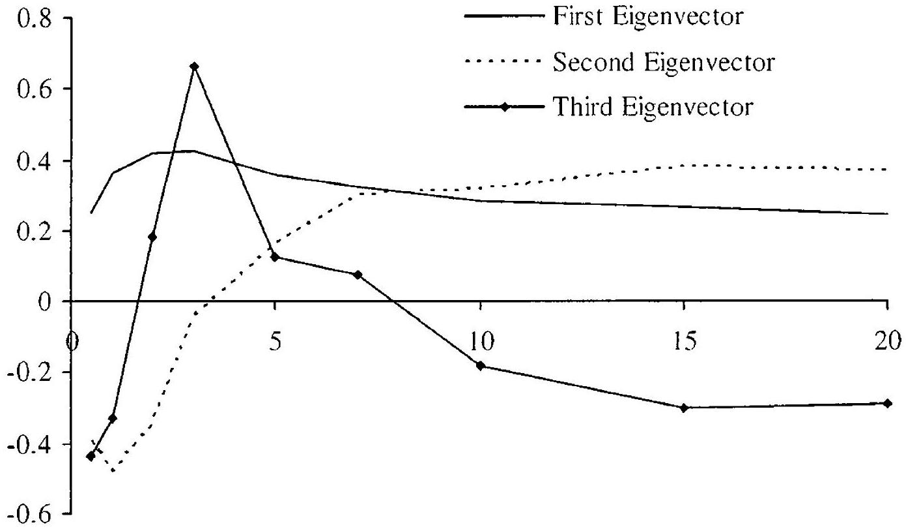
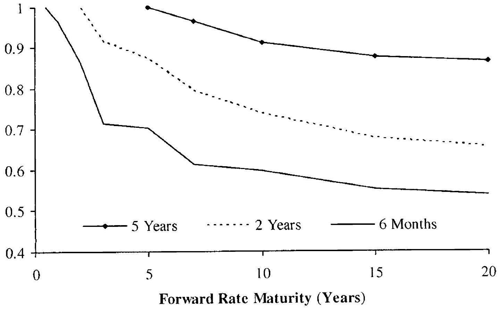
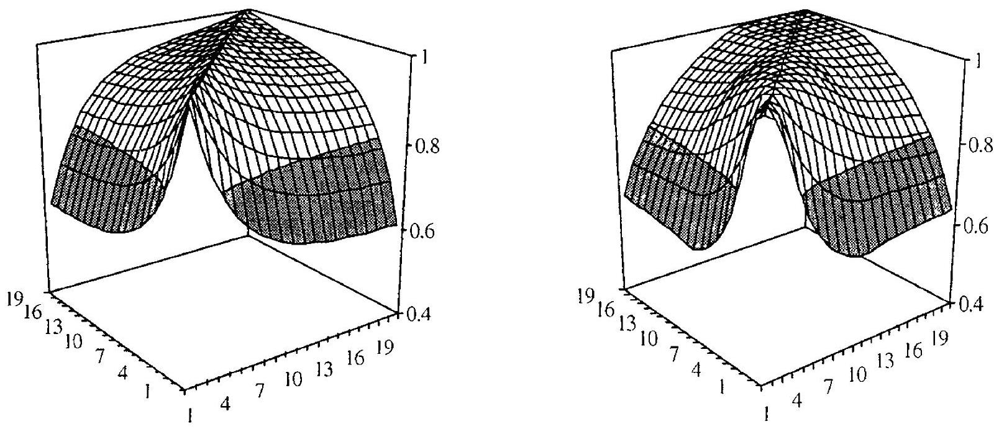

## The Libor Market Model I

Many of the models considered so far describe the evolution of the yield curve in terms of a small set of Markov state variables. While proper calibration procedures allow for successful application of such models to the pricing and hedging of a surprising variety of securities, many exotic derivatives require richer dynamics than what is possible with low-dimensional Markov models. For instance, exotic derivatives may be strongly sensitive to the joint evolution of multiple points of the yield curve, necessitating the usage of several driving Brownian motions. Also, most exotic derivatives may not be related in any obvious way to vanilla European options, making it hard to confidently identify a small, representative set of vanilla securities to which a low-dimensional Markovian model can feasibly be calibrated. What is required in such situations is a model sufficiently rich to capture the full correlation structure across the entire yield curve, and to allow for volatility calibration to a large enough set of European options that the volatility characteristics of most exotic securities can be considered "spanned" by the calibration. Candidates for such a model include the multi-factor short rate models in Chapter 12 and the multi-factor quasi-Gaussian models in Section 13.3. In this chapter, we shall cover an alternative approach to the construction of multi-factor interest rate models, the so-called Libor market (LM) model framework. Originally developed in Brace et al. [1997], Jamshidian [1997], and Miltersen et al. [1997], the LM model class enjoys significant popularity with practitioners and is in many ways easier to grasp than, say, the multi-factor quasi-Gaussian models in Chapter 13.

This chapter develops the basic LM model and provides a series of extensions to the original log-normal framework in Brace et al. [1997] and Miltersen et al. [1997] in order to better capture observed volatility smiles. To facilitate calibration of the model, efficient techniques for the pricing of European securities are developed. We provide a detailed discussion of the modeling of forward rate correlations which, along with the pricing formulas for caps and swaptions, serves as the basis for most of the calibration
strategies that we proceed to examine. Many of these strategies are generic in nature and apply to multi-factor models other than the LM class, including the models discussed in Chapters 12 and 13. We wrap up the chapter with a careful discussion of schemes for Monte Carlo simulation of LM models. A number of advanced topics in LM modeling is postponed to Chapter 15.

### 14.1 Introduction and Setup

### 14.1.1 Motivation and Historical Notes

Chapter 4 introduced the HJM framework which, in its most general form, involves multiple driving Brownian motions and an infinite set of state variables (namely the set of instantaneous forward rates). As argued earlier, the HJM framework contains any arbitrage-free interest rate model adapted to a finite set of Brownian motions. Working directly with instantaneous forward rates is, however, not particularly attractive in applications, for a variety of reasons. First, instantaneous forward rates are never quoted in the market, nor do they figure directly in the payoff definition of any traded derivative contract. As discussed in Chapter 5, realistic securities (swaps, caps, futures, etc.) instead involve simply compounded (Libor) rates, effectively representing integrals of instantaneous forward rates. The disconnect between market observables and model primitives often makes development of market-consistent pricing expression for simple derivatives cumbersome. Second, an infinite set of instantaneous forward rates can generally ${ }^{1}$ not be represented exactly on a computer, but will require discretization into a finite set. Third, prescribing the form of the volatility function of instantaneous forward rates is subject to a number of technical complications, requiring sub-linear growth to prevent explosions in the forward rate dynamics, which precludes the formulation of a log-normal forward rate model (see Sandmann and Sondermann [1997] and the discussion in Sections 4.5.3 and 11.1.3).

As discovered in Brace et al. [1997], Jamshidian [1997], and Miltersen et al. [1997], the three complications above can all be addressed simultaneously by simply formulating the model in terms of a non-overlapping set of simply compounded Libor rates. Not only do we then conveniently work with a finite set of directly observable rates that can be represented on a computer but, as we shall show, an explosion-free log-normal forward rate model also becomes possible. Despite the change to simply compounded rates, we should emphasize that the Libor market model will still be a special case of an HJM model, albeit one where we only indirectly specify the volatility function of the instantaneous forward rates.

[^46]
### 14.1.2 Tenor Structure

The starting point for our development of the LM model is a fixed tenor structure

$$
\begin{equation*}
0=T_{0}<T_{1}<\ldots<T_{N} . \tag{14.1}
\end{equation*}
$$
^eq14-1

The intervals $\tau_{n}=T_{n+1}-T_{n}, n=0, \ldots, N-1$, would typically be set to be either 3 or 6 months, corresponding to the accrual period associated with observable Libor rates. Rather than keeping track of an entire yield curve, at any point in time $t$ we are (for now; but see Section 15.1) focused only on a finite set of zero-coupon bonds $P\left(t, T_{n}\right)$ for the set of $n$ 's for which $T_{N} \geq T_{n}>t$; notice that this set shrinks as $t$ moves forward, becoming empty when $t>T_{N}$. To formalize this "roll-off" of zero-coupon bonds in the tenor structure as time progresses, it is often useful to work with an index function $q(t)$, defined by the relation

$$
\begin{equation*}
T_{q(t)-1} \leq t<T_{q(t)} \tag{14.2}
\end{equation*}
$$
^eq14-2

We think of $q(t)$ as representing the tenor structure index of the shortestdated discount bond still alive.

On the fixed tenor structure, we proceed to define Libor forward rates according to the relation (see (4.2))

$$
L\left(t, T_{n}, T_{n+1}\right)=L_{n}(t)=\frac{1}{\tau_{n}}\left(\frac{P\left(t, T_{n}\right)}{P\left(t, T_{n+1}\right)}-1\right), \quad N-1 \geq n \geq q(t)
$$

We note that when considering a given forward Libor rate $L_{n}(t)$, we always assume $n \geq q(t)$ unless stated otherwise. For any $T_{n}>t$,

$$
\begin{equation*}
P\left(t, T_{n}\right)=P\left(t, T_{q(t)}\right) \prod_{i=q(t)}^{n-1}\left(1+L_{i}(t) \tau_{i}\right)^{-1} \tag{14.3}
\end{equation*}
$$
^eq14-3

Notice that knowledge of $L_{n}(t)$ for all $n \geq q(t)$ is generally not sufficient to reconstruct discount bond prices on the entire (remaining) tenor structure; the front "stub" discount bond price $P\left(t, T_{q(t)}\right)$ must also be known.

### 14.2 LM Dynamics and Measures

### 14.2.1 Setting

In the Libor market model, the set of Libor forward rates $L_{q(t)}(t), L_{q(t)+1}(t), \ldots, L_{N-1}(t)$ constitutes the set of state variables for which we wish to specify dynamics. As a first step, we pick a probability measure P and assume that those dynamics originate from an $m$-dimensional Brownian motion $W(t)$, in the sense that all Libor rates are measurable with
respect to the filtration generated by $W(t)$. Further assuming that the Libor rates are square integrable, it follows from the martingale representation theorem that, for all $n \geq q(t)$,

$$
\begin{equation*}
d L_{n}(t)=\sigma_{n}(t)^{\top}\left(\mu_{n}(t) d t+d W(t)\right) \tag{14.4}
\end{equation*}
$$
^eq14-4

where $\mu_{n}$ and $\sigma_{n}$ are $m$-dimensional processes, respectively, both adapted to the filtration generated by $W(t)$. From the diffusion invariance principle (see Section 1.5) we know that $\sigma_{n}(t)$ is measure invariant, whereas $\mu_{n}(t)$ is not.

As it turns out, for a given choice of $\sigma_{n}(t)$ in the specification (14.4), it is quite straightforward to work out explicitly the form of $\mu_{n}(t)$ in various martingale measures of practical interest. We turn to this shortly, but let us first stress that (14.4) allows us to use a different volatility function $\sigma_{n}$ for each of the forward rates $L_{n}(t), n=q(t), \ldots, N-1$, in the tenor structure. This obviously gives us tremendous flexibility in specifying the volatility structure of the forward curve evolution, but in practice will require us to impose quite a bit of additional structure on the model to ensure realism and to avoid an excess of parameters. We shall return to this topic later in this chapter.

### 14.2.2 Probability Measures

As shown in Lemma 4.2.3, $L_{n}(t)$ must be a martingale in the $T_{n+1}$-forward measure $\mathrm{Q}^{T_{n+1}}$, such that, from (14.4),

$$
\begin{equation*}
d L_{n}(t)=\sigma_{n}(t)^{\top} d W^{n+1}(t) \tag{14.5}
\end{equation*}
$$
^eq14-5

where $W^{n+1}(t) \triangleq W^{T_{n+1}}(t)$ is an $m$-dimensional Brownian motion in $\mathrm{Q}^{T_{n+1}}$. It is to be emphasized that only one specific Libor forward rate - namely $L_{n}$ - is a martingale in the $T_{n+1}$-forward measure. To establish dynamics in other probability measures, the following proposition is useful.

Proposition 14.2.1. Let $L_{n}(t)$ satisfy (14.5). In measure $\mathrm{Q}^{T_{n}}$ the process for $L_{n}(t)$ is

$$
d L_{n}(t)=\sigma_{n}(t)^{\top}\left(\frac{\tau_{n} \sigma_{n}(t)}{1+\tau_{n} L_{n}(t)} d t+d W^{n}(t)\right)
$$

where $W^{n}(t)$ is an $m$-dimensional Brownian motion in measure $\mathrm{Q}^{T_{n}}$.
Proof. From Theorem 1.4.2 we know that the density $\varsigma(t)$ relating the measures $\mathrm{Q}^{T_{n+1}}$ and $\mathrm{Q}^{T_{n}}$ is given by

$$
\begin{aligned}
\varsigma(t) & =\mathrm{E}_{t}^{T_{n+1}}\left(\frac{d \mathrm{Q}^{T_{n}}}{d \mathrm{Q}^{T_{n+1}}}\right) \\
& =\frac{P\left(t, T_{n}\right) / P\left(0, T_{n}\right)}{P\left(t, T_{n+1}\right) / P\left(0, T_{n+1}\right)}=\left(1+\tau_{n} L_{n}(t)\right) \frac{P\left(0, T_{n+1}\right)}{P\left(0, T_{n}\right)} .
\end{aligned}
$$

Clearly, then,

$$
d \varsigma(t)=\frac{P\left(0, T_{n+1}\right)}{P\left(0, T_{n}\right)} \tau_{n} d L_{n}(t)=\frac{P\left(0, T_{n+1}\right)}{P\left(0, T_{n}\right)} \tau_{n} \sigma_{n}(t)^{\top} d W^{n+1}(t),
$$

or

$$
d \varsigma(t) / \varsigma(t)=\frac{\tau_{n} \sigma_{n}(t)^{\top} d W^{n+1}(t)}{1+\tau_{n} L_{n}(t)}
$$

From the Girsanov theorem (Theorem 1.5.1), it follows that the process

$$
\begin{equation*}
d W^{n}(t)=d W^{n+1}(t)-\frac{\tau_{n} \sigma_{n}(t)}{1+\tau_{n} L_{n}(t)} d t \tag{14.6}
\end{equation*}
$$
^eq14-6

is a Brownian motion in $\mathrm{Q}^{T_{n}}$. The proposition then follows directly from (14.5).

To gain some further intuition for the important result in Proposition 14.2.1, let us derive it in less formal fashion. For this, consider the forward discount bond $P\left(t, T_{n}, T_{n+1}\right)=P\left(t, T_{n+1}\right) / P\left(t, T_{n}\right)=\left(1+\tau_{n} L_{n}(t)\right)^{-1}$. An application of Ito's lemma to $P\left(t, T_{n}, T_{n+1}\right)$, with the help of (14.5), shows that

$$
\begin{aligned}
d P & \left(t, T_{n}, T_{n+1}\right) \\
\quad= & \tau_{n}^{2}\left(1+\tau_{n} L_{n}(t)\right)^{-3} \sigma_{n}(t)^{\top} \sigma_{n}(t) d t \\
& -\tau_{n}\left(1+\tau_{n} L_{n}(t)\right)^{-2} \sigma_{n}(t)^{\top} d W^{n+1}(t) \\
= & \tau_{n}\left(1+\tau_{n} L_{n}(t)\right)^{-2} \sigma_{n}(t)^{\top}\left\{\tau_{n}\left(1+\tau_{n} L_{n}(t)\right)^{-1} \sigma_{n}(t) d t-d W^{n+1}(t)\right\}
\end{aligned}
$$

As $P\left(t, T_{n}, T_{n+1}\right)$ must be a martingale in the $\mathrm{Q}^{T_{n}}$-measure, it follows that

$$
-d W^{n}(t)=\tau_{n}\left(1+\tau_{n} L_{n}(t)\right)^{-1} \sigma_{n}(t) d t-d W^{n+1}(t)
$$

is a Brownian motion in $\mathrm{Q}^{T_{n}}$, consistent with the result in Proposition 14.2.1.
While Proposition 14.2.1 only relates "neighboring" measures $\mathrm{Q}^{T}{ }^{n+1}$ and $\mathrm{Q}^{T_{n}}$, it is straightforward to use the proposition iteratively to find the drift of $L_{n}$ in any of the probability measures discussed in Section 4.2. Let us give some examples.

Lemma 14.2.2. Let $L_{n}(t)$ satisfy (14.5). Under the terminal measure $\mathrm{Q}^{T_{N}}$ the process for $L_{n}(t)$ is

$$
d L_{n}(t)=\sigma_{n}(t)^{\top}\left(-\sum_{j=n+1}^{N-1} \frac{\tau_{j} \sigma_{j}(t)}{1+\tau_{j} L_{j}(t)} d t+d W^{N}(t)\right)
$$

where $W^{N}(t)$ is an $m$-dimensional Brownian motion in measure $\mathrm{Q}^{T_{N}}$.

Proof. From (14.6) we know that

$$
\begin{aligned}
d W^{N}(t) & =d W^{N-1}(t)+\frac{\tau_{N-1} \sigma_{N-1}(t)}{1+\tau_{N-1} L_{N-1}(t)} d t \\
& =d W^{N-2}(t)+\frac{\tau_{N-2} \sigma_{N-2}(t)}{1+\tau_{N-2} L_{N-2}(t)} d t+\frac{\tau_{N-1} \sigma_{N-1}(t)}{1+\tau_{N-1} L_{N-1}(t)} d t
\end{aligned}
$$

Continuing this iteration down to $W^{n+1}$, we get

$$
d W^{N}(t)=d W^{n+1}(t)+\sum_{j=n+1}^{N-1} \frac{\tau_{j} \sigma_{j}(t)}{1+\tau_{j} L_{j}(t)} d t
$$

The lemma now follows from (14.5).
Lemma 14.2.3. Let $L_{n}(t)$ satisfy (14.5). Under the spot measure $\mathrm{Q}^{B}$ (see Section 4.2.3) the process for $L_{n}(t)$ is

$$
\begin{equation*}
d L_{n}(t)=\sigma_{n}(t)^{\top}\left(\sum_{j=q(t)}^{n} \frac{\tau_{j} \sigma_{j}(t)}{1+\tau_{j} L_{j}(t)} d t+d W^{B}(t)\right) \tag{14.7}
\end{equation*}
$$
^eq14-7

where $W^{B}(t)$ is an $m$-dimensional Brownian motion in measure $\mathrm{Q}^{B}$.
Proof. Recall from Section 4.2.3 that the spot measure is characterized by a rolling or "jumping" numeraire

$$
\begin{equation*}
B(t)=P\left(t, T_{q(t)}\right) \prod_{n=0}^{q(t)-1}\left(1+\tau_{n} L_{n}\left(T_{n}\right)\right) \tag{14.8}
\end{equation*}
$$
^eq14-8

At any time $t$, the random part of the numeraire is the discount bond $P\left(t, T_{q(t)}\right)$, so effectively we need to establish dynamics in the measure $\mathrm{Q}^{T_{q(t)}}$. Applying the iteration idea shown in the proof of Lemma 14.2.2, we get

$$
d W^{n+1}(t)=d W^{q(t)}(t)+\sum_{j=q(t)}^{n} \frac{\tau_{j} \sigma_{j}(t)}{1+\tau_{j} L_{j}(t)} d t
$$

as stated.
The spot and terminal measures are, by far, the most commonly used probability measures in practice. Occasionally, however, it may be beneficial to use one of the hybrid measures discussed earlier in this book, for instance if one wishes to enforce that a particular Libor rate $L_{n}(t)$ be a martingale. As shown in Section 4.2.4, we could pick as a numeraire the asset price process

$$
\widetilde{P}_{n+1}(t)= \begin{cases}P\left(t, T_{n+1}\right), & t \leq T_{n+1},  \tag{14.9}\\ B(t) / B\left(T_{n+1}\right), & t>T_{n+1},\end{cases}
$$
^eq14-9

where $B(t)$ is the spot numeraire (14.8). Using the same technique as in the proofs of Lemmas 14.2.2 and 14.2.3, it is easily seen that when $i \geq n$, then

$$
d L_{i}(t)=\left\{\begin{array}{l}
\sigma_{i}(t)^{\top}\left(\sum_{j=n+1}^{i} \frac{\tau_{j} \sigma_{j}(t)}{1+\tau_{3} L_{j}(t)} d t+d \widetilde{W}^{n+1}(t)\right), t \leq T_{n+1} \\
\sigma_{i}(t)^{\top}\left(\sum_{j=q(t)}^{i} \frac{\tau_{j} \sigma_{j}(t)}{1+\tau_{j} L_{j}(t)} d t+d \widetilde{W}^{n+1}(t)\right), t>T_{n+1}
\end{array}\right.
$$

where $\widetilde{W}^{n+1}(t)$ is a Brownian motion in the measure induced by the numeraire $\widetilde{P}_{n+1}(t)$. Note in particular that $L_{n}(t)$ is a martingale as desired, and that we have defined a numeraire which - unlike $P\left(t, T_{n+1}\right)$ - will be alive at any time $t$.

We should note that an equally valid definition of a hybrid measure will replace (14.9) with the asset process

$$
\bar{P}_{n+1}(t)= \begin{cases}B(t), & t \leq T_{n+1}  \tag{14.10}\\ B\left(T_{n+1}\right) P\left(t, T_{N}\right) / P\left(T_{n+1}, T_{N}\right), & t>T_{n+1}\end{cases}
$$
^eq14-10

This type of numeraire process is often useful in discretization of the LM model for simulation purposes; see Section 14.6.1.2 for details.

### 14.2.3 Link to HJM Analysis

As discussed earlier, the LM model is a special case of the general HJM class of diffusive interest rate models. To explore this relationship a bit further, we recall that HJM models generally have risk-neutral dynamics of the form

$$
d f(t, T)=\sigma_{f}(t, T)^{\top} \int_{t}^{T} \sigma_{f}(t, u) d u d t+\sigma_{f}(t, T)^{\top} d W(t)
$$

where $f(t, T)$ is the time $t$ instantaneous forward rate to time $T$ and $\sigma_{f}(t, T)$ is the instantaneous forward rate volatility function. From the results in Chapter 4, it follows that dynamics for the forward bond $P\left(t, T_{n}, T_{n+1}\right)$ are of the form

$$
\frac{d P\left(t, T_{n}, T_{n+1}\right)}{P\left(t, T_{n}, T_{n+1}\right)}=O(d t)-\left(\sigma_{P}\left(t, T_{n+1}\right)^{\top}-\sigma_{P}\left(t, T_{n}\right)^{\top}\right) d W(t)
$$

where $O(d t)$ is a drift term and

$$
\sigma_{P}(t, T)=\int_{t}^{T} \sigma_{f}(t, u) d u
$$

By definition $L_{n}(t)=\tau_{n}^{-1}\left(P\left(t, T_{n}, T_{n+1}\right)^{-1}-1\right)$, so that

$$
d L_{n}(t)=O(d t)+\tau_{n}^{-1}\left(1+\tau_{n} L_{n}(t)\right) \int_{T_{n}}^{T_{n+1}} \sigma_{f}(t, u)^{\top} d u d W(t)
$$

By the diffusion invariance principle, it follows from (14.5) that the LM model volatility $\sigma_{n}(t)$ is related to the HJM instantaneous forward volatility function $\sigma_{f}(t, T)$ by

$$
\begin{equation*}
\sigma_{n}(t)=\tau_{n}^{-1}\left(1+\tau_{n} L_{n}(t)\right) \int_{T_{n}}^{T_{n+1}} \sigma_{f}(t, u) d u \tag{14.11}
\end{equation*}
$$
^eq14-11

Note that, as expected, $\sigma_{n}(t) \rightarrow \sigma_{f}\left(t, T_{n}\right)$ as $\tau_{n} \rightarrow 0$.
It should be obvious from (14.11) that a complete specification of $\sigma_{f}(t, T)$ uniquely determines the LM volatility $\sigma_{n}(t)$ for all $t$ and all $n$. On the other hand, specification of $\sigma_{n}(t)$ for all $t$ and all $n$ does not allow us to imply a unique HJM forward volatility function $\sigma_{f}(t, T)$ - all we are specifying is essentially a strip of contiguous integrals of this function in the $T$-direction. This is hardly surprising, inasmuch as the LM model only concerns itself with a finite set of discretely compounded forward rates and cannot be expected to uniquely characterize the behaviors of instantaneous forward rates and their volatilities. Along the same lines, we note that the LM model does not uniquely specify the behavior of the short rate $r(t)=f(t, t)$; as a consequence, the rolling money market account $\beta(t)$ and the risk-neutral measure are not natural constructions in the LM model ${ }^{2}$. Section 15.3 discusses these issues in more detail.

### 14.2.4 Separable Deterministic Volatility Function

So far, our discussion of the LM model has been generic, with little structure imposed on the $N-1$ volatility functions $\sigma_{n}(t), n=1,2, \ldots, N-1$. To build a workable model, however, we need to be more specific about our choice of $\sigma_{n}(t)$. A common prescription of $\sigma_{n}(t)$ takes the form

$$
\begin{equation*}
\sigma_{n}(t)=\lambda_{n}(t) \varphi\left(L_{n}(t)\right) \tag{14.12}
\end{equation*}
$$
^eq14-12

where $\lambda_{n}(t)$ is a bounded vector-valued deterministic function and $\varphi: \mathbb{R} \rightarrow \mathbb{R}$ is a time-homogeneous local volatility function. This specification is conceptually very similar to the local volatility models in Chapter 7, although here $\sigma_{n}(\cdot)$ is vector-valued and the model involves joint dynamics of multiple state variables (the $N-1$ Libor forward rates).

At this point, the reader may reasonably ask whether the choice (14.12) in fact leads to a system of SDEs for the various Libor forward rates that is "reasonable", in the sense of existence and uniqueness of solutions. While we here shall not pay much attention to such technical regularity issues, it should be obvious that not all functions $\varphi$ can be allowed. One relevant result is given below.

[^47]Proposition 14.2.4. Assume that (14.12) holds with $\varphi(0)=0$ and that $L_{n}(0) \geq 0$ for all $n$. Also assume that $\varphi$ is locally Lipschitz continuous and satisfies the growth condition

$$
\varphi(x)^{2} \leq C\left(1+x^{2}\right), \quad x>0
$$

where $C$ is some positive constant. Then non-explosive, pathwise unique solutions of the no-arbitrage SDEs for $L_{n}(t), q(t) \leq n \leq N-1$, exist under all measures $\mathrm{Q}^{T_{\iota}}, q(t) \leq i \leq N$. If $L_{n}(0)>0$, then $L_{n}(t)$ stays positive at all $t$.

Proof. (Sketch) Due to the recursive relationship between measures, it suffices to consider the system of SDEs (14.7) under the spot measure $\mathrm{Q}^{B}$ :

$$
\begin{align*}
d L_{n}(t) & =\varphi\left(L_{n}(t)\right) \lambda_{n}(t)^{\top}\left(\mu_{n}(t) d t+d W^{B}(t)\right)  \tag{14.13}\\
\mu_{n}(t) & =\sum_{j=q(t)}^{n} \frac{\tau_{j} \varphi\left(L_{j}(t)\right) \lambda_{j}(t)}{1+\tau_{j} L_{j}(t)} \tag{14.14}
\end{align*}
$$
^eq14-13
^eq14-14

Under our assumptions, it is easy to see that each term in the sum for $\mu_{n}$ is locally Lipschitz continuous and bounded. The growth condition on $\varphi$ in turn ensures that the product $\varphi\left(L_{n}(t)\right) \lambda_{n}(t)^{\top} \mu_{n}(t)$ is also locally Lipschitz continuous and, due to the boundedness of $\mu_{n}$, satisfies a linear growth condition. Existence and uniqueness now follow from Theorem 1.6.1. The result that 0 is a non-accessible boundary for the forward rates if started above 0 follows from standard speed-scale boundary classification results; see Andersen and Andreasen [2000b] for the details.

Some standard parameterizations of $\varphi$ are shown in Table 14.1. Of those, only the log-normal specification and the LCEV specification directly satisfy the criteria in Proposition 14.2.4. The CEV specification violates Lipschitz continuity at $x=0$, and as a result uniqueness of the SDE fails. As shown in Andersen and Andreasen [2000b], we restore uniqueness by specifying that forward rates are absorbed at the origin (see also Section 7.2.3). As for the displaced log-normal specification $\varphi(x)=a x+b$, we here violate the assumption that $\varphi(0)=0$, and as a result we cannot always guarantee that forward rates stay positive. Also, to prevent explosion of the forward rate drifts, we need to impose additional restrictions to prevent terms of the form $1+\tau_{n} L_{n}(t)$ (in the denominator) from becoming zero. As displaced log-normal models are of considerable practical importance, we list the relevant restrictions in Lemma 14.2.5 below.

Lemma 14.2.5. Consider a local volatility Libor market model with local volatility function $\varphi(x)=b x+a$, where $b>0$ and $a \neq 0$. Assume that $b L_{n}(0)+a>0$ and $a / b<\tau_{n}^{-1}$ for all $n=1,2, \ldots, N-1$. Then nonexplosive, pathwise unique solutions of the no-arbitrage SDEs for $L_{n}(t)$, $q(t) \leq n \leq N-1$, exist under all measures $\mathrm{Q}^{T_{i}}, q(t) \leq i \leq N$. All $L_{n}(t)$ are bounded from below by $-a / b$.

| Name | $\varphi(x)$ |
| :--- | :--- |
| Log-normal | $x$ |
| CEV | $x^{p}, \quad 0<p<1$ |
| LCEV | $x \min \left(\varepsilon^{p-1}, x^{p-1}\right), \quad 0<p<1, \varepsilon>0$ |
| Displaced log-normal | $b x+a, \quad b>0, a \neq 0$ |

Table 14.1. Common DVF Specifications

Proof. Define $H_{n}(t)=b L_{n}(t)+a$. By Ito's lemma, we have

$$
\begin{gathered}
d H_{n}(t)=b d L_{n}(t)=b H_{n}(t) \lambda_{n}(t)^{\top}\left(\mu_{n}(t) d t+d W^{B}(t)\right) \\
\mu_{n}(t)=\sum_{j=q(t)}^{n} \frac{\tau_{j} H_{j}(t) \lambda_{j}(t)}{1+\tau_{j}\left(H_{j}(t)-a\right) / b}
\end{gathered}
$$

From the assumptions of the lemma, we have $H_{n}(0)>0$ for all $n$, allowing us to apply the result of Proposition 14.2.4 to $H_{n}(t)$, provided that we can guarantee that $\mu_{j}(t)$ is bounded for all positive $H_{j}, j=q(t), \ldots, n$. This follows from $1-\tau_{j} a / b>0$ or $a / b<\tau_{j}^{-1}$.

We emphasize that the requirement $a / b<\tau_{n}^{-1}$ implies that only in the limit of $\tau_{j} \rightarrow 0$ - where the discrete forward Libor rates become instantaneous forward rates - will a pure Gaussian LM model specification $(b=0)$ be meaningful; such a model was outlined in Section 4.5.1. On the flipside, according to Proposition 14.2.4, a finite-sized value of $\tau_{j}$ ensures that a well-behaved log-normal forward rate model exists, something that we saw earlier (Section 11.1.3) was not the case for models based on instantaneous forward rates. The existence of log-normal forward rate dynamics in the LM setting was, in fact, a major driving force behind the development and popularization of the LM framework, and all early examples of LM models (see Brace et al. [1997], Jamshidian [1997], and Miltersen et al. [1997]) were exclusively log-normal.

We recall from earlier chapters that it is often convenient to specify displaced log-normal models as $\varphi\left(L_{n}(t)\right)=(1-b) L_{n}(0)+b L_{n}(t)$, in which case the constant $a$ in Lemma 14.2.5 is different from one Libor rate to the next. In this case, we must require

$$
(1-b) / b<\left(L_{n}(0) \tau_{n}\right)^{-1}, \quad n=1, \ldots, N-1 .
$$

As $L_{n}(0) \tau_{n}$ is typically in the magnitude of a few percent, the regularity requirement on $b$ in (14.2.4) is not particularly restrictive.

### 14.2.5 Stochastic Volatility

As discussed earlier in this book, to ensure that the evolution of the volatility smile is reasonably stationary, it is best if the skew function $\varphi$ in (14.14)
is (close to) monotonic in its argument. Typically we are interested in specifications where $\varphi(x) / x$ is downward-sloping, to establish the standard behavior of interest rate implied volatilities tending to increase as interest rates decline. In reality, however, markets often exhibit non-monotonic volatility smiles or "smirks" with high-struck options trading at implied volatilities above the at-the-money levels. An increasingly popular mechanism to capture such behavior in LM models is through the introduction of stochastic volatility. We have already encountered stochastic volatility models in Chapters 8, 9 and, in the context of term structure models, in Sections 13.2 and 13.3; we now discuss how to extend the notion of stochastic volatility models to the simultaneous modeling of multiple Libor forward rates.

As our starting point, we take the process (14.14), preferably equipped with a $\varphi$ that generates either a flat or monotonically downward-sloping volatility skew, but allow the term on the Brownian motion to be scaled by a stochastic process. Specifically, we introduce a mean-reverting scalar process $z(t)$, with dynamics of the form

$$
\begin{equation*}
d z(t)=\theta\left(z_{0}-z(t)\right) d t+\eta \psi(z(t)) d Z(t), \quad z(0)=z_{0} \tag{14.15}
\end{equation*}
$$
^eq14-15

where $\theta, z_{0}$, and $\eta$ are positive constants, $Z$ is a Brownian motion under the spot measure $\mathrm{Q}^{B}$, and $\psi: \mathbb{R}_{+} \rightarrow \mathbb{R}_{+}$is a well-behaved function. We impose that (14.15) will not generate negative values of $z(t)$, which requires $\psi(0)=0$. We will interpret the process in (14.15) as the (scaled) variance process for our forward rate diffusions, in the sense that the square root of $z(t)$ will be used as a stochastic, multiplicative scaling of the diffusion term in (14.14). That is, our forward rate processes in $\mathrm{Q}^{B}$ are, for all $n \geq q(t)$,

$$
\begin{align*}
d L_{n}(t) & =\sqrt{z(t)} \varphi\left(L_{n}(t)\right) \lambda_{n}(t)^{\top}\left(\sqrt{z(t)} \mu_{n}(t) d t+d W^{B}(t)\right)  \tag{14.16}\\
\mu_{n}(t) & =\sum_{j=q(t)}^{n} \frac{\tau_{j} \varphi\left(L_{j}(t)\right) \lambda_{j}(t)}{1+\tau_{j} L_{j}(t)}
\end{align*}
$$
^eq14-16

where $z(t)$ satisfies (14.15). This construction naturally follows the specification of vanilla stochastic volatility models in Chapter 8, and the specification of stochastic volatility quasi-Gaussian models in Chapter 13. As we discussed previously, it is often natural to scale the process for $z(t)$ such that $z(0)=z_{0}=1$.

Let us make two important comments about (14.16). First, we emphasize that a single common factor $\sqrt{z(t)}$ simultaneously scales all forward rate volatilities; movements in volatilities are therefore perfectly correlated across the various forward rates. In effect, our model corresponds only to the first principal component of the movements of the instantaneous forward rate volatilities. This is a common assumption that provides good balance between realism and parsimony, and we concentrate mostly on this case although we do relax it later in the book, in Chapter 15. Second, we note
that the clean form of the $z$-process (14.15) in the measure $\mathrm{Q}^{B}$ generally does not carry over to other probability measures, as we would expect from Proposition 8.3.9. To state the relevant result, let $\langle Z(t), W(t)\rangle$ denote the vector of quadratic covariations between $Z(t)$ and the $m$ components of $W(t)$ (recall the definition of covariation in Remark 1.1.7). We then have

Lemma 14.2.6. Let dynamics for $z(t)$ in the measure $\mathrm{Q}^{B}$ be as in (14.15). Then the SDE for $z(t)$ in measure $\mathrm{Q}^{T_{n+1}}, n \geq q(t)-1$, is

$$
\begin{align*}
d z(t)=\theta\left(z_{0}\right. & -z(t)) d t+\eta \psi(z(t)) \\
& \times\left(-\sqrt{z(t)} \mu_{n}(t)^{\top}\left\langle d Z(t), d W^{B}(t)\right\rangle+d Z^{n+1}(t)\right) \tag{14.17}
\end{align*}
$$
^eq14-17

where $\mu_{n}(t)$ is given in (14.16) and $Z^{n+1}(t)$ is a Brownian motion in measure $\mathrm{Q}^{T_{n+1}}$.

Proof. From earlier results, we have

$$
d W^{n+1}(t)=\sqrt{z(t)} \mu_{n}(t) d t+d W^{B}(t) .
$$

Let us introduce the $m$-dimensional vector

$$
a(t)=\left\langle d Z(t), d W^{B}(t)\right\rangle / d t
$$

so that we can write

$$
d Z(t)=a(t)^{\top} d W^{B}(t)+\sqrt{1-\|a(t)\|^{2}} d \widetilde{W}(t)
$$

where $\widetilde{W}(t)$ is a scalar Brownian motion independent of $W^{B}(t)$. In the measure $\mathrm{Q}^{T_{n+1}}$, we then have

$$
\begin{aligned}
d Z(t) & =a(t)^{\top}\left(d W^{n+1}(t)-\sqrt{z(t)} \mu_{n}(t) d t\right)+\sqrt{1-\|a(t)\|^{2}} d \widetilde{W}(t) \\
& =d Z^{n+1}(t)-a(t)^{\top} \sqrt{z(t)} \mu_{n}(t) d t
\end{aligned}
$$

and the result follows.
The process (14.17) is awkward to deal with, due to presence of the drift term $\mu_{n}(t)^{\top}\left\langle d Z(t), d W^{B}(t)\right\rangle$ which will, in general, depend on the state of the Libor forward rates at time $t$. For tractability, on the other hand, we would like for the $z$-process to only depend on $z(t)$ itself. To achieve this, and to generally simplify measure shifts in the model, we make the following assumption ${ }^{3}$ about (14.15)-(14.16):

Assumption 14.2.7. The Brownian motion $Z(t)$ of the variance process $z(t)$ is independent of the vector-valued Brownian motion $W^{B}(t)$.

[^48]We have already encountered the same assumption in the context of stochastic volatility quasi-Gaussian models, see Section 13.2.1, where we also discussed the implications of such a restriction.

The diffusion coefficient of the variance process, the function $\psi$, is traditionally chosen to be of power form, $\psi(x)=x^{\alpha}, \alpha>0$. While it probably makes sense to keep the function monotonic, the power specification is likely a nod to tradition rather than anything else. Nevertheless, some particular choices lead to analytically tractable specifications, as we saw in Chapter 8; for that reason, $\alpha=1 / 2$ (the Heston model) is popular.

Remark 14.2.8. Going forward we shall often use the stochastic volatility model in this section as a benchmark for theoretical and numerical work. As the stochastic volatility model reduces to the local volatility model in Section 14.2.4 when $z(t)$ is constant, all results for the stochastic volatility model will carry over to the DVF setting.

### 14.2.6 Time-Dependence in Model Parameters

In the models we outlined in Sections 14.2.4 and 14.2.5, the main role of the vector-valued function of time $\lambda_{n}(t)$ was to establish a term structure "spine" of at-the-money option volatilities. To build volatility smiles around this spine, we further introduced a universal skew-function $\varphi$, possibly combined with a stochastic volatility scale $z(t)$ with time-independent process parameters. In practice, this typically gives us a handful of free parameters with which we can attempt to match the market-observed volatility smiles for various cap and swaption tenors. As it turns out, a surprisingly good fit to market skew data can, in fact, often be achieved with the models of Sections 14.2.4 and 14.2.5. For a truly precise fit to volatility skews across all maturities and swaption tenors it may, however, be necessary to allow for time-dependence in both the process parameters for $z(t)$ and, more importantly, the skew function $\varphi$. The resulting model is conceptually similar to the model in Section 14.2.5, but involves a number of technical intricacies that draw heavily on the material presented in Chapter 9. To avoid cluttering this first chapter on LM models with technical detail, we postpone the treatment of time-inhomogeneous $\varphi$ and $z$-process parameters to Chapter 15.

### 14.3 Correlation

In one-factor models for interest rates - such as the ones presented in Chapters 10 and 11 - all points on the forward curve always move in the same direction. While this type of forward curve move indeed is the most commonly observed type of shift to the curve, "rotational steepenings" and
the formation of "humps" may also take place, as may other more complex types of curve changes. The empirical presence of such non-trivial curve movements is an indication of the fact that various points on the forward curve do not move co-monotonically with each other, i.e. they are imperfectly correlated. A key characteristic of the LM model is the consistent use of vector-valued Brownian motion drivers, of dimension $m$, which gives us control over the instantaneous correlation between various points on the forward curve.

Proposition 14.3.1. The correlation between forward rate increments $d L_{k}(t)$ and $d L_{j}(t)$ in the $S V$ model (14.16) is

$$
\operatorname{Corr}\left(d L_{k}(t), d L_{j}(t)\right)=\frac{\lambda_{k}(t)^{\top} \lambda_{j}(t)}{\left\|\lambda_{k}(t)\right\|\left\|\lambda_{j}(t)\right\|}
$$

Proof. Using the covariance notation of Remark 1.1.7, we have, for any $j$ and $k$,

$$
d\left\langle L_{k}(t), L_{\jmath}(t)\right\rangle=z(t) \varphi\left(L_{k}(t)\right) \varphi\left(L_{j}(t)\right) \lambda_{k}(t)^{\top} \lambda_{j}(t) d t
$$

Using this in the definition of the correlation,

$$
\operatorname{Corr}\left(d L_{k}(t), d L_{j}(t)\right)=\frac{\left\langle d L_{k}(t), d L_{j}(t)\right\rangle}{\sqrt{\left\langle d L_{k}(t)\right\rangle\left\langle d L_{j}(t)\right\rangle}},
$$

which gives the result of the proposition.
A trivial corollary of Proposition 14.3.1 is the fact that $\operatorname{Corr}\left(d L_{k}(t), d L_{j}(t)\right)=1$ always when $m=1$, i.e. when we only have one Brownian motion. As we add more Brownian motions, our ability to capture increasingly complicated correlation structures progressively improves (in a sense that we shall examine further shortly), but at a cost of increasing the model complexity and, ultimately, computational effort. To make rational decisions about the choice of model dimension $m$, let us turn to the empirical data.

### 14.3.1 Empirical Principal Components Analysis

For some fixed value of $\tau$ (e.g. 0.25 or 0.5 ), let us define "sliding" forward rates ${ }^{4} l(t, x)$ with tenor $x$ as

$$
l(t, x)=L(t, t+x, t+x+\tau)
$$

[^49]For a given set of tenors $x_{1}, \ldots, x_{N_{x}}$ and a given set of calendar times $t_{0}, t_{1}, \ldots, t_{N_{l}}$, we can use market observations ${ }^{5}$ to set up the $N_{x} \times N_{t}$ observation matrix $O$ with elements

$$
O_{i, j}=\frac{l\left(t_{j}, x_{i}\right)-l\left(t_{j-1}, x_{i}\right)}{\sqrt{t_{j}-t_{j-1}}}, \quad i=1, \ldots, N_{x}, j=1, \ldots, N_{t} .
$$

Notice the normalization with $\sqrt{t_{j}-t_{j-1}}$ which annualizes the variance of the observed forward rate increments. Also note that we use absolute increments in forward rates here. This is arbitrary - we could have used, say, relative increases as well, if we felt that rates were more log-normal than Gaussian. For small sampling periods, the precise choice is of little importance.

Assuming time-homogeneity and ignoring small drift terms, the data collected above will imply a sample $N_{x} \times N_{x}$ variance-covariance matrix equal to

$$
\begin{equation*}
C=\frac{O O^{\top}}{N_{t}} \tag{14.18}
\end{equation*}
$$
^eq14-18

For our LM model to conform to empirical data, we need to use a sufficiently high number $m$ of Brownian motions to closely replicate this variancecovariance matrix. A formal analysis of what value of $m$ will suffice can proceed with the tools of principal components analysis (PCA), as established in Section 3.1.3.

### 14.3.1.1 Example: USD Forward Rates

To give a concrete example of a PCA run, we set $N_{x}=9$ and use tenors of $\left\{x_{1}, \ldots, x_{9}\right\}=\{0.5,1,2,3,5,7,10,15,20\}$ years. We fix $\tau=0.5$ (i.e., all forward rates are 6 months discrete rates) and use 4 years of weekly data from the USD market, spanning January 2003 to January 2007, for a total of $N_{t}=203$ curve observations. The eigenvalues of the matrix $C$ in (14.18) are listed in Table 14.2, along with the percentage of variance that is explained by using only the first $m$ principal components.

| $m$ | 1 | 2 | 3 | 4 | 5 | 6 | 7 | 8 | 9 |
| :--- | :---: | :---: | :---: | :---: | :---: | :---: | :---: | :---: | :---: |
| Eigenvalue | 7.0 | 0.94 | 0.29 | 0.064 | 0.053 | 0.029 | 0.016 | 0.0091 | 0.0070 |
| $\%$ Variance | 83.3 | 94.5 | 97.9 | 98.7 | 99.3 | 99.6 | 99.8 | 99.9 | 100 |

Table 14.2. PCA for USD Rates. All eigenvalues are scaled up by $10^{4}$.

As we see from the table, the first principal component explains about $83 \%$ of the observed variance, and the first three principal components together

[^50]explain nearly $98 \%$. This pattern carries over to most major currencies, and in many applications we would consequently expect that using $m=3$ or $m=4$ Brownian motions in a LM model would adequately capture the empirical covariation of the points on the forward curve. An exception to this rule-of-thumb occurs when a particular derivative security depends strongly on the correlation between forward rates with tenors that are close to each other; in this case, as we shall see in Section 14.3.4, a high number of principal components is required to provide for sufficient decoupling of nearby forward rates.

The eigenvectors corresponding to the largest three eigenvectors in Table 14.2 are shown in the Figure 14.1; the figure gives us a reasonable idea about what the (suitably scaled) first three elements of the $\lambda_{k}(t)$ vectors should look like as functions of $T_{k}-t$. Loosely speaking, the first principal component can be interpreted as a near-parallel shift of the forward curve, whereas the second and third principal components correspond to forward curve twists and bends, respectively.

Fig. 14.1. Eigenvectors

## Forward Rate Maturity (Years)

Notes: Eigenvectors for the largest three eigenvalues in Table 14.2.

### 14.3.2 Correlation Estimation and Smoothing

Empirical estimates for forward rate correlations can proceed along the lines of Section 14.3.1. Specifically, if we introduce the diagonal matrix

$$
c \triangleq\left(\begin{array}{cccc}
\sqrt{C_{1,1}} & 0 & \ddots & 0 \\
0 & \sqrt{C_{2,2}} & \ddots & \ddots \\
\ddots & \ddots & \ddots & 0 \\
0 & \ddots & 0 & \sqrt{C_{N_{v}, N_{x}}}
\end{array}\right),
$$

then the empirical $N_{x} \times N_{x}$ forward rate correlation matrix $R$ becomes

$$
R=c^{-1} C c^{-1} .
$$

Element $R_{i, j}$ of $R$ provides a sample estimate of the instantaneous correlation between increments in $l\left(t, x_{i}\right)$ and $l\left(t, x_{i}\right)$, under the assumption that this correlation is time-homogeneous.

The matrix $R$ is often relatively noisy, partially as a reflection of the fact that correlations are well-known to be quite variable over time, and partially as a reflection of the fact that the empirical correlation estimator has rather poor sample properties with large confidence bounds (see Johnson et al. [1995] for details). Nevertheless, several stylistic facts can be gleaned from the data, as demonstrated in Figure 14.2 where we have graphed a few slices of the correlation matrix for the USD data in Section 14.3.1.1.

Fig. 14.2. Forward Rate Correlations

Notes: For each of three fixed forward rate maturities ( 6 months, 2 years, and 5 years), the figure shows the correlation between the fixed forward rate and forward rates with other maturities (as indicated on the $x$-axis of the graph).

To make a few qualitative observations about Figure 14.2, we notice that correlations between forward rates $l\left(\cdot, x_{k}\right)$ and $l\left(\cdot, x_{j}\right)$ generally decline in $\left|x_{k}-x_{j}\right|$; this decline appears near-exponential for $x_{k}$ and $x_{j}$ close to each other, but with a near-flat asymptote for large $\left|x_{k}-x_{j}\right|$. It appears that the rate of the correlation decay and the level of the asymptote depend not only on $\left|x_{k}-x_{j}\right|$, but also on $\min \left(x_{k}, x_{j}\right)$. Specifically, the decay rate decreases with $\min \left(x_{k}, x_{j}\right)$, and the asymptote level increases with $\min \left(x_{k}, x_{j}\right)$.

In practice, unaltered empirical correlation matrices are typically too noisy for comfort, and might contain non-intuitive entries (e.g., correlation between a 10 year forward and a 2 year forward might come out higher than between a 10 year forward and a 5 year forward). As such, it is common practice in multi-factor yield curve modeling to work with simple parametric forms; this not only smoothes the correlation matrix, but also conveniently reduces the effective parameter dimension of the correlation matrix object, from $N_{x}\left(N_{x}-1\right) / 2$ distinct matrix elements to the number of parameters in the parametric form.

Several candidate parametric forms for the correlation have been proposed in the literature, see Schoenmakers and Coffey [2000], Jong et al. [2001], and Rebonato [2002], among many others. Rather than list all of these, we instead focus on a few reasonable forms that we have designed to encompass most or all of the empirical facts listed above. Our first parametric form is as follows:

$$
\operatorname{Corr}\left(d L_{k}(t), d L_{j}(t)\right)=q_{1}\left(T_{k}-t, T_{j}-t\right)
$$

where

$$
\begin{gather*}
q_{1}(x, y)=\rho_{\infty}+\left(1-\rho_{\infty}\right) \exp (-a(\min (x, y))|y-x|)  \tag{14.19}\\
a(z)=a_{\infty}+\left(a_{0}-a_{\infty}\right) e^{-\kappa z}
\end{gather*}
$$
^eq14-19

subject to $0 \leq \rho_{\infty} \leq 1, a_{0}, a_{\infty}, \kappa \geq 0$. Fundamentally, $q_{1}(x, y)$ exhibits correlation decay at a rate of $a$ as $|y-x|$ is increased, with the decay rate $a$ itself being an exponential function of $\min (x, y)$. We would always expect to have $a_{0} \geq a_{\infty}$, in which case
$\frac{\partial q_{1}(x, y)}{\partial x}=\left(1-\rho_{\infty}\right) e^{-a(x)(y-x)}\left[a(x)+(y-x) \kappa\left(a_{0}-a_{\infty}\right) e^{-\kappa x}\right], \quad x<y$, is non-negative, as one would expect.

Variations on (14.19) are abundant in the literature - the case $a_{0}=a_{\infty}$ is particularly popular - and $q_{1}$ generally has sufficient degrees of freedom to provide a reasonable fit to empirical data. One immediate issue, however, is a lack of control of the asymptotic correlation level at $|x-y| \rightarrow \infty$ which, as we argued above, is typically not independent of $x$ and $y$. As the empirical data suggests that $\rho_{\infty}$ tends to increase with $\min (x, y)$, we could introduce yet another decaying function

$$
\begin{equation*}
\rho_{\infty}(z)=b_{\infty}+\left(b_{0}-b_{\infty}\right) e^{-\alpha z} \tag{14.20}
\end{equation*}
$$
^eq14-20

and extend $q_{1}$ to the "triple-decaying" form
$q_{2}(x, y)=\rho_{\infty}(\min (x, y))+\left(1-\rho_{\infty}(\min (x, y))\right) \exp \left(-a\left(\min \left(x_{, .}:-=\right.\right.\right.$
with $a(z)$ given in (14.19), and where $0 \leq b_{0}, b_{\infty} \leq 1, \alpha \geq 0$. Empir. Ita suggests that normally $b_{0} \leq b_{\infty}$, in which case we have

$$
\begin{aligned}
& \frac{\partial q_{2}(x, y)}{\partial x}=-\alpha\left(b_{0}-b_{\infty}\right) e^{-\alpha x}\left(1-e^{-a(x)(y-x)}\right) \\
& \quad+\left(1-\rho_{\infty}(x)\right) e^{-a(x)(y-x)}\left[a(x)+(y-x) \kappa\left(a_{0}-a_{\infty}\right) e^{-\kappa x}\right], \quad x<
\end{aligned}
$$

which remains non-negative if $b_{0} \leq b_{\infty}$ and $a_{0} \geq a_{\infty}$.
In a typical application, the four parameters of $q_{1}$ and the six parameters of $q_{2}$ are found by least-squares optimization against an empirical correlation matrix. Any standard optimization algorithm, such as the LevenbergMarquardt algorithm in Press et al. [1992], can be used for this purpose. Some parameters are here subject to simple box-style constraints (e.g. $\rho_{\infty} \in[0,1]$ ), which poses no particular problems for most commercial optimizers. In any case, we can always use functional mappings to rewrite our optimization problem in terms of variables with unbounded domains. For instance, for the form $q_{1}$, we can set

$$
\rho_{\infty}=\frac{1}{2}+\frac{\arctan (u)}{\pi}, \quad u \in(-\infty, \infty)
$$

and optimize on the variable $u$ instead of $\rho_{\infty}$. Note that we sometimes may wish to optimize correlation parameters against more market-driven targets than empirical correlation matrices, an idea that we shall investigate further in Section 14.5.9.

### 14.3.2.1 Example: Fit to USD Data

Let $R$ be the $9 \times 9$ empirical correlation matrix generated from the data in Section 14.3.1.1, and let $R_{2}(\xi), \xi \triangleq\left(a_{0}, a_{\infty}, \kappa, b_{0}, b_{\infty}, \alpha\right)^{\top}$, be the $9 \times 9$ correlation matrix generated from the form $q_{2}$, when using the 9 specific forward tenors in 14.3.1.1. To determine the optimal parameter vector $\xi^{*}$. we minimize an unweighted Frobenius (least-squares) matrix norm, subject to a non-negativity constraint

$$
\xi^{*}=\underset{\xi}{\operatorname{argmin}}\left(\operatorname{tr}\left(\left(R-R_{2}(\xi)\right)\left(R-R_{2}(\xi)\right)^{\top}\right)\right), \text { subject to } \xi \geq 0
$$

The resulting fit is summarized in Table 14.3; Figure 14.3 in Section 14.3.4.1 contains a 3D plot of the correlation matrix $R_{2}\left(\xi^{*}\right)$.

The value of the Frobenius norm at $\xi^{*}$ is 0.070 , which translates into an average absolute correlation error (excluding diagonal elements) of around

| $a_{0}$ | $a_{\infty}$ | $\kappa$ | $b_{0}$ | $b_{\infty}$ | $\alpha$ |
| :---: | :---: | :---: | :---: | :---: | :---: |
| 0.312 | 0.157 | 0.264 | 0.490 | 0.946 | 0.325 |

Table 14.3. Best-Fit Parameters for $q_{2}$ in USD Market

$2 \%$. If we use the four parameter form $q_{1}$ instead of $q_{2}$ in the optimization exercise, the Frobenius norm at the optimum increases to 0.164 . As we would expect from Figure 14.2, allowing correlation asymptotes to increase in tenors thus adds significant explanatory power to the parametric form.

### 14.3.3 Negative Eigenvalues

While some functional forms are designed to always return valid correlation matrices (the function in Schoenmakers and Coffey [2000] being one such example), many popular forms - including our $q_{1}$ and $q_{2}$ above - can, when stressed, generate matrices $R$ that fail to be positive definite. While this rarely happens in real applications, it is not inconceivable that on occasion one or more eigenvalues of $R$ may turn out to be negative, requiring us to somehow "repair" the matrix. A similar problem can also arise due to rounding errors when working with large empirical correlation matrices.

Formally, when faced with an $R$ matrix that is not positive definite, we would ideally like to replace it with a modified matrix $R^{*}$ which i) is a valid correlation matrix; and ii) is as close as possible to $R$, in the sense of some matrix norm. The problem of locating $R^{*}$ then involves computing the norm

$$
\{\|R-X\|: X \text { is a correlation matrix }\}
$$

and setting $R^{*}$ equal to the matrix $X$ that minimizes this distance. If $\|\cdot\|$ is a weighted Frobenius norm, good numerical algorithms for the computation of $R^{*}$ have recently emerged, see Higham [2002] for a review and a clean approach.

If the negative eigenvalues are small in absolute magnitude (which is often the case in practice), it is often reasonable to abandon a full-blown optimization algorithm in favor of a more heuristic approach where we simply raise all offending negative eigenvalues to some positive cut-off value. To present one obvious algorithm, let us start by writing

$$
R=E \Lambda E^{\top},
$$

where $\Lambda$ is a diagonal matrix of eigenvalues, and $E$ is a matrix with the eigenvectors of $R$ in its columns. Let $\Lambda^{*}$ be the diagonal matrix with allpositive entries

$$
\Lambda_{i, i}^{*}=\max \left(\epsilon, \Lambda_{i, i}\right), \quad i=1, \ldots, N_{x},
$$

for some small cut-off value $\epsilon>0$. Then set

$$
C^{*}=E \Lambda^{*} E^{\top}
$$

which we interpret as a covariance matrix, i.e. of the $2=$

$$
C^{*}=c^{*} R^{*} c^{*}
$$

where $c^{*}$ is a diagonal matrix with elements $c_{i, i}^{*}=\sqrt{C_{i, i}^{*}}$ an $\rho^{*}$ is the valid, positive definite correlation matrix we seek. $R^{*}$ is then consey as

$$
\begin{equation*}
R^{*}=\left(c^{*}\right)^{-1} C^{*}\left(c^{*}\right)^{-1} \tag{14.22)}
\end{equation*}
$$

We emphasize that $R^{*}$ as defined in (14.22) will have 1's in $1: 5$ Eagonal. whereas $C^{*}$ will not. Both $C^{*}$ and $R^{*}$ are, by construction, positi Enite.

### 14.3.4 Correlation PCA

We now turn to a problem that arises in certain important applicate such as the calibration procedure we shall discuss in Section 14.5. Consider : $p$-dimensional Gaussian variable $Y$, where all elements of $Y$ have zero mean and unit variance. Let $Y$ have a positive definite correlation matrix $R$, given by

$$
R=\mathrm{E}\left(Y Y^{\top}\right)
$$

Consider now writing, as an approximation,

$$
\begin{equation*}
Y \approx D X, \tag{14.23}
\end{equation*}
$$
^eq14-23

where $X$ is an $m$-dimensional vector of independent standard Gaussian variables, $m<p$, and $D$ is a $(p \times m)$-dimensional matrix. We wish to strictly enforce that $D X$ remains a vector of variables with zero means and ari: variances, thereby ensuring that the matrix $D D^{\top}$ has the interpretation of a valid correlation matrix. In particular, we require that $D D^{\top}$ has ones or its diagonal.

Let $v(D)$ be the $p$-dimensional vector of the diagonal elements of $D D^{-}$. i.e. $v_{\imath}=\left(D D^{\top}\right)_{\imath, \imath}, i=1, \ldots, p$. Working as before with an unweighted Frobenius norm, we set

$$
h(D ; R)=\operatorname{tr}\left(\left(R-D D^{\top}\right)\left(R-D D^{\top}\right)^{\top}\right), \quad \text { :19.2\% }
$$

and define the optimal choice of $D$, denoted $D^{*}$, as

$$
\begin{equation*}
D^{*}=\underset{D}{\operatorname{argmin}} h(D ; R), \quad \text { subject to } v(D)=1 \tag{$1 \div .25$}
\end{equation*}
$$

where 1 is a $p$-dimensional vector of 1 's.

[^51]Proposition 14.3.2. Let $\mu$ be a $p$-dimensional vector, and let $D_{\mu}$ be given as the unconstrained optimum

$$
D_{\mu}=\underset{D}{\operatorname{argmin}} h(D ; R+\operatorname{diag}(\mu)),
$$

with $h$ given in (14.24). Define $D^{*}$ as in (14.25) and let $\mu^{*}$ be the solution to

$$
v\left(D_{\mu}\right)-1=0
$$

Then $D^{*}=D_{\mu^{*}}$.
Proof. We only provide a sketch of the proof; for more details, see Zhang and Wu [2003]. First, we introduce the Lagrangian

$$
\Im(D, \mu)=h(D ; R)-2 \mu^{\top}(v(D)-1)
$$

(The factor 2 on $\mu^{\top}$ simplifies results.) Standard matrix calculus shows that

$$
\frac{d h(D ; R)}{d D}=\left\{\frac{d h(D ; R)}{d D_{i, j}}\right\}=-4 R D+4 D D^{\top} D .
$$

We can use this result to compute the derivative of the Lagrangian with respect to $D$, which in turn yields the following condition for an optimum

$$
\begin{equation*}
-(R+\operatorname{diag}(\mu)) D+D D^{\top} D=\mathbf{0} \tag{14.26}
\end{equation*}
$$
^eq14-26

where we still must enforce the condition $v(D)=1 .$. Equation (14.26) identifies the optimum as minimizing the (unconstrained) optimization norm $h(D ; R+\operatorname{diag}(\mu))$.

Remark 14.3.3. For any fixed value of $\mu, D_{\mu}$ can be computed easily by standard PCA methods provided we interpret $R+\operatorname{diag}(\mu)$ as the target covariance matrix.

With Proposition 14.3.2, determination of $D^{*}$ is reduced to solving the $p$-dimensional root-search problem $v\left(D_{\mu}\right)-\mathbf{1}=\mathbf{0}$ for $\mu$. Many standard methods will suffice; for instance, one can use straightforward secant search methods such as the Broyden algorithm on p. 389 of Press et al. [1992].

As is the case for ordinary PCA approximations of covariance matrices, the "correlation PCA" algorithm outlined so far will return a correlation matrix approximation $D^{*}\left(D^{*}\right)^{\top}$ that has reduced rank (from $p$ down to $m$ ), a consequence of the PCA steps taken in estimating $D_{\mu}$.

Computation of optimal rank-reduced correlation approximations is a relatively well-understood problem, and we should note the existence of several recent alternatives to the basic algorithm we outlined above. A survey can be found in Pietersz and Groenen [2004] where an algorithm
based on majorization is also developed ${ }^{7}$. A recent paper by Li and Qi [2009] not covered in the survey of Pietersz and Groenen [2004] develops an approach based on representing the problem as a non-convex semi-definite programming problem. The authors show how a numerical algorithm that is highly efficient for large scale problems can be constructed. We should also note that certain heuristic (and non-optimal) methods have appeared in the literature, some of which are closely related to the simple algorithm we outlined in Section 14.3.3 for repair of correlation matrices. We briefly outline one such approach below (in Section 14.3.4.2), but first we consider a numerical example.

### 14.3.4.1 Example: USD Data

We here consider performing a correlation PC analysis on the correlation matrix $R$ generated from our best-fit form $q_{2}$ in Section 14.3.2.1. The 3D plots in Figure 14.3 below show the correlation fit we get with a rank-3 correlation matrix.

Fig. 14.3. Forward Rate Correlation Matrix in USD

Notes: 'The left-hand panel shows the correlation matrix $R$ for form $q_{2}$ calibrated to USD data. The right-hand panel shows the best-fitting rank- 3 correlation matrix, computed by the algorithm in Proposition 14.3.2. In both graphs, the $x$ - and $y$-axes represent the Libor forward rate maturities in years.

Looking at Figure 14.3, the effect of rank reduction is, loosely, that the exponential decay of our original matrix $R$ away from the diagonal has been

[^52]replaced with a "sigmoid" shape (to paraphrase Riccardo Rebonato) that is substantially too high close to the matrix diagonal. As the rank of the approximating correlation matrix is increased, the sigmoid shape is -- often rather slowly - pulled towards the exponential shape of the full-rank data. Intuitively, we should not be surprised at this result: with the rank $m$ being a low number, we effectively only incorporate smooth, large-scale curve movements (e.g. parallel shifts and twists) into our statistical model, and there is no mechanism to "pull apart" Libor forward rates with maturities close to each other.

Analysis of this difference - rather than the simple PCA considerations of Section 14.3.1 - often forms the basis for deciding how many factors $m$ to use in the model, especially for pricing derivatives with strong correlation dependence. For the reader's guidance, we find that $m=5$ to 10 suffices to recover the full-rank correlation shape in most cases.

### 14.3.4.2 Poor Man's Correlation PCA

For the case where the $p \times p$ correlation matrix $R$ is well-represented by a rank- $m$ representation of the form (14.23), it may sometimes be sufficiently accurate to compute the loading matrix $D$ by a simpler algorithm based on standard PCA applied directly to the correlation matrix. Specifically, suppose that we as a first step compute

$$
R_{m}=E_{m} \Lambda_{m} E_{m}^{\top}
$$

where $\Lambda_{m}$ is an $m \times m$ diagonal matrix of the $m$ largest eigenvalues of $R$, and $E_{m}$ is a $p \times m$ matrix of eigenvectors corresponding to these eigenvalues. While the error $R_{m}-R$ minimizes a least-squares norm, $R_{m}$ itself is obviously not a valid approximation to the correlation matrix $R$ as no steps were taken to ensure that $R_{m}$ has a unit diagonal. A simple way to accomplish this borrows the ideas of Section 14.3.3 and writes

$$
\begin{equation*}
R \approx r_{m}^{-1} R_{m} r_{m}^{-1} \tag{14.27}
\end{equation*}
$$
^eq14-27

where $r_{m}$ is a diagonal matrix with elements $\left(r_{m}\right)_{i, i}=\sqrt{\left(R_{m}\right)_{i, i}}, i=1, \ldots, p$. We note that this approximation sets the matrix $D$ in (14.23) to

$$
D=r_{m}^{-1} E_{m} \sqrt{\Lambda_{m}}
$$

It is clear that the difference between the "poor man's" PCA result (14.27) and the optimal result in Proposition 14.3.2 will generally be small if $R_{m}$ is close to having a unit diagonal, as the heuristic step taken in (14.27) will then have little effect. For large, complex correlation matrices, however, the optimal approximation in Proposition 14.3.2 will often be quite different from (14.27) unless $m$ is quite large.

### 14.4 Pricing of European Options

The previous section laid the foundation for calibrating an LM model to empirical forward curve correlation data, a topic that we shall return to in more detail in Section 14.5. Besides correlation calibration, however, we need to ensure that the forward rate variances implied by the LM model are in line with market data. In most applications - and certainly in all those that involve pricing and hedging of traded derivatives - this translates into a requirement that the vectors $\lambda_{k}(t)$ of the model are such that it will successfully reproduce the prices of liquid plain-vanilla derivatives, i.e. swaptions and caps. A condition for practical uses of the LM model is thus that we can find pricing formulas for vanilla options that are fast enough to be embedded into an iterative calibration algorithm.

### 14.4.1 Caplets

Deriving formulas for caplets is generally straightforward in the LM model, a consequence of the fact that Libor rates - which figure directly in the payout formulas for caps - are the main primitives of the LM model itself. Indeed, the word "market" in the term "Libor market model" originates from the ease with which the model can accommodate market-pricing of caplets by the Black formula.

As our starting point here, we use the generalized version of the LM model with skews and stochastic volatility; see (14.15) and (14.16). Other, simpler models, are special cases of this framework, and the fundamental caplet pricing methodology will carry over to these cases in a transparent manner. We consider the price of a $c$-strike caplet $V_{\text {caplet }}(\cdot)$ maturing at time $T_{n}$ and settling at time $T_{n+1}$. That is,

$$
V_{\text {caplet }}\left(T_{n+1}\right)=\tau_{n}\left(L_{n}\left(T_{n}\right)-c\right)^{+}
$$

For the purpose of pricing the caplet, the $m$-dimensional Brownian motion $W^{n+1}(t)$ can here be reduced to one dimension, as shown in the following result.

Proposition 14.4.1. Assume that the forward rate dynamics in the spot measure are as in (14.15)-(14.16), and that Assumption 14.2.7 holds. Then

$$
V_{\text {caplet }}(0)=P\left(0, T_{n+1}\right) \tau_{n} \mathrm{E}^{T_{n+1}}\left(\left(L_{n}\left(T_{n}\right)-c\right)^{+}\right)
$$

where

$$
\begin{align*}
d L_{n}(t) & =\sqrt{z(t)} \varphi\left(L_{n}(t)\right)\left\|\lambda_{n}(t)\right\| d Y^{n+1}(t)  \tag{14.28}\\
d z(t) & =\theta\left(z_{0}-z(t)\right) d t+\eta \psi(z(t)) d Z(t)
\end{align*}
$$
^eq14-28

and $Y^{n+1}(t)$ and $Z(t)$ are independent scalar Brownian motions in measure $\mathrm{Q}^{T_{n+1}}$. Specifically, $Y^{n+1}(t)$ is given by

$$
Y^{n+1}(t)=\int_{0}^{t} \frac{\lambda_{n}(s)^{\top}}{\left\|\lambda_{n}(s)\right\|} d W^{n+1}(s)
$$

Proof. $Y^{n+1}(t)$ is clearly Gaussian, with mean 0 and variance $\sqrt{t}$, identifying $Y^{n+1}(t)$ as a Brownian motion such that $\left\|\lambda_{n}(t)\right\| d Y^{n+1}(t)= \lambda_{n}(t)^{\top} d W^{n+1}(t)$. The remainder of the proposition follows from the martingale property of $L_{n}(t)$ in $\mathrm{Q}^{T_{n+1}}$, combined with the assumed independence of the forward rates and the process for $z(t)$.

While rather obvious, Proposition 14.4.1 is useful as it demonstrates that caplet pricing reduces to evaluation of an expectation of $\left(L_{n}\left(T_{n}\right)-c\right)^{+}$, where the process for $L_{n}(t)$ is now identical to the types of scalar stochastic volatility diffusions covered in detail in Chapters 8 and 9; the pricing of caplets can therefore be accomplished with the formulas listed in these chapters. In the same way, when dealing with LM models of the simpler local volatility type, we compute caplet prices directly from formulas in Chapter 7.

### 14.4.2 Swaptions

Whereas pricing of caplets is, by design, convenient in LM models, swaption pricing requires a bit more work and generally will involve some amount of approximation if a quick algorithm is required. In this section, we will outline one such approximation which normally has sufficient accuracy for calibration applications. A more accurate (but also more complicated) approach can be found in Section 15.2.

First, let us recall some notations. Let $V_{\text {swaption }}(t)$ denote the time $t$ value of a payer swaption that matures at time $T_{j} \geq t$, with the underlying security being a fixed-for-floating swap making payments at times $T_{j+1}, \ldots, T_{k}$, where $j<k \leq N$. We define an annuity factor for this swap as (see (4.8))

$$
\begin{equation*}
A(t) \triangleq A_{j, k-j}(t)=\sum_{n=j}^{k-1} P\left(t, T_{n+1}\right) \tau_{n}, \quad \tau_{n}=T_{n+1}-T_{n} \tag{14.29}
\end{equation*}
$$
^eq14-29

Assuming that the swap underlying the swaption pays a fixed coupon of $c$ against Libor, the payout of $V_{\text {swaption }}$ at time $T_{j}$ is (see Section 4.1.3)

$$
V_{\text {swaption }}\left(T_{j}\right)=A\left(T_{j}\right)\left(S\left(T_{j}\right)-c\right)^{+},
$$

where we have defined a par forward swap rate (see (4.10))

$$
S(t) \triangleq S_{j . k-j}(t)=\frac{P\left(t, T_{j}\right)-P\left(t, T_{k}\right)}{A(t)}
$$

Assume, as in Section 14.4.1, that we are working in the setting of a stochastic volatility LM model, of the type defined in Section 14.2.5; the procedure we shall now outline will carry over to simpler models unchanged.

Proposition 14.4.2. Assume that the forward rate dynamics in the spot measure are as in (14.15)-(14.16). Let $\mathrm{Q}^{A}$ be the measure induced by using $A(t)$ in (14.29) as a numeraire, and let $W^{A}(t)$ be an $m$-dimensional Brownian motion in $\mathrm{Q}^{A}$. Then, in measure $\mathrm{Q}^{A}$,

$$
\begin{equation*}
d S(t)=\sqrt{z(t)} \varphi(S(t)) \sum_{n=j}^{k-1} w_{n}(t) \lambda_{n}(t)^{\top} d W^{A}(t) \tag{14.30}
\end{equation*}
$$
^eq14-30

where the stochastic weights are

$$
\begin{align*}
w_{n}(t)=\frac{\varphi\left(L_{n}(t)\right)}{\varphi(S(t))} & \times \frac{\partial S(t)}{\partial L_{n}(t)}=\frac{\varphi\left(L_{n}(t)\right)}{\varphi(S(t))} \times \frac{S(t) \tau_{n}}{1+\tau_{n} L_{n}(t)} \\
& \times\left[\frac{P\left(t, T_{k}\right)}{P\left(t, T_{j}\right)-P\left(t, T_{k}\right)}+\frac{\sum_{i=n}^{k-1} \tau_{i} P\left(t, T_{i+1}\right)}{A(t)}\right] \tag{14.31}
\end{align*}
$$
^eq14-31

Proof. It follows from Lemma 4.2.4 that $S(t)$ is a martingale in measure $\mathrm{Q}^{A}$, hence we know that the drift of the process for $S(t)$ must be zero in this measure. From its definition, $S(t)$ is a function of $L_{j}(t), L_{j+1}(t), \ldots, L_{k-1}(t)$, and an application of Ito's lemma shows that

$$
d S(t)=\sum_{n=j}^{k-1} \sqrt{z(t)} \varphi\left(L_{n}(t)\right) \frac{\partial S(t)}{\partial L_{n}(t)} \lambda_{n}(t)^{\top} d W^{A}(t)
$$

Evaluating the partial derivative proves the proposition.
It should be immediately obvious that the dynamics of the par rate in (14.30) are too complicated to allow for analytical treatment. The main culprit are the random weights $w_{n}(t)$ in (14.31) which depend on the entire forward curve in a complex manner. All is not lost, however, as one would intuitively expect that $S(t)$ is well-approximated by a weighted sum of its "component" forward rates $L_{j}(t), L_{j+1}(t), \ldots, L_{k-1}(t)$, with weights varying little over time. In other words, we expect that, for each $n, \partial S(t) / \partial L_{n}(t)$ is a near-constant quantity.

Consider now the ratio $\varphi\left(L_{n}(t)\right) / \varphi(S(t))$ which multiplies $\partial S(t) / \partial L_{n}(t)$ in (14.31). For forward curves that are reasonably flat and forward curve movements that are predominantly parallel (which is consistent with our earlier discussion in Section 14.3.1.1), it is often reasonable to assume that the ratio is close to constant. This assumption obviously hinges on the precise form of $\varphi$, but tends to hold well for many of the functions that we would consider using in practice. To provide some loose motivation for this statement, consider first the extreme case where $\varphi(x)=$ const (i.e. the
model is Gaussian) in which case the ratio $\varphi\left(L_{n}(t)\right) / \varphi(S(t))$ is constant, by definition. Second, let us consider the log-normal case where $\varphi(x)=x$. In this case, a parallel shift $h$ of the forward curve at time $t$ would move the ratio to

$$
\frac{L_{n}(t)+h}{S(t)+h}=\frac{L_{n}(t)}{S(t)}+h \frac{S(t)-L_{n}(t)}{S(t)^{2}}+O\left(h^{2}\right)
$$

which is small if the forward curve slope (and thereby $S(t)-L_{n}(t)$ ) is small. As the $\varphi$ 's that we use in practical applications are mostly meant to produce skews that lie somewhere between log-normal and Gaussian ones, assuming that $\varphi\left(L_{n}(t)\right) / \varphi(S(t))$ is constant thus appears reasonable.

The discussion above leads to the following approximation, where we "freeze" the weights $w_{n}(t)$ at their time 0 values.

Proposition 14.4.3. The time 0 price of the swaption is given by

$$
\begin{equation*}
V_{\text {swaption }}(0)=A(0) \mathrm{E}^{A}\left(\left(S\left(T_{j}\right)-c\right)^{+}\right) \tag{14.32}
\end{equation*}
$$
^eq14-32

Let $w_{n}(t)$ be as in Proposition 14.4.2 and set

$$
\lambda_{S}(t)=\sum_{n=j}^{k-1} w_{n}(0) \lambda_{n}(t)
$$

The swap rate dynamics in Proposition 14.4.2 can be approximated as

$$
\begin{align*}
d S(t) & \approx \sqrt{z(t)} \varphi(S(t))\left\|\lambda_{S}(t)\right\| d Y^{A}(t)  \tag{14.33}\\
d z(t) & =\theta\left(z_{0}-z(t)\right) d t+\eta \psi(z(t)) d Z(t)
\end{align*}
$$
^eq14-33

where $Y^{A}(t)$ and $Z(t)$ are independent scalar Brownian motions in measure $\mathrm{Q}^{A}$, and

$$
\left\|\lambda_{S}(t)\right\| d Y^{A}(t)=\sum_{n=j}^{k-1} w_{n}(0) \lambda_{n}(t)^{\top} d W^{A}(t)
$$

Proof. Equation (14.32) follows from standard properties of $\mathrm{Q}^{A}$. The remainder of the proposition is proven the same way as Proposition 14.4.1, after approximating $w_{n}(t) \approx w_{n}(0)$.

We emphasize that the scalar term $\left\|\lambda_{S}(t)\right\|$ is purely deterministic, whereby the dynamics of $S(t)$ in the annuity measure have precisely the same form as the Libor rate SDE in Proposition 14.4.1. Therefore, computation of the $\mathrm{Q}^{A}$-expectation in (14.32) can lean directly on the analytical results we established for scalar stochastic volatility processes in Chapter 8 and, for simpler DVF-type LM models, in Chapter 7. We review relevant results and apply them to LM models in Chapter 15; here, to give an example, we merely list a representative result for a displaced log-normal local volatility LM model.

Proposition 14.4.4. Let each rate $L_{n}(t)$ follow a displaced log-normal process in its own forward measure,

$$
d L_{n}(t)=\left(b L_{n}(t)+(1-b) L_{n}(0)\right) \lambda_{n}(t)^{\top} d W^{n+1}(t), \quad n=1, \ldots, N-1
$$

Then the time 0 price of the swaption is approximated by

$$
V_{\text {swaption }}(0) \approx A(0) c_{\mathrm{B}}\left(0, S(0) / b ; T_{j}, c-S(0)+S(0) / b ; b \bar{\lambda}_{S}\right)
$$

where $c_{\mathrm{B}}(t, S ; T, K ; \sigma)$ is the Black call option formula with volatility $\sigma$, see Remark 7.2.8, and the term swap rate volatility $\bar{\lambda}_{S}$ is given by

$$
\bar{\lambda}_{S}=\left(\frac{1}{T_{j}} \int_{0}^{T_{j}}\left\|\lambda_{S}(t)\right\|^{2} d t\right)^{1 / 2}
$$

with $\lambda_{S}(t)$ defined in Proposition 14.4.3.
Proof. By Proposition 14.4.3, the approximate dynamics of $S(t)$ are given by

$$
d S(t) \approx(b S(t)+(1-b) S(0))\left\|\lambda_{S}(t)\right\| d Y^{A}(t)
$$

The result then follows from Proposition 7.2.12.
While we do not document the performance of the approximation (14.33) in detail here, many tests are available in the literature; see e.g. Andersen and Andreasen [2000b], Glasserman and Merener [2001], and Rebonato [2002]. Suffice to say that the approximation above is virtually always accurate enough for the calibration purposes for which it is designed, particularly if we restrict ourselves to pricing swaptions with strikes close to the forward swap rate. As mentioned earlier, should further precision be desired, one can turn to the more sophisticated swaption pricing approximations that we discuss in Chapter 15. Finally, we should note the existence of models where no approximations are required to price swaptions; these so-called swap market models are reviewed in Section 15.4.

### 14.4.3 Spread Options

When calibrating LM models to market data, the standard approach is to fix the correlation structure in the model to match empirical forward rate correlations. It is, however, tempting to consider whether one alternatively could imply the correlation structure directly from traded market data, thereby avoiding the need for "backward-looking" empirical data altogether. As it turns out, the dependence of swaptions and caps on the correlation structure is, not surprisingly, typically too indirect to allow one to simultaneously back out correlations and volatilities from the prices of these types of instruments alone. To overcome this, one can consider amending the set of calibration instruments with securities that have stronger sensitivity to forward rate
correlations. A good choice would here be to use yield curve spread options, a type of security that we encountered earlier in Section 5.13.3. Spread options are natural candidates, not only because their prices are highly sensitive to correlation, but also because they are relatively liquid and not too difficult to value in an LM model setting.

### 14.4.3.1 Term Correlation

Let $S_{1}(t)=S_{j_{1}, k_{1}-j_{1}}(t)$ and $S_{2}(t)=S_{j_{2}, k_{2}-j_{2}}(t)$ be two forward swap rates, and assume that we work with a stochastic volatility LM model of type (14.15)-(14.16). Following the result of Proposition 14.4.3, for $i=1,2$ we have, to good approximation,

$$
\begin{aligned}
& d S_{i}(t) \approx O(d t)+\sqrt{z(t)} \varphi\left(S_{i}(t)\right) \lambda_{S_{i}}(t)^{\top} d W^{B}(t) \\
& \lambda_{S_{i}}(t) \triangleq \sum_{n=j_{i}}^{k_{i}-1} w_{S_{i}, n}(0) \lambda_{n}(t)
\end{aligned}
$$

where $W^{B}(t)$ is a vector-valued Brownian motion in the spot measure, and we use an extended notation $w_{S_{i}, n}$ to emphasize which swap rate a given weight relates to. Notice the presence of drift terms, of order $O(d t)$. The quadratic variation and covariation of $S_{1}(t)$ and $S_{2}(t)$ satisfy

$$
\begin{aligned}
d\left\langle S_{1}(t), S_{2}(t)\right\rangle & =z(t) \varphi\left(S_{1}(t)\right) \varphi\left(S_{2}(t)\right) \lambda_{S_{1}}(t)^{\top} \lambda_{S_{2}}(t) d t \\
d\left\langle S_{i}(t)\right\rangle & =z(t) \varphi\left(S_{i}(t)\right)^{2}\left\|\lambda_{S_{i}}(t)\right\|^{2} d t, \quad i=1,2
\end{aligned}
$$

and the instantaneous correlation is

$$
\begin{equation*}
\operatorname{Corr}\left(d S_{1}(t), d S_{2}(t)\right)=\frac{\lambda_{S_{1}}(t)^{\top} \lambda_{S_{2}}(t)}{\left\|\lambda_{S_{1}}(t)\right\|\left\|\lambda_{S_{2}}(t)\right\|} \tag{14.34}
\end{equation*}
$$
^eq14-34

Instead of the instantaneous correlation, in many applications we are normally more interested in an estimate for term correlation $\rho_{\text {term }}\left(T^{\prime}, T\right)$ of $S_{1}$ and $S_{2}$ on some finite interval [ $T^{\prime}, T$ ]. Formally, we define this time 0 measurable quantity as

$$
\rho_{\mathrm{term}}\left(T^{\prime}, T\right) \triangleq \operatorname{Corr}\left(S_{1}(T)-S_{1}\left(T^{\prime}\right), S_{2}(T)-S_{2}\left(T^{\prime}\right)\right) .
$$

Ignoring drift terms and freezing the swap rates at their time 0 forward levels, to decent approximation we can write

$$
\begin{align*}
\rho_{\mathrm{term}}\left(T^{\prime}, T\right) & \approx \frac{\varphi\left(S_{1}(0)\right) \varphi\left(S_{2}(0)\right) \int_{T^{\prime}}^{T} \mathrm{E}^{B}(z(t)) \lambda_{S_{1}}(t)^{\top} \lambda_{S_{2}}(t) d t}{\varphi\left(S_{1}(0)\right) \varphi\left(S_{2}(0)\right) \prod_{i=1}^{2} \sqrt{\int_{T^{\prime}}^{T} \mathrm{E}^{B}(z(t))\left\|\lambda_{S_{i}}(t)\right\|^{2} d t}} \\
& =\frac{\int_{T^{\prime}}^{T} \lambda_{S_{1}}(t)^{\top} \lambda_{S_{2}}(t) d t}{\sqrt{\int_{T^{\prime}}^{T}\left\|\lambda_{S_{1}}(t)\right\|^{2} d t} \sqrt{\int_{T^{\prime}}^{T}\left\|\lambda_{S_{2}}(t)\right\|^{2} d t}}, \tag{14.35}
\end{align*}
$$
^eq14-35

where in the second equality we have used that fact that the parameterization (14.15) implies that, for all $t \geq 0$,

$$
\mathrm{E}^{B}(z(t))=z_{0}
$$

### 14.4.3.2 Spread Option Pricing

Consider a spread option paying at time $T \leq \min \left(T_{j_{1}}, T_{j_{2}}\right)$

$$
V_{\mathrm{spread}}(T)=\left(S_{1}(T)-S_{2}(T)-K\right)^{+}
$$

such that

$$
V_{\text {spread }}(0)=P(0, T) \mathrm{E}^{T}\left(\left(S_{1}(T)-S_{2}(T)-K\right)^{+}\right)
$$

where, as always, $\mathrm{E}^{T}$ denotes expectations in measure $\mathrm{Q}^{T}$. An accurate (analytic) evaluation of this expected value is somewhat involved, and we postpone it until Chapter 17. Here, as a preview, we consider a cruder approach which may, in fact, be adequate for calibration purposes. We assume that the spread

$$
\varepsilon(T)=S_{1}(T)-S_{2}(T)
$$

is a Gaussian variable with mean

$$
\mathrm{E}^{T}(\varepsilon(T))=\mathrm{E}^{T}\left(S_{1}(T)\right)-\mathrm{E}^{T}\left(S_{2}(T)\right) .
$$

In a pinch, the mean of $\varepsilon(T)$ can be approximated as $S_{1}(0)-S_{2}(0)$, which assumes that the drift terms of $S_{1}(t)$ and $S_{2}(t)$ in the $T$-forward measure are approximately identical. For a better approximation, see Chapter 16. As for the variance of $\varepsilon(T)$, it can be approximated in several different ways, but one approach simply writes

$$
\begin{align*}
\operatorname{Var}^{T}(\varepsilon(T)) & \approx \sum_{i=1}^{2} \varphi\left(S_{i}(0)\right)^{2} z_{0} \int_{0}^{T}\left\|\lambda_{S_{i}}(t)\right\|^{2} d t \\
& -2 \rho_{\mathrm{term}}(0, T) z_{0} \prod_{i=1}^{2} \varphi\left(S_{i}(0)\right)\left(\int_{0}^{T}\left\|\lambda_{S_{i}}(t)\right\|^{2} d t\right)^{1 / 2} \tag{14.36}
\end{align*}
$$
^eq14-36

With these approximations, the Bachelier formula (7.16) yields

$$
\begin{equation*}
V_{\text {spread }}(0)=P(0, T) \sqrt{\operatorname{Var}^{T}(\varepsilon(T))}(d \Phi(d)+\phi(d)), \quad d=\frac{\mathrm{E}^{T}(\varepsilon(T))-K}{\sqrt{\operatorname{Var}^{T}(\varepsilon(T))}} \tag{14.37}
\end{equation*}
$$
^eq14-37

### 14.5 Calibration

### 14.5.1 Basic Principles

Suppose that we have fixed the tenor structure, have decided upon the number of factors $m$ to be used, and have selected the basic form (e.g. DVF or SV) of the LM model that we are interested in deploying. Suppose also, for now, that any skew functions and stochastic volatility dynamics have been exogenously specified by the user. To complete our model specification, what then remains unanswered is the fundamental question of how to establish the set of $m$-dimensional deterministic volatility vectors $\lambda_{k}(\cdot), k=1,2, \ldots, N-1$, that together determine the overall correlation and volatility structure of forward rates in the model.

As evidenced by the large number of different calibration approaches proposed in the literature, there are no precise rules for calibration of LM models. Still, certain common steps are nearly always invoked:

- Prescribe the basic form of $\left\|\lambda_{k}(t)\right\|$, either through direct parametric assumptions, or by introduction of discrete time- and tenor-grids.
- Use correlation information to establish a map from $\left\|\lambda_{k}(t)\right\|$ to $\lambda_{k}(t)$.
- Choose the set of observable securities against which to calibrate the model.
- Establish the norm to be used for calibration.
- Recover $\lambda_{k}(t)$ by norm optimization.

In the next few sections, we will discuss these steps in sequence. In doing so, our primary aim is to expose a particular calibration methodology that we personally prefer for most applications, rather than give equal mention to all possible approaches that have appeared in the literature. We note up front that our discussion is tilted towards applications that ultimately involve pricing and hedging of exotic Libor securities (see e.g. Chapters 18 and 19).

### 14.5.2 Parameterization of $\left\|\lambda_{k}(t)\right\|$

For convenience, let us write

$$
\begin{equation*}
\lambda_{k}(t)=h\left(t, T_{k}-t\right), \quad\left\|\lambda_{k}(t)\right\|=g\left(t, T_{k}-t\right) \tag{14.38}
\end{equation*}
$$
^eq14-38

for some functions $h: \mathbb{R}_{+}^{2} \rightarrow \mathbb{R}^{m}$ and $g: \mathbb{R}_{+}^{2} \rightarrow \mathbb{R}_{+}$to be determined. We focus on $g$ in this section, and start by noting that many ad-hoc parametric forms for this function have been proposed in the literature. A representative example is the following 4-parameter specification, due to Rebonato [1998]:

$$
\begin{equation*}
g(t, x)=g(x)=(a+b x) e^{-c x}+d, \quad a, b, c, d \in \mathbb{R}_{+} \tag{14.39}
\end{equation*}
$$
^eq14-39

We notice that this specification is time-stationary in the sense that $\left\|\lambda_{k}(t)\right\|$ does not depend on calendar time $t$, but only on the remaining time to maturity ( $T_{k}-t$ ) of the forward rate in question. While attractive from a perspective of smoothness of model volatilities, assumptions of perfect time stationarity will generally not allow for a sufficiently accurate fit to market prices. To address this, some authors have proposed "separable" extensions of the type

$$
\begin{equation*}
g(t, x)=g_{1}(t) g_{2}(x), \tag{14.40}
\end{equation*}
$$
^eq14-40

where $g_{1}$ and $g_{2}$ are to be specified separately. See Brace et al. [1997] for an early approach along these lines.

For the applications we have in mind, relying on separability or parametric forms is ultimately too inflexible, and we seek a more general approach. For this, let us introduce a rectangular grid of times and tenors $\left\{t_{i}\right\} \times\left\{x_{j}\right\}$, $i=1, \ldots, N_{t}, j=1, \ldots, N_{x}$; and an ( $N_{t} \times N_{x}$ )-dimensional matrix $G$. The elements $G_{i, j}$ will be interpreted as

$$
\begin{equation*}
g\left(t_{i}, x_{j}\right)=G_{i, j} . \tag{14.41}
\end{equation*}
$$
^eq14-41

When dimensioning the grid $\left\{t_{i}\right\} \times\left\{x_{j}\right\}$, we would normally ${ }^{8}$ require that $t_{1}+x_{N_{r}} \geq T_{N}$, to ensure that all forward rates on the Libor forward curve are covered by the table; beyond this, there need not be any particular relationship between the grid and the chosen tenor structure, although we find it convenient to ensure that $t_{\imath}+x_{j} \in\left\{T_{n}\right\}$ as long as $t_{i}+x_{j} \leq T_{N}$ - a convention we adopt from now on. Note that the bottom right-hand corner of the grid contains Libor maturities beyond that of our tenor structure and is effectively redundant.

A few further comments on the grid-based approach above are in order. First, we notice that both time-stationary and separable specifications along the lines of (14.39) and (14.40) can be emulated closely as special cases of the grid-based approach. For instance, the parametric specification (14.39) would give rise to a matrix $G$ where

$$
G_{i, j}=\left(a+b x_{j}\right) e^{-c x_{j}}+d,
$$

i.e. all rows would be perfectly identical. We also point out that free parameters to be determined here equate all non-superfluous elements in $G$. In practice $N_{t}$ and $N_{x}$ would often both be around 10-15, so even after accounting for the fact that the bottom-right corner of $G$ is redundant, the total number of free parameters to be determined is potentially quite large. To avoid overfitting, additional regularity conditions must be imposed - an important point to which we return in Section 14.5.6.

[^53]
### 14.5.3 Interpolation on the Whole Grid

Suppose that we have somehow managed to construct the matrix $G$ in (14.41), i.e. we have uncovered $\left\|\lambda_{k}(t)\right\|=g\left(t, T_{k}-t\right)$ for the values of $t$ and $x=T_{k}-t$ on the grid $\left\{t_{i}\right\} \times\left\{x_{j}\right\}$. The next step is to construct $\left\|\lambda_{k}(t)\right\|$ for all values of $t$ and $k, k=1, \ldots, N-1$.

It is common ${ }^{9}$ to assume that for each $k$, the function $\left\|\lambda_{k}(t)\right\|$ is piecewise constant in $t$, with discontinuities at $T_{n}, n=1, \ldots, k-1$,

$$
\begin{equation*}
\left\|\lambda_{k}(t)\right\|=\sum_{n=1}^{k} 1_{\left\{T_{n-1} \leq t<T_{n}\right\}}\left\|\lambda_{n, k}\right\|=\sum_{n=1}^{k} 1_{\{q(t)=n\}}\left\|\lambda_{n, k}\right\| . \tag{14.42}
\end{equation*}
$$
^eq14-42

In this case, we are left with constructing the matrix $\left\|\lambda_{n, k}\right\|$ from $G$, for all $1 \leq n \leq k \leq N-1$. This is essentially a problem of two-dimensional interpolation (and, perhaps, extrapolation if the $\left\{t_{i}\right\} \times\left\{x_{j}\right\}$ grid does not cover the whole tenor structure). Simple, robust schemes such as separate $t$ and $x$-interpolation of low order seem to perform well, whereas high-order interpolation (cubic or beyond) may lead to undesirable effects during risk calculations. In practice, one would normally use either piecewise constant or piecewise linear interpolation.

Suppose, for concreteness, that linear interpolation in both dimensions of $G$ is chosen. Then for each $n, k(1 \leq n \leq k \leq N-1)$ we have the following scheme

$$
\begin{equation*}
\left\|\lambda_{n, k}\right\|=w_{++} G_{i, j}+w_{+-} G_{i, j-1}+w_{-+} G_{i-1, j}+w_{--} G_{i-1, j-1} \tag{14.43}
\end{equation*}
$$
^eq14-43

where, denoting $\tau_{n, k}=T_{k}-T_{n-1}$, we have

$$
\begin{array}{cl}
i=\min \left\{a: t_{a} \geq T_{n-1}\right\}, & j=\min \left\{b: x_{b} \geq \tau_{n, k}\right\} \\
w_{++}=\frac{\left(T_{n-1}-t_{i-1}\right)\left(\tau_{n, k}-x_{j-1}\right)}{\left(t_{i}-t_{i-1}\right)\left(x_{j}-x_{j-1}\right)}, & w_{+-}=\frac{\left(T_{n-1}-t_{i-1}\right)\left(x_{j}-\tau_{n, k}\right)}{\left(t_{i}-t_{i-1}\right)\left(x_{j}-x_{j-1}\right)} \\
w_{-+}=\frac{\left(t_{i}-T_{n-1}\right)\left(\tau_{n, k}-x_{j-1}\right)}{\left(t_{i}-t_{i-1}\right)\left(x_{j}-x_{j-1}\right)}, & w_{--}=\frac{\left(t_{i}-T_{n-1}\right)\left(x_{j}-\tau_{n, k}\right)}{\left(t_{i}-t_{i-1}\right)\left(x_{j}-x_{j-1}\right)}
\end{array}
$$

Apart from the order of interpolation, we can also choose which type of volatilities we want to interpolate. To explain, let us recall from Chapters 7 and 8 that we often normalize the local volatility function in such a way that $\varphi\left(L_{n}(0)\right) \approx L_{n}(0)$. Then, $\left\|\lambda_{k}(\cdot)\right\|$ 's have the dimensionality of log-normal, or percentage, volatilities, and (14.43) defines interpolation in log-normal Libor volatilities. This is not the only choice, and using volatilities that are scaled differently in the interpolation will sometimes lead to smoother and more robust results, as was the case during much of the 2007-2009 financial

[^54]crisis. To demonstrate the basic idea, let us fix $p, 0 \leq p \leq 1$. Then we can replace (14.43) with

$$
\begin{align*}
& L_{k}(0)^{1-p}\left\|\lambda_{n, k}\right\|=w_{++} L_{n(i, j)}(0)^{1-p} G_{i, j}+w_{+-} L_{n(i, j-1)}(0)^{1-p} G_{\imath, j-1} \\
& \quad+w_{-+} L_{n(i-1, j)}(0)^{1-p} G_{i-1, j}+w_{--} L_{n(i-1, j-1)}(0)^{1-p} G_{i-1, j-1} \tag{14.44}
\end{align*}
$$
^eq14-44
where the indexing function $n(i, j)$ is defined by $T_{n(i, j)}=t_{i}+x_{j}$. For $p=0$, this can be interpreted as interpolation in Gaussian volatilities (see Remark 7.2.9). For arbitrary $p$, the formula (14.44) specifies interpolation in "CEV" volatilities.

Finally, note that even if we use linear interpolation between the knot points (either in $t$ or $x$ or both), it is normally better to use constant extrapolation before the initial $t_{1}$ and $x_{1}$ and after the final $t_{N_{t}}$ and $x_{N_{. x}}$.

### 14.5.4 Construction of $\lambda_{k}(t)$ from $\left\|\lambda_{k}(t)\right\|$

Suppose the values of volatility norm $\left\|\lambda_{n, k}\right\|$ are known on the full grid $1 \leq n \leq k \leq N-1$. For each $T_{n}$, the components of the $m$-dimensional $\lambda_{k}\left(T_{n}\right)$ vectors may now be obtained from instantaneous Libor rate volatilities $\left\|\lambda_{n, k}\right\|$ for $k \geq n$, and instantaneous correlations of Libor rates fixing on or after $T_{n}$. The procedure is similar in spirit to the one we employed previously for parameterizing multi-factor Gaussian short rate models in Section 12.1.7. So, with the calendar time fixed at some value $T_{n}$, we introduce an $(N-n) \times(N-n)$ instantaneous correlation matrix $R\left(T_{n}\right)$, with elements

$$
\left(R\left(T_{n}\right)\right)_{i, j}=\operatorname{Corr}\left(d L_{i}\left(T_{n}-\right), d L_{j}\left(T_{n}-\right)\right), \quad i, j=n, \ldots, N-1
$$

The correlation matrix would, in many applications, be computed from an estimated parametric form, such as those covered in Section 14.3.2. Furthermore, we define a diagonal volatility matrix $c\left(T_{n}\right)$ with elements $\left\|\lambda_{n, n}\right\|,\left\|\lambda_{n, n+1}\right\|, \ldots,\left\|\lambda_{n, N-1}\right\|$ along its diagonal. That is,

$$
\left(c\left(T_{n}\right)\right)_{j, j}=\left\|\lambda_{n, n+j-1}\right\|, \quad j=1, \ldots, N-n,
$$

with all other elements set to zero. Given $R\left(T_{n}\right)$ and $c\left(T_{n}\right)$, an instantaneous covariance matrix ${ }^{10} C\left(T_{n}\right)$ for forward rates on the grid can now be computed as

$$
\begin{equation*}
C\left(T_{n}\right)=c\left(T_{n}\right) R\left(T_{n}\right) c\left(T_{n}\right) \tag{14.45}
\end{equation*}
$$
^eq14-45

Let us define $H\left(T_{n}\right)$ to be an $(N-n) \times m$ matrix composed by stacking each dimension of $h\left(T_{n}, T_{n+j-1}-T_{n}\right)$ (see 14.38) side by side, with $j$ running on the grid:[^55]

$$
\left(H\left(T_{n}\right)\right)_{j, i}=h_{i}\left(T_{n}, T_{n+j-1}-T_{n}\right), \quad j=1, \ldots, N-n, \quad i=1, \ldots, m
$$

Then, it follows that we should have

$$
\begin{equation*}
C\left(T_{n}\right)=H\left(T_{n}\right) H\left(T_{n}\right)^{\top} \tag{14.46}
\end{equation*}
$$
^eq14-46

Equations (14.45) and (14.46) specify two different representations of the covariance matrix, and we want them to be identical, i.e.

$$
\begin{equation*}
H\left(T_{n}\right) H\left(T_{n}\right)^{\top}=c\left(T_{n}\right) R\left(T_{n}\right) c\left(T_{n}\right) \tag{14.47}
\end{equation*}
$$
^eq14-47

which gives us a way to construct the $H\left(T_{n}\right)$ matrix, and thereby the vectors $h\left(T_{n}, T_{n+j-1}\right)$ for all values of $n, j$ on the full grid $1 \leq n \leq N-1$, $1 \leq j \leq N-n$. Assuming, as before, piecewise constant interpolation of $\lambda_{k}(t)$ for $t$ between knot dates $\left\{T_{i}\right\}$, the full set of factor volatilities $\lambda_{k}(t)$ can be constructed for all $t$ and $T_{k}$.

As written, equation (14.47) will normally not have a solution as the lefthand side is rank-deficient, whereas the right-hand side will typically have full rank. To get around this, we can proceed to apply PCA methodology, in several different ways. We discuss two methods below, but first quickly note that for $n$ close to $N$ (in particular for $N-n<m$ ), the equation (14.47) will have too many solutions. A pragmatic approach here is to zero out the last few (namely, $m-(N-n)$ ) columns of the matrix $H\left(T_{n}\right)$ before solving the equation, in effect "forbidding" Brownian motions with high index affecting remaining Libor rates. We trust the reader can fill in the details of this scheme, and will ignore this slight complication going forward.

### 14.5.4.1 Covariance PCA

In this approach, we apply PCA decomposition to the entire right-hand side of (14.47), writing

$$
c\left(T_{n}\right) R\left(T_{n}\right) c\left(T_{n}\right) \approx e_{m}\left(T_{n}\right) \Lambda_{m}\left(T_{n}\right) e_{m}\left(T_{n}\right)^{\top}
$$

where $\Lambda_{m}\left(T_{n}\right)$ is an $m \times m$ diagonal matrix of the $m$ largest eigenvalues of $c\left(T_{n}\right) R\left(T_{n}\right) c\left(T_{n}\right)$, and $e_{m}\left(T_{n}\right)$ is an $(N-n) \times m$ matrix of eigenvectors corresponding to these eigenvalues. Inserting this result into (14.47) leads to

$$
\begin{equation*}
H\left(T_{n}\right)=e_{m}\left(T_{n}\right) \sqrt{\Lambda_{m}\left(T_{n}\right)} \tag{14.48}
\end{equation*}
$$
^eq14-48

As discussed in Chapter 3, this approximation is optimal in the sense of minimizing the Frobenius norm of the covariance matrix errors.

### 14.5.4.2 Correlation PCA

An attractive alternative to the approach in Section 14.5.4.1 uses the correlation PCA decomposition discussed in Section 14.3.4. Here we write

$$
\begin{equation*}
R\left(T_{n}\right)=D\left(T_{n}\right) D\left(T_{n}\right)^{\top} \tag{14.49}
\end{equation*}
$$
^eq14-49

for an $(N-n) \times m$ matrix $D$ found by the techniques in Section 14.3.4. Inserting this into (14.47) yields

$$
\begin{equation*}
H\left(T_{n}\right)=c\left(T_{n}\right) D\left(T_{n}\right) \tag{14.50}
\end{equation*}
$$
^eq14-50

In computing the matrix $D$, we would normally use the result from Proposition 14.3.2, which would minimize the Frobenius norm on correlation matrix errors.

### 14.5.4.3 Discussion and Recommendation

Several papers in the literature focus on the method in Section 14.5.4.1 (e.g. Sidenius [2000], and Pedersen [1998]), but we nevertheless strongly prefer the approach in Section 14.5.4.2 for calibration applications. Although performing the PCA decomposition (as in Proposition 14.3.2) of a correlation matrix is technically more difficult than the same operation on a covariance matrix, the correlation PCA is independent of the $c$ matrix and as such will not have to be updated when we update guesses for the $G$ matrix (on which $c$ depends) in a calibration search loop. When the correlation matrix $R\left(T_{n}\right)$ originates from a parametric form independent of calendar time (which we recommend), the matrix $D$ in (14.49) will, in fact, need estimation only once per tenor date ${ }^{11} T_{n}$, at a minimal computational overhead cost. In comparison, the covariance PCA operation will have to be computed at each $T_{n}$ every time $G$ gets updated in the calibration loop. We also notice that $D\left(T_{n}\right) D\left(T_{n}\right)^{\top}$ having a unit diagonal will automatically ensure that the total forward rate volatility will be preserved if $m$ is changed; this is not the case for covariance PCA, where the total volatility of forward rates will normally increase as $m$ is increased, ceteris paribus.

If the complexity of the optimal PCA algorithm in Proposition 14.3.2 of Section 14.3.4 is deemed too egregious, the simplified approach of Section 14.3.4.2 could be used instead. It shares the performance advantages of the "true" correlation PCA as it only needs to be run once outside the calibration loop, but its theoretical deficiencies suggest that its use should, in most circumstances, be limited to the case where the correlations are themselves calibrated, rather than exogenously specified by the user. We return to the concept of correlation calibration in Section 14.5.9.

### 14.5.5 Choice of Calibration Instruments

In a standard LM model calibration, we choose a set of swaptions and caps (and perhaps Eurodollar options) with market-observable prices; these prices

[^56]serve as calibration targets for our model. The problem of determining precisely which caps and swaptions should be included in the calibration is a difficult and contentious one, with several opposing schools of thought represented in the literature. We shall spend this section ${ }^{12}$ outlining the major arguments offered in the literature as well as our own opinion on the subject. Before commencing on this, we emphasize that the calibration algorithm we develop in this book accommodates arbitrary sets of calibration instruments and as such will work with any selection philosophy.

One school of thought - the fully calibrated or global approach - advocates calibrating an LM model to a large set of available interest options, including both caps and swaptions in the calibration set. When using gridbased calibration, this camp would typically recommend using at-the-money swaptions with maturities and tenors chosen to coincide with each point in the grid. That is, if $T_{s}$ is the maturity of a swaption and $T_{e}$ is the end date of its underlying swap, then we would let $T_{s}$ take on all values in the time grid $\left\{t_{i}\right\}$, while at the same time letting $T_{e}-T_{s}$ progress through all values ${ }^{13}$ of the tenor grid $\left\{x_{j}\right\}$. On top of this, one would often add at-the-money caps at expiries ranging from $T=t_{1}$ to $T=t_{N_{t}}$.

The primary advantage of the fully calibrated approach is that a large number of liquid volatility instruments are consistently priced within the model. This, in turn, gives us some confidence that the vanilla option market is appropriately "spanned" and that the calibrated model can be used on a diverse set of exotic securities. In vega hedging (see Section 8.9.1 for definition and Chapter 26 for much more on vega hedging in LM models) of an exotic derivative, one will undoubtedly turn to swaptions and caps, so mispricing these securities in the model would be highly problematic.

Another school of thought - the parsimonious or local approach - judiciously chooses a small subset of caps and swaptions in the market, and puts significant emphasis on specification of smooth and realistic term structures of forward rate volatilities. Typically this will involve imposing strong timehomogeneity assumptions, or observed statistical relationships, on the $\lambda_{k}(\cdot)$ vectors. The driving philosophy behind the parsimonious approach (besides the desire for calibration speed) is the observation that, fundamentally, the price of a security in a model is equal to the model-predicted cost of hedging the security over its lifetime. Hedging profits in the future as specified by the model are, in turn, directly related to the forward rate volatility structures that the model predicts for the future. For these model-predicted hedging profits to have any semblance to the actual realized hedging profits, the dynamics of the volatility structure in the model should be a reasonable

[^57]estimate of the actual dynamics. In many cases, however, our best estimate of future volatility structures might be today's volatility structures (or those we have estimated historically), suggesting that the evolution of volatility should be as close to being time-homogeneous as possible. This can be accomplished, for instance, by using time-homogeneous mappings such as (14.39) or similar.

The strong points of the parsimonious approach are, of course, weak ones of the fully calibrated approach. Forward rate volatilities produced by the fully calibrated model can easily exhibit excessively non-stationary behavior, impairing the performance of dynamic hedging. On the other hand, the inevitable mispricings of certain swaptions and/or caps in the parsimonious approach are troublesome. In a pragmatic view of a model as a (sophisticated, hopefully) interpolator that computes prices of complex instruments from prices of simple ones, mispricing of simple instruments obviously does not inspire confidence in the prices returned for complex instruments. As discussed, the parsimonious approach involves an attempt to identify a small enough set of "relevant" swaptions and caps that even a time-homogeneous model with a low number of free parameters can fit reasonably well, but it can often be very hard to judge which swaption and cap volatilities are important for a particular exotic security. In that sense, a fully calibrated model is more universally applicable, as the need to perform trade-specific identification of a calibration set is greatly reduced. Notice also that the risk profile of a given security may change greatly over time as market rates move around, potentially necessitating the use of different calibration instruments over time. Changing the calibration instrument set will obviously trigger a discontinuity in the hedge strategy, which is not ideal.

It is easy to imagine taking both approaches to the extremes to generate results that would convincingly demonstrate the perils of using either of them. To avoid such pitfalls we recommend looking for an equilibrium between the two. While we overall favor the fully calibrated approach, it is clear that, at the very least, it should be supplemented by an explicit mechanism to balance price precision versus regularity (e.g. smoothness and time-homogeneity) of the forward rate volatility functions. In addition, one should always perform rigorous checks of the effects of calibration assumptions on pricing and hedging results produced by the model. These checks should cover, at a minimum, result variations due to changes in

- Number of factors used ( $m$ ).
- Relative importance of recovering all cap/swaption prices vs. timehomogeneity of the resulting volatility structure.
- Correlation assumptions.

A final question deserves a brief mention: should one calibrate to either swaptions or caps, or should one calibrate to both simultaneously? Followers of the parsimonious approach will often argue that there is a persistent
basis between cap and swaption markets, and any attempt to calibrate to both markets simultaneously is bound to distort the model dynamics. Instead, it is argued, one should only calibrate to one of the two markets, based on an analysis of whether the security to be priced is more cap- or swaption-like. Presumably this analysis would involve judging whether either caps or swaptions will provide better vega hedges for the security in question. The drawback of this approach is obvious: many complicated interest rates securities depend on the evolution of both Libor rates as well as swap rates and will simultaneously embed "cap-like" and "swaption-like" features.

To avoid discarding potentially valuable information from either swaption or cap markets, we generally recommend that both markets be considered in the calibration of the LM model. However, we do not necessarily advocate that both types of instruments receive equal weighting in the calibration objective function; rather, the user should be allowed some mechanism to affect the relative importance of the two markets. We return to this idea in the next section.

### 14.5.6 Calibration Objective Function

As discussed above, several issues should be considered in the choice of a calibration norm, including the smoothness and time-stationarity of the $\lambda_{k}(\cdot)$ functions; the precision to which the model can replicate the chosen set of calibration instruments; and the relative weighting of caps and swaptions. To formally state a calibration norm that will properly encompass these requirements, assume that we have chosen calibration targets that include $N_{S}$ swaptions, $V_{\text {swaption, } 1}, V_{\text {swaption, } 2}, \ldots, V_{\text {swaption, } N_{S}}$, and $N_{C}$ caps, $V_{\text {cap, } 1}$, $V_{\text {cap }, 2}, \ldots, V_{\text {cap }, N_{C}}$. Strategies for selecting these instruments were discussed in the previous section. We let $\widehat{V}$ denote their quoted market prices and, adopting the grid-based framework from Section 14.5.2, we let $\bar{V}(G)$ denote their model-generated prices as functions of the volatility grid $G$ defined in Section 14.5.2. We introduce a calibration objective function $\mathcal{I}$ as

$$
\begin{align*}
\mathcal{I}(G)= & \frac{w_{S}}{N_{S}} \sum_{i=1}^{N_{S}}\left(\bar{V}_{\text {swaption }, i}(G)-\widehat{V}_{\text {swaption }, i}\right)^{2} \\
& +\frac{w_{C}}{N_{C}} \sum_{i=1}^{N_{C}}\left(\bar{V}_{\text {cap }, i}(G)-\widehat{V}_{\text {cap }, i}\right)^{2} \\
& +\frac{w_{\partial t}}{N_{x} N_{t}} \sum_{i=1}^{N_{t}} \sum_{j=1}^{N_{t}}\left(\frac{\partial G_{i, j}}{\partial t_{i}}\right)^{2}+\frac{w_{\partial x}}{N_{x} N_{t}} \sum_{i=1}^{N_{t}} \sum_{j=1}^{N_{r}}\left(\frac{\partial G_{i, j}}{\partial x_{j}}\right)^{2} \\
& +\frac{w_{\partial t^{2}}}{N_{x} N_{t}} \sum_{i=1}^{N_{t}} \sum_{j=1}^{N_{t}}\left(\frac{\partial^{2} G_{i, j}}{\partial t_{i}^{2}}\right)^{2}+\frac{w_{\partial x^{2}}}{N_{x} N_{t}} \sum_{i=1}^{N_{t}} \sum_{j=1}^{N_{x}}\left(\frac{\partial^{2} G_{i, j}}{\partial x_{j}^{2}}\right)^{2}, \tag{14.51}
\end{align*}
$$
^eq14-51

where $w_{S}, w_{C}, w_{\partial t}, w_{\partial x}, w_{\partial t^{2}}, w_{\partial x^{2}} \in \mathbb{R}_{+}$are exogenously specified weights. In (14.51) the various derivatives of the elements in the table $G$ are, in practice, to be interpreted as discrete difference coefficients on neighboring table elements - see (14.52) below for an example definition ${ }^{14}$.

As we have defined it, $\mathcal{I}(G)$ is a weighted sum of i) the mean-squared swaption price error; ii) the mean-squared cap price error; iii) the meansquared average of the derivatives of $G$ with respect to calendar time; iv) the mean-squared average of the second derivatives of $G$ with respect to calendar time; v ) the mean-squared average of the derivatives of $G$ with respect to forward rate tenor; and vi) the mean-squared average of the second derivatives of $G$ with respect to forward rate tenor. The terms in i) and ii) obviously measure how well the model is capable of reproducing the supplied market prices, whereas the remaining four terms are all related to regularity. The term iii) measures the degree of volatility term structure time homogeneity and penalizes volatility functions that vary too much over calendar time. The term iv) measures the smoothness of the calendar time evolution of volatilities and penalizes deviations from linear evolution (a straight line being perfectly smooth). Terms v) and vi) are similar to iii) and iv) and measure constancy and smoothness in the tenor direction. In (14.51), the six weights $w_{S}, w_{C}, w_{\partial t}, w_{\partial x}, w_{\partial t^{2}}, w_{\partial x^{2}}$ determine the trade-off between volatility smoothness and price accuracy, and are normally to be supplied by the user based on his or her preferences. In typical applications, the most important regularity terms are those scaled by the weights $w_{\partial t}$ and $w_{\partial x^{2}}$ which together determine the degree of time homogeneity and tenor smoothness in the resulting model.

We should note that there are multiple ways to specify smoothness criteria, with (14.51) being one of many. For example, as we generalized the basic log-normal interpolation scheme (14.43) to allow for interpolation in "CEV" volatilities in (14.44), we can adjust the definition of smoothness to be in terms of compatible quantities. In particular, instead of using

$$
\begin{equation*}
\frac{w_{\partial x}}{N_{x} N_{t}} \sum_{i=1}^{N_{t}} \sum_{j=2}^{N_{x}}\left(\frac{G_{i, j}-G_{i, j-1}}{x_{j}-x_{j-1}}\right)^{2} \tag{14.52}
\end{equation*}
$$
^eq14-52

as implicit in (14.51) for the tenor-smoothness term, we could use

$$
\begin{equation*}
\frac{w_{\partial x}}{N_{x} N_{t}} \sum_{i=1}^{N_{t}} \sum_{j=2}^{N_{x}}\left(\frac{L_{n(\imath, j)}(0)^{1-p} G_{i, j}-L_{n(i, j-1)}(0)^{1-p} G_{i, j-1}}{x_{j}-x_{j-1}}\right)^{2} \tag{14.53}
\end{equation*}
$$
^eq14-53

for some $p, 0 \leq p \leq 1$. The case of $p=0$ would then correspond to smoothing basis-point Libor volatilities rather than log-normal Libor volatilities.

As written, the terms of the calibration norm that measure precision in cap and swaption pricing involve mean-squared errors directly on prices.

[^58]In practice, however, the error function is often applied to some transform of outright prices, e.g. implied volatilities. For an SV-type LM model, for instance, we could institute a pre-processing step where the market price of each swaption $\widehat{V}_{\text {swaption }, i}$ would be converted into a constant implied volatility $\hat{\lambda}_{S_{i}}$, in such a way that the scalar SDE for the swap rate $S_{i}$ underlying the swaption $V_{\text {swaption }, i}$,

$$
d S_{i}(t)=\sqrt{z(t)} \widehat{\lambda}_{S_{i}} \varphi\left(S_{i}(t)\right) d Y_{i}(t)
$$

would reproduce the observed swaption market price. Denoting by $\bar{\lambda}_{S_{i}}(G)$ the corresponding model volatility of the swap rate $S_{i}$ (as given by, for example, Proposition 14.4.4) and repeating this exercise for all caps and swaptions in the calibration set, we obtain an alternative calibration norm definition where the cap and swaption terms in (14.51) are modified as follows:

$$
\begin{equation*}
\mathcal{I}(G)=\frac{w_{S}}{N_{S}} \sum_{i=1}^{N_{S}}\left(\bar{\lambda}_{S_{i}}(G)-\widehat{\lambda}_{S_{i}}\right)^{2}+\frac{w_{C}}{N_{C}} \sum_{i=1}^{N_{C}}\left(\bar{\lambda}_{C_{2}}(G)-\widehat{\lambda}_{C_{i}}\right)^{2}+\cdots . \tag{14.54}
\end{equation*}
$$
^eq14-54

The advantage of working with implied volatilities in the precision norm is two-fold. First, the relative scaling of individual swaptions and caps is more natural; when working directly with prices, high-value (long-dated) trades would tend to be overweighed relative to low-value (short-dated) trades ${ }^{15}$. Second, in many models computation of the implied volatility terms $\bar{\lambda}_{S_{i}}$ and $\bar{\lambda}_{C_{i}}$ can often be done by simple time integration of (combinations of) $\lambda_{k}(\cdot)$ (see e.g. Proposition 14.4.4) avoiding the need to apply a possibly time-consuming option pricing formula to compute the prices $\bar{V}_{\text {swaption }, i}$ and $\bar{V}_{\text {cap }, i}$. Considerable attention to this particular issue was paid in Section 9.3 (for SV models) and Section 7.6.2 (for DVF models), and we review relevant results and apply them to LM models in Chapter 15.

The quality-of-fit objective can be expressed in terms of scaled volatilities, which sometimes improves performance. Following the ideas developed for interpolation (14.44) and smoothing (14.53), we could express the fit objective as

$$
\mathcal{I}(G)=\frac{w_{S}}{N_{S}} \sum_{i=1}^{N_{S}}\left(S_{i}(0)^{1-p}\left(\bar{\lambda}_{S_{i}}(G)-\widehat{\lambda}_{S_{i}}\right)\right)^{2}+\cdots
$$

for a given $p, 0 \leq p \leq 1$. Taking this idea further we note that a more refined structure of mean-squared weights in the definition of calibration norm is possible. For instance, rather than weighting all swaptions equally with the term $w_{S}$, one could use different weights for each swaption in the calibration set. Similarly, by using node-specific weights on the derivatives of the entries in $G$ one may, say, express the view that time homogeneity is more important for large $t$ than for small $t$.

[^59]
### 14.5.7 Sample Calibration Algorithm

At this point, we are ready to state our full grid-based calibration algorithm. We assume that a tenor structure and a time/tenor grid $\left\{t_{i}\right\} \times\left\{x_{j}\right\}$ have been selected, as have the number of Brownian motions $(m)$, a correlation matrix $R$, and the set of calibration swaptions and caps. In addition, the user must select the weights in the calibration norm $\mathcal{I}$ in (14.51) or (14.54). Starting from some guess for $G$, we then run the following iterative algorithm:

1. Given $G$, interpolate using (14.43) or (14.44) to obtain the full norm volatility grid $\left\|\lambda_{n, k}\right\|$ for all Libor indices $k=1, \ldots, N-1$ and all expiry indices $n=1, \ldots, k$.
2. For each $n=1, \ldots, N-1$, compute the matrix $H\left(T_{n}\right)$, and ultimately volatility loadings $\lambda_{k}\left(T_{n}\right)$, from $\left\|\lambda_{n, k}\right\|, k \geq n$, by PCA methodology, using either (14.48) or (14.50).
3. Given $\lambda_{k}(\cdot)$ for all $k=1, \ldots, N-1$, use the formulas in Sections 14.4.1 and 14.4.2 to compute model prices for all swaptions and caps in the calibration set.
4. Establish the value of $\mathcal{I}(G)$ by direct computation of either (14.51) or (14.54).
5. Update $G$ and repeat Steps 1-4 until $\mathcal{I}(G)$ is minimized.

Step 5 in the above algorithm calls for the use of a robust high-dimensional numerical optimizer. Good results can, in our experience, be achieved with several algorithms, including the Spellucci algorithm ${ }^{16}$, the LevenbergMarquardt algorithm, and the downhill simplex method (the last two can be found in Press et al. [1992]). These, and many alternative algorithms, are available in standard numerical packages, such as IMSL ${ }^{17}$ and NAG ${ }^{18}$. On a standard PC, a well-implemented calibration algorithm should generally complete in about 10 seconds from a cold start (i.e. where we do not have a good initial guess for $G$ ) for, say, a 40 year model with quarterly Libor rolls.

### 14.5.8 Speed-Up Through Sub-Problem Splitting

An LM model calibration problem involves a substantial number of free input variables to optimize over, namely all elements of the matrix $G$. In a typical setup, the number of such variables may range from a few dozen to a few hundred. As the number of terms, or "targets", in the calibration norm is of the same order of magnitude, we are dealing with a fairly sizable optimization problem. While modern optimization algorithms implemented on modern hardware can successfully handle the full-blown problem, it is still

[^60]of interest to examine whether there are ways of to improve computational efficiency. For instance, if we could split the optimization problem into a sequence of smaller sub-problems solved separately and sequentially, the performance of the algorithm would typically improve. Indeed, imagine for illustrative purposes that we have an optimization problem with $m=m_{1} m_{2}$ variables and computational complexity of the order ${ }^{19} O\left(m^{2}\right)=O\left(m_{1}^{2} m_{2}^{2}\right)$. However, if we could find the solution by sequentially solving $m_{1}$ problems of $m_{2}$ variables each, then the computational cost would be $m_{1} O\left(m_{2}^{2}\right)$, yielding savings of the order $O\left(m_{1}\right)$.

Our ability to split the problem into sub-problems typically relies on exploring its particular structure, i.e. the relationship between input variables and targets. If, for example, target 1 depends on variable 1 but not - or only mildly - on other variables, then it makes sense to find the optimal value for the variable 1 by optimizing for target 1 while keeping other variables constant, and so on. Fortunately, the LM model optimization problem presents good opportunities for this type of analysis. First, recall that the main calibration targets for the problem are the differences in market and model prices (or implied volatilities) of caps and swaptions. Let us consider a swaption with expiry $T_{j}$ and final payment date $T_{n}$; let $i$ be such that $T_{j}=t_{i}$. Then, as follows from the swaption approximation formula (14.33), the model volatility for this swaption depends on $\lambda_{k}(t)$ 's for $t \in\left[0, t_{i}\right]$ and for $k=j, \ldots, n-1$. Hence, the part of the calibration norm associated with the price fit of the swaption will depend on the first $i$ rows of the matrix G only. This observation suggests splitting the calibration problem into a collection of "row by row" calibration problems.

To simplify notations, we assume that the set of fit targets consists of all swaptions with expiries $t_{i}$ and tenors $x_{l}, i=1, \ldots, N_{t}, l=1, \ldots, N_{x}$. In a row-by-row calibration algorithm, the first row of the matrix $G$ is calibrated to all $N_{x}$ swaptions with expiry $t_{1}$, then the second row of $G$ is calibrated to the swaptions with expiry $t_{2}$, and so on.

As we emphasized earlier, having regularity terms in the calibration norm is important to ensure a smooth solution. Fortunately, regularity terms can generally be organized in the same row-by-row format as the precision terms. For instance, the regularity terms in the tenor direction naturally group into row-specific collections. As for the terms controlling the regularity of the matrix $G$ in calendar time $t$, when optimizing on time slice $t_{\imath}$, we would only include in the norm the terms that involve rows of $G$ with an index less than or equal to $i$. We trust that the reader can see how to arrange this, and omit straightforward details.

[^61]Computational savings from the row by row scheme could be substantial - for a 40 year model with quarterly Libor rolls, a well-tuned algorithm should converge in less than a second or two. There are, however, certain drawbacks associated with problem splitting. In particular, as the calibration proceeds from one row to the next, the optimizer does not have the flexibility to adjust previous rows of the matrix $G$ to the current row of swaption volatilities. This may result in a tell-tale "ringing" pattern of the Libor volatilities in the time direction, as the optimizer attempts to match each row of price targets through excessively large moves in the elements of $G$, in alternating up and down directions. Judicious application of regularity terms in the optimization norm can, however, help control this behavior, and overall the row-by-row scheme performs well. We recommend it as the default method for most applications, but note that sometimes a combination of full-blown and row-by-row calibration is the best choice.

Returning to the row-by-row calibration idea, one can try to take it further and split the calibration to an ever-finer level, eventually fitting each individual price target - a given caplet or swaption volatility, say separately, by moving just a single element of the matrix $G$. This should seemingly work because the $\left(t_{i}, x_{l+1}\right)$-swaption volatility depends on the same elements of matrix $G$ as the ( $t_{i}, x_{l}$ )-swaption volatility plus $G_{i, l+1}$. (This is not entirely true due to some grid interpolation effects, but the general idea is correct). So, in principle, $G_{i, l+1}$ can be found by just solving a quadratic equation, i.e. in closed form. For full details we refer the reader to Brigo and Mercurio [2001] where this bootstrap, or cascade, algorithm is described in detail. While this may appear to be a strong contender for practical LM calibration - full calibration is performed by just solving $N_{t} N_{x}$ quadratic equations - the scheme generally does not work for practicallysized problems. The cascade calibration suffers strongly from the ringing problem discussed above, and the quadratic equations typically fail to have a solution for swaption targets with just a few years of total maturity (i.e. from today to the final payment date). While it is possible to include regularity terms that preserve the closed-form nature of the solution, the ringing problem is difficult to remedy and calibration to long-dated options is rarely feasible. We find this to be true, even if one applies ad-hoc remediation methods proposed by various authors (see e.g. Brigo and Morini [2006]).

We should note that bootstrap calibration does have certain uses. For instance, one could use full-blown (or row by row) optimization to fundamentally calibrate $G$, and then use some version of bootstrap calibration to examine the effect of making small perturbations to input prices, e.g. when computing vegas. We discuss this idea in Chapter 26.

### 14.5.9 Correlation Calibration to Spread Options

In the calibration algorithm in Section 14.5.7, the matrix $R$ was specified exogenously and would typically originate from an empirical analysis similar
to that in Section 14.3.2. As we discussed in Section 14.4.3, an alternative approach attempts to imply $R$ directly from market data for spread options. Less is known about the robustness of calibrations based on this approach, but this shall not prevent us from listing a possible algorithm.

First, to make the problem tractable, we assume that the matrix $R$ is timehomogeneous and specified as some parametric function of a low-dimension parameter-vector $\xi$,

$$
R=R(\xi)
$$

Possible parameterizations include those listed in Section 14.3.2. We treat $\xi$ as an unknown vector, to be determined in the calibration procedure along with the elements of the volatility matrix $G$. For this, we introduce a set of market-observable spread option prices $\widehat{V}_{\text {spread, } 1}, \widehat{V}_{\text {spread, } 2}, \ldots, \widehat{V}_{\text {spread, } N_{S P}}$, their corresponding model-based prices $\bar{V}_{\text {spread, } 1}(G, \xi), \bar{V}_{\text {spread, } 2}(G, \xi), \ldots, \bar{V}_{\text {spread, } N_{s 1}}(G, \xi)$, and update the norm $\mathcal{I}$ in (14.51) (or (14.54)) to the norm $\mathcal{I}^{*}(G, \xi)$, where ${ }^{20}$

$$
\begin{equation*}
\mathcal{I}^{*}(G, \xi)=\mathcal{I}(G, \xi)+\frac{w_{S P}}{N_{S P}} \sum_{i=1}^{N_{S P}}\left(\bar{V}_{\text {spread }, i}(G, \xi)-\widehat{V}_{\text {spread }, i}\right)^{2} \tag{14.55}
\end{equation*}
$$
^eq14-55

The algorithm in Section 14.5.7 proceeds as before with a few obvious changes; we list the full algorithm here for completeness.

1. Given $G$, interpolate using (14.43) or (14.44) to obtain the full norm volatility grid $\left\|\lambda_{n, k}\right\|$ for all Libor indices $k=1, \ldots, N-1$ and all expiry indices $n=1, \ldots, k$.
2. Given $\xi$, compute $R=R(\xi)$.
3. For each $n=1, \ldots, N-1$ and using $R(\xi)$, compute the matrix $H$, and ultimately volatility loadings $\lambda_{k}\left(T_{n}\right)$, from $\left\|\lambda_{n, k}\right\|, k \geq n$, by PCA methodology, using either (14.48) or (14.50).
4. Given $\lambda_{k}(\cdot)$ for all $k=1, \ldots, N-1$, use the formulas in Sections 14.4.1, 14.4.2 and 14.4.3 to compute model prices for all swaptions, caps and spread options in the calibration set.
5. Establish the value of $\mathcal{I}^{*}(G, \xi)$ by direct computation of (14.55).
6. Update $G$ and $\xi$ and repeat Steps 1-5 until $\mathcal{I}(G, \xi)$ is minimized.

When using a correlation PCA algorithm in Step 3, in practice one may find that it is most efficient to use the "poor man's" approach in Section 14.3.4.2, rather than the slower expression listed in Proposition 14.3.2. Indeed, as long as the spread option prices ultimately are well-matched, we can be confident that our model has a reasonable correlation structure, irrespective of which PCA technique was used.

As was the case for our basic algorithm, let us note that it may be useful to transform spread option prices into implied volatilities or, even better,

[^62]into implied term correlations ${ }^{21}$ when evaluating the mean-squared error. For spread options, a definition of implied term correlation can be extracted from the simple Gaussian spread approach in Section 14.4.3, equations (14.36) and (14.37) or, for more accurate formulas, using the results of Chapter 17 and in particular Sections 17.4.2 and 17.9.1.

Finally, we should note that the optimization problem embedded in the algorithm above can be quite challenging to solve in practice. To stabilize the numerical solution, it may be beneficial to employ a split calibration approach, where we first freeze correlation parameters $\xi$ and then optimize $G$ over the parts of the calibration norm that do not involve spread options. Then we freeze $G$ at its optimum and optimize $\xi$ over the parts of the calibration norm that do not involve caps and swaptions. This alternating volatility- and correlation-calibration is then repeated iteratively until (hopefully) convergence. A similar idea can be employed when calibrating models to a volatility smile; see Section 15.2.3 for LM model applications and Section 16.2.3 for applications to vanilla models.

### 14.5.10 Volatility Skew Calibration

The calibration algorithm we have discussed so far will normally take at-themoney options as calibration targets when establishing the $\lambda_{k}(t)$ functions. Establishing the volatility smile away from at-the-money strikes must be done in a separate step, through specification of a DVF skew function $\varphi$ and, possibly, a stochastic volatility process $z(t)$. For the time-stationary specifications of these two mechanisms that we considered in Section 14.2.5, best-fitting to the volatility skew can be done relatively easily - in fact, it is probably often best to leave the parameters ${ }^{22}$ of the skew function $\varphi$ as a free parameter for trader's input. We study the problem of volatility skew calibration for LM models in more detail in Chapter 15.

### 14.6 Monte Carlo Simulation

Once an LM model has been calibrated to market data, we can proceed to use the parameterized model for the pricing and risk management of non-vanilla options. In virtually all cases, pricing of such options will involve numerical methods. As the LM model involves a very large number of Markov state

[^63]variables - namely the full number of Libor forward rates on the yield curve plus any additional variables used to model stochastic volatility finite difference methods are rarely applicable (but see the brief discussion in Section 15.3 for a special case), and we nearly always have to rely on Monte Carlo methods. As we discussed in Chapter 3, the main idea of Monte Carlo pricing is straightforward: i) simulate independent paths of the collection of Libor rates through time; ii) for each path, sum the numeraire-deflated values of all cash flows generated by the specific interest rate dependent security at hand; iii) repeat i)-ii) many times and form the average. Proper execution of step i) is obviously key to this algorithm, and begs an answer to the following question: given a probability measure and the state of the Libor forward curve at time $t$, how do we move the entire Libor curve (and the numeraire) forward to time $t+\Delta, \Delta>0$, in a manner that is consistent with the LM model dynamics? We address this question here.

### 14.6.1 Euler-Type Schemes

Assume that we stand at time $t$, and have knowledge of forward Libor rates maturing at all dates in the tenor structure after time $t$. We wish to devise a scheme to advance time to $t+\Delta$ and construct a sample of $L_{q(t+\Delta)}(t+\Delta), \ldots, L_{N-1}(t+\Delta)$. Notice that $q(t+\Delta)$ may or may not exceed $q(t)$; if it does, some of the front-end forward rates expire and "drop off" the curve as we move to $t+\Delta$.

For concreteness, assume for now that we work in the spot measure $Q^{B}$ in which case Lemma 14.2.3 tells us that general LM model dynamics are of the form

$$
\begin{equation*}
d L_{n}(t)=\sigma_{n}(t)^{\top}\left(\mu_{n}(t) d t+d W^{B}(t)\right), \quad \mu_{n}(t)=\sum_{j=q(t)}^{n} \frac{\tau_{j} \sigma_{j}(t)}{1+\tau_{j} L_{j}(t)} \tag{14.56}
\end{equation*}
$$
^eq14-56

where the $\sigma_{n}(t)$ are adapted vector-valued volatility functions and $W^{B}(t)$ is an $m$-dimensional Brownian motion in measure $\mathrm{Q}^{B}$. The simplest way of drawing an approximate sample $\widehat{L}_{n}(t+\Delta)$ for $L_{n}(t+\Delta)$ would be to apply a first-order Euler-type scheme. Applying results from Section 3.2.3, Euler (14.57) and log-Euler (14.58) schemes for (14.56) are, for $n=q(t+ \Delta), \ldots, N-1$,

$$
\begin{align*}
& \widehat{L}_{n}(t+\Delta)=\widehat{L}_{n}(t)+\sigma_{n}(t)^{\top}\left(\mu_{n}(t) \Delta+\sqrt{\Delta} Z\right)  \tag{14.57}\\
& \widehat{L}_{n}(t+\Delta)=\widehat{L}_{n}(t) \exp \left\{\frac{\sigma_{n}(t)^{\top}}{\widehat{L}_{n}(t)}\left(\left(\mu_{n}(t)-\frac{1}{2} \frac{\sigma_{n}(t)}{\widehat{L}_{n}(t)}\right) \Delta+\sqrt{\Delta} Z\right)\right\} \tag{14.58}
\end{align*}
$$
^eq14-57
^eq14-58

where $Z$ is a vector of $m$ independent $\mathcal{N}(0,1)$ Gaussian draws ${ }^{23}$. For specifications of $\sigma_{n}(t)^{\top}$ that are close to proportional in $L_{n}(t)$ (e.g. the $\log$ normal LM model), we would expect the log-Euler scheme (14.58) to produce lower biases than the Euler scheme (14.57). As discussed in Chapter 3, the log-Euler scheme will keep forward rates positive, whereas the Euler scheme will not.

As shown, both schemes (14.57), (14.58) advance time only by a single time step, but creation of a full path of forward curve evolution through time is merely a matter of repeated application of the single-period stepping schemes on a (possibly non-equidistant) time line $t_{0}, t_{1}, \ldots$ When working in the spot measure, it is preferable to have the tenor structure dates $T_{1}, T_{2}, \ldots, T_{N-1}$ among the simulation dates, in order to keep track of the spot numeraire $B(\cdot)$ without having to resort to extrapolations. In fact, it is common in practice to set $t_{i}=T_{i}$, which, unless accrual periods $\tau_{i}$ are unusually long or volatilities unusually high, will normally produce an acceptable discretization error for many types of LM models. See e.g. Andersen and Andreasen [2000b] and Glasserman and Zhao [2000] for some numerical investigations of the Euler bias.

Remark 14.6.1. When $t$ coincides with a date in the tenor structure, $t=T_{k}$, say, $q(t)$ will equal $T_{k+1}$ due to our definition of $q$ being right-continuous. As a result, when stepping forward from time $t=T_{k}, \widehat{L}_{k}\left(T_{k}\right)$ will not be included in the computation of the drifts $\mu_{n}, n \geq k+1$. As it turns out, this convention reduces discretization bias, a result that makes sense when we consider that the contribution from $L_{k}(t)$ to the drifts drops to zero at time $T_{k}+d t$ in a continuous-time setting.

While Euler-type schemes such as (14.57) and (14.58) are not very sophisticated and, as we recall from Chapter 3, result in rather slow convergence of the discretization bias $(O(\Delta))$, these schemes are appealing in their straightforwardness and universal applicability. Further, they serve to highlight the basic structure of an LM simulation and the computational effort in advancing the forward curve.

### 14.6.1.1 Analysis of Computational Effort

Focusing on the straight Euler scheme (14.57), a bit of contemplation reveals that the computational effort involved in advancing $L_{n}$ is dominated by the computation of $\mu_{n}(\cdot)$ which, in a direct implementation of (14.56), involves

$$
m \cdot(n-q(t)+1)=O(m n)
$$

[^64]operations for a given value of $n$. To advance all $N-q(t+\Delta)$ forward rates. it follows that the computational effort is $O\left(m N^{2}\right)$ for a single time step. Assuming that our simulation time line coincides with the tenor structure dates, generation of a full path of forward curve scenarios from time 0 to time $T_{N-1}$ will thus require a total computational effort of $O\left(m N^{3}\right)$. As $N$ is often big (e.g., a 25 year curve of quarterly forward rates will have $N=100$ ), a naive application of the Euler scheme will often require considerable computing resources.

As should be rather obvious, however, the computational order of $O\left(m N^{3}\right)$ is easy to improve on, as there is no need to spend $O(m N)$ operations on the computation of each $\mu_{n}$. Instead, we can invoke the recursive relationship

$$
\begin{equation*}
\mu_{n}(t)=\mu_{n-1}(t)+\frac{\tau_{n} \sigma_{n}(t)}{1+\tau_{n} \widehat{L}_{n}(t)} \tag{14.59}
\end{equation*}
$$
^eq14-59

which allows us to compute all $\mu_{n}, n=q(t+\Delta), \ldots, N-1$, by an $O(m N)$-step iteration starting from

$$
\mu_{q(t+\Delta)}(t)=\sum_{j=q(t)}^{q(t+\Delta)} \frac{\tau_{j} \sigma_{j}(t)}{1+\tau_{j} \widehat{L}_{j}(t)}
$$

In total, the computational effort of advancing the full curve one time step will be $O(m N)$, and the cost of taking $N$ such time steps will be $O\left(m N^{2}\right)-$ and not $O\left(m N^{3}\right)$.

We summarize this result in a lemma.
Lemma 14.6.2. Assume that we wish to simulate the entire Libor forward curve on a time line that contains the dates in the tenor structure and has $O(N)$ points. The computational effort of Euler-type schemes - such as (14.57) and (14.58) - is $O\left(m N^{2}\right)$.

Remark 14.6.3. The results of the lemma can be verified to hold for any of the probability measures we examined in Section 14.2.2.

We note that when simulating in other measures, the starting point of the iteration for $\mu_{n}$ will be measure-dependent. For instance, in the terminal measure,

$$
\mu_{n}(t)=-\sum_{j=n+1}^{N-1} \frac{\tau_{j} \sigma_{j}(t)}{1+\tau_{j} \widehat{L}_{j}(t)}
$$

and the equation (14.59) still holds. Now, however, the iteration starts at

$$
\mu_{N-1}(t)=0
$$

and proceeds backwards through $\mu_{N-2}, \mu_{N-3}, \ldots, \mu_{q(t+\Delta)}$. We leave it to the reader to carry out the analysis for other probability measures.

### 14.6.1.2 Long Time Steps

Most exotic interest rate derivatives involve revolving cash flows paid on a tightly spaced schedule (e.g. quarterly). As our simulation time line should always include dates on which cash flows take place, the average time spacing used in path generation will thus normally, by necessity, be quite small. In certain cases, however, there may be large gaps between cash flow dates, e.g. when a security is forward-starting or has an initial lock-out period. When simulating across large gaps, we may always choose to sub-divide the gap into smaller time steps, thereby retaining a tightly spaced simulation time line. To save computational time, however, it is often tempting to cover large gaps in a small number of coarse time steps, in order to lower overall computation effort. Whether such coarse stepping is possible is, in large part, a question of how well we can keep the discretization bias under control as we increase the time step, something that is quite dependent on the magnitude of volatility and the particular formulation of the LM model under consideration. Section 14.6.2 below deals with this question and offers strategies to improve on the basic Euler scheme. Here, we instead consider the pure mechanics of taking large time steps, i.e. steps that skip past several dates in the tenor structure.

Assume that we stand at the $j$-th date in the tenor structure, $t= T_{j}$, and wish to simulate the forward curve to time $T_{k}, k>j+1$, in a single step. As noted earlier, the mere notion of skipping over dates in the tenor structure makes usage of the spot measure $\mathrm{Q}^{B}$ inconvenient, as the numeraire $B\left(T_{k}\right)$ cannot be constructed without knowledge of the realizations of $L_{j+1}\left(T_{j+1}\right), L_{j+2}\left(T_{j+2}\right), \ldots, L_{k-1}\left(T_{k-1}\right)$; in turn, numeraire-deflation of cash flows is not possible and derivatives cannot be priced. Circumventing this issue, however, is merely a matter of changing the numeraire from $B(t)$ to the price of an asset that involves no roll-over in the interval $\left[T_{j}, T_{k}\right]$. One such asset price is $P\left(t, T_{N}\right)$, the choice of which corresponds to running our simulated paths in the terminal measure. In particular, we recognize that

$$
\begin{equation*}
P\left(T_{k}, T_{N}\right)=\prod_{n=k}^{N-1} \frac{1}{1+\tau_{n} L_{n}\left(T_{k}\right)}, \tag{14.60}
\end{equation*}
$$
^eq14-60

which depends only on the state of the forward curve at time $T_{k}$. Another valid numeraire asset would be $\bar{P}_{j}(t)$, as defined in Section 14.2.2:

$$
\bar{P}_{j}(t)=\left\{\begin{array}{lr}
B(t), & t \leq T_{j}, \\
B\left(T_{j}\right) P\left(t, T_{N}\right) / P\left(T_{j}, T_{N}\right), & t>T_{j} .
\end{array}\right.
$$

The numeraire $\bar{P}_{j}\left(T_{k}\right)$ can always be computed without knowledge of $L_{j+1}\left(T_{j+1}\right), \ldots, L_{k-1}\left(T_{k-1}\right)$, as long as $B\left(T_{j}\right)$ is known ${ }^{24}$. In the measure induced by this asset, the LM model dynamics are[^65]

$$
d L_{n}(t)= \begin{cases}\sigma_{n}(t)^{\top}\left(-\sum_{l=n+1}^{N-1} \frac{\tau_{l} \sigma_{l}(t)}{1+\tau_{l} L_{l}(t)} d t+d \bar{W}^{j}(t)\right), & t>T_{j} \\ \sigma_{n}(t)^{\top}\left(\sum_{l=q(t)}^{n} \frac{\tau_{l} \sigma_{l}(t)}{1+\tau_{l} L_{l}(t)} d t+d \bar{W}^{j}(t)\right), & t \leq T_{j}\end{cases}
$$

### 14.6.1.3 Notes on the Choice of Numeraire

Given our discussion above, the terminal measure may strike the reader as an obvious first choice for simulating the LM model - after all, simulations in the terminal measure will never fail to be meaningful, irrespective of the coarseness of the simulation time line. Other issues, however, come in play here as well. For instance, updating the numeraire $P\left(t, T_{N}\right)$ from one time step to the next is generally a more elaborate operation that updating the spot numeraire $B(t)$ : the former requires multiplying together $O(N)$ terms (see (14.60)), whereas the latter only involves multiplying $B(t)$ at the previous time step with a single discount bond price. Also, the statistical sample properties of price estimators in the terminal measure may be inferior to those in the spot measure, in the sense that the Monte Carlo noise is larger in the terminal measure. Glasserman and Zhao [2000] list empirical results indicating that this is, indeed, often the case for many common interest rate derivatives. A formal analysis of this observation is complex, but we can justify it by considering the pricing of a very simple derivative security, namely a discount bond maturing at some arbitrary time $T_{k}$ in the tenor structure. In the spot measure, we would estimate the price of this security by forming the sample average of random variables

$$
\begin{equation*}
P\left(T_{k}, T_{k}\right) / B\left(T_{k}\right)=B\left(T_{k}\right)^{-1}=\frac{1}{\prod_{n=0}^{k-1}\left(1+\tau_{n} L_{n}\left(T_{n}\right)\right)}, \tag{14.61}
\end{equation*}
$$
^eq14-61

whereas in the terminal measure we would form the sample average of random variables

$$
\begin{equation*}
P\left(T_{k}, T_{k}\right) / P\left(T_{k}, T_{N}\right)=P\left(T_{k}, T_{N}\right)^{-1}=\prod_{n=k}^{N-1}\left(1+\tau_{n} L_{n}\left(T_{k}\right)\right) \tag{14.62}
\end{equation*}
$$
^eq14-62

Assuming that Libor rates stay positive, the important thing to notice is that the right-hand side of (14.61) is bounded from above by 1 , whereas the right-hand side of (14.62) can grow arbitrarily large. For moderate to high Libor rate volatilities, we would thus intuitively expect price estimators based on (14.62) to have higher sample error.

As discussed in Section 14.6.1.2, sometimes it is mechanically inconvenient to simulate in the spot measure, due to a desire to take large time steps. In these cases, usage of a hybrid numeraire $\bar{P}(t)$ that switches from $B(t)$ to $P\left(t, T_{N}\right)$ at the latest possible date may be a useful strategy.
position $T_{j}$ at the start of the first simulation time step that spans multiple dates in the tenor structure.

### 14.6.2 Other Simulation Schemes

When simulating on a reasonably tight time schedule, the accuracy of the Euler or log-Euler schemes is adequate for most applications. However, as discussed above, we may occasionally be interested in using coarse time steps in some parts of the path generation algorithm, requiring us to pay more attention to the discretization scheme. Generic techniques for these purposes were introduced in detail in Chapter 3; we proceed to discuss a few of these in the context of LM models. We also consider the case where special-purpose schemes happen to exist for the discretization of the stochastic integral in the forward rate dynamics.

### 14.6.2.1 Special-Purpose Schemes with Drift Predictor-Corrector

In integrated form, the general LM dynamics in (14.56) become

$$
\begin{align*}
L_{n}(t+\Delta) & =L_{n}(t)+\int_{t}^{t+\Delta} \sigma_{n}(u)^{\top} \mu_{n}(u) d u+\int_{t}^{t+\Delta} \sigma_{n}(u)^{\top} d W^{B}(u) \\
& \triangleq L_{n}(t)+D_{n}(t, t+\Delta)+M_{n}(t, t+\Delta) \tag{14.63}
\end{align*}
$$
^eq14-63

where $M_{n}(t, t+\Delta)$ is a zero-mean martingale increment and $D_{n}(t, t+\Delta)$ is the increment of a predictable process. In many cases of practical interest, high-performance special-purpose schemes exist for simulation of $M_{n}(t, t+\Delta)$. This, for instance, is the case for the SV-LM model specification (Section 14.2.5), as discussed in detail in Section 9.5. In such cases, we obviously will choose to generate $M_{n}(t, t+\Delta)$ from the special-purpose scheme, and it thus suffices to focus on the term $D_{n}(t, t+\Delta)$. A simple approach is to use Euler stepping:

$$
\begin{equation*}
\widehat{L}_{n}(t+\Delta)=\widehat{L}_{n}(t)+\sigma_{n}(t)^{\top} \mu_{n}(t) \Delta+\widehat{M}_{n}(t, t+\Delta) \tag{14.64}
\end{equation*}
$$
^eq14-64

where $\widehat{M}_{n}(t, t+\Delta)$ is generated by a special-purpose scheme.
The drift adjustments in (14.64) are explicit in nature, as they are based only on the forward curve at time $t$. To incorporate information from time $t+\Delta$, we can use the predictor-corrector scheme from Section 3.2.5, which for (14.64) will take the two-step form

$$
\begin{align*}
\bar{L}_{n}(t+\Delta)= & \widehat{L}_{n}(t)+\sigma_{n}(t, \widehat{\mathbf{L}}(t))^{\top} \mu_{n}(t, \widehat{\mathbf{L}}(t)) \Delta+\widehat{M}_{n}(t, t+\Delta)  \tag{14.65}\\
\widehat{L}_{n}(t+\Delta)= & \widehat{L}_{n}(t)+\theta_{\mathrm{PC}} \sigma_{n}(t, \widehat{\mathbf{L}}(t))^{\top} \mu_{n}(t, \widehat{\mathbf{L}}(t)) \Delta \\
& +\left(1-\theta_{\mathrm{PC}}\right) \sigma_{n}(t+\Delta, \overline{\mathbf{L}}(t+\Delta))^{\top} \mu_{n}(t+\Delta, \overline{\mathbf{L}}(t+\Delta)) \Delta \\
& +\widehat{M}_{n}(t, t+\Delta) \tag{14.66}
\end{align*}
$$
^eq14-65
^eq14-66

where $\theta_{\mathrm{PC}}$ is a parameter in $[0,1]$ that determines the amount of implicitness we want in our scheme ( $\theta_{\mathrm{PC}}=1$ : fully explicit; $\theta_{\mathrm{PC}}=0$ : fully implicit). In practice, we would nearly always go for the balanced choice of $\theta_{\mathrm{PC}}= 1 / 2$. In (14.65)-(14.66), $\mathbf{L}$ denotes the vector of all Libor rates, $\mathbf{L}(t)= \left(L_{1}(t), \ldots, L_{N-1}(t)\right)^{\top}$ (with the convention that $L_{i}(t) \equiv L_{i}\left(T_{i}\right)$ for $i< q(t)$ ), and $\widehat{\mathbf{L}}, \overline{\mathbf{L}}$ defined accordingly. In particular, the short-hand notation $\mu_{n}(t, \widehat{\mathbf{L}}(t))$ is used to indicate that $\mu_{n}$ (and $\sigma_{n}$ ) may depend on the state of the entire forward curve at time $t$.

The technique above is based on a standard (additive) Euler scheme. If one is more inclined to use a multiplicative scheme in the vein of (14.58), we may replace the explicit scheme (14.64) with

$$
\begin{equation*}
\widehat{L}_{n}(t+\Delta)=\widehat{L}_{n}(t) \exp \left\{\frac{\sigma_{n}(t)^{\top}}{\widehat{L}_{n}(t)} \mu_{n}(t) \Delta\right\} \widehat{M}_{n}(t, t+\Delta) \tag{14.67}
\end{equation*}
$$
^eq14-67

where $\widehat{M}_{n}(t, t+\Delta)$ now has been redefined to be a unit-mean positive random variable, often a discretized multiplicative increment of an exponential martingale. The construction of a predictor-corrector extension of (14.67) follows closely the steps above, and is left for the reader.

While the weak convergence order of simulation schemes may not be affected by predictor-corrector schemes (Section 3.2.5), experiments show that (14.65)-(14.66) often will reduce the bias significantly relative to a fully explicit Euler scheme. Some results for the simple log-normal LM model can be found in Hunter et al. [2001] and Rebonato [2002]. As the computational effort of applying the predictor step is not insignificant, the speed-accuracy trade-off must be evaluated on a case-by-case basis. Section 14.6.2.3 below discusses a possible modification of the predictor-corrector scheme to improve efficiency.

### 14.6.2.2 Euler Scheme with Predictor-Corrector

In simulating the term $M_{n}(t, t+\Delta)$ in the predictor-corrector scheme above, we can always use the Euler scheme, i.e. in (14.64) we set

$$
\widehat{M}_{n}(t, t+\Delta)=\sigma_{n}(t)^{\top} \sqrt{\Delta} Z,
$$

where $Z$ is an $m$-dimensional vector of standard Gaussian draws. As we recall from Chapter 3, however, it may also be useful to apply the predictorcorrector principle to the martingale part of the forward rate evolution itself, although this would involve the evaluation of derivatives of the LM volatility term with respect to the forward Libor rates; see Chapter 3 for details.

### 14.6.2.3 Lagging Predictor-Corrector Scheme

Drift calculations, as was pointed out earlier, are the most computationally expensive part of any Monte Carlo scheme for a Libor market model. The
predictor-corrector scheme of (14.65)-(14.66) requires two calculations of the drift and is thus considerably more expensive than the standard Euler scheme. We often prefer to use a "lagging" modified predictor-corrector scheme which, as it turns out, allows us to realize most of the benefits of the predictor-corrector scheme, while keeping computational costs comparable to the standard Euler scheme.

Recall the definition of the drift of the $n$-th Libor rate under the spot measure,

$$
\mu_{n}(t)=\sum_{j=q(t)}^{n} \frac{\tau_{j} \sigma_{j}(t)}{1+\tau_{j} L_{j}(t)}
$$

Note that the drift depends on the values of the Libor rates of indices less than or equal to $n$. Let us split the contributions coming from Libor rates with an index strictly less than $n$, and the $n$-th Libor rate,

$$
\mu_{n}(t)=\sum_{j=q(t)}^{n-1} \frac{\tau_{j} \sigma_{j}(t)}{1+\tau_{j} L_{j}(t)}+\frac{\tau_{n} \sigma_{n}(t)}{1+\tau_{n} L_{n}(t)}
$$

Denoting $t^{\prime}=t+\Delta$, we observe that if we simulate the Libor rates in the order of increasing index, then by the time we need to simulate $L_{n}\left(t^{\prime}\right)$, we have already simulated $L_{j}\left(t^{\prime}\right), j=q(t), \ldots, n-1$. Hence, it is natural to use the predictor-corrector technique for the part of the drift that depends on Libor rates maturing strictly before $T_{n}$, while treating the part of the drift depending on the $n$-th Libor rate explicitly. This idea leads to the following scheme (compare to (14.64) or (14.65)-(14.66) with $\theta_{\mathrm{PC}}=1 / 2$ ),

$$
\begin{align*}
& \widehat{L}_{n}\left(t^{\prime}\right)=\widehat{L}_{n}(t)+\sigma_{n}(t)^{\top} \\
& \times\left(\frac{1}{2} \sum_{j=q(t)}^{n-1}\left(\frac{\tau_{j} \sigma_{j}(t)}{1+\tau_{j} \widehat{L}_{j}(t)}+\frac{\tau_{j} \sigma_{j}\left(t^{\prime}\right)}{1+\tau_{j} \widehat{L}_{j}\left(t^{\prime}\right)}\right)+\frac{\tau_{n} \sigma_{n}(t)}{1+\tau_{n} \widehat{L}_{n}(t)}\right) \Delta+\widehat{M}_{n}\left(t, t^{\prime}\right) \tag{14.68}
\end{align*}
$$
^eq14-68

Importantly, the drifts required for this scheme also satisfy a recursive relationship, allowing for an efficient update. Defining

$$
\widehat{\alpha}_{n}\left(t^{\prime}\right)=\sum_{j=q(t)}^{n}\left(\frac{\tau_{j} \sigma_{j}(t)}{1+\tau_{j} \widehat{L}_{j}(t)}+\frac{\tau_{j} \sigma_{j}\left(t^{\prime}\right)}{1+\tau_{j} \widehat{L}_{j}\left(t^{\prime}\right)}\right)
$$

we see that, clearly,

$$
\widehat{\alpha}_{n}\left(t^{\prime}\right)=\widehat{\alpha}_{n-1}\left(t^{\prime}\right)+\frac{\tau_{n} \sigma_{n}(t)}{1+\tau_{n} \widehat{L}_{n}(t)}+\frac{\tau_{n} \sigma_{n}\left(t^{\prime}\right)}{1+\tau_{n} \widehat{L}_{n}\left(t^{\prime}\right)}
$$

and (14.68) can be rewritten as

$$
\begin{equation*}
\widehat{L}_{n}\left(t^{\prime}\right)=\widehat{L}_{n}(t)+\sigma_{n}(t)^{\top}\left(\frac{1}{2} \widehat{\alpha}_{n-1}\left(t^{\prime}\right)+\frac{\tau_{n} \sigma_{n}(t)}{1+\tau_{n} \widehat{L}_{n}(t)}\right) \Delta+\widehat{M}_{n}\left(t, t^{\prime}\right) \tag{14.69}
\end{equation*}
$$
^eq14-69

The scheme above can easily be applied to other probability measures. In fact, since in the terminal measure the drift

$$
\mu_{n}(t)=-\sum_{j=n+1}^{N-1} \frac{\tau_{j} \sigma_{j}(t)}{1+\tau_{j} L_{j}(t)}
$$

does not depend on $L_{n}(t)$ in the first place, no "lag" is required in this measure. Indeed, we simply redefine

$$
\widehat{\alpha}_{n}\left(t^{\prime}\right)=-\sum_{j=n+1}^{N-1}\left(\frac{\tau_{j} \sigma_{j}(t)}{1+\tau_{j} \widehat{L}_{j}(t)}+\frac{\tau_{j} \sigma_{j}\left(t^{\prime}\right)}{1+\tau_{j} \widehat{L}_{j}\left(t^{\prime}\right)}\right)
$$

and, starting from $n=N-1$ and working backwards, use the scheme

$$
\begin{equation*}
\widehat{L}_{n}\left(t^{\prime}\right)=\widehat{L}_{n}(t)+\sigma_{n}(t)^{\top} \frac{1}{2} \widehat{\alpha}_{n}\left(t^{\prime}\right) \Delta+\widehat{M}_{n}\left(t, t^{\prime}\right) \tag{14.70}
\end{equation*}
$$
^eq14-70

Notice that $\widehat{\alpha}_{n}$ now satisfies the recursion

$$
\widehat{\alpha}_{n-1}\left(t^{\prime}\right)=\widehat{\alpha}_{n}\left(t^{\prime}\right)-\frac{\tau_{n} \sigma_{n}(t)}{1+\tau_{n} \widehat{L}_{n}(t)}-\frac{\tau_{n} \sigma_{n}\left(t^{\prime}\right)}{1+\tau_{n} \widehat{L}_{n}\left(t^{\prime}\right)}
$$

to be started at $\widehat{\alpha}_{N-1}(t)=0$.
The modifications of (14.69) and (14.70) to accommodate log-Euler stepping are trivial and left to the reader to explore. The lagging predictorcorrector scheme in the spot Libor measure has, as far as we know, not appeared in the literature, and its theoretical properties are not well-known (although the terminal measure version was studied in Joshi and Stacey [2008]). Still, its practical performance is very good and we do not hesitate recommending it as the default choice for many applications.

### 14.6.2.4 Further Refinements of Drift Estimation

For large time steps, it may be useful to explicitly integrate the timedependent parts of the drift, rather than rely on pure Euler-type approximations. Focusing on, say, (14.63), assume that we can write

$$
\begin{equation*}
\sigma_{n}(u)^{\top} \mu_{n}(u) \approx g(u, \mathbf{L}(t)), \quad u \geq t \tag{14.71}
\end{equation*}
$$
^eq14-71

for a function $g$ that depends on time as well as the state of the forward rates frozen at time $t$. Then,

$$
\begin{equation*}
D_{n}(t, t+\Delta)=\int_{t}^{t+\Delta} \sigma_{n}(u)^{\top} \mu_{n}(u) d u \approx \int_{t}^{t+\Delta} g(u, \mathbf{L}(t)) d u \tag{14.72}
\end{equation*}
$$
^eq14-72

As $g$ evolves deterministically for $u>t$, the integral on the right-hand size can be evaluated either analytically (if $g$ is simple enough) or by numerical quadrature. If doing the integral numerically, a decision must be made on the spacing of the integration grid. For volatility functions that are piecewise flat on the tenor-structure - which is a common assumption in model calibration - it is natural to align the grid with dates in the tenor structure.

To give an example, consider the DVF LM model, where we get (in the terminal measure, for a change)

$$
\begin{aligned}
\sigma_{n}(u)^{\top} \mu_{n}(u) & =-\varphi\left(L_{n}(u)\right) \lambda_{n}(u)^{\top} \sum_{j=n+1}^{N-1} \frac{\tau_{j} \lambda_{j}(u) \varphi\left(L_{j}(u)\right)}{1+\tau_{j} L_{j}(u)} \\
& \approx-\varphi\left(L_{n}(t)\right) \lambda_{n}(u)^{\top} \sum_{j=n+1}^{N-1} \frac{\tau_{j} \lambda_{j}(u) \varphi\left(L_{j}(t)\right)}{1+\tau_{j} L_{j}(t)}, \quad u \geq t
\end{aligned}
$$

which is of the form (14.71). For stochastic volatility models we might, say, additionally assume that the process $z(t)$ would stay on its expected path, i.e. $z(u) \approx \mathrm{E}_{t}^{N}(z(u))$ which can often be computed in closed form for models of interest. For instance, for the SV model in (14.15) we have

$$
\mathrm{E}_{t}^{N}(z(u))=z_{0}+\left(z(t)-z_{0}\right) e^{-\theta(u-t)}
$$

The approach in (14.72) easily combines with predictor-corrector logic, i.e. we could write

$$
\begin{align*}
D_{n}(t, t+\Delta) \approx \theta_{\mathrm{PC}} \int_{t}^{t+\Delta} & g(u, \mathbf{L}(t)) d u \\
& +\left(1-\theta_{\mathrm{PC}}\right) \int_{t}^{t+\Delta} g(u, \overline{\mathrm{~L}}(t+\Delta)) d u \tag{14.73}
\end{align*}
$$
^eq14-73

where $\bar{L}_{i}(t+\Delta)$ has been found in a predictor step using (14.72) in (14.64). The "lagged" schemes in Section 14.6.2.3 work equally well. Formula (14.72) also applies to exponential-type schemes such as (14.67), with or without predictor-corrector adjustment; we leave details to the reader.

### 14.6.2.5 Brownian-Bridge Schemes and Other Ideas

As a variation on the predictor-corrector scheme, we could attempt a further refinement of taking into account variance of the Libor curve between the sampling dates $t$ and $t+\Delta$. Schemes attempting to do so by application of Brownian bridge techniques ${ }^{25}$ were proposed in Andersen [2000b] and Pietersz et al. [2004], among others. While performance of these schemes is

[^66]mixed - tests in Joshi and Stacey [2008] show rather unimpressive results in comparison to simpler predictor-corrector schemes - the basic idea is sufficiently simple and instructive to merit a brief mention. In a nutshell, the Brownian bridge approach aims to replace in (14.72) all forward rates $\mathbf{L}(t)$ with the expectation of $\mathbf{L}(u)$, conditional upon the forward rates ending up at $\overline{\mathbf{L}}(t+\Delta)$, where $\overline{\mathbf{L}}(t+\Delta)$ is generated in a predictor step. Under simplifying assumptions on the dynamics of $L_{n}(t)$, a closed-form expression is possible for this expectation.

Proposition 14.6.4. Assume that

$$
d L_{n}(t) \approx \sigma_{n}(t)^{\top} d W(t)
$$

where $\sigma_{n}(t)$ is deterministic and $W(t)$ is an $m$-dimensional Brownian motion in some probability measure P . Let

$$
v_{n}(t, T)=\int_{t}^{T}\left\|\sigma_{n}(s)\right\|^{2} d s, \quad T \geq t
$$

Then, for $u \in[t, t+\Delta]$,

$$
\mathrm{E}\left(L_{n}(u) \mid L_{n}(t), L_{n}(t+\Delta)\right)=L_{n}(t)+\frac{v_{n}(t, u)}{v_{n}(t, t+\Delta)}\left(L_{n}(t+\Delta)-L_{n}(t)\right)
$$

Proof. We first state a very useful general result for multi-variate Gaussian variables.

Lemma 14.6.5. Let $X=\left(X_{1}, X_{2}\right)^{\top}$ be a partitioned vector of Gaussian variables, where $X_{1}$ and $X_{2}$ are themselves vectors. Assume that the covariance matrix between $X_{i}$ and $X_{j}$ is $\Sigma_{i, j}$ such that the total covariance matrix of $X$ is

$$
\Sigma=\left(\begin{array}{ll}
\Sigma_{1,1} & \Sigma_{1,2} \\
\Sigma_{2,1} & \Sigma_{2,2}
\end{array}\right)
$$

(where, of course, $\Sigma_{2,1}=\Sigma_{1,2}^{\top}$ ). Let the vector means of $X_{i}$ be $\mu_{i}, i=1,2$, and assume that $\Sigma_{2,2}$ is invertible. Then $X_{1} \mid X_{2}=x$ is Gaussian:

$$
\left(X_{1} \mid X_{2}=x\right) \sim \mathcal{N}\left(\mu_{1}+\Sigma_{1,2} \Sigma_{2,2}^{-1}\left(x-\mu_{2}\right), \Sigma_{1,1}-\Sigma_{1,2} \Sigma_{2,2}^{-1} \Sigma_{2,1}\right) .
$$

In Lemma 14.6.5, now set $X_{1}=L_{n}(u)-L_{n}(t)$ and $X_{2}=L_{n}(t+\Delta)-L_{n}(t)$. Note that $\mu_{1}=\mu_{2}=0$ and

$$
\Sigma_{1,2}=\Sigma_{2,1}=\Sigma_{1,1}=v_{n}(t, u), \quad \Sigma_{2,2}=v_{n}(t, t+\Delta) .
$$

The result of Proposition 14.6.4 follows.
We can use the result of Proposition 14.6.4 in place of the ordinary corrector step. For instance, in (14.73) we write

$$
D_{n}(t, t+\Delta) \approx \int_{t}^{t+\Delta} g(u, \mathbf{m}(u)) d u
$$

where, for $\mathbf{m}(u)=\left(m_{1}(u), \ldots, m_{N-1}(u)\right)$,

$$
m_{\imath}(u)=\mathrm{E}^{B}\left(L_{i}(u) \mid L_{i}(t), \bar{L}_{i}(t+\Delta)\right)
$$

is computed according to Proposition 14.6.4 once $\bar{L}_{i}(t+\Delta)$ has been sampled in a predictor step.

In some cases, it may be more appropriate to assume that $L_{n}$ is roughly log-normal, in which case Proposition 14.6.4 must be altered slightly.

Lemma 14.6.6. Assume that

$$
d L_{n}(t) / L_{n}(t) \approx \sigma_{n}(t)^{\top} d W(t)
$$

where $\sigma_{n}(t)$ is deterministic and $W(t)$ is an $m$-dimensional Brownian motion in some probability measure P . Then, for $u \in[t, t+\Delta]$,

$$
\begin{aligned}
\mathrm{E}\left(L_{n}(u) \mid L_{n}(t), L_{n}(t+\Delta)\right)= & L_{n}(t)\left(\frac{L_{n}(t+\Delta)}{L_{n}(t)}\right)^{v_{n}(t, u) / v_{n}(t, t+\Delta)} \\
& \times \exp \left(\frac{v_{n}(t, u)\left(v_{n}(t, t+\Delta)-v_{n}(t, u)\right)}{2 v_{n}(t, t+\Delta)}\right)
\end{aligned}
$$

where $v_{n}(t, T)$ is given in Proposition 14.6.4.
Proof. Apply Lemma 14.6.5 to $X_{1}=\ln L_{n}(u)-\ln L_{n}(t)$ and $X_{2}=\ln L_{n}(t+ \Delta)-\ln L_{n}(t)$. To translate back to find the conditional mean of $e^{X_{1}}$, one may use the fact that $\mathrm{E}\left(e^{a+b Y}\right)=e^{a+b^{2} / 2}$ if $Y$ is Gaussian $\mathcal{N}(0,1)$.

Joshi and Stacey [2008] investigate a number of other possible discretization schemes for the drift term in the LM model, including ones that attempt to incorporate information about the correlation between various forward rates. In general, many of these schemes will result in some improvement of the discretization error, but at the cost of more computational complexity and effort. All things considered, we hesitate to recommend any of these methods (and this goes for the Brownian bridge scheme above) for generalpurpose use, as the bias produced by simpler methods is often adequate. If not, it may, in fact, often be the case that we can insert a few extra simulation dates inside large gaps to bring down the bias, yet still spend less computational time than we would if using a more complex method of bridging the gap in a single step. Finally, we should note that most authors (including Joshi and Stacey [2008]) exclusively examine simple log-normal models where the martingale component ( $M_{n}$ in the notation of Section 14.6.2.1) can be simulated completely bias-free. When using more realistic models, this will not always be the case, in which case high-precision simulation of the drift term $D_{n}$ will likely be a waste of time.

### 14.6.2.6 High-Order Schemes

Even with predictor-corrector adjustment, all Euler-type discretization schemes are limited to a convergence order of $\Delta$. To raise this, one possibility is to consider higher-order schemes, such as the Milstein scheme and similar Taylor-based approaches; see Section 3.2.6 for details. Many high-order schemes unfortunately become quite cumbersome to deal with for the type of high-dimensional vector-SDE that arises in the context of LM models and, possibly as a consequence of this, there are currently very few empirical results in the literature to lean on. One exception is Brotherton-Ratcliffe (Brotherton-Ratcliffe [1997]) where a Milstein scheme was developed for the basic log-normal LM model with piecewise flat volatilities. The efficacy of this, and similar high-order schemes, in the context of the generalized LM model would obviously depend strongly on the particular choice of model formulation.

A simple alternative to classical Taylor-based high-order schemes involves Richardson extrapolation based on prices found by simulating on two separate time lines, one coarser than the other (see Section 3.2.7 for details). Andersen and Andreasen [2000b] list some results for this scheme, the efficacy of which seems to be rather modest.

### 14.6.3 Martingale Discretization

Consider again the hybrid measure induced by the numeraire $\widetilde{P}_{n+1}$, defined in Section 14.2.2. As discussed, one effect of using this measure is to render the process for the $n$-th forward Libor rate $L_{n}(t)$ a martingale. When timediscretizing the LM model using, say, an Euler scheme, the martingale property of $L_{n}(t)$ is automatically preserved, ensuring that the expectation of the discretized approximation $\widehat{L}_{n}(t)$ will have expectation $L_{n}(0)$, with no discretization bias. Also, when using Monte Carlo to estimate the price of the zero-coupon bond maturing at time $T_{n+1}$, we get

$$
P\left(0, T_{n+1}\right)=\widetilde{P}_{n+1}(0) \mathrm{E}^{n+1}(1)
$$

which will (obviously) be estimated bias-free as well.
As the discussion above highlights, it is possible to select a measure such that a particular zero-coupon bond and a particular FRA will be priced biasfree ${ }^{26}$ by Monte Carlo simulation, even when using a simple Euler scheme. While we are obviously rarely interested in pricing zero-coupon bonds by Monte Carlo methods, this observation can nevertheless occasionally help guide the choice of simulation measure, particularly if, say, a security can be argued to depend primarily on a single forward rate (e.g. caplet-like securities). In practice, matters are rarely this clear-cut, and one wonders

[^67]whether perhaps simulation schemes exist that will simultaneously price all zero-coupon bonds $P\left(t, T_{1}\right), P\left(t, T_{2}\right), \ldots, P\left(t, T_{N}\right)$ bias-free. It should be obvious that this cannot be accomplished by a simple measure-shift, but will require a more fundamental change in simulation strategy.

### 14.6.3.1 Deflated Bond Price Discretization

Fundamentally, we are interested in a simulation scheme that by construction will ensure that all numeraire-deflated bond prices are martingales. The easiest way to accomplish this is to follow a suggestion offered by Glasserman and Zhao [2000]: instead of discretizing the dynamics for Libor rates directly, simply discretize the deflated bond prices themselves. To demonstrate, let us consider the spot measure, and define

$$
\begin{equation*}
U\left(t, T_{n+1}\right)=\frac{P\left(t, T_{n+1}\right)}{B(t)} \tag{14.74}
\end{equation*}
$$
^eq14-74

Lemma 14.6.7. Let dynamics in the spot measure $\mathrm{Q}^{B}$ be as in Lemma 14.2.3. The dynamics for deflated zero-coupon bond prices (14.74) are given by

$$
\begin{equation*}
\frac{d U\left(t, T_{n+1}\right)}{U\left(t, T_{n+1}\right)}=-\sum_{j=q(t)}^{n} \tau_{j} \frac{U\left(t, T_{j+1}\right)}{U\left(t, T_{j}\right)} \sigma_{j}(t)^{\top} d W^{B}(t), \quad n=q(t), \ldots, N-1 \tag{14.75}
\end{equation*}
$$
^eq14-75

Proof. We note that, by definition,

$$
U\left(t, T_{n+1}\right)=\frac{P\left(t, T_{q(t)}\right) \prod_{j=q(t)}^{n} \frac{1}{1+\tau_{j} L_{j}(t)}}{P\left(t, T_{q(t)}\right) B\left(T_{q(t)-1}\right)}=\frac{\prod_{j=q(t)}^{n} \frac{1}{1+\tau_{j} L_{j}(t)}}{B\left(T_{q(t)-1}\right)}
$$

where $B\left(T_{q(t)-1}\right)$ is non-random at time $t$. We have that $U\left(t, T_{n+1}\right)$ must, by construction, be a martingale in $\mathrm{Q}^{B}$. An application of Ito's lemma to the diffusion term of $U$ gives

$$
d U\left(t, T_{n+1}\right)=-U\left(t, T_{n+1}\right) \sum_{j=q(t)}^{n} \frac{\tau_{j} \sigma_{j}(t)^{\top}}{1+\tau_{j} L_{j}(t)} d W^{B}(t)
$$

and the lemma follows once we note that

$$
\frac{U\left(t, T_{j+1}\right)}{U\left(t, T_{j}\right)}=\frac{1}{1+\tau_{j} L_{j}(t)}
$$

Discretization schemes for (14.75) that preserve the martingale property are easy to construct. For instance, we could use the log-Euler scheme

$$
\begin{equation*}
\widehat{U}\left(t+\Delta, T_{n+1}\right)=\widehat{U}\left(t, T_{n+1}\right) \exp \left(-\frac{1}{2}\left\|\gamma_{n+1}(t)\right\|^{2} \Delta+\gamma_{n+1}(t)^{\top} Z \sqrt{\Delta}\right) \tag{14.76}
\end{equation*}
$$
^eq14-76

where, as before, $Z$ is an $m$-dimensional standard Gaussian random variable. and

$$
\begin{equation*}
\gamma_{n+1}(t) \triangleq-\sum_{j=q(t)}^{n} \tau_{j} \frac{\widehat{U}\left(t, T_{j+1}\right)}{\widehat{U}\left(t, T_{j}\right)} \sigma_{j}(t) \tag{14.77}
\end{equation*}
$$
^eq14-77

We have several remarks to the log-Euler scheme (14.76). First, for models where interest rates cannot become negative, $U\left(t, T_{n+1}\right) / U\left(t, T_{n}\right)= P\left(t, T_{n+1}\right) / P\left(t, T_{n}\right)$ cannot exceed 1 in a continuous-time model, so it might be advantageous to replace (14.77) with

$$
\gamma_{n+1}(t) \triangleq-\sum_{j=q(t)}^{n} \tau_{j} \min \left(\frac{\widehat{U}\left(t, T_{j+1}\right)}{\widehat{U}\left(t, T_{j}\right)}, 1\right) \sigma_{j}(t)
$$

as recommended in Glasserman and Zhao [2000]. Second, for computational efficiency we should rely on iterative updating,

$$
\gamma_{n+1}(t)=\gamma_{n}(t)-\tau_{n} \min \left(\frac{\widehat{U}\left(t, T_{n+1}\right)}{\widehat{U}\left(t, T_{n}\right)}, 1\right) \sigma_{n}(t)
$$

using the same arguments as those presented in Section 14.6.1.1. Third, once $\widehat{U}\left(t+\Delta, T_{n}\right)$ has been drawn for all possible $n$, we can reconstitute the Libor curve from the relation

$$
\begin{equation*}
\widehat{L}_{n}(t+\Delta)=\frac{\widehat{U}\left(t+\Delta, T_{n}\right)-\widehat{U}\left(t+\Delta, T_{n+1}\right)}{\tau_{n} \widehat{U}\left(t+\Delta, T_{n+1}\right)}, \quad n=q(t+\Delta), \ldots, N-1 \tag{14.78}
\end{equation*}
$$
^eq14-78

For completeness, we note that dynamics of the deflated bond prices in the terminal measure $\mathrm{Q}^{T . \mathrm{v}}$ can easily be derived to be

$$
\begin{equation*}
\frac{d U\left(t, T_{n+1}\right)}{U\left(t, T_{n+1}\right)}=\sum_{j=n+1}^{N-1} \tau_{j} \frac{U\left(t, T_{j+1}\right)}{U\left(t, T_{j}\right)} \sigma_{\jmath}(t)^{\top} d W^{N}(t) \tag{14.79}
\end{equation*}
$$
^eq14-79

where we must now (re-)define $U\left(t, T_{n}\right)$ as

$$
U\left(t, T_{n}\right)=P\left(t, T_{n}\right) / P\left(t, T_{N}\right)
$$

Equation (14.79) can form the basis of a discretization scheme in much the same manner as above.

### 14.6.3.2 Comments and Alternatives

The discretization scheme presented above will preserve the martingale property of all deflated bonds maturing in the tenor structure, and in this
sense can be considered arbitrage-free. The resulting lack of bias on bond prices, however, does not necessarily translate into a lack of bias on any other derivative security price, e.g. a caplet or a swaption. In particular, we notice that nothing in the scheme above will ensure that bond price moments of any order other than one will be simulated accurately.

The extent of the bias induced by the scheme in Section 14.6.3.1 is specific to the security and model under consideration. For instance, using a log-Euler scheme for deflated bonds might work well in an LM model with rates that are approximately Gaussian, but might work less well in a model where rates are approximately log-normal. If results are disappointing, we can replace (14.76) with another discretization of (14.75) (see Chapter 3 for many examples), or we can try to discretize a quantity other than the deflated bonds $U\left(t, T_{n}\right)$. The latter idea is pursued in Glasserman and Zhao [2000], where several suggestions for discretization variables are considered. For instance, one can consider the differences

$$
\begin{equation*}
U\left(t, T_{n}\right)-U\left(t, T_{n+1}\right) \tag{14.80}
\end{equation*}
$$
^eq14-80

which are martingales since the $U$ 's are. As follows from (14.78), discretizing $U\left(t, T_{n}\right)-U\left(t, T_{n+1}\right)$ is, in a sense, close to discretizing $L_{n}(t)$ itself which may be advantageous. Joshi and Stacey [2008] contains some tests of discretization schemes based on (14.80), but, again, only in a log-normal setting. Additional tests in Beveridge et al. [2008] (in a displaced log-normal case) find (14.80) inferior to the standard predictor-corrector scheme and demonstrate that the scheme can lead to negative (path realizations of) bond prices.

### 14.6.4 Variance Reduction

We recall from the discussion in Chapter 3 that the errors involved in Monte Carlo pricing of derivatives can be split into two sources: the statistical Monte Carlo error (the standard error), and a bias unique to the discretization scheme employed. So far, our discussion has centered exclusively on the latter of these two types of errors and we now wish to provide some observations about the former. We should note, however, that it is difficult to provide generic prescription for variance reduction techniques in the LM model, as most truly efficient schemes tend be quite specific to the product being priced. We shall offer several such product-specific variance reduction schemes in later chapters, and here limit ourselves to rather brief suggestions.

We recall that Chapter 3 discussed three types of variance reduction techniques: i) antithetic sampling; ii) control variates; and iii) importance sampling. All have potential uses in simulation of LM models.

### 14.6.4.1 Antithetic Sampling

Application of antithetic sampling to LM modeling is straightforward. Using the Euler scheme as an example, each forward rate sample path generated
from the relation

$$
\widehat{L}_{n}(t+\Delta)=\widehat{L}_{n}(t)+\sigma_{n}(t)^{\top}\left(\mu_{n}(t) \Delta+\sqrt{\Delta} Z\right)
$$

is simply accompanied by a "reflected" sample path computed by flipping the vector-valued Gaussian variable $Z$ around the origin, i.e.

$$
\widehat{L}_{n}^{(a)}(t+\Delta)=\widehat{L}_{n}^{(a)}(t)+\sigma_{n}(t)^{\top}\left(\mu_{n}^{(a)}(t) \Delta-\sqrt{\Delta} Z\right)
$$

The reflection of $Z$ is performed at each time step, with both paths having identical starting points, $\widehat{L}_{n}^{(a)}(0)=\widehat{L}_{n}(0)=L_{n}(0)$. Using antithetic variates thus doubles the number of sample paths that will be generated from a fixed budget of random number draws. In practice, the variance reduction associated with antithetic variates is often relatively modest.

### 14.6.4.2 Control Variates

As discussed in Chapter 3, the basic (product-based) control variate method involves determining a set of securities (control variates) that i) have payouts close to that of the instrument we are trying to price; and ii) have known expected values in the probability measure in which we simulate. Obvious control variates in the LM model include (portfolios of) zero-coupon bonds and caplets. Due to discretization errors in generation of sample paths, we should note, however, that the sample means of zero-coupon bonds and caplets will deviate from their true continuous-time means with amounts that depend on the time step and the discretization scheme employed. This error will nominally cause a violation of condition ii) - we are generally able only to compute in closed-form the continuous-time expected values - but the effect is often benign and will theoretically be of the same order ${ }^{27}$ as the weak convergence order of the discretization scheme employed. Swaptions can also be included in the control variate set, although additional care must be taken here due to the presence of hard-to-quantify approximation errors in the formulas in Section 14.4.2. See Jensen and Svenstrup [2003] for an example of using swaptions as control variates for Bermudan swaptions.

An alternative interpretation of the control variate idea involves pricing a particular instrument using, in effect, two different LM models, one of which allows for an efficient computation of the instrument price, and one of which is the true model we are interested in applying. We shall return to this in Chapter 25.

Finally, the dynamic control variate method, based on the idea that an (approximate) self-financed hedging strategy could be a good proxy for the value of a security, is available for LM models as well. The method was developed in Section 3.4.3.2.

[^68]
### 14.6.4.3 Importance Sampling

Importance sampling techniques have so far found relatively limited use in the simulation of LM models, although Capriotti [2007] demonstrates that least-squares importance sampling (see Section 3.4.4.4) gives good results when pricing simple European options (caps and swaptions) in a three-factor log-normal LM model. As the variance reduction efficiency of importance sampling depends strongly on the payout, it is, however, unclear to what extent the results in Capriotti [2007] carry over to more complex security payouts (and models, for that matter).

Probably the most fruitful application of importance sampling in LM modeling is in the pricing of securities with a knock-out barrier. The basic idea is here that sample paths are generated conditional on a barrier not being breached, ensuring that all paths survive to maturity; this conditioning step induces a change of measure. We will expose the details of this technique in Chapter 20, where we discuss the pricing of the TARN product introduced in Section 5.15.2.

