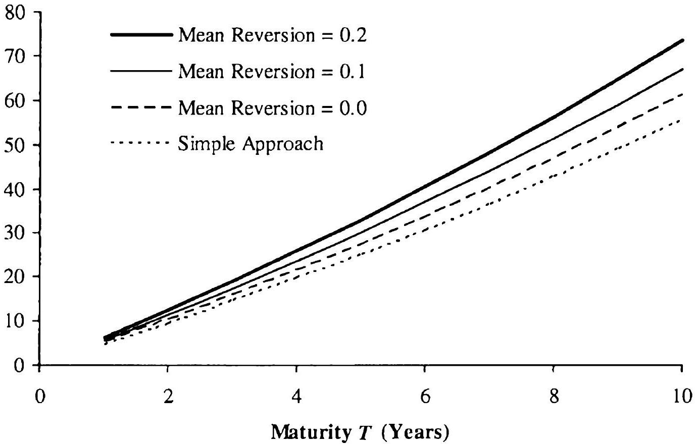

## Smile Dynamics and Hedging

---
tags: [quant/knowledge]
---
Nevertheless, it is important to realize that different models, while possibly producing identical swaption prices, may imply different - sometimes very different - hedging strategies and, ultimately, P\&L (Profit-And-Loss) of a vanilla options desk. We elaborate on this in the next two sections, and then turn to a few relevant topics associated with practicalities of swaption model calibration.

### 16.1.1 Smile Dynamics

Delta hedging in vanilla models is intimately linked to the model-implied volatility smile dynamics, i.e. how the smile moves with the underlying. To expand on this, let us focus on a $T$-maturity, $K$-strike European call option $c(t)=c(t, S(t) ; T, K)$, and consider the computation of its time $t$ delta

$$
\Delta(t)=\frac{\partial c(t)}{\partial S} .
$$

Recall (see (7.6)) the notion of implied volatility $\sigma_{\mathrm{B}}(t, S(t) ; T, K)$,

$$
c(t)=c_{\mathrm{B}}\left(t, S(t) ; T, K ; \sigma_{\mathrm{B}}(t, S(t) ; T, K)\right)
$$

where $c_{\mathrm{B}}(t, S ; T, K ; \sigma)$ represents the usual Black formula at a volatility level $\sigma$ (see Remark 7.2.8). By the chain rule, it follows that

$$
\begin{equation*}
\Delta(t)=\frac{\partial c_{\mathrm{B}}}{\partial S}+\frac{\partial c_{\mathrm{B}}}{\partial \sigma_{\mathrm{B}}} \frac{\partial \sigma_{\mathrm{B}}}{\partial S}=\Delta_{\mathrm{B}}(t)+\Upsilon_{\mathrm{B}}(t) \frac{\partial \sigma_{\mathrm{B}}}{\partial S}, \tag{16.1}
\end{equation*}
$$
^eq16-1

where $\Delta_{\mathrm{B}}(t)$ and $\Upsilon_{\mathrm{B}}(t)$ are, respectively, the delta and vega ${ }^{3}$ computed in a Black model at a volatility of $\sigma_{\mathrm{B}}$. From the Black formula (7.6), it follows that

$$
\Delta_{\mathrm{B}}(t)=\Phi\left(d_{+}\right), \quad \Upsilon_{\mathrm{B}}(t)=S(t) \sqrt{T-t} \phi\left(d_{+}\right)
$$

with $d_{ \pm}$defined by (7.6). According to (16.1), for models more sophisticated than the Black model, one can expect that a certain (possibly negative) amount of Black vega will "leak" into the Black delta, to produce a proper model-consistent delta. The amount of this leakage is controlled by the smile dynamics of the model, as given by the term $\partial \sigma_{\mathrm{B}} / \partial S$. This term is often called the backbone of the model.

For arguments sake, suppose we use the Black model with strike-specific volatility for risk-managing options, i.e. we use the pricing formula

$$
\begin{equation*}
c(t, S(t) ; T, K)=c_{\mathrm{B}}(t, S(t) ; T, K ; \psi(T, K)) \tag{16.2}
\end{equation*}
$$
^eq16-2

where $\psi(T, K)$ is calibrated, at time $t=0$, to market for each $T$ and $K$. According to (16.1), the delta calculated in our model will be exactly $\Delta_{\mathrm{B}}(t)$, i.e. the ordinary Black delta. On the other hand, this would not be the

[^0]case in, say, the Heston model, which we recall (from Section 8.8) to have "sticky delta" dynamics when the variance variable $z(t)$ is kept fixed. For the common case of a downward-sloping smile (i.e. a negative correlation parameter in the Heston model), it follows that $\Delta_{\text {Heston }}(t)>\Delta_{\mathrm{B}}(t)$, since $\Upsilon_{\mathrm{B}}(t)>0$ and - according to Figure 8.8 in Section 8.8 - $\partial \sigma_{\mathrm{B}} / \partial S>0$. For a downward sloping smile in a local volatility model, on the other hand, $\partial \sigma_{\mathrm{B}} / \partial S<0$ (see Figure 8.7) and the model delta would be less than the Black delta.

In general, the usefulness of a given swaption model to a trading desk lies perhaps not so much in its ability to fit the market - an easy feat if model parameters are allowed to depend on strike - but by how closely the model can match the realized dynamics of the volatility smile. Indeed, to the extent that volatility smile moves predicted by the model differ markedly from observations, the hedging strategies prescribed by the model will not be successful in practice, and traders will not be able to predict the P\&L implications of a move in market variables. Due to the importance of the backbone, it is not uncommon for a trading desk to exogenously supply an ad-hoc rule for smile moves that overrides the model-computed value of $\partial \sigma_{\mathrm{B}} / \partial S$; this practice is sometimes known as shadow delta hedging. Common rules include the earlier mentioned sticky delta rule, as well as the sticky strike rule (16.2) which assumes that the smile remains fixed as a function $K$ when $S$ moves ${ }^{4}$. While applications of ad-hoc rules when computing deltas will compromise the theoretical integrity of the underlying model, in practice the efficacy and stability of the hedging strategy may nevertheless improve.

### 16.1.2 Adjustable Backbone

As shadow delta hedging is a very common practice, let us proceed to elaborate on the basic idea, by describing a possible approach for exogenously controlling the backbone in a more nuanced way than through simple sticky delta/strike rules. We present our ideas in the context of a displaced lognormal model; adding stochastic volatility to the model would follow standard procedures and will not affect the backbone. Recalling the model (7.21),

$$
\begin{equation*}
d S(t)=\lambda(b S(t)+(1-b) L) d W(t) \tag{16.3}
\end{equation*}
$$
^eq16-3

we first focus on calculating its backbone. To find approximately the implied Black volatility for the model, we apply the expansion method of Proposition 7.5.1 with $\beta=0, \zeta=1$. Keeping only the first term, we obtain

$$
\sigma_{\mathrm{B}}(0, S(0) ; T, K) \approx \lambda \frac{\ln (S(0) / K)}{\int_{K}^{S(0)} \frac{d u}{b u+(1-b) L}}=\lambda b \frac{\ln (S(0) / K)}{\ln \left(\frac{b S(0)+(1-b) L}{b K+(1-b) L}\right)} .
$$

The backbone for the at-the-money strike is given by[^1]

$$
\left.\frac{\partial \sigma_{\mathrm{B}}(0, S(0) ; T, K)}{\partial S(0)}\right|_{K=S(0)} \approx-\frac{1-b}{2} \frac{L}{S(0)^{2}} \lambda
$$
and with $L \approx S(0)$, as is typically the case, we get

$$
\left.\frac{\partial \sigma_{\mathrm{B}}(0, S(0) ; T, K)}{\partial S(0)}\right|_{K=S(0)} \approx-\frac{1-b}{2} \frac{\lambda}{S(0)} .
$$

Clearly, the backbone is controlled by $b$. When $b=1$, we obtain the Black backbone $\left(\partial \sigma_{\mathrm{B}} / \partial S=0\right)$ and, when $b=0$, we obtain what we call the Gaussian backbone, as it is the backbone that is consistent with Gaussian dynamics - see Remark 7.2.9. The model (16.3), however, does not allow for an independent control over the backbone as $b$ is not a free parameter, but is determined by the slope of the market-observed volatility smile.

Let us see what would happen if we had specified the model (16.3) somewhat differently:

$$
\begin{equation*}
d S(t)=\lambda(b S(t)+(1-b) S(0)) d W(t) \tag{16.4}
\end{equation*}
$$
^eq16-4

Then, following the same steps as above, we would get

$$
\begin{aligned}
\sigma_{\mathrm{B}}(0, S(0) ; T, K) & \approx \lambda b \frac{\ln (S(0) / K)}{\ln \left(\frac{S(0)}{b K+(1-b) S(0)}\right)}, \\
\left.\frac{\partial \sigma_{\mathrm{B}}(0, S(0) ; T, K)}{\partial S(0)}\right|_{K=S(0)} & \approx \frac{1-b}{2} \frac{\lambda}{S(0)} .
\end{aligned}
$$

We see that the backbone is now different - positive (for $b \in[0,1)$ ) rather than negative, as in the model (16.3). This difference, of course, originates with the fact that a perturbation to $S(0)$ now affects the local volatility function in (16.4): a shock of size $\delta S(0)$ to $S(0)$ increases the local volatility function by $\lambda(1-b) \delta S(0)$, and the impact propagates into the implied volatility itself. On the other hand, the volatility smile generated by the model (16.4) has the same slope as the smile generated by the model (16.3), so we have arrived at two models with the same (static) smile but different smile dynamics. Clearly, by "mixing" the two, we can get a model where the backbone is controlled independently of the smile.

Here is how we proceed. Introducing a new parameter, "mixing" $m$, we specify

$$
\begin{equation*}
d S(t)=\lambda(b S(t)+(m-b) S(0)+(1-m) L) d W(t) \tag{16.5}
\end{equation*}
$$
^eq16-5

For $L$ close to $S(0), \lambda$ still has the meaning of relative (log-normal) volatility, and the slope of the smile is still controlled by $b$. On the other hand, simple calculations yield

$$
\begin{aligned}
\sigma_{\mathrm{B}}(0, S(0) ; T, K) & \approx \lambda b \frac{\ln (S(0) / K)}{\ln \left(\frac{m S(0)+(1-m) L}{b K+(m-b) S(0)+(1-m) L}\right)}, \\
\left.\frac{\partial \sigma_{\mathrm{B}}(0, S(0) ; T, K)}{\partial S(0)}\right|_{K=S(0)} & \approx \frac{1}{2} \frac{(m-b) S(0)-(1-m) L}{S(0)} \frac{\lambda}{S(0)}
\end{aligned}
$$

and, with $L \approx S(0)$,

$$
\left.\frac{\partial \sigma_{\mathrm{B}}(0, S(0) ; T, K)}{\partial S(0)}\right|_{K=S(0)} \approx\left(m-\frac{1+b}{2}\right) \frac{\lambda}{S(0)}
$$

Clearly, for any $b$, we can adjust the backbone by choosing a suitable $m$. For example, we can always obtain the Black backbone by setting $m=(1+b) / 2$, or the Gaussian backbone by setting $m=b / 2$.

To check that $m$ does not, indeed, have an impact on the (static) smile, let us calculate the slope of the implied volatility smile in the model (16.5). We have

$$
\left.\frac{\partial \sigma_{\mathrm{B}}(0, S(0) ; T, K)}{\partial K}\right|_{K=S(0)} \approx \frac{1}{2} \frac{-m S(0)+L m+b S(0)-L}{S(0)} \frac{\lambda}{S(0)}
$$

and, with $L \approx S(0)$,

$$
\begin{equation*}
\left.\frac{\partial \sigma_{\mathrm{B}}(0, S(0) ; T, K)}{\partial K}\right|_{K=S(0)} \approx-\frac{1-b}{2} \frac{\lambda}{S(0)} . \tag{16.6}
\end{equation*}
$$
^eq16-6

Thus, as claimed, the slope of the smile is independent of $m$ and, in particular, is the same for the models (16.3), (16.4) and (16.5).

We should note that sometimes a different definition of the backbone is used, a definition that we call the ATM backbone:

$$
\left.\frac{\partial \sigma_{\mathrm{B}}(0, S ; T, S)}{\partial S}\right|_{S=S(0)}
$$

This quantity specifies how the at-the-money volatility $\sigma_{\mathrm{B}}(0, S(0) ; T, S(0))$ changes with the underlying $S(0)$. Simple calculus yields

$$
\begin{aligned}
\left.\frac{\partial \sigma_{\mathrm{B}}(0, S ; T, S)}{\partial S}\right|_{S=S(0)}= & \left.\frac{\partial \sigma_{\mathrm{B}}(0, S(0) ; T, K)}{\partial S(0)}\right|_{K=S(0)} \\
& +\left.\frac{\partial \sigma_{\mathrm{B}}(0, S(0) ; T, K)}{\partial K}\right|_{K=S(0)}
\end{aligned}
$$

and we obtain, for the model (16.5) assuming $L \approx S(0)$,

$$
\begin{equation*}
\left.\frac{\partial \sigma_{\mathrm{B}}(0, S ; T, S)}{\partial S}\right|_{S=S(0)} \approx-(1-m) \frac{\lambda}{S(0)} \tag{16.7}
\end{equation*}
$$
^eq16-7

The ATM backbone in the model (16.5) is independent of the skew $b$. When $m=b$ (model (16.3)) the ATM backbone is twice the slope of the volatility smile (see (16.6)), and when $m=1$ (model (16.4)), the ATM backbone is zero, i.e. at-the-money implied volatility does not change as the underlying moves. Other regimes are easy to simulate. For example, a trader may believe that the at-the-money implied volatility should "slide along" the smile, i.e. exhibit (a weaker form of) the "sticky strike" behavior. Mathematically, this is expressed as

$$
\left.\frac{\partial \sigma_{\mathrm{B}}(0, S ; T, S)}{\partial S}\right|_{S=S(0)}=\left.\frac{\partial \sigma_{\mathrm{B}}(0, S(0) ; T, K)}{\partial K}\right|_{K=S(0)}
$$

which, using (16.6) and (16.7), gives us the following condition on the mixing parameter:

$$
m=\frac{b+1}{2}
$$

### 16.1.3 Stochastic Volatility Swaption Grid

With backbone issues out of the way, let us now discuss a typical setup for vanilla options modeling. As mentioned before, a stochastic volatility model offers a good compromise between tractability and the ability to represent typical shapes of volatility smiles. To describe a typical setup, let us introduce a tenor structure

$$
0<T_{0}<T_{1}<T_{2}<\ldots<T_{N}, \quad \tau_{n}=T_{n+1}-T_{n}
$$

and a collection of forward swap rates of different expiries/tenors, as in Section 5.10, see (5.13)-(5.14). For each swap rate $S_{n, m}(t)$, we specify the following SV-style dynamics (see Chapter 8) in the corresponding annuity measure

$$
d S_{n, m}(t)=\lambda_{n, m}\left(b_{n, m} S_{n, m}(t)+\left(1-b_{n, m}\right) S_{n, m}(0)\right) \sqrt{z_{n, m}(t)} d W^{n, m}(t)
$$

$$
\begin{equation*}
d z_{n, m}(t)=\theta\left(1-z_{n, m}(t)\right) d t+\eta_{n, m} \sqrt{z_{n . m}(t)} d Z^{n, m}(t) \tag{16.8}
\end{equation*}
$$
^eq16-8

with $\left\langle d Z^{n, m}(t), d W^{n, m}(t)\right\rangle=0$. Alternative local volatility parameterizations as in (16.3) or even (16.5) could of course be used, but we abstain from doing so to simplify notations. Further, we assume that the mean reversion of variance parameter $\theta$ is global, i.e. the same for all swaptions. This does not in any way restrict the range of available smiles for each individual swap rate as explained in Section 8.2, yet allows for a measure of consistency in term structure models (e.g., as in Section 13.2) that we, eventually, calibrate to the vanilla market. The rest of the parameters

$$
\left\{\left(\lambda_{n, m}, b_{n, m}, \eta_{n, m}\right)\right\}, \quad n=0, \ldots, N-1, \quad m=1, \ldots, N-n
$$

form the so-called $S V$ swaption grid, with the meanings of various parameters explained in Section 8.2. Relative to a full swaption volatility cube (see footnote 2), an SV swaption grid typically requires storage of fewer parameters, as the SV model produces a fairly parsimonious (and guaranteed arbitrage-free) interpolation rule in the strike dimension, eliminating the need for outright storage of implied Black or Gaussian volatilities on a strike grid. Of course, multiple other - possibly heuristic - interpolation rules can be used instead. We return to this briefly in Section 16.1.5 below.

### 16.1.4 Calibrating Stochastic Volatility Model to Swaptions

SV parameters for swaptions are usually obtained by individually calibrating swaptions for each expiry/maturity grid point, with an exception of the mean reversion parameter $\theta$. Recall (Section 8.2) that the parameter $\theta$ controls the speed at which the volatility smile flattens with time to expiry, so it is possible to choose a single $\theta$ for the whole grid, in such a way as to minimize the variability of $\eta_{n, m}$ across different $n$ 's (expiries).

Selection of $\theta$ can be done manually by choosing a particular $\theta$, calibrating SV parameters to each swaption grid point, and then assessing how constant $\eta_{n . m}$ for different $n, m$ are. If not sufficiently constant, a different $\theta$ can be selected, and the procedure iterated until a sufficiently good choice is found. In general, if $\eta_{n, m}$ 's increase with $n$, we need a smaller $\theta$ to prevent volatility smiles from flattening out too fast with expiry. Conversely, if $\eta_{n, m}$ 's decrease in $n$, a larger $\theta$ is needed.

Apart from $\theta$, swaption calibration is performed individually for each grid point. Let us sketch the algorithm. First, we fix a particular swaption maturity and a swap tenor, as represented by indices $n, m$. Suppressing these indices for the moment, suppose a collection of strikes $K_{1}, \ldots, K_{J}$ is given, along with corresponding market prices of swaptions $\widehat{V}_{1}, \ldots, \widehat{V}_{J}$. Given $\lambda, b, \eta$ let

$$
V\left(K_{j} ; \lambda, b, \eta\right), \quad j=1, \ldots, J
$$

be the model prices of swaptions in the model (16.8)-(16.9) with parameters $\lambda, b, \eta$. Our goal is to find $\lambda, b, \eta$ to match as closely as possible the market prices $\widehat{V}_{1}, \ldots, \widehat{V}_{J}$, where nearly always $J \geq 3$. This type of problem is most conveniently solved by non-linear optimization methods. Defining the objective function

$$
\begin{equation*}
\mathcal{I}_{1}(\lambda, b, \eta)=\sum_{j=1}^{J} w_{j}\left(V\left(K_{j} ; \lambda, b, \eta\right)-\widehat{V}_{j}\right)^{2} \tag{16.10}
\end{equation*}
$$
^eq16-10

where $w_{1}, \ldots, w_{J}$ are user-specified weights, we obtain the calibrated parameters by solving the problem

$$
\left(\lambda^{*}, b^{*}, \eta^{*}\right)=\underset{\{\lambda, b, \eta\}}{\operatorname{argmin}} \mathcal{I}_{1}(\lambda, b, \eta)
$$

with a specialized algorithm such as the Fletcher-Reeves or the LevenbergMarquardt method (see Press et al. [1992]). As the optimization problem is solved numerically, the solution typically involves multiple calculations of option prices in the SV model, and having an efficient valuation algorithm such as the one developed in Section 8.4 is important for performance.

The weights $w_{1}, \ldots, w_{J}$ serve two purposes. One is to express the view on which swaptions should be matched more accurately: the higher the weight $w_{j}$ is, the more closely the algorithm will try to match the price of the swaption with strike $K_{j}$. As we typically have more confidence in the at-the-money swaption prices, we would often set the weights higher for at-the-money strikes and lower for strikes away from the ATM. The other important purpose of the weights is to normalize the magnitude of different terms in the sum in (16.10), as different scales of different terms (i.e. some $\widehat{V}_{j}$ 's are bigger than others) will influence which terms are matched closer. As we often seek to ensure a good fit in terms of implied volatilities rather than absolute option values, a commonly-used scaling involves vegas of the options in the optimization problem; each weight $w_{j}$ then represents a product of a user-specified importance weight and a scaling weight equal to the inverse of the swaption vega. To simplify user interface, the vega scaling can be internalized, with (16.10) replaced by

$$
\begin{equation*}
\mathcal{I}_{2}(\lambda, b, \eta)=\sum_{j=1}^{J} w_{j}\left(\frac{V\left(K_{j} ; \lambda, b, \eta\right)-\widehat{V}_{j}}{\widehat{\Upsilon}_{j}}\right)^{2} \tag{16.11}
\end{equation*}
$$
^eq16-11

where $\widehat{\Upsilon}_{j}$ 's are vegas of corresponding options. For efficiency reasons, the vegas should not be calculated inside the calibration loop; a common shortcut is to just use vegas obtained in the Black model. The resulting objective function is a (numerically efficient) approximation to an objective function expressed in terms of implied volatilities:

$$
\begin{equation*}
\mathcal{I}_{3}(\lambda, b, \eta)=\sum_{j=1}^{J} w_{j}\left(\sigma_{\mathrm{B}}\left(K_{j} ; \lambda, b, \eta\right)-\widehat{\sigma}_{j}\right)^{2} \tag{16.12}
\end{equation*}
$$
^eq16-12

where $\sigma_{\mathrm{B}}\left(K_{j} ; \lambda, b, \eta\right)$ is the Black volatility implied by the model for the option with strike $K_{j}$, and $\widehat{\sigma}_{j}$ is its market-implied volatility. While (16.12) could be used directly, the expense of calculating implied volatilities inside the calibration loop typically makes it less attractive than (16.11).

Finally, let us remind the reader that optimization of a precision norm (e.g. either $\mathcal{I}_{1}, \mathcal{I}_{2}, \mathcal{I}_{3}$ ) must be undertaken for each pair of swaption expiries and swap tenors in the SV swaption grid, a total of $N(N+1) / 2$ separate optimization problems.

### 16.1.5 Some Other Interpolation Rules

Usage of the SV model for swaption calibration is particularly convenient if one ultimately needs to use swaption market data for calibration of term structure models such as the quasi-Gaussian model of Section 13.2 or the Libor market model of Section 14.2.5. See, in particular, the discussion in Section 15.2. It is, however, certainly possible to represent the strikedependence of implied swaption volatilities by different means. A particularly popular choice is to calibrate a SABR model (Section 8.6) to the smile, using the principles outlined above. The existence of a reasonably accurate expansion for implied volatilities in this model makes optimization of the norm (16.12) particularly convenient.

To improve the fitting capability of the model, we note that it is not uncommon for practitioners to "improve" the SABR model with heuristic modifications, such as making the power $c$ or correlation $\rho$ a smooth, bounded function of swaption strikes. Such alterations of the original model make little sense dynamically speaking, but may still represent a valid representation of the marginal distribution of forward swap rates. In a sense, the original SABR model has been used to produce a particular parametric interpolation rule for implied volatilities, where some of the parameters happen to have a convenient intuitive interpretation. Of course, it may then be tempting to skip the entire concept of a dynamic model and simply jump straight to the specification of a smooth parametric form for implied volatilities as a function of strike. There are numerous such forms in circulation; one representative example is the SVI ("stochastic volatility inspired") 5-parameter form proposed in Gatheral [2004]:

$$
\begin{equation*}
\sigma_{\mathrm{B}}(0, S(0) ; T, K)=a+b\left(\rho(k-h)+\sqrt{(k-h)^{2}+s^{2}}\right) \tag{16.13}
\end{equation*}
$$
^eq16-13

where $k \triangleq \ln (K / S(0))$. More details about the valid range and intuition for the parameters $a, b, h, \rho, s$ can be found in Gatheral [2004] and Gatheral and Jacquier [2010], and shall not be repeated here. Let us just note that one drawback of parametric forms is that they can produce arbitrages, in the sense that there typically are parameter combinations that will imply negative marginal densities ${ }^{5}$ for swap rates. This issue must be taken into consideration, e.g. by imposing constraints on the parameter space when calibrating the parametric form against market prices.

We note that similar issues with violation of arbitrage can arise if crude interpolation schemes are used for strike interpolation in a swaption cube - for instance, linear interpolation should never be used, since the second derivative of implied volatilities will not exist everywhere. A better choice for an interpolation scheme would be a twice differentiable spline, such as those described at length in Chapter 6.

[^2]
### 16.2 Caps and Floors

While pricing caps and floors (see Section 5.8) is typically no more complicated than pricing swaptions, calibrating a model to quoted cap or floor prices is more involved than calibrating it to swaptions. This is due to the fact that market prices of individual caplets are not directly available, since only prices of full caps - i.e. collections of caplets - are quoted. For example, in the short- to medium-term market in the US, caps of maturities $1,2,3,5$ and 10 years are traded. With each caplet covering 3 months, a total of $10 \times 4=40$ different caplet maturities are involved, each requiring its own rule for strike interpolation. The scarcity of actual quotes, and the fact that these quotes represent sums of option prices, can potentially lead to overfitting unless extra constraints, either implicit or explicit, are imposed during calibration.

### 16.2.1 Basic Problem

Assume for a moment that market prices of both 2 year and 2 year 3 months caps are known at multiple strikes. By simple subtraction, we could then recover the prices of individual caplets fixing in two years time, and would be able to fit model parameters to prices of those caplets across strikes, in a manner identical to that employed for swaptions. In reality, there is no market in 2 year 3 months caps, but we could always attempt to obtain the required prices by interpolating between the known prices of 2 year and 3 year caps. Alas, this idea is hampered by the fact that 2 year caps are typically quoted in a range of strikes that is different from the strikes for a 3 year cap: for a cap with a given maturity, the quoted strikes are typically fixed offsets from the forward swap rate of the corresponding maturity, i.e. ATM $\pm 100$ basis points, ATM $\pm 200$ basis points, and so on. As a consequence, we would need to perform interpolation between 2 year and 3 year cap prices across both expiries and strikes. Ensuring that such an interpolation scheme is both free of arbitrage and will give rise to reasonable (i.e. smooth over time) model parameters is not an easy task; our advice is to avoid it.

A more reasonable approach to cap calibration is to employ interpolation directly in model parameters, borrowing the ideas from yield curve construction theory (see Chapter 6). Specifically, we can formalize the cap calibration problem as finding model parameter curves indexed by expiry, such that a price precision norm is minimized subject to penalties for non-smooth model parameters. Encouraging smooth model parameters across expiry makes any subsequent parameter interpolation across time (as required for seasoned trades with fixing schedules deviating from that used in calibration) both more stable and more believable. Moreover, imposing smoothness constraints promotes the stability of calibration through time, a property important for consistency of risk management.

### 16.2.2 Setup and Norms

To formalize our approach, we specify the tenor structure

$$
0=T_{0}<T_{1}<T_{2}<\ldots<T_{N}, \quad \tau_{n}=T_{n+1}-T_{n}
$$

such that $\left[T_{n}, T_{n+1}\right]$ is a caplet tenor ( 3 months in the US). For concreteness, we use an SV model to define our volatility interpolation scheme in strike space; let the SV parameters to be used for a caplet that fixes at $T_{n}$ and pays at $T_{n+1}$ be denoted $\left(\lambda_{n}, b_{n}, \eta_{n}\right), n=1, \ldots, N-1$. We denote the price of the $n$-th caplet with strike $K$ in the SV model with parameters $\lambda, b, \eta$ by $V_{n}(K ; \lambda, b, \eta)$. Let $n_{i}, n_{1}<\ldots<n_{I}$, be the number of caplets in the $i$-th standard market cap. Furthermore, let us suppose that the $i$-th standard cap is available with strikes

$$
K_{\imath, 1}, \ldots, K_{i, J}
$$

where we for simplicity have assumed that caps of different tenors are quoted for the same number of strikes $J$ (but we allow for different values of those strikes). Finally, let us denote by $\widehat{V}_{i, j}, i=1, \ldots, I, j=1, \ldots, J$, the market price of the $i$-th standard cap (with $n_{i}$ caplets) at strike $K_{i, j}$.

Let us first consider the introduction of a precision norm that quantifies the amount of mispricing associated with a given set of SV parameters. For instance, we could use a standard weighted least-squares norm

$$
\mathcal{I}_{1}=\sum_{i=1}^{I} \sum_{j=1}^{J} w_{i, j}\left(\sum_{n=1}^{n_{2}} V_{n}\left(K_{i, j} ; \lambda_{n}, b_{n}, \eta_{n}\right)-\widehat{V}_{i, j}\right)^{2},
$$

where $w_{i, j}$ is the weight associated with the $i$-th cap of strike $K_{j}$.
In principle, we can treat parameter triples for all $n, n=1, \ldots, N-1$, as independent variables to be recovered in the solution of an optimization problem. However, significant performance improvements can be realized if we reduce the number of free parameters by allowing only the parameters that correspond to the expiries of market caps to be free inputs, while interpolating the rest. Linear interpolation seems to perform well, although more sophisticated interpolation schemes borrowed from Chapter 6 could result in further improvements. In any case, if we denote by $\mathcal{X}$ the collection of $\left\{\left(\lambda_{n_{i}}, b_{n_{i}}, \eta_{n_{i}}\right)\right\}$ for $i=1, \ldots, I$, then we can rewrite the objective function as

$$
\mathcal{I}_{2}(\mathcal{X})=\sum_{i=1}^{I} \sum_{j=1}^{J} w_{i, j}\left(\sum_{n=1}^{n_{i}} V_{n}\left(K_{\imath, j} ; \lambda_{n}(\mathcal{X}), b_{n}(\mathcal{X}), \eta_{n}(\mathcal{X})\right)-\widehat{V}_{\imath, j}\right)^{2}
$$

where, as explained, $\lambda_{n}(\mathcal{X}), b_{n}(\mathcal{X}), \eta_{n}(\mathcal{X})$ are obtained from the elements in $\mathcal{X}$ by suitable interpolation.

Various types of penalties for lack of smoothness are possible, with the discussion of the similar issues in LM calibration in Section 14.5.6 imminently applicable here; a reasonable choice would minimize the discrete equivalent of the integral of the square of the first-order derivative. In particular, we define a norm that, in essence, penalizes deviations of SV parameters from being constant over time,

$$
\begin{align*}
& \mathcal{I}_{\text {simooth }}(\mathcal{X})=w^{\lambda} \sum_{n=2}^{N-1}\left(\lambda_{n}(\mathcal{X})-\lambda_{n-1}(\mathcal{X})\right)^{2} \\
& +w^{b} \sum_{n=2}^{N-1}\left(b_{n}(\mathcal{X})-b_{n-1}(\mathcal{X})\right)^{2}+w^{\eta} \sum_{n=2}^{N-1}\left(\eta_{n}(\mathcal{X})-\eta_{n-1}(\mathcal{X})\right)^{2} \tag{16.14}
\end{align*}
$$
^eq16-14

Here weights $w^{\lambda}, w^{b}, w^{\eta}$ determine the relative importance of smoothing different model parameters. While the representation (16.14) is quite transparent, we can improve performance somewhat by reformulating - exactly or approximately, depending on the interpolation used - the objective function solely in terms of the components of $\mathcal{X}$, i.e. by imposing smoothness directly on the "free" parameters $\left\{\left(\lambda_{n_{1}}, b_{n_{i}}, \eta_{n_{2}}\right)\right\}$ for $i=1, \ldots, I$.

### 16.2.3 Calibration Procedure

Having introduced precision and smoothing norms above, the SV cap calibration problem can be cast as a minimization of the following objective function,

$$
\mathcal{X}=\operatorname{argmin}\left\{w_{\text {precision }} \mathcal{I}_{2}(\mathcal{X})+w_{\text {smooth }} \mathcal{I}_{\text {smooth }}(\mathcal{X})\right\}
$$

over the allowed domain for $\mathcal{X}$. The weights $w_{\text {precision }}$ and $w_{\text {smooth }}$ determine relative importance of achieving smoothness over a good fit to market prices. This optimization problem may be solved by numerical methods (see Press et al. [1992]), just as many other calibration problems we discussed previously. To improve efficiency of the algorithm, one could here attempt to split volatility level calibration from smile slope calibration, as dividing optimization problems into smaller ones and tackling them separately often gives us better performance (see relevant discussion in Section 14.5.8). Specifically, significant gains can often be found by iterating over a split scheme where we first calibrate the volatility parameter to at-the-money cap prices only and then calibrate the other model parameters to out-of-the-money cap prices. The success of such a "relaxation" scheme lies with the relative independence of the impacts of volatility parameter and the other parameters: by successfully optimizing in two relatively orthogonal dimensions, we reach a joint minimum faster than in the full calibration. We omit straightforward details.

### 16.3 Terminal Swap Rate Models

The relative simplicity with which European swaptions (and caps) can be priced comes from the fact that valuation here requires only knowledge of the terminal distribution of a single swap rate, in the appropriate annuity measure. This holds true for all securities whose payoffs can be expressed as deterministic functions of the swap rate $S(T)$ in the annuity measure, as should be clear from the replication argument of Proposition 8.4.13. Unfortunately, such payoffs are relatively rare. Much more common are relatively simple payoffs that appear to depend on the rate $S(T)$ only but, in fact, require the knowledge of certain additional discount bonds, often observed on the same date. As multiple discount bonds are involved and the knowledge of the distribution of a swap rate is not sufficient for valuation, it would appear that a full term structure model is needed to price such derivatives. This, of course, is an option that is always available. However, if the dependence on additional discount bonds is sufficiently mild, we often can avoid computational cost of a full-blown term structure model through certain approximations that aim at functionally linking the values of discount bonds on date $T$ to the "driving" rate $S(T)$, i.e. the rate that primarily determines the payoff. The basic modeling idea, which we denote the Terminal Swap Rate (TSR) approach, is extremely useful in handling a range of actively traded European derivatives that are not, strictly speaking, functions of a single rate, but can still be approximated accurately as such. We use the (somewhat loose, admittedly) term approximately single-rate for this class of securities; several common securities in the class will be presented in subsequent sections, after the TSR method has been described in detail.

### 16.3.1 TSR Basics

As briefly outlined in the previous section, the TSR approach treats the swap rate $S(T)$ as the single fundamental state variable for the yield curve at time $T$. To define the method formally, we continue with the notations of $A(t)$ being the annuity corresponding to the swap rate $S(t)$; for concreteness, we assume that (see (5.4)-(5.5))

$$
\begin{align*}
& A(t) \triangleq A_{0, N}(t)=\sum_{n=0}^{N-1} \tau_{n} P\left(t, T_{n+1}\right)  \tag{16.15}\\
& S(t) \triangleq S_{0, N}(t)=\frac{P(t, T)-P\left(t, T_{N}\right)}{A(t)} \tag{16.16}
\end{align*}
$$
^eq16-15
^eq16-16

where

$$
0<T=T_{0}<T_{1}<\ldots<T_{N}, \quad \tau_{n}=T_{n+1}-T_{n},
$$

is a tenor structure of dates. We continue denoting by $\mathrm{Q}^{A}$ the annuity measure, i.e. the measure for which $A(t)$ is the numeraire. We recall that the
market-implied distribution of $S(T)$ in $\mathrm{Q}^{A}$ can be found from calibrating a vanilla model to $N$-period swaptions with expiry $T$, across multiple strikes.

The no-arbitrage valuation formula (1.15) states that the value of a derivative with an $\mathcal{F}_{T}$-measurable payoff $X$ is given by

$$
\begin{equation*}
V(0)=A(0) \mathrm{E}^{A}\left(\frac{X}{A(T)}\right) . \tag{16.17}
\end{equation*}
$$
^eq16-17

Let $\{P(T, M)\}_{M \geq T}$ be the discount bonds of various maturities, all observed at time $T$. A TSR model specifies a map

$$
\begin{equation*}
P(T, M)=\pi(S(T), M), \quad M \geq T \tag{16.18}
\end{equation*}
$$
^eq16-18

where $\{\pi(\cdot, M)\}_{M \geq T}$ is a collection of exogenously specified maturity-indexed functions. In other words, each discount factor is assumed to be a deterministic, known function of the swap rate.

In a proper term structure model, the relationship between the market rate $S(T)$ and the discount factors $\{P(T, M)\}_{M \geq T}$ emerges from the model itself, and is ultimately derived from no-arbitrage conditions. While now we seek to impose the functional relationships (16.18) exogenously, consideration of no-arbitrage must also play a role. Indeed, a first condition to be imposed on the function $\{\pi(\cdot, M)\}_{M \geq T}$ will be the no-arbitrage condition: the valuation formula (16.17), when applied to the specification (16.18), must reproduce initial discount bond prices, i.e. the following must hold for any ${ }^{6} M \geq T$,

$$
\begin{equation*}
P(0, M)=A(0) \mathrm{E}^{A}\left(\frac{\pi(S(T), M)}{\sum_{n=0}^{N-1} \tau_{n} \pi\left(S(T), T_{n+1}\right)}\right), \quad M \geq T . \tag{16.19}
\end{equation*}
$$
^eq16-19

The no-arbitrage condition by itself is not sufficient to obtain a workable model. Another restriction on the mapping functions is obtained by observing that the swap rate $S(T)$ itself is a function of discount factors, as evidenced by (16.16). This suggests the introduction of a consistency condition, i.e. the requirement that the following holds for all $x$,

$$
\begin{equation*}
x=\frac{1-\pi\left(x, T_{N}\right)}{\sum_{n=0}^{N-1} \tau_{n} \pi\left(x, T_{n+1}\right)} \tag{16.20}
\end{equation*}
$$
^eq16-20

The final condition that we impose on a TSR model is that the set of functions $\{\pi(\cdot, M)\}_{M \geq T}$ should be reasonable. While somewhat harder to quantify than the other conditions, we shall mostly impose the following restrictions:

[^3]- For each $x$ and $M \geq T, \pi(x, M)$ is between 0 and 1 ,

$$
0<\pi(x, M) \leq 1
$$

- For each $x, \pi(x, \cdot)$ is monotonic in $M$,

$$
M_{1}<M_{2} \Longrightarrow \pi\left(x, M_{1}\right) \geq \pi\left(x, M_{2}\right)
$$

- The function $\pi(x, M)$ is continuous in ( $x, M$ ).

Some of these conditions are more important than others. For example, one may choose to tolerate negative interest rates, i.e. having $\pi(x, M)>1$ for some $x, M$, but not negative prices of bonds, i.e. having $\pi(x, M)<0$ for some $x, M$.

The conditions listed above do not define the functions $\{\pi(\cdot, M)\}_{M \geq T}$ uniquely; however, they do, as a rule, specify the functions uniquely within a particular parametric class. A concrete model is then obtained by postulating a particular parametric class for the functions $\{\pi(\cdot, M)\}_{M \geq T}$ first, and then choosing functions within the class uniquely from the no-arbitrage and consistency conditions. Let us consider a few representative examples.

### 16.3.2 Linear TSR Model

The linear TSR model is obtained by specifying

$$
\begin{equation*}
\frac{\pi(x, M)}{\sum_{n=0}^{N-1} \tau_{n} \pi\left(x, T_{n+1}\right)}=a(M) x+b(M), \quad M \geq T \tag{16.21}
\end{equation*}
$$
^eq16-21

for deterministic functions $a(\cdot)$ and $b(\cdot)$. The no-arbitrage condition requires

$$
P(0, M)=A(0) \mathrm{E}^{A}(a(M) S(T)+b(M))
$$

implying a condition on the free coefficient $b(\cdot)$,

$$
\begin{equation*}
b(M)=\frac{P(0, M)}{A(0)}-a(M) S(0) \tag{16.22}
\end{equation*}
$$
^eq16-22

The consistency condition requires that

$$
x=\frac{1-\pi\left(x, T_{N}\right)}{\sum_{n=0}^{N-1} \tau_{n} \pi\left(x, T_{n+1}\right)}=\left(a\left(T_{0}\right) x+b\left(T_{0}\right)\right)-\left(a\left(T_{N}\right) x+b\left(T_{N}\right)\right)
$$

so that

$$
\begin{align*}
& b\left(T_{0}\right)=b\left(T_{N}\right)  \tag{16.23}\\
& a\left(T_{0}\right)=1+a\left(T_{N}\right) \tag{16.24}
\end{align*}
$$
^eq16-23
^eq16-24

It follows from (16.22) that if (16.23) is satisfied, then (16.24) is satisfied as well, and vice versa.

The definition (16.21) imposes new restrictions on $a(\cdot), b(\cdot)$ that go beyond those considered in the previous section. In particular, the following must now hold,

$$
\sum_{n=0}^{N-1} \tau_{n}\left(a\left(T_{n+1}\right) x+b\left(T_{n+1}\right)\right) \equiv 1
$$

implying

$$
\begin{align*}
& \sum_{n=0}^{N-1} \tau_{n} a\left(T_{n+1}\right)=0  \tag{16.25}\\
& \sum_{n=0}^{N-1} \tau_{n} b\left(T_{n+1}\right)=1 \tag{16.26}
\end{align*}
$$
^eq16-25
^eq16-26

It is enough to ensure that one of these two conditions is satisfied; the other will follow automatically by (16.22).

To complete the model specification, we may proceed as follows. First, choose coefficients $\left\{a\left(T_{1}\right), \ldots, a\left(T_{N}\right)\right\}$, subject to the condition (16.25); a scheme for this will be discussed shortly. Then, calculate $a(T)=a\left(T_{0}\right)$ from (16.24), and the rest of $a(M)$ 's by, for example, linear interpolation of $\left\{a(T), a\left(T_{1}\right), \ldots, a\left(T_{N}\right)\right\}$. Finally, calculate all $b(M)$ 's via (16.22).

The specification of a TSR model above enjoys a fair amount of numerical tractability, owning to the simple linear relationship between the market rate and annuity-discounted bonds. For that reason it is rather popular in applications. However, the linear relationship imposed by the model is not wholly realistic, as bond prices may become negative in certain states of the world. Whether this is a problem for a particular application should be decided on a case-by-case basis.

The linear TSR model (16.21) is rather flexible, as the coefficients $\left\{a\left(T_{1}\right), \ldots, a\left(T_{N}\right)\right\}$ can be selected essentially independently, subject to (16.25) only. Setting these coefficients individually is not particularly convenient, however, as financial implications of various choices are not transparent. As promised above, let us therefore look for a more meaningful way of parameterizing $a(\cdot)$. For this, let us first observe that the coefficients $a(\cdot)$ essentially define the shape of the yield curve at time $T$ for different levels of the "state variable" $S(T)$. Of course, we have seen previously that the same role is played by the mean reversion parameter in the context of a Gaussian term structure model, see Section 10.1.2. This suggests connecting the coefficients of the TSR model to a mean reversion parameter, which would not only reduce the number of parameters we need to specify, but also parametrize the model with a single parameter that has strong financial interpretation and that, in principle, could be derived from prices of traded derivatives (see Section 13.1.8).

To connect $a(\cdot)$ to mean reversion, we interpret the equality (16.21) as defining $a(M)$ via

$$
a(M)=\frac{\partial}{\partial S(T)} \frac{P(T, M)}{\sum_{n=0}^{N-1} \tau_{n} P\left(T, T_{n+1}\right)},
$$

which we rewrite, in the context of a Gaussian one-factor model, as

$$
\begin{aligned}
a(M)=\left.\frac{\partial}{\partial x} \frac{P(T, M, x)}{\sum_{n=0}^{N-1} \tau_{n} P\left(T, T_{n+1}, x\right)}\right|_{S(T, x)=S(0)} & \\
& \times\left(\left.\frac{\partial S(T, x)}{\partial x}\right|_{S(T, x)=S(0)}\right)^{-1},
\end{aligned}
$$

where $x$ is now the short rate state in the Gaussian model on which all discount bonds and swap rates depend. We denote by $A(T, x)$ the annuity as the function of the short rate state $x$,

$$
A(T, x)=\sum_{n=0}^{N-1} \tau_{n} P\left(T, T_{n+1}, x\right)
$$

so that

$$
S(T, x)=\left(1-P\left(T, T_{N}, x\right)\right) / A(T, x)
$$

and

$$
\begin{aligned}
\frac{\partial}{\partial x} \frac{P(T, M, x)}{A(T, x)} & =-\frac{P(T, M, x) G(T, M)}{A(T, x)}-\frac{P(T, M, x)}{A(T, x)^{2}} \frac{\partial A(T, x)}{\partial x} \\
\frac{\partial}{\partial x} S(T, x) & =\frac{P\left(T, T_{N}, x\right) G\left(T, T_{N}\right)}{A(T, x)}-\frac{S(T, x)}{A(T, x)} \frac{\partial A(T, x)}{\partial x}
\end{aligned}
$$

where $G(\cdot, \cdot)$ is a function of mean reversion (see (10.18)). By using the approximation

$$
\left.P(T, t, x)\right|_{S(T, x)=S(0)} \approx P(0, t)
$$

for all $t \geq T$, we obtain

$$
\begin{equation*}
a(M)=\frac{P(0, M)(\gamma-G(T, M))}{P\left(0, T_{N}\right) G\left(T, T_{N}\right)+S(0) \gamma} \tag{16.27}
\end{equation*}
$$
^eq16-27

where

$$
\begin{align*}
\gamma & \left.\triangleq \frac{1}{A(T, x)} \frac{\partial A(T, x)}{\partial x}\right|_{P(T, t, x)=P(0, t), \forall t \geq T} \\
& =\frac{\sum \tau_{n} P\left(0, T_{n+1}\right) G\left(T, T_{n+1}\right)}{\sum \tau_{n} P\left(0, T_{n+1}\right)} \tag{16.28}
\end{align*}
$$
^eq16-28

As explained before, the coefficients $b(\cdot)$ are obtained from $a(\cdot)$ by (16.22).
With this parameterization, instead of a collection $\left\{a\left(T_{1}\right), \ldots, a\left(T_{N}\right)\right\}$, only one parameter - the mean reversion $\varkappa$ - needs to be specified. As we shall see later in Section 16.6.8, the choice of mean reversion has a mild but non-vanishing impact on values of many approximately single-rate derivatives.

Linking $a(\cdot)$ to mean reversion leads to a more intuitive parameterization of the model, and also facilitates better risk management. This is so because the mean reversion parameter can in principle be hedged by European swaptions of the same expiry (here $T$ ) and different tenors, as we discussed in Section 13.1.8.2. For truly precise vega hedging, however, this somewhat indirect linkage of $a(\cdot)$ to swaption volatilities is less than ideal. In fact, it is not difficult to link $a(\cdot)$ to swap rate volatilities (expiring on the same date $T$ but of different tenors) directly, using an approach similar to what we have developed in this section. We leave the details of this idea for the reader to fill.

### 16.3.3 Exponential TSR Model

The linear TSR model is a convenient, but by no means unique, representative of the TSR approach. The exponential TSR model belongs to the same class, but uses exponential functions to connect a swap rate to discount bonds; this idea originates with the exponential relationship between a discount bond and a corresponding continuously compounded spot yield.

We start the development of the exponential specification by postulating that

$$
\begin{equation*}
\pi(x, M) \propto \exp (-l(M) x), \quad M \geq T \tag{16.29}
\end{equation*}
$$
^eq16-29

The intuitive meaning of the loading $l(M)$ is best understood by recalling that a continuously compounded spot yield for the period [ $T, M$ ], observed at $T$, is given by

$$
y(T, M)=-\frac{1}{M-T} \ln P(T, M)=-\frac{1}{M-T} \ln \pi(S(T), M)
$$

Coupled with the specification (16.29), this tells us

$$
y(T, M) \propto \frac{l(M)}{M-T} S(T), \quad M \geq T
$$

so that the curve $l(M) /(M-T), M \geq T$, defines the shape of the shock to the yield curve, expressed in terms of yields $\{y(T, M)\}_{\Lambda I \geq T}$, for a perturbation of the market rate $S(T)$. Recycling the idea of connecting this shape to something similar in a term structure model, we use a one-factor Gaussian model and specify

$$
\begin{equation*}
l(M)=\frac{1-e^{-\varkappa(M-T)}}{\varkappa} \tag{16.30}
\end{equation*}
$$
^eq16-30

If more precision is desired, we can alternatively write

$$
l(M)=\frac{1-e^{-\varkappa(M-T)}}{\varkappa}\left(\left.\frac{\partial S(T, x)}{\partial x}\right|_{S(T, x)=S(0)}\right)^{-1}
$$

where the partial derivative is computed in a one-factor Gaussian model, with $x$ being the short rate state and $S(T, x)$ the swap rate as function of the short rate state in the Gaussian model (see Section 10.1.2).

Unfortunately, the expression on the right-hand side of (16.29) cannot be used directly in a TSR model, since it lacks flexibility to satisfy the consistency requirement. This, however, is easily rectified by modifying the functional form slightly and replacing $x \rightarrow \psi(x)$ in (16.29),

$$
\begin{equation*}
\pi(x, M)=\exp (-l(M) \psi(x)+b(M)), \quad M \geq T \tag{16.31}
\end{equation*}
$$
^eq16-31

The maturity-dependent function $b(\cdot)$ is obtained from the no-arbitrage conditions (16.19), and the function $\psi(\cdot)$ is defined implicitly by the consistency condition: for any $x, \psi(x)$ is set to be the solution $z^{*}$ of the equation

$$
x=\frac{1-\exp \left(-l\left(T_{N}\right) z+b\left(T_{N}\right)\right)}{\sum_{n=0}^{N-1} \tau_{n} \exp \left(-l\left(T_{n+1}\right) z+b\left(T_{n+1}\right)\right)}
$$

This equation can easily be solved with just a couple of iterations of a numerical root search algorithm; not surprisingly, it turns out that $\psi(x) \approx x$ to high precision.

### 16.3.4 Swap-Yield TSR Model

Another example of a TSR model is inspired by the coupon bond yield formula (see Burghardt [2005]). The mapping functions for the swap-yield TSR model are defined by

$$
\begin{equation*}
\pi(x, M)=\left(\prod_{i=0}^{q(M)-1} \frac{1}{1+\tau_{i} x}\right) \times\left(\frac{1}{1+\tau_{q(M)} x}\right)^{\left(M-T_{q(M)}\right) / \tau_{q(M)}}, \quad M \geq T \tag{16.32}
\end{equation*}
$$
^eq16-32

where, by (14.2), the index function $q(M), M \geq T$, is specified by the condition

$$
\begin{equation*}
M \in\left[T_{q(M)}, T_{q(M)+1}\right) \tag{16.33}
\end{equation*}
$$
^eq16-33

with the assumption that $T_{N+1}=+\infty$.
The consistency condition (16.20) is satisfied automatically as the following identity holds,

$$
\begin{equation*}
\frac{1-\prod_{i=0}^{N-1}\left(1+\tau_{i} x\right)^{-1}}{\sum_{n=0}^{N-1} \tau_{n} \prod_{i=0}^{n}\left(1+\tau_{i} x\right)^{-1}} \equiv x \tag{16.34}
\end{equation*}
$$
^eq16-34

The formula (16.32) essentially tells us to discount all cash flows after $T$ at the same rate, namely a rate given by the realized swap rate $S(T)$. As mentioned, this is motivated by traditional definitions of a coupon bond yield or by the payoff of a cash-settled swaption, see Section 5.10.1. The swap-yield TSR specification is motivated by real financial constructs and it can be said to be "reasonable" in the sense of Section 16.3.1; not surprisingly the model has enjoyed widespread popularity in the financial industry. Despite this, the model is not arbitrage-free, as (16.19) is not satisfied. Empirically, the extent of violation of no-arbitrage conditions is fairly small, but not always negligible. Another issue with the model, at least in its basic form, is its lack of explicit control over the shape of the yield curve at time $T$, something we managed to introduce into the linear and exponential specifications by imposing a link between parameters of these models to a mean reversion parameter.

In defense of the swap-yield model, it should be said that, in principle, the model could be improved by few modifications. Violations of no-arbitrage conditions could be addressed by introducing a scaling parameter $b(M)$ as in (16.32).The consistency condition that would no longer hold could be satisfied by introducing a function $\psi(x)$ in the place of $x$ in (16.32), similar to (16.31); this function would need to be calculated numerically. Even ideas about mean reversion could be applied. We invite the reader to attempt these improvements, although we generally feel that the resulting model would offer few, if any, advantages over the linear or exponential TSR models.

### 16.4 Libor-in-Arrears

We start our study of approximately single-rate derivatives with a closer look at Libor-in-arrears, or LIA (see Section 5.6), cash flows, probably the simplest single-rate derivatives apart from European swaptions and caps. Interestingly, it turns out that LIA cash flow valuation does not require the machinery we developed in Section 16.3, as in fact a LIA cash flow can be stated as a true single-rate product. Our discussion nevertheless shall allow us to give a convenient introduction to issues that are relevant for more complicated products to be covered in later sections.

We recall (Section 5.6) that the defining characteristic of an LIA cash flow is that it pays the Libor rate on the date when the rate fixes, rather than on the date it matures (i.e. the payment date). While most often a whole strip of such cash flows is used as a leg in a Libor-in-arrears swap, we focus our attention on a single cash flow; the valuation of a full strip follows by additivity. Let $T>0$ be the start date, and $M$ the end date of the period covered by a Libor rate. The forward Libor rate is given, for $t$ such that $0 \leq t \leq T$, by

$$
L(t, T, M)=\frac{P(t, T)-P(t, M)}{\tau P(t, M)}, \quad \tau=M-T
$$

we use simplified notation $L(t)=L(t, T, M)$ when there is no chance of confusion. The value, at time 0 , of a Libor-in-arrears cash flow is then given by

$$
V_{\mathrm{LIA}}(0)=\beta(0) \mathrm{E}\left(\beta(T)^{-1} L(T)\right)
$$

where $\beta(t)$ is the continuously compounded money market account, and the expected value is taken under the risk-neutral measure Q. The standard approach to valuing payoffs that pay at time $T$ would involve a switch to the $T$-forward measure, as then the expression under the expected value operator simplifies accordingly (see Section 4.2.2). Unfortunately, this is not convenient for LIA cash flows as traded caplets provide infornation about the distribution of the Libor rate in the $M$-forward measure, not the $T$-forward measure. We shall apply the $M$-forward measure in a moment; but for now, using the $T$-forward measure, we obtain

$$
V_{\mathrm{LIA}}(0)=P(0, T) \mathrm{E}^{T}(L(T))
$$

While the expression looks rather simple, our progress along this route is hampered by the fact that $L(t)=L(t, T, M)$ is a martingale in the $M$-forward measure, not the $T$-forward measure. Thus,

$$
\mathrm{E}^{T}(L(T)) \neq L(0)
$$

To characterize this situation, let us define the concept of a Libor-in-arrears convexity adjustment, defined by the difference

$$
D_{\mathrm{LIA}}(0) \triangleq \mathrm{E}^{T}(L(T))-L(0)
$$

This adjustment arises from the mismatch between the measure appropriate for the given payment date and the measure in which the market rate is a martingale. We shall encounter many similar examples later in the chapter; the difference of valuations under different measures is often described generically as convexity.

Returning to the issue of valuing an LIA cash flow, we now write the valuation formula in the $M$-forward measure to obtain that

$$
V_{\mathrm{LIA}}(0)=P(0, M) \mathrm{E}^{M}\left(\frac{1}{P(T, M)} L(T)\right)
$$

Fortunately, the factor $\frac{1}{P(T, M)}$ can be rewritten in terms of the Libor rate,

$$
\frac{1}{P(T, M)}=1+\tau L(T)
$$

so that

$$
\begin{equation*}
V_{\mathrm{LIA}}(0)=P(0, M) \mathrm{E}^{M}((1+\tau L(T)) L(T)) \tag{16.35}
\end{equation*}
$$
^eq16-35

The rate $L(t)$ is a martingale in the $M$-forward measure, i.e. it has no drift,

$$
\mathrm{E}^{M}(L(T))=L(0) .
$$

In particular,

$$
\begin{equation*}
V_{\mathrm{LIA}}(0)=P(0, M)\left(L(0)+\tau \mathrm{E}^{M}\left(L(T)^{2}\right)\right) . \tag{16.36}
\end{equation*}
$$
^eq16-36

The full distribution of $L(T)$ in this measure is encoded in prices of caplets on $L(T)$ with different strikes, see Section 7.1.2. So, to compute

$$
\begin{equation*}
\mathrm{E}^{M}\left(L(T)^{2}\right), \tag{16.37}
\end{equation*}
$$
^eq16-37

we merely need to integrate the function $x^{2}$ against the probability density of $L(T)$ in measure $\mathrm{Q}^{M}$. If one has fitted a particular vanilla caplet model to the market, the density could, in principle, be extracted from this model; in some cases (e.g. the Black or Bachelier models), the density integral can be computed in closed form. In general, however, it is preferable to establish the density directly from observed market prices of $T$-maturity caplets ${ }^{7}$ on $L(T)$, and to use the replication method of Proposition 8.4.13. Applying the proposition to the problem (16.37), we obtain

$$
\begin{align*}
& \mathrm{E}^{M}\left(L(T)^{2}\right)=L(0)^{2} \\
& \quad+2 \int_{-\infty}^{L(0)} p(0, L(0) ; T, K) d K+2 \int_{L(0)}^{\infty} c(0, L(0) ; T, K) d K \tag{16.38}
\end{align*}
$$
^eq16-38

where $p(t, L ; T, K)(c(t, L ; T, K))$ are undiscounted values of put (call) options on the rate $L(T)$ with strike $K$, i.e. simple undiscounted floorlets (caplets). The values of such options are available from the market, and the value of the Libor-in-arrears cash flow is computed by integrating them up.

The power of the replication method goes beyond a mere calculation of the convexity value. As should be clear from the formula above, it also provides a way to hedge the Libor-in-arrears cash flow with standard puts and calls in a model-independent way. In particular, to hedge a contract with the payoff

$$
(1+\tau L(T)) L(T),
$$

we would

- Enter a short FRA (forward rate agreement, see Section 5.3) on $L(T)$.
- Put $\tau P(0, M) L(0)^{2}$ dollars into a money market account.
- Sell $2 \tau \cdot(d K) K$-strike puts for all $K \in(-\infty, L(0)]$.
- Sell $2 \tau \cdot(d K) K$-strike calls for all $K \in[L(0), \infty)$.

The hedge is static, i.e. it never needs adjustment throughout the life of the trade. And, as mentioned earlier, the hedge is model-independent, as it does not rely on any modeling assumptions.

[^4]To account for the fact that in reality one does not have an infinite number of options on the rate to construct the integrals in (16.38), the integrals can be discretized, and the following formula may be used instead,

$$
\begin{equation*}
\mathrm{E}^{M}\left(L(T)^{2}\right) \approx L(0)^{2}+\sum_{2} w_{i}^{p} p\left(0, L(0) ; T, K_{i}\right)+\sum_{\imath} w_{i}^{c} c\left(0, L(0) ; T, K_{i}\right), \tag{16.39}
\end{equation*}
$$
^eq16-39

for a collection of strikes $\left\{K_{i}\right\}$, with weights $w_{i}^{p}$ and $w_{i}^{c}$ chosen so that the sums in (16.39) approximate the integrals in (16.38) at fixing time $T$. In particular, for a given range $x \in\left(-x_{\min }, x_{\max }\right)$, the weights can be chosen to super-replicate the actual payoff for all values $x \in\left(-x_{\min }, x_{\max }\right)$ of the realized Libor rate $x=L(T)$ :

$$
\begin{aligned}
& \sum_{i} \bar{w}_{i}^{p} p\left(T, x ; T, K_{i}\right)+\sum_{i} \bar{w}_{i}^{c} c\left(T, x ; T, K_{i}\right) \\
& \geq 2 \int_{-\infty}^{L(0)} p(T, x ; T, K) d K+2 \int_{L(0)}^{\infty} c(T, x ; T, K) d K=x^{2}-L(0)^{2}
\end{aligned}
$$

Similarly, we can choose the weights to sub-replicate:

$$
\begin{aligned}
& \sum_{i} \underline{w}_{i}^{p} p\left(T, x ; T, K_{2}\right)+\sum_{i} \underline{w}_{i}^{c} c\left(T, x ; T, K_{i}\right) \\
& \leq 2 \int_{-\infty}^{L(0)} p(T, x ; T, K) d K+2 \int_{L(0)}^{\infty} c(T, x ; T, K) d K=x^{2}-L(0)^{2}
\end{aligned}
$$

The minimum value over all super-replicating (maximum over all subreplicating) portfolios can be regarded as the upper (lower) arbitrage bound on the value of the long (short) LIA cash flow. A value of the LIA cash flow outside of these bounds is arbitrageable with options available in the market in a static, model-independent way.

### 16.5 Libor-with-Delay

Having considered Libor-in-arrears, we now move on to a more interesting case of Libor cash flows with an arbitrary payment delay. For this product, we can apply the lessons learned in Section 16.4, and also start using the techniques of Section 16.3 for the first time.

Continuing with the notation $L(t)=L(t, T, M)$ for the forward Libor rate covering the period $[T, M]$, we consider a cash flow that pays this rate at some arbitrary payment time $T_{p}, T_{p} \geq T$. Switching to the $M$-forward measure, the measure in which the market-implied distribution of $L(T)$ is known, it follows that the value of the Libor-with-delay cash flow is given by

$$
\begin{equation*}
V_{\mathrm{LD}}(0)=P(0, M) \mathrm{E}^{M}\left(\frac{P\left(T, T_{p}\right)}{P(T, M)} L(T)\right) . \tag{16.40}
\end{equation*}
$$
^eq16-40

The presence of the term $P\left(T, T_{p}\right)$ inside the expected value operator now generally prevents us from representing the payoff as a function of the rate $L(T)$ only, making this payoff a simple example of what we defined as an approximately single-rate derivative in Section 16.3.

Valuing Libor-with-delay cash flows presents no theoretical difficulties if one uses a full term structure model, such as the quasi-Gaussian model or a version of the Libor market model. While possible, such a brute-force approach is generally not recommended here. For instance, we note the value of a Libor-in-arrears cash flow and, by extension, of a Libor-with-delay cash flow will depend on values of options of all strikes on a given rate, suggesting that the underlying model should ideally match the entire volatility smile for the underlying Libor rate, something that will be a stretch for a full-blown term structure model. On top of this, there are obvious computational issues in employing a full term structure model for something as vanilla as Libor-with-delay cash flows.

A more sensible approach to the pricing of a Libor-with-delay cash flow utilizes the replication method from Section 16.4 above, along with a method to represent the payoff in (16.40) as a function of the single rate ( $L(T)$ ) only. For the latter, we may use the methods in Section 16.3; we proceed to show an example.

### 16.5.1 Swap-Yield TSR Model

The simplest and probably most popular method for establishing a functional relationship between the payoff in (16.40) and the rate $L(T)$ is an application of the swap-yield terminal swap rate model of Section 16.3.4. While this method is not fully arbitrage-free (as mentioned), the degree to which noarbitrage is violated is typically immaterial for Libor-with-delay cash flows. To apply the model to the problem at hand, the rate $L(T)=L(T, T, M)$ is specified to be the market rate, and $P\left(T, T_{p}\right)$ is linked to this rate via the relationship

$$
P\left(T, T_{p}\right)=\left(\frac{1}{1+\tau L(T)}\right)^{\left(T_{p}-T\right) / \tau} .
$$

The formula (16.40) then becomes

$$
V_{\mathrm{LD}}(0)=P(0, M) \mathrm{E}^{M}\left((1+\tau L(T))^{1-\left(T_{r}-T\right) / \tau} L(T)\right)
$$

allowing us to apply the replication method outlined in Section 16.4 to obtain the value, and the model-independent hedge, of the cash flow. While the resulting formula would not be perfectly arbitrage-free, it will handle correctly the two special cases $T_{p}=T$ (the formula (16.35) is recovered) and $T_{p}=M$ (zero convexity adjustment for Libor paid at the end date of the Libor period). Of course, as with any approximation, one should be mindful of pushing the formula beyond its limits; in particular it should not be used for $T_{p} \gg M$.

### 16.5.2 Other Terminal Swap Rate Models

As an alternative to the approach in Section 16.5.1, we may apply any of the arbitrage-free terminal swap rate models of Sections 16.3.2 and 16.3.3. As these two TSR models are specifically designed to relate discount factors observed at a particular date $T$ to a market rate observed on the same date, the task of linking $P\left(T, T_{p}\right)$ to $L(T)$ for the Libor-with-delay contract is easily accomplished. We trust the reader can see how to proceed; if not, a more general case is considered in Section 16.6.4 below.

### 16.5.3 Approximations Inspired by Term Structure Models

While we do not recommend using a full term structure model to value Libor-with-delay cash flows, it is possible to use such models to derive the relationship between the discount factor $P\left(T, T_{p}\right)$ and the Libor rate $L(T)$. For instance, Andreasen [2002] suggests the one-factor quasi-Gaussian model for the task. While a purely Gaussian model (which has been our standard for these types of approximations in earlier chapters) would give very similar results, we use the qG model here for variety. To develop the approximation, we recall (13.5),

$$
\begin{aligned}
P(T, M) & =P(T, M, x(T), y(T)), \quad M \geq T \\
P(T, M, x, y) & =\frac{P(0, M)}{P(0, T)} \exp \left(-G(T, M) x-\frac{1}{2} G(T, M)^{2} y\right),
\end{aligned}
$$

where $x(T), y(T)$ are the state variables in the model and $G(T, M)$ is a function of mean reversion, see (13.3).

Writing the forward Libor rate $L(t)=L(t, T, M)$ as $L(t, x, y)$ to emphasize its dependence on state variables, we note that $P\left(T, T_{p}, x, y\right)$ and $L(T, x, y)$ are monotonic in $x$, for any fixed value of the state variable $y(T)$. We recall from Chapter 13 that the state variable $y(T)$ is a locally deterministic auxiliary variable whose role is to keep the model arbitrage-free. As done many times in Chapter 13, for the purposes of deriving an approximation let us fix its time $T$ value at some deterministic level $\bar{y}(T)$. Then the discount bond can be expressed in terms of the Libor rate directly,

$$
\begin{equation*}
P\left(T, T_{p}\right)=P\left(T, T_{p}, X(T, L(T)), \bar{y}(T)\right) \tag{16.41}
\end{equation*}
$$
^eq16-41

where $X(T, l)$ is an inverse (in $x$ ) function to $L(T, x, \bar{y}(T))$.
To derive a suitable expression for $\bar{y}(T)$, we recall (Proposition 13.1.4, equation (10.41)) that in the quasi-Gaussian model

$$
\mathrm{E}(y(T)) \approx \operatorname{Var}(x(T))
$$

Then, assuming a nearly linear relationship between the Libor rate and the state variable $x$, we write

$$
\operatorname{Var}(L(T)) \approx\left(\left.\frac{\partial L(T, x, y)}{\partial x}\right|_{x=y=0}\right)^{2} \operatorname{Var}(x(T)) .
$$

This expressions suggests the following approximation for $\bar{y}(T)$,

$$
\bar{y}(T)=\left(\left.\frac{\partial L(T, x, y)}{\partial x}\right|_{x=y=0}\right)^{-2} \operatorname{Var}(L(T)),
$$

where we approximate $\operatorname{Var}(L(T))$ with the variance in the corresponding forward measure, $\operatorname{Var}(L(T)) \approx \operatorname{Var}^{M}(L(T))$, and compute the latter either in the vanilla model calibrated to the volatility smile of options on $L(T)$, or directly by the replication method. With $\bar{y}(T)$ set this way, we can solve (16.41) numerically, thereby establishing the required relationship between $P\left(T, T_{p}\right)$ and $L(T)$ and allowing the replication method to be applied. The model thus constructed will violate the no-arbitrage condition (16.19), but only mildly so; moreover we can fix this violation with the application of the scaling idea from Section 16.6.7.

Other term structure models can be used to link $P\left(T, T_{p}\right)$ to the Libor rate. For example, later in the chapter (in Section 16.6.6) we develop approximations that are inspired by Libor market models.

### 16.5.4 Applications to Averaging Swaps

Libor-with-delay cash flows do not, as a rule, trade individually but instead serve as building blocks for other derivatives; common among them are the so-called averaging swaps, i.e. swaps that are composed of averaging cash flows. An averaging cash flow (recall Section 5.7) pays, at time $T_{p}$, an average Libor rate $\bar{L}$ over the period,

$$
\bar{L}=\sum_{i=1}^{k} w_{\imath} L\left(t_{i}^{f}, t_{i}^{s}, t_{\imath}^{e}\right),
$$

where we use the notation of Section 5.7. The value of the averaging cash flow at time 0 is given by

$$
V_{\mathrm{avg}}(0)=\beta(0) \mathrm{E}\left(\beta\left(T_{p}\right)^{-1} \bar{L}\right)
$$

which, using linearity of the payoff and applying appropriate measure changes, is given by

$$
\begin{aligned}
V_{\mathrm{avg}}(0) & =\sum_{i=1}^{k} w_{i} \beta(0) \mathrm{E}\left(\beta\left(T_{p}\right)^{-1} L\left(t_{i}^{f}, t_{i}^{s}, t_{i}^{e}\right)\right) \\
& =\sum_{i=1}^{k} w_{i} P\left(0, t_{i}^{e}\right) \mathrm{E}_{i}^{t^{c}}\left(\frac{P\left(t_{i}^{f}, T_{p}\right)}{P\left(t_{i}^{f}, t_{i}^{e}\right)} L\left(t_{i}^{f}, t_{i}^{s}, t_{i}^{e}\right)\right) .
\end{aligned}
$$

Each term in the sum is the value of a Libor-with-delay cash flow, and can be evaluated by one of the methods developed above.

### 16.6 CMS and CMS-Linked Cash Flows

The discussion of issues around valuation of Libor-in-arrears and Libor-withdelay cash flows provides us with a useful blueprint for modeling the larger, and more important, class of CMS and CMS-linked cash flows. Using the notations (16.15)-(16.16), we recall from Section 5.11 that a CMS cash flow pays the swap rate $S(T)$ at time $T_{p}, T_{p} \geq T$, typically with ${ }^{8} T_{p} \leq T_{1}$. More generally, a CMS-linked cash flow pays some function of the swap rate $S(T)$.

In a direct analogy to the LIA case, the market-implied distribution of $S(T)$ in the swap measure $\mathrm{Q}^{A}$ is known from market values of European swaptions; yet, a CMS cash flow is more naturally valued in the $T_{p}$-forward measure, the measure linked to a discount bond maturing on the CMS payment date. Not surprisingly, this gives rise to a convexity adjustment. More precisely, note that the value of a CMS cash flow is given by the following expectation in the annuity measure,

$$
\begin{equation*}
V_{\mathrm{CMS}}(0)=A(0) \mathrm{E}^{A}\left(\frac{P\left(T, T_{p}\right)}{A(T)} S(T)\right) \tag{16.42}
\end{equation*}
$$
^eq16-42

whereby we can define the CMS convexity adjustment to be

$$
\begin{align*}
D_{\mathrm{CMS}}(0) & \triangleq \mathrm{E}^{T_{p}}(S(T))-S(0)  \tag{16.43}\\
& =\frac{A(0)}{P\left(0, T_{p}\right)} \mathrm{E}^{A}\left(\frac{P\left(T, T_{p}\right)}{A(T)} S(T)\right)-S(0)
\end{align*}
$$
^eq16-43

At a high level, our discussion of Libor-with-delay valuation issues (Section 16.5) readily extends to the case of CMS cash flows. As always, the expected value in (16.42) can, in principle, be computed with the help of a term structure model, but this is typically too inaccurate and too slow ${ }^{9}$, so the replication method is typically a better choice. Of course, in order to apply it, the payoff of (16.42) and, in particular, the multiplier $P\left(T, T_{p}\right) / A(T)$, needs to be represented as a function of $S(T)$ only. We shall discuss this in a moment, but first we briefly review the replication method for CMS cash flows. We have already discussed replication for Libor-linked cash flows, but we find it worthwhile to examine the method again in a CMS-specific setting.

[^5]
### 16.6.1 The Replication Method for CMS

In close analogy to the LIA case, when the replication method of Proposition 8.4.13 is applied to the CMS payoff in (16.42), it decomposes the CMS payoff into a portfolio of standard European options on the swap rate, i.e. swaptions; from this representation the market value of the payoff may be obtained by simply summing up swaption values. These swaption values can be taken directly from the market or, if our goal is to compute a model price, from a given model.

We shall discuss ways of linking the term $P\left(T, T_{p}\right) / A(T)$ to the swap rate $S(T)$ momentarily; for now let us simply assume that an annuity mapping function $\alpha(s)$ has been found such that

$$
\begin{equation*}
\mathrm{E}^{A}\left(\frac{P\left(T, T_{p}\right)}{A(T)} S(T)\right)=\mathrm{E}^{A}(\alpha(S(T)) S(T)) \tag{16.44}
\end{equation*}
$$
^eq16-44

Proposition 8.4.13 then stipulates that

$$
\begin{align*}
& \mathrm{E}^{A}(\alpha(S(T)) S(T))=S(0) \alpha(S(0)) \\
& \quad+\int_{-\infty}^{S(0)} w(K) p(0, S(0) ; T, K) d K+\int_{S(0)}^{\infty} w(K) c(0, S(0) ; T, K) d K, \tag{16.45}
\end{align*}
$$
^eq16-45

where the hedge weights $w(s)$ are given by

$$
w(s)=\frac{d^{2}}{d s^{2}}(\alpha(s) s)
$$

and $p(t, S ; T, K)(c(t, S ; T, K))$ are put (call) options on the rate $S(T)$ with strike $K$, forward $S$ and fixing at $T$, as observed at $t$. Combining (16.42), (16.44), and (16.45), we obtain

$$
\begin{align*}
& V_{\mathrm{CMS}}(0)=A(0) S(0) \alpha(S(0)) \\
& \quad+\int_{-\infty}^{S(0)} w(K) V_{\mathrm{rec}}(0, K) d K+\int_{S(0)}^{\infty} w(K) V_{\mathrm{pay}}(0, K) d K \tag{16.46}
\end{align*}
$$
^eq16-46

where $V_{\text {rec }}(0, K)\left(V_{\text {pay }}(0, K)\right)$ are the values, at time 0 , of receiver (payer) European swaptions, respectively:

$$
\begin{gathered}
V_{\mathrm{rec}}(0, K)=A(0) \mathrm{E}^{A}\left((K-S(T))^{+}\right), \\
V_{\mathrm{pay}}(0, K)=A(0) \mathrm{E}^{A}\left((S(T)-K)^{+}\right) .
\end{gathered}
$$

As mentioned above, the swaption values can either be computed in a model of choice or directly observed in the market. We emphasize again that not
only does the replication method calculate the value of a CMS cash flow consistently with the market in swaptions for all strikes, but it also provides a static, model-independent (up to the choice of $\alpha(s)$ ) hedging portfolio of payer and receiver swaptions.

In the basic expression (16.46) we can impose various restrictions on swaption hedge positions to, say, incorporate liquidity constraints into the price of the CMS cash flow. For example, swaptions of very low or very high strikes may not be easily tradeable. Then, supposing that the lowest available strike is $K_{\min }$, and the highest one is $K_{\max }$, one can choose to pay no more than

$$
A(0) S(0) \alpha(S(0))+\int_{K_{\mathrm{min}}}^{S(0)} w(K) V_{\mathrm{rec}}(0, K) d K+\int_{S(0)}^{K_{\max }} w(K) V_{\mathrm{pay}}(0, K) d K
$$

on the grounds that this is the value that can be "locked in" by hedging with available vanillas. Adjustment for the fact that only a finite number of strikes are traded can proceed along the lines of the discussion in Section 16.4.

The replication approach extends virtually unchanged to cash flows that pay an arbitrary - but reasonably smooth - function of the swap rate, say $g(S(T))$, paid at time $T_{p} \geq T$. Notable examples of such cash flows include CMS caplets and floorlets (see Section 5.11),

$$
\begin{equation*}
g(s)=g_{\text {caplet }}(s)=(s-K)^{+}, \quad g(s)=g_{\text {floorlet }}(s)=(K-s)^{+} . \tag{16.47}
\end{equation*}
$$
^eq16-47

The value of a CMS-linked cash flow is then, naturally, equal to

$$
\begin{equation*}
V_{\mathrm{gCMS}}(0)=A(0) \mathrm{E}^{A}\left(\frac{P\left(T, T_{p}\right)}{A(T)} g(S(T))\right)=A(0) \mathrm{E}^{A}(\alpha(S(T)) g(S(T))), \tag{16.48}
\end{equation*}
$$
^eq16-48

and the replication method, as given by (16.46), applies with the weights calculated by

$$
\begin{equation*}
w(s)=\frac{d^{2}}{d s^{2}}(\alpha(s) g(s)) \tag{16.49}
\end{equation*}
$$
^eq16-49

For many payoffs of interest the second derivative here will not be defined in a conventional sense at all points, and may, in particular, contain Dirac delta functions. For example, for the CMS caplets and floorlets with strike $K$, the second derivative in (16.49) would include a delta function centered at $K$. This is, however, not a cause for concern, as delta functions are easy to handle in the integrals in (16.46): a delta function centered at some point $s_{0}$ would just contribute a term $V_{\text {rec }}\left(0, s_{0}\right)$ (or $V_{\text {pay }}\left(0, s_{0}\right)$, depending on the relationship between $s_{0}$ and $K$ ) to the integrals in the replication method.

We observe in passing that the replication method requires calculation of values for a collection of swaptions of different strikes. For some models, such calculations can be optimized, see e.g. the discussion of Section 8.4.5.

### 16.6.2 Annuity Mapping Function as a Conditional Expected Value

The previous section introduced the annuity mapping function $\alpha(s)$ as a critical ingredient of CMS valuation, but stopped short of developing a method to determine it. From examples presented earlier in this chapter, the reader might reasonably expect that terminal swap rate models and/or approximations inspired by term structure models could be used for that purpose. This is indeed the case, as we shall show momentarily. First, however, we find it useful to step back a little to determine the actual theoretical meaning of annuity mapping functions; this analysis is illuminating in its own right and is also helpful in developing a systematic approach to finding good approximations.

Let us start with the main valuation formula (16.42). We obtain

$$
\begin{aligned}
V_{\mathrm{CMS}}(0) & =A(0) \mathrm{E}^{A}\left(\frac{P\left(T, T_{p}\right)}{A(T)} S(T)\right) \\
& =A(0) \mathrm{E}^{A}\left(\mathrm{E}^{A}\left(\left.\frac{P\left(T, T_{p}\right)}{A(T)} S(T) \right\rvert\, S(T)\right)\right) \\
& =A(0) \mathrm{E}^{A}\left(S(T) \mathrm{E}^{A}\left(\left.\frac{P\left(T, T_{p}\right)}{A(T)} \right\rvert\, S(T)\right)\right)
\end{aligned}
$$

Now, if we compare this formula to (16.44), we obtain the following useful result.

Proposition 16.6.1. The annuity mapping function $\alpha(s)$ in (16.44) or, more generally, (16.48) may be written as the conditional expectation

$$
\begin{equation*}
\alpha(s)=\mathrm{E}^{A}\left(\left.\frac{P\left(T, T_{p}\right)}{A(T)} \right\rvert\, S(T)=s\right) \tag{16.50}
\end{equation*}
$$
^eq16-50

This result is model-independent.
The proposition clarifies the role of various methods of linking discount bond values to rates that we introduced previously in order to value approximately single-rate derivatives. These methods, in fact, can be seen as approximations to the true annuity mapping function defined by the conditional expected value in (16.50). We shall return to this interpretation and explore it in more detail as we discuss various methods individually below. For now, we note that the problem of calculating the conditional expected value in (16.50) could be attacked directly, as we demonstrate later in Section 16.6.6 for the LM model, or by projection methods. To elaborate briefly, the expected value of random variable $X$ conditional on some other random variable $Y$ can be interpreted as a projection of $X$ on the space of all (suitably regular) functions of $Y$. Let us denote such a space by $\mathcal{B}$; then

$$
E(X \mid Y)=f^{*}(Y), \quad \text { where } f^{*}=\operatorname{argmin}\left\{\mathrm{E}\left((X-f(Y))^{2}\right), \quad f \in \mathcal{B}\right\} .
$$

Following Antonov and Misirpashaev [2009a], we can then obtain a tractable approximation to the true value of the conditional expected value by restricting the subspace of functions of $Y$ to project on. For a given subspace $\widetilde{\mathcal{B}} \subset \mathcal{B}$, an approximation is then defined as the closest, in the least-squares sense, element of the subspace to $X$,

$$
E(X \mid Y) \approx f^{*}(Y), \quad \text { where } f^{*}=\operatorname{argmin}\left\{\mathrm{E}\left((X-f(Y))^{2}\right), \quad f \in \tilde{\mathcal{B}}\right\}
$$

If the subspace $\widetilde{\mathcal{B}}$ is defined by a parametric functional form,

$$
\widetilde{\mathcal{B}}=\{f(y ; \theta), \theta \in \Theta\}
$$

for some parametric set $\Theta \subset \mathbb{R}^{d}$, then the necessary condition for $f^{*}(y) \triangleq f\left(y ; \theta^{*}\right)$ to be optimal is given by the equations

$$
\frac{\partial}{\partial \theta_{2}} \mathrm{E}\left((X-f(Y ; \theta))^{2}\right)=0, \quad i=1, \ldots, d
$$

For later use, let us formalize this result as a proposition.
Proposition 16.6.2. Given two random variables $X$ and $Y$ and a parametric set of functions $\{f(y ; \theta)\}, \theta \in \Theta \subset \mathbb{R}^{d}$, an approximation to $E(X \mid Y)$ is given by

$$
E(X \mid Y) \approx f\left(Y ; \theta^{*}\right)
$$

where $\theta^{*}$ is a so/media/jt/Seagate 6TB/Japanese/日语N1考试真题/PDF+教程（大福利赠送）/lution to the set of equations

$$
\begin{equation*}
\mathrm{E}\left(X \frac{\partial f}{\partial \theta_{i}}(Y ; \theta)\right)=\mathrm{E}\left(f(Y ; \theta) \frac{\partial f}{\partial \theta_{i}}(Y ; \theta)\right), \quad i=1, \ldots, d \tag{16.51}
\end{equation*}
$$
^eq16-51

### 16.6.3 Swap-Yield TSR Model

As our first concrete model, let us consider the swap-yield model of Section 16.3.4, a model that has long been a de-facto standard for linking the annuity to the swap rate. Recalling the index function $q(M)$ defined by (16.33), we link discount factors $P(T, M)$ to the swap rate by the formula

$$
P(T, M)=\left(\prod_{i=0}^{q(M)-1} \frac{1}{1+\tau_{i} S(T)}\right) \times\left(\frac{1}{1+\tau_{q(M)} S(T)}\right)^{\left(M-T_{q(M)}\right) / \tau_{q(M)}}
$$

with $M \geq T$. As (16.34) holds, we have

$$
\begin{aligned}
A(T) & =\sum_{n=0}^{N-1} \tau_{n} P\left(T, T_{n+1}\right) \\
& =\sum_{n=0}^{N-1} \tau_{n} \prod_{\imath=0}^{n} \frac{1}{1+\tau_{\imath} S(T)}=\frac{1}{S(T)}\left(1-\prod_{i=0}^{N-1} \frac{1}{1+\tau_{\imath} S(T)}\right)
\end{aligned}
$$

Also, assuming $T_{p} \in\left[T_{0}, T_{1}\right]$ (with obvious modifications for the general case),

$$
P\left(T, T_{p}\right)=\left(\frac{1}{1+\tau_{0} S(T)}\right)^{\left(T_{p}-T\right) / \tau_{0}}
$$

Then

$$
\alpha(s)=s \frac{\left(\frac{1}{1+\tau_{0} s}\right)^{\left(T_{r}-T\right) / \tau_{0}}}{1-\prod_{i=0}^{N-1} \frac{1}{1+\tau_{2} s}}
$$

defines the function $\alpha(s)$ to be used in (16.44). We note, as before, that the model will violate basic arbitrage restrictions, in the sense that

$$
\mathrm{E}^{A}\left(\frac{P\left(T, T_{p}\right)}{A(T)}\right) \neq \frac{P\left(0, T_{p}\right)}{A(0)}
$$

A method to correct for this is shown in Section 16.6.7.

### 16.6.4 Linear and Other TSR Models

As all terminal swap rate models are specifically designed to relate discount bonds of various maturities on a particular date $T$ to a market rate $S(T)$, it is easy to extend the discussion in Section 16.6.3 to the general TSR model class. In the TSR class, the linear TSR model (see Section 16.3.2) is arguably the simplest and probably the most popular, so let us use this model as our second concrete example. Applied to the problem of CMS cash flow valuation, the model postulates a linear relationship between the inverse annuity and the swap rate,

$$
\begin{equation*}
\alpha(s)=\alpha_{1} s+\alpha_{2} \tag{16.52}
\end{equation*}
$$
^eq16-52

(in the notation of Section 16.3.2 we have $\alpha_{1}=a\left(T_{p}\right), \alpha_{2}=b\left(T_{p}\right)$ ). The parameter $\alpha_{1}$ can be considered an exogenous input, and $\alpha_{2}$ determined by the no-arbitrage requirement that

$$
\frac{P\left(0, T_{p}\right)}{A(0)}=\mathrm{E}^{A}\left(\frac{P\left(T, T_{p}\right)}{A(T)}\right)=\mathrm{E}^{A}\left(\alpha_{1} S(T)+\alpha_{2}\right)=\alpha_{1} S(0)+\alpha_{2},
$$

implying

$$
\begin{equation*}
\alpha_{2}=\frac{P\left(0, T_{p}\right)}{A(0)}-\alpha_{1} S(0) . \tag{16.53}
\end{equation*}
$$
^eq16-53

With this specification,

$$
\begin{align*}
V_{\mathrm{CMS}}(0) & =A(0) \mathrm{E}^{A}\left(\left(\alpha_{1} S(T)+\alpha_{2}\right) S(T)\right) \\
& =\alpha_{2} A(0) S(0)+\alpha_{1} A(0) \mathrm{E}^{A}\left(S(T)^{2}\right) \\
& =P\left(0, T_{p}\right) S(0)-\alpha_{1} A(0) S(0)^{2}+\alpha_{1} A(0) \mathrm{E}^{A}\left(S(T)^{2}\right) \\
& =P\left(0, T_{p}\right) S(0)+\alpha_{1} A(0) \operatorname{Var}^{A}(S(T)) \tag{16.54}
\end{align*}
$$
^eq16-54

and the convexity adjustment is then given simply by

$$
\begin{equation*}
D_{\mathrm{CMS}}(0)=\alpha_{1} \frac{A(0)}{P\left(0, T_{p}\right)} \operatorname{Var}^{A}(S(T)) \tag{16.55}
\end{equation*}
$$
^eq16-55

The variance of $S(T)$ is computed either directly in a model of choice, or by integrating the function $(s-S(0))^{2}$ against the market-implied probability density of the swap rate obtained from swaption prices or, equivalently ${ }^{10}$, by the replication method. The elegant formula (16.55), reminiscent of the Libor-in-arrears formula (16.36), is commonly used in practice, despite the fact that discount factors can become negative in certain states of the simulated world under the specification (16.52). The parameter $\alpha_{1}$ can be linked to mean reversion as discussed in Section 16.3.2; we touch on this in more detail in Section 16.6.8. More crudely, we can estimate $\alpha_{1}$ from a boundary argument, where we simply observe that for scenarios where the time $T$ yield curve is very low (and $S(T)$ therefore is close to zero), we must have

$$
\frac{P\left(T, T_{p}\right)}{A(T)} \approx \frac{1}{\sum_{n=0}^{N-1} \tau_{n}}
$$

As we may write $\alpha_{2}=\mathrm{E}^{A}\left(\alpha_{1} S(T)+\alpha_{2} \mid S(T)=0\right)$, this suggests setting

$$
\begin{equation*}
\alpha_{2}=\frac{1}{\sum_{n=0}^{N-1} \tau_{n}}, \quad \alpha_{1}=\frac{1}{S(0)}\left(\frac{P\left(0, T_{p}\right)}{A(0)}-\alpha_{2}\right) \tag{16.56}
\end{equation*}
$$
^eq16-56

where the equation for $\alpha_{1}$ follows from (16.53). While not exactly state-of-the-art, this simplified approach often yields decent precision. See Figure 16.1 on p. 736 for some representative test results.

To wrap up the discussion of the applications of linear TSR models to CMS pricing, let us briefly touch upon its relationship to the result of Proposition 16.6.1. Setting $X=P\left(T, T_{p}\right) / A(T), Y=S(T)$, and $f(y ; \theta)=\theta_{1}+\theta_{2} x$, $\left(\theta_{1}, \theta_{2}\right)^{\top} \in \mathbb{R}^{2}$, we obtain from Proposition 16.6.2 that the coefficients of the best linear approximation to the annuity mapping function $\alpha(s)$,

$$
\alpha(s)=\theta_{1}^{*} s+\theta_{2}^{*}
$$

are given by the solution to the equations[^6]

$$
\begin{aligned}
\mathrm{E}^{A}\left(\frac{P\left(T, T_{p}\right)}{A(T)}\right) & =\mathrm{E}^{A}\left(\theta_{1} S(T)+\theta_{2}\right) \\
\mathrm{E}^{A}\left(\frac{P\left(T, T_{p}\right)}{A(T)} S(T)\right) & =\mathrm{E}^{A}\left(\left(\theta_{1} S(T)+\theta_{2}\right) S(T)\right)
\end{aligned}
$$

Solving the equations, we obtain the optimal coefficients

$$
\begin{equation*}
\theta_{1}^{*}=\frac{P\left(0, T_{p}\right)}{A(0)} \frac{D_{\mathrm{CMS}}(0)}{\operatorname{Var}^{A}(S(T))}, \quad \theta_{2}^{*}=\frac{P\left(0, T_{p}\right)}{A(0)}-\theta_{1}^{*} S(0) \tag{16.57}
\end{equation*}
$$
^eq16-57

The same result could have been obtained by backing out $\alpha_{1}$ and $\alpha_{2}$ from (16.53) and (16.55), a fact that is not surprising given that both calculations started with a linear approximation to $\alpha(s)$.

The result (16.57), even if somewhat trivially obtainable from (16.53) and (16.55), emphasizes the point that a known magnitude of the CMS adjustment will often uniquely identify the annuity mapping function within a parametric class. Importantly, this can be used to calibrate the annuity mapping function (within a given parametric class) to liquidly traded CMS swaps, the market values of which reveal the size of the convexity adjustment. The calibrated annuity mapping function can then be used to value more complicated, and less liquid, CMS-linked derivatives such as CMS caps or CMS range accruals.

Let us finally note that while the linear TSR model gives us the most amount of analytic tractability, the ideas behind Proposition 16.6.2 could be applied to other types of TSR models as well. For example, if we were to choose functions for discount bonds from the exponential class and apply Proposition 16.6.2, we would obtain a model that is quite similar to the exponential TSR model.

### 16.6.5 The Quasi-Gaussian Model

As was the case for Libor-with-delay cash flows (see Section 16.5.3), the quasi-Gaussian (qG) model can be used as a source of inspiration for the functional relationship between the annuity and the swap rate. We recall the bond reconstruction formula in the quasi-Gaussian model (see (13.5))

$$
\begin{aligned}
P(T, M) & =P(T, M, x(T), y(T)), \quad M \geq T, \\
P(T, M, x, y) & =\frac{P(0, M)}{P(0, T)} \exp \left(-G(T, M) x-\frac{1}{2} G(T, M)^{2} y\right),
\end{aligned}
$$

with $x(T), y(T)$ being the state variables of the model and $G(T, M)$ a deterministic function of mean reversion, and define $A(T, x, y), S(T, x, y)$ accordingly. Motivated by Section 16.5.3, we set

$$
\bar{y}(T)=\left(\left.\frac{\partial S(T, x, y)}{\partial x}\right|_{x=y=0}\right)^{-2} \operatorname{Var}^{A}(S(T)),
$$

where $\operatorname{Var}^{A}(S(T))$, the variance of the swap rate $S(T)$ in the annuity measure, is computed consistently with the model used in the replication method, and define $X(T, s)$ to be the inverse function, in $x$, of $S(T, x, \bar{y}(T))$. Then we can define the mapping function $\alpha(s)$ by

$$
\begin{equation*}
\alpha(s)=\frac{P\left(T, T_{p}, X(T, s), \bar{y}(T)\right)}{A(T, X(T, s), \bar{y}(T))}, \tag{16.58}
\end{equation*}
$$
^eq16-58

and calculate $V_{\text {CMS }}(0)$ via (16.46). For calculating market-consistent CMS values, the values of swaptions in the replication algorithm should be either taken directly from the market or calculated using a market-calibrated vanilla model. If, on the other hand, our objective is to calculate an analytical approximation to the value of a CMS cash flow in the quasi-Gaussian model (a value that could be used to assess and adjust the valuation of more exotic payoffs linked to CMS rates in the model), then we should value swaptions in the qG model directly, perhaps using an approximation such as Proposition 13.1.10.

### 16.6.6 The Libor Market Model

A Libor market model can also be used to specify the form of dependency of the ammuity on the forward swap rate. While perhaps too complicated for valuing CMS cash flows per se, establishing the dependency explicitly would be useful for applications of Libor market models to exotic derivatives that are linked to CMS rates, such as callable CMS range accruals, CMS spread TARNs, and the like (see e.g. Sections 5.13.2 and 5.14). When valuing CMS-linked exotic derivatives, it is often desirable to confirm that the values of CMS convexity adjustments in the Libor market model agree with the "market" convexity adjustments or, at the very least, to quantify, and potentially correct for, any observed differences (see Chapter 21). Of course, one can always use Monte Carlo simulation to calculate CMS adjustments in a Libor market model, but the usual performance considerations favor an analytical or semi-analytical approach.

The subject of calculating CMS adjustments in Libor market models has received some attention in the literature - see e.g. Gatarek [2003] for a representative approach - but most published methods generally boil down to using "freezing" techniques to approximate the drift of the swap rate in the forward measure, a method that is not particularly accurate. A notable exception to this trend is the recent work by Antonov and Arneguy [2009] who calculate the expected value

$$
\frac{P\left(0, T_{p}\right)}{A(0)} \mathrm{E}^{T_{p}}(S(T))=\mathrm{E}^{A}\left(\left(\frac{P\left(T, T_{p}\right)}{A(T)}\right) S(T)\right)
$$

by deriving an approximate SDE for $P\left(t, T_{p}\right) / A(t)$, and then obtain a linear annuity mapping function via (16.57). Test results given in the paper suggest
that the approach is reasonably accurate; however, we believe that it is important to capture the non-linearity of the annuity mapping function in LMM in order to obtain a truly precise approximation. Our preferred alternative is developed below.

First, we recall (16.50) which states that, independently of the underlying model, $\alpha(s)$ can be interpreted as the expected value of $P\left(T, T_{p}\right) / A(T)$ conditioned on $S(T)=s$. We proceed to derive an approximation to this conditional expected value, consistent with the Libor market model. As we did in Chapter 14, we denote the spanning Libor rates by

$$
L_{n}(t)=L\left(t, T_{n}, T_{n+1}\right), \quad n=0, \ldots, N-1 .
$$

Assuming $T_{p}=T$ for notational simplicity ${ }^{11}$, we observe that the argument of the conditional expected value, the inverse numeraire $1 / A(T)$, is a deterministic function of the vector of Libor rates $\mathbf{L}(T)=\left(L_{0}(T), \ldots, L_{N-1}(T)\right)^{\top}$,

$$
\frac{1}{A(T)}=\rho(\mathbf{L}(T)), \quad \rho(x)=\left(\sum_{n=0}^{N-1} \tau_{n} \prod_{i=0}^{n}\left(1+\tau_{i} x_{i}\right)^{-1}\right)^{-1} .
$$

Approximating

$$
\alpha(s)=\mathrm{E}^{A}\left(\rho(\mathrm{~L}(T)) \mid S\left(T_{n}\right)=s\right) \approx \rho\left(\mathrm{E}^{A}(\mathrm{~L}(T) \mid S(T)=s)\right),
$$

we reduce the problem to that of computing $\mathrm{E}^{A}(\mathrm{~L}(T) \mid S(T)=s)$ in a Libor market model, a problem we can tackle in the usual fashion, through an application of a Gaussian approximation. For concreteness, let us consider the following form of the Libor market model (see Section 14.2.5),

$$
\begin{align*}
d L_{n}(t) & =\sqrt{z(t)} \varphi\left(L_{n}(t)\right) \lambda_{n}(t)^{\top} d W^{T_{n+1}}(t)  \tag{16.59}\\
d z(t) & =\theta\left(z_{0}-z(t)\right) d t+\eta(t) \sqrt{z(t)} d Z(t), \quad z(0)=z_{0}=1
\end{align*}
$$
^eq16-59

with $\left\langle d W^{T_{n+1}}(t), d Z(t)\right\rangle=0$ for $n=0, \ldots, N-1$. Here $\lambda_{n}(t)$ is an $m$-dimensional deterministic volatility function and $W^{T_{n+1}}(t)$ is an $m$ dimensional $\mathrm{Q}^{T_{n+1}}$-Brownian motion. To compute $\mathrm{E}^{A}(\mathbf{L}(T) \mid S(T)=s)$, we use the following Gaussian approximation to the $\mathrm{Q}^{A}$-dynamics of Libor and swap rates,

$$
L_{n}(t) \approx \widehat{L}_{n}(t), \quad S(t) \approx \widehat{S}(t)
$$

where

$$
\begin{gathered}
d \widehat{L}_{n}(t)=\varphi\left(L_{n}(0)\right) \lambda_{n}(t)^{\top} d W^{A}(t), \quad \widehat{L}_{n}(0)=L_{n}(0), \quad n=0, \ldots, N-1 \\
d \widehat{S}(t)=\varphi(S(0))\left(\sum_{\imath=0}^{N-1} w_{\imath} \lambda_{\imath}(t)^{\top}\right) d W^{A}(t), \quad \widehat{S}(0)=S(0)
\end{gathered}
$$

[^7]with

$$
\begin{equation*}
w_{\imath}=\frac{\varphi\left(L_{\imath}(0)\right)}{\varphi(S(0))} \frac{\partial S(0)}{\partial L_{i}(0)}, \quad i=0, \ldots, N-1, \tag{16.60}
\end{equation*}
$$
^eq16-60
(see Section 14.4.2 for details on approximating swap rate dynamics in Libor market models). The required expected value is then computed by

$$
\begin{aligned}
\mathrm{E}^{A}\left(L_{n}(T) \mid S(T)\right. & =s) \\
& \approx \mathrm{E}^{A}\left(\widehat{L}_{n}(T) \mid \widehat{S}(T)=s\right)=L_{n}(0)\left(1+c_{n} \frac{s-S(0)}{S(0)}\right)
\end{aligned}
$$
where

$$
\begin{equation*}
c_{n}=\frac{\varphi\left(L_{n}(0)\right) S(0) \int_{0}^{T} \lambda_{n}(t)^{\top}\left(\sum_{i=0}^{N-1} w_{i} \lambda_{i}(t)\right) d t}{\varphi(S(0)) L_{n}(0) \int_{0}^{T}\left\|\sum_{i=0}^{N-1} w_{i} \lambda_{i}(t)\right\|^{2} d t} \tag{16.61}
\end{equation*}
$$
^eq16-61

Putting all steps together, we obtain the following proposition.
Proposition 16.6.3. The mapping function $\alpha(s)$ defined by (16.50) in the Libor market model (16.59) is approximately given by

$$
\alpha(s)=\mathrm{E}^{A}\left(\left.\frac{1}{A(T)} \right\rvert\, S(T)=s\right) \approx\left(\sum_{n=0}^{N-1} \tau_{n} \prod_{i=0}^{n}\left(1+\tau_{\imath} l_{\imath}(s)\right)^{-1}\right)^{-1},
$$

where

$$
l_{n}(s)=L_{n}(0)\left(1+c_{n} \frac{s-S(0)}{S(0)}\right)
$$

for $n=0, \ldots, N-1$, with coefficients $c_{n}$ given by (16.61) and weights $w_{n}$ given by (16.60).

### 16.6.7 Correcting Non-Arbitrage-Free Methods

Several of the annuity mapping methods developed in previous sections (e.g. in Sections 16.6.3, 16.6.5 and 16.6.6) are not arbitrage-free by construction. Others, such as the linear TSR model, may theoretically be arbitrage-free, but numerical methods may induce slight errors. In this section we introduce a simple adjustment to all methods that will remedy the main arbitrage issues, be they theoretical or numerical.

We recall that the principal valuation formula for CMS cash flows specifies

$$
V_{\mathrm{CMS}}(0)=A(0) \mathrm{E}^{A}\left(\frac{P\left(T, T_{p}\right)}{A(T)} S(T)\right)=A(0) \mathrm{E}^{A}(\alpha(S(T)) S(T))
$$

where $\alpha(s)$ is obtained by one of the methods discussed above. The quantity $P\left(T, T_{p}\right) / A(T)$, being a ratio of a tradeable asset and the numeraire, is a
martingale in the annuity measure. Hence, in any arbitrage-free model the following should hold,

$$
\mathrm{E}^{A}\left(\frac{P\left(T, T_{p}\right)}{A(T)}\right)=\frac{P\left(0, T_{p}\right)}{A(0)}
$$

That is, we should have

$$
\begin{equation*}
\mathrm{E}^{A}(\alpha(S(T)))=\frac{P\left(0, T_{p}\right)}{A(0)} \tag{16.62}
\end{equation*}
$$
^eq16-62

If, however, the function $\alpha(s)$ is obtained by one of the methods that does not satisfy the no-arbitrage condition, we would see that

$$
\begin{equation*}
\bar{\alpha} \triangleq \mathrm{E}^{A}(\alpha(S(T))) \neq \frac{P\left(0, T_{p}\right)}{A(0)} \tag{16.63}
\end{equation*}
$$
^eq16-63

For purposes of CMS product valuations, the inequality (16.63) is, by far, the most important manifestation of the arbitrage in the model. Pragmatically, we can compensate by rescaling the original function $\alpha(s)$ to force (16.62) to be satisfied. In particular, defining

$$
\begin{equation*}
\tilde{\alpha}(s)=\frac{P\left(0, T_{p}\right)}{A(0)} \frac{\alpha(s)}{\bar{\alpha}}, \tag{16.64}
\end{equation*}
$$
^eq16-64

we obtain the "improved" CMS valuation formula,

$$
V_{\mathrm{CMS}}(0)=A(0) \mathrm{E}^{A}(S(T) \widetilde{\alpha}(S(T)))=P\left(0, T_{p}\right) \frac{\mathrm{E}^{A}(S(T) \alpha(S(T)))}{\mathrm{E}^{A}(\alpha(S(T)))} .
$$

In fact, the correction (16.64) is useful even for arbitrage-free models; while the no-arbitrage property (16.62) holds in theory, in practice it can be violated in the numerical scheme used.

Apart from the fundamental "test" (16.62) that any annuity mapping method must pass, there are other checks that are useful to keep in mind while looking at any particular method for CMS product valuation. One such test is obtained from the trivial identity

$$
\sum_{n=0}^{N-1} \frac{\tau_{n} P\left(T, T_{n+1}\right)}{A(T)}=1
$$

which implies the following relationship between annuity mapping functions $\alpha\left(s, T_{n}\right)$ that correspond to different payment dates $T_{n}, n=1, \ldots, N$ (note how we enriched the notation for the annuity mapping function with the payment date for the moment),

$$
\sum_{n=0}^{N-1} \tau_{n} \mathrm{E}^{A}\left(\alpha\left(S(T), T_{n+1}\right) S(T)\right)=S(0)
$$

This identity, in effect, states that the sum of CMS convexity adjustments with payment dates running over all tenor dates of the swap rate should be equal to zero.

Another useful check is obtained if we recall that

$$
\frac{P\left(T, T_{0}\right)}{A(T)}-\frac{P\left(T, T_{N}\right)}{A(T)}=S(T)
$$

(here of course $T_{0}=T$, but we write it as such to highlight the symmetry in the expression). Multiplying both sides by $S(T)$, applying the expected value operator, and using the extended notation $\alpha(s, M)$ for the $M$-paymentdate annuity mapping function, we obtain another identity that should be satisfied,

$$
\mathrm{E}^{A}\left(\alpha\left(S(T), T_{0}\right) S(T)\right)-\mathrm{E}^{A}\left(\alpha\left(S(T), T_{N}\right) S(T)\right)=\mathrm{E}^{A}\left(S(T)^{2}\right) .
$$

The right-hand side here can be obtained from the $Q^{A}$-distribution of the swap rate $S(T)$ by replication and, as such, is independent of any annuity mapping function. Therefore, for any annuity mapping method, this identity - i.e. the requirement that the difference of CMS payments paid on the swap rate fixing date and on the last payment date be annuity-mappingindependent - represents another constraint that should be satisfied by the method.

### 16.6.8 Impact of Annuity Mapping Function and Mean Reversion

The importance of capturing volatility smile in CMS valuation, typically through the replication method (16.46), is widely acknowledged. On the other hand, the impact of other components entering into CMS valuation, especially the annuity mapping function $\alpha(s)$, is sometimes overlooked. One does not need to look any further than at the formula (16.54) for the CMS value in a linear TSR model to understand potential issues: if the parameter $\alpha_{1}$ in (16.54) is allowed to vary freely, the CMS convexity adjustment can be made arbitrarily small or large.

Of course not all values of $\alpha_{1}$ are compatible with financial reality, but choosing a reasonable range for $\alpha_{1}$ is not entirely trivial. Relating the parameter to mean reversion as we did in Section 16.3.2 is useful, since we understand the role of mean reversion and its impact on model dynamics reasonably well. Moreover, mean reversion can be directly linked to market prices of traded securities, as shown in Section 13.1.8. It turns out that CMS convexity adjustment can vary by $10 \%-20 \%$ (in relative terms) when using different but reasonable levels of mean reversions.

To demonstrate the effect of mean reversion on the CMS convexity adjustment, consider the concrete problem of estimating the time 0 forward rate for a 10 year swap rate with semi-annual fixings. We use the linear

TSR method and assume that interest rates are flat at $5 \%$ (continuously compounded), and that the par swap rate is log-normally distributed with a constant volatility of $\sigma_{S}=17 \%$ for all fixing dates (which is hardly consistent with the presence of mean reversion, but good enough for a numerical example). Under this assumption,

$$
\operatorname{Var}^{A}(S(T))=S(0)^{2}\left(e^{\sigma_{S}^{2} T}-1\right),
$$

allowing us to compute the convexity adjustment (16.55) in closed form for a given maturity $T$. We estimate the coefficient $\alpha_{1}$ in (16.55) in two ways: by the simplified approach (16.56), or from the more elaborate formula (16.27) that takes mean reversion $\varkappa$ as a parameter. Results are shown in Figure 16.1, at multiple values of $T$ and $\varkappa$.

Fig. 16.1. CMS Convexity Adjustment (Basis Points)

Notes: CMS convexity adjustment (16.55) in basis points for the linear TSR model, as computed by formula (16.27) (at three different mean reversion levels) and by the simplified formula (16.56). The rate and volatility settings are described in the text.

Notice that the convexity adjustment increases with mean reversion, a consequence of the fact that the volatility of the annuity factor effectively increases when the mean reversion goes up. Consistent with this, the slope parameter $\alpha_{1}$ increases in mean reversion. The simple approach in formula (16.56) results in lower convexity adjustments than the mean reversion based approach.

### 16.6.9 CDF and PDF of CMS Rate in Forward Measure

The replication method is very useful for pricing CMS-linked cash flows, but it is not always convenient to apply. In particular, if the payoff is discontinuous, then the calculation of weights in, e.g., (16.49) will require special care. Let us attempt to develop a suitable alternative. We start by noting that the problem of pricing a cash flow that pays $g(S(T))$ at time $T_{p}, T_{p} \geq T$, (as in Section 16.6.1) can be seen as a problem of determining a density of $S(T)$ in the $T_{p}$-forward measure, $\psi^{T_{p}}(s)$, as we can always write

$$
\begin{equation*}
\mathrm{E}^{T_{\nu}}(g(S(T)))=\int_{-\infty}^{\infty} g(s) \psi^{T_{\nu}}(s) d s \tag{16.65}
\end{equation*}
$$
^eq16-65

This density is not directly available; however, the cumulative distribution function (CDF) $\Psi^{A}(\cdot)$ and the probability density function (PDF) $\psi^{A}(\cdot)$ of a swap rate in the annuity measure are available in either closed form for a particular vanilla model calibrated to market, or non-parametrically from the market prices of swaptions of all strikes (see Section 7.1.2) via

$$
\begin{align*}
\Psi^{A}(K) & =1+\frac{\partial}{\partial K} c(K)  \tag{16.66}\\
\psi^{A}(K) & =\frac{\partial^{2}}{\partial K^{2}} c(K)  \tag{16.67}\\
c(K) & =\mathrm{E}^{A}\left((S(T)-K)^{+}\right) \tag{16.68}
\end{align*}
$$
^eq16-66
^eq16-67
^eq16-68

The following proposition allows us to obtain the CDF and PDF of the swap rate in the forward measure from its distributional characteristics in the annuity measure.

Proposition 16.6.4. Given an annuity mapping function $\alpha(s)$ defined by (16.50), the PDF $\psi^{T^{\prime}}(s)$ and the CDF $\Psi^{T^{\prime}}(s)$ of the swap rate in the $T_{p}$ forward measure are linked to the $\operatorname{PDF} \psi^{A}(s)$ and the $C D F \psi^{A}(s)$ of the swap rate in the annuity measure by

$$
\begin{align*}
\psi^{T_{r}}(s) & =\frac{A(0)}{P\left(0, T_{p}\right)} \alpha(s) \psi^{A}(s)  \tag{16.69}\\
\Psi^{T_{v}}(s) & =\frac{A(0)}{P\left(0, T_{p}\right)} \int_{-\infty}^{s} \alpha(u) \psi^{A}(u) d u \tag{16.70}
\end{align*}
$$
^eq16-69
^eq16-70

Proof. Proceeding somewhat informally, we observe that the value of the density $\psi^{T_{r}}(K)$ at point $K$ is equal to the (undiscounted) value of the security with the delta-function payoff, $\delta(S(T)-K)$,

$$
\psi^{T_{p}}(K)=\mathrm{E}^{T_{p}}(\delta(S(T)-K))
$$

By switching to the annuity measure, using the law of iterated conditional expectations, and the definition (16.50) of $\alpha(s)$, we obtain

$$
\begin{aligned}
\psi^{T_{r}}(K) & =\frac{A(0)}{P\left(0, T_{p}\right)} \mathrm{E}^{A}\left(\frac{P\left(T, T_{p}\right)}{A(T)} \delta(S(T)-K)\right) \\
& =\frac{A(0)}{P\left(0, T_{p}\right)} \mathrm{E}^{A}(\alpha(S(T)) \delta(S(T)-K)) \\
& =\frac{A(0)}{P\left(0, T_{p}\right)} \alpha(K) \mathrm{E}^{A}(\delta(S(T)-K)) \\
& =\frac{A(0)}{P\left(0, T_{p}\right)} \alpha(K) \psi^{A}(K)
\end{aligned}
$$

The statement (16.70) follows trivially.
In practice, we would use one of the approximations to $\alpha(s)$ as derived in, for example, Sections 16.6.3, 16.6.4, 16.6.5, or 16.6.6. The density integration method (16.65) with the density $\psi^{T_{p}}(s)$ given by (16.69) is theoretically equivalent to the replication method of Section 16.6.1, but can, as hinted at earlier, have better numerical properties for non-smooth or discontinuous payoffs such as digital options or range accruals on a CMS rate. Indeed, unlike (16.49), the density integration method does not involve payoff differentiation. Another important application of the method arises when valuing cash flows linked to multiple CMS rates as we discuss in Chapter 17.

The expression (16.70) for the CDF has a particularly simple form when the function $\alpha(s)$ is linear as in, for example, the linear TSR model (Section 16.3.2).

Corollary 16.6.5. In the linear TSR model (16.52), the CDF $\Psi^{T_{1}}(s)$ of the swap rate in the $T_{p}$-forward measure is given by

$$
\begin{equation*}
\Psi^{T_{r}}(s)=\frac{A(0)}{P\left(0, T_{p}\right)}\left(\alpha_{1}(S(0)-s-c(s))+\alpha(s) \Psi^{A}(s)\right) \tag{16.71}
\end{equation*}
$$
^eq16-71

where the CDF in the annuity measure $\Psi^{A}(s)$ is given by (16.66), and $c(s)$ is the option price with strike $s$ in (16.68).
Proof. We have,

$$
\begin{aligned}
& \frac{P\left(0, T_{p}\right)}{A(0)} \Psi^{T_{v}}(s)=\int_{-\infty}^{s}\left(\alpha_{1} u+\alpha_{2}\right) \psi^{A}(u) d u \\
& \quad=\alpha_{1}\left(\int_{-\infty}^{\infty} u \psi^{A}(u) d u-\int_{s}^{\infty}(u-s) \psi^{A}(u) d u-s \int_{s}^{\infty} \psi^{A}(u) d u\right) \\
& \quad+\alpha_{2} \int_{-\infty}^{s} \psi^{A}(u) d u
\end{aligned}
$$

We note that

$$
\begin{aligned}
& \int_{-\infty}^{\infty} u \psi^{A}(u) d u=S(0), \quad \int_{s}^{\infty}(u-s) \psi^{A}(u) d u=c(s) \\
& \int_{s}^{\infty} \psi^{A}(u) d u=1-\Psi^{A}(s), \quad \int_{-\infty}^{s} \psi^{A}(u) d u=\Psi^{A}(s)
\end{aligned}
$$

and the result follows.
Corollary 16.6.6. In the linear TSR model (16.52), the PDF $\psi^{T_{p}}(s)$ of the swap rate in the $T_{p}$-forward measure is given by

$$
\begin{equation*}
\psi^{T_{\prime}}(s)=\frac{A(0)}{P\left(0, T_{p}\right)}\left(\alpha_{1} s+\alpha_{2}\right) \psi^{A}(s) \tag{16.72}
\end{equation*}
$$
^eq16-72

where its PDF in the annuity measure $\psi^{A}(s)$ is given by (16.67).
Proof. Either directly from (16.69) or by differentiating (16.71) and using (16.66).

At this point the reader may wonder if the $\operatorname{PDF} \psi^{T_{p}}(s)$ is directly linked to prices of traded derivatives. To answer this, we should recall the definition of a CMS caplet payoff in (16.47). Clearly,

$$
\begin{equation*}
V_{\text {cmscaplet }}(0, K)=P\left(0, T_{p}\right) \mathrm{E}^{T_{p}}\left((S(T)-K)^{+}\right) \tag{16.73}
\end{equation*}
$$
^eq16-73

and we therefore have the following result (compare with (16.67)):
Lemma 16.6.7. The market-implied PDF $\psi^{T}(s)$ of the swap rate in the $T_{p}$-forward measure can be directly obtained from values of CMS caplets by

$$
\begin{equation*}
\psi^{T_{r}}(K)=\frac{1}{P\left(0, T_{p}\right)} \frac{\partial^{2}}{\partial K^{2}} V_{\text {cmscaplet }}(0, K) \tag{16.74}
\end{equation*}
$$
^eq16-74

### 16.6.10 SV Model for CMS Rate

A forward measure associated with the payment date of a cash flow is often the most convenient measure to use when dealing with vanilla derivatives linked to multiple market rates, as we shall find out in the next chapter. So, it would be useful to have PDFs and CDFs of market rates in the forward measure to be of tractable form, i.e. come from some common parameterizations such as the SV model of Chapter 8. Alas, this is not the case if we start with the SV model in the annuity measure for the swap rate, which is of course a common procedure. In this section we discuss these issues and proceed to derive useful approximations.

The formulas in Proposition 16.6.4 and Corollary 16.6.6 specify how PDFs of swap rates change under a measure change, from the annuity measure to the $T_{p}$-forward measure. These transformations are independent of the actual models (PDFs) used and are, of course, exact (to the extent that $\alpha(s)$ represents a true conditional expected value). As we indicated above it is useful to have an approximation to the $\operatorname{PDF} \psi^{T_{p}}(s)$ that is from the same family as the PDF in the annuity measure $\psi^{A}(s)$. To elaborate, assume the swap rate follows

$$
\begin{align*}
d S(t) & =\lambda(b S(t)+(1-b) S(0)) \sqrt{z(t)} d W^{A}(t)  \tag{16.75}\\
d z(t) & =\theta(1-z(t)) d t+\eta \sqrt{z(t)} d Z^{A}(t), \quad z(0)=1 \tag{16.76}
\end{align*}
$$
^eq16-75
^eq16-76

where $\left\langle d Z^{A}(t), d W^{A}(t)\right\rangle=0$ and $Z^{A}(t), W^{A}(t)$ are Brownian motions in $\mathrm{Q}^{A}$, the annuity measure. This SDE system defines the distribution, and in particular the PDF $\psi^{A}(\cdot)$ of $S(T)$, in measure $\mathrm{Q}^{A}$. Let us now define an adjusted process $\widetilde{S}(t)$ given by the following SV dynamics in the $T_{p}$-forward measure,

$$
\begin{align*}
d \widetilde{S}(t) & =\widetilde{\lambda}(\widetilde{b} \widetilde{S}(t)+(1-\widetilde{b}) \widetilde{S}(0)) \sqrt{\widetilde{z}(t)} d W^{T_{v}}(t) \\
d \widetilde{z}(t) & =\theta(1-\widetilde{z}(t)) d t+\widetilde{\eta} \sqrt{\widetilde{z}(t)} d Z^{T_{v}}(t), \quad \widetilde{z}(0)=1 \tag{16.77}
\end{align*}
$$
^eq16-77

where $Z^{T_{r}}(t), \quad W^{T_{r}}(t) \quad$ are $Q^{T_{r}}$-Brownian motions satisfying $\left\langle d Z^{T_{p}}(t), d W^{T_{p}}(t)\right\rangle=0$, and where we align the mean of $\widetilde{S}(T)$ to equal the CMS-adjusted value of $S(T)$, i.e.

$$
\widetilde{S}(0)=\mathrm{E}^{T_{p}}(S(T))
$$

Finally, we define $\psi^{T_{r}}(\cdot)$ to be the PDF of $\widetilde{S}(T)$, and aim to set the adjusted parameters $\widetilde{\lambda}, \widetilde{b}, \widetilde{\eta}$ such that the distribution of $\widetilde{S}(T)$ is as close as possible to the distribution of $S(T)$ in the $T_{p}$-forward measure.

As measure transformations affect the drift of an SDE , it is clear that the equality (in distribution) of $S(T)$ and $\widetilde{S}(T)$ under $\mathrm{Q}^{T_{p}}$, cannot, in general, be achieved exactly, as we here attempt to represent the measure transform as a parameter change solely affecting the diffusion term in the SDE for $S(t)$. Still, as we said in the beginning of the section, such a representation, even if approximate, is often useful for the multi-rate derivatives that we consider in Chapter 17.

The calculation of ( $\widetilde{S}(0), \widetilde{\lambda}, \widetilde{b}, \widetilde{\eta}$ ) from $(S(0), \lambda, b, \eta)$ is not trivial and best done numerically. The convexity-adjusted CMS rate $\widetilde{S}(0)$ is calculated by the replication method of Section 16.6.1. As we can rewrite (16.73) in the form

$$
V_{\text {cmscaplet }}(0, K)=P\left(0, T_{p}\right) \mathrm{E}^{T_{p}}\left((\widetilde{S}(T)-K)^{+}\right),
$$

we note that CMS caplets are nothing more than European call options on $\widetilde{S}(T)$. Hence, we can obtain $(\widetilde{\lambda}, \widetilde{b}, \widetilde{\eta})$ by direct calibration of the SV model (16.77) (which is in $T_{p}$-forward measure) to prices of CMS caplets that are computed in the original $S V$ model for $S(T)$ (with dynamics specified in the annuity measure). These CMS caplet prices in the SV model for $S(t)$ are best obtained by the replication algorithm (16.46) with weights (16.49). As we need CMS caplet prices across a range of strikes for $(\widetilde{\lambda}, \widetilde{b}, \widetilde{\eta})$-calibration, we can reuse much of the calculations in (16.46), as only the weights (but not the swaption prices used in replication) change in (16.46) for CMS caplets of different strikes.

At this point one may question whether the SV parameters ( $\lambda, b, \eta$ ) perhaps do not change when we switch from the annuity to the forward measure, i.e. that all measure-related changes can be embedded in the change of the forward value, $S(0) \rightarrow \widetilde{S}(0)=\mathrm{E}^{T^{\prime}}(S(T))$. The answer is, of course, a clear no: the relationship between the densities as given by, for example, (16.71) is not just a shift of the mean of $S(T)$. In fact we see that the measure change affects the whole distribution, in particular re-distributing the probability mass from the region of lower values of the swap rate to the region of the higher values of the rate (as $\alpha_{1}>0$ typically). Hence, we would expect, at the very least, a change in the skew parameter $b$; other parameters will also be affected. This highlights an important point: CMS caps/floors should not be valued by simply convexity-adjusting the forward swap rate and then otherwise using the same model with the same parameters as for European swaptions. Despite the fact that it often produces sizable errors, this type of computation nevertheless appears quite common in practice.

### 16.6.11 Dynamics of CMS Rate in Forward Measure

While in the previous section we absorbed the measure change into the SV diffusion parameters, in reality measure changes affect only (instantaneous) drifts of the SDEs defining the dynamics. Let us explore how this will work for the SV model. While not a particularly useful consideration for single-rate derivatives, this becomes important when we consider Monte Carlo pricing of derivatives linked to multiple rates; see Section 17.8.1 for such applications.

We continue looking at a single swap rate $S(t)$ associated with the annuity $A(t)$, and assume that the following stochastic volatility model is specified in the annuity measure,

$$
\begin{align*}
d S(t) & =\lambda \varphi(S(t)) \sqrt{z(t)} d W^{A}(t)  \tag{16.78}\\
d z(t) & =\theta(1-z(t)) d t+\eta \psi(z(t)) d Z^{A}(t), \quad z(0)=1 \tag{16.79}
\end{align*}
$$
^eq16-78
^eq16-79

where $\left\langle d Z^{A}(t), d W^{A(t)}\right\rangle=0$ and $Z^{A}(t), W^{A}(t)$ are Brownian motions in $\mathrm{Q}^{A}$, the annuity measure.

We are interested in bringing the two-dimensional SDE (16.78)-(16.79) into the $T_{p}$-forward measure, where $T_{p}$ is the payment time of the CMS contract. However, the dynamics (16.78)-(16.79) in the annuity measure do not uniquely define a $T_{p}$-forward measure - for that we would need a full term structure model (or, at least, an additional specification for the density process $\left.P\left(t, T_{p}\right) / A(t)\right)$. On the other hand, if we assume that we have knowledge of the conditional expectation (16.50) we can nevertheless construct a probability measure that would resemble a forward measure for European-type payoffs fixing at $T$ and paying at $T_{p}$ (but not for any other payoffs such as e.g. European derivatives fixing at time other than $T$ ). More precisely, we are interested in constructing a measure $\widetilde{\mathrm{Q}}^{T}{ }^{\text {v }}$ such that, for any function $f(\cdot)$,

$$
\mathrm{E}^{A}\left(\frac{P\left(T, T_{p}\right)}{A(T)} f(S(T))\right)=\frac{P\left(0, T_{p}\right)}{A(0)} \widetilde{\mathrm{E}}^{T_{p}}(f(S(T)))
$$

where $\widetilde{\mathrm{E}}^{T_{p}}$ denotes expectation in measure $\widetilde{\mathrm{Q}}^{T_{p}}$.
Before stating our result, we recall the definition of the function $\alpha(s)$ from (16.50). It is more convenient to deal with a rescaled function, so let us define

$$
\widehat{\alpha}(s)=\frac{A(0)}{P\left(0, T_{p}\right)} \alpha(s)=\frac{A(0)}{P\left(0, T_{p}\right)} \mathrm{E}^{A}\left(\left.\frac{P\left(T, T_{p}\right)}{A(T)} \right\rvert\, S(T)=s\right)
$$

Proposition 16.6.8. Define the measure $\widetilde{\mathrm{Q}}^{T_{p}}$ by the condition that the process ( $z(t), S(t)$ ) satisfies the following SDE in $\widetilde{\mathrm{Q}}^{T_{p}}$,

$$
\begin{align*}
& d S(t)=\lambda \varphi(S(t)) \sqrt{z(t)}\left(d W^{T_{r}}(t)+v^{S}(t) d t\right),  \tag{16.80}\\
& d z(t)=\theta(1-z(t)) d t+\eta \psi(z(t))\left(d Z^{T_{r}}(t)+v^{z}(t) d t\right), \\
& z(0)=1
\end{align*}
$$
^eq16-80

where $Z^{T_{p}}(t)$ and $W^{T_{p}}(t)$ are (uncorrelated) driftless Brownian motions in $\widetilde{\mathrm{Q}}^{T_{r}}$, the drift adjustments are given by

$$
\begin{align*}
v^{z}(t) & =\eta \psi(z(t)) \frac{\partial}{\partial z} \ln (\Lambda(t, z(t), S(t)))  \tag{16.81}\\
v^{S}(t) & =\lambda \varphi(S(t)) \sqrt{z(t)} \frac{\partial}{\partial S} \ln (\Lambda(t, z(t), S(t)))
\end{align*}
$$
^eq16-81

and the function $\Lambda(t, z, s)$ satisfies the following $P D E$,

$$
\begin{align*}
\frac{\partial}{\partial t} \Lambda(t, z, s)+\theta(1-z) & \frac{\partial}{\partial z} \Lambda(t, z, s)+\frac{\eta^{2}}{2} \psi(z)^{2} \frac{\partial^{2}}{\partial z^{2}} \Lambda(t, z, s) \\
+ & \frac{\lambda^{2}}{2} \varphi(s)^{2} z \frac{\partial^{2}}{\partial s^{2}} \Lambda(t, z, s)=0, \quad t \in[0, T] \tag{16.82}
\end{align*}
$$
^eq16-82

with the terminal condition at $t=T$

$$
\begin{equation*}
\Lambda(T, z, s)=\widehat{\alpha}(s) \tag{16.83}
\end{equation*}
$$
^eq16-83

Then for any function $f(\cdot)$ we have

$$
\begin{equation*}
\frac{A(0)}{P\left(0, T_{p}\right)} \mathrm{E}^{A}\left(\frac{P\left(T, T_{p}\right)}{A(T)} f(S(T))\right)=\widetilde{\mathrm{E}}^{T_{p}}(f(S(T))) \tag{16.84}
\end{equation*}
$$
^eq16-84

Proof. Clearly, for any function $f(\cdot)$,

$$
\frac{A(0)}{P\left(0, T_{p}\right)} \mathrm{E}^{A}\left(\frac{P\left(T, T_{p}\right)}{A(T)} f(S(T))\right)=\mathrm{E}^{A}(\widehat{\alpha}(S(T)) f(S(T)))
$$

The condition (16.84) would therefore be satisfied if we locate a measure that satisfies

$$
\mathrm{E}^{A}(\widehat{\alpha}(S(T)) f(S(T)))=\widetilde{\mathrm{E}}^{T_{r}}(f(S(T)))
$$

for any $f(\cdot)$. Recalling the results in Section 1.4, we must find a density process, i.e. a positive $\mathrm{Q}^{A}$-martingale, that equals $\widehat{\alpha}(S(T))$ at time $T$. Such a martingale is easy to construct,

$$
\Lambda(t)=\mathrm{E}_{t}^{A}(\widehat{\alpha}(S(T)))
$$

and this allows us to specify the measure $\widetilde{\mathrm{Q}}^{T}{ }^{T}$ as the measure for which $\Lambda(t)$ is the Radon-Nikodym derivative (with respect to $\mathrm{Q}^{A}$ ).

By Girsanov's theorem, moving from $\widetilde{\mathrm{Q}}^{A}$ to $\widetilde{\mathrm{Q}}^{T_{p}}$ is associated with certain changes in the drift terms of (16.78)-(16.79). Specifically, we recall from Section 1.5 that

$$
\begin{aligned}
d Z^{A}(t) & =d Z^{T_{r}}(t)+\nu^{z}(t) d t \\
d W^{A}(t) & =d W^{T_{r}}(t)+\nu^{S}(t) d t
\end{aligned}
$$

where

$$
d \Lambda(t) / \Lambda(t)=\nu^{z}(t) d Z^{A}(t)+\nu^{S}(t) d W^{A}(t)
$$

By Ito's lemma and the fact that $\Lambda(t)$ is a $\mathrm{Q}^{A}$-martingale,

$$
\begin{aligned}
& d \Lambda(t, z(t), S(t))=\Lambda_{z}(t, z(t), S(t)) \eta \psi(z(t)) d Z^{A}(t) \\
& \quad+\Lambda_{S}(t, z(t), S(t)) \lambda \varphi(S(t)) \sqrt{z(t)} d W^{A}(t)
\end{aligned}
$$

Then the expressions for $\nu^{z}(t), \nu^{S}(t)$ follow by matching the $d Z^{A}, d W^{A}$ terms in the last two equations.

Finally, to find the expression for $\Lambda(t)$ we recall that since the process $(S(t), z(t))$ is Markovian, we have, with slight abuse of notations,

$$
\begin{aligned}
\Lambda(t) & =\Lambda(t, z(t), S(t)) \\
\Lambda(t, z, s) & =\mathrm{E}_{t}^{A}(\widehat{\alpha}(S(T)) \mid z(t)=z, S(t)=s)
\end{aligned}
$$

If follows from the Feynman-Kac theorem that the function $\Lambda(t, z, s)$ satisfies the PDE (16.82)-(16.83) .

Proposition 16.6.8 establishes a numerical scheme for simulating $(z(t), S(t))$ in $\widetilde{\mathrm{Q}}^{T}{ }^{\prime}$, for purposes of pricing European-style derivatives fixing at a given time $T$ and paying at $T_{p}$. In general, we would determine the function $\Lambda(t, z, s)$ by numerically solving the PDE (16.82)-(16.83) on a grid of $(t, z, s)$, and then perform the Monte Carlo simulation for (16.80), with the drift adjustments $v^{z}(t), v^{S}(t)$ computed for each path using (16.81). In some important cases, however, no finite difference scheme is required, as shown in the following corollary for the often-used case where the function $\alpha(s)$ is linear.

Corollary 16.6.9. Assume that

$$
\widehat{\alpha}(s)=\widehat{\alpha}_{1} s+\widehat{\alpha}_{2}
$$

Then

$$
\begin{equation*}
v^{z}(t)=0, \quad v^{S}(t)=\lambda \varphi(S(t)) \sqrt{z(t)} \frac{\widehat{\alpha}_{1}}{\widehat{\alpha}_{1} S(t)+\widehat{\alpha}_{2}} \tag{16.85}
\end{equation*}
$$
^eq16-85

Proof. The swap rate $S(t)$ is a $\mathrm{Q}^{A}$-martingale, hence

$$
\Lambda(t, z, s)=\mathrm{E}^{A}(\widehat{\alpha}(S(T)) \mid z(t)=t, S(t)=t)=\widehat{\alpha}_{1} s+\widehat{\alpha}_{2}
$$

### 16.6.12 Cash-Settled Swaptions

After the mainly theoretical considerations of Section 16.6.11, let us return to applications and consider the important topic of pricing of cash-settled European swaptions. As explained in Section 5.10.1, cash-settled swaptions are the most common type of vanilla options in European markets, especially for derivatives quoted in EUR and GBP. Cash-settled swaptions are closely linked to the swap-settled European swaptions that are standard in the US, but rather than exercising into a physical swap contract, a cash-settled swaption instead uses a particular "swap-like" formula to determine a cash amount to be paid upon option exercise. As it turns out, the replication methods we developed earlier in this chapter allow us to link a value of a cash-settled swaption to those of swap-settled swaptions across a range of strikes. While the two kinds of swaptions are rarely traded in the same market, this connection is nevertheless important as it allows us to continue treating swap-settled swaptions as the fundamental type of vanilla options to which we calibrate all our models, irrespective of market conventions. That is, we would maintain a swaption grid of vanilla model parameters (see Section 16.1.3) that represents values of swap-settled swaptions, even if these are not directly traded. The actual model parameter values for each grid point would be calculated by calibration to the values of the most prevalent type of swaptions in the market; for the case of cash-settled swaptions, this would require usage of the valuation formula (16.86) developed below.

As we recall, the payoff of a cash-settled swaption is given by a deterministic function $g(\cdot)$ applied to the swap rate $S(T)$ and paid at $T$, where the function $g(\cdot)$ is given by

$$
g(s)=\left(\sum_{n=0}^{N-1} \tau_{n} \prod_{i=0}^{n}\left(1+\tau_{i} s\right)^{-1}\right)(s-K)^{+}
$$

for a payer swaption. Given the amnuity mapping function $\alpha(s)$, the value is then given by

$$
\begin{equation*}
V_{\mathrm{CSS}}(0)=A(0) \mathrm{E}^{A}(\alpha(S(T)) g(S(T))), \tag{16.86}
\end{equation*}
$$
^eq16-86

and is easily calculated by the replication method applied to prices for swap-settled swaptions.

In application of (16.86), we would need to fix a choice for the the annuity mapping function $\alpha$; for this, we typically recommend using the linear TSR model of Section 16.3.2. Interestingly, if we were alternatively to use the swap-yield model of Section 16.6.3, we would get

$$
\alpha(s) g(s)=(s-K)^{+},
$$

as the swap-yield annuity mapping function exactly cancels the annuity discounting term in the payoff. We would therefore get

$$
V_{\mathrm{CSS}}(0)=A(0) \mathrm{E}^{A}\left((S(T)-K)^{+}\right),
$$

which is the value of a swap-settled swaption. In reality the values of swapand cash-settled swaptions should, of course, be different; the inability of the swap-yield model to distinguish them is a symptom of the fact that the swap-yield model is not a truly arbitrage-free model.

As cash-settled swaptions differ from swap-settled swaptions, they also do not obey the "standard" call-put parity,

$$
\begin{aligned}
& V_{\mathrm{CSS}, \text { pay }}(0)-V_{\mathrm{CSS}, \text { rec }}(0) \\
& \quad=A(0) \mathrm{E}^{A}\left(\alpha(S(T))\left(\sum_{n=0}^{N-1} \tau_{n} \prod_{i=0}^{n}\left(1+\tau_{i} S(T)\right)^{-1}\right)(S(T)-K)\right) \\
& \quad \neq A(0)(S(0)-K)
\end{aligned}
$$

Instead, a combined long-short position in a cash-settled payer swaption and a cash-settled receiver position is equivalent to a "cash-settled swap", i.e. a (typically non-traded) derivative with the payoff

$$
\left(\sum_{n=0}^{N-1} \tau_{n} \prod_{i=0}^{n}\left(1+\tau_{i} S(T)\right)^{-1}\right)(S(T)-K) .
$$

### 16.7 Quanto CMS

All securities discussed so far in this chapter produce payments in the same currency as the currency of the underlying rates used to calculate the payoff. It is, however, not uncommon to use a different currency for payment, a modification that leads to the creation of so-called "quanto" cash flows, see Section 4.3. While we generally limit the scope of this book to single-currency
derivatives only, quanto extensions of CMS-linked derivatives are sufficiently common to warrant a discussion of their valuation.

We have already arrived at some preliminary results on multi-currency markets in Section 4.3, a section that the reader is advised to review before proceeding; the notations of this section will be adopted in what follows.

### 16.7.1 Overview

Let the swap rate $S(T)$ of Section 16.6 be computed from a domestic currency yield curve. A quanto CMS cash flow pays $g(S(T))$ at time $T_{p}$ in some other foreign currency; the value of the cash flow is therefore equal to

$$
V_{\text {QuantoCMS }}(0)=\beta_{f}(0) \mathrm{E}^{f}\left(\beta_{f}\left(T_{p}\right)^{-1} g(S(T))\right)
$$

in foreign currency units, where $\beta_{f}(t)$ is the foreign money market account and $E^{f}$ is the expected value operator for the foreign risk-neutral measure. Since $S(t)$ is defined by the domestic interest rate curve, its distribution in the domestic (annuity) measure is available from the swaption market. By Lemma 4.3.1, the density process relating the foreign and domestic risk-neutral measures is given by

$$
\mathrm{E}_{t}^{d}\left(\frac{d \mathrm{Q}^{f}}{d \mathrm{Q}^{d}}\right)=\frac{\beta_{f}(t) X(t)}{\beta_{d}(t) X(0)}, \quad t \geq 0
$$

where $X(t)$ is the spot FX rate measured in domestic currency per foreign currency units. The value of the contract in the domestic risk-neutral measure may therefore be written (in foreign currency units, naturally) as

$$
\begin{equation*}
V_{\text {QuantoCMS }}(0)=\frac{\beta_{d}(0)}{X(0)} \mathrm{E}^{d}\left(\beta_{d}\left(T_{p}\right)^{-1} g(S(T)) X\left(T_{p}\right)\right) . \tag{16.87}
\end{equation*}
$$
^eq16-87

Of course, the same formula can be derived by observing that since $g(S(T))$ is paid in a foreign currency, we can convert the proceeds into the domestic currency at time $T_{p}$ to create a domestic asset with the payoff $g(S(T)) X\left(T_{p}\right)$.

Conditioning in (16.87) on $\mathcal{F}_{T}$, we get

$$
\begin{aligned}
V_{\text {QuantoCMS }}(0) & =\frac{\beta_{d}(0)}{X(0)} \mathrm{E}^{d}\left(\beta_{d}(T)^{-1} g(S(T))\left[\beta_{d}(T) \mathrm{E}_{T}^{d}\left(\beta_{d}\left(T_{p}\right)^{-1} X\left(T_{p}\right)\right)\right]\right) \\
& =\frac{\beta_{d}(0)}{X(0)} \mathrm{E}^{d}\left(\beta_{d}(T)^{-1} g(S(T))\left[P_{d}\left(T, T_{p}\right) X_{T_{p}}(T)\right]\right),
\end{aligned}
$$

where we have used the notation from Section 4.3,

$$
X_{T_{p}}(T)=\frac{P_{f}\left(T, T_{p}\right)}{P_{d}\left(T, T_{p}\right)} X(T)
$$

to denote the $T_{p}$-forward FX rate seen at time $T$.

As we have seen previously for CMS-linked cash flows, the (domestic) annuity measure provides the most direct market information about the distribution of the underlying swap rate. Switching to this measure, we have

$$
V_{\text {QuantoCMS }}(0)=\frac{A(0)}{X(0)} \mathrm{E}^{A, d}\left(g(S(T)) \frac{P_{d}\left(T, T_{p}\right)}{A(T)} X_{T_{p}}(T)\right)
$$

Drawing on the results of Section 16.6, we see that if the payment currency of the cash flow were domestic, then the appropriate valuation formula instead would read

$$
V(0)=A(0) \mathrm{E}^{A, d}\left(g(S(T)) \frac{P_{d}\left(T, T_{p}\right)}{A(T)}\right)
$$

The quanto adjustment is defined to be the ratio,

$$
D_{\text {Quanto }}(0)=\frac{\mathrm{E}^{A, d}\left(g(S(T)) \frac{P_{d}\left(T, T_{r}\right)}{A(T)} X_{T_{r}}(T)\right)}{X(0) \mathrm{E}^{A, d}\left(g(S(T)) \frac{P_{d}\left(T, T_{r}\right)}{A(T)}\right)}
$$

For quanto CMS valuation or, equivalently, calculation of quanto adjustments, it is natural to search for a suitable extension of the methods developed previously for (single-currency) CMS-linked cash flows. In particular, as quanto CMS structures are quite vanilla-like, we would ideally like to avoid the usage of full term structure (multi-currency) interest rate models.

By the arguments similar to those of Section 16.6.2, we have

$$
\begin{equation*}
V_{\text {QuantoCMS }}(0)=\frac{A(0)}{X(0)} \mathrm{E}^{A, d}(g(S(T)) v(S(T))) \tag{16.88}
\end{equation*}
$$
^eq16-88

where

$$
v(s) \triangleq \mathrm{E}^{A, d}\left(\left.\frac{P_{d}\left(T, T_{p}\right)}{A(T)} X_{T_{p}}(T) \right\rvert\, S(T)=s\right)
$$

Let us recall the definition (16.50) of $\alpha(s)$ and also define

$$
\begin{equation*}
\chi(s) \triangleq \mathrm{E}^{A, d}\left(X_{T_{p}}(T) \mid S(T)=s\right) \tag{16.89}
\end{equation*}
$$
^eq16-89

Then, approximately ${ }^{12}$,

$$
v(s) \approx \alpha(s) \chi(s)
$$

so that (also approximately)

$$
\begin{equation*}
V_{\mathrm{QuantoCMS}}(0)=\frac{A(0)}{X(0)} \mathrm{E}^{A, d}(g(S(T)) \alpha(S(T)) \chi(S(T))) \tag{16.90}
\end{equation*}
$$
^eq16-90

Once the value is represented in the form (16.90) it can be computed by the replication method, as in Section 16.6.1. To complete the valuation, it only remains to determine the function $\chi(s)$ in (16.89).

[^8]
### 16.7.2 Modeling the Joint Distribution of Swap Rate and Forward Exchange Rate

To compute the function $\chi(s)$ in the previous section, a joint distribution of the swap rate $S(T)$ and the forward FX rate $X_{T_{p}}(T)$ needs to be specified. The marginal one-dimensional distribution of $S(T)$ in $\mathrm{Q}^{A, d}$ is given by the swaption model; we denote the cumulative distribution function (CDF) of $S(T)$ by $\Psi^{A}(s)$, see (16.66). The payoff of the quanto CMS cash flow in (16.88) depends on $X_{T_{p}}(T)$ linearly, indicating that the value of the derivative has rather limited dependence on the particular form of the distribution of the FX rate, a fact well-supported by numerical tests ${ }^{13}$. In the interest of analytical tractability, we simply model $X_{T_{p}}(T)$ as being log-normal in the domestic annuity measure $\mathrm{Q}^{A, d}$, i.e. we assume that there exists a standard Gaussian random variable $\xi_{1}$, a volatility $\sigma_{X}$, and a scaling constant $m_{X}$ such that

$$
\begin{equation*}
X_{T_{p}}(T)=X(0) e^{\sigma_{X} \sqrt{T} \xi_{1}+m_{X} T} \tag{16.91}
\end{equation*}
$$
^eq16-91

The volatility $\sigma_{X}$ is obtained by calibrating (16.91) to $T$-expiry ATM options on the FX rate ${ }^{14}$, whereas the choice of the constant $m_{X}$ is clarified below.

With marginal distributions of $S(T)$ and $X_{T_{p}}(T)$ specified, we impose the dependence structure with a simple application of the so-called copula method. Chapter 17 contains a full review of copula methods and their applications to multi-rate vanilla derivatives, but for our needs here it suffices to note that if $\xi_{2}$ is a standard Gaussian random variable, then clearly

$$
S(T) \stackrel{d}{=}\left(\Psi^{A}\right)^{-1}\left(\Phi\left(\xi_{2}\right)\right)
$$

where $\Phi(\cdot)$ is the standard Gaussian CDF, and the equality is in terms of distribution. The dependence structure between $S(T)$ and $X_{T_{p}}(T)$ may now be imposed by correlating the two standard Gaussian random variables, $\xi_{1}$ and $\xi_{2}$, with a correlation $\rho_{X S}$, leading to the following specification of the joint distribution

$$
\begin{gathered}
X_{T_{v}}(T)=X(0) e^{\sigma_{X} \sqrt{T} \xi_{1}+m_{X} T}, \quad S(T)=\left(\Psi^{A}\right)^{-1}\left(\Phi\left(\xi_{2}\right)\right), \\
\operatorname{Corr}\left(\xi_{1}, \xi_{2}\right)=\rho_{X S} .
\end{gathered}
$$

The function $\chi(s)$ in (16.89) can now easily be computed,[^9]

$$
\begin{align*}
\chi(s) & =\mathrm{E}^{A, d}\left(X_{T_{p}}(T) \mid S(T)=s\right) \\
& =X(0) e^{m_{X} T} \mathrm{E}^{A, d}\left(e^{\sigma_{X} \sqrt{T} \xi_{1}} \mid \xi_{2}=\Phi^{-1}\left(\Psi^{A}(s)\right)\right) \\
& =X(0) e^{m_{X} T} \widetilde{\chi}(s)  \tag{16.92}\\
\widetilde{\chi}(s) & =\exp \left(\rho_{X S} \sigma_{X} \sqrt{T} \Phi^{-1}\left(\Psi^{A}(s)\right)+\frac{\sigma_{X}^{2} T}{2}\left(1-\rho_{X S}^{2}\right)\right) .
\end{align*}
$$
^eq16-92

### 16.7.3 Normalizing Constant and Final Formula

To complete the development of a pricing formula for quanto CMS cash flows, we now only need to establish the constant $n_{X}$ in (16.91) (and (16.92)). For this, we note that $X_{T_{p}}(\cdot)$ is a martingale in the domestic $T_{p}$-forward measure $\mathrm{Q}^{T_{p}, d}$ (see Section 4.3), and in particular,

$$
X_{T_{p}}(0)=\mathrm{E}^{T_{p}, d}\left(X_{T_{p}},(T)\right)
$$

Changing to the domestic annuity measure $\mathrm{Q}^{A, d}$, the following holds,

$$
X_{T_{p}},(0)=\frac{A(0)}{P_{d}\left(0, T_{p}\right)} \mathrm{E}^{A, d}\left(\frac{P_{d}\left(T, T_{p}\right)}{A(T)} X_{T_{p}}(T)\right)
$$

Recalling the definition of $\alpha(s)$ and $\chi(s)$ we finally write

$$
\begin{aligned}
X_{T_{p}}(0) & =\frac{A(0)}{P_{d}\left(0, T_{p}\right)} \mathrm{E}^{A, d}(\alpha(S(T)) \chi(S(T))) \\
& =X(0) e^{m_{x} T} \frac{A(0)}{P_{d}\left(0, T_{p}\right)} \mathrm{E}^{A, d}(\alpha(S(T)) \widetilde{\chi}(S(T)))
\end{aligned}
$$

and hence

$$
e^{-m_{X} T}=\frac{X(0)}{X_{T_{p}}(0)} \frac{A(0)}{P_{d}\left(0, T_{p}\right)} \mathrm{E}^{A, d}(\alpha(S(T)) \widetilde{\chi}(S(T)))
$$

Combining all previous results, we have arrived at the following pricing formula.

Proposition 16.7.1. Let the forward $F X$ rate $X_{T_{p}}(T)$ be log-normal with volatility $\sigma_{\mathrm{X}}$, and let the co-dependence between $X_{T_{p}}(T)$ and the swap rate $S(T)$ be characterized by a Gaussian copula with correlation $\rho_{X S}$. The value of a quanto CMS cash flow $g(S(T))$ paid in a foreign currency at time $T_{p} \geq T$ is then approximated by

$$
\begin{equation*}
V_{\mathrm{QuantoCMS}}(0) \approx P_{f}\left(0, T_{p}\right) \frac{\mathrm{E}^{A, d}(g(S(T)) \alpha(S(T)) \widetilde{\chi}(S(T)))}{\mathrm{E}^{A, d}(\alpha(S(T)) \widetilde{\chi}(S(T)))}, \tag{16.93}
\end{equation*}
$$
^eq16-93

where the annuity mapping function $\alpha(\cdot)$ is defined by (16.50), and

$$
\widetilde{\chi}(s)=\exp \left(\rho_{X S} \sigma_{X} \sqrt{T} \Phi^{-1}\left(\Psi^{A}(s)\right)+\frac{\sigma_{X}^{2} T}{2}\left(1-\rho_{X S}^{2}\right)\right)
$$

with $\Psi^{A}(s) \triangleq \mathrm{P}^{A, d}(S(T)<s)$.

Remark 16.7.2. The expected values in the denominator and the numerator of the right-hand side of (16.93) can be computed by the replication method from Section 16.6.1.

### 16.8 Eurodollar Futures

Eurodollar (ED) futures are exchange-traded futures contracts on Libor rates (see Section 5.4) and serve as fundamental inputs in the construction of the yield curve, as explained in Chapter 6. As we explained in Section 4.1.2, daily mark-to-market causes the value of the futures contract on a Libor rate to differ from the value of a forward contract on a Libor rate. Only the latter is an input into an interest rate curve construction, while only the former is liquidly quoted in the market. The difference between the two is called the ED future convexity adjustment, a quantity that we shall analyze and quantify in the following sections.

### 16.8.1 Fundamental Results on Futures

As in Section 4.1.2, we let $F(t, T, M)$ denote the futures rate at time $t$ covering the period $[T, M]$, with $0 \leq t \leq T<M$. The forward (Libor) rate for the same period is, as always, denoted by $L(t, T, N)$. The next lemma establishes the relationship between the two.

Lemma 16.8.1. Let Q be the risk-neutral measure and $\mathrm{Q}^{M I}$ be the $M$ forward measure, with E and $\mathrm{E}^{\mu /}$ being the corresponding expected value operators. Then

$$
L(t, T, M)=\mathrm{E}_{t}^{M T}(L(T, T, M)), \quad F(t, T, M)=\mathrm{E}_{t}(L(T, T, M)) .
$$

Proof. The first result is from Lemma 4.2.3 and the second is from Lemma 4.2.2.

Lemma 16.8.1 holds for futures contracts that are marked-to-market continuously. For calculation purposes it is often more convenient to assume discrete mark-to-market; it has been established (see Hunt and Kennedy [2000]) that prices with monthly or even quarterly resettlement frequency differ little from the prices with continuous (or daily) resettlement. To work out a version of Lemma 16.8.1 that covers discrete mark-to-market, let us introduce a standard tenor structure

$$
0=T_{0}<T_{1}<\ldots<T_{N}, \quad \tau_{n}=T_{n+1}-T_{n}
$$

and define Libor rates as before,

$$
L_{n}(t)=L\left(t, T_{n}, T_{n+1}\right)=\frac{P\left(t, T_{n}\right)-P\left(t, T_{n+1}\right)}{\tau_{n} P\left(t, T_{n+1}\right)}, \quad n=0, \ldots, N-1 .
$$

The discretely compounded money market account $B(t)$ is defined by (4.24), and the corresponding measure, the spot Libor measure, is defined in Section 4.2.3; we denote it by $\mathrm{Q}^{B}$ and the corresponding expected value operator by $\mathrm{E}^{B}$. We abbreviate the notation for the expected value in the $T_{n}$-forward measure to $\mathrm{E}^{n} \triangleq \mathrm{E}^{T_{n}}$ (and the same for variance) and, finally, in line with the definition of spanning Libor rates, define spanning futures rates

$$
F_{n}(t)=F\left(t, T_{n}, T_{n+1}\right), \quad n=0, \ldots, N-1 .
$$

We are now ready for the valuation formula of discretely-resettled futures rates.

Proposition 16.8.2. The futures rate that is marked-to-market only on the dates $T_{0}<T_{1}<\ldots<T_{n}=T<M$ is given by

$$
F(t, T, M)=\mathrm{E}_{t}^{B}(L(T, T, M))
$$

In particular,

$$
\mathrm{E}^{B}\left(L_{n}\left(T_{n}\right)\right)=F_{n}(0), \quad n=0, \ldots, N-1 .
$$

Proof. At time $T_{n}=T$, the cash flow associated with the futures contract is

$$
F\left(T_{n}, T, M\right)-F\left(T_{n-1}, T, M\right)=L(T, T, M)-F\left(T_{n-1}, T, M\right) .
$$

At time $T_{n-1}$, the present value of this cash flow is

$$
V_{\mathrm{fut}}\left(T_{n-1}\right)=B\left(T_{n-1}\right) \mathrm{E}_{T_{n-1}}^{B}\left(\frac{L(T, T, M)-F\left(T_{n-1}, T, M\right)}{B\left(T_{n}\right)}\right) .
$$

By the definition of the rolling spot numeraire $B(t)$, the quantity

$$
B\left(T_{n-1}\right) / B\left(T_{n}\right)=P\left(T_{n-1}, T_{n}\right)
$$

is non-random at time $T_{n-1}$, and so is $F\left(T_{n-1}, T_{n}, M\right)$, whereby

$$
V_{\mathrm{fut}}\left(T_{n-1}\right)=P\left(T_{n-1}, T_{n}\right)\left(\mathrm{E}_{T_{n-1}}^{B}(L(T, T, M))-F\left(T_{n-1}, T, M\right)\right) .
$$

As futures contracts are always entered into at a price of 0 , it follows that $V_{\text {fut }}\left(T_{n-1}\right)=0$ by definition, and therefore

$$
F\left(T_{n-1}, T, M\right)=\mathrm{E}_{T_{n-1}}^{B}(L(T, T, M)) .
$$

At time $T_{n-2}$, we may write

$$
\begin{aligned}
V_{\mathrm{fut}}\left(T_{n-2}\right) & =B\left(T_{n-2}\right) \mathrm{E}_{T_{n-2}}^{B}\left(\frac{F\left(T_{n-1}, T, M\right)-F\left(T_{n-2}, T, M\right)}{B\left(T_{n-1}\right)}\right) \\
& =B\left(T_{n-2}\right) \mathrm{E}_{T_{n-2}}^{B}\left(\frac{\mathrm{E}_{T_{n-1}}^{B}(L(T, T, M))-F\left(T_{n-2}, T, M\right)}{B\left(T_{n-1}\right)}\right) \\
& =P\left(T_{n-2}, T_{n-1}\right)\left(\mathrm{E}_{T_{n-2}}^{B}(L(T, T, M))-F\left(T_{n-2}, T, M\right)\right),
\end{aligned}
$$

whereby (as $V_{\text {fut }}\left(T_{n-2}\right)=0$ )

$$
F\left(T_{n-2}, T, M\right)=\mathrm{E}_{T_{n-2}}^{B}(L(T, T, M))
$$

Proceeding inductively, the result follows.
The ED future convexity adjustment is given by the difference

$$
F(t, T, M)-L(t, T, M)=\mathrm{E}_{t}(L(T, T, M))-\mathrm{E}_{t}^{M T}(L(T, T, M))
$$

or, for discrete settlement,

$$
F(t, T, M)-L(t, T, M)=\mathrm{E}_{t}^{B}(L(T, T, M))-\mathrm{E}_{t}^{M}(L(T, T, M))
$$

Proposition 4.5.3 derived the convexity adjustment in a general Gaussian multi-factor HJM model in closed-form. However, having demonstrated the importance of incorporating volatility smile in calculations for other types of convexity (Libor-in-arrears, CMS), we can legitimately ask whether the smile has a significant impact on ED convexity as well. This question cannot be answered within the constraints of a Gaussian model as it does not allow for smile control; we instead follow the ideas in Piterbarg and Renedo [2006] and develop a smile-enabled pricing approach in the following.

### 16.8.2 Motivations and Plan

Performance requirements for valuing ED futures are even more stringent than for other types of derivatives, due to their high trading volumes and, in particular, their use in yield curve construction. This rules out Monte Carlo methods, or even PDE-based schemes, necessitating the development of analytic approximations that incorporate the volatility smile yet allow for efficient numerical algorithms. In addition, we look for the formula for convexity adjustments that depends on observable market inputs in the most direct way possible, with lengthy model and curve calibrations reduced to a minimum or eliminated altogether. To achieve this, we separate model parameters into two categories: those that change often, and those that do not. The former category here covers volatility parameters, and are taken directly from the prices of options on ED contracts across different expiries and strikes. These parameters can be updated in real time as we build yield curves intra-day. The latter category of (slow-moving) parameters are essentially correlation parameters, and originate from calibrating a model with a rich volatility structure to caps and swaptions. Due to computational constraints, these parameters cannot be updated often - but they do not need to be, as they typically do not change much over time.

We use the following road map to derive the ED futures valuation formula:

1. First, an expansion technique is applied to derive a model-independent relationship that expresses a forward rate as a functional of a collection of futures rates with expiries on or before the expiry of the forward rate.
2. The variance terms that appear in the formula are separated into slowand fast-moving parameters, as described earlier.
3. Fast-moving volatility parameters are represented in several different ways, both in model-independent fashion as functions of prices of options on ED futures across strikes ${ }^{15}$, and as closed-form expressions involving volatility smile parameters.
4. Finally, slow-moving correlation parameters are expressed in terms of the parameters of a Libor market model, properly calibrated to relevant market instruments or, more pragmatically, through the simplified formulas (16.117) or (16.118).

We emphasize that the first step of the algorithm differs from traditional methods which typically express the value of futures rates in terms of forward rates, an approach diametrically opposite of ours. We consider our approach superior, as it eliminates the need to invert equations to obtain forward rates from market-observed futures quotes (a fundamental requirement of curve building algorithms).

### 16.8.3 Preliminaries

As established previously, the following relations hold,

$$
\begin{align*}
& F_{n}(0)=\mathrm{E}^{B}\left(L_{n}\left(T_{n}\right)\right)=\mathrm{E}^{B}\left(F_{n}\left(T_{n}\right)\right)  \tag{16.94}\\
& L_{n}(0)=\mathrm{E}^{n+1}\left(L_{n}\left(T_{n}\right)\right)=\mathrm{E}^{n+1}\left(F_{n}\left(T_{n}\right)\right) \tag{16.95}
\end{align*}
$$
^eq16-94
^eq16-95

for all $n=0, \ldots, N-1$. We assume that all $F_{n}(0), n=0, \ldots, N-1$, are known; our goal is to derive formulas that express forward rates $\left\{L_{n}(0)\right\}$ in terms of futures $\left\{F_{n}(0)\right\}$ and, potentially, other market-observed quantities. The following result is straightforward.

Lemma 16.8.3. For each $n, n=0, \ldots, N-1$,

$$
\begin{equation*}
L_{n}(0)=\mathrm{E}^{B}\left(\left[\prod_{i=0}^{n} \frac{1+\tau_{\imath} L_{i}(0)}{1+\tau_{i} L_{\imath}\left(T_{\imath}\right)}\right] L_{n}\left(T_{n}\right)\right) \tag{16.96}
\end{equation*}
$$
^eq16-96

Proof. Follows by a measure change.
Lemma 16.8.3 expresses the forward rate $L_{n}(0)$ as an expectation of a certain payoff in the spot Libor measure (not forward measure as in (16.95)), the measure that is used in defining futures in (16.94). This result is used as a starting point for deriving convexity adjustments.

[^10]
### 16.8.4 Expansion Around the Futures Value

To express the expected value in (16.96) in terms of market-observed quantities, we derive a Taylor series expansion of (16.96) in powers of a small parameter that measures the deviation of each of $L_{n}\left(T_{n}\right)$ from its mean in the spot Libor measure, $F_{n}(0)=\mathrm{E}^{B}\left(L_{n}\left(T_{n}\right)\right)$.

Fix $\epsilon>0$, and define $L_{n}^{\epsilon}$ 's by

$$
L_{n}^{\epsilon}(t)=\epsilon\left(L_{n}(t)-F_{n}(0)\right)+F_{n}(0)
$$

Note that for any $n$,

$$
\begin{align*}
L_{n}^{1}(t) & =L_{n}(t)  \tag{16.97}\\
L_{n}^{0}(t) & =F_{n}(0)  \tag{16.98}\\
\frac{\partial L_{n}^{\epsilon}(t)}{\partial \epsilon} & =L_{n}(t)-F_{n}(0)  \tag{16.99}\\
L_{n}^{\epsilon}\left(T_{n}\right) & =\epsilon\left(L_{n}\left(T_{n}\right)-\mathrm{E}^{B}\left(L_{n}\left(T_{n}\right)\right)\right)+\mathrm{E}^{B}\left(L_{n}\left(T_{n}\right)\right) \tag{16.100}
\end{align*}
$$
^eq16-97
^eq16-98
^eq16-99
^eq16-100

Define

$$
\begin{equation*}
V(\epsilon)=\left[\prod_{i=0}^{n} \frac{1+\tau_{i} L_{i}(0)}{1+\tau_{i} L_{i}^{\epsilon}\left(T_{i}\right)}\right] L_{n}^{\epsilon}\left(T_{n}\right) \tag{16.101}
\end{equation*}
$$
^eq16-101

It should be clear that $V(1)$ is the value inside the expectation on the right-hand side of (16.96),

$$
\begin{equation*}
L_{n}(0)=\mathrm{E}^{B}(V(1)) \tag{16.102}
\end{equation*}
$$
^eq16-102

Expanding $V(\epsilon)$ into a Taylor series in $\epsilon$ yields,

$$
\begin{equation*}
V(\epsilon)=V(0)+\mathrm{E}^{B}\left(\frac{d V}{d \epsilon}(0)\right) \times \epsilon+\frac{1}{2} \mathrm{E}^{B}\left(\frac{d^{2} V}{d \epsilon^{2}}(0)\right) \times \epsilon^{2}+O\left(\epsilon^{3}\right) \tag{16.103}
\end{equation*}
$$
^eq16-103

The values of the derivatives of $V(\epsilon)$ are computed in the following lemma.
Lemma 16.8.4. For any $n, n=0, \ldots, N-1$,

$$
\begin{gather*}
V(0)=\left[\prod_{i=0}^{n} \frac{1+\tau_{i} L_{i}(0)}{1+\tau_{i} F_{i}(0)}\right] F_{n}(0)  \tag{16.104}\\
\mathrm{E}^{B}\left(\frac{d V}{d \epsilon}(0)\right)=0  \tag{16.105}\\
\mathrm{E}^{B}\left(\frac{d^{2} V}{d \epsilon^{2}}(0)\right)=V(0) \sum_{j, m=0}^{n} D_{j, m} \operatorname{Cov}^{B}\left(L_{j}\left(T_{j}\right), L_{m}\left(T_{m}\right)\right) \tag{16.106}
\end{gather*}
$$
^eq16-104
^eq16-105
^eq16-106

where the coefficients $D_{j, m}$ are given by

$$
\begin{align*}
D_{j, m}=\left(-\frac{\tau_{j}}{1+\tau_{j} F_{j}(0)}\right. & \left.+\frac{1_{\{j=n\}}}{F_{n}(0)}\right)\left(-\frac{\tau_{m}}{1+\tau_{m} F_{m}(0)}+\frac{1_{\{m=n\}}}{F_{n}(0)}\right) \\
& +1_{\{j=m\}}\left(\frac{\tau_{j}^{2}}{\left(1+\tau_{j} F_{j}(0)\right)^{2}}-\frac{1_{\{j=n\}}}{F_{n}(0)^{2}}\right) \tag{16.107}
\end{align*}
$$
^eq16-107

and, by definition,

$$
\begin{aligned}
& \operatorname{Cov}^{B}\left(L_{j}\left(T_{j}\right), L_{m}\left(T_{m}\right)\right) \\
& \quad=\mathrm{E}^{B}\left[\left(L_{j}\left(T_{j}\right)-\mathrm{E}^{B}\left(L_{j}\left(T_{j}\right)\right)\right)\left(L_{m}\left(T_{m}\right)-\mathrm{E}^{B}\left(L_{m}\left(T_{m}\right)\right)\right)\right] \\
& \quad=\mathrm{E}^{B}\left[\left(F_{j}\left(T_{j}\right)-F_{j}(0)\right)\left(F_{m}\left(T_{m}\right)-F_{m}(0)\right)\right]
\end{aligned}
$$

Proof. It follows from (16.101) that

$$
V(\epsilon)=\left(\prod_{i=0}^{n}\left(1+\tau_{i} L_{i}(0)\right)\right) p\left(L_{0}^{\epsilon}\left(T_{0}\right), \ldots, L_{n}^{\epsilon}\left(T_{n}\right)\right)
$$

where we defined

$$
\begin{equation*}
p\left(y_{0}, \ldots, y_{n}\right)=\left[\prod_{i=0}^{n} \frac{1}{1+\tau_{i} y_{i}}\right] y_{n} \tag{16.108}
\end{equation*}
$$
^eq16-108

Obviously, (16.104) follows from (16.98). Moreover, with the help of (16.99),

$$
\begin{align*}
\frac{d V(\epsilon)}{d \epsilon}= & \left(\prod_{i=0}^{n}\left(1+\tau_{i} L_{i}(0)\right)\right) \\
& \times \sum_{j=0}^{n} \frac{\partial}{\partial y_{j}} p\left(L_{0}^{\epsilon}\left(T_{0}\right), \ldots, L_{n}^{\epsilon}\left(T_{n}\right)\right)\left(L_{j}(t)-F_{j}(0)\right) \tag{16.109}
\end{align*}
$$
^eq16-109

Since

$$
\mathrm{E}^{B}\left(L_{j}(t)-F_{j}(0)\right)=0
$$

the statement (16.105) is proved.
Differentiating (16.109) with respect to $\epsilon$ again, we obtain

$$
\begin{aligned}
& \frac{d^{2} V(0)}{d \epsilon^{2}}=\left(\prod_{i=0}^{n}\left(1+\tau_{i} L_{i}(0)\right)\right) p\left(F_{0}(0), \ldots, F_{n}(0)\right) \\
& \quad \times \sum_{j, m} D_{j, m}\left(L_{j}(t)-F_{j}(0)\right)\left(L_{m}(t)-F_{m}(0)\right)
\end{aligned}
$$

where we have denoted

$$
D_{j, m}=\frac{\partial^{2}}{\partial y_{j} \partial y_{m}} p\left(F_{0}(0), \ldots, F_{n}(0)\right)
$$

The expression (16.107) for $D_{j, m}$ 's follows by calculating $\partial^{2} p / \partial y_{j} \partial y_{m}$ from (16.108). Simplifying, we obtain

$$
\frac{d^{2} V(0)}{d \epsilon^{2}}=V(0) \sum_{j . m} D_{j, m}\left(L_{j}(t)-F_{\jmath}(0)\right)\left(L_{m}(t)-F_{m}(0)\right)
$$

Taking the expected value of both sides leads to (16.105). Full details of the proof are in Piterbarg and Renedo [2006].

Lemma 16.8.4 expresses quantities $V(0), \mathrm{E}^{\beta}\left(\partial^{2} V(0) / \partial \epsilon^{2}\right)$ in the series expansion (16.103) in terms of quantities that are either directly observable, such as futures rates, or computable, such as covariances of forward rates. Applying the results of Lemma 16.8.4 to the representation (16.102) and expansion (16.103), we obtain the following result.

Theorem 16.8.5. For any $n, n=0, \ldots, N-1$, an approximation to forward rate $L_{n}(0)$ is obtained from the futures $\left\{F_{i}(0)\right\}_{\imath=0}^{n}$ and forward rates for previous periods $\left\{L_{l}(0)\right\}_{l=0}^{n-1}$ by solving the following equation,

$$
\begin{equation*}
L_{n}(0)=V(0)\left(1+\frac{1}{2} \sum_{\jmath, m=0}^{n} D_{\jmath, m} \operatorname{Cov}^{B}\left(L_{j}\left(T_{j}\right), L_{m}\left(T_{m}\right)\right)\right) \tag{16.110}
\end{equation*}
$$
^eq16-110

with $V(0)$ and $D_{j . m}$ given in Lemma 16.8.4.
Remark 16.8.6. Theorem 16.8.5 specifies an algorithm for solving for forward rates $L_{n}(0)$ sequentially for all $n$, using futures prices $\left\{F_{j}(0)\right\}$ as inputs.

Remark 16.8.7. The expression on the right-hand side of (16.110) will be simplified in the sections that follow. In many cases the rate to be determined from the expression, $L_{n}(0)$, will appear on the right-hand side of (16.110) as well. In this case, (16.110) should be treated not as an identity, but as an equation on $L_{n}(0)$. While this may seem to complicate the problem of finding $L_{n}(0)$, in reality the dependence of the right-hand side of (16.110) on $L_{n}(0)$ is typically mild, and the equation can be solved iteratively in just a few steps.

The formula (16.110) depends on covariances between various forward rates. By the definition of the covariance,

$$
\begin{align*}
& \operatorname{Cov}^{B}\left(L_{j}\left(T_{j}\right), L_{m}\left(T_{m}\right)\right) \\
& =\left(\operatorname{Var}^{B}\left(L_{j}\left(T_{j}\right)\right) \operatorname{Var}^{B}\left(L_{m}\left(T_{m}\right)\right)\right)^{1 / 2} \operatorname{Corr}^{B}\left(L_{j}\left(T_{j}\right), L_{m}\left(T_{m}\right)\right), \tag{16.111}
\end{align*}
$$
^eq16-111

where the variances and the correlation are computed in the spot measure. We proceed to discuss how to estimate the terms on the right-hand side of (16.111) from market observations.

### 16.8.5 Forward Rate Variances

The variance of $L_{n}\left(T_{n}\right)$ in the formula (16.111) is to be computed in the spot measure. As an approximation, we compute the variance instead in the measure in which $L_{n}(t)$ is a martingale,

$$
\begin{equation*}
\operatorname{Var}^{B}\left(L_{n}\left(T_{n}\right)\right) \approx \operatorname{Var}^{n+1}\left(L_{n}\left(T_{n}\right)\right), \quad n=1, \ldots, N-1, \tag{16.112}
\end{equation*}
$$
^eq16-112

where by definition

$$
\operatorname{Var}^{n+1}\left(L_{n}\left(T_{n}\right)\right) \triangleq \mathrm{E}^{n+1}\left(L_{n}\left(T_{n}\right)-\mathrm{E}^{n+1} L_{n}\left(T_{n}\right)\right)^{2}
$$

The error of this approximation is typically small, and allows us to rewrite the formula for computing forward rates from futures rates as

$$
\begin{align*}
L_{n}(0) \approx V(0) & \left(1+\frac{1}{2} \sum_{j, m=0}^{n} D_{j, m} \operatorname{Var}^{j+1}\left(L_{j}\left(T_{j}\right)\right)^{1 / 2}\right. \\
& \left.\times \operatorname{Var}^{m+1}\left(L_{m}\left(T_{m}\right)\right)^{1 / 2} \operatorname{Corr}^{B}\left(L_{j}\left(T_{j}\right), L_{m}\left(T_{m}\right)\right)\right) \tag{16.113}
\end{align*}
$$
^eq16-113

The market in options on ED futures contracts is very liquid - perhaps the most liquid market of options on interest rates. Applying the familiar replication method allows estimation of the variance of a forward rate in a model-independent way from observable prices of ED futures options (compare to (16.38)):

$$
\begin{align*}
\operatorname{Var}^{n+1}\left(L_{n}\left(T_{n}\right)\right)= & \mathrm{E}^{n+1}\left(\left(L_{n}\left(T_{n}\right)-\mathrm{E}^{n+1} L_{n}\left(T_{n}\right)\right)^{2}\right)  \tag{16.114}\\
= & 2 \int_{-\infty}^{L_{n}(0)} \mathrm{E}^{n+1}\left(\left(K-L_{n}\left(T_{n}\right)\right)^{+}\right) d K \\
& +2 \int_{L_{n}(0)}^{\infty} \mathrm{E}^{n+1}\left(\left(L_{n}\left(T_{n}\right)-K^{+}\right) d K\right.
\end{align*}
$$
^eq16-114

In the formula (16.113), observable option prices are used directly for variance calculations and the forward rate $L_{n}(0)$, the rate to solve for, enters the right-hand side of the equation only as an integration limit in (16.114), so the comments of Remark 16.8.7 still apply. Equation (16.114) demonstrates explicitly that the ED convexity adjustment depends on prices of ED futures options at all strikes, i.e. on the volatility smile.

Equation (16.114) may not be easy to use in practice as only a discrete set of strikes is typically traded, and not all of them are very liquid. For these reasons, we may wish to capture the smile by a low-parametric vanilla model - or perhaps just a functional form, as in Section 16.1.5 - calibrated to liquid strikes. For instance, we could use a standard stochastic volatility model ${ }^{16}$ for the rate $L_{n}(t)$,[^11]

$$
\begin{align*}
d L_{n}(t) & =\sigma_{n}\left(b_{n} L_{n}(t)+\left(1-b_{n}\right) L_{n}(0)\right) \sqrt{z(t)} d W(t)  \tag{16.115}\\
d z(t) & =\theta(1-z(t)) d t+\eta_{n} \sqrt{z(t)} d Z(t)
\end{align*}
$$
^eq16-115
with correlation $\langle d W(t), d Z(t)\rangle=0$. These SDEs are understood to be in the $T_{n+1}$-forward measure. The set of parameters $\left(\sigma_{n}, b_{n}, \eta_{n}\right)$ defines the volatility smile in options on the rate $L_{n}\left(T_{n}\right)$ and is calibrated to market as described in Section 16.1.4. The variance of the Libor rate in the model (16.115) can easily be calculated:

Proposition 16.8.8. Recall the definition (8.11) of $\Psi_{\bar{z}}(v, u ; t)$. Then

$$
\operatorname{Var}^{n+1}\left(L_{n}\left(T_{n}\right)\right)=\frac{L_{n}(0)^{2}}{b_{n}^{2}}\left[\Psi_{\bar{z}}\left(\left(\sigma_{n} b_{n}\right)^{2}, 0 ; T_{n}\right)-1\right] .
$$

Proof. Direct calculations.
We again comment that the expression for the variance $\operatorname{Var}^{n+1}\left(L_{n}\left(T_{n}\right)\right)$ involves $L_{n}(0)$, which here makes (16.113) a quadratic equation in $L_{n}(0)$. In addition, it should be noted that the implied values of parameters ( $\sigma_{n}, b_{n}, \eta_{n}$ ) also, in principle, depend on the parameter $L_{n}(0)$ through the calibration process. However, the loss of accuracy is negligible if ( $\sigma_{n}, b_{n}, \eta_{n}$ ) are calibrated with the "previous" value of the forward rate $L_{n}(0)$, i.e. the value before the update of the convexity adjustment.

### 16.8.6 Forward Rate Correlations

Once forward rate variances have been computed, the computation of (16.113) can be completed provided that we can establish the correlations $\operatorname{Corr}^{B}\left(L_{j}\left(T_{j}\right), L_{m}\left(T_{m}\right)\right)$. There are many ways this can be done, but some type of model assumption will generally be required. For instance, if we have a calibrated LM model (16.59) lying around, we may calculate correlations in the Libor market model from the formula (14.35). Specifically, assuming $T_{j} \leq T_{m}$, we have for the model (16.59),

$$
\begin{equation*}
\operatorname{Corr}^{B}\left(L_{j}\left(T_{j}\right), L_{m}\left(T_{m}\right)\right)=\frac{\int_{0}^{T_{i}} \lambda_{j}(s)^{\top} \lambda_{m}(s) d s}{\left(\int_{0}^{T_{j}}\left\|\lambda_{j}(s)\right\|^{2} d s\right)^{1 / 2}\left(\int_{0}^{T_{m}}\left\|\lambda_{m}(s)\right\|^{2} d s\right)^{1 / 2}} . \tag{16.116}
\end{equation*}
$$
^eq16-116

Extraction of the model parameters $\left\{\lambda_{j}(\cdot)\right\}$ from the market is described in Chapter 14. Since correlations do not change often, this calibration can be performed "off-line", i.e. on an infrequent basis with the results reused as needed.

The approach above assumes that a full LM model has been implemented and calibrated. This may not always be practical, so let us consider a simplified method that retains the general spirit of a full LM model. First, we assume that the dynamics of Libor rates originate from a time-stationary Gaussian process of the mean-reverting type,

$$
d L_{i}(t)=O(d t)+\sigma_{0} e^{-\varkappa\left(T_{i}-t\right)} d W_{i}(t), \quad i=j, m
$$

where $W_{j}(t)$ and $W_{m}(t)$ are scalar $\mathrm{Q}^{B}$-Brownian motions with correlation

$$
\left\langle d W_{\jmath}(t), d W_{m}(t)\right\rangle=q\left(T_{j}-t, T_{m}-t\right) d t
$$

for some function $q: \mathbb{R}^{2} \rightarrow[-1,1]$. Representative examples of the correlation function $q$ are listed in Section 14.3.2. Ignoring drift terms and assuming $T_{j} \leq T_{m}$, we have

$$
\begin{gathered}
\operatorname{Cov}^{B}\left(L_{j}\left(T_{j}\right), L_{m}\left(T_{m}\right)\right)=\sigma_{0}^{2} \int_{0}^{T_{l}} e^{-\varkappa\left(T_{l}-t\right)} e^{-\varkappa\left(T_{m}-t\right)} q\left(T_{j}-t, T_{m}-t\right) d t \\
\operatorname{Var}^{B}\left(L_{i}\left(T_{\iota}\right)\right)=\frac{\sigma_{0}^{2}}{2 \varkappa}\left(1-e^{-2 \varkappa T_{k}}\right), \quad i=j, m
\end{gathered}
$$

Hence

$$
\begin{equation*}
\operatorname{Corr}^{B}\left(L_{\jmath}\left(T_{j}\right), L_{m}\left(T_{m}\right)\right)=2 \varkappa \frac{\int_{0}^{T_{1}} e^{-\varkappa\left(T_{1}-t\right)} e^{-\varkappa\left(T_{m}-t\right)} q\left(T_{j}-t, T_{m}-t\right) d t}{\sqrt{\left(1-e^{-2 \varkappa T_{1}}\right)\left(1-e^{-2 \varkappa T_{m}}\right)}} \tag{16.117}
\end{equation*}
$$
^eq16-117

A special case arises when $q\left(T_{j}-t, T_{m}-t\right)=\rho_{j, m}$ and does not depend on $t$, in which case (16.117) reduces to

$$
\begin{align*}
& \operatorname{Corr}^{B}\left(L_{j}\left(T_{j}\right), L_{m}\left(T_{m}\right)\right) \\
& \quad=\rho_{j, m} \frac{\left(e^{2 \varkappa T_{\jmath}}-1\right) e^{-\varkappa\left(T_{,}+T_{m}\right)}}{\sqrt{\left(1-e^{-2 \varkappa T_{\jmath}}\right)\left(1-e^{-2 \varkappa T_{m}}\right)}}=\rho_{j, m} \sqrt{\frac{e^{2 \varkappa T_{,}}-1}{e^{2 \varkappa T_{m}}-1}} . \tag{16.118}
\end{align*}
$$
^eq16-118

Formulas (16.117) and (16.118) do not require a full calibration of an LM model, only the estimation of basic forward rate correlations and a single mean reversion. We note that the role of the latter quantity is to govern the amount of de-correlation caused by the fact that $L_{j}$ and $L_{m}$ fix at different time. The mean reversion can potentially be estimated from market data (see Section 13.1.8), or could be a direct trader input.

### 16.8.7 The Formula

For convenience, let us now pull all previous results together into a single, easily referenced formula. First, let us summarize the notations. By $\left\{L_{n}(0)\right\}_{n=1}^{N-1}$ we denote the (unknown) sequence of forward rates for the tenor structure $\left\{T_{n}\right\}_{n=0}^{N}$, and by $\left\{F_{n}(0)\right\}_{n=1}^{N-1}$ we denote the (known) sequence of futures rates. For each $n, n=1, \ldots, N-1$, let the triple ( $\sigma_{n}, b_{n}, \eta_{n}$ ) be the set of parameters of the model (16.115) implied from market prices of options on the rate $L_{n}\left(T_{n}\right)$ of different strikes.

Theorem 16.8.9. For each $n, n=0, \ldots, N-1$, the forward rate $L_{n}(0)$ is obtained from the futures rates $\left\{F_{i}(0)\right\}_{i=0}^{n}$ and forward rates for previous periods $\left\{L_{i}(0)\right\}_{i=0}^{n-1}$ by solving the following equation,

$$
\begin{align*}
& L_{n}(0)=V(0)\left(1+\frac{1}{2} \sum_{j, m=0}^{n} D_{j, m} \frac{L_{j}(0) L_{m}(0)}{b_{j} b_{m}}\right. \\
& \left.\quad \times\left(\Psi_{\bar{z}}\left(\left(\sigma_{j} b_{j}\right)^{2}, 0 ; T_{j}\right)-1\right)^{1 / 2}\left(\Psi_{\bar{z}}\left(\left(\sigma_{m} b_{m}\right)^{2}, 0 ; T_{m}\right)-1\right)^{1 / 2} c_{j, m}\right) \tag{16.119}
\end{align*}
$$
^eq16-119

with

$$
\begin{gathered}
V(0)=\left[\prod_{i=0}^{n} \frac{1+\tau_{i} L_{i}(0)}{1+\tau_{i} F_{i}(0)}\right] F_{n}(0) \\
D_{j, m}=\left(-\frac{\tau_{j}}{1+\tau_{j} F_{j}(0)}+\frac{1_{\{j=n\}}}{F_{n}(0)}\right)\left(-\frac{\tau_{m}}{1+\tau_{m} F_{m}(0)}+\frac{1_{\{m=n\}}}{F_{n}(0)}\right) \\
\quad+1_{\{j=m\}}\left(\frac{\tau_{j}^{2}}{\left(1+\tau_{j} F_{j}(0)\right)^{2}}-\frac{1_{\{j=n\}}}{F_{n}(0)^{2}}\right)
\end{gathered}
$$

and

$$
c_{j, m}=\operatorname{Corr}^{B}\left(L_{j}\left(T_{j}\right), L_{m}\left(T_{m}\right)\right)
$$

as given by, for example, (16.116), (16.117) or (16.118). The function $\Psi_{\bar{z}}(v, u ; t)$ is defined by (8.11) and is available in closed form per Proposition 8.3.8.

### 16.9 Convexity and Moment Explosions

When dealing with convexity products - Libor-in-arrears, CMS, ED futures, and so forth - we find (equations (16.36), (16.54) and (16.110)) that their values depend on the variance of some underlying rate, i.e. a second moment of the appropriate terminal distribution. Some care must be taken in the model setup to ensure that this second moment is well-behaved. For instance, if we have elected to work in a stochastic volatility setup, Proposition 8.3.10 and the discussion around it tell us that the second moment of the underlying in a stochastic volatility model may fail to exist, even for fairly reasonable values of model parameters. Should that occur, the theoretical convexity value will become infinite.

Intuitively, convexity value depends on prices of options at a continuum of strikes, from 0 to $+\infty$. In the market however, only prices of options over a finite range of strikes are observed, and infinite prices arise solely from the
model-based extrapolation of the volatility smile beyond the observable range. We can control the smile extrapolation by altering the model specification in the manner discussed after Proposition 8.3.10. Alternatively, at least for pricing vanilla derivatives, we can control smile extrapolation explicitly, e.g. by restricting the domain of integration in the replication method, as we have already discussed in Sections 16.4 and 16.6.1. In particular, when evaluating the variance of some rate $S(t)$ we would replace

$$
\operatorname{Var}(S(T))=2 \int_{-\infty}^{S(0)} \mathrm{E}(K-S(T))^{+} d K+2 \int_{S(0)}^{\infty} \mathrm{E}(S(T)-K)^{+} d K
$$

with

$$
\operatorname{Var}(S(T)) \approx 2 \int_{K_{\min }}^{S(0)} \mathrm{E}(K-S(T))^{+} d K+2 \int_{S(0)}^{K_{\max }} \mathrm{E}(S(T)-K)^{+} d K
$$

for some $-\infty<K_{\min } \leq S(0) \leq K_{\max }<\infty$, as justified by the fact that only options with market-observable strikes can be used in hedging. The same idea can be applied to all convexity products evaluated by the replication method. The extra parameters, $K_{\min }$ and $K_{\max }$, could even be used to calibrate CMS (and other) convexity values to market, if these market values are available.

An alternative to outright cropping of the integration domain would be to institute an ad-hoc modification of the model-implied density of $S(T)$ for small/large values of the swap rate. This can be accomplished in many different ways, e.g. by artificially flattening out the implied volatility smile for large strikes ${ }^{17}$. The particulars of this scheme are left to the reader to explore, but let us note that any scheme to flatten out the implied volatility smile should, of course, be smooth as a function of strikes, to avoid generation of negative densities.

If we wish to control smile wing behavior in such a way that we are always certain that a valid density arises, we can also contemplate ad-hoc measures to modify model densities directly to prevent moment explosion (or to otherwise regularize the model). Assume that we have implemented a model where the density for $S(T)$ in its annuity measure $\mathrm{Q}^{A}$ is $\psi(s)$. A call payout (as needed for a payer swaption) is therefore valued as

$$
\mathrm{E}^{A}\left((S(T)-K)^{+}\right)=\int_{K}^{\infty}(s-K) \psi(s) d s
$$

Let us introduce some user-specified strikes $K_{\min }$ and $K_{\max }$, and rewrite the expectation as (assuming $K_{\min }<K_{\max }$ )[^12]

$$
\begin{aligned}
\mathrm{E}^{A} & \left((S(T)-K)^{+}\right) \\
= & \int_{K_{\text {min }}}^{K_{\text {max }}}(s-K)^{+} \psi(s) d s \\
& +\int_{-\infty}^{K_{\text {min }}}(s-K)^{+} \psi(s) d s+\int_{K_{\text {max }}}^{\infty}\left(s-K^{\prime}\right)^{+} \psi(s) d s \\
= & \int_{K_{\text {min }}}^{K_{\text {max }}}(s-K)^{+} \psi(s) d s \\
& +\mathrm{Q}^{A}\left(S(T) \leq K_{\text {min }}\right) \int_{-\infty}^{K_{\text {min }}}(s-K)^{+} \psi\left(s \mid S(T) \leq K_{\text {min }}\right) d s \\
& +\mathrm{Q}^{A}\left(S(T)>K_{\text {max }}\right) \int_{K_{\text {max }}}^{\infty}(s-K)^{+} \psi\left(s \mid S(T)>K_{\text {max }}\right) d s
\end{aligned}
$$

Here we have introduced conditional densities

$$
\begin{aligned}
& \psi\left(s \mid S(T) \leq K_{\min }\right) d s=\mathrm{Q}^{A}\left(S(T) \in[s, s+d s] \mid S(T) \leq K_{\min }\right) \\
& \psi\left(s \mid S(T)>K_{\max }\right) d s=\mathrm{Q}^{A}\left(S(T) \in[s, s+d s] \mid S(T)>K_{\max }\right)
\end{aligned}
$$

Suppose now that we wish to replace the density $\psi$ with another density in the tails, i.e. for values of $S(T)$ outside of the range $\left[K_{\text {min }}, K_{\text {inax }}\right]$. To do this, let us write

$$
\begin{aligned}
& \mathrm{E}^{A}\left((S(T)-K)^{+}\right) \\
& \quad=\int_{K_{\mathrm{min}}}^{K_{\mathrm{max}}}(s-K)^{+} \psi(s) d s \\
& \quad+\mathrm{Q}^{A}\left(S(T) \leq K_{\min }\right) \int_{-\infty}^{K_{\mathrm{min}}}(s-K)^{+} \psi_{\min }\left(s \mid S(T) \leq K_{\min }\right) d s \\
& \quad+\mathrm{Q}^{A}\left(S(T)>K_{\max }\right) \int_{K_{\max }}^{\infty}(s-K)^{+} \psi_{\max }\left(s \mid S(T)>K_{\max }\right) d s
\end{aligned}
$$

where we have introduced two new conditional densities $\psi_{\text {min }}$ and $\psi_{\text {max }}$. Consider now some $K \in\left[K_{\min }, K_{\max }\right]$ and let us require that $\mathrm{E}^{A}((S(T)- K)^{+}$) is unchanged by the introduction of $\psi_{\text {min }}$ and $\psi_{\text {max }}$; i.e., we insist that the smile in the strike region $\left[K_{\min }, K_{\max }\right]$ is preserved after manipulation of the tail densities. Additionally, we of course should demand that $\mathrm{E}^{A}(S(T))= S(0)$. The first of these restrictions requires that

$$
\begin{aligned}
Q^{A}\left(S(T)>K_{\max }\right) \int_{K_{\operatorname{mix}}}^{\infty} & (s-K) \psi_{\max }\left(s \mid S(T)>K_{\max }\right) d s \\
= & \int_{K_{\max }}^{\infty}(s-K) \psi(s) d s, \quad K \in\left[K_{\min }, K_{\max }\right]
\end{aligned}
$$

As

$$
\int_{K_{\max }^{\infty}}^{\infty} \psi_{\max }\left(s \mid S(T)>K_{\max }\right) d s=1
$$

it follows that

$$
\begin{aligned}
\mathrm{Q}^{A}\left(S(T)>K_{\max }\right)\left(\int_{K_{\max }}^{\infty}\right. & \left.s \psi_{\max }\left(s \mid S(T)>K_{\max }\right) d s-K\right) \\
= & \int_{K_{\max }}^{\infty} s \psi(s) d s-K \mathrm{Q}^{A}\left(S(T)>K_{\max }\right)
\end{aligned}
$$

or

$$
\begin{equation*}
\int_{K_{\max }}^{\infty} s \psi_{\max }\left(s \mid S(T)>K_{\max }\right) d s=\frac{\int_{K_{\max }}^{\infty} s \psi(s) d s}{\mathrm{Q}^{A}\left(S(T)>K_{\max }\right)} \tag{16.120}
\end{equation*}
$$
^eq16-120

Insisting also that $\mathrm{E}^{A}(S(T))$ is unchanged by the introduction of $\psi_{\min }$ and $\psi_{\text {max }}$ then leads to

$$
\begin{equation*}
\int_{-\infty}^{K_{m m}} s \psi_{\min }\left(s \mid S(T) \leq K_{\min }\right) d s=\frac{\int_{-\infty}^{K_{\min }} s \psi(s) d s}{\mathrm{Q}^{A}\left(S(T) \leq K_{\min }\right)} \tag{16.121}
\end{equation*}
$$
^eq16-121

The right-hand sides of (16.120)-(16.121) can be computed from the given model, yielding two consistency requirements any density modification in the tails must satisfy. If we, say, postulate that the conditional densities $\psi_{\min }$ and $\psi_{\text {max }}$ originate from Black models with unknown constant volatilities $\sigma_{\min }$ and $\sigma_{\max }$, respectively, the consistency requirements will allow us to back out $\sigma_{\text {min }}$ and $\sigma_{\text {max }}$. Indeed, notice that in such a setup

$$
\begin{aligned}
\psi_{\min }(s \mid S(T) & \left.\leq K_{\min }\right) \\
& =\frac{1}{S_{0} \Phi\left(d\left(K_{\min }\right)\right) \sigma_{\min } \sqrt{2 \pi T}} \exp \left(-\frac{1}{2} d(s)^{2}\right), \quad s \leq K_{\min }
\end{aligned}
$$

where

$$
d(x)=\frac{\ln (x / S(0))+\frac{1}{2} \sigma_{\min }^{2} T}{\sigma_{\min } \sqrt{T}}
$$

which can be used to show that

$$
\int_{-\infty}^{K_{\mathrm{min}}} s \psi_{\min }\left(s \mid S(T) \leq K_{\min }\right) d s=S(0) \frac{\Phi\left(d\left(K_{\min }\right)-\sigma_{\min } \sqrt{T}\right)}{\Phi\left(d\left(K_{\min }\right)\right)}
$$

Similarly,

$$
\int_{K_{\max }}^{\infty} s \psi_{\max }\left(s \mid S(T)>K_{\max }\right) d s=S(0) \frac{\Phi\left(-d\left(K_{\max }\right)+\sigma_{\max } \sqrt{T}\right)}{\Phi\left(-d\left(K_{\max }\right)\right)}
$$

which allows us to uncover $\sigma_{\min }$ and $\sigma_{\max }$ from (16.120)-(16.121). We point out that the scheme above can easily be modified to handle more complicated density tails, e.g. the ones from CEV or displaced diffusion models.

