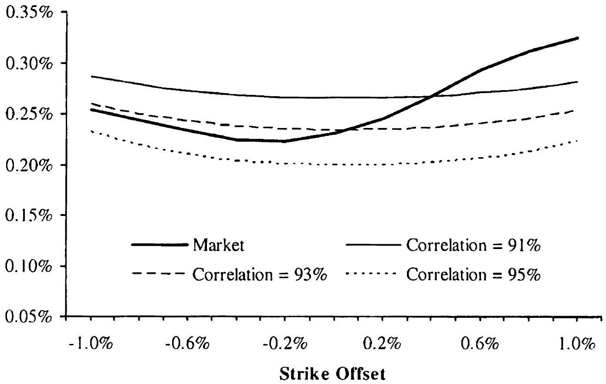
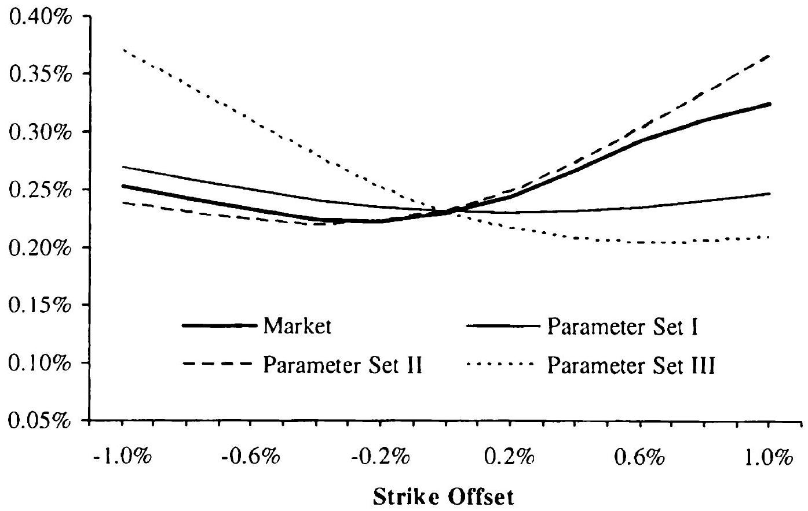
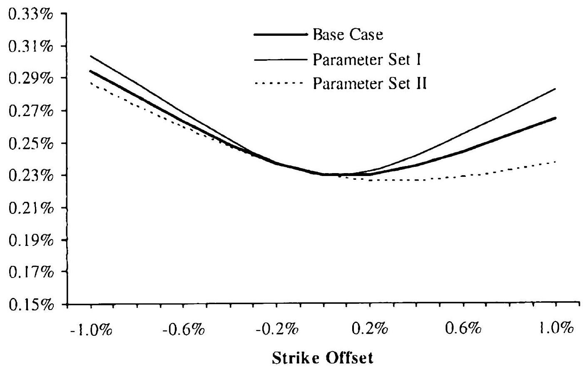
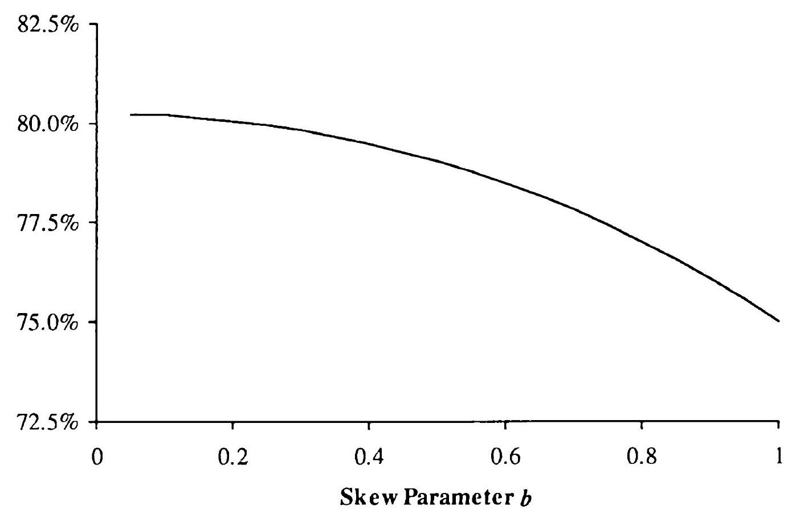

## Multi-Rate Vanilla Derivatives

After our analysis of single-rate vanilla derivatives in the previous chapter, we now proceed to consider European-type payoffs that are linked to more than one swap or Libor rate. The most important member of this class is the CMS spread, but securities such as floating range accruals and floating range accruals on a CMS spread are also popular in the market.

Valuation of these multi-rate vanilla derivatives in a dynamic term structure model presents no conceptual difficulties. However, given the (relatively) high traded volume in derivatives of this type, application of a full term structure model may not be accurate or fast enough (or both) in practice. Hence, in this chapter we look for extensions of the vanilla models of Chapter 16 that allow us to price derivatives linked to multiple rates in an efficient manner. As in Chapter 16, convexity adjustments are an inherent part of valuation, but require only straightforward extensions of the methods developed for the single-rate case. New challenges do arise in the multi-rate setting, however, as we now face the need to specify and control the dependence structure between the rates involved. We spend most of the chapter discussing this issue in detail.

### 17.1 Introduction to Multi-Rate Vanilla Derivatives

We define a multi-rate vanilla derivative to be a derivative security with a European-type payoff linked to more than one market rate. Given a payment date $T_{p}$, a collection of swap or Libor rates $S_{1}(\cdot), \ldots, S_{d}(\cdot)$, a collection of fixing dates $t_{1}, \ldots, t_{d}$, and a $d$-argument function $f\left(s_{1}, \ldots, s_{d}\right)$, a multi-rate derivative is defined by its payoff

$$
\begin{equation*}
V\left(T_{p}\right)=f\left(S_{1}\left(t_{1}\right), \ldots, S_{d}\left(t_{d}\right)\right) \text { paid at time } T_{p} . \tag{17.1}
\end{equation*}
$$
^eq17-1

Of course, we require $t_{i} \leq T_{p}$ for all $i=1, \ldots, d$. Our main focus in this chapter is on the case when all $t_{i}$ 's are the same: $t_{i}=T$ for some $T \leq T_{p}$
and all $i=1, \ldots, d$. That said, we do develop methods to deal with fixing dates that are not all exactly equal - a case important for floating range accruals, for example - but we still insist here on the fixing dates being "not too far" from each other. If fixing dates are wide apart, valuation is typically best handled in a dynamic term structure model (e.g., the LM model).

As was the case for their single-rate counterparts, multi-rate vanilla derivative payoffs (17.1) are rarely traded themselves; rather, they constitute building blocks for traded securities that are (additive) collections of multirate cash flows. Examples include the multi-rate exotic swaps (Section 5.13.3), e.g. swaps paying CMS spread or digital CMS spreads, and various flavors of curve caps. Also popular are the range accruals, see Section 5.13.4; the following variations are (among many others) covered by the techniques in this chapter:

1. Accrual is based on a single market rate, but payment is linked to a different market rate (floating range accruals).
2. The payment rate is either fixed or a function of a collection of market rates, and the observation rate is a difference of two market rates (CMS spread range accruals).
3. Dual range accruals.
4. Curve cap range accruals.

As mentioned above, we focus our attention on developing "vanilla" models for multi-rate derivatives, i.e. models that steer clear of defining dynamics for the whole yield curve and instead merely aim to specify, in the most direct way possible, the distribution of the collection of swap rates $S_{1}\left(t_{1}\right), \ldots, S_{d}\left(t_{d}\right)$. The efficacy of this approach stems from the fact that the value of payoffs in the class (17.1) have limited, if any, dependence on the actual continuous-time dynamics of the yield curve, since only the joint distribution of terminal rate observations will enter valuation formulas. With this in mind, we may distill the essence of various vanilla-type methods to the following steps.

1. One-dimensional (terminal) distributions of all relevant market rates are extracted from market prices of swaptions.
2. All one-dimensional distributions are brought under the same equivalent martingale measure.
3. A dependence structure is imposed on the vector of market rates, while ensuring that market-implied marginal one-dimensional distributions are preserved.
4. Parameters used in the specification of the dependence structure are estimated historically or, if sufficient market information is available, implied from the prices of certain instruments.
5. A suitable numerical method is applied to integrate the payoff against a specified multi-dimensional distribution.

We start our discussion of multi-rate vanilla derivatives valuation with the first two items of this program.

### 17.2 Marginal Distributions and Reference Measure

The value of a cash flow with the payoff (17.1) at time $t=0$ is given by

$$
\begin{equation*}
V(0)=\mathrm{E}\left(\beta\left(T_{p}\right)^{-1} f\left(S_{1}\left(t_{1}\right), \ldots, S_{d}\left(t_{d}\right)\right)\right) \tag{17.2}
\end{equation*}
$$
^eq17-2

where E is the expectation operator for the risk-neutral measure Q . As discussed in Chapter 16, the distribution of each swap rate $S_{i}\left(t_{i}\right)$ under its annuity measure $\mathrm{Q}^{A_{2}}$ (a measure for which the annuity $A_{i}(t)$ linked to the rate $S_{\imath}(t)$ is a numeraire) can be deduced from market prices of swaptions across strikes. We emphasize that the measures $Q^{A_{i}}$ are different for different swap rates, and there will generally exist no measure under which all $S_{i}$ 's are martingales. In principle, one can choose any annuity measure and proceed to derive distributions of all rates under that measure - technical tools for this can be developed relatively easily by extending the results of Section 16.6.9. This approach suffers from a certain arbitrariness, and it is typically both more natural and more convenient to work with the $T_{p}$-forward measure. Moreover, we already know how to translate a swap rate distribution under the annuity measure into its distribution under the $T_{p}$-forward measure, see Section 16.6.9.

Changing to $T_{p}$-forward measure in (17.2), we obtain

$$
\begin{equation*}
V(0)=P\left(0, T_{p}\right) \mathrm{E}^{T_{r}}\left(f\left(S_{1}\left(t_{1}\right), \ldots, S_{d}\left(t_{d}\right)\right)\right) . \tag{17.3}
\end{equation*}
$$
^eq17-3

As we recall from Section 16.6.9, the distribution of $S_{\imath}\left(t_{i}\right)$ under $\mathrm{Q}^{T_{\nu}}$ is linked to the (market-implied) distribution of $S_{\imath}\left(t_{i}\right)$ under $\mathrm{Q}^{A_{i}}$ via the density relationship

$$
\begin{equation*}
\mathrm{Q}^{T_{p}}\left(S_{i}\left(t_{i}\right) \in d s\right)=\frac{A_{i}(0)}{P\left(0, T_{p}\right)} \alpha_{i}(s) \mathrm{Q}^{A}\left(S_{i}\left(t_{i}\right) \in d s\right) \tag{17.4}
\end{equation*}
$$
^eq17-4

where the annuity mapping function $\alpha_{i}(s)$ is defined as

$$
\begin{equation*}
\alpha_{i}(s)=\mathrm{E}^{A_{\imath}}\left(\left.\frac{P\left(t_{i}, T_{p}\right)}{A_{i}\left(t_{i}\right)} \right\rvert\, S_{i}\left(t_{i}\right)=s\right), \quad i=1, \ldots, d \tag{17.5}
\end{equation*}
$$
^eq17-5

In deriving the annuity mapping functions we can follow Chapter 16 and impose a functional relationship between $P\left(t_{2}, T_{p}\right) / A_{i}\left(t_{i}\right)$ and $S_{i}\left(t_{i}\right)$. As we may do so independently for each $i=1, \ldots, d$, the application of the relevant method(s) from Chapter 16 is straightforward.

The formulas (17.4)-(17.5) are exact as written, but we would virtually always apply an approximation for $\alpha_{i}(s)$ in (17.5). As far as such approximations are concerned, we should note that the techniques discussed in Chapter

16 will be associated with a certain degree of inconsistency in the multi-rate context. For instance, in the common case where $t_{i}=T$ for some $T \leq T_{p}$ and all $i=1, \ldots, d$, we see that $P\left(T, T_{p}\right) / A_{i}(T)$ for a given $i$ is a function of all swap rates $S_{1}(T), \ldots, S_{d}(T)$. Therefore, the calculation of $\alpha_{i}(s)$ should in principle involve the dependence structure of all swap rates in the payoff. Although we shall introduce such a dependence structure between all swap rates (see later in Section 17.3) to calculate the value of the derivative cash flow, we typically do not use this dependence structure when estimating $\alpha_{i}(s)$ by (17.5). Instead, we would normally content ourselves with the simpler methods of Chapter 16, such as the linear TSR model. While acknowledging the inconsistency we, among others, realize considerable practical advantages of separating the specification of measure changes via (17.4)-(17.5) from that of the dependence structure; consequently, we adopt this approach throughout this chapter.

With marginal distributions of each $S_{i}\left(t_{l}\right)$ in (17.3) specified by (17.4), the value $V(0)$ will be strongly sensitive to the dependence structure imposed by the model on the random variables $S_{1}\left(t_{1}\right), \ldots, S_{d}\left(t_{d}\right)$. Specifying and controlling such dependence is at the heart of the problem of valuing multirate vanilla cash flows, with the so-called copula method being a popular choice for the job. We introduce this method next.

### 17.3 Dependence Structure via Copulas

### 17.3.1 Introduction to Gaussian Copula Method

The copula approach, popularized in financial applications by its widespread usage in credit derivatives modeling, is a method of constructing a joint distribution of random variables consistently with pre-specified one-dimensional marginal distributions. While a thorough treatinent of the subject is well beyond the scope of this book - the reader is referred to Nelsen [2006] for that - we proceed to present salient points in the next few sections.

To warm up, let us start with the so-called Gaussian copula method, the most common, and easily understood, type of the copula methods in use. We have already seen a particular application of this method in Section 16.7. Let us assume that one-dimensional cumulative distribution functions (CDFs) $\Psi_{1}(\cdot), \ldots, \Psi_{d}(\cdot)$ have been given, and we are tasked with constructing a multi-dimensional random vector $\left(X_{1}, \ldots, X_{d}\right)$ with a measure of control over the dependence of the random variables $X_{2}$, but constrained so that each variable $X$, has $\operatorname{CDF} \Psi_{2}(\cdot), i=1, \ldots, d$. The Gaussian copula method accomplishes this by specifying

$$
\begin{equation*}
X_{\imath}=\Psi_{\imath}^{-1}\left(\Phi\left(Z_{\imath}\right)\right), \quad i=1, \ldots, d \tag{17.6}
\end{equation*}
$$
^eq17-6

where $\Phi(\cdot)$ is the standard one-dimensional Gaussian CDF and ( $Z_{1}, \ldots, Z_{d}$ ) is a multi-dimensional, normalized ${ }^{1}$ Gaussian vector with the correlation matrix $R$. Clearly the CDF of each $X_{i}$ thus defined is $\Psi_{i}(\cdot)$ (see Section 3.1.1.1), and the correlation matrix $R$ provides a way to control the codependence structure in the vector.

Let us denote the joint CDF of ( $X_{1}, \ldots, X_{d}$ ) as constructed above by $\Psi_{\text {gauss }}\left(x_{1}, \ldots, x_{d}\right)$, and the joint $d$-dimensional (Gaussian) CDF of $\left(Z_{1}, \ldots, Z_{d}\right)$ by $\Phi_{d}\left(z_{1}, \ldots, z_{d} ; R\right)$. Then it follows from (17.6) that

$$
\begin{equation*}
\Psi_{\text {gauss }}\left(x_{1}, \ldots, x_{d}\right)=\Phi_{d}\left(\Phi^{-1}\left(\Psi_{1}\left(x_{1}\right)\right), \ldots, \Phi^{-1}\left(\Psi_{d}\left(x_{d}\right)\right) ; R\right) . \tag{17.7}
\end{equation*}
$$
^eq17-7

From the joint CDF of $\left(X_{1}, \ldots, X_{d}\right)$ we easily obtain the joint probability density function (PDF) as

$$
\begin{align*}
& \psi_{\text {gauss }}\left(x_{1}, \ldots, x_{d}\right)  \tag{17.8}\\
& \quad=\frac{\partial^{d}}{\partial x_{1} \ldots \partial x_{d}} \Psi_{\text {gauss }}\left(x_{1}, \ldots, x_{d}\right)  \tag{17.9}\\
& \quad=\left.\frac{\partial^{d}}{\partial z_{1} \ldots \partial z_{d}} \Phi_{d}\left(z_{1}, \ldots, z_{d} ; R\right)\right|_{z^{\prime}=\Phi^{-1}\left(\Psi_{i}(x,)\right), \forall i} \times \prod_{\imath=1}^{d} \frac{\Psi_{i}^{\prime}\left(x_{i}\right)}{\Phi^{\prime}\left(\Phi^{-1}\left(\Psi_{i}\left(x_{i}\right)\right)\right)} \\
& \quad=\phi_{d}\left(\Phi^{-1}\left(\Psi_{1}\left(x_{1}\right)\right), \ldots, \Phi^{-1}\left(\Psi_{d}\left(x_{d}\right)\right) ; R\right) \times \prod_{i=1}^{d} \frac{\psi_{\imath}\left(x_{\imath}\right)}{\phi\left(\Phi^{-1}\left(\Psi_{i}\left(x_{i}\right)\right)\right)}
\end{align*}
$$
^eq17-8
^eq17-9

where $\phi(z)$ and $\phi_{d}\left(z_{1}, \ldots, z_{d} ; R\right)$ are the one- and $d$-dimensional Gaussian PDFs, respectively, and $\psi_{\imath}\left(x_{\imath}\right)$ is the one-dimensional PDF of $X_{i}, i= 1, \ldots, d$.

With the joint PDF $\psi_{\text {gauss }}\left(x_{1}, \ldots, x_{d}\right)$ of $\left(X_{1}, \ldots, X_{d}\right)$ available, the undiscounted ${ }^{2}$ value of a derivative with a payoff $f\left(X_{1}, \ldots, X_{d}\right)$ is given by the multi-dimensional integral

$$
\begin{equation*}
V=\int \cdots \int f\left(x_{1}, \ldots, x_{d}\right) \psi_{\text {gauss }}\left(x_{1}, \ldots, x_{d}\right) d x_{1} \ldots d x_{d} \tag{17.10}
\end{equation*}
$$
^eq17-10

Another, sometimes more useful, expression may be obtained from (17.6), as the derivative security with the payoff $f\left(X_{1}, \ldots, X_{d}\right)$ can also be considered to have the payoff $f\left(\Psi_{1}^{-1}\left(\Phi\left(Z_{1}\right)\right), \ldots, \Psi_{d}^{-1}\left(\Phi\left(Z_{d}\right)\right)\right)$. Therefore its value is given by

$$
\begin{equation*}
V=\int \cdots \int f\left(\Psi_{1}^{-1}\left(\Phi\left(z_{1}\right)\right), \ldots, \Psi_{d}^{-1}\left(\Phi\left(z_{d}\right)\right)\right) \phi_{d}\left(z_{1}, \ldots, z_{d} ; R\right) d z_{1} \ldots d z_{d} \tag{17.11}
\end{equation*}
$$
^eq17-11

[^13]The Gaussian copula method can be implemented easily, is wellunderstood, and widely used. Still, it suffers from its share of problems, chief among them being its limited control over the shape of the joint distribution, a point that we shall address in more detail later in this chapter.

### 17.3.2 General Copulas

To develop co-dependence structures more general than those implied by the Gaussian copula method, consider first rewriting (17.7) as

$$
\begin{equation*}
\Psi_{\text {gauss }}\left(x_{1}, \ldots, x_{d}\right)=C_{\text {gauss }}\left(\Psi_{1}\left(x_{1}\right), \ldots, \Psi_{d}\left(x_{d}\right) ; R\right) \tag{17.12}
\end{equation*}
$$
^eq17-12

where

$$
C_{\text {gauss }}\left(u_{1}, \ldots, u_{d} ; R\right) \triangleq \Phi_{d}\left(\Phi^{-1}\left(u_{1}\right), \ldots, \Phi^{-1}\left(u_{d}\right) ; R\right)
$$

The function $C_{\text {gauss }}\left(u_{1}, \ldots, u_{d} ; R\right)$ is easily seen to define a specific multidimensional distribution function (as defined in, for example, Nelsen [2006]) for a vector of $d$ random variables with marginal distributions that are all uniform on $[0,1]$. It turns out that this concept can be generalized nicely.

Definition 17.3.1. Consider a function $C:[0,1]^{d} \rightarrow[0,1] . C\left(u_{1}, \ldots, u_{d}\right)$ is said to be a $d$-dimensional copula function if it defines a valid joint distribution function for a $d$-dimensional vector of random variables, with each variable being uniformly distributed on $[0,1]$.

The requirement that a copula defines a joint distribution function for a vector of uniformly distributed random variables puts a number of strong constraints on the form of the function $C$. For instance, it is clear that $C$ must be increasing in its arguments. Also, if the $i$-th argument of $C$ is 0 , $C$ itself must return 0 , irrespective of the values of the remaining $d-1$ arguments. Further, if all but the $i$-th argument of $C$ are set to $1, C$ must return the $i$-th argument itself. The last two simple relations (which we invite the reader to verify) can be summarized as follows:

$$
\begin{gather*}
C\left(u_{1}, u_{2}, \ldots, u_{i-1}, 0, u_{i+1}, \ldots, u_{d}\right)=0,  \tag{17.13}\\
C\left(1,1, \ldots, 1, u_{\imath}, 1,1, \ldots, 1\right)=u_{i} . \tag{17.14}
\end{gather*}
$$
^eq17-13
^eq17-14

To give a few introductory examples, notice that a particularly simple copula arises if all $d$ uniform variables underlying the copula are independent. The resulting independence copula $C_{\text {ID }}$ is

$$
\begin{equation*}
C_{\mathrm{ID}}=\prod_{i=1}^{d} u_{i} . \tag{17.15}
\end{equation*}
$$
^eq17-15

To state the copula $C_{\mathrm{D}}$ that defines perfect dependence, introduce $d$ uniform random variables $U_{1}, U_{2}, \ldots, U_{d}$ and set $U_{1}=U_{2}=\ldots=U_{d}$. In this case we get (with P being a probability measure)

$$
\begin{align*}
C_{\mathrm{D}}\left(u_{1}, u_{2}, \ldots, u_{d}\right) & =\mathrm{P}\left(U_{1} \leq u_{1}, U_{2} \leq u_{2}, \ldots, U_{d} \leq u_{d}\right) \\
& =\mathrm{P}\left(U_{1} \leq u_{1}, U_{1} \leq u_{2}, \ldots, U_{1} \leq u_{d}\right) \\
& =\mathrm{P}\left(U_{1} \leq \min _{i=1, \ldots, d} u_{i}\right) \\
& =\min _{\imath=1, \ldots, d} u_{i} \tag{17.16}
\end{align*}
$$
^eq17-16

For obvious reasons, the perfect anti-dependence copula $C_{\mathrm{AD}}$ can only be stated for the case $d=2$. In this case, we write $U_{2}=1-U_{1}$ for two uniform random variables $U_{1}, U_{2}$, and get

$$
\begin{align*}
C_{\mathrm{AD}}\left(u_{1}, u_{2}\right) & =\mathrm{P}\left(U_{1} \leq u_{1}, U_{2} \leq u_{2}\right) \\
& =\mathrm{P}\left(U_{1} \leq u_{1}, 1-U_{1} \leq u_{2}\right) \\
& =\mathrm{P}\left(1-u_{2} \leq U_{1} \leq u_{1}\right) \\
& =\left(u_{1}+u_{2}-1\right)^{+} \tag{17.17}
\end{align*}
$$
^eq17-17

The anti-dependence copula in (17.17) cannot be extended to $d>2$, but we can still define a function

$$
\begin{equation*}
G_{\mathrm{AD}}\left(u_{1}, u_{2}, \ldots, u_{d}\right)=\left(\sum_{i=1}^{d} u_{i}+1-d\right)^{+}, \tag{17.18}
\end{equation*}
$$
^eq17-18

such that $G_{\mathrm{AD}}=C_{\mathrm{AD}}$ for the case $d=2$. Although $G_{\mathrm{AD}}$ defined this way is not itself a copula for $d \geq 3$, it turns out that this function can be used to bound any valid copula function. Specifically, one can prove the following result.

Theorem 17.3.2. Any valid $d$-dimensional copula function $C$ must satisfy the Frechet bounds

$$
G_{\mathrm{AD}}\left(u_{1}, u_{2}, \ldots, u_{d}\right) \leq C\left(u_{1}, u_{2}, \ldots, u_{d}\right) \leq C_{\mathrm{D}}\left(u_{1}, u_{2}, \ldots, u_{d}\right) .
$$

The real strength of the copula function concept originates with the fact that it allows us to separate co-dependence information from marginal distributions. Specifically, given a copula function $C\left(u_{1}, \ldots, u_{d}\right)$ and a collection of marginal CDFs $\Psi_{1}\left(x_{1}\right), \ldots, \Psi_{d}\left(x_{d}\right)$, we can construct a $d$-dimensional joint distribution function $\Psi_{C}\left(x_{1}, \ldots, x_{d}\right)$ with marginals $\Psi_{1}\left(x_{1}\right), \ldots, \Psi_{d}\left(x_{d}\right)$ by a formula similar to (17.12),

$$
\begin{equation*}
\Psi_{C}\left(x_{1}, \ldots, x_{d}\right)=C\left(\Psi_{1}\left(x_{1}\right), \ldots, \Psi_{d}\left(x_{d}\right)\right) \tag{17.19}
\end{equation*}
$$
^eq17-19

The simple proof of the fact that $\Psi_{C}\left(x_{1}, \ldots, x_{d}\right)$ defined by (17.19) is a true $d$-dimensional distribution function is left to the reader. By the so-called Sklar's theorem, the opposite is also true: for any $d$-dimensional distribution
function there exists a copula function such that the joint distribution function can be represented in the form (17.19). ${ }^{3}$

The joint PDF $\psi_{C}$ associated with the CDF $\Psi_{C}$ in (17.19) is given by (compare to (17.9))

$$
\begin{align*}
\psi_{C}\left(x_{1}, \ldots, x_{d}\right) & =\frac{\partial^{d}}{\partial x_{1} \ldots \partial x_{d}} \Psi_{C}\left(x_{1}, \ldots, x_{d}\right) \\
& =c\left(\Psi_{1}\left(x_{1}\right), \ldots, \Psi_{d}\left(x_{d}\right)\right) \prod_{i=1}^{d} \psi_{i}\left(x_{i}\right) \tag{17.20}
\end{align*}
$$
^eq17-20

where

$$
\begin{equation*}
c\left(u_{1}, \ldots, u_{d}\right)=\frac{\partial^{d}}{\partial u_{1} \ldots \partial u_{d}} C\left(u_{1}, \ldots, u_{d}\right), \tag{17.21}
\end{equation*}
$$
^eq17-21

is the copula density and $\psi_{i}(\cdot)$ 's are the marginal PDFs. For the Gaussian copula the copula density is given by

$$
\begin{equation*}
c_{\text {gauss }}\left(u_{1}, \ldots, u_{d} ; R\right)=\frac{\phi\left(\Phi^{-1}\left(u_{1}\right), \ldots, \Phi^{-1}\left(u_{d}\right) ; R\right)}{\prod_{i=1}^{d} \phi\left(\Phi^{-1}\left(u_{i}\right)\right)} . \tag{17.22}
\end{equation*}
$$
^eq17-22

### 17.3.3 Archimedean Copulas

With technical background material now out of the way, let us proceed to examine some concrete examples of copula functions, beyond the Gaussian class. One choice that is quite popular in the copula literature is the so-called Archimedean class of copulas. This class requires specification of a generator function $\omega:[0,1] \rightarrow \mathbb{R}$ satisfying

$$
\lim _{x \rightarrow 0} \omega(x)=+\infty, \quad \omega(1)=0, \quad \omega^{\prime}(x)<0, \quad \omega^{\prime \prime}(x)>0
$$

From a generator function, a corresponding Archimedean copula $C_{\text {arch }}\left(u_{1}, \ldots, u_{d} ; \omega\right)$ can be defined by the relation

$$
C_{\operatorname{arch}}\left(u_{1}, \ldots, u_{d} ; \omega\right)=\omega^{-1}\left(\sum_{i=1}^{d} \omega\left(u_{i}\right)\right) .
$$

It is a trivial exercise to show that $C_{\text {arch }}\left(u_{1}, \ldots, u_{d} ; \omega\right)$ is indeed a copula function.

The generator function is often indexed with a parameter, specifying a parametric family of Archimedean copulas. Of particular note are the following two families:

[^14]- Clayton copula:

$$
\omega_{\text {clayton }}(u ; \theta)=u^{-\theta}-1, \quad \theta>0 .
$$

- Gumbel copula:

$$
\omega_{\text {gumbel }}(u ; \theta)=(-\ln u)^{\theta}, \quad \theta>0 .
$$

The corresponding copulas are given by

$$
\begin{aligned}
& C_{\text {clayton }}\left(u_{1}, \ldots, u_{d} ; \theta\right)=\left(\sum_{\imath=1}^{d} u_{i}^{-\theta}-d+1\right)^{-1 / \theta} \\
& C_{\text {gumbel }}\left(u_{1}, \ldots, u_{d} ; \theta\right)=\exp \left(-\left(\sum_{i=1}^{d}\left(-\ln u_{i}\right)^{\theta}\right)^{1 / \theta}\right) .
\end{aligned}
$$

In the special case of $\theta=1$, the Gumbel copula becomes

$$
C_{\text {gumbel }}\left(u_{1}, \ldots, u_{d} ; 1\right)=\prod_{i=1}^{d} u_{i},
$$

which is the independence copula $C_{\text {ID }}$ introduced earlier.
A quick graphing exercise shows that as $\theta$ is raised, both the Clayton and Gumbel copulas assign increasing probability mass around the point $(0, \ldots, 0)$; in terms of the joint distribution of the market rates, this corresponds to an increase in the probability of a joint down-move of the rates.

### 17.3.4 Making Copulas from Other Copulas

With the Archimedean copulas introduced in the previous section, we can use the parameter $\theta$ of both the Clayton or Gumbel copula to control the probability of a joint down-move of interest rates, but we have no direct control over other moves of interest such as a joint $u p$-move of the rates. This is easily fixed, however, by an application of the following general result.

Lemma 17.3.3. If $C\left(u_{1}, \ldots, u_{d}\right)$ is a copula, then the function obtained by reflecting $C$ in dimension $i$,
$\bar{C}\left(u_{1}, \ldots, u_{i}, \ldots, u_{d} ;\{i\}\right) \triangleq C\left(u_{1}, \ldots, 1, \ldots, u_{d}\right)-C\left(u_{1}, \ldots, 1-u_{i}, \ldots, u_{d}\right)$,
is also a copula for any $i=1, \ldots, d$. The density of the reflected copula is given by

$$
\bar{c}\left(u_{1}, \ldots, u_{i}, \ldots, u_{d} ;\{i\}\right)=c\left(u_{1}, \ldots, 1-u_{i}, \ldots, u_{d}\right) .
$$

Proof. Trivial consequence of the fact that if $U$ follows a uniform $[0,1]$ distribution, then so does $1-U$.

By repeated application of the lemma, it is easy to see that it generalizes to multiple indices. Specifically, if we denote by $\bar{C}\left(\ldots ;\left\{i_{1}, \ldots, i_{M I}\right\}\right)$ a function obtained by repeating the mapping (17.23) for all $i_{m}, m=1, \ldots, M$, this is still a copula. Focusing on the two-dimensional case $d=2$ and choosing the Clayton copula for concreteness, we have

$$
\begin{aligned}
& \bar{C}_{\text {clayton }}\left(u_{1}, u_{2} ; \theta ;\{1,2\}\right)=C_{\text {clayton }}(1,1 ; \theta)-C_{\text {clayton }}\left(1,1-u_{2} ; \theta\right) \\
&-C_{\text {clayton }}\left(1-u_{1}, 1 ; \theta\right)+C_{\text {clayton }}\left(1-u_{1}, 1-u_{2} ; \theta\right),
\end{aligned}
$$

and now the parameter $\theta$ controls the probability of a joint up-move in the two market rates. In the copula $\bar{C}_{\text {clayton }}\left(u_{1}, u_{2} ; \theta ;\{1\}\right)$ the parameter $\theta$ controls the joint probability of an up-move of the first rate and a down-move in the second rate, and in the copula $\bar{C}_{\text {clayton }}\left(u_{1}, u_{2} ; \theta ;\{2\}\right)$, the parameter $\theta$ controls the joint probability of a down-move of the first rate and an up-move in the second rate.

Another way of creating copulas uses the observation that a convex combination of copulas is also a copula.

Lemma 17.3.4. Let us denote $u=\left(u_{1}, \ldots, u_{d}\right)^{\top}$, and let there be given $M$ different $d$-dimensional copulas $C_{1}(u), \ldots, C_{M}(u)$, as well as a collection of non-negative weights $w_{1}, \ldots, w_{M}$ such that $\sum_{m=1}^{M I} w_{m}=1$. The linear combination, or mixture,

$$
C_{\mathrm{mix}}(u)=\sum_{m=1}^{M} w_{m} C_{m}(u),
$$

is also a copula.
Proof. Trivial.
One can interpret mixture copulas as representations of the idea that different dependence structures of the random variables are realized in different states of the world, with these states having probabilities $w_{m}$, $m=1, \ldots, M$. To give a simple example, consider a Gaussian copula setting where there are two states of the correlation matrix: $R_{h i}$ ("excited state") and $R_{\text {normal }}$ ("normal state"). Assuming that the probabilities of these states are $w_{\text {normal }}$ and $w_{\mathrm{hi}}=1-w_{\text {normal }}$, respectively, we would define

$$
\begin{align*}
& C_{\text {multigauss }}\left(u_{1}, \ldots, u_{d} ; w_{\text {normal }}, w_{\mathrm{hi}}, R_{\text {normal }}, R_{\mathrm{hi}}\right) \\
& \quad=w_{\text {normal }} C_{\text {gauss }}\left(u_{1}, \ldots, u_{d} ; R_{\text {normal }}\right)+w_{\mathrm{hi}} C_{\text {gauss }}\left(u_{1}, \ldots, u_{d} ; R_{\mathrm{hi}}\right) . \tag{17.24}
\end{align*}
$$
^eq17-24

If, say, $R_{h 1}$ is supposed to reflect an unlikely crash state, we could set $R_{\mathrm{hi}} \gg R_{\mathrm{normal}}$ (in, e.g., an element-wise sense) and $w_{\mathrm{hi}} \ll w_{\text {normal }}$.

To motivate the next method for constructing copulas, we note that for any function $q(u)$ we have a trivial identity

$$
u=q(u) \times \frac{u}{q(u)}
$$

Hence, if we have two (2-dimensional) copulas $C_{1}(u, v)$ and $C_{2}(u, v)$ and functions $q(u), p(v)$ such that $q(1)=p(1)=1$, then the function

$$
C(u, v)=C_{1}(q(u), p(v)) C_{2}\left(\frac{u}{q(u)}, \frac{v}{p(v)}\right)
$$

would satisfy requirement (17.14), as

$$
\begin{aligned}
& C(u, 1)=C_{1}(q(u), 1) C_{2}\left(\frac{u}{q(u)}, 1\right)=q(u) \frac{u}{q(u)}=u \\
& C(1, v)=C_{1}(1, p(v)) C_{2}\left(1, \frac{v}{p(v)}\right)=p(v) \frac{v}{p(v)}=v
\end{aligned}
$$

While we have not demonstrated that $C$ is a copula, it turns out that this is the case if certain conditions are imposed on $q$ (and $p$ ). The relevant result (suitably extended to dimension $d$ ) for these so-called product copulas can be found in Liebscher [2008]:
Theorem 17.3.5. Let $C_{1}, \ldots, C_{M}$ be $d$-dimensional copulas, and let $q_{m, i}: [0,1] \rightarrow[0,1], m=1, \ldots, M, i=1, \ldots, d$, be functions that are either strictly increasing or identically equal to 1 . Suppose that $\prod_{m=1}^{M} q_{m, 2}(u)=u$ for $u \in[0,1], i=1, \ldots, d$, and $\lim _{u \rightarrow 0+} q_{m, i}(u)=q_{m, i}(0)$. Then

$$
C\left(u_{1}, \ldots, u_{d}\right)=\prod_{m=1}^{M} C_{m}\left(q_{m, 1}\left(u_{1}\right), \ldots, q_{m, d}\left(u_{d}\right)\right)
$$

is a copula.
In this theorem, consider taking $M=2, C_{1}=\prod_{i=1}^{d} u_{i}$ (the independence copula), $C_{2}=C_{\text {gauss }}\left(u_{1}, \ldots, u_{d} ; R\right)$ (Gaussian copula with correlation matrix $R), q_{1, i}(u)=u^{1-\theta_{2}}$, and $q_{2, i}(u)=u^{\theta_{2}}$ for $\theta_{i} \in[0,1], i=1, \ldots, d$. We then obtain a copula that we find particularly useful for multi-rate derivatives:
Corollary 17.3.6. Let $R$ be a $d \times d$ correlation matrix and $\theta= \left(\theta_{l}, \ldots, \theta_{d}\right)^{\top} \in[0,1]^{d}$ a d-dimensional vector of parameters. Then the power Gaussian function

$$
\begin{equation*}
C_{\mathrm{PG}}\left(u_{1}, \ldots, u_{d} ; R, \theta\right) \triangleq\left(\prod_{i=1}^{d} u^{1-\theta_{\iota}}\right) C_{\mathrm{gauss}}\left(u_{1}^{\theta_{1}}, \ldots, u_{d}^{\theta_{d}} ; R\right) \tag{17.25}
\end{equation*}
$$
^eq17-25

is a copula.
Section 17.4.3 demonstrates that the power Gaussian copula provides a parsimonious, yet flexible way of specifying dependence structure for CMS spread options.

### 17.4 Copula Methods for CMS Spread Options

We recall from Section 5.13.3 that the payoff of a spread option is given by

$$
\left(S_{1}(T)-S_{2}(T)-K\right)^{+}
$$

at time $T_{p} \geq T$, where $S_{1}(T), S_{2}(T)$ are two swap rates of different tenors fixing at time $T$. The (undiscounted) value of a spread option is therefore given by

$$
\begin{equation*}
V(0 ; T, K)=\mathrm{E}^{T_{p}}\left(\left(S_{1}(T)-S_{2}(T)-K\right)^{+}\right) \tag{17.26}
\end{equation*}
$$
^eq17-26

CMS spread options (Section 5.13.3) are, arguably, the most liquid of the multi-rate vanilla derivatives. Euro- and USD-denominated spread options are traded among brokers, assuring reasonable visibility into market prices.

### 17.4.1 Normal Model for the Spread

Market quotes of CMS spread options often come in the form of implied Normal (also known as Bachelier, Gaussian or, simply, basis-point) volatilities of the spread. As we have already seen in Section 14.4.3, the implied Normal spread volatility $\sigma_{\mathrm{N}}(T, K)$ (for a given pair of swap rates) is defined by equating the undiscounted market price of a spread option to its Normal model price at the given volatility, i.e.

$$
V_{\mathrm{mkt}}(0 ; T, K)=c_{\mathrm{N}}\left(0, \mathrm{E}^{T^{\prime}}\left(S_{1}(T)-S_{2}(T)\right) ; T, K ; \sigma_{\mathrm{N}}(T, K)\right)
$$

where $c_{\mathrm{N}}(t, S ; T, K ; \lambda)$ is the Normal pricing formula with volatility $\lambda$ defined by (7.16).

A few features of this formula are worth pointing out. First, the Normal model, rather than the Black model, is used as a convention for quoting spread options because the spread process $S_{1}(T)-S_{2}(T)$ can become negative, something which is disallowed in a log-normal setting. Indeed, spread options that correspond to zero strike, $K=0$, are among the most liquid - and for the Black model, zero-strike implied volatility is simply not defined. Second, we notice that in order to back out the implied volatility, we must use the convexity-adjusted forward of the spread $\mathrm{E}^{T_{r}}\left(S_{1}(T)-S_{2}(T)\right)$. When trading with each other, dealers therefore need to agree on the convexity adjustments of the underlying swap rates before they can agree on the implied volatility. Finally, we note that in practice the implied volatility of a particular CMS spread will always depend on both the strike and the expiry, reflecting the fact that market distributions of spreads are not perfectly Gaussian. Much of the work in modeling spread options is focused on properly capturing the market-implied distribution of the spread.

The Normal model provides a convenient common language for quoting spread options, but it is not well-suited for risk management. Apart from the standard risk management issues that arise when using models with
strike-indexed parameters (see the related discussion in Section 16.1.1), we highlight the fact that strike-indexed spread volatilities generate no explicit link to the marginal distribution parameters - including volatilities - of the underlying swap rates. As a consequence, spread options will, unreasonably, show no vega (volatility sensitivity, see Section 8.9) to swaption parameters, making them difficult, or even impossible, to hedge. A related issue is the absence of direct information useful for the pricing of other payoffs that depend on the same two swap rates. For example, it is unclear how to translate a strike-dependent spread volatility into a parameter that could be used to value a spread option with non-standard gearing, i.e. a payoff

$$
\begin{equation*}
\left(S_{1}(T)-g S_{2}(T)-K\right)^{+}, \tag{17.27}
\end{equation*}
$$
^eq17-27

where $g \neq 1$.
The two issues above can be addressed with a certain degree of success by copula methods. We shall describe this approach momentarily, but let us note that if our ultimate goal is to build dynamic term structure models that are consistent with the prices of vanilla spread options (and European swaptions, of course), we will ultimately need to abandon the copula approach - see Section 17.8 and beyond.

### 17.4.2 Gaussian Copula for Spread Options

Arguably, the simplest copula-based spread option valuation method is obtained by specifying a two-dimensional Gaussian copula, a parameterization that depends on a single correlation parameter $\rho$. A spread option is then valued using the following procedure.

1. For each of the swap rates $S_{i}(T), i=1,2$, a market-implied density under its own annuity measure, $\psi_{i}^{A_{2}}(x)$, is derived from swaption prices. We may perform this derivation non-parametrically (see Section 16.6.9) or rely on a vanilla model calibrated to swaption prices.
2. Using Proposition 16.6.4, each $\psi_{i}^{A_{1}}(x), i=1,2$, is converted into the PDF $\psi_{i}^{T_{p}}(x)$ of the $i$-th swap rate under the $T_{p}$-forward measure.
3. For a given correlation $\rho$, the joint probability density function $\psi^{T_{p}}\left(x_{1}, x_{2} ; \rho\right)$ of $\left(S_{1}(T), S_{2}(T)\right)$ is defined by (17.20), where the copula density $c_{\text {gauss }}(\cdot)$ for the Gaussian copula is given by (17.22). (In this case, notice that $R$ is a $2 \times 2$ matrix with 1 on the diagonal and $\rho$ off-diagonal.)
4. The payoff $\left(x_{1}-x_{2}-K\right)^{+}$is integrated against the density $\psi^{T_{v}}\left(x_{1}, x_{2} ; \rho\right)$ to obtain the undiscounted model price of the spread option:

$$
V_{\mathrm{mdl}}(0 ; T, K, \rho)=\iint\left(x_{1}-x_{2}-K\right)^{+} \psi^{T_{r}}\left(x_{1}, x_{2} ; \rho\right) d x_{1} d x_{2}
$$

See Sections 17.6.1, 17.6.2 for details on numerical implementation.

To calibrate the model to market, we would also perform the following step:

5 Find $\rho=\rho(T, K)$, the implied spread correlation, such that the model price of the spread option matches its market price,

$$
V_{\mathrm{mdl}}(0 ; T, K, \rho(T, K))=V_{\mathrm{mkt}}(0 ; T, K) .
$$

Clearly, with $\rho$ fixed, changes to marginal distributions of the two swap rates would affect their joint distribution via (17.20), ultimately impacting the spread option value. Also, for a given $\rho$ we can integrate any payoff, including (17.27), against the joint density, allowing us to value all payoffs linked to the two swap rates consistently. Hence, as advertised the copula method can overcome several of the issues we identified earlier for the simple Normal spread model. On the other hand, were we to calibrate (as in Step 5) the Gaussian copula model to market values of spread options with a fixed maturity date but different strikes, we would typically obtain a different value of the implied spread correlation for each strike, an effect sometimes known as the correlation smile. In other words, a simple Gaussian copula has insufficient flexibility to capture market-observed distributions of CMS spreads. To elaborate a bit further on this, in Figure 17.1 we show typical shapes of Normal volatilities of spreads across strikes as implied by different values of the Gaussian copula correlation $\rho$. We see that $\rho$ basically can only shift the implied spread option volatility smile in parallel, making it impossible to match the market-implied volatility smile listed in the figure. To properly match the market, we apparently need to go beyond Gaussian copulas and look for more flexible alternatives.

Before starting our search for an alternative copula, let us briefly clarify one point about Gaussian copulas. While the implied Gaussian copula correlation is often used to characterize the dependence of the swap rates, it is important to realize that this parameter is not well-defined unless marginal distributions of the swap rates (under some common measure!) are clearly specified. Above we defined the implied correlation by i) implying the marginal distributions under the annuity measures from swaptions; and ii) transplanting these distribution into the $T_{p}$-forward measure using a given annuity-mapping function (e.g. one defined by a the linear TSR model). Were we to change any of these "ingredients", we would need to use a different correlation in the copula to obtain the same spread option value. For example, the following marginals will also lead to reasonable definitions of the implied spread correlation (all under the $T^{p}$-forward measure):

1. The marginal distribution for each swap rate $S_{i}(T), i=1,2$, is lognormal with mean $\mathrm{E}^{T_{r}}\left(S_{i}(T)\right)$, and volatility set equal to the implied Black volatility of the at-the-money (strike $=S_{i}(0)$ ) swaption.
2. The marginal distribution for each swap rate $S_{i}(T), i=1,2$, is lognormal with mean $\mathrm{E}^{T_{p}}\left(S_{i}(T)\right)$, and volatility set equal to the implied Black volatility of the at-the-money (strike $=\mathrm{E}^{T_{p}}\left(S_{i}(T)\right)$ ) CMS cap.

Fig. 17.1. Implied Normal Spread Volatility

Notes: Implied Normal spread volatility for a 5 year spread option on the difference between 10 year and 2 year swap rates. The $x$-axis shows the strike as an offset to the CMS-adjusted forward value of the spread. The "Market" data was observed in November 2007. The spread volatility curves implied by a Gaussian copula are shown for three levels of copula correlation ( $91 \%, 93 \%$, and $95 \%$ ), assuming market-implied marginal distributions per Section 17.4.2.
3. The marginal distribution for each swap rate $S_{i}(T), i=1,2$, is Gaussian with mean $\mathrm{E}^{T_{r}}\left(S_{i}(T)\right)$, and volatility equal to the implied Normal volatility of the at-the-money (strike $=S_{i}(0)$ ) swaption.
4. The marginal distribution for each swap rate $S_{i}(T), i=1,2$, is Gaussian with mean $\mathrm{E}^{T_{r}}\left(S_{\imath}(T)\right)$, and volatility equal to the implied Normal volatility of the at-the-money (strike $=\mathrm{E}^{T_{p}}\left(S_{i}(T)\right)$ ) CMS cap.

This, far from exhaustive, list of alternatives is intended to give the reader a flavor of issues that can arise when two parties are communicating price information in terms of implied spread correlations - clearly they would have to be very precise about all relevant details to avoid misunderstandings ${ }^{4}$. Communication issues aside, the choice of conventions for specifying the meaning of implied Gaussian copula correlations largely comes down to personal preferences and consistency with the rest of one's modeling setup. We leave it to the reader to ponder pros and cons of various approaches; not

[^15]surprisingly, the way we defined implied spread correlations to begin with is our personal choice. It is worth pointing out, however, that in the last case listed above (and only in the last case), the spread correlations can be extracted from the implied spread volatilities directly by simple algebraic manipulations. If we denote the Gaussian copula correlation in case 4 by $\rho_{\mathrm{N}}(T, K)$, the relevant at-the-money CMS cap volatilities by $\sigma_{\mathrm{N}, 2}, i=1,2$, and the normal spread volatility by $\sigma_{\mathrm{N}}(T, K)$, then it is easily seen that

$$
\sigma_{\mathrm{N}}(T, K)^{2}=\sigma_{\mathrm{N}, 1}^{2}+\sigma_{\mathrm{N}, 2}^{2}-2 \sigma_{\mathrm{N}, 1} \sigma_{\mathrm{N}, 2} \rho_{\mathrm{N}}(T, K) .
$$

### 17.4.3 Spread Volatility Smile Modeling with the Power Gaussian Copula

After our small detour into various definitions of implied spread correlations, we now proceed with the task of identifying a copula that would allow us to match the market-implied spread volatility smile as closely as possible. As we saw in Figure 17.1, the Gaussian copula provides us with the ability to change the overall level of the implied spread volatility smile, but lacks controls over its slope or curvature. Mixtures of Gaussian copulas as in (17.24) allow for more flexibility, but ultimately only provide the mechanism to control the curvature of the implied spread volatility smile and not its slope, a fact that is easy to verify experimentally. While we can consider adding standard Archimedean copulas from Section 17.3.3, either standalone, "reflected" as in Lemma 17.3.3, or as parts of mixtures, we generally find that this does not provide sufficient flexibility either. On the other hand, the power Gaussian copula (17.25), despite its parsimonious specification, turns out to provide direct control over the relevant features of the spread volatility smile.

In the two-dimensional case, the Gaussian power copula is given by

$$
\begin{equation*}
C_{\mathrm{PG}}\left(u, v ; \rho, \theta_{1}, \theta_{2}\right)=u^{1-\theta_{1}} v^{1-\theta_{2}} C_{\text {gauss }}\left(u^{\theta_{1}}, v^{\theta_{2}} ; \rho\right), \tag{17.28}
\end{equation*}
$$
^eq17-28

where $\rho$ is a correlation coefficient and $\theta_{1}, \theta_{2} \in[0,1]$. We would expect the correlation $\rho$ to move the implied spread volatility smile up and down, just as in the (pure) Gaussian case of Figure 17.1. It turns out that the remaining two parameters $\theta_{1}, \theta_{2}$ provide good control over the slope and curvature of the smile. Starting from $\theta_{1}=\theta_{2}=1$, the base Gaussian case, we find that as $\theta_{1}$ decreases from 1 towards 0 , the spread smile rotates counter-clock-wise, and as the parameter $\theta_{2}$ decreases, the smile rotates in the opposite direction. The effects are clearly visible in the first graph in Figure 17.2. By decreasing both parameters at the same time curvature is added to the smile, and a good fit to market volatilities can be achieved, as the second graph in Figure 17.2 demonstrates.

Fig. 17.2. Implied Normal Spread Volatility

Notes: Implied Normal spread volatility for the spread option in Figure 17.1 in the power Gaussian copula (17.28). Three parameter scenarios as well as best fit parameters from Table 17.1 are shown.

### 17.4.4 Copula Implied From Spread Options

As we have shown, the power Gaussian copula is capable of reproducing a wide range of market-observed shapes of spread volatility smiles. Yet, clearly, it cannot reproduce at least some of the spread volatility smiles exactly (as,

|  | Set I | Set II | Set III | Best Fit |
| :--- | ---: | ---: | ---: | ---: |
| $\rho$ | $92.6 \%$ | $95.6 \%$ | $95.8 \%$ | $95.5 \%$ |
| $\theta_{1}$ | $100.0 \%$ | $90.0 \%$ | $100.0 \%$ | $91.0 \%$ |
| $\theta_{2}$ | $100.0 \%$ | $100.0 \%$ | $90.0 \%$ | $99.0 \%$ |

Table 17.1. Power Gaussian copula (17.28) parameter sets for Figure 17.2.

for example, seen in the wings of the graph in Figure 17.2). Nor, in theory, could the same feat be accomplished by any other copula function with a finite number of parameters. It is, then, natural to wonder whether it is possible to come up with a copula that would reproduce market volatilities (or, equivalently, values) of spread options exactly for all values of spread strikes. Of course, spread options are never traded in the whole continuum of strikes, yet the question remains valid in the idealized case of knowing the full distribution of the spread. We call such a copula a spread-implied copula.

As we write this book there are no definitive results on spread-implied copulas, so our treatment will necessarily be brief. From general dimensionality analysis it is clear that, in general, there should be a continuum of copulas that would match a set of spread option values of all strikes (and, of course, given marginal distributions of individual swap rates). It is also clear that some collections of spread option values are fundamentally incompatible with given marginal distributions. As a somewhat trivial example, consider marginal distributions that correspond to non-random swap rates (i.e. marginal PDFs are delta functions). Then, clearly, most exogenously specified values of spread options will be incompatible with such marginals irrespective of what dependence structure we would specify.

While it is relatively easy to come up with some examples where spread option values are inconsistent with marginal distributions, the precise results on the existence of spread-implied copulas are unknown to us. Pragmatically, however, there are a number of constructive algorithms for creating "candidate" spread-implied copulas; upon construction these functions can be verified to be true copulas (or not, as the case might be).

One such algorithm, recently proposed by Austing [2010] in the context of a related problem in FX cross-smile modeling, uses the fact that the joint distribution of the swap rates $S_{1}(T), S_{2}(T)$ can be obtained from the prices of the so-called best-of-calls options, i.e. options with the payoff

$$
\max \left(\left(S_{1}(T)-K_{1}\right)^{+},\left(S_{2}(T)-K_{2}\right)^{+}\right)
$$

for all strikes $K_{1}$ and $K_{2}$. Importantly, prices of such best-off call options can be parameterized consistently with given values of options on each individual swap rate (for all strikes) and all spread options. We refer the reader to the original paper for details, and instead take a somewhat different tack.

Of central importance to our discussion is the result that links a copula function to values of spread options that we develop later in the book, see Corollary 17.6.2. For convenience we pre-announce it here; the formula (17.38) states that the spread option values $V(0 ; T, K)$ are given by

$$
\begin{equation*}
V(0 ; T, K)=\int_{-\infty}^{\infty}\left(1_{\{x>0\}}-C\left(\Psi_{1}(x), \Psi_{2}(x-K)\right)\right) d x-\mathrm{E}^{T^{\prime}}\left(S_{2}(T)\right)-K \tag{17.29}
\end{equation*}
$$
^eq17-29

for all values of strike $K$. Here $\Psi_{1}$ and $\Psi_{2}$ are the marginal CDFs of the swap rates $S_{1}(T)$ and $S_{2}(T)$ and $C$ is the copula function. If spread option values $V(0 ; T, K)$ are given for all $K$, then we can treat (17.29) as an (integral) equation for the unknown copula function $C$.

One can imagine a number of approaches for attacking this equation. We can, for example, discretize $V(0 ; T, \cdot)$ and $C(\cdot, \cdot)$ on a grid to obtain a linear system for the grid values of the copula function. The constraints on $C$ to be a copula are then given by certain linear inequalities, and the resulting problem can be solved by linear algebra methods. One should be mindful that (17.29) does not introduce enough constraints to give a unique solution, so they should be supplemented with other, exogenous, conditions. We leave it to the reader to explore these ideas.

As (17.29) is underspecified, another line of attack would involve parameterizing $C$ by a one-dimensional family and then solving for the parameter function. For example, one can take an Archimedean copula from Section 17.3.3 with an unspecified parameter function $\omega(\cdot)$ that one then would solve for (numerically) from (17.29). In the same vain, one can take a product copula from Theorem 17.3.5 with one of the $q_{m, i}(\cdot)$ unspecified and solve for it from (17.29).

A rather simple alternative to these, admittedly quite computationally expensive, methods is based on the idea of mixing two copulas together with the weight that is a function of (essentially) spread option strike. The resulting function is not guaranteed to be a copula (something that should be checked post-construction) but this deficiency is somewhat compensated by a rather simple numerical algorithm, an algorithm that we now proceed to outline.

Let us choose two copulas, $C_{\mathrm{lo}}(u, v)$ and $C_{\mathrm{hi}}(u, v)$, and let us define the "copula" $C$ by

$$
\begin{align*}
C(u, v ; \alpha(\cdot))=\alpha\left(\Psi_{1}^{-1}(u)\right. & \left.-\Psi_{2}^{-1}(v)\right) C_{\mathrm{lo}}(u, v) \\
& +\left(1-\alpha\left(\Psi_{1}^{-1}(u)-\Psi_{2}^{-1}(v)\right)\right) C_{\mathrm{hi}}(u, v) \tag{17.30}
\end{align*}
$$
^eq17-30

where $\alpha(\cdot)$ is an unknown mixing weight. Substituting this expression into (17.29) we obtain a simple equation on the weight function $\alpha(K)$ that we can solve to yield

$$
\alpha(K)=\frac{V(0 ; T, K)-V_{\mathrm{hi}}(0 ; T, K)}{V_{\mathrm{lo}}(0 ; K, K)-V_{\mathrm{hi}}(; T, K)},
$$

where $V_{\mathrm{lo}}$ and $V_{\mathrm{hi}}$ are the spread option values that correspond to the copulas $C_{\mathrm{lo}}$ and $C_{\mathrm{hi}}$. The copulas $C_{\mathrm{lo}}$ and $C_{\mathrm{hi}}$ should be chosen so that the spread option values $V$ are spanned by $V_{\mathrm{lo}}$ and $V_{\mathrm{hi}}$; for example we can take the anti-dependence copula $C_{\mathrm{AD}}$ (see(17.17)) as $C_{\mathrm{lo}}$ and the perfect dependence copula $C_{\mathrm{D}}$ (see(17.16)) as $C_{\mathrm{hi}}$, or we can take Gaussian copulas with sufficiently low/high correlations. The right choice of $C_{\mathrm{lo}}$ and $C_{\mathrm{hi}}$ will guarantee that $C(u, v) \in[0,1]$; also by construction the marginals conditions (17.13)-(17.14) are always satisfied. Where $C$ may fail to be a real copula is in being a true two-dimensional distribution function; whether this is satisfied or not will have to be checked post-factum.

### 17.5 Rates Observed at Different Times

In Section 17.4 we assumed that all swap rates fix at the same time $T$. This assumption is, however, not required for the copula method to work, although certain complications do arise for securities with multiple fixing dates. To illustrate, consider a floating range accrual which, according to the definition in Section 5.13.4, pays the amount

$$
S_{1}(T) \times \frac{\sharp\left\{t \in[T, T+\tau]: S_{2}(t) \in[l, u]\right\}}{\sharp\{t \in[T, T+\tau]\}}
$$

at time $T_{p}=T+\tau$, where $\sharp\{\cdot\}$ is the number of business days that satisfy the specified trigger condition. Clearly, a range accrual can be decomposed into a series of floating digital options, i.e. contracts with the payoff

$$
S_{1}(T) \times 1_{\left\{S_{2}(t) \in[l, u]\right\}}
$$

for $t \in[T, T+\tau]$, paid at $T_{p}$. The (undiscounted) value of such digital is

$$
V_{\mathrm{digi}}(0)=\mathrm{E}^{T_{p}}\left(S_{1}(T) \times 1_{\left\{S_{2}(t) \in[l, u]\right\}}\right)
$$

The distributions of $S_{1}(T), S_{2}(t)$ in their annuity measures can be mapped into the distributions under the $T_{p}$-forward measure using standard techniques, at which point one could, in principle, apply the copula method. The main complication here is not so much the mechanics of the copula method, but rather the meaning of the parameters for the dependence structure. If we take the Gaussian copula as an example, the correlation parameter of the copula would specify the dependence between $S_{1}(T)$ and $S_{2}(t)$ - two swap rates observed at different times. Clearly we cannot use the same correlation parameter as we would use to characterize the dependence between $S_{1}(T)$ and $S_{2}(T)$ (i.e. when the rates are observed on the same date) ${ }^{5}$. Instead,

[^16]the correct correlation parameter should originate from the terminal codependence between the two rates ( $S_{1}(T), S_{2}(t)$ ) and should reflect both the correlation of rates observed at the same time and their inter-temporal de-correlation (which is typically quite significant).

One can attempt to deal with the issue above by specifying copula correlations (or, in general, copula parameters) that are functions of time $t$ (in addition to them being functions of time $T$ ). Clearly, this is not particularly satisfactory as a large number of parameters would need to be kept and updated. Independent marking of such parameters would impose a heavy operational burden and, importantly, could introduce hard-to-trace arbitrage possibilities into the model. A better alternative, in our view, is to maintain only one copula correlation that corresponds to the dependence of the two rates $\left(S_{1}(T), S_{2}(T)\right)$ observed on the same date, and then devise rules that would link other correlations to this "anchor" correlation. As we have done in the past, we may look at term structure models (that, by definition, are self-consistent in this regard) for inspiration. By resorting to approximations we limit the applicability of the method to only relatively small mismatches between the observation dates (about a year or so, probably) - for anything longer we would strongly recommend a direct application of a suitable multi-factor term structure model.

One reasonable approximation can be derived by assuming that $S_{2}(t)- S_{2}(T)$ is independent from $S_{1}(T)$ - a very respectable approximation - and that we can approximate the dynamics of $S_{2}(t)$ by a one-factor Gaussian mean-reverting process with constant volatility and mean reversion parameter $\varkappa_{S_{2}}$, the same approximations that we employed in Section 16.8.6. Proceeding as in that section, we obtain (compare to (16.118))

$$
\operatorname{Corr}\left(S_{1}(T), S_{2}(t)\right)=\operatorname{Corr}\left(S_{1}(T), S_{2}(T)\right) \times \sqrt{\frac{1-e^{-2 \varkappa_{S_{2}} T}}{1-e^{-2 \varkappa_{S_{2}} t}}}
$$

With this parameterization, correlation of $\left(S_{1}(T), S_{2}(T)\right)$ defines the overall level of correlations for rates observed on different dates, while the mean reversion $\varkappa_{S_{2}}$ defines speed of further de-correlation arising from fixing date mismatches, providing a parsimonious yet flexible description of the whole universe of various correlations.

### 17.6 Numerical Methods for Copulas

Let us now turn our attention to issues of numerical implementation of valuation methods for copulas. The (undiscounted) value of a derivative with the payoff $f\left(S_{1}\left(t_{1}\right), \ldots, S_{d}\left(t_{d}\right)\right)$ paid at time $T_{p}$, where $S_{i}\left(t_{i}\right)$ is a swap rate observed at time $t_{i}, i=1, \ldots, d$, is equal to

$$
\begin{equation*}
V(0)=\mathrm{E}^{T_{p}}\left(f\left(S_{1}\left(t_{1}\right), \ldots, S_{d}\left(t_{d}\right)\right)\right) . \tag{17.31}
\end{equation*}
$$
^eq17-31

Letting $\psi\left(x_{1}, \ldots, x_{d}\right)$ be the joint probability density of the swap rates $S_{1}\left(t_{1}\right), \ldots, S_{d}\left(t_{d}\right)$ under the $T_{p}$-forward measure ${ }^{6}$, then the value can be represented as an integral

$$
V(0)=\int_{-\infty}^{\infty} \cdots \int_{-\infty}^{\infty} f\left(x_{1}, \ldots, x_{d}\right) \psi\left(x_{1}, \ldots, x_{d}\right) d x_{1} \ldots d x_{d}
$$

If the dependence structure between the swap rates is defined by a copula $C\left(u_{1}, \ldots, u_{d}\right)$ then, according to (17.20),

$$
\begin{align*}
V(0)=\int_{-\infty}^{\infty} & \ldots \int_{-\infty}^{\infty} f\left(x_{1}, \ldots, x_{d}\right) \\
& \times c\left(\Psi_{1}\left(x_{1}\right), \ldots, \Psi_{d}\left(x_{d}\right)\right)\left(\prod_{i=1}^{d} \psi_{i}\left(x_{\imath}\right)\right) d x_{1} \ldots d x_{d} \tag{17.32}
\end{align*}
$$
^eq17-32

where the copula density $c\left(u_{1}, \ldots, u_{d}\right)$ is defined by (17.21) and where we have denoted marginal PDFs and CDFs of the swap rates under the $T_{p}$ forward measure by $\psi_{i}(x)$ and $\Psi_{i}(x), i=1, \ldots, d$, respectively. The formula (17.32) is the basic valuation formula for the copula method; changing to variables $u_{i}=\Psi_{i}\left(x_{i}\right)$ we can rewrite it as another useful formula,

$$
\begin{equation*}
V(0)=\int_{0}^{1} \cdots \int_{0}^{1} f\left(\Psi_{1}^{-1}\left(u_{1}\right), \ldots, \Psi_{d}^{-1}\left(u_{d}\right)\right) c\left(u_{1}, \ldots, u_{d}\right) d u_{1} \ldots d u_{d} \tag{17.33}
\end{equation*}
$$
^eq17-33

### 17.6.1 Numerical Integration Methods

A quadrature rule approximates an integral with a finite sum of the values of the integrand over a suitably chosen grid covering the domain of integration. While not strictly required, the integration grid is often chosen to be a direct product of one-dimensional integration grids, so that we have something like

$$
\begin{align*}
& \int \cdots \int g\left(y_{1}, \ldots, y_{d}\right) d y_{1} \ldots d y_{d} \\
& \quad \approx \sum_{m_{1}=1}^{M_{1}} \ldots \sum_{m_{d}=1}^{M_{d}} \mu_{m_{1}, \ldots, m_{d}} g\left(y_{1, m_{1}}, \ldots, y_{d, m_{d}}\right) \tag{17.34}
\end{align*}
$$
^eq17-34

for the grid $\left\{y_{1}, m_{1}\right\} \times \ldots \times\left\{y_{d}, m_{d}\right\}$ and weights $\left\{\mu_{m_{1}, \ldots, m_{d}}\right\}$. The presence of nested sums makes (17.34) impractical in high dimensions, as the number of points grows exponentially in the number of dimensions ("curse of dimensionality"). However, in the practically important case where $d$ is

[^17]small (say, $d=2$ or 3 ), the integrals in (17.32) or (17.33) can be computed quite efficiently with various schemes of the type (17.34). A good selection of methods is reviewed in Press et al. [1992], and many schemes are implemented in numerical software packages. With such pre-canned routines readily available, numerical integration for the copula method may therefore seem as straightforward as calling a suitable black-box procedure for the integral we are interested in; however, a robust, efficient implementation requires a bit more thought.

The first decision we need to make is which of the two integration formulas (17.32) and (17.33) to use. In (17.33) the limits of integration are finite, which simplifies discretization, and the marginal PDFs and CDFs $\psi_{i}(x), \Psi_{i}(x)$ are not required when evaluating the integrand. On the other hand, (17.33) requires an efficient algorithm for calculating the inverses of marginal CDFs $\Psi_{i}^{-1}(u)$. Ultimately, whether (17.32) or (17.33) is most convenient will often depend on the specifics of the model at hand. For concreteness, we here choose (17.33) for our discussion.

Inverse CDFs that appear in (17.33) are rarely available in closed form and typically must be calculated numerically. For the sake of efficiency, these inverse CDFs should always be pre-computed before the main integration starts. This could be (for a given dimension $i$ ) as simple as caching $v_{j}=\Psi_{i}\left(\xi_{j}\right)$ for $\xi_{j}$ on a given grid $\xi_{1}<\ldots<\xi_{J}$ that spans the domain of $\Psi_{i}(\cdot)$. In the main integration computation one might then approximate

$$
\Psi_{i}^{-1}(u) \approx \frac{v_{n+1}-u}{v_{n+1}-v_{n}} \xi_{n}+\frac{u-v_{n}}{v_{n+1}-v_{n}} \xi_{n+1}
$$

with $n$ such that $v_{n} \leq u<v_{n+1}$. A more refined approach would augment this by inserting extra points in the intervals $\left[\xi_{n}, \xi_{n+1}\right]$ for which gaps $v_{n+1}-v_{n}$ are larger than a pre-specified tolerance $\epsilon>0$.

With the inverse CDFs pre-computed and stored in caches, each evaluation of the integrand in (17.33) would consist of $d$ lookups in inverse CDF caches, together with a (usually quite straightforward) evaluation of the payoff $f(\cdot)$ and a computation of the copula density function $c(\cdot)$. As the copula density function in most cases is known analytically, cache lookups will often dominate the evaluation time, suggesting that the integration grid be organized in such a way that cache lookups are efficient.

As we sometimes prefer not to use adaptive integration schemes (see Section 23.2.1 for explanation), we need to pay attention to the smoothness properties of the integrand, in particular the payoff $f$ (as the copula density function $c$ is usually smooth enough). Clearly, for most payoffs $f$ would be either discontinuous (digital options on CMS spread, say) or, if continuous, then not differentiable (put and call options on CMS spread, say). Many relevant strategies for dealing with non-smooth payoffs are discussed in Chapter 23, and we urge the reader to get acquainted with the material in that chapter before proceeding with an actual implementation. For the purposes of our discussion here, we just observe that in the integral (17.33)
or, rather, the generic scheme (17.34), we often must treat the innermost integration (summation) differently from the outer integrals. To explain, let us set $d=2$ and consider the nested integral

$$
\int_{0}^{1}\left(\int_{0}^{1} g\left(u_{1}, u_{2}\right) d u_{1}\right) d u_{2}
$$

where we use the short-hand notation

$$
g\left(u_{1}, u_{2}\right)=f\left(\Psi_{1}^{-1}\left(u_{1}\right), \Psi_{2}^{-1}\left(u_{2}\right)\right) c\left(u_{1}, u_{2}\right) .
$$

If $g$ is non-smooth, numerical computation of the inner integral

$$
\int_{0}^{1} g\left(u_{1}, u_{2}\right) d u_{1}
$$

will generally require us to identify the points where $g\left(\cdot, u_{2}\right)$ is singular and either include them in the integration grid or increase the density of grid points around these points (see Chapter 23 ). It is therefore critical that we use an integration scheme that allows us complete freedom in locating the integration nodes ${ }^{7}$. On the other hand, when we calculate

$$
\int_{0}^{1} G\left(u_{2}\right) d u_{2}
$$

where $G\left(u_{2}\right)$ is (the numerically calculated value of) the integral $\int_{0}^{1} g\left(u_{1}, u_{2}\right) d u_{1}$, the integrand $G$ is often smooth, as the singularities of $g$ would have been integrated out in the inner integral. Hence, for the outer integration, we can use fast schemes suitable for smooth integrands. For integrating over a finite interval (such as $[0,1]$ ), the Gauss-Lobatto quadrature ${ }^{8}$ (see Kythe and Schäferkotter [2004])) is a good choice.

While integrating in one of the dimensions may cure singularities, this cannot be the case if the non-smooth features of the payoff are defined solely by the "outer" variable; in the example above that would be the case if we had $g\left(u_{1}, u_{2}\right)=1_{\left\{u_{2}>K\right\}}$ or something similar. This situation can be handled by switching the order of integration and integrating in variable $u_{2}$ first. For most cases, in fact, integrating in one particular dimension gives a smoother function than in any other, so an advanced integration routine would have logic to determine the dimension on which to perform the innermost quadrature. Of course there are situations when the payoff is non-smooth in both directions; careful handling of singularities in both integrals is then required.

[^18]Before concluding our remarks on integration methods for copulas, we briefly consider the specialization of the method for Gaussian copulas (see Section 17.3.1). For $C=C_{\text {gauss }}$, we recall the alternative valuation formula (17.11),

$$
\begin{aligned}
V(0)=\int_{-\infty}^{\infty} \cdots \int_{-\infty}^{\infty} f\left(\Psi_{1}^{-1}\left(\Phi\left(z_{1}\right)\right), \ldots,\right. & \left.\Psi_{d}^{-1}\left(\Phi\left(z_{d}\right)\right)\right) \\
& \times \phi\left(z_{1}, \ldots, z_{d} ; R\right) d z_{1} \ldots d z_{d}
\end{aligned}
$$

Using this representation can lead to numerical improvements, since each nested integral is now represented as an integral over a Gaussian density. For such integrals, the Gauss-Hermite quadrature method (already mentioned in Section 12.3.4.3; see also Press et al. [1992]) is often very efficient. Of course, we would recommend this quadrature rule only if the integrand is sufficiently smooth (e.g., for outer integrals). Also, our recommendation to cache inverse CDFs still apply.

### 17.6.2 Dimensionality Reduction for CMS Spread Options

The discussion in the previous section is generic and applies to arbitrary multi-rate payoffs. In the important special case of CMS spread options, we can achieve further efficiencies of numerical implementation by reformulating the problem as one involving only one-dimensional integrals. The following proposition (following Dhaene and Goovaerts [1996] and Berrahoui [2005]) contains the relevant result.

Proposition 17.6.1. Let us denote

$$
\gamma(x, K)=\frac{d}{d x} \Psi(x, x-K)
$$

where $\Psi\left(x_{1}, x_{2}\right)$ is the joint CDF of ( $\left.S_{1}(T), S_{2}(T)\right)$ under $\mathrm{Q}^{T_{p}}$. Then, the undiscounted value of a spread option as defined by (17.26) is given by

$$
\begin{equation*}
V(0 ; T, K)=\int_{-\infty}^{+\infty} x \gamma(x, K) d x-\int_{-\infty}^{+\infty} x \psi_{2}(x) d x-K \tag{17.35}
\end{equation*}
$$
^eq17-35

where $\psi_{2}(x)$ is the one-dimensional marginal PDF of $S_{2}(T)$ under $\mathrm{Q}^{T_{p}}$.
Proof. We have

$$
\begin{aligned}
V(0 ; T, K)= & \int_{-\infty}^{+\infty}\left(\int_{-\infty}^{x_{1}-K}\left(x_{1}-x_{2}-K\right) \psi\left(x_{1}, x_{2}\right) d x_{2}\right) d x_{1} \\
= & \int_{-\infty}^{+\infty} x_{1}\left(\int_{-\infty}^{x_{1}-K} \psi\left(x_{1}, x_{2}\right) d x_{2}\right) d x_{1} \\
& -\int_{-\infty}^{+\infty}\left(x_{2}+K\right)\left(\int_{x_{2}+K}^{+\infty} \psi\left(x_{1}, x_{2}\right) d x_{1}\right) d x_{2}
\end{aligned}
$$

Recall that $\psi\left(x_{1}, x_{2}\right)=\frac{\partial^{2}}{\partial x_{1} \partial x_{2}} \Psi\left(x_{1}, x_{2}\right)$. Therefore

$$
\begin{aligned}
V(0 ; T, K) & =\int_{-\infty}^{+\infty} x_{1}\left(\frac{\partial}{\partial x_{1}} \Psi\left(x_{1}, x_{1}-K\right)-\frac{\partial}{\partial x_{1}} \Psi\left(x_{1},-\infty\right)\right) d x_{1} \\
& -\int_{-\infty}^{+\infty}\left(x_{2}+K\right)\left(\frac{\partial}{\partial x_{2}} \Psi\left(+\infty, x_{2}\right)-\frac{\partial}{\partial x_{2}} \Psi\left(x_{2}+K, x_{2}\right)\right) d x_{2}
\end{aligned}
$$

Note that

$$
\frac{\partial}{\partial x_{1}} \Psi\left(x_{1},-\infty\right)=0, \quad \frac{\partial}{\partial x_{2}} \Psi\left(+\infty, x_{2}\right)=\psi_{2}\left(x_{2}\right) .
$$

Then

$$
\begin{align*}
& V(0 ; T, K)=\int_{-\infty}^{+\infty} x_{1} \frac{\partial}{\partial x_{1}} \Psi\left(x_{1}, x_{1}-K\right) d x_{1} \\
& +\int_{-\infty}^{+\infty}\left(x_{2}+K\right) \frac{\partial}{\partial x_{2}} \Psi\left(x_{2}+K, x_{2}\right) d x_{2}-\int_{-\infty}^{+\infty} x \psi_{2}(x) d x-K \tag{17.36}
\end{align*}
$$
^eq17-36

We also have

$$
\gamma(x, K)=\frac{\partial}{\partial x_{1}} \Psi(x, x-K)+\frac{\partial}{\partial x_{2}} \Psi(x, x-K)
$$

and

$$
\begin{aligned}
\int_{-\infty}^{+\infty} x \gamma(x, K) d x=\int_{-\infty}^{+\infty} x \frac{\partial}{\partial x_{1}} \Psi(x, x & -K) d x \\
& +\int_{-\infty}^{+\infty} x \frac{\partial}{\partial x_{2}} \Psi(x, x-K) d x
\end{aligned}
$$

By substituting $x=x_{1}$ in the first integral and $x=x_{2}+K$ in the second, the proposition now follows from (17.36).

In the case when the joint CDF is generated by a copula $C\left(u_{1}, u_{2}\right)$, i.e. when $\Psi\left(x_{1}, x_{2}\right)=C\left(\Psi_{1}\left(x_{1}\right), \Psi_{2}\left(x_{2}\right)\right)$, we have

$$
\begin{aligned}
\gamma(x, K)=\frac{\partial}{\partial u_{1}} C\left(\Psi_{1}(x), \Psi_{2}(x-K)\right) \psi_{1}(x) & \\
& +\frac{\partial}{\partial u_{2}} C\left(\Psi_{1}(x), \Psi_{2}(x-K)\right) \psi_{2}(x-K)
\end{aligned}
$$

Finally, let us present the result of Proposition 17.6.1 in a somewhat different form, already used in the discussion in Section 17.4.4.

Corollary 17.6.2. The undiscounted value $V(0 ; T, K)$ at time $t=0$ of a spread option with strike $K$ at expiry $T$ as defined by (17.26) is given by

$$
\begin{equation*}
V(0 ; T, K)=\int_{-\infty}^{\infty}\left(1_{\{x>0\}}-\Psi(x, x-K)\right) d x-\mathrm{E}^{T_{p}}\left(S_{2}(T)\right)-K \tag{17.37}
\end{equation*}
$$
^eq17-37

Alternatively it can be expressed in terms of the copula function,

$$
\begin{equation*}
V(0 ; T, K)=\int_{-\infty}^{\infty}\left(1_{\{x>0\}}-C\left(\Psi_{1}(x), \Psi_{2}(x-K)\right)\right) d x-\mathrm{E}^{T_{\nu}}\left(S_{2}(T)\right)-K \tag{17.38}
\end{equation*}
$$
^eq17-38

Proof. Integrating by parts we obtain

$$
\begin{aligned}
\int_{-\infty}^{\infty} x \gamma(x, K) d x & =\int_{-\infty}^{\infty} x\left(\frac{d}{d x} \Psi(x, x-K)\right) d x \\
& =\int_{-\infty}^{0} x d \Psi(x, x-K)-\int_{0}^{\infty} x d(1-\Psi(x, x-K)) \\
& =-\int_{-\infty}^{0} \Psi(x, x-K) d x+\int_{0}^{\infty}(1-\Psi(x, x-K)) d x
\end{aligned}
$$

and (17.37) follows. The result (17.38) follows from the definition of the copula function.

### 17.6.3 Dimensionality Reduction for Other Multi-Rate Derivatives

The formula (17.35) serves as a base for deriving similar one-dimensional representations for other derivatives. For example, differentiating the definition

$$
V_{\text {spread }}(0 ; T, K)=\mathrm{E}^{T_{r}}\left(\left(S_{1}(T)-S_{2}(T)-K\right)^{+}\right)
$$

with respect to the strike and exchanging the order of the expected value operator and differentiation, we obtain

$$
\mathrm{E}^{T_{p}}\left(1_{\left\{S_{1}(T)-S_{2}(T)>K\right\}}\right)=-\frac{\partial}{\partial K} V_{\text {spread }}(0 ; T, K) .
$$

On the left-hand side we have the value of a digital spread option, and the expression on the right-hand side may be computed as the one-dimensional integral obtained by differentiating (17.35) with respect to $K$,

$$
\begin{aligned}
\mathrm{E}^{T_{p}}\left(1_{\left\{S_{1}(T)-S_{2}(T)>K\right\}}\right) & =-\frac{\partial}{\partial K} V_{\text {spread }}(0 ; T, K) \\
& =-\int_{-\infty}^{+\infty} x \frac{\partial \gamma(x, K)}{\partial K} d x+1
\end{aligned}
$$

To obtain further results, we first generalize Proposition 17.6.1 to spread options with arbitrary gearings.

Corollary 17.6.3. Let $a_{1}, a_{2}>0$. Then

$$
\begin{align*}
\mathrm{E}^{T_{\nu}\left(\left(a_{1} S_{1}(T)\right.\right.} & \left.\left.-a_{2} S_{2}(T)-K\right)^{+}\right) \\
=\int_{-\infty}^{+\infty} x & \left(\frac{d}{d x} \Psi\left(x / a_{1},(x-K) / a_{2}\right)\right) d x \\
& -\int_{-\infty}^{+\infty} x\left(\frac{d}{d x} \Psi\left(+\infty, x / a_{2}\right)\right) d x-K, \tag{17.39}
\end{align*}
$$
^eq17-39

where $\Psi\left(x_{1}, x_{2}\right)$ is, as before, the joint $C D F$ of $\left(S_{1}(T), S_{2}(T)\right)$ under $\mathrm{Q}^{T_{p}}$.
We can now differentiate the formula (17.39) with respect to $a_{1}$ and $a_{2}$, yielding one-dimensional integral representations for the values of derivatives with the payoffs

$$
\begin{equation*}
S_{1}(T) 1_{\left\{a_{1} S_{1}(T)-a_{2} S_{2}(T)>K\right\}}, \quad S_{2}(T) 1_{\left\{a_{1} S_{1}(T)-a_{2} S_{2}(T)>K\right\}} . \tag{17.40}
\end{equation*}
$$
^eq17-40

We leave the detailed derivation of these integrals as an exercise to the reader, and just note that the payoffs in (17.40) are those of floating digital spread options. These options are not only important by themselves but are also components of floating spread range accruals, as explained in Section 17.5. As long as the payment rate of the range accrual is either $S_{1}$ or $S_{2}$ (i.e. equal to one of the rates that define the spread), the value of this security can be obtained by one-dimensional integration. We notice that the specification (17.40) also includes (non-spread) floating digitals, as we can produce the payoff

$$
S_{1}(T) 1_{\left\{S_{2}(T)>K\right\}}
$$

by setting $a_{1}=0, a_{2}=-1$.
The valuation expression for a floating digital is, in fact, easy - and instructive - to derive directly. The key here is the following important lemma.

Lemma 17.6.4. If the distribution of $S_{1}(T), S_{2}(T)$ under $\mathrm{Q}^{T_{p}}$ is given by the joint CDF $\Psi\left(x_{1}, x_{2}\right)$ with the copula function $C\left(u_{1}, u_{2}\right)$, then the conditional CDF of $S_{2}(T)$ given $S_{1}(T)$ is directly computable from the copula,

$$
\mathrm{Q}^{T_{v}}\left(S_{2}(T)<x_{2} \mid S_{1}(T)=x_{1}\right)=\frac{\partial C}{\partial u_{1}}\left(\Psi_{1}\left(x_{1}\right), \Psi_{2}\left(x_{2}\right)\right)
$$

where $\Psi_{1}, \Psi_{2}$ are the marginal $C D F s$ of $S_{1}$ and $S_{2}$.
Proof. We have

$$
\begin{aligned}
& \mathrm{Q}^{T_{v}}\left(S_{2}(T)<x_{2} \mid S_{1}(T)=x_{1}\right) \\
& \qquad=\frac{\mathrm{E}^{T_{v}}\left(\delta\left(S_{1}(T)-x_{1}\right) 1_{\left\{S_{2}(T)<x_{2}\right\}}\right)}{\mathrm{E}^{T_{v}}\left(\delta\left(S_{1}(T)-x_{1}\right)\right)}=\frac{\partial \Psi\left(x_{1}, x_{2}\right) / \partial x_{1}}{\psi_{1}\left(x_{1}\right)}
\end{aligned}
$$

where $\delta(\cdot)$ is the Dirac delta function and $\psi_{1}$ is the PDF of $S_{1}$. On the other hand,

$$
\frac{\partial \Psi\left(x_{1}, x_{2}\right)}{\partial x_{1}}=\frac{\partial C\left(\Psi_{1}\left(x_{1}\right), \Psi_{2}\left(x_{2}\right)\right)}{\partial x_{1}}=\frac{\partial C\left(\Psi_{1}\left(x_{1}\right), \Psi_{2}\left(x_{2}\right)\right)}{\partial u_{1}} \psi_{1}\left(x_{1}\right),
$$

and the result follows.
Conditioning the payoff of the floating digital on $S_{1}(T)$ and applying the lemma, we obtain

$$
\begin{align*}
\mathrm{E}^{T_{p}}\left(S_{1}(T) 1_{\left\{S_{2}(T)>K\right\}}\right) & =\int_{-\infty}^{\infty} x \mathrm{Q}^{T_{p}}\left(S_{2}(T)>K \mid S_{1}(T)=x\right) \psi_{1}(x) d x \\
& =\int_{-\infty}^{\infty} x\left(1-\frac{\partial C}{\partial u_{1}}\left(\Psi_{1}(x), \Psi_{2}(K)\right)\right) \psi_{1}(x) d x \tag{17.41}
\end{align*}
$$
^eq17-41

Remark 17.6.5. The result of Lemma 17.6.4 provides an alternative, perhaps more elegant, route to the proof of Proposition 17.6.1 (or, more generally, Corollary 17.6.3). To see this, we write for the spread option value $V(0 ; T, K)$,

$$
\begin{aligned}
V(0 ; T, K)= & \mathrm{E}^{T_{p}}\left(S_{1}(T) 1_{\left\{S_{1}(T)-S_{2}(T)-K \geq 0\right\}}\right) \\
& -\mathrm{E}^{T_{p}}\left(S_{2}(T) 1_{\left\{S_{1}(T)-S_{2}(T)-K \geq 0\right\}}\right) \\
& -K \mathrm{E}^{T_{p}}\left(1_{\left\{S_{1}(T)-S_{2}(T)-K \geq 0\right\}}\right)
\end{aligned}
$$

Conditioning the first term on $S_{1}(T)$ and the second on $S_{2}(T)$ (and the third one on either $S_{1}(T)$ or $S_{2}(T)$ ) and using the result of Lemma 17.6.4, a one-dimensional integral representation for the spread option is obtained.

### 17.6.4 Dimensionality Reduction by Conditioning

Reducing the dimensionality of integrals is often an effective technique for improving computational performance and/or for extending the domain of applicability of direct integration methods. For some payoffs this can be achieved by application of the method in Sections 17.6.2 and 17.6.3; others require different approaches. In Lemma 17.6.4 we demonstrated a particular application of the principle of conditioning, an idea that has quite general applicability. The gist of the method is simple: if we can calculate (or approximate) in closed form the expectation of the payoff conditioned on some $b$-dimensional subset of the $d$ variables in the payoff definition, then we can reduce the dimension of the valuation integral from $d$ to $b$.

Gaussian random variables are particularly amendable to conditioning methods, courtesy of Lemma 14.6.5 that we have already applied in the context of Brownian bridge calculations, and for calculating swaption values in a two-dimensional Gaussian model (see Section 12.1.6.1). The lemma helps us to calculate the distribution of one Gaussian random variable conditioned
on another; importantly, the conditional distribution remains Gaussian. Let us demonstrate how the lemma could be applied to the problem of dimensionality reduction, by considering a simple floating digital payoff ${ }^{9}$

$$
\begin{equation*}
S_{1}(T) 1_{\left\{S_{2}(T)>K\right\}}, \tag{17.42}
\end{equation*}
$$
^eq17-42

where $S_{1}$ and $S_{2}$ are two swap rates, for notational simplicity assumed to pay at $T$. The log-normal model would specify

$$
\begin{equation*}
S_{i}(T)=\widetilde{S}_{i} e^{\sigma_{i} Z_{i}-\sigma_{i}^{2} / 2}, \quad i=1,2, \tag{17.43}
\end{equation*}
$$
^eq17-43

where $\widetilde{S}_{i}=\mathrm{E}^{T}\left(S_{i}(T)\right)$ are CMS-adjusted forward swap rates, $\sigma_{i}$ are unscaled ${ }^{10} \log$-normal volatilities of the swap rates, and the vector $\left(Z_{1}, Z_{2}\right)^{\top}$ is Gaussian with zero mean, unit variance and correlation $\rho$ (all under $\mathrm{Q}^{T}$ ). The (undiscounted) value of the derivative with payoff (17.42) is given by

$$
\begin{equation*}
V(0)=\widetilde{S}_{1} \mathrm{E}^{T}\left(e^{\sigma_{1} Z_{1}-\sigma_{1}^{2} / 2} 1\left\{Z_{2}>\ln \left(K / \widetilde{S}_{2}\right) / \sigma_{2}+\sigma_{2} / 2\right\}\right) . \tag{17.44}
\end{equation*}
$$
^eq17-44

A direct evaluation of (17.42) would require two-dimensional integration, but it is easy to see that by applying the result of Lemma 14.6.5 we can reduce the dimension of the integral to one. In particular, if we condition on $Z_{2}$, we have,

$$
\begin{align*}
V & =\widetilde{S}_{1} \mathrm{E}^{T}\left(\mathrm{E}^{T}\left(e^{\sigma_{1} Z_{1}-\sigma_{1}^{2} / 2} 1\left\{Z_{2}>\ln \left(K / \widetilde{S}_{2}\right) / \sigma_{2}+\sigma_{2} / 2\right\} \mid Z_{2}\right)\right) \\
& =\widetilde{S}_{1} \mathrm{E}^{T}\left(1_{\left\{Z_{2}>\ln \left(K / \widetilde{S}_{2}\right) / \sigma_{2}+\sigma_{2} / 2\right\}} \mathrm{E}^{T}\left(e^{\sigma_{1} Z_{1}-\sigma_{1}^{2} / 2} \mid Z_{2}\right)\right) \tag{17.45}
\end{align*}
$$
^eq17-45

Since

$$
\begin{equation*}
Z_{1} \mid Z_{2} \sim \mathcal{N}\left(Z_{2} \rho, 1-\rho^{2}\right) \tag{17.46}
\end{equation*}
$$
^eq17-46

we can evaluate the conditional expected value analytically,

$$
\begin{equation*}
\mathrm{E}^{T}\left(e^{\sigma_{1} Z_{1}-\sigma_{1}^{2} / 2} \mid Z_{2}\right)=e^{\sigma_{1} \rho Z_{2}-\sigma_{1}^{2} \rho^{2} / 2} \tag{17.47}
\end{equation*}
$$
^eq17-47

which gives us

$$
V(0)=\widetilde{S}_{1} e^{-\sigma_{1}^{2} \rho^{2} / 2} \mathrm{E}^{T}\left(e^{\rho \sigma_{1} Z_{2}} 1\left\{Z_{2}>\ln \left(K / \widetilde{S}_{2}\right) / \sigma_{2}+\sigma_{2} / 2\right\}\right)
$$

Now we need to integrate the modified payoff against the distribution of $Z_{2}$ only, which is a one-dimensional integration. Of course, in the log-normal model, this will give the same result as the formula (17.41).

[^19]As should be clear from the above, successful applications of conditioning methods rely to a large degree on the availability of the appropriate analytical tools such as Lemma 14.6.5. For general copulas we can calculate conditional CDFs quite easily, as Lemma 17.6.4 demonstrated. This can take us a long way, but to gain analytical tractability, we may ultimately need to consider a narrower range of copulas. In particular, if one is content to use Gaussian copulas, or combinations thereof, then the techniques discussed above can be applied virtually unchanged. For example, conditional CDFs in Gaussian copulas are available in closed form by direct application of Lemma 14.6.5. We leave the (simple) derivation of this generic result to the reader, while focusing here on the applications of the method to some specific payoffs.

As we recall, the Gaussian copula method essentially replaces (17.43) with a more generic expression

$$
\begin{equation*}
S_{i}(T)=\Lambda_{i}\left(Z_{i}\right), \quad i=1,2 \tag{17.48}
\end{equation*}
$$
^eq17-48

where $\Lambda_{i}(x) \triangleq \Psi_{i}^{-1}(\Phi(x))$ are "mapping functions" from Gaussian variates to market rates. We have already shown (Lemma 17.6.4) how to calculate the value of the payoff (17.42) by conditioning on $S_{1}$. Conditioning on $S_{2}$, as done for the Gaussian case in (17.45), is also straightforward. Specifically, we obtain

$$
V(0)=\mathrm{E}^{T}\left(1_{\left\{\Lambda_{2}\left(Z_{2}\right)>K\right\}} \mathrm{E}^{T}\left(\Lambda_{1}\left(Z_{1}\right) \mid Z_{2}\right)\right),
$$

and we observe that it is necessary to calculate, or approximate, $\mathrm{E}^{T}\left(\Lambda_{1}\left(Z_{1}\right) \mid Z_{2}\right)$. A simple approximation may be obtained by replacing $\Lambda_{1}(\cdot)$ with a quadratic function:

$$
\Lambda_{1}(x) \approx \Lambda_{1}(0)+\Lambda_{1}^{\prime}(0) x+\frac{1}{2} \Lambda_{1}^{\prime \prime}(0) x^{2}
$$

so that we would have

$$
\mathrm{E}^{T}\left(\Lambda_{1}\left(Z_{1}\right) \mid Z_{2}\right) \approx \Lambda_{1}(0)+\Lambda_{1}^{\prime}(0) \mathrm{E}^{T}\left(Z_{1} \mid Z_{2}\right)+\frac{1}{2} \Lambda_{1}^{\prime \prime}(0) \mathrm{E}^{T}\left(Z_{1}^{2} \mid Z_{2}\right),
$$

where, from (17.46),

$$
\mathrm{E}^{T}\left(Z_{1} \mid Z_{2}\right)=\rho Z_{2}, \quad \mathrm{E}^{T}\left(Z_{1}^{2} \mid Z_{2}\right)=1+\rho^{2}\left(Z_{2}^{2}-1\right) .
$$

This could be refined slightly by expanding not around $x=0$ but around $x^{*}=\Lambda_{1}^{-1}\left(\widetilde{S}_{1}\right)$, where $\widetilde{S}_{1}$ is the forward CMS-adjusted swap rate.

A more general approach of expanding $\Lambda_{1}(x)$ into a Taylor series of arbitrary order is also possible and not much more work, as all required terms of the type $\mathrm{E}^{T}\left(Z_{1}^{r} \mid Z_{2}\right), r \geq 1$, are easily available from (17.46). Finally, a related, and very accurate, method is based on approximating $\Lambda_{1}(x)$ with a truncated cosine series. If we choose a range $\left[-z_{\max }, z_{\max }\right]$ such that $\mathrm{Q}^{T}\left(Z_{1} \in\left[-z_{\text {max }}, z_{\text {max }}\right]\right)=1-\epsilon$ for small $\epsilon>0$ (for example we can take $z_{\text {max }}$ equal to 3 or 4 ), then, since $\Lambda_{1}(x)$ is typically continuous, we can approximate it for $x \in\left[-\tilde{z}_{\max }, z_{\max }\right]$ arbitrarily closely by a sum of the type

$$
\begin{equation*}
\Lambda_{1}(x) \approx \operatorname{Re}\left(\sum_{m=0}^{M} w_{m} e^{\lambda_{m} x-\lambda_{m}^{2} / 2}\right), \tag{17.49}
\end{equation*}
$$
^eq17-49

where

$$
\lambda_{m}=\frac{\pi i m}{2 z_{\max }}, \quad m=0, \ldots, M
$$

and $i=\sqrt{-1}$. The weights $w_{m}$ could be quickly computed by an inverse discrete cosine transform, see Press et al. [1992]. The required conditional expected value is then given by (see (17.47))

$$
\mathrm{E}^{T}\left(\Lambda_{1}\left(Z_{1}\right) \mid Z_{2}\right) \approx \operatorname{Re}\left(\sum_{m=0}^{M} w_{m} e^{\lambda_{m} \rho Z_{2}-\lambda_{m}^{2} \rho^{2} / 2}\right) .
$$

The expansion methods do not always work; for example, a payment amount of a floating digital could be a function of the rate $S_{1}$ rather than equal to the rate itself. To consider a typical example, let us analyze the expectation

$$
V(0)=\mathrm{E}\left(\left(S_{1}-u\right)^{+} 1_{\left\{S_{2}>K\right\}}\right),
$$

essentially a call option on $S_{1}$ conditioned on $S_{2}$ being above some level. Conditioning on $Z_{2}$ we see that we need to calculate the expected value

$$
\begin{equation*}
\mathrm{E}\left(\left(\Lambda_{1}\left(Z_{1}\right)-u\right)^{+} \mid Z_{2}\right) . \tag{17.50}
\end{equation*}
$$
^eq17-50

In the case where $S_{1}$ is $\log$-normal, this conditional expected value would present no difficulties and would be given by the Black formula (with some parameters dependent on $Z_{2}$ ). Matters are more complicated in the general case, however. To proceed, we recall that $Z_{1}=\rho Z_{2}+\bar{\rho} \xi, \bar{\rho}=\left(1-\rho^{2}\right)^{1 / 2}$, where $\xi$ is a standard Gaussian random variable independent of $Z_{2}$. Hence, for a fixed value of $Z_{2}$, the task of evaluating (17.50) reduces to that of calculating

$$
\begin{equation*}
\mathrm{E}\left(\left(\Lambda_{1}(a+b \xi)-u\right)^{+}\right) \tag{17.51}
\end{equation*}
$$
^eq17-51

for some $a, b$.
To proceed further, it is important to recall that the values of options of the type $e(v)=\mathrm{E}\left(\left(\Lambda_{1}(\xi)-v\right)^{+}\right)$are easily available to us, as these are just the option values in the marginal model we use for the rate $S_{1}$. With that in mind, we can calculate the option value in (17.51) by replicating the payoff with $e(v), v \in \mathbb{R}$, following the ideas of Section 16.6.1. However, it is not clear if we can achieve substantial computational savings - the original aim of the conditioning method - along this route as the replication method requires calculation of an integral. To save computational effort, suppose we limit ourselves to a single strike in the replication. A natural choice of that strike is such $v$ that the two payoffs

$$
\left(\Lambda_{1}(a+b x)-u\right)^{+}, \quad\left(\Lambda_{1}(x)-v\right)^{+}
$$

have a discontinuity at exactly the same point $x$. Such a point is given by

$$
v^{*}=\Lambda_{1}\left(x^{*}\right), \quad x^{*}=\left(\Lambda_{1}^{-1}(u)-a\right) / b .
$$

Then, by matching the slope of both payoffs at the critical point $x^{*}$, we obtain a single-strike "replication",

$$
\left(\Lambda_{1}(a+b x)-u\right)^{+} \approx \frac{b \Lambda_{1}^{\prime}\left(a+b x^{*}\right)}{\Lambda_{1}^{\prime}\left(x^{*}\right)}\left(\Lambda_{1}(x)-\Lambda_{1}\left(x^{*}\right)\right)^{+}
$$

which, when applied to the conditional expected value in (17.50), gives us the following approximation

$$
\mathrm{E}\left(\left(\Lambda_{1}\left(Z_{1}\right)-u\right)^{+} \mid Z_{2}\right) \approx \bar{\rho} \frac{\Lambda_{1}^{\prime}\left(\rho Z_{2}+\bar{\rho} x^{*}\left(Z_{2}\right)\right)}{\Lambda_{1}^{\prime}\left(x^{*}\left(Z_{2}\right)\right)} e\left(\Lambda_{1}\left(x^{*}\left(Z_{2}\right)\right)\right) .
$$

where the critical point $x^{*}\left(Z_{2}\right)$ depends on $Z_{2}$ and is given by

$$
x^{*}\left(Z_{2}\right)=\left(\Lambda_{1}^{-1}(u)-\rho Z_{2}\right) / \bar{\rho} .
$$

The accuracy of the method obviously depends on how far the mapping function $\Lambda_{1}(\cdot)$ is from identity.

### 17.6.5 Dimensionality Reduction by Measure Change

Methods based on conditioning are not the only choice for dimensionality reduction. Another useful approach is based in the idea of performing calculations under a different measure to simplify the payoff. The main technical tool here is the following specialization of the Girsanov theorem (see Theorem 1.5.1).

Lemma 17.6.6. If $X$ is a $d$-dimensional Gaussian vector with mean $\mu$ and covariance matrix $\Sigma, v$ is a $d$-dimensional vector and $f(\cdot)$ is a function $\mathbb{R}^{d} \rightarrow \mathbb{R}$, then

$$
\mathrm{E}\left(e^{v^{\top}(X-\mu)-v^{\top} \Sigma v / 2} f(X)\right)=\widehat{\mathrm{E}}(f(X))
$$

where in measure $\widehat{\mathrm{Q}}$, vector $X$ has mean $\mu+\Sigma v$ and covariance matrix $\Sigma$.
Proof. See Section 3.5 of Karatzas and Shreve [1997].
To see how this method works, let us continue with the payoff (17.42) and return to the log-normal model (17.43) for the moment. Applying Lemma 17.6.6 to the problem (17.44), we immediately obtain the following one-dimensional representation:

$$
\begin{equation*}
V(0)=\widetilde{S}_{1} \widehat{\mathrm{E}}\left(1_{\left\{Z_{2}>\ln \left(K / \widetilde{S}_{2}\right) / \sigma_{2}+\sigma_{2} / 2\right\}}\right), \tag{17.52}
\end{equation*}
$$
^eq17-52

where $Z_{2}$ under $\widehat{\mathrm{Q}}$ is Gaussian but has a different drift,

$$
Z_{2} \sim \mathcal{N}\left(\sigma_{1} \rho, 1\right)
$$

As desired, the problem has been reduced to that of a one-dimensional integration (in fact, in this case, the expectation is available in closed form). While this example is rather simple, many other payoffs are amendable to the same type of treatment.

As was the case for the conditioning method, the measure change method extends to the general Gaussian copula setup. In the model (17.48), with the approximation (17.49), we have for the value of the payoff (17.42),

$$
\begin{aligned}
V(0) & =\mathrm{E}^{T}\left(\Lambda_{1}\left(Z_{1}\right) 1_{\left\{\Lambda_{2}\left(Z_{2}\right)>K\right\}}\right) \\
& \approx \operatorname{Re}\left(\mathrm{E}^{T}\left(\left(\sum_{m=0}^{M} w_{m} e^{\lambda_{m} Z_{1}-\lambda_{m}^{2} / 2}\right) 1_{\left\{\Lambda_{2}\left(Z_{2}\right)>K\right\}}\right)\right) \\
& =\operatorname{Re}\left(\sum_{m=0}^{M} w_{m} \mathrm{E}^{T}\left(e^{\lambda_{m} Z_{1}-\lambda_{m}^{2} / 2} 1_{\left\{\Lambda_{2}\left(Z_{2}\right)>K\right\}}\right)\right)
\end{aligned}
$$

Applying Lemma 17.6.6 to each term in turn, we obtain

$$
\begin{equation*}
V(0) \approx \operatorname{Re}\left(\sum_{m=0}^{M} w_{m} \widehat{\mathrm{E}}^{m}\left(1_{\left\{\Lambda_{2}\left(Z_{2}\right)>K\right\}}\right)\right), \tag{17.53}
\end{equation*}
$$
^eq17-53

where under measure $\widehat{Q}^{m}, Z_{2}$ is Gaussian with variance 1 and the mean $\lambda_{m} \sigma_{1} \rho$ for each $m=1, \ldots, M$. While it may seem strange to have Gaussian random variables with a (purely) imaginary mean, each term $\widehat{\mathrm{P}}^{m}\left(\Lambda_{2}\left(Z_{2}\right)>\right. K$ ) in (17.53) is actually well-defined as an analytic continuation of the Gaussian CDF into a complex domain. Let us demonstrate on a simple example. Let $Z$ be a standard Gaussian random variable. Then

$$
\begin{aligned}
\mathrm{E}^{T}\left(e^{i Z+1 / 2} 1_{\{Z>K\}}\right) & =\frac{1}{\sqrt{2 \pi}} \int_{K}^{\infty} e^{i x+1 / 2} e^{-x^{2} / 2} d x \\
& =\frac{1}{\sqrt{2 \pi}} \int_{K}^{\infty} e^{-(x-i)^{2} / 2} d x \\
& =\frac{1}{\sqrt{2 \pi}} \int_{K-i}^{\infty-i} e^{-z^{2} / 2} d z
\end{aligned}
$$

where the last integral is understood to be over the contour $\{x-i: x \in[K, \infty)\}$ in the complex plane and is well-defined, see Chapter 7 of Abramowitz and Stegun [1965].

The method of (17.53) requires $m$ one-dimensional integrations, which is an improvement - as long as $m$ is not too large - over one two-dimensional integration that would be required for a standard valuation of (17.42).

### 17.6.6 Monte Carlo Methods

Let us return to the general problem of calculating the value of a multi-rate payoff in (17.31). We observe again that if the dimensionality $d$ of the payoff is higher than 3 (after potential dimensionality reductions by conditioning and measure change methods), nested numerical integration of the type (17.34) becomes unattractive compared to direct Monte Carlo simulation of the $d$-dimensional joint distribution. A particularly simple Monte Carlo scheme is obtained if the copula used is Gaussian (with correlation matrix $R$ ). Recalling (17.6), it should be clear that we can calculate the (undiscounted) value of the derivative as

$$
\begin{equation*}
V(0) \approx \frac{1}{N} \sum_{n=1}^{N} f\left(\Psi_{1}^{-1}\left(\Phi\left(Z_{n, 1}\right)\right), \ldots, \Psi_{d}^{-1}\left(\Phi\left(Z_{n, d}\right)\right)\right) \tag{17.54}
\end{equation*}
$$
^eq17-54

where $\mathbf{Z}_{1}, \ldots, \mathbf{Z}_{N}$, with $\mathbf{Z}_{n}=\left(Z_{n, 1}, \ldots, Z_{n, d}\right)$, are $N$ independent samples from a $d$-dimensional Gaussian distribution.

The case of a non-Gaussian copula is conceptually similar. Given a copula function $C\left(u_{1}, \ldots, u_{d}\right)$, assume momentarily that we know how to generate a random sample for the vector $\mathbf{U}=\left(U_{1}, \ldots, U_{d}\right)$, where each $U_{i}$ has a uniform distribution on $[0,1]$, and the dependence structure is given by the copula $C$,

$$
\begin{equation*}
\mathrm{Q}^{T_{n}}\left(U_{1}<u_{1}, \ldots, U_{d}<u_{d}\right)=C\left(u_{1}, \ldots, u_{d}\right) . \tag{17.55}
\end{equation*}
$$
^eq17-55

Then, the value of the derivative in (17.33) is given by

$$
\begin{equation*}
V(0) \approx \frac{1}{N} \sum_{n=1}^{N} f\left(\Psi_{1}^{-1}\left(U_{n, 1}\right), \ldots, \Psi_{d}^{-1}\left(U_{n, d}\right)\right) \tag{17.56}
\end{equation*}
$$
^eq17-56

where $\mathbf{U}_{n}=\left(U_{n, 1}, \ldots, U_{n, d}\right)$ has the same distribution as $\mathbf{U}$ for each $n= 1, \ldots, N$, and all $\mathbf{U}_{n}$ are independent. Calculations with formulas (17.54) or (17.56) are straightforward; we only remind the reader that inverse CDFs $\Psi_{i}^{-1}(u)$ should be pre-computed and cached before the main simulation.

The success of the numerical implementation of the scheme (17.56) hinges on our ability to simulate a random sample from a given copula as in (17.55). We have demonstrated how to do this for the Gaussian copula, so let us consider the Archimedean copulas that were also introduced in Section 17.3. The simulation algorithm for a bivariate Archimedean copula with the generator function $\omega(\cdot)$ can be based on the following result from Nelsen [2006].

Lemma 17.6.7. Let ( $U_{1}, U_{2}$ ) be a random vector with uniform marginals and joint distribution function $C_{\text {arch }}\left(u_{1}, u_{2} ; \omega(\cdot)\right)$. Define two new random variables

$$
R=\omega\left(U_{1}\right) /\left(\omega\left(U_{1}\right)+\omega\left(U_{2}\right)\right), \quad F=C_{\operatorname{arch}}\left(U_{1}, U_{2} ; \omega(\cdot)\right)
$$

Then, the joint distribution function of $(R, F)$ is given by

$$
P(R<r, F<f)=r \times A_{\omega}(f), \quad A_{\omega}(f) \triangleq 1-\omega(f) / \omega^{\prime}(f) .
$$

Here, $R$ and $F$ are independent and $R$ is uniformly distributed on $[0,1]$.
With the help of this lemma, a sample ( $U_{1}, U_{2}$ ) from an Archimedean copula can be generated with the following algorithm:

1. Simulate two independent random variables $R$ and $W$, uniformly distributed on $[0,1]$.
2. Set $F=A_{\omega}^{-1}(W)$, where $A_{\omega}(f)=1-\omega(f) / \omega^{\prime}(f)$.
3. Set $U_{1}=\omega^{-1}(R \omega(F))$ and $U_{2}=\omega^{-1}((1-R) \omega(F))$.

A multi-dimensional extension of this algorithm exists; see Wu et al. [2006] for details.

From our basic ability to simulate Gaussian and Archimedean copulas, we can devise simulation schemes for the "aggregate" copulas outlined in Section 17.3.4. First, let us consider the reflection method of Lemma 17.3.3. If $\left(U_{1}, \ldots, U_{i}, \ldots, U_{d}\right)$ is a sample from some copula $C\left(u_{1}, \ldots, u_{d}\right)$, then, clearly, $\left(U_{1}, \ldots, 1-U_{i}, \ldots, U_{d}\right)$ is a sample from the reflected copula $\bar{C}\left(u_{1}, \ldots, u_{d} ;\{i\}\right)$; it follows that simulating reflected copulas is straightforward.

Simulation of a convex linear combination of copulas as given by Lemma 17.3.4 is also easy. To state the algorithm, let $\mathrm{U}^{m}=\left(U_{1}^{m}, \ldots, U_{d}^{m}\right), m= 1, \ldots, M$, be a collection of independent samples from the copulas $C_{m}$,; and let $W$ be a discrete random variable with the distribution $\mathrm{P}(W=m)=w_{m}$, $m=1, \ldots, M$. If $W$ is independent of all $\mathrm{U}^{m}$, then the sample

$$
\left(U_{1}, \ldots, U_{d}\right)=\mathbf{U} \triangleq \mathbf{U}^{W}=\sum_{m=1}^{M} \mathbf{U}^{m} 1_{\{W=m\}}
$$

is a sample from the mixture copula

$$
\sum_{m=1}^{M} w_{m} C_{m}\left(u_{1}, u_{2}, \ldots u_{d}\right)
$$

Finally, let us turn to the product copulas as defined by Theorem 17.3.5. While they may appear more complicated than mixture copulas, product copulas are, in fact, quite straightforward to simulate. To present the basic idea, we first observe that if random variables $X_{m}, m=1, \ldots, M$, are independent, then

$$
\begin{equation*}
\mathrm{P}\left(\max _{m=1, \ldots, M} X_{m}<x\right)=\mathrm{P}\left(X_{1}<x, \ldots, X_{M}<x\right)=\prod_{m=1}^{M} \mathrm{P}\left(X_{m}<x\right) \tag{17.57}
\end{equation*}
$$
^eq17-57

As above, let $\mathbf{U}^{m}=\left(U_{1}^{m}, \ldots, U_{d}^{m}\right), m=1, \ldots, M$, be a collection of independent samples from the copulas $C_{m}$. As pointed out by Liebscher [2008], if we define

$$
\mathbf{U}=\left(U_{1}, \ldots, U_{d}\right), \quad U_{i} \triangleq \max _{m=1, \ldots, M} q_{m, i}^{-1}\left(U_{i}^{m}\right), \quad i=1, \ldots, d
$$

it follows from (17.57) that

$$
\begin{aligned}
& \mathrm{P}\left(U_{1}<u_{1}, \ldots, U_{d}<u_{d}\right) \\
& \quad=\mathrm{P}\left(\max _{m=1, \ldots, M} q_{m, 1}^{-1}\left(U_{1}^{m}\right)<u_{1}, \ldots, \max _{m=1, \ldots, M} q_{m, d}^{-1}\left(U_{d}^{m}\right)<u_{d}\right) \\
& \quad=\prod_{m=1}^{M} \mathrm{P}\left(U_{1}^{m}<q_{m, 1}\left(u_{1}\right), \ldots, U_{d}^{m}<q_{m, 2}\left(u_{d}\right)\right)
\end{aligned}
$$

which is the product copula we wished to produce. We leave it to the reader to write down a step-by-step simulation scheme for the product copula, using the result above.

### 17.7 Limitations of the Copula Method

The copula method has gained widespread acceptance for multi-rate derivatives, in large part due to the ease with which a multivariate distribution consistent with market-observed marginal distributions can be constructed and parameterized. Before the reader starts assuming that copulas are a panacea, we should warn that copula applications have their share of limitations. First and foremost, we emphasize that copulas generally do not result in a dynamic model for the yield curve, nor are they consistent with the most popular classes of such models. As we have seen, the copula method allows us to easily ascribe a joint terminal distribution to a collection of CMS rates, for the purpose of pricing European multi-rate options. In the general case it is difficult, if not impossible, to find a dynamic term structure model that would be consistent with the joint terminal distributions produced by the copula method. To see why this might be problematic, consider a path-dependent exotic security for which a multi-rate vanilla is part of the payoff specification; in such a case, application of a copula for the "embedded" vanilla option would inherently be inconsistent with the dynamic model itself. Such an inconsistency may, among other ills, cause internal arbitrages in the model and nonsensical hedge ratios.

Also, before one gets carried away by the simplicity and convenience of copula parameterizations, it should be remembered that copulas in practical use are not usually chosen for their links to observed financial relationships, but instead for their technical properties and ease of implementation. While we (as should be clear to the reader by now) always welcome a close of
pragmatism in financial modeling, choosing tools simply because they are easy to use, rather than because they make sense, is obviously a problematic idea. A related issue is the fact that many copulas have parameters which are either devoid of meaning, or are consistently misinterpreted by users. For instance, the parameters in a Gaussian copula, the entries in the correlation matrix $R$, are obviously not the actual correlations of the interest rates being modeled ${ }^{11}$ - instead, the (linear) correlations between rates in the copula will depend on the marginal distribution of the rates. In effect, the meaning of the copula parameters (the matrix $R$ ) will change when the marginal distributions of the rates change. See Appendix 17.A for a concrete demonstration of this effect.

As a last warning about copulas, let us note that a typical copula uses just a few parameters to capture the often complex dependence structure of various rates over periods of time. In practice, the parameterization of any model almost invariably defines the rules for parameter interpolation: if $a$ is a particular model parameter, then it is natural for the users to use constant or linear interpolation in $a$, either explicitly in a risk management system or implicitly in their heads, to fill in values between observations. In a copula setting, this can become a problem as naive interpolation of parameters across option expiries may lead to a distorted picture of how the dynamic dependence of two rates evolves ${ }^{12}$. Potential problems of this kind are touched upon in Section 17.5.

Although care must be taken to avoid some of the pitfalls above, copulas clearly have a place in modeling of vanilla derivatives and, in any case, have managed to become a de-facto standard for some important products, such as European CMS spread options. Our message in this section is simply that the limitations of the method should be clearly understood, to ensure that it is applied effectively and appropriately. On this note, let us stop our discussion of copulas and look at alternative ways of introducing dependence between market rates.

### 17.8 Stochastic Volatility Modeling for Multi-Rate Options

As described in Chapter 16, a stochastic volatility model is often our preferred choice for pricing of single-rate derivatives such as swaptions and CMS-linked products. In the context of multi-rate derivatives, having the distribution of

[^20]each rate described by a stochastic volatility model gives us an opportunity to define co-dependence between these rates by techniques other than the copula method. Broadly, if each swap rate involved in the payoff of a given multi-rate derivative has its own asset process and its own stochastic variance process (such as in (16.75)-(16.76)), then the co-dependence structure between rates can be controlled by correlating the Brownian motions that drive the asset and stochastic variance processes.

A stochastic volatility model for a given swap rate is often formulated in the annuity measure specific to that rate, in which case a translation into a common measure will be required in the multi-rate setup. Leaning on the general discussion in Section 17.2, we choose as common measure the forward measure associated with the payment date $T_{p}$. Conveniently, the problem of translation of dynamics from annuity to forward measures has already been considered in Chapter 16 where two different approaches were suggested. We consider both in turn.

### 17.8.1 Measure Change by Drift Adjustment

In Section 16.6.11 we derived a change of drifts associated with a shift of measure for SDEs driving a stochastic volatility model. Applying Proposition 16.6.8 to each swap rate, we obtain the following dynamics for a collection of $d$ swap rates ( $S_{1}(\cdot), \ldots, S_{d}(\cdot)$ ) in the $T_{p}$-forward measure,

$$
\begin{align*}
& d S_{i}(t)=\lambda_{i} \varphi_{i}\left(S_{\imath}(t)\right) \sqrt{z_{i}(t)}\left(d W_{i}^{T_{r}}(t)+v^{S_{i}}(t) d t\right),  \tag{17.58}\\
& d z_{i}(t)=\theta\left(1-z_{i}(t)\right) d t+\eta_{i} \psi_{i}\left(z_{i}(t)\right)\left(d Z_{i}^{T_{r}}(t)+v^{z_{i}}(t) d t\right), \quad z_{\imath}(0)=1 \tag{17.59}
\end{align*}
$$
^eq17-58
^eq17-59

where $i=1, \ldots, d$ and the different parameters are explained in Section 16.6.11. Individual swap rate parameters ( $\lambda_{i}, \varphi_{i}(\cdot), \eta_{i}$ ) are obtained by the standard European swaption calibration for each swap rate (Section 16.1.4), and the drifts $v^{z_{i}}(t), v^{S_{i}}(t)$ follow by the measure-change arguments of Proposition 16.6.8 (see also Corollary 16.6.9 for an important special case). The dependence structure between the swap rates may then be defined by correlations

$$
\left\langle d W_{i}^{T_{v}}(t), d W_{j}^{T_{v}}(t)\right\rangle=\rho_{i, j} d t,\left\langle d Z_{i}^{T_{p}}(t), d Z_{j}^{T_{v}}(t)\right\rangle=R_{i, j} d t, i, j=1, \ldots, d
$$

where we keep asset/volatility correlations for each swap rate at zero, i.e.

$$
\left\langle d W_{i}^{T_{p}}(t), d Z_{i}^{T_{v}}(t)\right\rangle=0, \quad i=1, \ldots, d
$$

to replicate the setup of Proposition 16.6.8 exactly. Alternatively, we can calibrate these correlations together with other marginal parameters (which
would require a small extension of Proposition 16.6.8). Valuation of multirate derivatives in the model (17.58) requires Monte Carlo simulation, as the dimensionality of the model is high and the complexity of drifts does not lend itself easily to closed-form approximations.

### 17.8.2 Measure Change by CMS Caplet Calibration

The need to perform Monte Carlo simulation in the model (17.58) does not automatically render the approach unsuited for practical purposes the Monte Carlo simulation of a $d$-asset stochastic volatility model is fairly quick, especially for important special cases of $d=2,3$. Nevertheless, it is a drawback. One way to develop more efficient schemes relies on the approach in Section 16.6.10, where we suggested translating stochastic volatility parameters from the annuity measure to the forward measure by first pricing CMS caplets in the model defined in the annuity measure, and then calibrating an new stochastic volatility model in the $T_{p}$-measure to these prices. See in particular (16.77) and the surrounding discussion. We remind the reader that this approach to a measure change is largely ad-hoc.

Let us assume that parameters have been suitably adjusted to incorporate the measure translation for each swap rate $S_{l}(t), i=1, \ldots, d$. We therefore have available a CMS-adjusted forward rate $\widetilde{S}_{2}=\mathrm{E}^{T_{1}}\left(S_{2}(T)\right)$, and a triple of $T_{p}$-measure parameters $\left(\lambda_{i}, b_{i}, \eta_{i}\right)$ for each rate, where we dropped tildes from the notation of (16.77) for improved readability. A $d$-rate model can then be formulated by correlating all the driving Brownian motions,

$$
\begin{align*}
d S_{i}(t) & =\lambda_{i}\left(b_{i} S_{i}(t)+\left(1-b_{l}\right) \widetilde{S}_{i}\right) \sqrt{z_{i}(t)} d W_{l}^{T_{l}}(t) . \quad S_{i}(0)=\widetilde{S}_{l}  \tag{17.60}\\
d z_{i}(t) & =\theta\left(1-z_{l}(t)\right) d t+\eta_{l} \sqrt{z_{l}(t)} d Z_{\imath}^{T_{l}}(t), \quad z_{l}(0)=1
\end{align*}
$$
^eq17-60

$i=1, \ldots, d$, with the correlations defined by a $2 d \times 2 d$ correlation matrix $R$ in the block form

$$
\operatorname{Corr}\left(\binom{d W^{T_{n}}(t)}{d Z^{T_{r}}(t)},\binom{d W^{T_{r}}(t)}{d Z^{T_{r}}(t)}\right)=R, \quad R \triangleq\left(\begin{array}{ll}
R^{W W} & R^{W Z}  \tag{17.61}\\
\left(R^{W Z}\right)^{\top} & R^{Z Z}
\end{array}\right)
$$
^eq17-61

where $W^{T_{p}}(t)=\left(W_{1}^{T_{p}}(t) \ldots, W_{d}^{T_{p}}(t)\right)^{\top}, Z^{T_{p}}(t)=\left(Z_{1}^{T_{p}}(t), \ldots, Z_{d}^{T_{p}}(t)\right)^{\top}$, and the matrices $R^{W W}, R^{W Z}, R^{Z Z}$ are $d \times d$. We emphasize that the parameters $\left(\lambda_{i}, b_{i}, \eta_{l}\right), i=1, \ldots, d$, are not obtained by a standard European swaption calibration for each swap rate, but by the more complicated twostep calibration described in Section 16.6.10.

With the joint dynamics of all swap rates under the same measure, the model (17.60) presents a straightforward extension of a one-factor displaced Heston model to $d$ dimensions. For standard payoffs such as spread options or, more generally, options on the weighted average of $d$ rates, (17.60) is simple enough for us to derive efficient closed-form approximations by

Markovian projection methods, an exercise that we postpone to Appendix A. For more complicated derivatives we can instead resort to Monte Carlo simulation. Each individual swap rate can be efficiently simulated using the methods from Section 9.5, for instance the Quadratic-Exponential (QE) discretization scheme for stochastic variance of Section 9.5.3.3, and the simplified Broadie-Kaya algorithm of Section 9.5.5.2 for the swap rate. To correlate different swap rates, as well as swap rate variances (and swap rates to variances of other swap rates) we just draw correlated Gaussian random variables to drive the discretization schemes ${ }^{13}$. For non-linear schemes such as QE, we note that this approach is not exact as the correlation between increments of swap rates and variances will not be exactly equal to the correlations of driving Gaussian variables. Nevertheless, numerical tests on the QE scheme show that this seemingly naive approximation is often of very good quality even for relatively coarse time discretizations. It is worth pointing out, however, that construction of accurate discretization schemes for multi-dimensional Heston-style stochastic volatility SDEs is an area of ongoing research.

### 17.8.3 Impact of Correlations on the Spread Smile

Apart from $\left\langle d W_{1}^{T_{n}}(t), d Z_{i}^{T_{n}}(t)\right\rangle, i=1, \ldots, d$, correlation parameters (17.61) in the model (17.60) do not affect the marginal distributions of each rate. They are, however, expected to affect the joint distribution of the rates; so, in a way, they define a "copula" function for the swap rates. To gain some intuition for the impact of various correlation parameters on the joint distribution, let us for illustrative purposes consider a model suitable for a CMS spread option with payoff

$$
\begin{equation*}
\left(S_{1}(T)-S_{2}(T)-K\right)^{+}, \text {paid at } T_{p}, \tag{17.62}
\end{equation*}
$$
^eq17-62

i.e., a version of (17.60) with $d=2$. The correlation matrix then has the form,

$$
R=\left(\begin{array}{cccc}
1 & R_{12}^{W W} & R_{11}^{W Z} & R_{12}^{W Z} \\
R_{12}^{W W} & 1 & R_{21}^{W Z} & R_{22}^{W Z} \\
R_{11}^{W Z} & R_{21}^{W Z} & 1 & R_{12}^{Z Z} \\
R_{12}^{W Z} & R_{22}^{W Z} & R_{12}^{Z Z} & 1
\end{array}\right),
$$

where only the parameters $R_{12}^{W W}, R_{12}^{W Z}, R_{21}^{W Z}, R_{12}^{Z Z}$ are "free" in the sense of not affecting the marginal distributions of the two swap rates.

Of the various entries in $R$, the "spot-spot" correlation $R_{12}^{W W}$ is the most obvious in its effect on option value. Specifically, as the spread option value depends strongly on the variance of the swap rate difference, increasing

[^21](decreasing) the correlation between the Brownian motions driving the rates will decrease (increase) the option value. In the model (17.60), $R_{12}^{W W}$ is typically the primary determinant of the spread option value or, equivalently, the overall level of the spread volatility smile (see Section 17.4.1). The effect of other correlation entries in $R$ is more subtle and hard to grasp without resorting to numerical experiments. To conduct such an experiment, let us look at a CMS spread option with expiry $T=5$ years, with the model parameters in Table 17.2.

|  | Rate 1 | Rate 2 |
| :--- | :---: | :---: |
| CMS-adjusted swap rate $\widetilde{S}_{2}$ | $4.97 \%$ | $4.60 \%$ |
| Volatility $\lambda_{i}$ | $11.8 \%$ | $13.2 \%$ |
| Skew $b_{i}$ | $100 \%$ | $70 \%$ |
| Mean reversion of variance $\theta$ | $10 \%$ | $10 \%$ |
| Volatility of variance $\eta_{i}$ | $120 \%$ | $120 \%$ |

Table 17.2. Model Parameters for Heston model for CMS Spread

The base case for the correlation matrix is given in (17.63).

$$
R=\left(\begin{array}{cccc}
100 \% & 95 \% & -25 \% & -25 \%  \tag{17.63}\\
95 \% & 100 \% & -20 \% & -25 \% \\
-25 \% & -20 \% & 100 \% & 95 \% \\
-25 \% & -25 \% & 95 \% & 100 \%
\end{array}\right) .
$$
^eq17-63

As is evident from Figure 17.3, the "vol-vol" correlation $R_{12}^{Z Z}$ will move the overall level of the volatility smile up and down; after correcting for this level effect with the "spot-spot" correlation $R_{12}^{W W}$, increasing "vol-vol" correlation will allow one to add curvature to the spread volatility smile. Also, in Figure 17.3 we see that "spot1-vol2" correlation $R_{12}^{W Z}$ affects the slope of the spread volatility smile. Interestingly, for this particular set of parameters, the "spot2-vol1" correlation $R_{21}^{W Z}$ has very little impact on the spread volatility smile (as a consequence, the effect is not shown).

|  | Base Case | Set I | Set II | Set III | Set IV |
| :--- | ---: | ---: | ---: | ---: | ---: |
| $R_{12}^{W W}$ | $95 \%$ | $92 \%$ | $97 \%$ | $95 \%$ | $95 \%$ |
| $R_{12}^{W Z}$ | $-25 \%$ | $-25 \%$ | $-25 \%$ | $-30 \%$ | $-20 \%$ |
| $R_{21}^{W Z}$ | $-25 \%$ | $-25 \%$ | $-25 \%$ | $-25 \%$ | $-25 \%$ |
| $R_{12}^{Z Z}$ | $95 \%$ | $97 \%$ | $93 \%$ | $95 \%$ | $95 \%$ |

Table 17.3. Correlation Parameter Sets for Figure 17.3

Fig. 17.3. Implied Normal Spread Volatility

Notes: Implied Normal spread volatility for the spread option (17.62) in the model described in Section 17.8.3, in particular in Table 17.2 and equation (17.63). The correlation scenarios shown in the graphs are listed in Table 17.3. "Strike offset" is the difference between the strike and the expected value of the CMS spread.

### 17.8.4 Connection to Term Structure Models

As we discussed previously in Section 17.7, making the copula method of Section 17.3 consistent with a typical dynamic term structure model is a
difficult objective that may not be possible to achieve effectively. In this respect, multi-rate vanilla models of the type (17.60) have a clear edge, as stochastic volatility is our preferred method of adding volatility smile capabilities to full term structure models. In particular, the multi-stochastic volatility LM model of Section 15.7, when applied to spread options, takes the form (17.60) (see Proposition 15.7.1), and hence the methods of Section 17.8 could be applied.

As multi-stochastic volatility models have yet to enter the mainstream, a more pressing task would be the construction of efficient methods for spread option pricing in simpler term structure models, e.g. ordinary (mono) stochastic volatility LM models. A crude approach for this was introduced in Section 14.4.3.2; the next section discusses several refinements.

### 17.9 CMS Spread Options in Term Structure Models

There are several reasons why we would want to efficiently calculate values of multi-rate derivatives - and in particular CMS spread options - in a term structure model. For example, for pricing an exotic derivative on underlyings that involve multi-rate payoffs we may wish to check how closely the term structure model values the underlying compared to the market; any observed differences can be used to correct the price of the exotic produced by the term structure model (see Chapter 21 for more on this topic). Another need arises in calibration, as we sometimes include CMS spread options in the calibration set as a source of market-implied correlations between swap rates (see Section 14.5.9). The efficiency requirements imposed by both of these applications typically rule out Monte Carlo methods, so here we seek to develop closed-form approximations for a few specific term structure models.

### 17.9.1 Libor Market Model

We first consider Libor market (LM) models, as these are often used as workhorses for pricing exotics on multi-rate underlyings. For simplicity, let us focus on a CMS spread option with the payoff (17.62), although similar techniques can be applied to other payoffs.

In Section 14.4.3.2 we presented a simple method for pricing CMS spread options in the LM model, based on a Gaussian approximation to the spread process (and little concern for the effects of measure changes). Here we develop a more sophisticated, and more accurate, approach that utilizes copula techniques. In fact, there is not much left to do at this point, as we have already developed almost all the "ingredients" we need for the method. In Section 16.6.6 we derived the annuity mapping function consistent with the LM model; using the machinery of Section 16.6.9, the mapping function could be turned into a CDF of each swap rate in the $T_{p}$-forward measure. Thus, according to Section 17.4, all that remains to do
is to find a copula that is consistent with the dependence structure of the swap rates in the LM model. Considering, for concreteness, the stochastic volatility LM model specification (14.15)-(14.16) (also see (16.59)), we recall the results of Section 14.4.3.1 and, in particular, (14.34) that tell us that the instantaneous correlation between two swap rates in the stochastic volatility LM model is, in fact, deterministic ${ }^{14}$ and is the same as in a displaced log-normal LM model. In a displaced log-normal LM model, swap rates are approximately functions of Gaussian variables (see Appendix 17.A), so we can approximate the dependence structure of two swap rates in the SV-LM model by a Gaussian copula. The correlation to be used in the copula may then be approximated as the term correlation of the swap rates $\rho_{\text {term }}(0, T)$, as given by (14.35). We formalize this discussion as a proposition.

Proposition 17.9.1. The undiscounted value $V(0)$ of a $C M S$ spread option with the payoff (17.62) in the stochastic volatility LM model (14.15)-(14.16) is approximately given by the two-dimensional Gaussian copula integral

$$
\begin{aligned}
V(0) \approx \iint\left(\left(\Psi_{1}^{T_{p}}\right)^{-1}\left(\Phi\left(z_{1}\right)\right)-\left(\Psi_{2}^{T_{p}}\right)^{-1}\left(\Phi\left(z_{2}\right)\right)-K\right)^{+} & \\
& \times \phi\left(z_{1}, z_{2} ; \rho_{\text {term }}(0, T)\right) d z_{1} d z_{2}
\end{aligned}
$$

where $\phi\left(z_{1}, z_{2} ; R\right)$ is a two-dimensional Gaussian density with correlation $R, \rho_{\mathrm{term}}(0, T)$ is given by (14.35), and $\Phi(z)$ is the standard Gaussian CDF.

Remark 17.9.2. In Proposition 17.9.1, $\Psi_{i}^{T_{p}}(s)$ are the $T_{p}$-forward measure CDFs of the swap rates $S_{i}(T), i=1,2$. From Proposition 16.6.4 these CDFs can be obtained from the annuity-measure swap rate $\operatorname{CDFs} \Psi_{i}^{A_{i}}(s)$ and the annuity mapping functions $\alpha_{i}(s), i=1,2$. The annuity mapping function $\alpha_{\imath}(s)$ may be computed as in Proposition 16.6.3 and the CDFs $\Psi_{i}^{A_{\imath}}(s)$, $i=1,2$, can be obtained by differentiating (in strike) European swaption values in the LM model, per formulas in Proposition 14.4.3 or Section 15.2.

The result in Proposition 17.9.1 trivially generalizes to general multi-rate cash flows. Of course, for spread options specifically, we can make the algorithm more efficient by utilizing one-dimensional integration formulas from Section 17.6.2. If the speed of this approach is too slow, we can trade accuracy for speed by utilizing some of the ideas of Section 17.8.2. Recall that in the SV-LM model, the distribution of each $S_{i}(T)$ in its corresponding annuity measure is given by the SV model. If we can approximate the marginal distributions of $S_{1}(T), S_{2}(T)$ in $\mathrm{Q}^{T_{p}}$ by the SV model as well, then the distribution of $S_{1}(T)-S_{2}(T)$ could be quite effectively approximated by the same distribution, see Appendix A, leading to a closed-form approximation to the spread option value. Section 16.6.10 outlines the numerical approach

[^22]to the measure change that preserves the SV distribution class; in a pinch, we can just reuse the SV parameters from the annuity measure distributions while adjusting the forward swap rates with the CMS convexity adjustments,

$$
\begin{equation*}
S_{i}(0) \rightarrow \mathrm{E}^{T_{p}}\left(S_{i}(T)\right), \quad i=1,2 \tag{17.64}
\end{equation*}
$$
^eq17-64

While Section 16.6.10 warns against performing the measure shift in the SV model by the sole change of the forward (17.64), the impact of such laissez-faire approach on the quality of CMS spread option valuation in LM models is likely to be muted, given all the other approximations we are making on the way.

Finally, let us note that Antonov and Arneguy [2009] present an alternative approximation idea that is based on working in a measure in which the spread $S_{1}(t)-S_{2}(t)$ is a martingale. While such a measure cannot be easily characterized by a numeraire, it can still be defined by the chift change in the Brownian motions driving the model's SDEs. We refer the interested reader to the source paper, as the approach is too involved to be described here in a few lines.

### 17.9.2 Quadratic Gaussian Model

Having dealt with the LM models, we now turn our attention to the multifactor quadratic Gaussian (QG) models of Section 12.3. Interestingly, the most productive approach here is quite different from that used for the LM models - reflecting the different approaches for European swaption pricing in the two models, see Section 12.3.4. For the purpose of elaborating on this observation, we continue examining the CMS spread option (17.62).

As a start, we recall that in a QG model, a swap rate $S(T)$ is a deterministic function of the state vector $z(T), S(T)=S(T, z(T))$. In one of the approximations to the swap rate we developed in Section 12.3.4, we replaced the function with a quadratic form of the state vector, see (12.92). Let us denote the quadratic approximations to the two rates involved in the payoff (17.62) by $S_{1, q}(T, z)$ and $S_{2, q}(T, z)$,
$S_{i, q}(T, z)=z^{\top} \gamma_{S_{i}} z+h_{S_{i}}^{\top} z-\mathrm{E}^{A}\left(z(T)^{\top} \gamma_{S_{i}} z(T)+h_{S_{i}}^{\top} z(T)\right)+S_{\imath}(0), i=1,2$.
Then, the undiscounted value of the spread option is given approximately by

$$
V(0) \approx \mathrm{E}^{T_{p}}\left(\left(S_{1, q}(T, z(T))-S_{2, q}(T, z(T))-K\right)^{+}\right)
$$

Two points should now be obvious. One is that the difference of two quadratic forms $S_{1, q}(T, z)-S_{2, q}(T, z)$ is itself a quadratic form in $z$,

$$
\begin{aligned}
& S_{1, q}(T, z)-S_{2, q}(T, z)=z^{\top}\left(\gamma_{S_{1}}-\gamma_{S_{2}}\right) z+\left(h_{S_{1}}-h_{S_{2}}\right)^{\top} z \\
& \quad-\mathrm{E}^{A}\left(z(T)^{\top}\left(\gamma_{S_{1}}-\gamma_{S_{2}}\right) z(T)+\left(h_{S_{1}}-h_{S_{2}}\right)^{\top} z(T)\right)+S_{1}(0)-S_{2}(0)
\end{aligned}
$$

Another is that the distribution of $z(T)$ in the $T_{p}$-forward measure is known - it is Gaussian with a known mean $m^{T_{p}}(0, T, 0)$ and covariance matrix $\nu^{T_{r}}(0, T, 0)$, see Proposition 12.3.4. Hence, the problem of pricing a spread option in the QG model is almost identical to the problem of pricing a European swaption, and any of the methods of Section 12.3.4.3 could be applied (with the most efficient method probably being the two-dimensional integration method in Theorem 12.3.7). Further details are available in Piterbarg [2009b].

## 17. A Appendix: Implied Correlation in Displaced Log-Normal Models

## 17.A.1 Preliminaries

The purpose of this appendix is to briefly examine how marginal distributions affect spread option prices in a Gaussian copula. We shall consider only marginal distributions originating from displaced log-normal dynamics, so first let us recall that a (one-dimensional) process of the form

$$
d X(t)=\lambda\left((1-b) X_{0}+b X(t)\right) d W(t), \quad X(0)=X_{0}
$$

with $b>0$ has the solution

$$
X(T)=\frac{X_{0}}{b}\left(\exp \left(-b^{2} \lambda^{2} T / 2+b \lambda W(T)\right)-1+b\right)
$$

Given this result, let us consider two swap rates $S_{1}(t)$ and $S_{2}(t)$ in the $T$-forward measure, with

$$
\mathrm{E}^{T}\left(S_{1}(T)\right)=\mathrm{E}^{T}\left(S_{2}(T)\right)=S_{0}>0,
$$

and set, for $b>0$,

$$
\begin{equation*}
S_{i}(T)=\frac{S_{0}}{b}\left(\exp \left(-b^{2} \lambda_{2}^{2} T / 2+b \lambda_{i} Z_{i} \sqrt{T}\right)-1+b\right), \quad b>0, \quad i=1,2 \tag{17.65}
\end{equation*}
$$
^eq17-65

where $Z_{1}$ and $Z_{2}$ are two standard Gaussian random variables with constant correlation $\rho$. As $S_{1}(T)$ and $S_{2}(T)$ are monotonic functions of correlated Gaussian variables, it is clear ${ }^{15}$ that their dependency is generated by a two-dimensional Gaussian copula with correlation parameter $\rho$.

From the definition (17.65) it follows that

$$
\operatorname{Var}\left(S_{i}(T)\right)=\frac{S_{0}^{2}}{b^{2}}\left(e^{b^{2} \lambda_{i}^{2} T}-1\right), \quad i=1,2
$$

[^23]and

$$
\begin{equation*}
\operatorname{Cov}\left(S_{1}(T), S_{2}(T)\right)=\frac{S_{0}^{2}}{b^{2}}\left(e^{\rho b^{2} \lambda_{1} \lambda_{2} T}-1\right) \tag{17.66}
\end{equation*}
$$
^eq17-66

Therefore

$$
\begin{equation*}
\operatorname{Corr}\left(S_{1}(T), S_{2}(T)\right)=\frac{e^{\rho b^{2} \lambda_{1} \lambda_{2} T}-1}{\sqrt{e^{b^{2} \lambda_{1}^{2} T}-1} \sqrt{e^{b^{2} \lambda_{2}^{2} T}-1}} \tag{17.67}
\end{equation*}
$$
^eq17-67

We notice that $\operatorname{Corr}\left(S_{1}(T), S_{2}(T)\right)$ is, of course, not equal to $\rho$, but instead is given by a more complicated expression that in most practically relevant cases will decrease in $b$, for fixed $\lambda_{1}$ and $\lambda_{2}$. Based solely on this observation, we might therefore expect that spread option prices would increase in the skew parameter $b$.

## 17.A. 2 Implied Log-Normal Correlation

The correlation in (17.67) is not a particularly market-oriented way of characterizing spread option value. As we have seen earlier in this chapter, a better measure may be to use implied spread volatility. To offer a slightly different perspective, in this appendix we instead work with an implied log-normal correlation $\rho_{L N}$, defined as the value of the copula correlation $\rho$ that will match the ATM spread option ${ }^{16}$ in the true model, after $b$ has been set to 1 (but with ATM option prices kept constant). Examining how $\rho_{L N}$ depends on the skew $b$ will give us a convenient scalar measure of how skew affects co-dependence in a spread option setting.

To compute $\rho_{L N}$, first consider the zero-strike payout

$$
V(0)=\mathrm{E}^{T}\left(\left(S_{1}(T)-S_{2}(T)\right)^{+}\right)
$$

Writing $V(0)=\mathrm{E}^{T}\left(S_{1}(T)\left(1-S_{2}(T) / S_{1}(T)\right)^{+}\right.$) shows (after a measure change, see Section 17.6.5) that

$$
\begin{equation*}
V(0)=\frac{S_{0}}{b}(2 \Phi(d)-1), \quad d=\frac{\sigma b}{2} \sqrt{T} \tag{17.68}
\end{equation*}
$$
^eq17-68

where $\sigma=\sqrt{\lambda_{1}^{2}+\lambda_{2}^{2}-2 \rho \lambda_{1} \lambda_{2}}$. We note in passing that when $b=1$ this formula is known as the Margrabe formula, see Margrabe [1978]. We also note that, for $i=1,2$,

$$
\begin{equation*}
\mathrm{E}^{T}\left(\left(S_{i}(T)-S_{0}\right)^{+}\right)=\frac{S_{0}}{b}\left(2 \Phi\left(y_{i}\right)-1\right), \quad y_{i}=\frac{\lambda_{i} b}{2} \sqrt{T} \tag{17.69}
\end{equation*}
$$
^eq17-69

Suppose now that we observe implied Black ATM volatility for $S_{1}(T)$ and $S_{2}(T)$ to be $\sigma_{1}$ and $\sigma_{2}$, respectively. Using the Black option pricing formula, for $i=1,2$ we therefore must have[^24]

$$
\begin{align*}
\mathrm{E}^{T}\left(\left(S_{\imath}(T)-S_{0}\right)^{+}\right) & =S_{0} \Phi\left(\frac{1}{2} \sigma_{\imath} \sqrt{T}\right)-S_{0} \Phi\left(-\frac{1}{2} \sigma_{i} \sqrt{T}\right) \\
& =S_{0}\left(2 \Phi\left(\frac{\sigma_{\imath}}{2} \sqrt{T}\right)-1\right) \tag{17.70}
\end{align*}
$$
^eq17-70

Suppose also that we have best-fit $b$ to some value different from 1. To preserve ATM option prices, we equate (17.69) and (17.70),

$$
\frac{1}{b}\left(2 \Phi\left(\frac{\lambda_{2} b}{2} \sqrt{T}\right)-1\right)=2 \Phi\left(\frac{\sigma_{i}}{2} \sqrt{T}\right)-1, \quad i=1,2 .
$$

We can solve these equations in closed form for $\lambda_{2}$ to yield

$$
\begin{equation*}
\lambda_{\imath}=\frac{2}{b \sqrt{T}} \Phi^{-1}\left(\left(\Phi\left(\frac{\sigma_{\imath}}{2} \sqrt{T}\right)-\frac{1}{2}\right) b+\frac{1}{2}\right), \quad i=1,2 \tag{17.71}
\end{equation*}
$$
^eq17-71

In most cases, this equation results in $\lambda_{1} \approx \sigma_{1}$ and $\lambda_{2} \approx \sigma_{2}$. Assuming that the copula correlation in our model has been set to $\rho$, by our definition of $\rho_{L N}$, we get from (17.68) that

$$
\frac{1}{b}(2 \Phi(d)-1)=2 \Phi\left(\frac{1}{2} \sqrt{\sigma_{1}^{2}+\sigma_{2}^{2}-2 \rho_{L N} \sigma_{1} \sigma_{2}} \sqrt{T}\right)-1
$$

or

$$
\begin{equation*}
\sqrt{\sigma_{1}^{2}+\sigma_{2}^{2}-2 \rho_{L N} \sigma_{1} \sigma_{2}}=\frac{2}{\sqrt{T}} \Phi^{-1}\left(\frac{1}{2 b}(2 \Phi(d)-1)+\frac{1}{2}\right) \tag{17.72}
\end{equation*}
$$
^eq17-72

from which we can extract an analytical expression for $\rho_{L N}= \rho_{L N}\left(b, \sigma_{1}, \sigma_{2}, \rho, T\right)$. We omit further details in the interest of brevity, but just notice the curious fact that $\rho_{L N}\left(b, \sigma_{1}, \sigma_{1}, 0.5, T\right)=0.5$, independently of $b, \sigma_{1}, T$.

## 17.A. 3 A Few Numerical Results

Going forward, we assume that log-normal volatilities are $\sigma_{1}=\sigma_{2}=25 \%$. First, we set $T=10$ years and $\rho=0.75$. Figure 17.4 shows $\rho_{L N}$ as a function of $b$. Notice the implied correlation $\rho_{L N}$ here decreases in $b$; in other words, tilting the skew downwards (i.e. lowering $b$ ) has the effect of increasing the effective spread option correlation.

Next, we freeze $b=0.25$ and $\rho=0.75$ and let $T$ vary. Figure 17.5 shows the resulting effects on $\rho_{L N}$. The effect of skew on implied correlation $\rho_{L N}$ is clearly quite sensitive to maturity $T$, with the difference $\left|\rho-\rho_{L N}\right|$ increasing in $T$.

While we do not show the results, we note that lowering volatility ( $\sigma_{1}$ and $\sigma_{2}$ ) will have qualitatively the same effect as lowering maturity. In low-volatility regimes (and for short-dated options), the practice of assuming that the market-implied ATM spread option correlation is independent of skew may therefore be defensible.

Fig. 17.4. Log-Normal Correlation $\rho_{L N}$

Notes: Model parameters are: $T=10, \rho=0.75$, and $\sigma_{1}=\sigma_{2}=0.25$.

Fig. 17.5. Log-Normal Correlation $\rho_{L N}$

Notes: Model parameters are: $b=0.25, \rho=0.75$, and $\sigma_{1}=\sigma_{2}=0.25$.

