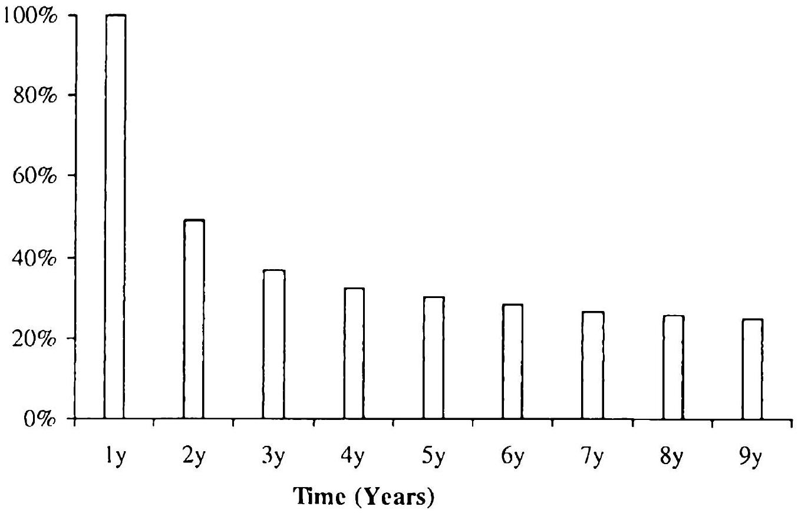
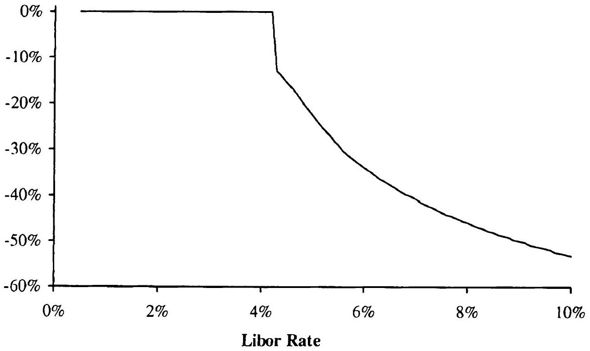
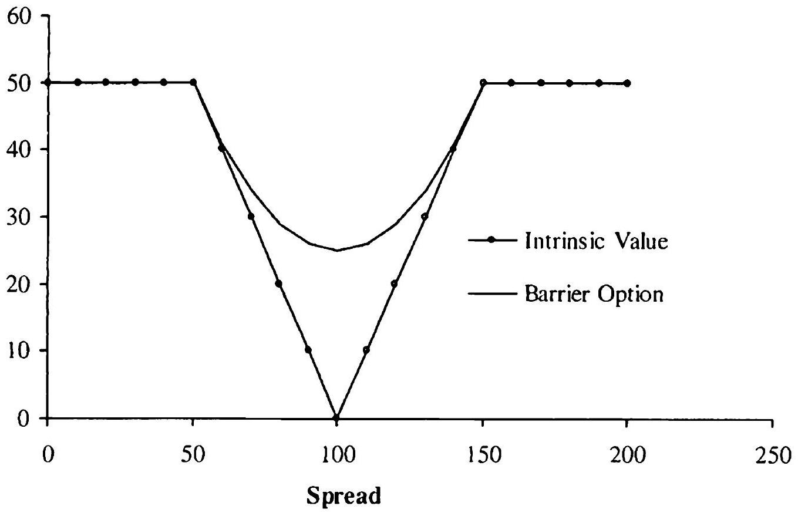
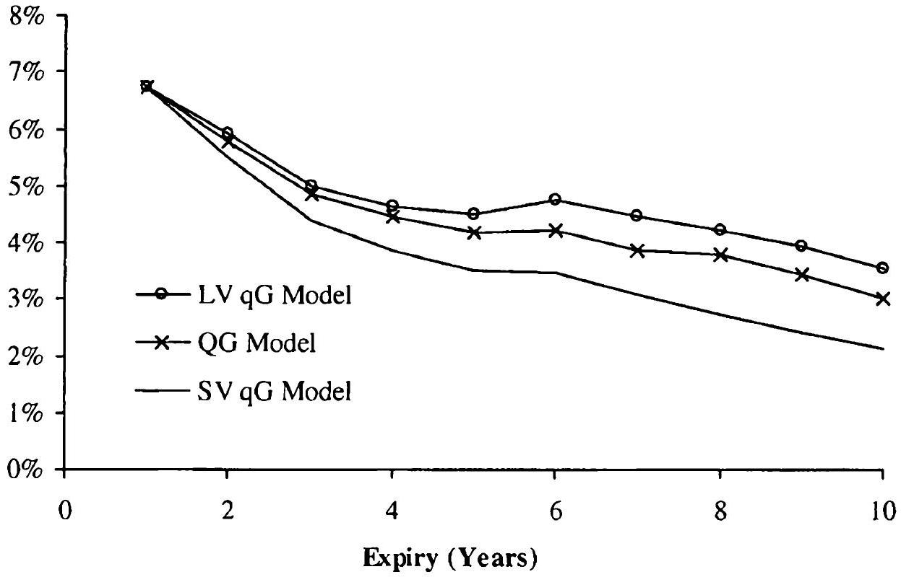

## TARNs, Volatility Swaps, and Other Derivatives

Having completed our discussion of callable Libor exotics, in this chapter we turn our attention to a few remaining types of exotic interest rate derivatives that are popular in the market. Our analysis gives us the opportunity to provide additional examples of the local projection method introduced in Chapter 18 which, along with the out-of-model adjustment methods in Chapter 21, are the cornerstone techniques for the situations where computational efficiency constraints prohibit the usage of large, globally calibrated models.

### 20.1 TARNs

### 20.1.1 Definitions and Examples

As explained in Section 5.15.2, a TARN (Targeted Redemption Note) pays structured coupons in exchange for Libor coupons until the cumulative amount of structured coupon payments exceeds a pre-agreed target, at which point the derivative terminates. While many coupon types could be used in a TARN, we focus our discussion on inverse floating coupons indexed to the Libor rate. Recall (Section 5.13.1) that an inverse floating coupon with strike $s$, gearing $g$, a zero floor and no cap is defined as

$$
\begin{equation*}
C_{n}=\left(s-g \times L_{n}\left(T_{n}\right)\right)^{+} \tag{20.1}
\end{equation*}
$$
^eq20-1

with the underlying rate observed (fixed) at time $T_{n}$ and the coupon paid at $T_{n+1}$. We shall use the specific structured coupon (20.1) as an example throughout this section; in defining it, we have used the usual notation for spanning Libor rates

$$
L_{n}(t)=L\left(t, T_{n}, T_{n+1}\right)=\frac{P\left(t, T_{n}\right)-P\left(t, T_{n+1}\right)}{\tau_{n} P\left(t, T_{n+1}\right)}, \quad n=0, \ldots, N-1
$$

and have also introduced a tenor structure

$$
0=T_{0}<T_{1}<\ldots<T_{N}, \quad \tau_{n}=T_{n+1}-T_{n}
$$

In the TARN, the structured coupon fixed at time $T_{n}$ is only paid if the sum of coupons fixing before (but not including) time $T_{n}$ is below a given total return $R$. Thus, from the investor viewpoint, the value of the TARN at time 0 under is given by

$$
\begin{align*}
V_{\operatorname{tarn}}(0) & =\mathrm{E}\left(\sum_{n=1}^{N-1} B\left(T_{n+1}\right)^{-1} \tau_{n}\left(C_{n}-L_{n}\left(T_{n}\right)\right) 1_{\left\{Q_{. .}<R\right\}}\right)  \tag{20.2}\\
Q_{n} & =\sum_{i=1}^{n-1} \tau_{i} C_{i}, \quad Q_{1}=0
\end{align*}
$$
^eq20-2

where we, arbitrarily, have used the spot measure numeraire $B(t)$ (and E therefore denotes expectation in measure $Q^{B}$ ). We recall that a TARN typically pays fixed coupons to an investor before the knock-out feature starts; these coupons can be valued separately and are not included in the TARN definition above.

To make the discussion a bit more concrete, let us warm up by considering a typical example. Let the total maturity $T_{N}$ be 10 years, let the target return $R$ be $3 \%$, and let the strike $s$ and gearing $g$ in (20.1) be $11.5 \%$ and 2 , respectively. Also suppose the TAR.N pays annual coupons ( $\tau_{n}=1$ year). Using a yield curve with continuously compounded yields that grow from $3.5 \%$ in 1 day to $6.50 \%$ in 10 years and a displaced log-normal LM model with skew parameter 0.6 and calibrated to flat $35 \%$ swaption ATM Black volatilities, the value of the TARN with these parameters implies an attractive fixed coupon of $11 \%$ in the first year. If the TARN knocks out after the second year (at $T_{2}$ ), the investor would have received $14 \%$ return over two years ( $11 \%$ fixed coupon up front plus $3 \%$ targeted return), and is repaid the principal upon termination. This scenario comes true provided $C_{1}$ is above $3 \%$, which according to (20.1) is equivalent to $L_{1}\left(T_{1}\right)$ fixing below $4.25 \%$. More generally, the TARN will terminate early if interest rates are low. On the flip side, if, say, the rates go above $5.75 \%$ and stay there for the entire 10 year life of the TARN, all coupons $C_{n}$ pay zero, and the investor receives nothing for 10 years. Yet, he has to pay Libor (by. essentially, forfeiting interest on the principal) for 10 years, so the high-rate scenario is obviously not advantageous to the investor.

For reference, Figure 20.1 plots the probability (in spot measure) of the TARN being alive at future points in time, using the same market data and the model as above. According to the figure, the TARN stays alive for 10 years (bad for the investor) with about $25 \%$ probability, and knocks out after the first two years (good for the investor) with about $65 \%$ probability. Loosely speaking, the TARN investor therefore makes good money with (risk-neutral) probability of $65 \%$, and loses a significant amount
with probability of $25 \%$. This demonstrates how a high leverage inherent in TAR.Ns allows them to pay attractive (i.e., high) coupons in scenarios that favor the investor. The leverage in any particular TARN depends on many factors, but is primarily a function of the target return $R$, with TARNs having smaller target return $R$ providing higher leverage, ceteris paribus.

Fig. 20.1. Probability of TARN Being Alive at Future Years

Notes: Model-implied spot measure probability of a TARN being alive after a given number of years. The TARN contract details and the model are described in the text.

### 20.1.2 Valuation and Risk with Globally Calibrated Models

Using a flexible model (e.g. a Libor market model or a multi-factor quasiGaussian model) calibrated to the full swaption volatility grid is always a relatively safe choice for TARN pricing, since a globally calibrated multifactor model can typically be counted on to capture the majority of all possible market risk factors. As shall be explained later, faithful reproduction of volatility smiles of various Libor rates is important for TARN valuation, so among all possible LM or qG models, we recommend the versions with stochastic volatility (Sections 14.2.5 and 13.3.2), as these models have enough flexibility to provide good fits to volatility smiles for a collection of forward Libor rates.

Pricing TARNs in LM and qG models is conceptually straightforward: as TARNs are purely path-dependent derivatives with no optimal exercise
features, standard Monte Carlo simulation techniques apply. However, since the knock-out feature of the TARN will introduce "digital" discontinuities into the payoff, Monte Carlo errors of the contract value and, especially, its risk sensitivities can be quite large, see Section 3.3.1. The number of paths required to get reasonably accurate estimates of risk sensitivities of a derivative with a discontinuous payoff could be high, which may sometimes render the application of a Monte Carlo based market model impractical. We review methods that help us obtain risk sensitivities in Monte Carlo for TARNs later in the book, see Sections 23.2.4, 23.4.4, and 25.2. Ultimately, however, the full power of LM and qG models may not be required for TARNs; despite appearances, TARNs turn out to be relatively simple instruments amendable to treatment by less complex - and more performant - models. We pursue this topic next.

### 20.1.3 Local Projection Method

In Chapters 18 and 19 we introduced the local projection method and applied it to Bermudan swaptions and other callable Libor exotics. We recall that the method is based on finding a relatively simple, local model that is calibrated to a global model (such as an LM model) in such a way as to approximate the value of the global model for a particular derivative. In particular, the local model should be calibrated to the parts of the global model volatility structure that are relevant to the derivative being valued. Let us apply this approach to TARNs. To start, it is informative to rewrite the TARN value as follows,

$$
\begin{array}{r}
V_{\operatorname{tarn}}(0)=\mathrm{E}\left(\sum_{n=1}^{N-1} B\left(T_{n+1}\right)^{-1} \tau_{n}\left(\left(s-g \times L_{n}\left(T_{n}\right)\right)^{+}-L_{n}\left(T_{n}\right)\right)\right. \\
\left.\times 1_{\left\{\sum_{i=1}^{n-1} \tau_{i}\left(s-g \times L_{i}\left(T_{i}\right)\right)^{+}<R\right\}}\right) \tag{20.3}
\end{array}
$$
^eq20-3

(with the usual convention that $\sum_{i=1}^{0}=0$ ). Scrutinizing the payoff, we notice that it depends on the values

$$
\widetilde{L}=\left(L_{1}\left(T_{1}\right), L_{2}\left(T_{2}\right), \ldots, L_{N-1}\left(T_{N-1}\right)\right)
$$

of Libor rates on their fixing dates only (for the discrete money market numeraire $B(t)$ this follows from (4.24)). With the values of Libor rates at intermediate times irrelevant, only the distribution properties of the $(N-1)$ dimensional vector $\widetilde{L}$ must be captured in whatever model we decide to use. Clearly this is a major simplification from a typical valuation problem. Notice, for instance, that a Bermudan swaption would depend on values of Libor rates at various dates on and before their fixing dates. A similar principle also holds approximately true for more complicated TARNs linked
to swap rates (rather than Libor rates): only the distribution properties of the $(N-1)$-dimensional vector of swap rates observed on their fixing dates needs to be captured. In stating this principle, we have relied on the fact that the dependence on Libor rates through discounting with the spot numeraire is rather mild and has only limited impact on the value of TAR.Ns.

Focusing on the covariance characteristics only (we will deal with volatility smiles later), and assuming log-normal distributions for market rates for the time being, we see that if two models assign the same values to the term variances of Libor rates $\operatorname{Var}\left(\ln L_{n}\left(T_{n}\right)\right), n=1, \ldots, N-1$, and inter-temporal correlations of Libor rates $\operatorname{Corr}\left(\ln L_{n}\left(T_{n}\right), \ln L_{m}\left(T_{m}\right)\right), n, m=1, \ldots, N-1$, then the values of a TARN in the two models would be the same. With this in mind, we can apply the local projection method as follows. First, we calibrate, say, a Libor market model to the full swaption volatility grid (and, of course, one's views on the proper dynamics of the volatility structure). Second, we use the calibrated LM model to calculate the relevant term volatilities and inter-temporal correlations needed for the TARN. Third, we pick a simpler model and calibrate it to the volatilities and correlations extracted from the LM model. Finally, we use the calibrated local model for valuing the TARN. Of course, when computing risk sensitivities, we would update the volatilities and correlations produced by the global LM model for each shock of market data.

In the procedure above, the local model needed for the third and final steps needs enough flexibility in its volatility structure specification to calibrate to the set of TAR.N volatility information we identified earlier. Fortunately, the set is not very extensive and, as we have seen before, can be effectively captured even by models as simple as a one-factor Gaussian model, see Sections 13.1.7 and 13.1.8.3. While adequate for capturing the volatility structure, the smile capabilities of the Gaussian model are, however, quite limited, and we shall consider more advanced alternatives below.

### 20.1.4 Volatility Smile Effects

To investigate the effects of the volatility smile on TARNs, let us consider the TARN value on date $T_{1}$ as a function of the Libor rate $L_{1}\left(T_{1}\right)$ :

$$
\begin{aligned}
& V_{\operatorname{tarn}}\left(T_{1}, x\right) \\
& =\mathrm{E}\left(B\left(T_{1}\right) \sum_{n=1}^{N-1} B\left(T_{n+1}\right)^{-1} \tau_{n}\left(C_{n}-L_{n}\left(T_{n}\right)\right) 1_{\left\{Q_{n}<R\right\}} \mid L_{1}\left(T_{1}\right)=x\right)
\end{aligned}
$$

We plot $V_{\text {tarn }}\left(T_{1}, x\right)$ as a function of $x$ in Figure 20.2 for the same TARN example and market/model data used in Section 20.1.1. Since $V_{\text {tarn }}(0)$ is given by the integral of $V_{\operatorname{tarn}}\left(T_{1}, x\right)$ over the distribution of $L_{1}\left(T_{1}\right)$, the features of the payoff $V_{\operatorname{tarn}}\left(T_{1}, x\right)$ highlight the characteristics of the distribution of $L_{1}\left(T_{1}\right)$ that are important for valuation. Clearly, $V_{\operatorname{tarn}}\left(T_{1}, x\right)$ has an outright discontinuity at a barrier $L_{1}\left(T_{1}\right)=b_{1}$ implicitly given by

$$
\begin{equation*}
\tau_{1}\left(s-g b_{1}\right)^{+}=R \tag{20.4}
\end{equation*}
$$
^eq20-4

and a call-option type singularity (a kink) at $s / g$. Moreover, values of future coupons are non-linear functions of $L_{1}\left(T_{1}\right)$, so the payoff $V_{\operatorname{tarn}}\left(T_{1}, x\right)$ is nonlinear in $x$. From the replication argument of Proposition 8.4.13, we recall that a model generally needs to faithfully incorporate the whole distribution of $L_{1}\left(T_{1}\right)$ as implied from caplet prices across a range of strikes, and not just some summary information such as an implied volatility at a certain strike.

Fig. 20.2. Value of TARN on First Knockout Date

Notes: Value of a TARN on the first knockout date as a function of the spot Libor rate on that date. TARN and model details are given in the text.

Some might argue for focusing all attention on the knockout barrier $b_{1}$ and disregarding the rest of the volatility smile, believing that to value a TARN properly, it suffices to choose a model that values a digital caplet with strike $b_{1}$ consistently with the market. While this argument has some merit for the first date $T_{1}$, it is simply not valid for any subsequent knock-out dates. For instance, it is obvious that the value of $L_{2}\left(T_{2}\right)$ at which the derivative knocks out would depend on the realized fixing of $L_{1}\left(T_{1}\right)$, a value that is unknown at time $t=0$. Since the location of the knock-out barrier at time $T_{2}$ is unknown at time $t=0$, we cannot find a single strike that would faithfully represent relevant features of the volatility smile at $T_{2}$; thus a model that only matches the level, or slope, of the implied volatility of $L_{2}\left(T_{2}\right)$ at a single strike will be inadequate.

From this discussion, and from what we have learned about the local projection method in previous chapters, it is clear that a successful candidate for the local model should have the ability to calibrate to volatility smiles of all Libor rates, in addition to having a low number of state variables and enough flexibility to calibrate to inter-temporal correlations of Libor rates. One reasonable candidate is the one-factor quasi-Gaussian (qG) model with stochastic volatility (13.64). To calibrate this model, we would first fix its mean reversion function to match the inter-temporal correlations of Libor rates $\operatorname{Corr}\left(\ln L_{n}\left(T_{n}\right), \ln L_{m}\left(T_{m}\right)\right), n, m=1, \ldots, N-1$, as explained in Section 13.1.8.3. Subsequently, we would use the methods of Section 13.2 to calibrate to the volatility smiles of all Libor rates that appear in the payoff formula. With the formulas developed there, the time-dependent local volatility function $\sigma_{r}(t, x, y)$, and the time-dependent volatility of variance function $\eta(t)$ (see (13.64) for notation) could be chosen to match the implied SV parameters of relevant caplets.

The qG-SV model is a good choice of a local model for TARNs as it has just enough - but not more - flexibility to calibrate to all relevant covariance and smile information. Other suitable model candidates include the one-factor Markov-functional model from Appendix 11.A of Chapter 11, as it could be calibrated in a similar way. Finally, we could also use a twofactor version of the quadratic Gaussian model of Section 12.3. As all these three local models have sufficient flexibility to reproduce the TARN-specific correlation and smile properties of a globally calibrated multi-factor model, we would expect them to produce similar values for TARNs. Still, the models generate volatility smiles using different mechanisms, which may change correlations in subtle ways, as we saw an example of in Appendix 17.A of Chapter 17. While this effect on TARNs is quite minor, it can be significant for other classes of derivatives, see Section 20.2.4 below.

### 20.1.5 PDE for TARNs

Suppose that we succeeded in applying the local projection method to calibrate a low-dimensional Markov model targeted to TAR.N valuation. Actual pricing of the TARN structure could then obviously be accomplished by standard Monte Carlo techniques. As low-dimensional models typically allow for particularly efficient path discretization, the resulting scheme would be substantially faster than, say, simulation of a full Libor market model. Even more attractive, if the Markov model has a dimension less than 3 or 4, the local projection method allows for the usage of PDE-based TARN valuation schemes. In a finite-difference setting, the path-dependent nature of TARNs can be dealt with using the now-familiar method of augmenting the state variable space, see for instance Sections 2.7.5 and 18.4.5. In doing so, we shall implicitly assume that all $C_{n}$ 's are non-negative, as is almost universally the case for structured notes.

Let $V(t, I)$ be the value of the TARN at time $t$ assuming that the total accumulated coupon at time $t$ is $I=I(t)$, where we have defined

$$
I(t)=\sum_{i=1}^{N-1} \tau_{i} C_{i}\left(T_{i}\right) 1_{\left\{T_{i} \leq t\right\}}
$$

We start by initializing the value of the TARN at $T_{N}$ to 0 ,

$$
\begin{equation*}
V\left(T_{N}-, I\right)=0 \tag{20.5}
\end{equation*}
$$
^eq20-5

Then, for each $n=N-1, \ldots, 0$, we perform the following steps.

1. Roll back the value of the TARN

$$
V\left(T_{n}, I\right)=\mathrm{E}_{T_{n}}\left(\frac{B\left(T_{n}\right)}{B\left(T_{n+1}\right)} V\left(T_{n+1}-, I\right)\right)
$$

by solving an appropriate model PDE for each value of $I$.
2. Apply the continuity condition

$$
V\left(T_{n}-, I\right)=V\left(T_{n}, I+\tau_{n} C_{n}\right)
$$

across $I$-planes, corresponding to the update of the total return $Q_{n}$ at time $T_{n}$.
3. Add the time $T_{n}$ coupon times the survival indicator,

$$
\begin{equation*}
V\left(T_{n}-, I\right)=V\left(T_{n}-, I\right)+P\left(T_{n}, T_{n+1}\right) \tau_{n}\left(C_{n}-L_{n}\left(T_{n}\right)\right) 1_{\{I<R\}} \tag{20.6}
\end{equation*}
$$
^eq20-6

4. Starting from the new terminal condition (20.6), repeat Steps 1 through 3 with $n \rightarrow(n-1)$.

The final value is given by $V_{\text {tarn }}(0)=V(0,0)$.
The discretization schome based on this algorithm would require specifying bounds, and potentially the discretization grid, for the extra state variable $I$. The lower bound for $I$ is clearly 0 . From (20.6) it follows that the coupon update equation for $I>R$ is trivial so one would think that the upper bound for $I$ should be $R$. Yet if we look at the continuity condition in Step 2 we see that, on the right-hand side, we may actually need the values of $V\left(T_{n}, I\right)$ for $R<I<R+\tau_{n} C_{n}$. Hence the upper bound should be somewhat higher than $R$ and is best determined as

$$
\begin{equation*}
R+\max _{n, \omega}\left\{\tau_{n} C_{n}(\omega)\right\} \tag{20.7}
\end{equation*}
$$
^eq20-7

where by $C_{n}(\omega)$ we denoted the value of $n$-th coupon in the TARN over a realization of an interest rate path $\omega$. For an inverse floater TAR.N, as well as for many other TARN types, the coupons are globally bounded and the expression in (20.7) makes sense. For TARNs with unbounded coupons
this strategy will obviously not work and the global maximum will need to be replaced with a maximum over a set of sufficiently high probability. Needless to say rather crude calculations are sufficient here. For example, if the coupon $C_{n}$ is a deterministic function of a Libor rate $L_{n}\left(T_{n}\right)$, then the, say, $99 \%$ confidence interval for $L_{n}\left(T_{n}\right)$ could be established from its forward value and market-observed volatility; this confidence interval on the rate could then be translated into a confidence interval on the coupon.

While trade-specific analysis for the bounds of $I$ is not conceptually difficult, it is always preferable to have a generic scheme that works for a large class of instruments. For example, one could imagine a simple scheme where, prior to solving a PDE, a Monte Carlo simulation with a low number of paths is run and an empirical distribution of $I$ is estimated. Using this distribution, not only the bounds of given probabilistic coverage on $I$ could be established, but we could also use it to set up a discretization grid. For example, we can discretize more finely in the region where realized values of $I$ are dense, and use coarse discretization elsewhere to save calculation time.

Section 5.15.2 lists a few potential tweaks to the standard TARN specification; they could be included in the PDE scheme without much difficulty. For example, to include the "capped at trigger" feature we would replace (20.6) with

$$
\begin{aligned}
V\left(T_{n}-, I\right)=V & \left(T_{n}-, I\right) \\
& +P\left(T_{n}, T_{n+1}\right) \tau_{n}\left(\min \left(C_{n},(R-I)\right)-L_{n}\left(T_{n}\right)\right) 1_{\{I<R\}} .
\end{aligned}
$$

And to account for the "make whole" provision we would replace the initialization (20.5) with

$$
V\left(T_{N}-, I\right)=(R-I)^{+} .
$$

### 20.2 Volatility Swaps

We now shift our attention to volatility swaps introduced in Section 5.16. Valuation of many flavors of volatility swaps is straightforward in Monte Carlo, so a globally-calibrated LM model is a reasonable choice ${ }^{1}$. As always, however, performance considerations suggest that we seek methods that are faster.

[^58]
### 20.2.1 Local Projection Method

We recall that the structured coupon paid at $T_{n+1}$ of a typical volatility swap has the form

$$
\begin{equation*}
C_{n}=\left|S_{n+1}\left(T_{n+1}\right)-S_{n}\left(T_{n}\right)\right| \tag{20.8}
\end{equation*}
$$
^eq20-8

where $S_{n}(t), n=1, \ldots, N$, are the reference rates of the swap. The payoff of a volatility swap shares certain characteristics with a TARN payoff, and this makes it amendable to the same treatment as what we applied to TARNs. In particular, it is clear from the valuation equation (5.26) that the value of a volatility swap depends on the values of the rates $S_{n}$ on their fixing dates only. As such, the specific local projection method developed in Section 20.1.3 may be applied to volatility swaps as well. We do not repeat the analysis here, but just emphasize that we can use one-factor models to value volatility swaps as long as we calibrate them to the marginal rate distributions and the correlation structure of $\left(S_{1}\left(T_{1}\right), \ldots, S_{N}\left(T_{N}\right)\right)$. The former typically would come from the market and the latter from a globally calibrated model, e.g., the LM model.

As a properly calibrated one-factor model is appropriate for valuation, one may wonder whether we can use PDE, rather than Monte Carlo, methods. Indeed, this is the case, as each "swaplet" (20.8) in the structured leg of the volatility swap can be valued in a finite difference grid by introducing of an extra state variable to track the "strike" $S_{n}\left(T_{n}\right)$ in the swaplet payoff. In this particular case, the extra state variable method amounts to calculating, via a PDE, the value of the coupon at time $T_{n}$,

$$
\begin{align*}
V_{\text {swaplet }}\left(x, T_{n}\right) \triangleq \mathrm{E}_{T_{n}}^{T_{n+1}} & \left(C_{n} \mid S_{n}\left(T_{n}\right)=x\right) \\
& =\mathrm{E}_{T_{n}}^{T_{n+1}}\left(\left|S_{n+1}\left(T_{n+1}\right)-x\right| \mid S_{n}\left(T_{n}\right)=x\right) \tag{20.9}
\end{align*}
$$
^eq20-9

for a selection of values $x$ (we use $T_{n+1}$-forward measure in this example). To obtain the time 0 value of the coupon, we can then calculate, again in a PDE, the expected value

$$
\begin{equation*}
\mathrm{E}\left(\beta\left(T_{n}\right)^{-1} P\left(T_{n}, T_{n+1}\right) V_{\text {swaplet }}\left(S_{n}\left(T_{n}\right), T_{n}\right)\right), \tag{20.10}
\end{equation*}
$$
^eq20-10

where $\beta(t)$ is the money market numeraire.
For some versions of the volatility swap payoff, we can go further and derive approximate closed-form expressions. We will discuss this in more detail later but, briefly, the basic approach here is to calculate the value of each swaplet payout with a two-dimensional integration or a suitable approximation for a spread option. In doing so, we rely on a model to pre-calculate the term volatilities and the (inter-temporal) correlation of $S_{n}\left(T_{n}\right)$ and $S_{n+1}\left(T_{n+1}\right)$ in (20.8).

### 20.2.2 Shout Options

As pointed out in Section 5.16.2, volatility swaps often give the receiver of the structured coupons an option to shout, i.e. to choose the observation time of the rate $S_{n+1}(\cdot)$ in (20.8). The coupon in (20.8) is then replaced with

$$
C_{n}=\left|S_{n+1}\left(\eta_{n}\right)-S_{n}\left(T_{n}\right)\right|,
$$

where the stopping time $\eta_{n} \in\left[T_{n}, T_{n+1}\right]$ is chosen by the party receiving the coupon ${ }^{2}$. Importantly, the payoff is still paid at time $T_{n+1}$, even if $\eta_{n}$ is strictly less than $T_{n+1}$. As viewed from time $T_{n}$, the option then looks like an American option on an at-the-money straddle, with exercise value $P\left(\eta_{n}, T_{n+1}\right)\left|S_{n+1}\left(\eta_{n}\right)-S_{n}\left(T_{n}\right)\right|$; the presence of the discount factor $P\left(\eta, T_{n+1}\right)$ in the exercise value reflects the fact that payment of the coupon will always take place at time $T_{n+1}$, irrespective of the time of exercise. Notice that $S_{n+1}(t)$ has almost no drift ${ }^{3}$ so Jensen's inequality implies that

$$
\begin{aligned}
P\left(\eta_{n}, T_{n+1}\right) \mathrm{E}_{\eta_{n}}^{T_{n+1}} & \left(\left|S_{n+1}\left(T_{n+1}\right)-S_{n}\left(T_{n}\right)\right|\right) \\
& \geq P\left(\eta_{n}, T_{n+1}\right)\left|\mathrm{E}_{\eta_{n}}^{T_{n+1}}\left(S_{n+1}\left(T_{n+1}\right)\right)-S_{n}\left(T_{n}\right)\right| \\
& \approx P\left(\eta_{n}, T_{n+1}\right)\left|S_{n+1}\left(\eta_{n}\right)-S_{n}\left(T_{n}\right)\right|,
\end{aligned}
$$

i.e the exercise value is (approximately) dominated by the hold value and the value of the early exercise is negligible. As a consequence, the shout option can safely be ignored for valuation purposes, and the coupons could be valued as if (20.8) were the actual payoff.

The situation is somewhat less clear cut in a reasonably popular case of a capped coupon with a shout,

$$
\begin{equation*}
C_{n}^{\prime}=\min \left(\left|S_{n+1}\left(\eta_{n}\right)-S_{n}\left(T_{n}\right)\right|, c\right) \tag{20.11}
\end{equation*}
$$
^eq20-11

for some $c>0$. Clearly, if for some $t \in\left[T_{n}, T_{n+1}\right)$ the rate $S_{n+1}(t)$ is outside the interval $\left[S_{n}\left(T_{n}\right)-c, S_{n}\left(T_{n}\right)+c\right]$, then the holder should exercise at that point as he will never get a higher value for the coupon (but if he waits he may end up with a lower value at expiration). So early exercise is optimal in some cases. This may seem like a major complication as any application of Monte Carlo would apparently require the estimation of the optimal exercise rule, potentially requiring the full suite of regression-based methods of Chapter 18. Fortunately the situation is much simpler; we formalize this result as a proposition.

[^59]Proposition 20.2.1. The value of the American option on a capped straddle with the payoff (20.11) is equal to the value of a straddle with a barrier, so that $\mathrm{E}_{T_{n}}^{T_{n+1}}\left(C_{n}^{\prime}\right)=\mathrm{E}_{T_{n}}^{T_{n+1}}\left(C_{n}^{\prime \prime}\right)$, where

$$
\begin{aligned}
C_{n}^{\prime \prime}= & c \times 1_{\left\{\max _{t \in\left[T_{n}, T_{n+1}\right]}\left(\left|S_{n+1}(t)-S_{n}\left(T_{n}\right)\right|\right) \geq c\right\}} \\
& +\left|S_{n+1}\left(T_{n+1}\right)-S_{n}\left(T_{n}\right)\right| \times 1_{\left\{\max _{t \in\left[T_{n}, T_{n+1}\right]}\left(\left|S_{n+1}(t)-S_{n}\left(T_{n}\right)\right|\right)<c\right\}}
\end{aligned}
$$

Remark 20.2.2. The proposition tells us that the optimal exercise strategy is known analytically: for the period [ $T_{n}, T_{n+1}$ ] one should simply exercise the shout option on the first time $t$ when $S_{n+1}(t)$ hits either of the barriers $S_{n}\left(T_{n}\right) \pm c$.

Proof. We content ourselves with a sketch of the proof; a more formal argument is developed in Broadie and Detemple [1995]. Let us denote by $\eta_{n}^{c}$ the first hitting time of the double barrier $S_{n}\left(T_{n}\right) \pm c$,

$$
\eta_{n}^{c}=\inf \left\{t \in\left[T_{n}, T_{n+1}\right]:\left|S_{n+1}(t)-S_{n}\left(T_{n}\right)\right|=c\right\} \wedge T_{n+1}
$$

Then, clearly,

$$
\mathrm{E}_{T_{n}}^{T_{n+1}}\left(C_{n}^{\prime \prime}\right)=\mathrm{E}_{T_{n}}^{T_{n+1}}\left(\min \left(\left|S_{n+1}\left(\eta_{n}^{c}\right)-S_{n}\left(T_{n}\right)\right|, c\right)\right)
$$

(we use $T_{n+1}$-forward measure for valuation here). On one hand,

$$
\begin{align*}
\mathrm{E}_{T_{n}}^{T_{n+1}}\left(\operatorname { m i n } \left(\mid S_{n+1}\left(\eta_{n}^{c}\right)-\right.\right. & \left.\left.S_{n}\left(T_{n}\right) \mid, c\right)\right) \\
& \leq \mathrm{E}_{T_{n}}^{T_{n+1}}\left(\min \left(\left|S_{n+1}\left(\eta_{n}\right)-S_{n}\left(T_{n}\right)\right|, c\right)\right) \tag{20.12}
\end{align*}
$$
^eq20-12

because, by definition, $\eta_{n}$ is the optimal stopping time for the American capped straddle. On the other hand, for each $t \in\left[T_{n}, T_{n+1}\right]$,

$$
\mathrm{E}_{t}^{T_{n+1}}\left(\min \left(\left|S_{n+1}\left(\eta_{n}^{c}\right)-S_{n}\left(T_{n}\right)\right|, c\right)\right) \geq \min \left(\left|S_{n+1}(t)-S_{n}\left(T_{n}\right)\right|, c\right)
$$

as Figure 20.3 demonstrates. Therefore,

$$
\begin{align*}
& \mathrm{E}_{T_{n}}^{T_{n+1}}\left(\min \left(\left|S_{n+1}\left(\eta_{n}\right)-S_{n}\left(T_{n}\right)\right|, c\right)\right) \\
& \quad=\mathrm{E}_{T_{n}}^{T_{n+1}}\left(\int_{T_{n}}^{T_{n+1}} \min \left(\left|S_{n+1}(t)-S_{n}\left(T_{n}\right)\right|, c\right) \delta\left(\eta_{n}-t\right) d t\right) \\
& \quad \leq \mathrm{E}_{T_{n}}^{T_{n+1}}\left(\int_{T_{n}}^{T_{n+1}} \mathrm{E}_{t}^{T_{n+1}}\left(\min \left(\left|S_{n+1}\left(\eta_{n}^{c}\right)-S_{n}\left(T_{n}\right)\right|, c\right)\right) \delta\left(\eta_{n}-t\right) d t\right) \\
& \quad=\mathrm{E}_{T_{n}}^{T_{n+1}}\left(\min \left(\left|S_{n+1}\left(\eta_{n}^{c}\right)-S_{n}\left(T_{n}\right)\right|, c\right) \int_{T_{n}}^{T_{n+1}} \delta\left(\eta_{n}-t\right) d t\right) \\
& \quad=\mathrm{E}_{T_{n}}^{T_{n+1}}\left(\min \left(\left|S_{n+1}\left(\eta_{n}^{c}\right)-S_{n}\left(T_{n}\right)\right|, c\right)\right) \tag{20.13}
\end{align*}
$$
^eq20-13

where the second-to-last equality follows by the law of iterated conditional expectations and $\mathcal{F}_{t}$-measurability of $\delta\left(\eta_{n}-t\right)$. Comparing (20.12) and (20.13) we see that

$$
\mathrm{E}_{T_{n}+1}^{T_{n+1}}\left(C_{n}^{\prime}\right)=\mathrm{E}_{T_{n}}^{T_{n+1}}\left(C_{n}^{\prime \prime}\right)
$$

and the optimal exercise strategy is actually given by $\eta_{n}^{c}$, as stated earlier. $\square$

Fig. 20.3. Value of a Barrier Option on a Capped Straddle

Notes: The payoff and the present value of a barrier option on a capped straddle, vs. the underlying. The barrier option value dominates the payoff in all states of the world.

Having replaced an American option with a barrier option, we can now value capped volatility swaps in standard Monte Carlo, as no optimal exercise features need to be incorporated. Still, we do have some complications - namely two continuous barriers - that now need to be handled in Monte Carlo. Here the techniques developed in Section 3.2.9 come in handy. Deserving a special mention is the method of Broadie et al. [1997] which replaces a continuously-observed barrier with a discretely-observed one that is shifted by a certain amount, see Theorem 3.2.2. Other methods from Section 3.2.9 could also be used, although all of then assume that the underlying follows a simple process such as a Brownian motion; this is typically not a problem as the dynamics of $S_{n+1}(t)$ for $t \in\left[T_{n}, T_{n+1}\right]$ could be closely approximated as such, irrespective of the underlying model used, since $T_{n+1}-T_{n}$ tends to be relatively small (one year or less).

PDE methods can also be used for barrier options, with the same trick of using the strike $S_{n}\left(T_{n}\right)$ as an extra state variable as we discussed in the European case (20.9)-(20.10), only now valuing a (double) barrier option for each value of the strike $S_{n}\left(T_{n}\right)$. This is probably the best we can do as far as valuation speed is concerned, as it should be obvious that closed-form approximations to values of capped straddle coupons with a shout option would be rather hard to develop.

### 20.2.3 Min-Max Volatility Swaps

Defined in Section 5.16.3, min-max volatility swaps replace the straddle coupon (20.8) with a coupon that measures the maximum move of a given rate over a given period,

$$
\begin{equation*}
C_{n}=M_{n}-m_{n} \tag{20.14}
\end{equation*}
$$
^eq20-14

where

$$
M I_{n}=\max _{s \in\left[T_{n}, T_{n+1}\right]} S_{n}(s), \quad m_{n}=\min _{s \in\left[T_{n}, T_{n+1}\right]} S_{n}(s)
$$

At first glance the min-max coupon appears significantly more "exotic" than the plain straddle (20.8), to the point that one may wonder if the minmax coupon has significantly different risk characteristics. For example, a superficial analysis could suggest that the min-max coupon has significantly higher "forward skew" exposure, i.e. the exposure to the slope of the volatility smile as observed at the time when the minimum (or maximum) of the process is reached. It is all the more interesting that, in fact, we can show that the two coupons, (20.14) and (20.8), are quite alike.

Let us start by assuming that for $t \in\left[T_{n}, T_{n+1}\right], S_{n}(t)$ follows a driftless Brownian motion with some constant volatility $\sigma$, i.e.

$$
d S_{n}(t)=\sigma d W(t)
$$

where $W(t)$ is a Brownian motion in the $T_{n+1}$-forward measure $Q^{T_{n+1}}$. As we have already pointed out, this is not a bad approximation as the period $\left[T_{n}, T_{n+1}\right]$ is often rather short, on the order of one year. By the reflection principle from Section 2.6 of Karatzas and Shreve [1997], we have for any $b \geq S_{n}\left(T_{n}\right)$,

$$
\begin{equation*}
\mathrm{Q}_{T_{n},}^{T_{n+1}}\left(M_{n} \geq b\right)=2 \mathrm{Q}_{T_{n}}^{T_{n+1}}\left(S_{n}\left(T_{n+1}\right) \geq b\right) \tag{20.15}
\end{equation*}
$$
^eq20-15

As

$$
\int_{b_{\min }}^{b_{\min }} 1_{\{x \geq b\}} d b=\min \left(\max \left(x-b_{\min }, 0\right), b_{\max }-b_{\min }\right)
$$

we obtain, integrating (20.15) over $b \in\left[S_{n}\left(T_{n}\right), \infty\right)$ that

$$
\mathrm{E}_{T_{n}}^{T_{n+1}}\left(M_{n}-S_{n}\left(T_{n}\right)\right)=2 \mathrm{E}_{T_{n}}^{T_{n+1}}\left(\left(S_{n}\left(T_{n+1}\right)-S_{n}\left(T_{n}\right)\right)^{+}\right) .
$$

Similarly,

$$
\mathrm{E}_{T_{n}}^{T_{n+1}}\left(S_{n}\left(T_{n}\right)-m_{n}\right)=2 \mathrm{E}_{T_{n}}^{T_{n+1}}\left(\left(S_{n}\left(T_{n}\right)-S_{n+1}\left(T_{n}\right)\right)^{+}\right)
$$

and, adding the last two equations together, we obtain

$$
\begin{equation*}
\mathrm{E}_{T_{n}}^{T_{n+1}}\left(M_{n}-m_{n}\right)=2 \mathrm{E}_{T_{n}}^{T_{n+1}}\left(\left|S_{n}\left(T_{n+1}\right)-S_{n}\left(T_{n}\right)\right|\right) . \tag{20.16}
\end{equation*}
$$
^eq20-16

Therefore, the value of the min-max coupon is (approximately) equal to twice the value of the straddle coupon, and the min-max volatility bond could be valued, and risk managed, in the same way as the standard volatility swap in Section 20.2.

The starting point of our proof, equation (20.15), has an interesting financial interpretation. On the left-hand side we have the value of a "onetouch" option, an option that pays 1 if the underlying process ever touches the barrier $b$ (before $T_{n+1}$ ). The equality suggests that this continuously monitored barrier option can somehow be hedged with two European-style digital call options (the right-hand side). To show that this is indeed the case, consider buying two digital calls struck at the barrier. If the underlying process never hits the barrier, both the one-touch and the two digitals expire worthless. On the other hand, if the process touches the barrier, then we sell one of the digital calls and buy one digital put, i.e. an option that pays 1 at $T_{n+1}$ if and only if $S_{n}\left(T_{n+1}\right) \leq b$. The value of the digital call and the digital put are the same due to the (assumed) symmetry of the Brownian motion process for $S_{n}$; hence we can trade at zero cost. After the trade, our replicating portfolio consists of one digital call and one digital put, which will produce a payoff of 1 irrespective of the final value of the process $S_{n}\left(T_{n+1}\right)$. Note that this is exactly equal to the payoff of the one-touch in this case. Therefore the one-touch and the replicating portfolio have the same payoffs in all states of the world, as claimed. The replicating portfolio (or the inverse of it, a hedging portfolio) is called semi-static to reflect the fact that the replicating strategy may involve some (costless) trading activity during the life of the trade.

In deriving (20.16) we represented the min-max payoff as a (continuous) integral of one-touch payoffs. It should then come as no surprise that we can set up a semi-static replicating portfolio for a min-max coupon that starts with two European straddles (see footnote 22 in Section 5.16.3). We leave it as an exercise to the reader to write down the explicit trading strategy for the replication; as a hint we mention that it involves holding at each time $t \in\left[T_{n}, T_{n+1}\right]$ a portfolio with the payoff

$$
\left|S_{n}\left(T_{n+1}\right)-M_{n}(t)\right|+\left|m_{n}(t)-S_{n}\left(T_{n+1}\right)\right|
$$

where $M_{n}(t), m_{n}(t)$ are the running maximum and minimum,

$$
M_{n}(t)=\max _{s \in\left[T_{n}, t\right]} S_{n}(s), \quad m_{n}(t)=\min _{s \in\left[T_{n}, t\right]} S_{n}(s)
$$

The replication of a min-max coupon with two standard straddles is not model-independent, as it relies on approximating the process for the rate $S_{n}(t)$ with a (driftless) Gaussian process. As a result of this assumption, ATM puts and calls will have identical prices, a relationship often known as arithmetic put-call symmetry. The hedging arguments above can be extended to all processes for which arithmetic put-call symmetry holds at a barrier hitting time, i.e. processes for which the distribution of $S_{n}\left(T_{n+1}\right)$ observed at any stopping time in $\left[T_{n}, T_{n+1}\right]$ is symmetric. In some settings, it is most useful to assume geometric put-call symmetry, which essentially means that the Black volatility smile is symmetric in log-moneyness; a simple example of a process satisfying this assumption is the geometric Brownian motion process without drift, or the (drift-free) Heston model with zero asset/volatility correlation. It is not difficult to prove that a semi-static hedge also exists for this case, although the hedge is somewhat more complicated than two straddles (European options at a full continuum of strikes are required). For further discussions on the topic, see Carr and Lee [2009a] which surveys (and generalizes) the considerable amount of work in the literature on applications of put-call symmetry.

While one can experiment with various assumptions to find more accurate valuation formulas, ultimately the main utility of the result such as (20.16) lies in demonstrating that the risk characteristics of a min-max volatility swap are largely the same as those of a standard volatility swap. Such qualitative understanding is useful when making model selections, even when direct replication arguments no longer work. As a typical example we can mention the capped min-max volatility swap, a swap with coupons that have a payoff

$$
C_{n}=\min \left(M_{n}-m_{n}, c\right),
$$

for some $c>0$.

### 20.2.4 Impact of Volatility Dynamics on Volatility Swaps

With the analysis above as background, let us now ponder the question of what is, ultimately, the appropriate model for volatility swaps. While the discussion of Section 20.2.1 has made it clear that (properly calibrated) single-factor models can be safely used, we still need to decide on other features of potential models, such as a faithful reproduction of volatility smile and, perhaps, its dynamics. As always, we look for a model that captures the main risk factors for a given type of derivatives, yet avoids introducing complicated features that may not be relevant.

To show that the model choice is not entirely trivial we point to Figure 20.4. Here, we have plotted the value of volatility swaplets for fixed-tenor and fixed-expiry volatility swaps (see Section 5.16.1) in three different models. Both swaps are of 10 year maturity and have annual coupons. For the fixedtenor swap the underlying rate is the 10 year CMS rate; for the fixed-expiry
swap it is a 10 year swap rate fixing in 10 years time. For model calibration we use Euro market data from the summer of 2008 . The three models are: i) the SV version of the quasi-Gaussian (qG) model as in Section 13.2; ii) the two-factor quadratic Gaussian (QG) model from Section 12.3; and iii) a local volatility version of the qG model, with local volatility a quadratic function of the short rate (not something we normally recommend, see Section 13.1.5) and time. All three models have been calibrated to volatility smiles of the 20 year coterminal swaption strip. To give a sense of market data used in calibration, the vanilla SV model (see Section 16.1.3) used to mark swaptions was set up to have the volatility between $14 \%$ and $16 \%$, the skew between $-10 \%$ and $10 \%$ and the volatility of variance between $100 \%$ and $200 \%$, with mean reversion of volatility at $20 \%$. All three models have the same mean reversion parameter of $2 \%$ in a (loose) attempt to make the inter-temporal correlations of relevant swap rates invariant across models.

We see that the differences in the values of individual coupons for the three models are quite significant. As we have calibrated the models to the same spot market data (volatility smiles), we must conclude that it is the different dynamics of the volatility structure (and, perhaps, volatility smiles) in the three models that are responsible for the valuation differences. In fact, we will argue that the difference in multi-dimensional distributions of the swap rates in the three models lead to differences in the meaning of the mean reversion parameter which imply different forward volatilities in different models. To understand this better, let us consider the issue of pricing an individual coupon in more details.

Let $S(t)$ be a forward swap rate that corresponds to a swap that starts at time $T$ (with some, unspecified, maturity). Also, define $A(t)$ to be the corresponding annuity. We consider a contract that pays

$$
\begin{equation*}
|S(t)-S(u)| \tag{20.17}
\end{equation*}
$$
^eq20-17

at time $t$, where $0<u<t \leq T$, a contract commonly called a forward $C M S$ straddle. This contract corresponds to a coupon of a fixed-expiry volatility swap, the first graph in Figure 20.4. Let us find an approximate expression for the value of (20.17) in order to study its dependence on the various market quantities. The value can be expressed in the annuity measure induced by $S$ and equals

$$
V(0)=A(0) \mathrm{E}^{A}(|S(t)-S(u)| / A(t)) .
$$

Using the linear TSR model of Section 16.6.4 we obtain

$$
V(0)=A(0) \mathrm{E}^{A}\left(|S(t)-S(u)| \times\left(\frac{1}{A(0)}+\alpha_{1}(S(t)-S(0))\right)\right)
$$

for some $\alpha_{1}>0$, so

$$
\begin{equation*}
V(0)=V_{1}+V_{2}+V_{3}, \tag{20.18}
\end{equation*}
$$
^eq20-18

where we have defined

Fig. 20.4. Values of Volatility Swaplets For Fixed-Tenor and Fixed-Expiry Volatility Swaps

Notes: Values of volatility swaplets for fixed-tenor (first panel) and fixed-expiry (second panel) 10 year maturity annual volatility swaps in three different models, as described in the text.

$$
\begin{aligned}
V_{1} & =\left(1-\alpha_{1} S(0) A(0)\right) \mathrm{E}^{A}(|S(t)-S(u)|), \\
V_{2} & =\alpha_{1} A(0) \mathrm{E}^{A}(|S(t)-S(u)|(S(t)-S(u))), \\
V_{3} & =\alpha_{1} A(0) \mathrm{E}^{A}(|S(t)-S(u)| S(u)) .
\end{aligned}
$$

We shall see that $V_{1}$ is linked to the future volatility of the swap rate $S, V_{2}$ is linked to the future skew, and $V_{3}$ is largely determined by the convexity adjustment as defined by Section 16.6.

Let us take a closer look at the first term $V_{1}$. Conditioning on the sigma-algebra at time $u$ we obtain

$$
\begin{align*}
\mathrm{E}^{A}(|S(t)-S(u)|) & =A(0)^{-1} \mathrm{E}\left(\beta(u)^{-1} A(u) \mathrm{E}_{u}^{A}(|S(t)-S(u)|)\right)  \tag{20.19}\\
& =A(0)^{-1} \mathrm{E}\left(\beta(u)^{-1} V_{\text {straddle }}(u, S(u), t)\right)
\end{align*}
$$
^eq20-19

where

$$
V_{\text {straddle }}(u, K, t)=A(u) \mathrm{E}_{u}^{A}(|S(t)-K|)
$$

can be recognized as the time $u$ value of a swaption straddle, i.e. a sum of $K$ strike payer and receiver European swaptions for delivery at time $t$ of a swap that starts at $T \geq t$, as entered at time $u$. The quantity $V_{\text {straddle }}(u, S(u), t)$ is then the value at time $u$ of the at-the-money (ATM) straddle. We note that the contract, entered at time 0 , that pays

$$
A(t)|S(t)-S(u)|
$$

at time $t$ is known as a forward swaption straddle. The forward swaption straddle differs from the forward CMS straddle in (20.17) in that it pays the difference of swap values rather than swap rates.

Let us denote by $\sigma_{\mathrm{N}}(u, S(u) ; t, K)$ the value of the implied basis-point (or Normal) volatility of the swap rate $S$, as observed at time $u$ for swaptions with expiry $t$ and strike $K$ (and again, on a swap that starts at some $T \geq t$ ). From the Bachelier pricing formula (7.16), we see that

$$
\begin{equation*}
V_{\text {straddle }}(u, S(u), t)=A(u) \sqrt{\frac{2 \tau}{\pi}} \sigma_{\mathrm{N}}(u, S(u) ; t, S(u)), \tag{20.20}
\end{equation*}
$$
^eq20-20

so the ATM straddle value is equal to the (scaled) value of the implied basis-point volatility. From (20.19) it follows that

$$
V_{1}=a_{1} \mathrm{E}^{A}\left(\sigma_{\mathrm{N}}(u, S(u) ; t, S(u))\right)
$$

for some constant $a_{1}$. As mentioned earlier, the value $V_{1}$ is given by the expected value of a future (at-the-money) basis-point volatility of a swap rate $S$ over a period $[u, t]$.

As we have discussed before, the information about such future volatilities is, by and large, not contained in the market data available at time 0 , but is mostly driven by the dynamics of a model used for valuation. While calibrated to the same marginal distributions at time 0 , the three models used in Figure 20.4 have different dynamics and therefore different forward volatilities. Probably the easiest way to understand it is to recall (see Dupire [1997]) that the price of the contract that pays instantaneous forward variance is model-independent (as long as all European options are matched),
which implies, by Jensen's inequality, that the price of a contract that pays forward volatility will depend on the distribution (mainly variance) of the volatility itself.

We shall discuss forward swaption straddles in more detail in Section 20.3, but first we turn our attention back to the remaining two terms in the decomposition (20.18). We can rewrite the term $V_{2}$ as

$$
V_{2}=a_{2} \mathrm{E}^{A}(f(S(t)-S(u)))
$$

where $a_{2}$ is some constant and $f(x)=x|x|$. The function $f(x)$ is concave for $x<0$ and convex for $x>0$, suggesting that the value $V_{2}$ is largely driven by forward skew, i.e. the slope of the volatility smile $\sigma_{\mathrm{N}}(u, S(u) ; t, K)$ at time $u$. This is most easily seen from the replication result of Proposition 8.4.13. as we have

$$
\begin{aligned}
& \mathrm{E}^{A}(f(S(t)-S(u)))= \\
& \quad \int_{0}^{\infty}\left(\mathrm{E}^{A}\left((S(t)-(S(u)+y))^{+}\right)-\mathrm{E}^{A}\left(((S(u)-y)-S(t))^{+}\right)\right) d y
\end{aligned}
$$

i.e. $V_{2}$ is a sum of forward call spreads for different strike offsets $y$ from the time $u$ at-the-money rate $S(u)$. The value of each call spread is largely (to the first order in volatility) determined by the difference in the appropriate implied volatilities,

$$
\begin{aligned}
\mathrm{E}^{A}((S(t)- & \left.(S(u)+y))^{+}\right)-\mathrm{E}^{A}\left(((S(u)-y)-S(t))^{+}\right) \\
& \approx c \cdot\left(\sigma_{\mathrm{N}}(u, S(u) ; t, S(u)+y)-\sigma_{\mathrm{N}}(u, S(u) ; t, S(u)-y)\right)
\end{aligned}
$$

which is clearly related to the slope of the volatility smile as observed at time $u$. As is the case for forward volatility, forward skew is strongly modeldependent, which helps to explain the differences in forward CMS straddle values in Figure 20.4.

The third term, $V_{3}$ in (20.18) provides a relatively small contribution to the value of the forward CMS straddle. To analyze it in more detail, it is convenient to condition on $S(u)$ and use (20.20) to obtain

$$
V_{3}=a_{3} \mathrm{E}^{A}\left(S(u) \sigma_{\mathrm{N}}(u, S(u) ; t, S(u))\right)
$$

for some constant $a_{3}$. For many models the ATM volatility $\sigma_{\mathrm{N}}(u, S ; t, S)$ is a linear function of $S$,

$$
\sigma_{\mathrm{N}}(u, S ; t, S) \approx a_{4}+a_{5} S
$$

so then

$$
V_{3}=a_{3} a_{4} S(0)+a_{3} a_{5} \mathrm{E}^{A}\left(S(u)^{2}\right)
$$

and we see that $V_{3}$ is mostly influenced by the convexity adjustment of $S(u)$ (see Section 16.6.4). The value of the convexity adjustment is linked to the
spot volatility information (volatility smile for options on $S(u)$ as observed at time 0 ), and models that are calibrated to the (spot) volatility smile on $S(u)$ should give identical values to this term. This is, for example, the case in Figure 20.4 for the fixed-tenor volatility swaps; in the fixed-expiry case the models would typically be calibrated to (spot) volatility smiles on $S(T)$ ( $T$ here is the start date for the swap) and may imply different smiles for time $u$. Anyway, as we already mentioned, numerical experiments show that the $V_{3}$ term is not particularly significant.

As the value of the forward CMS straddle is largely defined by the forward volatility term $V_{1}$, it may seem puzzling that the values on display in Figure 20.4 are strongly sensitive to the model choice. After all, we used the same mean reversion for the three models ( $2 \%$ ), which seemingly implies the same inter-temporal correlations between the swap rates involved, which, as we argued before, should essentially lock in the forward volatilities to the same levels in the three models. However, material differences here arise from the fact that different smile mechanisms in the three models in Figure 20.4 change the meaning of the mean reversion parameter. We have seen a similar effect before in Section 17.A that showed that the effective correlation in a displaced log-normal model depends on the skew. The same happens here: even though the mean reversion parameter is the same, the actual effective inter-temporal correlations (or, equivalently, forward volatilities) are different because of different multi-dimensional distributions of the swap rates involved (even though marginal distributions are nearly identical). To estimate these smile effects on correlation we would face the difficult task of going beyond the Gaussian-type approximations used in, e.g., Section 13.1.8.3.

Let us summarize. The values of forward CMS straddles - i.e. coupons of volatility swaps - depend on the level and shape of volatility smiles at future times. As these are largely defined by the volatility dynamics of the model used, different models can produce significantly different values, even if calibrated to identical (spot) volatility information. In particular the impact of volatility smiles on inter-temporal correlations/forward volatilities is of significant importance, and it is advisable to use models with different mechanisms of smile generation to monitor and control it.

### 20.3 Forward Swaption Straddles

Besides being closely linked to volatility swaps (see Section 20.2.4), forward swaption straddles are themselves traded as stand-alone products, with most of the demand coming from hedge funds interested in expressing views on future implied volatility (see (20.20)). In this stand-alone traded format forward swaption straddles tend to be relatively short-dated, with typical expiries around 3-5 years. As such, these securities are often treated as vanilla, rather than exotic, derivatives, and it is common to use simple
vanilla-type models for their valuation. We proceed to describe a typical approach.

First, to be able to use our standard swap rate notations (4.8), (4.10), we assume that a tenor structure

$$
0<T_{0}<T_{1}<\ldots<T_{N}, \quad \tau_{n}=T_{n+1}-T_{n}
$$

is given. To introduce matching notation for forward straddles, let

$$
V_{n, m}\left(v ; T_{k}\right)
$$

be the time $v$ value of the forward straddle payoff

$$
\begin{equation*}
A_{n, m}\left(T_{n}\right)\left|S_{n, m}\left(T_{n}\right)-S_{n, m}\left(T_{k}\right)\right| \tag{20.21}
\end{equation*}
$$
^eq20-21

paid at $T_{n}, k<n, n+m<N$. We fix a particular forward straddle; to tie our discussion to Section 20.2.4, we assume that

$$
u=T_{s}, \quad t=T=T_{e}
$$

for some indices ${ }^{4} s, e, 0 \leq s<e<N$, and that the final payment date of the swap is $T_{N}$. So this contract delivers at time $T_{s}$ the value of an at-the-money straddle with expiry $T_{e}$ on a swap that starts on $T_{e}$ and matures on $T_{N}$. In other words, the contract has the payoff

$$
V_{\text {straddle }}\left(T_{s}, S_{e, N-e}\left(T_{s}\right), T_{e}\right)
$$

paid at $T_{s}$ or, equivalently, the payoff (20.21) with $k=s, n=e, m=N-e$. By (20.20), the value at time 0 is equal to

$$
\begin{align*}
V_{e, N-e}\left(0 ; T_{s}\right)= & A_{e, N-e}(0) \sqrt{\frac{2\left(T_{e}-T_{s}\right)}{\pi}} \\
& \times \mathrm{E}^{A}\left(\sigma_{\mathrm{N}}\left(T_{s}, S_{e, N-e}\left(T_{s}\right) ; T_{e}, S_{e, N-e}\left(T_{s}\right)\right)\right) \tag{20.22}
\end{align*}
$$
^eq20-22

(the measure $\mathrm{Q}^{A}$ here is actually $\mathrm{Q}^{A_{\mathrm{c} . N-\mathrm{c}}}$ but we simplify the notation for brevity). As we already mentioned, in most models that we use the at-the-money basis-point volatility $\sigma_{\mathrm{N}}\left(T_{s}, S ; T_{e}, S\right)$ can be approximated to excellent precision as a linear function. This allows us to write

$$
\begin{array}{r}
\sigma_{\mathrm{N}}\left(T_{s}, S_{e, N-e}\left(T_{s}\right) ; T_{e}, S_{e, N-e}\left(T_{s}\right)\right) \approx \sigma_{\mathrm{N}}\left(T_{s}, S_{e, N-e}(0) ; T_{e}, S_{e, N-e}(0)\right) \\
+\left.\frac{\partial}{\partial S} \sigma_{\mathrm{N}}\left(T_{s}, S ; T_{e}, S\right)\right|_{S=S_{\mathrm{e}, N-e}(0)}\left(S_{e, N-e}\left(T_{s}\right)-S_{e, N-e}(0)\right)
\end{array}
$$

As $S_{e, N-e}$ is a $\mathrm{Q}^{A}$-martingale we then simply have[^60]

$$
\begin{equation*}
V_{e, N-e}\left(0 ; T_{s}\right) \approx A_{e, N-e}(0) \sqrt{\frac{2\left(T_{e}-T_{s}\right)}{\pi}} \lambda_{e, N-e}\left(T_{s}, T_{e}\right) \tag{20.23}
\end{equation*}
$$
^eq20-23
where we have abbreviated

$$
\lambda_{e, N-e}\left(T_{s}, T_{e}\right) \triangleq \sigma_{\mathrm{N}}\left(T_{s}, S_{e, N-e}(0) ; T_{e}, S_{e, N-e}(0)\right)
$$
and added subscripts to highlight the rate this volatility corresponds to. As discussed earlier, $\lambda_{e, N-e}\left(T_{s}, T_{e}\right)$ is the forward volatility of the swap rate $S_{e, N-e}$ over the period [ $T_{s}, T_{e}$ ]. While this quantity cannot be observed directly in the market, it can be linked to quantities that can. Indeed, if we approximate the swap rate $S_{e, N-e}$ as following a Gaussian process in measure $\mathrm{Q}^{A}$, then splitting the total variance of $S_{e, N-e}\left(T_{e}\right)$ over the periods $\left[0, T_{s}\right]$ and $\left[T_{s}, T_{e}\right]$ we get

$$
\begin{equation*}
\lambda_{e, N-e}\left(T_{s}, T_{e}\right)^{2}\left(T_{e}-T_{s}\right)=\lambda_{e, N-e}\left(0, T_{e}\right)^{2} T_{e}-\lambda_{e, N-e}\left(0, T_{s}\right)^{2} T_{s} \tag{20.24}
\end{equation*}
$$
^eq20-24

Clearly, $\lambda_{e, N-e}\left(0, T_{e}\right)$ is observable, since the value of a standard spot (time 0 ) starting at-the-money straddle with expiry $T_{e}$ is given by

$$
V_{e, N-e}(0 ; 0) \approx A_{e, N-e}(0) \sqrt{\frac{2 T_{e}}{\pi}} \lambda_{e, N-e}\left(0, T_{e}\right)
$$

The other term in (20.24), $\lambda_{e, N-e}\left(0, T_{s}\right)$, is the volatility of the swap starting at $T_{e}$ over the period $\left[0, T_{s}\right]$. Equivalently, it is the volatility implied from the value of an option on a forward starting swap; at option expiry $T_{s}$ the holder has the right to enter into a swap starting at some future time $T_{e}>T_{s}$. Such options are not traded (or, rather, not liquid), but note that a forward-starting swap can be represented as a combination of spot-starting swaps. We do the calculation for swap rates:

$$
\begin{align*}
S_{e, N-e}\left(T_{s}\right) & =\frac{P\left(T_{s}, T_{e}\right)-P\left(T_{s}, T_{N}\right)}{A_{e, N-e}\left(T_{s}\right)} \\
& =\frac{P\left(T_{s}, T_{s}\right)-P\left(T_{s}, T_{N}\right)}{A_{e, N-e}\left(T_{s}\right)}-\frac{P\left(T_{s}, T_{s}\right)-P\left(T_{s}, T_{e}\right)}{A_{e, N-e}\left(T_{s}\right)} \\
& =w_{1}\left(T_{s}\right) S_{s, N-s}\left(T_{s}\right)-w_{2}\left(T_{s}\right) S_{s, e-s}\left(T_{s}\right) \tag{20.25}
\end{align*}
$$
^eq20-25

where

$$
w_{1}\left(T_{s}\right)=\frac{A_{s, N-s}\left(T_{s}\right)}{A_{e, N-e}\left(T_{s}\right)}, \quad w_{2}\left(T_{s}\right)=\frac{A_{s, e-s}\left(T_{s}\right)}{A_{e, N-e}\left(T_{s}\right)}
$$

To proceed, we approximate the ratios of PVBPs by their values at time 0 ,

$$
\begin{equation*}
w_{1}\left(T_{s}\right) \approx w_{1}=\frac{A_{s, N-s}(0)}{A_{e, N-e}(0)}, \quad w_{2}\left(T_{s}\right) \approx w_{2}=\frac{A_{s, e-s}(0)}{A_{e, N-e}(0)} \tag{20.26}
\end{equation*}
$$
^eq20-26

and assume that $S_{s, N-s}\left(T_{s}\right), S_{s, e-s}\left(T_{s}\right)$ are approximately Gaussian with correlation $\rho$. Then from (20.25) we obtain

$$
\begin{align*}
& \lambda_{e, N-e}\left(0, T_{s}\right)^{2} \approx w_{1}^{2} \lambda_{s, N-s}\left(0, T_{s}\right)^{2} \\
& \quad-2 w_{1} w_{2} \lambda_{s, N-s}\left(0, T_{s}\right) \lambda_{s, e-s}\left(0, T_{s}\right) \rho+w_{2}^{2} \lambda_{s, e-s}\left(0, T_{s}\right)^{2} \tag{20.27}
\end{align*}
$$
^eq20-27

where the volatilities $\lambda_{s, N-s}\left(0, T_{s}\right), \lambda_{s, e-s}\left(0, T_{s}\right)$ are now observable as they correspond to ATM (spot) starting swaptions with expiry $T_{s}$ on $(N-s)$ period and ( $e-s$ )-period swaps, respectively. Invoking (20.24) and putting it all together, we have

$$
\begin{align*}
& V_{e, N-e}\left(0 ; T_{s}\right) \approx A_{e, N-e}(0) \sqrt{\frac{2}{\pi}}\left(\lambda_{e, N-e}\left(0, T_{e}\right)^{2} T_{e}-\left(w_{1}^{2} \lambda_{s, N-s}\left(0, T_{s}\right)^{2}\right.\right. \\
& \left.\left.-2 w_{1} w_{2} \lambda_{s, N-s}\left(0, T_{s}\right) \lambda_{s, e-s}\left(0, T_{s}\right) \rho+w_{2}^{2} \lambda_{s, e-s}\left(0, T_{s}\right)^{2}\right) T_{s}\right)^{1 / 2} \tag{20.28}
\end{align*}
$$
^eq20-28

where the only unobserved parameter is the correlation $\rho$. This parameter can, for instance, be estimated from a properly-calibrated LM model or left as an "exotic" parameter for traders to tweak.

As the two relevant swap rates $S_{s, N-s}\left(T_{s}\right), S_{s, e-s}\left(T_{s}\right)$ fix on the same date, the correlation $\rho$ is usually quite high; in fact, it is not uncommon to simply assume that $\rho=1$. Additionally, sometimes one approximates $A_{e, N-e} \approx T_{N}-T_{e}, A_{e, s-e} \approx T_{s}-T_{e}$, and so forth. This results in the following well-known approximation for forward volatility:

$$
\begin{align*}
& \lambda_{e, N-e}\left(T_{s}, T_{e}\right)=\left(\lambda_{e, N-e}\left(0, T_{e}\right)^{2} \frac{T_{e}}{T_{e}-T_{s}}\right. \\
& \left.\quad-\left(\frac{T_{N}-T_{s}}{T_{N}-T_{e}} \lambda_{s, N-s}\left(0, T_{s}\right)-\frac{T_{e}-T_{s}}{T_{N}-T_{e}} \lambda_{s, e-s}\left(0, T_{s}\right)\right)^{2} \frac{T_{s}}{T_{e}-T_{s}}\right)^{1 / 2} \tag{20.29}
\end{align*}
$$
^eq20-29

While (20.29) may occasionally be useful for back-of-the-envelope computations, (20.27) is still preferable.

The simple expression (20.28) for the value of a forward swaption straddle makes its vega exposure quite transparent. A position in the forward straddle is equivalent to a long position in the spot-starting straddle on the same rate $S_{e, N-e}\left(T_{e}\right)$, minus a spread option on two swap rates $S_{s, N-s}\left(T_{s}\right)$ and $S_{s, e-s}\left(T_{s}\right)$. It is important to realize, however, that the vega hedge suggested by this decomposition is not static: as rates move, the vega of a forward swaption straddle does not change, while the vegas of standard swaptions implicitly used in the decomposition (20.28) do change, and may disappear altogether if the swaptions become sufficiently far in or out of the money. The vega hedge consequently must be rebalanced quite frequently over the life of the forward swaption straddle, often at fairly significant expense. As for other risk sensitivities, the forward swaption straddle has no delta ${ }^{5}$ and

[^61](almost) no gamma until the time of the strike fix ( $T_{s}$ ); so it is, indeed, an instrument with pure volatility exposure.

The formula (20.28) was obtained using Gaussian approximation. In Section 20.2.4, on the other hand, we highlighted the importance of accounting for volatility smile in pricing forward swaption straddles. This, however, does not invalidate ( 20.28 ), as we recall that the main issue with the smile is its impact on the meaning of the mean reversion parameter - and, ultimately, the effective correlation in the model. In (20.28), we control de-correlation directly, through an exogenous correlation parameter $\rho$, which "bundles" smile effects and correlation effects in one parameter.

The task of choosing a reasonable value for $\rho$ is fairly straightforward since, as we recall, forward swaption straddles are usually rather short dated. Still, if we want to study the smile effects separately from correlation, we can extend the model to explicitly include the smile. Many routes could be taken here; let us outline a possible approach. First, we note that the forward swaption straddle value is given by the expected value of the payoff

$$
\begin{equation*}
\left|S_{e, N-e}\left(T_{e}\right)-S_{e, N-e}\left(T_{s}\right)\right| \tag{20.30}
\end{equation*}
$$
^eq20-30

in the annuity measure in which $S_{e, N-e}$ is a martingale. The distribution of $S_{e, N-e}\left(T_{e}\right)$ is known directly in this measure from the swaption values across strikes (recall Chapter 16). The distribution of $S_{e, N-e}\left(T_{e}\right)$ is, however, not known. However, by (20.25) and (20.26) it can be represented as a weighted difference of two swap rates $S_{s, N-s}\left(T_{s}\right), S_{s, e-s}\left(T_{s}\right)$ whose full distributions are, again, observable. So we can rewrite the payoff (20.30) as

$$
\left|S_{e, N-e}\left(T_{e}\right)-w_{1} S_{s, N-s}\left(T_{s}\right)+w_{2} S_{s, e-s}\left(T_{s}\right)\right|
$$

and then use any of the copula methods from Chapter 16, methods that allow direct inclusion of full marginal distributions of the rates involved. We let the reader fill in the remaining details.

Before concluding, let us mention a few variations of the basic forward swaption straddle product. We already mentioned options on forward starting swaps, which are closely related to forward swaption straddles and can be priced along the same lines as above. Another related contract pays the value of the implied basis-point volatility (for an at-the-money straddle with expiry $T_{e}$ ) at $T_{s}$, i.e. a contract with the payoff

$$
\sigma_{\mathrm{N}}\left(T_{s}, S_{e, N-e}\left(T_{s}\right) ; T_{e}, S_{e, N-e}\left(T_{s}\right)\right)
$$

at $T_{s}$. Its value can be linked to that of a forward swaption straddle as we have
volatility surface moves with the yield curve (see discussion in Section 16.1.1 on backbones), then a "shadow delta" could, of course, come into play.

$$
\begin{aligned}
& \mathrm{E}\left(\beta\left(T_{s}\right)^{-1} \sigma_{\mathrm{N}}\left(T_{s}, S_{e, N-e}\left(T_{s}\right) ; T_{e}, S_{e, N-e}\left(T_{s}\right)\right)\right) \\
& \quad=\mathrm{E}^{A}\left(\frac{\sigma_{\mathrm{N}}\left(T_{s}, S_{e, N-e}\left(T_{s}\right) ; T_{e}, S_{e, N-e}\left(T_{s}\right)\right)}{A_{e, N-e}\left(T_{s}\right)}\right)
\end{aligned}
$$

Apart from some deterministic scaling, the difference from (20.22) is in the convexity term $1 / A_{e, N-e}\left(T_{s}\right)$. We can link it to the value of the swap rate $S_{e, N-e}\left(T_{s}\right)$ using methods from Chapter 16. While we are not able to derive a simple formula such as (20.28), copula methods obviously still apply.

