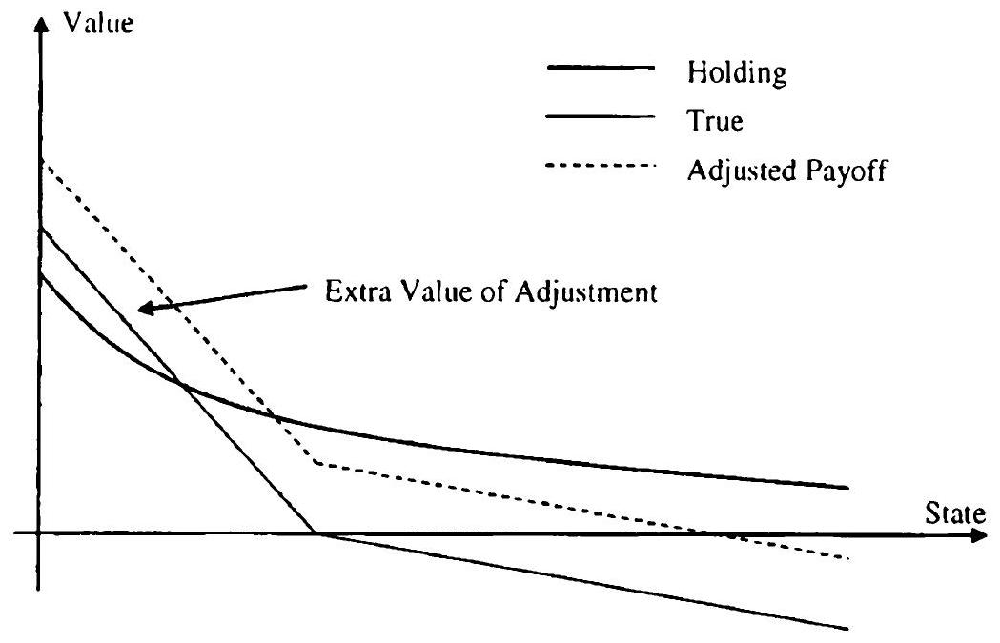
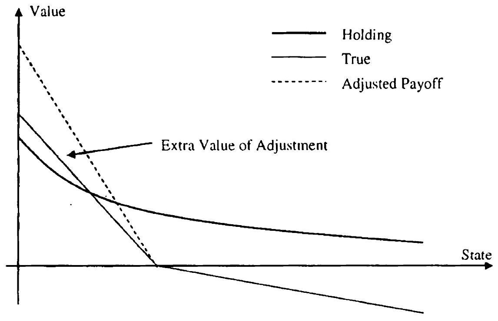
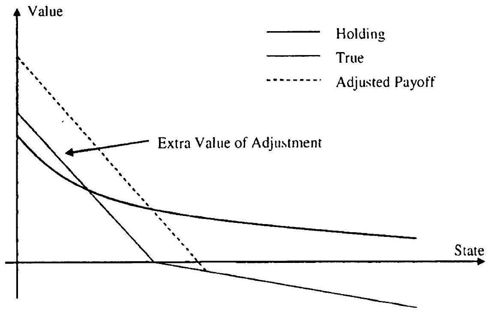

## Out-of-Model Adjustments

When valuing exotic derivatives, like CLEs and TARNs, that are written on an underlying structured swap, it is natural to desire that the structured swap is priced in line with the market ${ }^{1}$. Sometimes such consistency is easy to achieve, as when the term structure model used for exotic derivatives pricing happens to coincide (either exactly or to good approximation) with the vanilla model(s) used to define the "market". For instance, the stochastic volatility versions of the quasi-Gaussian model (see Chapter 13) and the Libor market model (see Chapters 14 and 15) are consistent with the vanilla SV model of Chapter 8 when it comes to European swaption pricing. Such consistency is, however, not always feasible. For instance, when using volatility smile parameterizations such as SABR or SVI for vanilla swaption marking (see Sections 8.6 and 16.1.5), we will typically not be perfectly consistent with any of the standard term structure models above. Similarly, it is hard to imagine a term structure model that would be exactly consistent with some of the copulas we introduced for multi-rate vanilla derivatives pricing in Chapter 17. Even if a sophisticated calibration routine is employed, such lack of consistency generally implies that the vanilla and term structure models will disagree in an economically meaningful way on the prices of structured swaps underlying exotic derivatives, a situation that is typically seen as undesirable.

In this chapter we review various methods to force the value of a structured swap in a term structure model to match the market (or vanilla model) value, through outright manipulation of some quantity that affects the derivative price. In selecting the quantity (or quantities) to alter, any of the key "ingredients" in a derivative model price are potential candidates: the model, the market data, and the trade. We consider all three possibilities in what follows. There is a strong ad-hoc flavor to all the methods we present,

[^62]and theoretical justification is typically rather weak. Nevertheless, if applied judiciously, risk management and pricing accuracy can sometimes benefit from the methods of this chapter. To be clear, the methods we present are not designed to cover for gross mis-calibrations or mis-valuations of underlying swaps, and should not be used as such. We only (cautiously) endorse them as ways of correcting for "small" mismatches in valuation. While it is difficult to make general statements on how small is small, one should use a combination of common sense, experience and rigorous testing in making the judgment.

### 21.1 Adjusting the Model

We start out by considering adjustments, where model-derived information is used to adjust the value of an exotic derivative to account for mispricing of the underlying. Here, and throughout the chapter, we denote the coupons of the structured swap used as an underlying for a given derivative by $C_{n}$, $n=1, \ldots, N-1$, and the exotic derivative itself - a callable Libor exotic or a TARN, for example - by $H_{0}$. Note that we therefore depart slightly from our standard notation, whereas we would normally use $C_{n}$ and $H_{0}$ to determine values of coupons and exotic derivatives; we do so to distinguish different values calculated by different methods. In particular, the market value of the $n$-th coupon is denoted by $V_{\text {mkt }}\left(C_{n}\right), n=1, \ldots, N-1$. The value of the same coupon in the term structure model is denoted by $V_{\mathrm{mdI}}\left(C_{n}\right)$, $n=1, \ldots, N-1$.

### 21.1.1 Calibration to Coupons

As we have seen on numerous occasions in this book, when pricing exotic derivatives, term structure models are typically calibrated to a multitude of European swaptions. Of course, this in itself does not necessarily guarantee that the prices of coupons of the underlying swap in the term structure model would match their market, or vanilla model, prices. A good example here is a fixed-rate callable range accrual (see Section 5.13.4), where the $n$-th coupon is given by

$$
C_{n}=k \times \frac{1}{T_{n+1}-T_{n}} \sum_{t \in\left[T_{n}, T_{n+1}\right]} 1_{\{L(t) \in[l, u]\}},
$$

with $L(t)$ being some Libor rate. A fixed-rate range accrual coupon is decomposable into a collection of digital options on the Libor rate, and as such can be valued in a vanilla model with slight timing-delay convexity adjustments, see Chapter 16 and in particular Section 16.5. It is likely, however, that $V_{\text {mdl }}\left(C_{n}\right) \neq V_{\text {mkt }}\left(C_{n}\right)$, due to, for example, differences in the
treatment of convexity effects or in the volatility smiles implied by the term structure and the vanilla models.

To guarantee that $V_{\text {mdl }}\left(C_{n}\right)=V_{\text {mkt }}\left(C_{n}\right)$ for all $n=1, \ldots, N-1$, the model can explicitly be calibrated to the market prices of the underlying coupons. This extended calibration method is fairly benign as far as model adjustments go, and could well be considered an extension of the local projection method (see Section 18.4). The ability to calibrate to the prices of underlying coupons relies, of course, on the availability of efficient methods for calculating their values $V_{\text {mdl }}\left(C_{n}\right), n=1, \ldots, N-1$, in a term structure model used. For most "interesting" coupons, however, closed-form expression are generally unavailable in sophisticated term structure models (e.g. LM-type models), and one has to resort to numerical calculations for calibration, often requiring Monte Carlo simulations. Calibration by Monte Carlo simulation is not something we would typically recommend, but if this approach is chosen nevertheless, some fairly obvious precautions should be taken: all coupons should be computed in the same simulation loop, the simulation seed must be taken to be the same in all calibration iterations as well as for the main valuation, and so on. A body of literature on these so-called stochastic optimization methods exists (see e.g. Broadie et al. [2009], Andradóttir [1995], Andradóttir [1996]) and should be consulted before one attempts to use Monte Carlo simulation inside a calibration loop.

For term structure models amendable to PDE methods, calculating coupon values by numerical (PDE) methods for calibration is certainly a plausible strategy. For numerical efficiency, we recommend usage of the forward induction method (see Section 11.3.2.3), rather than the standard backward induction method, when calculating coupon values in a calibration algorithm.

Apart from numerical issues, the extended calibration method has certain other caveats. Calibration to non-standard targets requires special care, as one has to be mindful of using the right parameters in the calibration. For example, the value of the range accrual coupon, being a sum of digital options, is not a monotonic function of volatility, and trying to calibrate volatility of the model to the market prices of range accrual coupons may yield unrealistic volatility levels or fail outright. In this particular case, it is clear that the skew of the volatility smile is a primary driver of the range coupon value and, hence, it is the model skews (in a skew-enabled model such as a quasi-Gaussian local volatility model), and not the volatilities, that should be calibrated to the market prices of range accrual coupons.

Even if calibration to coupons does not fail, it may result in a set of model parameters that are inappropriate for valuing other optionality embedded in a given exotic derivative, such as callability. In the callable range accrual example above, had we mistakenly tried to calibrate the volatility of a term structure model to range accrual coupons, the model volatilities could end up being very high or very low, significantly over- or under-estimating the value of callability feature. Similarly, if we were to try to value a CMS spread

TARN (see Section 5.15) in a one-factor model by, say, calibrating mean reversion to the underlying CMS spread option values ${ }^{2}$, the resulting mean reversion would very likely be inappropriate for valuing the trigger feature of the TARN.

### 21.1.2 Adjusters

While the extended calibration method can be attractive, brute-force calibration to coupon values may not always be feasible for numerical or other reasons. Fortunately, the problem can be simplified if we recall our main tenet that prudent application of out-of-model adjustments should be limited to correcting for small mismatches, in which case we should be able to linearize the problem and solve it with less effort. We call this idea the adjusters method after Hagan [2002] who popularized it.

Let $\xi$ be some model parameter - a volatility function, a correlation parameter, a vector of mean reversions or even a yield curve - and $\xi_{0}$ be its calibrated value. In general $\xi$ can be represented as a column vector, and to simplify our exposition we assume it is $(N-1)$-dimensional, with the $n$-th coordinate affecting the value of the $n$-th coupon. We make the dependence of model prices of various securities on $\xi$ explicit and write $V_{\mathrm{mdl}}\left(C_{n} ; \xi\right)$.

Let $\xi^{*}$ be the solution of

$$
V_{\mathrm{mdl}}\left(C_{n} ; \xi^{*}\right)=V_{\mathrm{mkt}}\left(C_{n}\right) \text { for all } n=1, \ldots, N-1
$$

For all $n=1, \ldots, N-1, \xi^{*}$ satisfies, to first order,

$$
\begin{equation*}
V_{\mathrm{mdl}}\left(C_{n} ; \xi_{0}\right)+\frac{\partial V_{\mathrm{mdl}}}{\partial \xi}\left(C_{n} ; \xi_{0}\right)\left(\xi^{*}-\xi_{0}\right) \approx V_{\mathrm{mkt}}\left(C_{n}\right), \tag{21.1}
\end{equation*}
$$
^eq21-1

where $\partial V_{\mathrm{mdl}} / \partial \xi$ is a row vector of $\partial V_{\mathrm{mdl}} / \partial \xi_{n}, n=1, \ldots, N-1$. Hence,

$$
\begin{equation*}
\xi^{*} \approx \xi_{0}+\left[\frac{\partial \bar{V}_{\mathrm{mdl}}}{\partial \xi}\left(C ; \xi_{0}\right)\right]^{-1}\left(\bar{V}_{\mathrm{mkt}}(C)-\bar{V}_{\mathrm{mdl}}\left(C ; \xi_{0}\right)\right) \tag{21.2}
\end{equation*}
$$
^eq21-2

where we use bars to denote column vectors,

$$
\bar{V}_{\mathrm{mdl}}(C ; \xi) \triangleq\left(V_{\mathrm{mdl}}\left(C_{1} ; \xi\right), \ldots, V_{\mathrm{mdl}}\left(C_{N-1} ; \xi\right)\right)^{\top}
$$

and so forth. In particular,

$$
\begin{equation*}
\frac{\partial \bar{V}_{\mathrm{mdl}}}{\partial \xi}(C ; \xi) \tag{21.3}
\end{equation*}
$$
^eq21-3

is an $(N-1) \times(N-1)$ matrix whose $n$-th row is $\partial V_{\mathrm{mdl}}\left(C_{n} ; \xi\right) / \partial \xi$.
Before proceeding, let us note that while we for exposition purposes assumed the dimension of the model parameter $\xi$ to be the same as the

[^63]number of coupons, this need not be so in actual applications. In particular, if the dimensions do not match, we can think of the equation (21.1) as a linear regression problem and find $\xi^{*}$ by the appropriate least-squares methods. This procedure has been used many times already in this book, see, for example, Section 6.4.3.

Having identified $\xi^{*}$, the adjusted model price of $H_{0}$ is given by

$$
V_{\mathrm{adj}}\left(H_{0}\right)=V_{\mathrm{mdl}}\left(H_{0} ; \xi^{*}\right)
$$

and, expanding to first order and substituting (21.2),

$$
\begin{align*}
V_{\mathrm{adj}}\left(H_{0}\right) \approx & V_{\mathrm{mdl}}\left(H_{0} ; \xi_{0}\right)+\frac{\partial V_{\mathrm{mdl}}}{\partial \xi}\left(H_{0}\right)\left(\xi^{*}-\xi_{0}\right) \\
= & V_{\mathrm{mdl}}\left(H_{0} ; \xi_{0}\right) \\
& +\frac{\partial V_{\mathrm{mdl}}}{\partial \xi}\left(H_{0}\right)\left[\frac{\partial \bar{V}_{\mathrm{mdl}}}{\partial \xi}\left(C ; \xi_{0}\right)\right]^{-1}\left(\bar{V}_{\mathrm{mkt}}(C)-\bar{V}_{\mathrm{mdl}}\left(C ; \xi_{0}\right)\right) . \tag{21.4}
\end{align*}
$$
^eq21-4

With these formulas, the adjusters method follows these steps.

1. Given the calibrated model parameter value $\xi_{0}$, the unadjusted values of the exotic $H_{0}$, and of all the underlying coupons $C_{n}, n=1, \ldots, N-1$, are computed.
2. The sensitivities of the value of $H_{0}$ and values of the various $C_{n}$ to the model parameter $\xi$ (at $\xi_{0}$ ) are computed.
3. The matrix of parameter sensitivities in (21.3) is inverted.
4. The adjusted exotic value $V_{\text {adj }}\left(H_{0}\right)$ is calculated via the linear approximation (21.4).

Note that the calibration loop of Section 21.1.1 is now replaced by the calculation of the sensitivity matrix $\partial \bar{V}_{\mathrm{mdl}}(C) / \partial \xi$. Given the actual structure of the problem, this matrix may be known to be of specific form, e.g. diagonal or lower-triangular, further simplifying its evaluation. Moreover, the matrix can often be cached and reused when calculating risk sensitivities, further improving the overall efficiency of the scheme. Other needed quantities such as $\partial V_{\mathrm{mdl}}\left(H_{0}\right) / \partial \xi$, are typically calculated anyway for risk management purposes and should not, as a rule, add to the overall computational burden.

The adjusters method is not restricted to using the underlying coupons as adjusters, but can be applied more broadly. For example, the value of a Bermudan swaption in a model with no volatility smile capabilities could be "adjusted" for the smile by using European swaptions as adjusters. In a sense, we can see the adjustment as a type of a control variate method (see Section 3.4.3 or Chapter 25 below) with the values of the adjusters (coupons or other vanilla instruments) used as controls.

The adjusters method potentially applies to a variety of model parameters, and a key question concerns which parameter should be used as $\xi$ - model
volatilities, skews, etc. The answer follows the same logic as in Section 21.1.1: we should apply the method to the parameter(s) that have the most impact on the values of coupons while affecting other features of the model as little as possible. For example, the level of a yield curve often affects coupon values directly and so we can use the yield curve as the adjuster. This case has a special name, the delta-adjustment method, and it is similar to some of the approaches we discuss below, such as the spread adjustment method (Section 21.2) and the strike adjustment (Section 21.3.3) methods. Volatilities, too, are often a good choice for adjustment as values of most "interesting" coupons depend on volatilities of relevant rates. Of course the situation could be more complicated as the example of a fixed range accrual coupon in Section 21.1.1 demonstrated; here the skew of the volatility smile. and not its overall level, was the most relevant adjuster. Overall, nothing replaces careful analysis of each type of exotic derivative before the adjusters method is applied.

Before we wrap up our discussion of adjusters we note that the term

$$
\frac{\partial V_{\mathrm{mdl}}}{\partial \xi}\left(H_{0}\right)\left[\frac{\partial \bar{V}_{\mathrm{mdl}}}{\partial \xi}\left(C ; \xi_{0}\right)\right]^{-1}
$$

in (21.4) could be interpreted as the sensitivity of the value of an exotic to the values of the underlying coupons, an interesting measure of sensitivity in its own right.

### 21.1.3 Path Re-Weighting

In the case of Monte Carlo based models, an approach from Avellaneda et al. [2001] makes it possible to exactly match calibration targets to their desired values, while also correcting for numerical inaccuracies of the valuation method. Let us discuss the idea in some detail. As a start, we denote simulated Monte Carlo paths by $\omega_{i}, i=1, \ldots, K$. As always, the value estimate of any payoff - be it a zero-coupon bond, a vanilla option, or the coupon $C_{n}$ - is given by the average of the payoff values associated with each path $\omega_{\imath}, i=1, \ldots, K$. Focusing exclusively on the problem of matching the model values of coupons $C_{n}, n=1, \ldots, N-1$, to the market. we denote by $C_{n}^{i}$ the value of the $n$-th coupon, $n=1, \ldots, N-1$, along path $\omega_{i}, i=1, \ldots, K$. Then, the basic Monte Carlo value estimate of the $n$-th coupon in the model is given by

$$
\begin{equation*}
V_{\mathrm{mdl}}\left(C_{n}\right)=\frac{1}{K} \sum_{l=1}^{K} C_{n}^{l} . \tag{21.5}
\end{equation*}
$$
^eq21-5

The idea of the path re-weighting method is to assign non-equal probabilities to the different paths in order to match target values. Let the probability assigned to the path $\omega_{i}$ be $p_{i}$, satisfying the standard requirements

$$
\begin{gather*}
0 \leq p_{\imath} \leq 1 \quad \forall i=1, \ldots, K,  \tag{21.6}\\
\sum_{\imath=1}^{K} p_{i}=1 . \tag{21.7}
\end{gather*}
$$
^eq21-6
^eq21-7

Then the value of the $n$-th coupon is given by

$$
\begin{equation*}
\sum_{i=1}^{K} C_{n}^{i} p_{i}, \tag{21.8}
\end{equation*}
$$
^eq21-8

and is a linear function of the vector $p=\left(p_{1}, \ldots, p_{K}\right)^{\top}$. Hence, one would expect that it should be fairly straightforward to find a vector $p$ that matches model prices of all coupons to the market,

$$
\begin{equation*}
\sum_{\imath=1}^{K} C_{n}^{i} p_{i}=V_{\mathrm{mkt}}\left(C_{n}\right), \quad n=1, \ldots, N-1 \tag{21.9}
\end{equation*}
$$
^eq21-9

The resulting "probabilities" can subsequently be reused in the pricing of the exotic derivative.

The problem (21.6), (21.7), (21.9) is under-specified since the number of paths used - which also equals the dimension of the vector $p$ - is typically (much) larger than the number of coupons. Hence, a suitable regularization target is needed if we want to have a unique solution. It is not unreasonable, for example, to try to keep the vector $p$ as close as possible to the equiweighted probabilities of (21.5). Working with probability distributions, a convenient measure of closeness is the so-called Kullback-Leibler relative entropy between the probability vector $p$ and the equi-weighted prior. With this choice of norm, we can formalize the search for $p$ as the following minimization problem:

$$
\begin{equation*}
I(p) \triangleq \sum_{\imath=1}^{K} p_{\imath} \ln \left(p_{i}\right) \rightarrow \min \tag{21.10}
\end{equation*}
$$
^eq21-10

subject to the linear inequality constraints (21.6), as well as the linear equality constraints (21.7) and (21.9). Proponents of the principle of relative entropy optimization often justify the choice of norm in (21.10) from a perspective of information theory (e.g., as a way to ensure that we do not add information that we do not possess to the problem), but a more standard least-squares norm would likely do just as well ${ }^{3}$.

The range of model errors that the path re-weighting method can correct for is limited, since the $\sum_{i=1}^{K} C_{n}^{2} p_{\imath}$ will obviously always be between the minimum and the maximum path value of $C_{n}$, among the $K$ paths. If the target $V_{\mathrm{mkt}}\left(C_{n}\right)$ is outside this range, such a gross mismatch cannot

[^64]be corrected. Should this situation ever arise, the difference between the model and market values would likely be of such magnitude that the path re-weighting scheme would fundamentally be inappropriate anyway, as we discussed in the beginning of this chapter.

Let us develop the solution to the entropy minimization problem above in a bit more detail. For this purpose, let $\lambda=\left(\lambda_{1}, \ldots, \lambda_{N-1}\right)$ be a vector of Lagrange multipliers for the constraints (21.9), and $\mu$ a Lagrange multiplier for the total probability constraint (21.7). Then the solution to the following unconstrained problem (the "dual" formulation of the constrained problem, see Cover and Thomas [2006]),

$$
\begin{equation*}
\min _{\lambda} \max _{p, \mu} J(p, \lambda, \mu), \tag{21.11}
\end{equation*}
$$
^eq21-11

where (note the negative sign in front of $I(p)$ )

$$
\begin{align*}
J(p, \lambda, \mu) & \triangleq-I(p) \\
& +\sum_{n=1}^{N-1} \lambda_{n}\left(\sum_{i=1}^{K} C_{n}^{i} p_{i}-V_{\mathrm{mkt}}\left(C_{n}\right)\right)+\mu\left(\sum_{i=1}^{K} p_{i}-1\right) \tag{21.12}
\end{align*}
$$
^eq21-12

if it happens to satisfy (21.6), would also solve (21.10) subject to (21.6), (21.7) and (21.9).

Proposition 21.1.1. For a given vector $\lambda$, the solution of the inner maximization problem in (21.11) is given by

$$
\mu^{*}=1-\ln (Z(\lambda))
$$

and

$$
\begin{equation*}
p_{\imath}^{*}=\frac{1}{Z(\lambda)} \exp \left(\sum_{n=1}^{N-1} \lambda_{n} C_{n}^{i}\right), \quad i=1, \ldots, K, \tag{21.13}
\end{equation*}
$$
^eq21-13

where the partition function $Z(\lambda)$ is given by

$$
Z(\lambda)=\sum_{i=1}^{K} \exp \left(\sum_{n=1}^{N-1} \lambda_{n} C_{n}^{i}\right) .
$$

Proof. The necessary conditions for the inner maximum in (21.11) are given by

$$
\frac{\partial J\left(p^{*}, \lambda, \mu^{*}\right)}{\partial \mu}=0, \quad \frac{\partial J\left(p^{*}, \lambda, \mu^{*}\right)}{\partial p_{\imath}}=0, \quad i=1, \ldots, K,
$$

so that we have

$$
-\ln \left(p_{i}^{*}\right)-1+\sum_{n=1}^{N-1} \lambda_{n} C_{n}^{i}+\mu^{*}=0, \quad i=1, \ldots, K,
$$

and $\sum_{\imath=1}^{K} p_{i}^{*}=1$. The proposition follows.
We note that $p_{2}^{*}$ 's defined by (21.13) always satisfy (21.6). The distribution of the form (21.13) is known as the Boltzman-Gibbs distribution for the partition function $Z(\lambda)$.

Now, substituting (21.13) into the definition of the objective function (21.12) we obtain

$$
\begin{equation*}
G(\lambda) \triangleq J\left(p^{*}, \lambda, \mu^{*}\right)=\ln (Z(\lambda))-\sum_{n=1}^{N-1} \lambda_{n} V_{\mathrm{mkt}}\left(C_{n}\right) \tag{21.14}
\end{equation*}
$$
^eq21-14

Now all we need to do is to minimize (21.14), i.e. solve the $(N-1)$-dimensional optimization problem

$$
\begin{equation*}
\lambda^{*}=\underset{\lambda}{\operatorname{argmin}}(G(\lambda)) . \tag{21.15}
\end{equation*}
$$
^eq21-15

Compared to the original formulation (21.10), the dimensionality of the problem has now been significantly reduced, as normally $N \ll K$. Moreover, (21.15) is unconstrained, and thus easier to solve by standard optimization techniques. In addition, it is a "nice" optimization problem as the function $G(\lambda)$ is globally convex with a single minimum, as stated in the following proposition.

Proposition 21.1.2. The function $G(\lambda)$ is globally convex. In particular, the following holds for all $n, m=1, \ldots, N-1$,

$$
\begin{equation*}
\frac{\partial G(\lambda)}{\partial \lambda_{n}}=\mathrm{E}^{\lambda}\left(C_{n}\right)-V_{\mathrm{mkt}}\left(C_{n}\right), \quad \frac{\partial^{2} G(\lambda)}{\partial \lambda_{n} \partial \lambda_{m}}=\operatorname{Cov}^{\lambda}\left(C_{n}, C_{m}\right), \tag{21.16}
\end{equation*}
$$
^eq21-16

where the measure $\mathrm{Q}^{\lambda}$ is defined on Monte Carlo paths by Boltzman-Gibbs weights $p^{*}$ that correspond to $\lambda$ as per (21.13), i.e. for any random variable $X$,

$$
\mathrm{E}^{\lambda}(X)=\sum_{i=1}^{K} p_{i}^{*} X^{i}
$$

where $X^{i}$ is the realization of the random variable $X$ on the $i$-th path, $i=1, \ldots, K$.

Proof. Let us fix $n$. By straightforward differentiation,

$$
\begin{aligned}
\frac{\partial G(\lambda)}{\partial \lambda_{n}} & =\frac{1}{Z(\lambda)} \frac{\partial Z(\lambda)}{\partial \lambda_{n}}-V_{\mathrm{mkt}}\left(C_{n}\right) \\
& =\frac{1}{Z(\lambda)} \sum_{i=1}^{K} \exp \left(\sum_{j=1}^{N-1} \lambda_{j} C_{j}^{i}\right) C_{n}^{l}-V_{\mathrm{mkt}}\left(C_{n}\right) \\
& =\sum_{i=1}^{K} p_{i}^{*} C_{n}^{i}-V_{\mathrm{mkt}}\left(C_{n}\right)
\end{aligned}
$$

Furthermore,

$$
\frac{\partial^{2} G(\lambda)}{\partial \lambda_{n} \partial \lambda_{m}}=\frac{1}{Z(\lambda)} \frac{\partial^{2} Z(\lambda)}{\partial \lambda_{n} \partial \lambda_{m}}-\frac{1}{Z(\lambda)^{2}} \frac{\partial Z(\lambda)}{\partial \lambda_{n}} \frac{\partial Z(\lambda)}{\partial \lambda_{m}},
$$

and we obtain that

$$
\frac{\partial^{2} G(\lambda)}{\partial \lambda_{n} \partial \lambda_{m}}=\operatorname{Cov}^{\lambda}\left(C_{n}, C_{m}\right)
$$

by straightforward calculations. The fact that $G(\lambda)$ is globally convex now follows from the representation of the second derivative of $G$ as a covariance matrix in (21.16), and the fact that a covariance matrix is always nonnegativedefinite.

We point out an interesting consequence of (21.16) is that the solution to the optimization problem (21.15) is given by such $\lambda^{*}$ that

$$
V_{\mathrm{mkt}}\left(C_{n}\right)=\mathrm{E}^{\lambda^{*}}\left(C_{n}\right), \quad n=1, \ldots, N-1 .
$$

As the objective function $G(\lambda)$ is globally convex and its first- and second-order derivatives are straightforward to calculate, most non-linear optimization algorithms as discussed in, for example, Section 14.5.7 would work well. For extra performance, specialized methods tuned for convex objective functions, such as the Nesterov-Nemirovskii algorithm (see Nesterov et al. [1994]), could be applied.

The constrained minimization formulation (21.10) as presented in Avellaneda et al. [2001] is not the only possible way to formalize the problem of path re-weighting. For example, we can replace the exact repricing criteria (21.9) by a suitably-defined least-squares target. In particular, denoting by $v_{n}$ the penalty for violating (21.9) for a given $n, n=1, \ldots, N-1$, the problem can be re-formulated as

$$
\begin{equation*}
\sum_{i=1}^{K} p_{i} \ln \left(p_{i}\right)+\sum_{n=1}^{N-1} v_{n}\left(\sum_{i=1}^{K} C_{n}^{i} p_{i}-V_{\mathrm{mkt}}\left(C_{n}\right)\right)^{2} \rightarrow \min \tag{21.17}
\end{equation*}
$$
^eq21-17

subject to (21.6), (21.7). Not surprisingly, the problem can also be solved by the partition function method along the lines of Proposition 21.1.1, a statement we leave to the reader to verify. Finally, an even simpler quadratic problem could be obtained by replacing relative entropy as an objective function by its second-order Taylor expansion around the equi-weighted probabilities, see e.g. Glasserman [2004], Section 4.5:

$$
\begin{equation*}
\sum_{i=1}^{K}\left(p_{i}-1 / K\right)^{2}+\sum_{n=1}^{N-1} v_{n}\left(\sum_{i=1}^{K} C_{n}^{i} p_{i}-V_{\mathrm{mkt}}\left(C_{n}\right)\right)^{2} \rightarrow \min \tag{21.18}
\end{equation*}
$$
^eq21-18

subject to (21.6), (21.7). Again, we leave it up to the reader to fill in relevant details.

It is worthwhile pointing out an interesting connection between entropy minimization methods and the problem of calculating risk sensitivities. It turns out that under the (rather unrealistic, admittedly) assumption that market data shocks do not affect generated Monte Carlo paths but only change the right-hand-side values in (21.9), the sensitivities of the exotic derivative to the prices of coupons/market shocks can be deduced via duality arguments from the solutions of the relevant optimization problems (21.10), (21.17) or (21.18). Details can be found in Avellaneda et al. [2001].

Most adjustment methods have undesirable side effects, and path reweighting is no exception. With non-uniform weights assigned to paths, the prices of zero-coupon bonds in the model may no longer match their market values, with the model then allowing arbitrage. This in principle could be patched up by adding all relevant zero-coupon bonds to the set of constraints (21.9) to match, but, of course, at higher computational cost. Calibration to vanilla options could also unravel - remediation will, once again, involve enlargement of the set of constraints. Again, we remind the reader that over-using methods such as path re-weighting could be dangerous, as it is difficult to control all the consequences if large deviations from the equiweighted paths are required. Should such situations arise, the model is most likely seriously mis-specified and any valuation results should be treated as suspect.

While introduced here as an adjustment technique, let us finally note that path re-weighting could be interpreted as a variance reduction technique, provided that the option prices we are matching our finite-sample estimates to are known to coincide with the true (infinite-sample) model values. Clearly, the resulting method would have strong similarities to the more familiar technique of control variates (see Chapter 25). Glasserman and Yu [2005] investigate this link further, and prove that the two techniques are essentially identical, for large enough sample sizes. For strict variance reduction purposes, the more straightforward method of control variates is therefore typically preferable.

### 21.1.4 Proxy Model Method

Suppose we have identified that a given exotic security is sensitive to an "exotic risk" factor. This factor may not be important for the valuation of vanilla securities, and implementing it into a term structure model may result in the model being so complex that analytical approximations used for calibration to the vanilla market fail to be accurate enough. On the other hand, suppose we also have a simpler term structure model that calibrates well to the vanilla market but does not have the required exotic risk factor. The following procedure, which we call the proxy model method, is sometimes used to combine the two models to measure the sensitivity to the exotic risk factor. First, we calculate the difference in value of the derivative in the complex model for different values of the exotic risk factor, $\xi=\xi_{1}$ and
$\xi=\xi_{0}$,

$$
\Delta V_{\text {complex }}=V_{\text {complex }}\left(H_{0} ; \xi_{1}\right)-V_{\text {complex }}\left(H_{0} ; \xi_{0}\right)
$$

Here typically $\xi_{0}$ corresponds to the base case, i.e. the value of the exotic risk factor that is more or less consistent with the simplified worldview of the simpler term structure model, and $\xi_{1}$ is our view of the actual marketobserved value of the risk factor. Next, we calculate the base value of the derivative in the simple model calibrated to the market,

$$
V_{\text {simple }}\left(H_{0}\right) .
$$

We would like to add $\Delta V_{\text {complex }}$ to $V_{\text {simple }}\left(H_{0}\right)$ to account for the risk factor impact; however, $\Delta V_{\text {complex }}$ is biased due to the problems of calibrating the complex model. To correct for the bias, we calibrate our simple model to the vanilla prices generated by the complex model in the two scenarios. Henceforth, we define $V_{\text {simple }, 0}\left(H_{0}\right)$ and $V_{\text {simple, } 1}\left(H_{0}\right)$ to be the prices of the derivative in question in the simple model calibrated to the vanilla prices as generated by the complex model with $\xi=\xi_{0}$ and $\xi=\xi_{1}$.

As the simple model is insensitive to the exotic risk factor, we would expect

$$
\Delta V_{\text {simple }}=V_{\text {simple }, 1}\left(H_{0}\right)-V_{\text {simple }, 0}\left(H_{0}\right)
$$

to solely represent the impact of mis-calibration of the complex model to vanillas on the value of the exotic derivative. Thus, it is not unreasonable to define the adjusted price by

$$
V_{\text {adj }}\left(H_{0}\right)=V_{\text {simple }}\left(H_{0}\right)+\Delta V_{\text {complex }}-\Delta V_{\text {simple }} .
$$

To make the discussion above a bit more concrete, consider the problem of assessing the impact of stochastic volatility de-correlation, which would be the exotic risk factor under consideration, on a callable CMS spread derivative. Suppose we have a suitable model, say an LM model from Section 15.7 , which has multiple sources of volatility randomness. We would value the derivative with the correlation of volatilities set to $100 \%$ ( $\xi_{0}$ case), and then set it to some other value that is less than $100 \%$ ( $\xi_{1}$ case) which we obtain by, say, historical estimation. To correct for calibration errors induced by imperfect vanilla approximations, we would calibrate a simpler LM model with a single stochastic volatility factor to the vanilla prices produced by the complex model; the single volatility factor model serves as a model that is (one hopes) sufficiently "similar" to the complex model yet allows for accurate vanilla option approximations. In this case, in addition to the usual European swaptions, we should probably also include CMS spread options in the vanilla market, to make sure we control the extra de-correlation of rates that comes from de-correlating their volatilities.

The method outlined above is rarely accurate enough for trading and risk management purposes, but is useful for qualitative understanding of the impact of certain risk factors, as well as, say, reserve calculations.

### 21.1.5 Asset-Based Adjustments

Consider as an example an LM model applied to a CMS-style exotic derivative. The CMS convexity adjustment (see Section 16.6) as implied by the LM model may not be equal to the "market" CMS adjustment (as calculated by, say, a replication method from Section 16.6.1). This situation might arise in part because the volatility smiles generated by the LM model differ slightly from the ones implied by market prices. One way of compensating for the difference involves changing the trade definition, a method we discuss later in Section 21.3. Here we, instead, consider a different method in which we adjust the simulated dynamics of the relevant swap rate(s) in the LM model (see Van Steenkiste [2009]). The advantage of this asset-based adjustment method is that we are able to not only adjust the overall levels of the relevant swap rates, but also their volatilities and skews. This, in turn, could further aid us in closing the valuation gap for the underlying swap of a CMS-based exotic derivative.

For concreteness, consider a version of the LM model (14.4) with deterministic separable volatility (14.2.4). Suppose a given swap rate ${ }^{4} S(t)$ is of special interest to us, because, say, some coupon of the underlying swap is a function of it,

$$
\begin{equation*}
C=C(S(T)) . \tag{21.19}
\end{equation*}
$$
^eq21-19

The standard Monte Carlo scheme for the model involves simulating all Libor rates $\left\{L_{n}(T)\right\}$ per Section 14.6, calculating discount factors from simulated Libor rates and combining them to calculate the simulated value of the swap rate $S(T)$. The simulated value of the swap rate is then used to calculate the simulated value of a coupon in (21.19).

Instead of calculating the swap rate from simulated Libor rates, we can of course also just simulate $S(t)$ alongside the Libor rates directly. The exact dynamics of the swap rate under the measure used for simulating Libor rates (e.g., the spot measure) can be derived by Ito's lemma, or from Proposition 14.4.2 by the appropriate measure change. In particular we have

$$
\begin{equation*}
d S(t)=\mu_{S}(t, \mathbf{L}(t)) d t+\varphi(S(t)) \sum_{n=1}^{N-1} w_{n}(t) \lambda_{n}(t)^{\top} d W^{B}(t) \tag{21.20}
\end{equation*}
$$
^eq21-20

where $\mathbf{L}(t)$ is the vector of all Libor rates at time $t, \mu_{S}(t, \mathbf{L}(t))$ is the appropriate drift, $w_{n}(t)$ 's are given by (14.31), and $W^{B}(t)$ is a Brownian motion in the spot measure. We could discretize the SDE (21.20) in the same way we would discretize SDEs for the Libor rates, and simulate $S(t)$ together with the Libor rates; then we can use this simulated value in the payoff (21.19). Up to the discretization bias and simulation error, the value

[^65]of the derivative computed in this scheme would be the same as in the standard scheme where $S(t)$ is calculated directly from Libor rates.

While the utility of the simulation scheme above by itself is questionable, it gives us a starting point for adjusting the dynamics of $S(t)$ as we see fit. Decoupling the dynamics of $S(t)$ in (21.20) from the dynamics of Libor rates allows us to treat the swap rate as a stand-alone market variable, or "asset" (hence the name of the method), whose model dynamics we can control independently. For example, suppose we would like to shift the mean of the simulated variable $S(T)$ to compensate for the differential of CMS convexity adjustments between the LM model and the market. Then we just use (21.20) with an initial condition shifted by some $c \neq 0$,

$$
d S_{\mathrm{adj}}(t)=O(d t)+\varphi\left(S_{\mathrm{adj}}(t)\right) \sum_{n=1}^{N-1} w_{n}(t) \lambda_{n}(t)^{\top} d W^{B}(t), \quad S_{\mathrm{adj}}(0)=S(0)+c
$$

When valuing the $S$-dependent coupon (and the payoff of the entire exotic derivative) we then would use $S_{\text {adj }}(t)$ instead of $S(t)$ in payoff calculations.

The volatility of the swap rate could be adjusted in a similar way; for example we can specify that

$$
d S_{\mathrm{adj}}(t)=O(d t)+c \varphi\left(S_{\mathrm{adj}}(t)\right) \sum_{n=1}^{N-1} w_{n}(t) \lambda_{n}(t)^{\top} d W^{B}(t), \quad S_{\mathrm{adj}}(0)=S(0)
$$

for some volatility adjustment $c>0$. Or, indeed, we can change the model skew of $S(t)$ by replacing (21.20) with

$$
d S_{\mathrm{adj}}(t)=O(d t)+\varphi\left(a S_{\mathrm{adj}}(t)+b\right) \sum_{n=1}^{N-1} w_{n}(t) \lambda_{n}(t)^{\top} d W^{B}(t), \quad S_{\mathrm{adj}}(0)=S(0)
$$

for some $a, b$. All three types of dynamics adjustments could, of course, be combined to provide a finer level of control over the distribution of $S(t)$; indeed, possibilities are limitless. The method is not restricted to adjustments of dynamics of swap rates only; we can apply the same trick to the spread of two swap rates to ensure that, say, the volatility of a CMS spread in this "adjusted" LM model matches that in the vanilla (multi-rate) model used.

While the asset-based adjustment method is rather flexible, it should be obvious that it comes at a serious cost of introducing arbitrage and making the model internally inconsistent. The swap rate simulated from one of the adjusted SDEs above will no longer equal the "true" swap rate as synthesized from (simulated) Libor rates. As a consequence, a European swaption would have different values in such a model depending on how the payoff is written, see equations (5.10) or (5.11) in Chapter 5. Taking this example to the extreme, one can imagine a trader equipped with such a model selling and buying identical swaptions booked in different formats and generating riskless "profits" on each trade.

### 21.1.6 Mapping Function Adjustments

Adjusting the dynamics of the swap rate $S(t)$ is not the only way to achieve desired changes to its distribution. As a possible alternative, we can modify its terminal distribution directly. In particular, instead of using the swap rate $S(T)$ when calculating the coupon value in (21.19), we would use $S_{\text {adj }}(T)$ defined by

$$
S_{\mathrm{adj}}(T)=\Lambda(S(T))
$$

Here $S(T)$ is the model-simulated value of the swap rate, and the mapping function $\Lambda(s)$ is chosen in such a way that $S_{\text {adj }}(T)$ has a desired distribution (e.g. one consistent with the swaption market, or perhaps with a particular vanilla model). This approach is sometimes called the mapping function adjustment.

When using the mapping function adjustment method, we would not adjust just one swap rate, but all rates used in calculating underlying coupons. If the product requires observations of the swap rate on different dates, we would, of course, use different mapping functions for different observation dates.

Determining the mapping function $\Lambda(s)$ for each required observation of each swap rate is conceptually simple. If $\Psi_{\mathrm{mkt}}(s)$ is the market-implied cumulative distribution function of the swap rate $S(T)$ in the appropriate annuity measure (see Section 16.6.9), and $\Psi_{\text {mdl }}(s)$ is the same for the term structure model that we are adjusting, then we simply set

$$
\Lambda(s)=\Psi_{\mathrm{mkt}}^{-1}\left(\Psi_{\mathrm{mdl}}(s)\right)
$$

For most models we consider, efficient swaption pricing formulas exist, and the model CDF $\Psi_{\text {mdl }}(s)$ needed here is readily available. Needless to say, the mapping function(s) should be pre-computed and cached before valuing a given trade.

A careful reader will no doubt notice that this type of adjustment has a Markov-functional model flavor (see Appendix 11.A to Chapter 11). It is, however, not a full-blown Markov-functional model as, of course, we have made no provisions to retain the arbitrage-free characteristics of the adjusted model. Clearly, the usual caveats to usage of such non-arbitrage-free models apply, and the warnings at the end of Section 21.1.5 should be carefully considered before the mapping approach is used.

### 21.2 Adjusting the Market

Having finished with adjustments based on models, let us turn to using market data for that purpose. While several sources of market data could be used for adjustment, the most common target is the yield curve, where we can capitalize on the fact that the yield curve is frequently the only
parameter that is shared between the term structure model and the vanilla models. The resulting adjustment method is in many ways similar to that in Section 21.1.2, but there are a few twists that warrant a separate discussion.

Continuing with the notations of Section 21.1.2, we first specialize $\xi$ to be the yield curve as used during valuation, and $\xi_{0}$ to be the yield curve as fit to the market prices of swaps, etc. (see Chapter 6). We formulate the adjustment problem as finding $\xi^{*}$ such that

$$
\begin{equation*}
V_{\mathrm{mdl}}\left(C_{n} ; \xi^{*}\right)=V_{\mathrm{mkt}}\left(C_{n}\right) \text { for all } n=1, \ldots, N-1 \tag{21.21}
\end{equation*}
$$
^eq21-21

With the view that the impact of the yield curve on the value of a coupon is roughly the same in the two models (vanilla and exotic), we define $\delta$ to be the (time-dependent) spread, to be applied to the yield curve, such that

$$
\begin{equation*}
V_{\text {vanilla }}\left(C_{n} ; \xi_{0}+\delta\right)=V_{\mathrm{mdl}}\left(C_{n}, \xi_{0}\right) \text { for all } n=1, \ldots, N-1, \tag{21.22}
\end{equation*}
$$
^eq21-22

where $V_{\text {vanilla }}\left(C_{n} ; \xi\right)$ is the value of coupon $C_{n}$ in the vanilla model when using yield curve $\xi$. Then, by approximate linearity and (21.22),

$$
V_{\mathrm{mdl}}\left(C_{n}, \xi_{0}-\delta\right) \approx V_{\mathrm{vanilla}}\left(C_{n} ; \xi_{0}+\delta-\delta\right)=V_{\mathrm{mkt}}\left(C_{n}\right)
$$

and the approximate solution to (21.21) is given by

$$
\xi^{*} \approx \xi_{0}-\delta
$$

Note that solving (21.22) is normally much quicker than solving (21.21) directly.

The valuation of the exotic derivative proceeds with the adjusted yield curve $\xi^{*}=\xi_{0}-\delta$,

$$
V_{\mathrm{adj}}\left(H_{0}\right)=V_{\mathrm{mdl}}\left(H_{0}, \xi_{0}-\delta\right)
$$

We call this the spread adjustment method. Notably, the adjusted yield curve should only be applied to the structured leg - the Libor leg, if present, should use the original, unadjusted yield curve. Simultaneous modeling of two yield curves - the adjusted and the original - could follow the deterministic spread approach from Section 15.5.

While the idea behind the method is simple, the need to use multiple yield curves in valuation makes the method somewhat unwieldy, and it is not particularly popular. For derivatives that involve spread options, for obvious reasons we should adjust the slope, rather than the overall level, of the yield curve.

### 21.3 Adjusting the Trade

Adjusting the trade is probably the most common type of out-of-model adjustments. In this approach, some features of the coupons are changed
to line up the values of the adjusted coupons in the term structure model with the values of the original coupons in the vanilla model, i.e. their market values. The adjusted value of the exotic derivative is then calculated by applying the term structure model to a redefined contract with adjusted coupons.

Before discussing a few common approaches, it is worth pointing out the obvious, but sometimes overlooked, point that trade adjustments (and indeed any other type of adjustments) should be performed for each valuation of the trade - and, in particular, for each re-valuation during risk calculations. With trade adjustments in particular, it is tempting to calculate the adjustments once at trade initiation, and then book an adjusted trade in the booking system. However, even if booked trades are re-adjusted periodically, calculated risk measures would be consistently wrong, as they would not include the impact of market parameter shocks on the coupon adjustments.

### 21.3.1 Fee Adjustments

The additive fee adjustment owns its ease of applicability to the additive property of the pricing operator. Suppose we have in mind a payoff $A_{n}$ to use in adjusting the coupon $C_{n}$, with $A_{n}$ being paid at the payment date of the coupon, often $T_{n+1}$. Then we can always find a scaling $\alpha_{n}$ such that

$$
\alpha_{n} V_{\mathrm{mdl}}\left(A_{n}\right)=V_{\mathrm{mkt}}\left(C_{n}\right)-V_{\mathrm{mdl}}\left(C_{n}\right) .
$$

We define the adjusted coupon $C_{n}^{*}$ as $C_{n}$ plus the adjustment $\alpha_{n} A_{n}$. Then, clearly,

$$
\begin{aligned}
V_{\mathrm{mdl}}\left(C_{n}^{*}\right) & =V_{\mathrm{mdl}}\left(C_{n}+\alpha_{n} A_{n}\right)=V_{\mathrm{mdl}}\left(C_{n}\right)+\alpha_{n} V_{\mathrm{mdl}}\left(A_{n}\right) \\
& =V_{\mathrm{mdl}}\left(C_{n}\right)+V_{\mathrm{mkt}}\left(C_{n}\right)-V_{\mathrm{mdl}}\left(C_{n}\right)=V_{\mathrm{mkt}}\left(C_{n}\right) .
\end{aligned}
$$

The adjusted value of $H_{0}$ is then given by the value, in the model, of $H_{0}^{*}$, where $H_{0}^{*}$ is constructed from the adjusted coupons,

$$
V_{\mathrm{adj}}\left(H_{0}\right)=V_{\mathrm{mdl}}\left(H_{0}^{*}\right) .
$$

This procedure is called the fee adjustment method because $\alpha_{n} A_{n}$ could be thought of as an extra "fee" that applies to the coupon $C_{n}$.

Fee adjustments require calculating $V_{\mathrm{mdl}}\left(C_{n}\right)$ and $V_{\mathrm{mdl}}\left(A_{n}\right)$, but only once as no iterative search is required. As a consequence, the method is computationally quite efficient even for Monte Carlo based models. Of course, for PDE-based models, the forward PDE valuation of coupons should still be favored over the backward PDE.

The simplest form of fee adjustment is the constant fee adjustment, i.e. using $A_{n}=1$, paid at the payment date of the coupon $C_{n}$. Then the equation simplifies to be an equation on a scalar $f_{n}$ such that

$$
\begin{equation*}
f_{n} V_{\mathrm{mdll}}(1)=V_{\mathrm{mkt}}\left(C_{n}\right)-V_{\mathrm{mdll}}\left(C_{n}\right) . \tag{21.23}
\end{equation*}
$$
^eq21-23

The adjusted coupon is given by $C_{n}^{*}=C_{n}+f_{n}$. This specialization is slightly faster than the general case as only $V_{\mathrm{mdl}}\left(C_{n}\right)$ needs to be computed.

Another reasonable choice - at least from a computational complexity standpoint - of the adjustment payoff is the coupon itself, $A_{n}=C_{n}$. With this choice one would look for $\alpha_{n}$ such that

$$
\begin{equation*}
\alpha_{n} V_{\mathrm{mdll}}\left(C_{n}\right)=V_{\mathrm{mkt}}\left(C_{n}\right)-V_{\mathrm{mdll}}\left(C_{n}\right), \tag{21.24}
\end{equation*}
$$
^eq21-24

which requires no more effort than finding a constant $f_{n}$ in (21.23). The adjusted coupon is then given by

$$
C_{n}^{*}=\left(1+\alpha_{n}\right) C_{n}
$$

i.e. the adjustment has the same shape as the original coupon. Sometimes this is called a multiplicative adjustment.

The additive and multiplicative fee adjustment methods could be blended. Choosing $\omega_{n}, 0 \leq \omega_{n} \leq 1$, one can define the adjusted coupon by

$$
\begin{equation*}
C_{n}^{*}=C_{n}+\left(\omega_{n} f_{n}+\left(1-\omega_{n}\right) \alpha_{n} C_{n}\right) \tag{21.25}
\end{equation*}
$$
^eq21-25

where $f_{n}, \alpha_{n}$ are given by (21.23), (21.24).

### 21.3.2 Fee Adjustment Impact on Exotic Derivatives

For different fee adjustment methods, the value of the structured swap underlying a given exotic derivative is invariant, by definition. This is not the case for the exotic derivative itself, as different adjustment methods would assign it different values. Generally, such differences originate with an asymmetric impact of a fee on the price of the exotic derivative. Considering a case of a callable derivative, only the changes to the underlying coupons in the exercise region will contribute to the price. Conversely, changes to the underlying coupons in the hold region are irrelevant. However, coupon adjustments are calculated to match the integral of the payoff over the whole of the state space to the market value. While the integrals of the adjusted exercise value over the whole state space are therefore independent of the type of payoff adjustment type, the same cannot be said for the integrals over the exercise region. To demonstrate, consider a callable inverse floater. i.e. a Bermudan style option to enter a swap to receive an inverse floating coupon $\max \left(s-g L_{n}\left(T_{n}\right), 0\right)$ and pay Libor $L_{n}\left(T_{n}\right)$. The underlying swap is a sum of net coupons

$$
\max \left(s-(g+1) L_{n}\left(T_{n}\right),-L_{n}\left(T_{n}\right)\right) .
$$

The exercise value is represented by the solid line in Figures 21.1 and 21.2. The dotted line represents the adjusted exercise value: an additive
adjustmer : Egye 21.1 and a multiplicative one in Figure 21.2. While the integral of the difference of the dotted and solid lines is the same in both figures. their integrals over the exercise region, as represented by the grey area, are different. In this case, a multiplicative adjustment will assign a higher value to the callable inverse floater.

Fig. 21.1. Additive Adjustment for CLE

Notes: Effect of the additive fee adjustment on the exercise value of a callable inverse floater. "Holding" denotes the hold value of the callable inverse floater, as a function of the state of the model; "True" denotes the actual payoff of the coupon; and "Adjusted Payoff" represents the payoff adjusted according to the method described.

### 21.3.3 Strike Adjustment

Many coupon types have a natural "strike" parameter, as a quick recall of the definitions of capped/floored floaters, inverse floaters, etc. in Section 5.13 should confirm. Moreover, the value of a coupon is often a monotonic function of the strike. Denoting the strike by $k$, the $n$-th coupon as a function of strike by $C_{n}(k)$, and the actual value of the strike for the $n$-th coupon by $k_{n}$, we can therefore usually find $k_{n}^{*}$ such that

$$
\begin{equation*}
V_{\mathrm{mdl}}\left(C_{n}\left(k_{n}^{*}\right)\right)=V_{\mathrm{mkt}}\left(C_{n}\left(k_{n}\right)\right) \tag{21.26}
\end{equation*}
$$
^eq21-26

for any $n=1, \ldots, N-1$. As indicated by the notations, both $k_{n}$ and $k_{n}^{*}$ are coupon-specific, and depend on $n=1, \ldots, N-1$. Then, denoting by $H_{0}^{*}$ the exotic with the coupon strikes set to $k_{n}^{*}, n=1, \ldots, N-1$, the adjusted value of the exotic is given by the model price of $H_{0}^{*}$,

Fig. 21.2. Multiplicative Adjustment for CLE

Notes: Effect of the multiplicative fee adjustment on the exercise value of a callable inverse floater. See caption to Figure 21.1 for notations.

$$
V_{\mathrm{adj}}\left(H_{0}\right)=V_{\mathrm{mdl}}\left(H_{0}^{*}\right) .
$$

This procedure is called the strike adjustment method.
Other parameters can play the role of the strike in the method. For example, for range accrual coupons, an upper or lower range can be used. as the value of the coupon is monotone in those parameters.

Strike adjustments are more numerically intensive than fee adjustments, since solving (21.26) typically requires multiple calculations of $V_{\text {mdl }}\left(C_{n}(s)\right)$ for different values of $s$. Despite higher computational costs and no discernible theoretical advantage over the fee adjustment method, the strike adjustment method remains popular, perhaps because traders are used to adjusting strikes/barriers for other purposes, such as improvement of risk management of barrier options and adjusting for sampling frequency effects (see e.g. Section 2.5.3, Theorem 3.2.2 and Broadie et al. [1997]).

As with the fee adjustment method, the effect of the strike adjustment on the value of an exotic derivative could be understood by looking at the impact of the adjustments in the relevant part of the state space. Continuing the example from the previous section, Figure 21.3 shows the impact of the strike adjustment on the price of a callable inverse floater.

As a final comment to this chapter, we note that there are undoubtedly many additional ingenious ways of adjusting models, market data and trades that could have been included in this chapter. At the end of the day, however, nothing replaces a good calibration of a well-specified term structure model to the vanilla market. Out-of-model adjustments are useful when applied sparingly, but can easily be abused. For example, it has been rumored that a

Fig. 21.3. Strike Adjustment for CLE

Notes: Effect of the strike adjustment on the exercise value of a callable inverse floater. See caption to Figure 21.1 for notations.

French bank used to risk manage its portfolio of callable CMS spread trades in a one-factor Gaussian model with trade adjustments. Needless to say that this is not something we would recommend. Even in more reasonable applications, the choice of the "right" adjustment could be a delicate exercise and continues to be more art than science.

