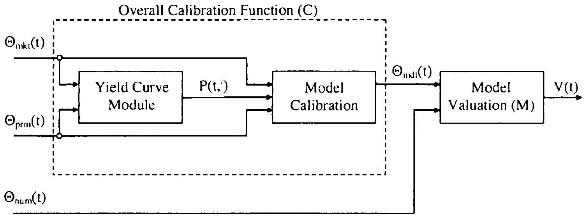

## Introduction to Risk Management

We have reached the point in the book where we are ready to discuss the problem of managing the market risk ${ }^{1}$ exposure of interest rate derivatives portfolios. For our purposes here, the topic of primary interest is the quantification and computation of the risk exposure, a task that turns out to be quite challenging and shall require several chapters to cover. First, however, we devote a brief introductory chapter to a high-level overview of the risk management exercise, as practiced by a typical fixed income derivatives trading desk. As part of our analysis, we identify the most common "greeks" (risk sensitivities), and also provide some background on the role these play in hedging and risk management. As we shall see, actual hedging practices tend to deviate considerably from the theoretical ideals of pure delta hedging of Brownian increments (see Section 1.7). We discuss these issues here, and also provide some material on how the risk management and middle office teams in a bank may use market risk exposure information to compute summary statistics for overall risk exposure (the so-called value-at-risk), and to perform day-to-day analysis and breakout of portfolio profits and losses. The chapter serves to provide justification for the emphasis on greeks computation in the remainder of the book, and also elaborates on a number of discussions that have cropped up earlier, including Bermudan swaption risk management (Section 19.7.1) and computation of par-point yield curve risk reports (Section 6.4).

[^66]
### 22.1 Risk Management and Sensitivity Computations

### 22.1.1 Basic Information Flow

To understand how a trading desk uses a model in practice, it is useful to introduce a bit of notation. Let $\Theta_{\mathrm{mkt}}(t)$ be an $N_{\mathrm{mkt}}$-dimensional vector representing the observable market data at time $t$. For a fixed income desk, the components of $\Theta_{\mathrm{mkt}}(t)$ are typically swap and futures rates (for yield curve construction) and cap and swaption prices or implied volatilities at multiple strikes, tenors, and maturities (for volatility calibration). Second, let $\Theta_{\text {prm }}(t)$ denote the set of $N_{\text {prm }}$ additional parameters that are not directly observed, but are estimated from historical data or are treated as "exotic" constants to be specified directly by the trader. Examples of such parameters include short rate mean reversion parameters, correlation parameterizations, stochastic volatility mean reversion speeds, local volatility parameters (e.g., the CEV power), and so forth. As we have seen in many chapters of this book, the question of how to split $\Theta_{\mathrm{mkt}}(t)$ and $\Theta_{\mathrm{prm}}(t)$ is often not clear-cut, as one can always attempt to add additional market variables to $\Theta_{\mathrm{mkt}}(t)$ to allow us to deduce some of the elements of $\Theta_{\mathrm{prm}}(t)$ by direct calibration, in which case these parameters can obviously be removed from $\Theta_{\mathrm{prm}}(t)$. As we discussed in Section 14.5.9, one might for instance attempt to eliminate correlation information from $\Theta_{\mathrm{prm}}(t)$ by introducing spread option price information into $\Theta_{m k t}(t)$; or one might try to calibrate short rate mean reversion from multiple swaption strips, rather than specify this parameter directly (see for instance Sections 13.1.8.2 and 13.1.8.3). As certain parameters are inherently difficult to extract in a stable and robust manner from market data, in practice it is rarely the case that $\Theta_{\text {prm }}(t)$ is completely empty.

Given $\Theta_{\mathrm{mkt}}(t)$ and $\Theta_{\mathrm{prm}}(t)$, the first step in pricing a derivative security typically involves a calibration procedure, where the vectors $\Theta_{\mathrm{mkt}}(t)$ and $\Theta_{\mathrm{prm}}(t)$ are turned into a vector ${ }^{2}$ of model-appropriate parameters $\Theta_{\mathrm{mdl}}(t)$ that contain the discount curve as well as the parameters that control its volatility structure and future dynamics. The calibration may itself require specification of certain control parameters, such as the smoothing weights used in a typical LM model calibration (Section 14.5); for simplicity, we consider these parameters part of $\Theta_{\text {prm }}(t)$. The model calibration itself will typically involve at least two steps: the construction of the discount bond curve, followed by calibration of a model for the dynamics of this curve. As the first step can typically be separated completely from the latter, it is informative to break the calibration in two parts, as in Figure 22.1 below. Notice that we here have introduced a pre-processing step where

[^67]those elements of $\Theta_{\mathrm{mkt}}(t)$ and $\Theta_{\mathrm{prm}}(t)$ that are relevant ${ }^{3}$ for yield curve construction are used to produce a discount bond curve $P(t, T), T \geq t$. Together with the (remaining) elements of $\Theta_{\mathrm{mkt}}(t)$ and $\Theta_{\mathrm{prm}}(t)$, this yield curve is fed to the main model calibration function, which produces $\Theta_{\text {mdl }}(t)$. In any case, we may write

$$
\begin{equation*}
\Theta_{\mathrm{mdl}}(t)=C\left(\Theta_{\mathrm{mkt}}(t) ; \Theta_{\mathrm{prml}}(t)\right), \tag{22.1}
\end{equation*}
$$
^eq22-1
where $C$ represents the (overall) calibration function.

Fig. 22.1. Information Flow

Notes: Basic information flow in derivatives pricing and model calibration.

Given the time $t$ yield curve and a set of model parameters, we can proceed to use the model to price a given portfolio of derivative contracts. This will require us to load contract data for a specified set of securities, and also to read in additional parameters $\Theta_{\text {num }}(t)$ that control the numerical schemes used in the model. Examples of parameters in $\Theta_{\text {num }}(t)$ would include the number of Monte Carlo paths, the size of discretization steps for finite difference grids and for SDE discretization schemes, and so forth. With $V(t)=V_{1}(t)+\ldots+V_{n}(t)$ denoting the value of a portfolio of $n$ derivatives, we write (see Figure 22.1),

$$
\begin{equation*}
V(t)=M\left(\Theta_{\mathrm{mdl}}(t) ; \Theta_{\mathrm{num}}(t)\right), \tag{22.2}
\end{equation*}
$$
^eq22-2

for some function $M$, originating from the expression of arbitrage-free valuation principles through our chosen model. As $\Theta_{\text {mdl }}(t)$ itself originates from $\Theta_{\mathrm{mkt}}(t)$ and $\Theta_{\mathrm{prm}}(t)$, we may, of course, write[^68]

$$
\begin{equation*}
V(t)=H\left(\Theta_{\mathrm{mkt}}(t) ; \Theta_{\mathrm{prm}}(t), \Theta_{\mathrm{num}}(t)\right), \tag{22.3}
\end{equation*}
$$
^eq22-3
where $H$ is the overall transfer function that translates market data and control parameters into derivatives values.

Finally, let us quickly note that sometimes the calibration function $C$ will be product-specific, i.e. it will depend on the characteristics of the specific security being valued - recall the discussion of "global" versus "local" calibration in Section 14.5.5. For our purposes here, we ignore this additional level of potential inter-connectivity.

### 22.1.2 Risk: Theory and Practice

According to basic derivatives pricing theory, the function $M$ in (22.2) assigns value based on dynamic hedging and no-arbitrage principles: the price of a derivative security should equal the cost of hedging the security through its lifetime. In doing so, the model will typically rely on idealized assumptions, e.g. that hedging costs are zero, hedging can take place in continuous time, and so forth. These assumptions are, of course, not true in practice, and will require traders to properly charge ${ }^{4}$ for the cost of running the hedge, as well as for the fact that the hedge is not truly risk-free. A more subtle issue is the fact that the model will compute value based on an assumption of "infallibility" of the parameter estimates $\Theta_{\mathrm{mdl}}(t)$. In particular, once $\Theta_{\mathrm{mdl}}(t)$ has been established, the underlying model will typically assume that, for any $t^{\prime}>t$,

$$
\begin{equation*}
V\left(t^{\prime}\right)=L\left(X\left(t^{\prime}\right) ; \Theta_{\mathrm{mdl}}(t)\right), \quad t^{\prime}>t, \tag{22.4}
\end{equation*}
$$
^eq22-4

where $X(t)$ is a random vector of state variables driven by a vector Brownian motion $W(t)$, and $L$ some model-implied map. Our hedging strategy should therefore, as described in Section 1.7, in theory care only about neutralizing the effects of movements in $X$, as caused by $W$.

In practice, the situation is different. First, actual moves of the yield curve and volatility smiles will inherently deviate from those projected by the model. Second, at time $t^{\prime}>t$, in reality the model parameter vector $\Theta_{\text {mdl }}(t)$ will be discarded and the model calibrated again, followed by an application of (22.2)

[^69]to establish the new value of the portfolio as $V\left(t^{\prime}\right)=M\left(\Theta_{\mathrm{mdl}}\left(t^{\prime}\right) ; \Theta_{\mathrm{num}}\left(t^{\prime}\right)\right)$. Of course, the recalibrated model parameters $\Theta_{\text {mdl }}\left(t^{\prime}\right)$ will rarely, if ever, be consistent with those used at time $t$, so equation (22.4) will generally fail. As this equation serves as a fundamental assumption of the underlying model, the practical usage of the model is clearly causing quite profound consistency violations. In particular, we constantly change parameters that are assumed by the model to be invariants.

While at first glance the situation outlined above may seem to strike a death blow to the entire foundation of derivatives pricing and hedging, there are several mitigating factors that make the situation less dire than it appears. First, if the model is fundamentally sound, its dynamics will be close to reality most of the time, and (22.2) and (22.4) will consequently be near-identical on average. Second, the trader can employ several strategies to minimize the risk of model mis-specification. One type of strategy involves the use of robust static or super-replicating hedges, as in Sections 16.6.1, 19.4.5 and 20.2 .3 . As this is not always possible, a more common strategy involves hedging "too much", by neutralizing the portfolio to higher-order sensitivities (gamma hedging), and also by hedging against moves in quantities which are assumed by the model to be non-random. A standard example of the latter is the practice of vega hedging with the Black-Scholes model: despite the fact that the model assumes that the volatility is a constant, the dealer will nevertheless put on a hedge against moves in the volatility parameter. As discussed in Hull [2006] or Taleb [1997], there is empirical evidence that such practices considerably improve the hedge robustness and performance in actual markets.

Vega hedging is an example of the common practice of ignoring the theoretical ideal of (22.4), and instead constructing a hedge around (22.3), with the hedge aiming to neutralize (in a standard Taylor-series sense, see Section 22.1.5) as many of the movements in the entire market data vector $\Theta_{\mathrm{mkt}}(t)$ as possible, irrespective of whether a particular model may suggest that this is reasonable or not. As the dimension of the market data vector $N_{\text {mkt }}$ can be very high, often 100 or more, it may be too costly and too onerous to hedge against all components of $\Theta_{\mathrm{mkt}}(t)$ individually, so some type of principal components analysis (as in Section 14.3.1, for instance) may be undertaken to guide the level of granularity required in the hedge. Additionally, one would need to contemplate whether hedges against both first- and second-order (or even higher orders) risk are required. The answer to this question would typically be settled by careful analysis of the convexity properties of the portfolio value $V$ as a function of the market data $\Theta_{\mathrm{mkt}}(t)$ : whenever there is significant convexity or concavity with respect to a given parameter, it is reasonable to attempt to put on a second-order hedge. As the (Hessian) matrix of second-order derivatives of $V$ with respect to the components of $\Theta_{\mathrm{mkt}}(t)$ has $N_{\mathrm{mkt}}\left(N_{\mathrm{mkt}}+1\right) / 2$ distinct elements (which will often reach thousands), again some selectivity will be required in practice.

The "art of derivatives trading" - that is, the practice of cost-efficiently managing of book of derivatives from market data sensitivity reports requires considerable and detailed market knowledge and is hard, if not impossible, to describe in purely mathematical terms. Consequently we abstain from attempting to do so, but simply notice that the very foundation of the trading exercise are the market data sensitivities themselves. For readers interested in a description of derivative trading practices, the available material is, unfortunately, rather limited. A common reference is Taleb [1997]; Miron and Swannell [1991] could also be consulted.

### 22.1.3 Example: the Black-Scholes Model

To make the discussion in Sections 22.1.1 and 22.1.2 more concrete, let us assume that our derivatives portfolio is written on a single underlying asset $X(t)$, the risk-neutral dynamics of which are

$$
\begin{equation*}
d X(t) / X(t)=r d t+\sigma d W^{\prime}(t) \tag{22.5}
\end{equation*}
$$
^eq22-5

where $r$ and $\sigma$ are constants and $W(t)$ is a one-dimensional Brownian motion. We shall shortly (in Section 22.1.4) make the model a bit more realistic by introducing time-dependence into the parameters, but for now we assume that they are constants. In addition, we assume that $r$ and $\sigma$ are directly observable in the market (again, we relax this shortly), such that $\Theta_{\mathrm{mkt}}(t)=\Theta_{\mathrm{mcll}}(t)=(X(t), r, \sigma)^{\top}$.

The theoretical hedge for a derivative (or a derivative portfolio) $V$ written on $X$ will take the form of a pure delta hedge, where a position ( $-\partial V / \partial X$ ) in $X$ is maintained at all times. In practice, a trader will not only be concerned with neutralizing against first-order movements in $X(t)$, but will also manage many of the instantaneous sensitivities listed in Table 22.1.

| Common Name | Delinition |
| :--- | :--- |
| theta | $\partial V / \partial t$ |
| rho | $\partial V / \partial r$ |
| delta | $\partial V / \partial X$ |
| gamma | $\partial^{2} V / \partial X^{2}$ |
| vega | $\partial V / \partial \sigma$ |
| volga (or vomma) | $\partial^{2} V / \partial \sigma^{2}$ |
| vanna | $\partial^{2} V / \partial \sigma \partial X$ |

Table 22.1. Common greeks in the Black-Scholes model.

Neutralization of rho will typically involve taking positions in interest rate swaps, whereas gamma, vega, volga, vanna can only be eliminated by trading derivative securities with non-linear payouts in $X$ and volatility exposure - typically liquid European options.

We should note that in Table 22.1, the theta (or time decay) has a special status, as the passage of time is both unavoidable and non-random - as such, it makes no sense to try to hedge this "exposure". We also note that the theta, in a sense, emerges as a combination of other greeks, as can be confirmed from the basic Black-Scholes-Merton valuation PDE from Section 1.9:

$$
\begin{equation*}
\frac{\partial V}{\partial t}+r X \frac{\partial V}{\partial X}+\frac{1}{2} \sigma^{2} X^{2} \frac{\partial^{2} V}{\partial X^{2}}=r V \tag{22.6}
\end{equation*}
$$
^eq22-6

or, equivalently,

$$
\text { theta }+r X \times \text { delta }+\frac{1}{2} \sigma^{2} X^{2} \times \text { gamma }=r \times \text { value } \text {. }
$$

Notice, in particular, that a delta hedged position (delta $=0$ ), will identify theta $=r V-\frac{1}{2} \sigma^{2} X^{2} \times$ gamma, so for a delta hedger the time decay of his position originates in part from a pure discount effect due to interest accruing on the net present value of the portfolio (the term $r V$ ), and in part from a convexity term (the term $-\frac{1}{2} \sigma^{2} X^{2} \times$ gamma). The latter, of course, represents optionality leaking away over time, and not surprisingly scales with $\sigma^{2}$.

While traders tend to monitor all entries in Table 22.1, particular attention is typically paid to the delta, gamma and vega exposures. Hedging the vega ensures that inevitable changes to implied volatility will not lead to large moves in the portfolio value, and hedging the gamma helps prevent "slippage" in between dates where the delta hedge is rebalanced. As discussed already in Section 19.7.1, most traders strongly prefer being long gamma exposure (i.e. the net gamma of their portfolio, including hedges, is positive), as a negative gamma position can lose a very substantial amount of money in periods of financial turmoil when the trader cannot adjust his delta hedge quickly enough to track the market.

One would intuitively expect that a portfolio that has low gamma exposure would also have a low vega, a result that in fact can be formalized as follows:

Lemma 22.1.1. Consider a European-style claim with maturity $T$ and payout function $g(X(T))$, where $X(t)$ satisfies (22.5). With $V(t)=V(t, X(t))$ denoting time $t$ value of this security, we have (employing somewhat loose notation)

$$
\begin{equation*}
\frac{\partial V(t)}{\partial \sigma}=(T-t) X(t)^{2} \sigma \frac{\partial^{2} V(t)}{\partial X(t)^{2}}, \quad \text { or } \quad \text { vega }=(T-t) X(t)^{2} \sigma \times \text { gamma. } \tag{22.7}
\end{equation*}
$$
^eq22-7

Proof. An elementary, if rather inelegant, proof proceeds as follows. First, we let $\mathrm{E}_{t}$ denote time $t$ risk-neutral expectation, such that

$$
V(t)=e^{-r(T-t)} \mathrm{E}_{t}(g(X(T)))
$$

where

$$
X(T)=X(t) \exp \left(\left(r-\frac{1}{2} \sigma^{2}\right)(T-t)+\sigma \sqrt{T-t} Z\right)
$$

with $Z \sim \mathcal{N}(0,1)$. Notice that

$$
\begin{equation*}
\frac{\partial V(t)}{\partial X(t)}=e^{-r(T-t)} \mathrm{E}_{t}\left(\frac{\partial g(X(T))}{\partial X(T)} \cdot \frac{X(T)}{X(t)}\right) \tag{22.8}
\end{equation*}
$$
^eq22-8

and

$$
\frac{\partial X(T)}{\partial t}=-X(T)\left(r-\frac{1}{2} \sigma^{2}+\frac{\sigma}{2 \sqrt{T-t}} Z\right)
$$

such that

$$
\begin{align*}
\frac{\partial V(t)}{\partial t}= & r e^{-r(T-t)} \mathrm{E}_{t}(g(X(T)))+e^{-r(T-t)} \mathrm{E}_{t}\left(\frac{\partial g(X(T))}{\partial X(T)} \cdot \frac{\partial X(T)}{\partial t}\right) \\
= & r V(t)-e^{-r(T-t)} \mathrm{E}_{t}\left(\frac{\partial g(X(T))}{\partial X(T)} X(T)\left(r-\frac{1}{2} \sigma^{2}+\frac{\sigma}{2 \sqrt{T-t}} Z\right)\right) \\
= & r V(t)-X(t) \frac{\partial V(t)}{\partial X(t)}\left(r-\frac{1}{2} \sigma^{2}\right) \\
& -\frac{\sigma}{2 \sqrt{T-t}} e^{-r(T-t)} \mathrm{E}_{t}\left(\frac{\partial g(X(T))}{\partial X(T)} \cdot X(T) Z\right) \tag{22.9}
\end{align*}
$$
^eq22-9

where we have used (22.8) in the last equality. Using the same principles, we get

$$
\begin{align*}
\frac{\partial V(t)}{\partial \sigma} & =e^{-r(T-t)} \mathrm{E}_{t}\left(\frac{\partial g(X(T))}{\partial X(T)} \cdot \frac{\partial X(T)}{\partial \sigma}\right) \\
& =e^{-r(T-t)} \mathrm{E}_{t}\left(\frac{\partial g(X(T))}{\partial X(T)} \cdot X(T)(-\sigma(T-t)+\sqrt{T-t} Z)\right) \\
& =-X(t) \frac{\partial V(t)}{\partial X(t)} \sigma(T-t)+e^{-r(T-t)} \sqrt{T-t} \mathrm{E}_{t}\left(\frac{\partial g(X(T))}{\partial X(T)} X(T) Z\right) \tag{22.10}
\end{align*}
$$
^eq22-10

Combining (22.9) and (22.10), we get

$$
\begin{aligned}
\frac{\partial V(t)}{\partial \sigma}= & -X(t) \frac{\partial V(t)}{\partial X(t)} \sigma(T-t) \\
& +\frac{2(T-t)}{\sigma}\left(r V(t)-\frac{\partial V(t)}{\partial t}-X(t) \frac{\partial V(t)}{\partial X(t)}\left(r-\frac{1}{2} \sigma^{2}\right)\right) \\
= & \frac{2(T-t)}{\sigma}\left(r V(t)-\frac{\partial V(t)}{\partial t}-r X(t) \frac{\partial V(t)}{\partial X(t)}\right)
\end{aligned}
$$

The result (22.7) follows after insertion of the pricing PDE (22.6) into the expression above.

Remark 22.1.2. A more elegant way to prove Lemma 22.1.1 relies on operator calculus, as in Carr [2000]. As this technique is sometimes quite handy, we demonstrate it in Appendix 22.A, where it is also shown that, for a general European-style claim,

$$
\frac{\partial V(t)}{\partial r}=(T-t)\left(X(t) \frac{\partial V(t)}{\partial X(t)}-V(t)\right) .
$$

While Lemma 22.1.1 only holds for European-style claims in the BlackScholes model, the observation that there is a close link between vega and gamma holds in general. We shall examine the importance of vega and gamma hedging in more detail shortly, but first let us make the model setting a bit more realistic.

### 22.1.4 Example: Black-Scholes Model with Time-Dependent Parameters

In actual usage of the Black-Scholes model, one would always allow the short rate and volatility to be time-dependent, in order to match observed term structures of discount bonds and (term) option volatilities. While technically an obvious extension to Section 22.1.3, let us go over the mechanics nevertheless to better illustrate the concepts from Sections 22.1.1 and 22.1.2. We first change (22.5) to

$$
d X(t) / X(t)=r(t) d t+\sigma(t) d W(t)
$$

where $r(t)$ and $\sigma(t)$ are deterministic functions of time, to be calibrated to the term structure of discount bonds and implied at-the-money (ATM) volatilities observed in the market. We assume that the yield curve is computed from a vector of swap yields $S(t)=\left(S_{1}(t), \ldots, S_{J}(t)\right)^{\top}$, where it is understood that $S_{i}(t)$ represents the time- $t$ par yield of a swap that matures on some date $T_{i}>t, i=1, \ldots, J$. For simplicity, let us assume, as in Section 6.2.1, that the constructed yield curve is bootstrapped as a piecewise flat curve in forward rate space, with breakpoints located at the swaption maturities $\left\{T_{2}\right\}$. Defining $T_{0} \triangleq t$, the resulting time $t$ forward curve may therefore be represented as

$$
f(t, u)=-\frac{\partial \ln P(t, u)}{\partial u}=\sum_{\imath=0}^{J-1} \gamma_{i}(t) 1_{\left\{u \in\left\{T_{\imath}, T_{\imath+1}\right\}\right\}}
$$

where we use the vector $\gamma(t)=\left(\gamma_{1}(t), \ldots, \gamma_{J}(t)\right)^{\top}$ to store the resulting $J$ forward curve levels. As $r$ is assumed deterministic, we set $r(u)=f(t, u)$, $u \geq t$, and have then completed the interest rate calibration.

To construct $\sigma(t)$, assume that a vector $v(t)=\left(v_{1}(t), \ldots, v_{D}(t)\right)^{\top}$ is observed in the market, where each $v_{i}(t)$ represents a term volatility to $t_{i}$ on a specified maturity grid $\left\{t_{i}\right\}_{\imath=1}^{D}$, with $t_{1}>t$. That is,

$$
v_{i}(t)=\sigma_{\mathrm{ATM}}\left(t, t_{i}\right)
$$

where $\sigma_{\mathrm{ATM}}\left(t, t_{i}\right) \triangleq \sigma_{\mathrm{BS}}\left(t, X(t) ; t_{i}, X(t)\right)$ is the ATM implied (Black-Scholes) volatility to time $t_{i}$, seen from time $t$ (see Section 7.1.2). If we assume that $\sigma(u)$ is piecewise flat on the $\left\{t_{i}\right\}$-grid, we can construct $\sigma(u)$ by bootstrapping from the basic relation (see Section 1.9.3)

$$
\begin{equation*}
\sigma_{\mathrm{ATM}}(t, u)^{2}=(u-t)^{-1} \int_{t}^{u} \sigma(s)^{2} d s \tag{22.11}
\end{equation*}
$$
^eq22-11

The result of this exercise is a vector $\varsigma(t)=\left(\varsigma_{1}(t), \ldots, \varsigma_{D}(t)\right)^{\top}$ of flat volatility levels, such that

$$
\sigma(u)=\sum_{i=0}^{D-1} \varsigma_{i}(t) 1_{\left\{u \in\left[t_{2}, t_{i+1}\right)\right\}},
$$

where we set $t_{0} \triangleq t$.
The calibration procedure described above turns $\Theta_{\mathrm{mkt}}(t)=(S(t), v(t))^{\top}$ into $\Theta_{\text {mdl }}(t)=(\gamma(t), \varsigma(t))^{\top}$, with both vectors having dimension $J+D$, i.e. $N_{\mathrm{mkt}}=N_{\mathrm{prm}}=J+D$. The vector $\Theta_{\mathrm{prm}}(t)$ is here empty, but would have contained precision parameters if, say, the more elaborate yield curve construction algorithm of Section 6.3 had been used. The contents of the vector $\Theta_{\text {num }}(t)$ would depend on what numerical method the calibrated model would implement for the purpose of pricing a specific derivative. For instance, if we were using a finite difference grid, $\Theta_{\text {num }}(t)$ might contain a confidence level multiplier (see Section 2.1) to dimension the grid, a $\theta$ parameter to determine the level of implicitness in the solver (see Section 2.2.3), various flags (e.g. whether to use upwinding or not, see Section 2.6.1) and, of course, information to determine the number of grid points in the time ( $t$ ) and space ( $X$ ) directions.

As $r$ and $\sigma$ are now vector-valued, the quantities rho, vega, volga, and vanna in Table 22.1 are no longer scalars ${ }^{5}$ but must be represented as vectors. Also, one issue is how we wish to present this risk information in the first place: for vega, say, do we want to report sensitivities with respect to the market volatilities $v$ (so-called market vegas) or the model volatilities $\varsigma$ (so-called model vegas)? The former is the most common, but we can here freely translate between the two. Specifically, applying the chain rule to the relationship between $v_{i}$ 's and $\varsigma_{j}$ 's given by (22.11) we have that

$$
\frac{\partial}{\partial v_{i}}=\sum_{j=1}^{D} \frac{\partial}{\partial \varsigma_{j}}\left(\frac{\partial \varsigma_{j}}{\partial v_{i}}\right)
$$

[^70]where the matrix of partial derivatives $\partial \varsigma / \partial v$ can be obtained by inverting the Jacobian matrix $\partial v / \partial \varsigma$ which can be obtained in closed form from the relation (22.11). A similar translation between sensitivities to swap yields and to forward rate buckets was discussed already, in Section 6.4.

### 22.1.5 Actual Risk Computations

Getting back to the general representation (22.3), assume that we perturb the market data by a vector-valued amount $\delta=\left(\delta_{1}, \ldots, \delta_{N_{\text {mkt }}}\right)^{\top}$. Let us use a Taylor expansion to write (dropping the argument $t$ for clarity)

$$
\begin{equation*}
V(\delta)=H\left(\Theta_{\mathrm{mkt}}+\delta\right) \approx H\left(\Theta_{\mathrm{mkt}}\right)+\nabla^{H} \cdot \delta+\frac{1}{2} \delta^{\top} \cdot A^{H} \cdot \delta \tag{22.12}
\end{equation*}
$$
^eq22-12

where $\nabla^{H}$ is an $N_{\text {mkt }}$-dimensional row vector and $A^{H}$ an $N_{\text {mkt }} \times N_{\text {mkt }}$ matrix, with elements

$$
\nabla_{i}^{H}=\left.\frac{\partial H(x)}{\partial x_{i}}\right|_{x=\Theta_{\mathrm{mkt}}}, \quad A_{i, j}^{H}=\left.\frac{\partial^{2} H(x)}{\partial x_{i} \partial x_{j}}\right|_{x=\Theta_{\mathrm{mkt}}}, \quad i, j=1, \ldots, N_{\mathrm{mkt}} .
$$

While the situation in interest rate modeling is obviously a little more complicated than for the single-asset Black-Scholes setup in Sections 22.1.3 and 22.1 .4 , loosely speaking the gradient vector $\nabla^{H}$ will contain deltas (first-order sensitivities with respect to swap yields) and vegas (first-order sensitivities with respect to swaption volatilities), while the Hessian matrix $A^{H}$ will contain gammas, volgas, and vannas. Notice that the risk measure rho is not used for interest rate derivatives (where, in a sense, delta and rho coincide).

Although not all elements of $A$ are always requested, in a nutshell the main role of an interest rates derivatives risk system is to report ${ }^{6} \nabla^{H}$ and $A^{H}$ for consumption by the trading desk, risk management, and the middle office. The trading desk will, as we discussed earlier in Section 22.1.2, use the sensitivities to evaluate how much it should rebalance the portfolio to keep it broadly market-neutral and robust to market shocks; the "ideal" configuration for a pure ${ }^{7}$ hedger will obviously be to arrange the portfolio such that $\nabla^{H}=0$ and $A^{H}=0$. Risk management will use the sensitivities to ensure that the exposures to individual market data components are within given sensitivity limits. In addition, risk management will typically

[^71]compute an overall measure of the portfolio risk, based on a statistical (or historical) model for the perturbation vector $\bar{\delta}$ over a given time horizon, typically one day. We discuss this computation briefly in Section 22.3. In the middle office of a bank, the sensitivities are used for $P \& L$ analysis, i.e. the process of reconciling observed moves in portfolio value with changes in market data. We review this process in Section 22.2.

Recall that market data input used to compute the value of a derivative security typically goes through a two-step procedure, where first a calibration turns the market data vector $\Theta_{m k t}$ into a model data vector $\Theta_{m d l}$, which in turn is used to compute the derivatives price, $V=M\left(\Theta_{\text {mdl }}\right)$. It is often natural to first compute sensitivities with respect to the model parameters a process that is independent of the chosen calibration procedure - and then combine these sensitivities with calibration-specific sensitivity information to compute the market data input sensitivities. For instance, we would write, for $j=1, \ldots, N_{\mathrm{mkt}}$,

$$
\nabla_{j}^{H}=\left.\sum_{i=1}^{N_{\mathrm{m}, \mathrm{mll}}} \frac{\partial M(y)}{\partial y_{i}} \frac{\partial C_{i}(x)}{\partial x_{j}}\right|_{y=\Theta_{\mathrm{m}, \mathrm{ll}, x}=\Theta_{\mathrm{mkt}}},
$$

where $C_{2}$ is the $i$-th component of the $N_{\text {mdl }}$-dimensional calibration function $C$ in (22.1). The $N_{\mathrm{mdl}} \times N_{\mathrm{mkt}}$ matrix $J$ with elements

$$
J_{i, j}=\frac{\partial C_{i}}{\partial x_{j}}
$$

is known as the Jacobian for the map from market to model parameters. The Jacobian can normally be computed in the calibration module, as part of the calibration procedure itsclf. We saw a simple example of Jacobian matrix usage in Section 22.1.4 above, and will consider the idea in a more realistic setting in Section 26.3.3.

### 22.1.6 What about $\Theta_{\text {prm }}$ and $\Theta_{\text {num }}$ ?

The reader will have noticed that the portfolio value depends not only on market data, but also on various technical parameters that control numerics and the calibration, as well as certain unobservable model parameters. This type of data is fairly static, and sensitivity information is rarely reported on a running basis. As the numbers do affect the official profit-and-loss (P\&L) produced by the model, the elements of $\Theta_{\text {prm }}$ and $\Theta_{\text {num }}$ are typically supervised by control groups that may impose standards on numerical parameters (e.g. require that the nunerical error be within a certain tolerances) and may request that monetary buffers - so-called reserves - be set aside to cover the uncertainty of unobservable model parameters. The latter will require some estimates of the uncertainty associated with a given parameter, as well as a computation of the portfolio value sensitivity to the parameters.

While the reserves need to be dynamically updated to reflect changes in the portfolio and in the parameter sensitivities, this is normally done relatively infrequently, e.g. every month or quarter. Given this, from a computational perspective sensitivity generation with respect to market data $\Theta_{\text {mkt }}$ - which is often done on an inter-day basis - is, by far, the more challenging task. As such, our emphasis in the rest of this book is solely on computation of market data sensitivities.

### 22.1.7 A Note on Trading P\&L and the Computation of Implied Volatility

Before proceeding to discuss applications of the sensitivity analysis of Section 22.1.5, we insert a brief interlude to demonstrate an important result (sometimes known as the fundamental theorem of derivatives trading) that provides a link between a portfolio's gamma and expected hedging P\&L over a given horizon. The setup is as follows. At time 0 a trader buys a contingent claim on a single non-dividend paying asset $X$, and chooses to value his position by using a Black-Scholes model with fixed volatility $\sigma_{\mathrm{BS}}$. Let the trader's mark for his portfolio be $V_{\mathrm{BS}}(t)$ and assume that $\sigma_{\mathrm{BS}}$ is such that the value $V_{\mathrm{BS}}(0)$ coincides with the time 0 market value. We assume that the contingent claim expires at time $T$ with value $g(X(T))$, and pays no cash flows before then. The trader is actively hedging his position, but commits two "sins": i) he does not gamma or vega hedge his position, but only delta hedges; and ii) he never re-calibrates the model but assumes that $\sigma_{\mathrm{BS}}$ is the correct volatility to use when computing hedge information, even if the volatility of $X$ is observed to change over time.

In analyzing the performance of the hedger's strategy, let us assume that the volatility of $X$ is a random process $\sigma(t)$, i.e. that dynamics in the real-life measure $P$ are of the form

$$
d X(t) / X(t)=O(d t)+\sigma(t) d W^{P}(t)
$$

where $W^{P}(t)$ is a P-Brownian motion. Now, to hedge his long position in the contingent claim, the trader sets up a short position in a portfolio $\Pi$ with $n_{X}(t)$ units of $X$ held at time $t$, along with a cash position $N(t)$. As described above, the trader delta hedges according to the Black-Scholes model, so

$$
n_{\mathrm{X}}(t)=\frac{\partial V_{\mathrm{BS}}(t)}{\partial X(t)} .
$$

In other words, we have

$$
\Pi(t)=n_{X}(t) X(t)+N(t),
$$

where, by construction, $\Pi(0)=V_{\mathrm{BS}}(0)$. Assuming that $N(t)$ is rolled over at the short-term interest rate $r$ (assumed constant for convenience), we therefore get

$$
\begin{equation*}
d \Pi(t)=n_{X}(t) d X(t)+N(t) r d t \tag{22.13}
\end{equation*}
$$
^eq22-13

where the self-financing condition (see(1.10)) justifies ignoring the change in $n_{X}$ at $t+d t$. The following important result now holds.

Proposition 22.1.3. The time $T$ terminal value of the delta hedging account in (22.15) is

$$
\Pi(T)=g(X(T))+\frac{1}{2} e^{r T} \int_{0}^{T} e^{-r t}\left(\sigma_{\mathrm{BS}}^{2}-\sigma(t)^{2}\right) X(t)^{2} \frac{\partial^{2} V_{\mathrm{BS}}(t)}{\partial X(t)^{2}} d t
$$

where $g(x)$ is the terminal payout function.
Proof. By Ito's lemma, observe that

$$
\begin{equation*}
d V_{\mathrm{BS}}(t)=\frac{\partial V_{\mathrm{BS}}(t)}{\partial t} d t+\frac{\partial V_{\mathrm{BS}}(t)}{\partial X(t)} d X(t)+\frac{1}{2} \sigma(t)^{2} X(t)^{2} \frac{\partial^{2} V_{\mathrm{BS}}(t)}{\partial X(t)^{2}} d t \tag{22.14}
\end{equation*}
$$
^eq22-14

so combining (22.13) and (22.14) yields

$$
\begin{align*}
d\left(V_{\mathrm{BS}}(t)-\Pi(t)\right)= & \frac{\partial V_{\mathrm{BS}}(t)}{\partial t} d t+\frac{1}{2} \sigma(t)^{2} X(t)^{2} \frac{\partial^{2} V_{\mathrm{BS}}(t)}{\partial X(t)^{2}} d t-N(t) r d t \\
= & \frac{\partial V_{\mathrm{BS}}(t)}{\partial t} d t+\frac{1}{2} \sigma(t)^{2} X(t)^{2} \frac{\partial^{2} V_{\mathrm{BS}}(t)}{\partial X(t)^{2}} d t \\
& -r\left(\Pi(t)-\frac{\partial V_{\mathrm{BS}}(t)}{\partial X(t)} X(t)\right) d t \tag{22.15}
\end{align*}
$$
^eq22-15

We now recall that $V_{\mathrm{BS}}(t)$ satisfies the Black-Scholes PDE with constant volatility $\sigma_{\mathrm{BS}}$, wherefore

$$
\frac{\partial V_{\mathrm{BS}}(t)}{\partial t}+r X(t) \frac{\partial V_{\mathrm{BS}}(t)}{\partial X(t)}+\frac{1}{2} \sigma_{\mathrm{BS}}^{2} X(t)^{2} \frac{\partial^{2} V_{\mathrm{BS}}(t)}{\partial X(t)^{2}}=r V_{\mathrm{BS}}(t) .
$$

Inserting this expression into (22.15) yields, after a little algebra,

$$
\begin{aligned}
& d\left(V_{\mathrm{BS}}(t)-\Pi(t)\right) \\
& \quad=\frac{1}{2}\left(\sigma(t)^{2}-\sigma_{\mathrm{BS}}^{2}\right) X(t)^{2} \frac{\partial^{2} V_{\mathrm{BS}}(t)}{\partial X(t)^{2}} d t+r\left(V_{\mathrm{BS}}(t)-\Pi(t)\right) d t
\end{aligned}
$$

We can integrate this equation to yield

$$
\begin{aligned}
V_{\mathrm{BS}}(T)-\Pi(T)=e^{r T} & \left(V_{\mathrm{BS}}(0)-\Pi(0)\right) \\
& +e^{r T} \int_{0}^{T} e^{-r t} \frac{1}{2}\left(\sigma(t)^{2}-\sigma_{\mathrm{BS}}^{2}\right) X(t)^{2} \frac{\partial^{2} V_{\mathrm{BS}}(t)}{\partial X(t)^{2}} d t
\end{aligned}
$$

and the result of the proposition follows from the observation that $V_{\mathrm{BS}}(T)= g(X(T))$ and $V_{\mathrm{BS}}(0)=\Pi(0)$.

Proposition 22.1.3 demonstrates that the hedging strategy followed by the trader generally does not work, in the sense that the terminal value $\Pi(T)$ of the self-financing hedging portfolio will fail to equal $g(X(T))$. In certain special cases, however, the hedge will work, e.g. when the hedged claim is gamma-neutral ( $\partial^{2} V_{\mathrm{BS}} / \partial X^{2}=0$ ) or when $\sigma(t)$ is close to $\sigma_{\mathrm{BS}}$ "on average". These observations, while trivial, strongly support the strategy of re-calibrating the model to changing market conditions and to use gammahedging to keep portfolio convexity low.

As an aside, we notice that if i) the Black-Scholes gamma is strictly positive, and ii) the realized volatility $\sigma(t)$ is consistently higher than $\sigma_{\mathrm{BS}}$, we have $\Pi(T)<g(X(T))$ for sure. As the trader is short the liedging portfolio, it follows that the trader keeping a positive gamma benefits from financial turmoil (high volatility), a point we have made several times already.

Finally, let us present an important corollary of Proposition 22.1.3.
Corollary 22.1.4. Let the claim in Proposition 22.1.3 be a European call or put option with strike $K$. The time 0 implied volatility $\sigma_{\mathrm{BS}}= \sigma_{\mathrm{BS}}(0, X(0) ; T, K)$ is given by

$$
\begin{equation*}
\sigma_{\mathrm{BS}}^{2}=\frac{\mathrm{E}\left(\int_{0}^{T} e^{-r t} \sigma(t)^{2} X(t)^{2} \frac{\partial^{2} V_{\mathrm{BS}}(t)}{\partial X(t)^{2}} d t\right)}{\mathrm{E}\left(\int_{0}^{T} e^{-r t} X(t)^{2} \frac{\partial^{2} V_{\mathrm{BS}}(t)}{\partial \mathrm{X}(t)^{2}} d t\right)} \tag{22.16}
\end{equation*}
$$
^eq22-16

where E denotes expectation in the risk-neutral measure, and

$$
\begin{align*}
X(t)^{2} \frac{\partial^{2} V_{\mathrm{BS}}(t)}{\partial X(t)^{2}} & =X(t) \frac{\phi\left(d_{+}(X(t))\right)}{\sigma_{\mathrm{BS}} \sqrt{T-t}}  \tag{22.17}\\
d_{+}(x) & =\frac{\ln (x / K)+\left(r+\frac{1}{2} \sigma_{\mathrm{BS}}^{2}\right)(T-t)}{\sigma_{\mathrm{BS}} \sqrt{T-t}}
\end{align*}
$$
^eq22-17

where $\phi(x)=(2 \pi)^{-1 / 2} e^{-x^{2} / 2}$ is the Gaussian density.
Proof. The hedge portfolio generates no cash flows on $[0, T]$, so its time 0 value must equal

$$
\begin{aligned}
& \Pi(0)=e^{-r T} \mathrm{E}(\Pi(T))=e^{-r T} \mathrm{E}(g(X(T))) \\
& \quad+\mathrm{E}\left(\int_{0}^{T} e^{-r t} \frac{1}{2}\left(\sigma(t)^{2}-\sigma_{\mathrm{BS}}^{2}\right) X(t)^{2} \frac{\partial^{2} V_{\mathrm{BS}}(t)}{\partial X(t)^{2}} d t\right)
\end{aligned}
$$

where $g(x)=(x-K)^{+}$for a call and $g(x)=(K-x)^{+}$for a put. Here, the term

$$
e^{-r T} \mathrm{E}(g(X(T)))
$$

equals the time 0 market value of the put or call being hedged, and equals $\Pi(0)$ by assumption. It follows that

$$
\mathrm{E}\left(\int_{0}^{T} e^{-r t} \frac{1}{2}\left(\sigma(t)^{2}-\sigma_{\mathrm{BS}}^{2}\right) X(t)^{2} \frac{\partial^{2} V_{\mathrm{BS}}(t)}{\partial X(t)^{2}} d t\right)=0
$$

which immediately leads to (22.16). The result (22.17) follows from an explicit evaluation of gamma in the Black-Scholes model.

To get some insights into the result of the corollary above, assume that $\sigma(t)$ is of the local volatility type, $\sigma(t)=\sigma(X(t))$, in which case (22.16) can be written

$$
\begin{equation*}
\sigma_{\mathrm{BS}}(T, K)^{2}=\frac{\int_{0}^{\infty} \int_{0}^{T} e^{-r t} \sigma(x) w(t, x) \psi(t, x) d t d x}{\int_{0}^{\infty} \int_{0}^{T} e^{-r t} w(t, x) \psi(t, x) d t d x} \tag{22.18}
\end{equation*}
$$
^eq22-18

where $\psi(t, x)$ is the density of $X(t)$ as seen from time 0 , and

$$
w(t, x)=x \frac{\phi\left(d_{+}(x)\right)}{\sigma_{\mathrm{BS}}(T, K) \sqrt{T-t}}
$$

In a sense, (22.18) demonstrates that implied volatility is a weighted average of local volatility, where weights are proportional to the product of gamma and the asset density.

Direct usage of (22.18) is complicated by the fact that the implied volatility figures in both the left- and right-hand sides of the equation, and by the fact that the density of the asset is rarely, if ever, known explicitly. On the other hand, the product $w(t, x) \psi(t, x)$ can be seen to typically form a "ridge" from $x=X(0)$ at time 0 to $x=K$ at time $T$, a result that holds irrespective of the model specification. This, among other considerations, has inspired some authors to suggest that

$$
\sigma_{\mathrm{BS}}(0, X(0) ; T, K)^{2} \approx \frac{1}{T} \int_{0}^{T} \mathrm{E}\left(\sigma(t)^{2} \mid X(t)=x^{*}(t)\right) d t
$$

where $x^{*}(t)$ is to be interpreted as the most likely path from $X(0)$ to $K$. This idea has found applications for both local and stochastic volatility models, see e.g. Gatheral [2006]. While often quite intuitive, approximation techniques based on (22.16) involve a fair amount of heuristics ${ }^{8}$, and precision is often neither impressive nor easy to characterize. As a result, the method - which we believe was originally suggested by Bruno Dupire - is often reserved for qualitative analysis. See Lee [2005] and Gatheral [2006] for additional discussion and applications.

### 22.2 P\&L Analysis

Besides being used by traders to manage the exposure of their books, the sensitivity information contained in Taylor expansions such as (22.12) is

[^72]consumed by various support and control functions in a bank. We discuss two such uses: P\&L analysis and, in Section 22.3 below, value-at-risk computation.

### 22.2.1 P\&L Predict

The expansion (22.12) may be used in an accounting analysis to analyze and reconcile the realized P\&L from one trading day to the next. Although the analysis is carried out at time $t+h$ (where the market data movement $\delta$ is known), it is known as a $P \& L$ prediction analysis, or just a $P \& L$ predict. Given, at time $t$, expansion terms $\nabla^{H}(t)$ and $A^{H}(t)$, if the observed market data movements over the period $[t, t+h]$ (with $h$ typically equal to one business day) is $\delta$, then, all things equal, we would expect the time $t+h$ portfolio value to be approximately

$$
\begin{equation*}
V(t+h) \approx V(t)+\frac{\partial V(t)}{\partial t} h+\nabla^{H}(t) \cdot \delta+\frac{1}{2} \delta^{\top} \cdot A^{H}(t) \cdot \delta \tag{22.19}
\end{equation*}
$$
^eq22-19

Notice the inclusion of the term $\partial V / \partial t$ (theta) in this expansion, to account for the passage of time. The right-hand side of this equation is known as the second-order P\&L predict; if we omit the convexity term (i.e. set $A^{H}(t)=0$ ), the right-hand side is, naturally, the first-order $P$ \& $L$ predict. The difference between the right- and left-hand sides of (22.19) may be called the unpredicted P\&L. If systems and models are working properly, the P\&L predict should generally be an accurate and unbiased estimated of actual P\&L, so monitoring of the unpredicted P\&L serves an important control purpose. Unusually large values of unpredicted $\mathrm{P} \& \mathrm{~L}$ may, for instance, hint at problems in the computation of risk sensitivities (and therefore in hedges) or suggest that the portfolio is exposed to large unhedged high-order risks.

We should note that when writing down (22.19), we implicitly made several simplifying assumptions, most notably that the portfolio at time $t$ is the same as at time $t+h$. In reality, trades may expire, get canceled or amended, or entirely new trades may be added to the portfolio on the interval $(t, t+h]$. In addition, cash payments (coupons and settlement amounts) may take place on $(t, t+h]$ and must be added to the left-hand side of (22.19). The function $V$ in (22.19) should therefore really be thought of as representing the part of the portfolio trade population that involves no special events over the period $[t, t+h]$; a full $\mathrm{P} \& \mathrm{~L}$ predict analysis will additionally require accounting for a number of adjustments due to cash payments, changes to the portfolio, and rate fixings. Getting all details right is often a fairly complex exercise, and as mentioned earlier is normally handled by dedicated personnel in a bank's middle office.

An important issue in P\&L predict (and also in P\&L explain, see Section 22.2.2 below) is the computation of the theta term in (22.19). In particular, when advancing time forward, what precisely is it that we should hold fixed?

While one might say that, by definition, all elements of $\Theta_{\mathrm{mkt}}(t)$ should stay at their time $t$ values, this generally causes problems. To demonstrate, assume, as is common, that the yield curve is constructed from a series of Eurodollar contracts, and swap quotes. As discussed in Section 5.4, a Eurodollar futures contract will settle at a fixed point in time - i.e. it has a fixed time of maturity - so when advancing time from $t$ to $t+h$. its remaining time to maturity will shrink by an amount $h$. On the other hand, a market-quoted swap always is associated with a standardized time to maturity (a fixed swap tenor), so no maturity shrinkage occurs when time is advanced. In total, when advancing time forward, the time to maturity of some, but not all, yield curve instruments will undergo a change. This is not compensated for by a change in the market quote (which is held fixed). which results in an effective move in the forward curve that typically will be highly erratic and entirely unsuitable for a perturbation analysis. To avoid problems of this type, and to properly reflect short-term funding costs, it is natural to compute the expected change in market data

$$
\begin{equation*}
\Theta_{\mathrm{mkt}}^{f}(t)=\mathrm{E}^{t+h}\left(\Theta_{\mathrm{mkt}}(t+h) \mid \mathcal{F}_{t}\right), \tag{22.20}
\end{equation*}
$$
^eq22-20

and then write

$$
\begin{equation*}
\frac{\partial V(t)}{\partial t} \approx \frac{V\left(t+h ; \Theta_{\mathrm{mkt}}^{f}(t)\right)-V(t)}{h} \tag{22.21}
\end{equation*}
$$
^eq22-21

The term $V\left(t+h ; \Theta_{\text {mkt }}^{f}(t)\right)$ may be computed by an outright re-valuation of the portfolio after i) advancing calendar time to $t+h$; and ii) moving the market data to $\Theta_{\mathrm{mkt}}^{f}(t)$. In computation of $\Theta_{\mathrm{mkt}}^{f}(t)$, the discount curve constructed at time $t$ will simply be "rolled" up to its time $t+h$ forward curve as seen from time $t$, i.e. for any $T>t+h$ we set

$$
P(t+h, T)=\mathrm{E}^{t+h}\left(P(t, T) \mid \mathcal{F}_{t}\right)=\frac{P(t, T)}{P(t, t+h)} \approx P(t, T)(1+r(t) h),
$$

where $r(t)$ is the short rate. Moving the discount curve in this fashion is consistent with the notion that a risk-free portfolio should earn a rate of $r(t)$ over a short holding period and rationally anchors the P\&L predict analysis around forward values of discount bonds, i.e. values that can be locked in by a risk-free trading strategy at time $t$.

With the choice (22.21) for theta, we have, in effect, moved the expansion point of the Taylor series (22.19) from $\Theta_{\mathrm{mkt}}(t)$ to $\Theta_{\mathrm{mkt}}^{f}(t)$, which suggest a modified (and improved) expression for the P\&L predict:

$$
\begin{equation*}
V(t+h) \approx V\left(t+h ; \Theta_{\mathrm{mkt}}^{f}(t)\right)+\nabla^{H}(t) \cdot\left(\delta-\delta^{f}\right)+\frac{1}{2}\left(\delta-\delta^{f}\right)^{\top} \cdot A^{H}(t) \cdot\left(\delta-\delta^{f}\right) \tag{22.22}
\end{equation*}
$$
^eq22-22

with

$$
\begin{equation*}
\delta^{f} \triangleq \Theta_{\mathrm{mkt}}^{f}(t)-\Theta_{\mathrm{mkt}}(t) \tag{22.23}
\end{equation*}
$$
^eq22-23

In (22.22), the term $V\left(t+h ; \Theta_{\mathrm{mkt}}^{f}(t)\right)$ represents the value that the portfolio will reach if the market data moves "according to expectations", and remaining terms add first- and second-order corrections based on the deviation of the time $t+h$ market data away from its time $t$ expectation,
$\delta-\delta^{f}=\Theta_{\mathrm{mkt}}(t+h)-\Theta_{\mathrm{mkt}}(t)-\left(\Theta_{\mathrm{mkt}}^{f}(t)-\Theta_{\mathrm{mkt}}(t)\right)=\Theta_{\mathrm{mkt}}(t+h)-\Theta_{\mathrm{mkt}}^{f}(t)$.
For the reasons explained earlier, (22.22) is typically preferable to (22.19), yet it is not uncommon for P\&L analysis systems to implement both.

Finally, let us note that in our description of the P\&L predict process we assumed that interest rate risk was captured as sensitivities with respect to market quotes of yield curve instruments, i.e. we start from a par-point report, in the convention of Section 6.4. As discussed in that section, it is, however, not uncommon to instead capture interest rate risk through sensitivities with respect to buckets of the forward curve itself (a forward rate report). This change in approach is easily accommodated by the methodology above, by simply altering the definitions of $\Theta_{\mathrm{mkt}}(t), \delta$, and $\delta^{f}$ accordingly.

### 22.2.2 P\&L Explain

The objective of a $P \& L \operatorname{explain}^{9}$ analysis is to estimate the contribution of each component of the market vector move $\delta$ to the overall move in the portfolio value. In a sense, such information is also captured in the P\&L predict (through the sensitivities $\nabla^{H}$ and, perhaps, $A^{H}$ ), but the P\&L explain analysis does away with Taylor expansions and instead relies on brute-force bumping of market data. As was the case for the P\&L predict, the explain analysis is carried out at time $t+h$ when the market data movement $\delta$ is known.

### 22.2.2.1 Waterfall Explain

In one type of P\&L explain - a so-called waterfall explain - the impact of the $i$-th component of $\delta$ is basically captured as

$$
\begin{align*}
E_{i}=V(t & \left.+h ; \Theta_{\mathrm{mkt}}(t)+\left(\delta_{1}, \delta_{2}, \ldots, \delta_{i}, 0,0, \ldots, 0\right)^{\top}\right) \\
& -V\left(t+h ; \Theta_{\mathrm{mkt}}(t)+\left(\delta_{1}, \delta_{2}, \ldots, \delta_{i-1}, 0,0, \ldots, 0\right)^{\top}\right), \tag{22.24}
\end{align*}
$$
^eq22-24

with $i=1, \ldots, N_{\mathrm{mkt}}$. In other words, the impact of market variable $i$ is recorded as the difference in portfolio values arising from moving the first $i-1$ and $i$ market data variables, respectively, to their time $t+h$ values. The resulting attribution of P\&L is often, quite descriptively, termed a "bump-and-do-not-reset" P\&L explain.

[^73]Notice that

$$
\sum_{i=1}^{N_{\mathrm{mkt}}} E_{i}=V\left(t+h ; \Theta_{\mathrm{mkt}}(t+h)\right)-V\left(t+h ; \Theta_{\mathrm{mkt}}(t)\right) \neq V(t+h)-V(t)
$$

since $V(t)=V\left(t ; \Theta_{\mathrm{mkt}}(t)\right) \neq V\left(t+h ; \Theta_{\mathrm{mkt}}(t)\right)$. A complete P\&L explain report must therefore add back a theta-type term that measures time decay, i.e. we write

$$
\begin{equation*}
V(t+h)-V(t)=\sum_{i=1}^{N_{\mathrm{mkt}}} E_{i}+\left\{V\left(t+h ; \Theta_{\mathrm{mkt}}(t)\right)-V\left(t ; \Theta_{\mathrm{mkt}}(t)\right)\right\} \tag{22.25}
\end{equation*}
$$
^eq22-25

where the term in the curly brackets accounts for the effect associated with keeping market data fixed and letting time progress from $t$ to $t+h$.

As argued in Section 22.2.1, the time decay definition used in (22.25) is often problematic. A more meaningful definition is given in (22.21), which leads to the following improved accounting for the P\&L explain:

$$
\begin{equation*}
V(t+h)-V(t)=\sum_{i=1}^{N_{\mathrm{mkt}}} E_{i}^{f}+\left\{V\left(t+h ; \Theta_{\mathrm{mkt}}^{f}(t)\right)-V\left(t ; \Theta_{\mathrm{mkt}}(t)\right)\right\}, \tag{22.26}
\end{equation*}
$$
^eq22-26

where

$$
\begin{aligned}
E_{i}^{f}=V\left(t+h ; \Theta_{\mathrm{mkt}}^{f}(t)\right. & \left.+\left(\delta_{1}^{f}, \delta_{2}^{f}, \ldots, \delta_{i}^{f}, 0,0, \ldots, 0\right)^{\top}\right) \\
& -V\left(t+h ; \Theta_{\mathrm{mkt}}^{f}(t)+\left(\delta_{1}^{f}, \delta_{2}^{f}, \ldots, \delta_{i-1}^{f}, 0,0, \ldots, 0\right)^{\top}\right),
\end{aligned}
$$

with $\delta^{f}$ defined in (22.23). Both (22.25) and (22.26) can be found in actual bank systems, but the latter is typically preferable.

### 22.2.2.2 Bump-and-Reset Explain

By construction, the waterfall P\&L explain procedure in Section 22.2.2.1 is always fully able to explain P\&L moves, in the sense that both (22.25) and (22.26) are identities, rather than approximations. While this is convenient, one drawback of the method is that the amount ( $E_{i}$ or $E_{i}^{f}$ ) of the P\&L move that is allocated to an individual market data variable depends on how the vector $\Theta_{\mathrm{mkt}}(t)$ happens to be ordered. This lends a certain amount of arbitrariness to the waterfall method, which sometimes can affect the P\&L attribution process fairly substantially. To see this, assume that $\Theta_{\mathrm{mkt}}(t)$ consists of interest rate and volatility data, and that interest rates are listed before the volatilities. Consider a position in an out-of-the-money caplet, and a market scenario where both interest rates and volatilities increase over the interval $[t, t+h]$. Further, assume that the shift in interest rates just happens to make the caplet position move from being out-of-the-money
(OTM) to at-the-money (ATM). In the waterfall P\&L explain, since our ordering was such that we move interest rates before we move volatilities, when measuring the contribution from volatilities to the P\&L move, we will register a decent amount, since ATM options have high vega. On the other hand, had we arbitrarily listed volatilities before interest rates in $\Theta_{\mathrm{mkt}}(t)$, the contribution from volatility would have been computed on an OTM option with little vega, resulting in a much smaller P\&L effect.

To avoid the consistency problems of the waterfall method, an alternative approach is to change (22.24) to

$$
E_{\imath}=V\left(t+h ; \Theta_{\mathrm{mkt}}(t)+\left(0,0, \ldots, \delta_{i}, 0,0, \ldots, 0\right)^{\top}\right)-V\left(t+h ; \Theta_{\mathrm{mkt}}(t)\right)
$$

which is often called bump-and-reset $P \& L$ explain. With this definition, however, an exact P\&L explain such as (22.25) is not possible, but we must instead content ourselves with an expression of the form

$$
\begin{equation*}
V(t+h)-V(t)=\sum_{i=1}^{N_{\mathrm{mkt}}} E_{i}+\left\{V\left(t+h ; \Theta_{\mathrm{mkt}}(t)\right)-V\left(t ; \Theta_{\mathrm{mkt}}(t)\right)\right\}+U \tag{22.27}
\end{equation*}
$$
^eq22-27

where $U$ represents the unexplained part of the P\&L (the "unexplain"), primarily caused by cross-convexity terms in the Hessian matrix $A^{H}$, i.e. terms of the type $\partial^{2} V / \partial \delta_{i} \partial \delta_{j}, i \neq j$. We note that (22.27) can be improved to incorporate the same notion of time decay as in (22.26); we leave this straightforward modification to the reader.

If the term $U$ is consistently large, it may be necessary to explicitly add terms that capture cross-convexity exposure. This can be done using terms from $A^{H}$, which makes the overall procedure a bit of a hybrid between true P\&L predict and explain. Alternatively, if we, say, identify the interaction of $\delta_{\imath}$ and $\delta_{\jmath}$ as being considerable, we may do a joint bump-and-reset of these market data perturbations to split out a cross-term contribution of

$$
\begin{aligned}
& V\left(t+h ; \Theta_{\mathrm{mkt}}(t)+\left(0,0, \ldots, \delta_{\imath}, 0, \ldots, \delta_{j}, 0, \ldots 0\right)^{\top}\right) \\
& -V\left(t+h ; \Theta_{\mathrm{mkt}}(t)+\left(0,0, \ldots, \delta_{i}, 0,0, \ldots, 0\right)^{\top}\right) \\
& \quad-V\left(t+h ; \Theta_{\mathrm{mkt}}(t)+\left(0,0, \ldots, \delta_{j}, 0,0, \ldots, 0\right)^{\top}\right)
\end{aligned}
$$

Carefully supplementing the basic bump-and-reset P\&L explain with crossterm contributions will help ensure that the residual amount of unexplained P\&L is small.

### 22.3 Value-at-Risk

While the P\&L predict and explain are largely backward-looking accounting exercises, the risk management team in a bank is primarily focused on
analyzing the distribution of future portfolio values, in order to gauge the overall riskiness of a portfolio. Rather than report the entire P\&L distribution, it is common to summarize it in a few summary statistics, known as risk measures. Many such risk measures exist, but the so-called value-at-risk (VaR) is probably the most commonly used in practice. VaR at level $\alpha$ (denoted $\Lambda_{\alpha}$ ) is simply the ( $1-\alpha$ )-percentile of the distribution of the $\mathrm{P} \& \mathrm{~L}$ move $V(t+h)-V(t)$ in the real-life measure P :

$$
\begin{equation*}
\mathrm{P}\left(V(t+h)-V(t) \leq \Lambda_{\alpha} \mid \mathcal{F}_{t}\right)=1-\alpha . \tag{22.28}
\end{equation*}
$$
^eq22-28

In other words, the probability of losing ${ }^{10}$ more than $-\Lambda_{\alpha}$ over the time interval $[t, t+h]$ is less than $1-\alpha$. Typically $\alpha$ is set to $99 \%$ or $95 \%$, and $h$ to one business day.

Another commonly used risk measure is conditional value-at-risk (cVaR), which is defined as the conditional expectation

$$
\begin{equation*}
\Xi_{\alpha} \triangleq \mathrm{E}^{\mathrm{P}}\left(V(t+h)-V(t) \mid V(t+h)-V(t) \leq \Lambda_{\alpha}\right) . \tag{22.29}
\end{equation*}
$$
^eq22-29

cVaR has certain theoretical advantages to VaR ${ }^{11}$, but VaR is nevertheless the more common in practice.

To compute $\Lambda_{\alpha}$ and $\Xi_{\alpha}$, we need a statistical description for the market data increment vector $\delta$. One popular choice uses the historical distribution of $\delta$ directly, giving rise to the so-called historical VaR risk measure. Here, one takes the actual realizations of $\delta$ over the last $N_{\mathrm{VaR}}$ trading days (e.g. $N_{\text {VaR }}=500$, roughly corresponding to two years) and applies them to the current market data, thereby generating the empirical distribution of $V(t+h)-V(t)$. The calculation of VaR then amounts to ranking the impact of the last $N_{\mathrm{VaR}}$ market moves on the current portfolio, from worst to best, and using the impact of the market data move on the day with the rank $(1-\alpha) N_{\mathrm{VaR}}$ as the VaR.

Another VaR methodology uses a parameterized, rather than historical, distribution of market moves. As $h$ is typically a short interval, it is, for instance, often justified to assume that each element in $\delta$ is Gaussian with zero mean and standard deviation $s_{i}$,

$$
\begin{equation*}
\delta_{i} \sim \mathcal{N}\left(0, s_{i}^{2}\right), \quad i=1, \ldots, N_{\mathrm{mkt}}, \tag{22.30}
\end{equation*}
$$
^eq22-30

where $s_{i}$ may be estimated from the annualized basis point volatility $\sigma_{i}$ of market element $i$ through the relation

$$
s_{i}=\sigma_{i} \sqrt{h}
$$

[^74]We capture co-dependence between the elements of $\delta$ in a correlation matrix $R$, typically estimated from historical time series. Notice that even if market data element $i$ has some non-zero drift, the mean of $\delta_{i}$ would be of order $O(h)$ and typically negligible relative to $s_{i}$ (order $O(\sqrt{h})$ ); the assumption of zero mean is therefore an innocuous one.

To compute VaR and cVaR in the Gaussian setup, one option is to perform a brute-force simulation of the portfolio value $V(t+h)$, using a full portfolio revaluation for each simulated value of the vector $\delta$. While this is, in fact, sometimes done, it is far easier to rely on the Taylor expansion (22.19). For VaR/cVaR purposes, we may safely ignore the time decay term in (22.19), hence we can take as our starting point the equation

$$
\begin{equation*}
V(t+h)=V(t)+\nabla^{H}(t) \cdot \delta+\frac{1}{2} \delta^{\top} \cdot A^{H}(t) \cdot \delta \tag{22.31}
\end{equation*}
$$
^eq22-31

With (22.31) and (22.30), the VaR and cVaR computations are analytically tractable. One simple result is the following.

Proposition 22.3.1. Let $V(t+h)$ be given as in (22.31), with $A^{H}(t)=0$. Also, let the elements of the $N_{\mathrm{mkt}}$-dimensional vector $\delta$ have correlation matrix $R$ and satisfy (22.30). Setting $s=\left(s_{1}, \ldots, s_{N_{\text {mkt }}}\right)^{\top}$, we have

$$
\begin{align*}
& \Lambda_{\alpha}=v \Phi^{-1}(1-\alpha)  \tag{22.32}\\
& \Xi_{\alpha}=-v(1-\alpha)^{-1} \phi\left(\Phi^{-1}(1-\alpha)\right) \tag{22.33}
\end{align*}
$$
^eq22-32
^eq22-33

where $\phi(x)=(2 \pi)^{-1 / 2} e^{-x^{2} / 2}$ is the Gaussian density, and

$$
v^{2}=\nabla^{H}(t) \operatorname{diag}(s) R \operatorname{diag}(s) \nabla^{H}(t)^{\top} .
$$

Proof. First observe that the covariance matrix $C$ of $\delta$ is

$$
C=\operatorname{diag}(s) R \operatorname{diag}(s),
$$

where $\operatorname{diag}(s)$ is a square matrix with $s$ along the diagonal and zeros elsewhere. Under our assumptions, it is clear that $V(t+h) \sim \mathcal{N}\left(V(t), v^{2}\right)$, where the variance $v^{2}$ is given by

$$
v^{2}=\nabla^{H}(t) C \nabla^{H}(t)^{\top} .
$$

Defining $\Delta V=V(t+h)-V(t)$ and writing $\Delta V=v Z$ for $Z \sim \mathcal{N}(0,1)$, we have

$$
\mathrm{P}\left(\Delta V \leq \Lambda_{\alpha}\right)=\mathrm{P}\left(Z \leq \frac{\Lambda_{\alpha}}{v}\right)=\Phi\left(\frac{\Lambda_{\alpha}}{v}\right) .
$$

Equating this expression to $1-\alpha$, per (22.28), results in (22.32). To compute the cVaR, we write

$$
\begin{aligned}
\mathrm{E}^{\mathrm{P}}\left(\Delta V \mid \Delta V \leq \Lambda_{\alpha}\right) & =\mathrm{P}\left(\Delta V \leq \Lambda_{\alpha}\right)^{-1} \times \mathrm{E}^{\mathrm{P}}\left(\Delta V 1_{\left\{\Delta V \leq \Lambda_{n}\right\}}\right) \\
& =(1-\alpha)^{-1} \mathrm{E}^{\mathrm{P}}\left(v Z 1_{\{Z \leq m\}}\right) \\
& =(1-\alpha)^{-1} v \mathrm{E}^{\mathrm{P}}\left(Z 1_{\{Z \leq m\}}\right),
\end{aligned}
$$

where $m=\Lambda_{\alpha} / v=\Phi^{-1}(1-\alpha)$. Observe that

$$
\mathrm{E}^{\mathrm{P}}\left(Z 1_{\{Z \leq m\}}\right)=\int_{-\infty}^{m} z \phi(z) d z=-\phi(m),
$$

and (22.33) follows.
The results in Proposition 22.3.1 are often denoted delta VaR and delta $c V a R$, respectively, to reflect the fact that we have ignored the Hessian matrix $A^{H}$. If we wish to include $A^{H}$ - to compute what is known as delta-gamma VaR./cVaR - matters get a bit more complicated, as the distribution of $V(t+h)-V(t)$ is no longer simple. One method, described in Rouvinez [1997], shows that $V(t+h)-V(t)$ can be expressed as a sum of independent non-central chi-square random variables. From this representation, the characteristic function of $V(t+h)-V(t)$ can be constructed and, using a numerical technique, turned into a cumulative distribution function from which VaR and cVaR can be computed. As the topic is somewhat tangential to our needs in this book, we omit the details here but just note that at the end of the day the key to a good delta-gamma VaR./cVaR computation is a reliable and accurate estimate for $\nabla^{H}$ and $A^{H}$, a topic that shall occupy the remainder of this book.

## 22.A Appendix: Alternative Proof of Lemma 22.1.1

Consider a contingent claim with terminal value $g(X(T))$, where $X(t)$ satisfies the Black-Scholes SDE (22.5). Let us write the time $t$ value of this claim as $V(t)=h(T-t, X(t))$, where $h$ satisfies the PDE

$$
\begin{equation*}
\frac{\partial h}{\partial \tau}=\mathcal{L} V, \quad \mathcal{L}=-r+r X \frac{\partial}{\partial X}+\frac{1}{2} \sigma^{2} X^{2} \frac{\partial^{2}}{\partial X^{2}}, \tag{22.34}
\end{equation*}
$$
^eq22-34

subject to an initial condition $h(0, X)=g(X)$. Operator calculus treats this equation as an ordinary differential equation in $\tau=T-t$. The solution to (22.34) is then given by

$$
\begin{equation*}
h(\tau, X)=\exp (\tau \mathcal{L}) g(X), \tag{22.35}
\end{equation*}
$$
^eq22-35

where the exponential must be interpreted as

$$
\exp (\tau \mathcal{L})=\sum_{i=0}^{\infty} \frac{(\tau \mathcal{L})^{\imath}}{i!}
$$

Differentiating with respect to $\tau$ verifies that (22.35) is, indeed, the solution to the initial value problem (22.34).

To form the derivative $\partial V / \partial \sigma=\partial h / \partial \sigma$, we notice that all dependency on $\sigma$ in the expression (22.35) is in the operator $\mathcal{L}$. Differentiating with respect to $\sigma$, we get

$$
\frac{\partial h}{\partial \sigma}=\tau \frac{\partial \mathcal{L}}{\partial \sigma} \exp (\tau \mathcal{L}) g(X)=\tau \sigma X^{2} \frac{\partial^{2}}{\partial X^{2}}(\exp (\tau \mathcal{L}) g(X))=\tau \sigma X^{2} \frac{\partial^{2} h}{\partial X^{2}}
$$

or, equivalently,

$$
\frac{\partial V}{\partial \sigma}=(T-t) \sigma X^{2} \frac{\partial^{2} V}{\partial X^{2}},
$$

which is (22.7).
The operator representation (22.35) makes it easy to compute other parameter derivatives. For instance, we note that

$$
\frac{\partial h}{\partial r}=\tau\left(-1+X \frac{\partial}{\partial X}\right)(\exp (\tau \mathcal{L}) g(X))=\tau\left(X \frac{\partial h}{\partial X}-g\right)
$$

such that

$$
\frac{\partial V}{\partial r}=(T-t)\left(X \frac{\partial V}{\partial X}-V\right)
$$

as mentioned in Remark 22.1.2.

