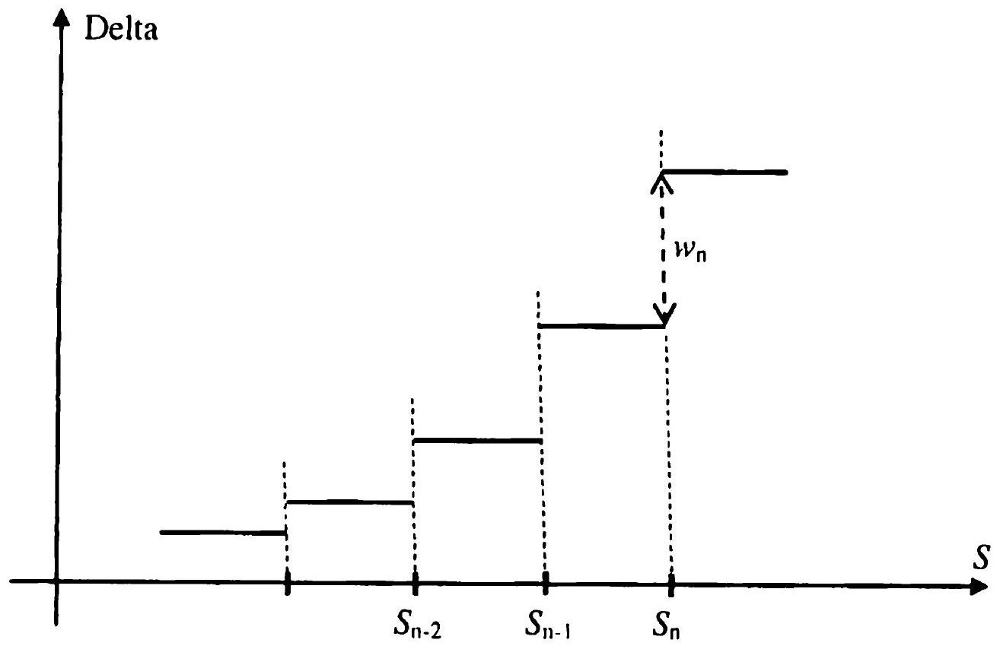
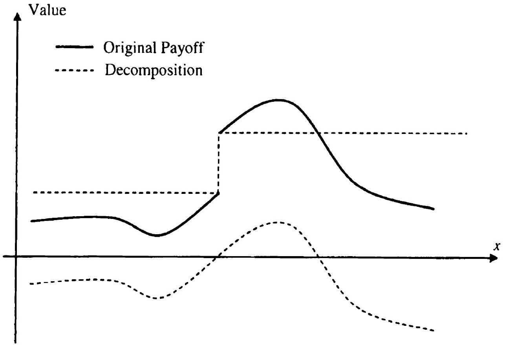
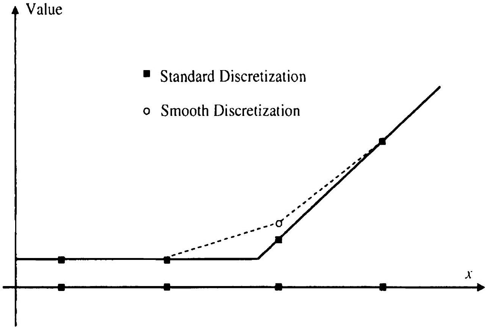

## Payoff Smoothing and Related Methods

As made clear in the previous chapter, practical risk management of a portfolio of interest rate securities revolves around price sensitivities with respect to various valuation inputs, such as market prices and model parameters. These sensitivities are often ${ }^{1}$ calculated by applying small perturbations to market and model parameters, followed by a re-pricing of the securities portfolio in question.

Being derivatives of a model price function, price sensitivities (grecks) are inherently less smooth than the price function itself. For instance, it is well-known (see Section 1.10.3) that while the value of a Bermudan security on an exercise date is continuous across the exercise boundary, its delta is not. This lack of smoothness will often put significant stress on a numerical scheme, which effectively is faced with the problem of resolving an irregular boundary condition. As a result, a careless implementation of a numerical sensitivity computation will often produce poor results, with the resulting greeks being less stable than what is expected theoretically. In this chapter we study this problem, with an emphasis on how to adapt numerical schemes to avoid introducing spurious instabilities into the calculation of greeks. Some of the discussion in this chapter builds on previous material, and we suggest that the reader briefly review Sections 2.5 and 3.3 before proceeding.

### 23.1 Issues with Discretization Schemes

As we saw in Section 3.3.1.2, fixing the random seed when computing deltas (and other greeks) by Monte Carlo methods significantly reduces the standard error. This is a simple example of the general rule that one should ideally attempt to freeze as many aspects of a numerical calculation (such as a Monte Carlo seed, the geometry of a PDE grid, etc.) as possible when doing perturbation analysis in a numerical scheme. In particular, adhering to this

[^75]simple rule often ensures that no additional discontinuities are introduced by the numerical method itself.

### 23.1.1 Problems with Grid Dimensioning

While straightforward in theory, consistently following the rule above can be quite difficult. Sometimes violations are subtle and unintentional, and sometimes they are unavoidable due to systems limitations or computational precision requirements. Let us look at the former case, using as our first example the problem of valuing a simple option by numerically integrating the payout against a Gaussian density. As is frequently done in practice, suppose that the numerical domain of integration is chosen to be $[-5 \sigma \sqrt{T}, 5 \sigma \sqrt{T}]$, where $T$ is the expiry of the option and $\sigma$ is the asset volatility (a model input). In addition, let the number of integration nodes, $N$, be chosen so that the integration grid is uniform with a pre-specified and fixed step $\delta$, i.e.

$$
\begin{equation*}
N=\left\lfloor\frac{10 \sigma \sqrt{T}}{\delta}\right\rfloor, \tag{23.1}
\end{equation*}
$$
^eq23-1

where $\lfloor\cdot\rfloor$ denotes the integer part of a real number. The resulting option valuation scheme appears reasonable, if slightly unconventional. However, imagine now that we wish to compute the option vega by comparing the base value of the option to a value computed after shocking the volatility to a new level of $\sigma+\Delta \sigma$. Since the integration domain depends on $\sigma$, it will be slightly larger in the perturbation scenario. Moreover, as the integration step is kept constant, the number of integration nodes may change between the base and the bumped scenarios. As the number of integration points can only move by an integer amount, the change in the grid geometry would not be continuous, introducing a purely artificial contribution of the order $O\left((\Delta \sigma)^{-1}\right)$. This contribution explodes to infinity as $\Delta \sigma \rightarrow 0$ (as long as the number of steps changes as a result of the volatility perturbation).

The issue that arises in the example above stems from the fact that the number of integration nodes $N$ as given by (23.1) is not a smooth function of $\sigma$, as the function $x \mapsto\lfloor x\rfloor$ is not differentiable (or even continuous). Since the numerical value of the security is a function of the number of integration nodes $N$, the value will not be smooth with respect to $\sigma$, and the vega, while continuous in the theoretical model, will be discontinuous in the numerical scheme. Of course, the problem is easy to rectify: heed our advice and avoid altering the geometry of the grid when perturbing market inputs.

### 23.1.2 Grid Shifts Relative to Payout

The example in Section 23.1.1 above is an example of grid geometry changing outright, due to changes in asset moments used for grid position and/or dimensioning. Another problematic case occurs when the grid is frozen in
space, but the nature of the perturbation itself will cause an effective shift of the grid relative to the payout. To give an example of this, consider a problem of valuing a European option with a payoff $f(x)$ on an underlying $S(T)$ observed at time $T$. Assuming zero interest rates, the value of this option is equal to the integral of the payoff against the PDF of the underlying. Let the initial (time 0 ) spot value of the underlying be denoted by $S$. Assuming for simplicity that the distribution of the increment $S(T)-S$ is independent of $S$, we denote the density of $S(T)-S$ by

$$
\mathrm{Q}((S(T)-S) \in d x)=\pi(x) d x
$$

The value of the option as a function of the spot $S$ today is then given by two equivalent expressions

$$
\begin{align*}
V(S) & =\int_{-\infty}^{\infty} f(x) \pi(x-S) d x  \tag{23.2}\\
& =\int_{-\infty}^{\infty} f(S+x) \pi(x) d x \tag{23.3}
\end{align*}
$$
^eq23-2
^eq23-3

While (23.2) and (23.3) are mathematically equivalent, (23.2) is better suited for numerical computations of sensitivities of $V$ with respect to $S$. In particular, notice that changes in $S$ here get absorbed into the density of $S$, which in a grid setting simply amounts to changing the weights on individual grid points in a numerical quadrature rule. On the other hand, the formulation (23.3) absorbs changes in $S$ into the payout, which effectively causes the grid to move relative to the payout function ${ }^{2}$.

To demonstrate the kind of problems that arise when the discretization grid is not fixed relative to the payoff, let us consider a simple example. We recall that a typical non-adaptive quadrature scheme (including rectangle, trapezoidal and Gaussian quadrature rules) specifies a collection of fixed knot points $\left\{x_{n}\right\}_{n=0}^{N}$ and weights $\left\{w_{n}\right\}_{n=0}^{N}$, and approximates $V(S) \approx \tilde{V}(S)$, where

$$
\tilde{V}(S)=\sum_{n=0}^{N} w_{n} f\left(x_{n}+S\right) .
$$

Note again that the weights and knots are fixed relative to the density of the process and not the payoff, i.e. contrary to our earlier advice. Let us analyze the behavior of the scheme under shifts of $S$. For concreteness, we consider a European call option, i.e.

$$
f(x)=(x-K)^{+}
$$

for a fixed choice of $K$. Then[^76]

$$
\tilde{V}(S)=\sum_{n=0}^{N} w_{n}\left(x_{n}+S-K\right)^{+} .
$$

The exact derivative of the numerical value $\widetilde{V}(S)$ with respect to the initial value of the asset, i.e. the delta, is given by

$$
\frac{d}{d S} \widetilde{V}(S)=\sum_{n=0}^{N} w_{n} 1_{\left\{x_{n}+S-K>0\right\}}
$$

As a function of $S$, this function has discontinuities of sizes $w_{n}$ at points $S=S_{n}$,

$$
S_{n} \triangleq K-x_{n}
$$

for all $n=0, \ldots, N$. Thus, as the spot $S$ moves, the delta will jump whenever the spot crosses one of the levels $S_{n}$. Moreover, in this scheme, the delta does not change as long as $S$ does not cross one of $S_{n}$, which is obviously unrealistic. A typical plot of such a "delta" is shown in Figure 23.1.

Fig. 23.1. Discontinuous Delta

Notes: Delta of a derivative evaluated with an integration scheme that is not fixed relative to the payoff.

The irregular deltas in Figure 23.1 are caused by the call option kink crossing over knot points in the grid as a result of parameter perturbation: similar behavior will occur for all payouts with payout discontinuities, kinks. and the like.

### 23.1.3 Additional Comments

Problems of the types described in Sections 23.1.1 and 23.1.2 are easy to introduce, but often difficult to track down. This is particularly true for complex models that often use sophisticated numerical methods with complicated dependencies on market and model data. When examining numerical routines for problems, we note that one must obviously include both valuation and calibration algorithms, as the computation of stable sensitivities requires that both types of algorithms behave smoothly with respect to moves in market parameters. Local, bootstrap-type calibrations (such as that developed in Section 13.1.7 for quasi-Gaussian models) generally outperform global, best-fit calibrations (such as that from Section 14.5.7 for LM models). We postpone our treatment of calibration effects to Chapter 26, and in this chapter focus on the (post-calibration) problem of building numerically smooth valuation routines.

Even if one is vigilant and tracks down all cases of non-constant (effective) grid geometry, there may, as mentioned earlier, exist violations that are impractical to resolve. For example, the Monte Carlo "grid" is difficult to keep constant by the nature of how it is generated. Also, by not explicitly tailoring a finite difference grid geometry to the market data used in a perturbed scenario, an unacceptable loss of precision may occur. Finally, we note that the organizational setup in many banks may make it hard for valuation code developers to fully control risk sensitivity computations. For all these reasons, it is worthwhile to develop methods that will produce stable sensitivities, even if the grid geometry cannot be guaranteed to stay fixed under market data moves.

As a final comment, let us briefly note that some numerical methods, in principle, give us greeks "for free" as part of valuation. For example, in a finite difference grid solution of a vanilla model PDE, the derivative with respect to the asset can be read off the PDE grid by forming a central finite difference of the solution (at time 0 ) at grid nodes surrounding today's value of the asset ${ }^{3}$. This avenue is not available for all greeks, however, and even for deltas and gammas the utility of the method is quite limited in term structure models, since we rarely are interested in theoretical derivatives with respect to the abstract model variables, but instead nearly always wish to compute sensitivities to specific perturbations of the yield curve. In addition, as described in Section 16.1.1, we may often be interested in working with joint moves of interest rates and volatilities that are user-prescribed and incompatible with the theoretical model dynamics. Even for PDE-based

[^77]models we therefore typically will need to calculate greeks by applying market data bumps ${ }^{4}$.

### 23.2 Basic Techniques

An obvious remedy to many of the issues identified in earlier sections is simply to increase the number of grid points. As a rule of thumb, the discretization step of a grid should be significantly smaller than a typical shift applied to inputs when calculating greeks. For instance, in Figure 23.1, if the perturbation size for delta calculation covered a few grid intervals, the delta would vary fairly smoothly with the value of the spot. Of course, the smaller the grid size, the more computationally intensive the numerical scheme will be, and we cannot always trade speed for accuracy with impunity, since greek calculations are often time-sensitive. The next few sections cover several more sophisticated, and less computationally costly, alternatives to brute-force grid refinement.

### 23.2.1 Adaptive Integration

Increasing the density of grid points uniformly is not the best way to spend a computational budget, as adding extra points away from a discontinuity of a payoff does little to improve the numerical properties of greeks. A reasonable yet relatively simple way of improving numerical stability of an algorithm at a modest computational cost is to first identify the region of the state space where the payoff is likely to have singularities ${ }^{5}$, and then sample this part of the space at a higher resolution than elsewhere. For instance, suppose we know that the function $f(x)$ that we are integrating has a singularity in a particular interval $\left[x_{m}, x_{m+1}\right]$ of the integration grid. Then we can further subdivide $\left[x_{m}, x_{m+1}\right]$ into 10 (or 100 ) subintervals and apply the trapezoidal rule for the finer grid. This will insure that the singularity is handled accurately, while no extra effort is wasted in the regions where $f$ is smooth.

For any particular payoff function, it is often relatively simple to identify the regions where a denser grid is beneficial - the type of knowledge that can be incorporated directly into the integration routine. For a more generic setup (or for payouts that are hard to analyze directly), a good

[^78]alternative is to rely on adaptive integration routines, often prepackaged in numerical libraries such as IMSL and NAG. In this class of routines, the integral is approximated using ordinary quadrature rules on adaptively refined subintervals of the integration domain until a stopping criterion is met. In effect, the grid points are chosen automatically based directly on properties of the function being integrated. Adaptive algorithms generally work quite well, but care must be taken to keep grid geometry fixed in perturbed scenarios, something that can occasionally be a bit of a challenge if a third-party library routine is used.

### 23.2.2 Adding Singularities to the Grid

In the situation where perturbations cause a grid shift relative to the payoff, if the position of a payoff singularity is known exactly, numerical properties of the valuation algorithm can be improved substantially by simply adding the singularity to the integration grid. This serves to effectively lock down the grid geometry in the immediate vicinity of the singularity. The method is closely related to the grid shifting method used to improve convergence of numerical solutions of PDEs, see Section 2.5.3.

Using the integration problem (23.3) as an example, let us consider a continuous payoff $f(y)$ whose derivative is discontinuous at a single point $y=K$ (multiple singularities can be handled similarly). Let us rewrite the value of the option as

$$
V(S)=\int_{-\infty}^{K-S} f(x+S) \pi(x) d x+\int_{K-S}^{\infty} f(x+S) \pi(x) d x
$$

Suppose we proceed to apply a simple numerical quadrature to each integral separately. We start with $N+1$ integration knots fixed in $x$-space, and add one more knot at the singularity, i.e. at $x=K-S$. To characterize the location of the additional knot, let the index $\mu(S)$ be defined by

$$
x_{\mu(S)} \leq K-S<x_{\mu(S)+1}
$$

Using a trapezoidal integration rule for simplicity, the resulting numerical scheme can formally be written as

$$
\begin{aligned}
& \widetilde{V}(S)=\widetilde{V}_{1}(S)+\widetilde{V}_{2}(S)+\widetilde{V}_{3}(S)+\widetilde{V}_{4}(S) \\
& \widetilde{V}_{1}(S)=\frac{1}{2} \sum_{n=1}^{\mu(S)}\left(f\left(x_{n}+S\right) \pi\left(x_{n}\right)+f\left(x_{n-1}+S\right) \pi\left(x_{n-1}\right)\right) \Delta x_{n} \\
& \widetilde{V}_{2}(S)=\frac{1}{2}\left(f(K) \pi(K-S)+f\left(x_{\mu(S)}+S\right) \pi\left(x_{\mu(S)}\right)\right)\left(K-S-x_{\mu(S)}\right)
\end{aligned}
$$

$$
\begin{aligned}
\widetilde{V}_{3}(S)= & \frac{1}{2}\left(f\left(x_{\mu(S)+1}+S\right) \pi\left(x_{\mu(S)+1}\right)+f(K) \pi(K-S)\right) \\
& \times\left(x_{\mu(S)+1}-(K-S)\right) \\
\widetilde{V}_{4}(S)= & \frac{1}{2} \sum_{n=\mu(S)+2}^{N}\left(f\left(x_{n}+S\right) \pi\left(x_{n}\right)+f\left(x_{n-1}+S\right) \pi\left(x_{n-1}\right)\right) \Delta x_{n}
\end{aligned}
$$

The terms $\widetilde{V}_{1}(S)$ and $\widetilde{V}_{4}(S)$ collect the contributions of integration intervals before and after the singularity, respectively, whereas the terms $\widetilde{V}_{2}(S)$ and $\tilde{V}_{3}(S)$ represent the contributions of the integration interval containing the singularity.

Let us fix $m$ such that $\mu(S)=m$ for the initial (pre-perturbed) value of $S$. Clearly there are no issues with the smoothness of $d \tilde{V}(S) / d S$ as we move $S$ in such a way that $K-S \in\left[x_{m}, x_{m+1}\right)$, so the only potential discontinuity could arise when $K-S$ crosses one of the integration nodes, i.e. when $\mu(S)$ jumps. To show that the scheme implies smooth behavior across grid points, let us investigate what happens when $S$ crosses $S_{m} \triangleq K-x_{m}$. For this analysis, we only need to keep track of the terms $\widetilde{U}(S)$ that originate from the intervals adjacent to $x_{m}$. For $x_{m+1}>K-S \geq x_{m}$ we have

$$
\begin{aligned}
\widetilde{U}(S) & =\frac{1}{2}\left(f\left(x_{m}+S\right) \pi\left(x_{m}\right)+f\left(x_{m-1}+S\right) \pi\left(x_{m-1}\right)\right) \Delta x_{m} \\
& +\frac{1}{2}\left(f(K) \pi(K-S)+f\left(x_{m}+S\right) \pi\left(x_{m}\right)\right)\left(K-S-x_{m}\right) \\
& +\frac{1}{2}\left(f\left(x_{m+1}+S\right) \pi\left(x_{m+1}\right)+f(K) \pi(K-S)\right)\left(x_{m+1}-(K-S)\right)
\end{aligned}
$$

and for shifted $S$ such that $x_{m-1} \leq K-S<x_{m}$, i.e. for $\mu(S)=m-1$,

$$
\begin{aligned}
\widetilde{U}(S) & =\frac{1}{2}\left(f(K) \pi(K-S)+f\left(x_{m-1}+S\right) \pi\left(x_{m-1}\right)\right)\left(K-S-x_{m-1}\right) \\
& +\frac{1}{2}\left(f\left(x_{m}+S\right) \pi\left(x_{m}\right)+f(K) \pi(K-S)\right)\left(x_{m}-(K-S)\right) \\
& +\frac{1}{2}\left(f\left(x_{m+1}+S\right) \pi\left(x_{m+1}\right)+f\left(x_{m}+S\right) \pi\left(x_{m}\right)\right) \Delta x_{m+1}
\end{aligned}
$$

Note that $\widetilde{U}(S)$ is continuous at $S=S_{m}$ and

$$
\begin{aligned}
& \tilde{U}\left(S_{m}\right)=\frac{1}{2}\left(f(K) \pi\left(x_{m}\right)+f\left(K-\Delta x_{m}\right) \pi\left(x_{m-1}\right)\right) \Delta x_{m} \\
& \quad+\frac{1}{2}\left(f\left(K+\Delta x_{m+1}\right) \pi\left(x_{m+1}\right)+f(K) \pi\left(x_{m}\right)\right) \Delta x_{m+1}
\end{aligned}
$$

In fact, the derivative of $\widetilde{U}(S)$ is also continuous across the grid point, as we prove in Appendix 23.A.

As a final observation, we note that to add the singularity to the grid, the location of the singularity obviously needs to be detected first. In many
alternative is to rely on adaptive integration routines, often prepackaged in numerical libraries such as MSL and NAG. In this class of routines, the integral is approximated using ordinary quadrature rules on adaptively refined subintervals of the integration domain until a stopping criterion is met. In effect, the grid points are chosen automatically based directly on properties of the function being integrated. Adaptive algorithms generally work quite well, but care must be taken to keep grid geometry fixed in perturbed scenarios, something that can occasionally be a bit of a challenge if a third-party library routine is used.

### 23.2.2 Adding Singularities to the Grid

In the situation where perturbations cause a grid shift relative to the payoff, if the position of a payoff singularity is known exactly, numerical properties of the valuation algorithm can be improved substantially by simply adding the singularity to the integration grid. This serves to effectively lock down the grid geometry in the immediate vicinity of the singularity. The method is closely related to the grid shifting method used to improve convergence of numerical solutions of PDEs, see Section 2.5.3.

Using the integration problem (23.3) as an example, let us consider a continuous payoff $f(y)$ whose derivative is discontinuous at a single point $y=K$ (multiple singularities can be handled similarly). Let us rewrite the value of the option as

$$
V(S)=\int_{-\infty}^{K-S} f(x+S) \pi(x) d x+\int_{K-S}^{\infty} f(x+S) \pi(x) d x
$$

Suppose we proceed to apply a simple numerical quadrature to each integral separately. We start with $N+1$ integration knots fixed in $x$-space, and add one more knot at the singularity, i.e. at $x=K-S$. To characterize the location of the additional knot, let the index $\mu(S)$ be defined by

$$
x_{\mu(S)} \leq K-S<x_{\mu(S)+1}
$$

Using a trapezoidal integration rule for simplicity, the resulting numerical scheme can formally be written as

$$
\begin{aligned}
& \tilde{V}(S)=\tilde{V}_{1}(S)+\tilde{V}_{2}(S)+\tilde{V}_{3}(S)+\tilde{V}_{4}(S) \\
& \tilde{V}_{1}(S)=\frac{1}{2} \sum_{n=1}^{\mu(S)}\left(f\left(x_{n}+S\right) \pi\left(x_{n}\right)+f\left(x_{n-1}+S\right) \pi\left(x_{n-1}\right)\right) \Delta x_{n} \\
& \tilde{V}_{2}(S)=\frac{1}{2}\left(f(K) \pi(K-S)+f\left(x_{\mu(S)}+S\right) \pi\left(x_{\mu(S)}\right)\right)\left(K-S-x_{\mu(S)}\right),
\end{aligned}
$$

$$
\begin{aligned}
\widetilde{V}_{3}(S)= & \frac{1}{2}\left(f\left(x_{\mu(S)+1}+S\right) \pi\left(x_{\mu(S)+1}\right)+f(K) \pi(K-S)\right) \\
& \times\left(x_{\mu(S)+1}-(K-S)\right) \\
\widetilde{V}_{4}(S)= & \frac{1}{2} \sum_{n=\mu(S)+2}^{N}\left(f\left(x_{n}+S\right) \pi\left(x_{n}\right)+f\left(x_{n-1}+S\right) \pi\left(x_{n-1}\right)\right) \Delta x_{n} .
\end{aligned}
$$

The terms $\widetilde{V}_{1}(S)$ and $\widetilde{V}_{4}(S)$ collect the contributions of integration intervals before and after the singularity, respectively, whereas the terms $\widetilde{V}_{2}(S)$ and $\widetilde{V}_{3}(S)$ represent the contributions of the integration interval containing the singularity.

Let us fix $m$ such that $\mu(S)=m$ for the initial (pre-perturbed) value of $S$. Clearly there are no issues with the smoothness of $d \widetilde{V}(S) / d S$ as we move $S$ in such a way that $K-S \in\left[x_{m}, x_{m+1}\right)$, so the only potential discontinuity could arise when $K-S$ crosses one of the integration nodes, i.e. when $\mu(S)$ jumps. To show that the scheme implies smooth behavior across grid points, let us investigate what happens when $S$ crosses $S_{m} \triangleq K-x_{m}$. For this analysis, we only need to keep track of the terms $\tilde{U}(S)$ that originate from the intervals adjacent to $x_{m}$. For $x_{m+1}>K-S \geq x_{m}$ we have

$$
\begin{aligned}
\tilde{U}(S) & =\frac{1}{2}\left(f\left(x_{m}+S\right) \pi\left(x_{m}\right)+f\left(x_{m-1}+S\right) \pi\left(x_{m-1}\right)\right) \Delta x_{m} \\
& +\frac{1}{2}\left(f(K) \pi(K-S)+f\left(x_{m}+S\right) \pi\left(x_{m}\right)\right)\left(K-S-x_{m}\right) \\
& +\frac{1}{2}\left(f\left(x_{m+1}+S\right) \pi\left(x_{m+1}\right)+f(K) \pi(K-S)\right)\left(x_{m+1}-(K-S)\right),
\end{aligned}
$$

and for shifted $S$ such that $x_{m-1} \leq K-S<x_{m}$, i.e. for $\mu(S)=m-1$,

$$
\begin{aligned}
\widetilde{U}(S) & =\frac{1}{2}\left(f(K) \pi(K-S)+f\left(x_{m-1}+S\right) \pi\left(x_{m-1}\right)\right)\left(K-S-x_{m-1}\right) \\
& +\frac{1}{2}\left(f\left(x_{m}+S\right) \pi\left(x_{m}\right)+f(K) \pi(K-S)\right)\left(x_{m}-(K-S)\right) \\
& +\frac{1}{2}\left(f\left(x_{m+1}+S\right) \pi\left(x_{m+1}\right)+f\left(x_{m}+S\right) \pi\left(x_{m}\right)\right) \Delta x_{m+1}
\end{aligned}
$$

Note that $\widetilde{U}(S)$ is continuous at $S=S_{m}$ and

$$
\begin{aligned}
& \begin{aligned}
\widetilde{U}\left(S_{m}\right)= & \frac{1}{2}\left(f(K) \pi\left(x_{m}\right)+f\left(K-\Delta x_{m}\right) \pi\left(x_{m-1}\right)\right) \Delta x_{m} \\
& +\frac{1}{2}\left(f\left(K+\Delta x_{m+1}\right) \pi\left(x_{m+1}\right)+f(K) \pi\left(x_{m}\right)\right) \Delta x_{m+1}
\end{aligned}
\end{aligned}
$$

In fact, the derivative of $\widetilde{U}(S)$ is also continuous across the grid point, as we prove in Appendix 23.A.

As a final observation, we note that to add the singularity to the grid, the location of the singularity obviously needs to be detected first. In many
cases, this must be done numerically using, for example, the method of Section 23.3.2.1. The numerical improvements to the greeks, however, are usually well worth the extra cost.

### 23.2.3 Singularity Removal

Most of the noise in greeks comes from the fact that numerical schemes have difficulty handling payoff singularities. It follows that removing these singularities should restore smoothness. The method based on this idea is quite powerful when it works, but is somewhat limited in its scope.

Fig. 23.2 Singularity Removal

Notes: A discontinuous payoff could be decomposed into a continuous one and a step function.

Suppose that, as in Figure 23.2, an otherwise-smooth payoff $f(x)$ has a jump discontinuity at one point $x=K$, with the size of the jump equal to $a$. The payoff can evidently then be decomposed into the sum of two functions, one being a simple step function $a 1_{\{x>K\}}$, and the other equal to $g(x)=f(x)-a 1_{\{x>K\}}$. Notice that the function $g(x)$ is smooth, unlike $f(x)$ itself. The integration problem

$$
V(S)=\int_{-\infty}^{\infty} f(S+x) \pi(x) d x
$$

may now be split in two,

$$
V(S)=a \int_{-\infty}^{\infty} 1_{\{x>K\}} \pi(x-S) d x+\int_{-\infty}^{\infty} g(x) \pi(x-S) d x
$$

Let $\Psi(x)$ be the cumulative distribution function corresponding to the density $\pi(x)$, then

$$
V(S)=a(1-\Psi(K-S))+\int_{-\infty}^{\infty} g(x) \pi(x-S) d x
$$

Suppose the CDF $\Psi(x)$ can be computed analytically, or numerically with high precision (and, say, tabulated). As the only function being integrated numerically, $g$, is smooth by construction, this scheme produces smooth greeks.

Shifted and scaled step functions $a 1_{\{x>K\}}$, and combinations thereof, can be used to remove outright discontinuities in the payoff $f$. To remove discontinuities in the derivative of $f$, linear combinations of functions $(a x+b)^{+}$ for various $a, b$ (i.e., call/put type payoffs) can be used instead. It should be clear, however, that the applicability of the singularity removal method will be limited by the availability of accurate (ideally analytic) methods to compute CDF and call/put option values.

### 23.2.4 Partial Analytical Integration

For the cases where the CDF or call/put option values are not known analytically, suitable approximations could still be used for smoothing the payoff. In the common case where the density $\pi(x)$ corresponds to a diffusive random variable $S(T)$, one approach is to focus on short times to maturity, where the conditional transition density

$$
\pi(x, T ; y, T-\delta) d x \triangleq \mathrm{Q}(S(T) \in d x \mid S(T-\delta)=y)
$$

can often be approximated by, say, a Gaussian or log-normal distribution for small $\delta>0$. Then the value of a derivative with the payoff $f(x)$ is given by

$$
\begin{equation*}
\mathrm{E}\left(f(S(T))=\mathrm{E}\left(\mathrm{E}_{T-\delta}(f(S(T)))\right)=\int_{-\infty}^{\infty} \pi(x, T-\delta ; S, 0) V(x, T-\delta) d x\right. \tag{23.4}
\end{equation*}
$$
^eq23-4

where $V(x, T-\delta)$ is the value of the derivative at time $T-\delta$,

$$
V(x, T-\delta)=\int_{-\infty}^{\infty} \pi(y, T ; x, T-\delta) f(y) d y
$$

With the approximation to $\pi(y, T ; x, T-\delta)$ by a Gaussian or log-normal density, this integral can often be calculated analytically. This is certainly true for puts/calls and digitals. More complex payoffs can, for each value of $x$, often be approximated as combinations of simple payoffs in the vicinity
of $x$, as the width of distribution of $S(T)$ given $S(T-\delta)$ is small for small $\delta$. Moreover, $V(x, T-\delta)$ is often a (much) smoother function of $x$ than $f(x)$; for example the Black-Scholes value of a call option is infinitely differentiable, unlike the payoff itself. Hence, a numerical integration scheme applied to (23.4) should result in smoother and more stable greeks.

The method above (as well as several others reviewed in Section 23.2) is not limited to numerical integration, but can equally well be applied for PDE and Monte Carlo valuation; in fact we already saw a PDE application in Section 2.8. For example, a non-trivial application to TARNs in Monte Carlo is presented in Pietersz and van Regenmortel [2006]. To briefly review this method, let us recall the setup of Section 20.1 and note that

$$
V_{\mathrm{tarn}}(0)=\sum_{n=1}^{N-1} V_{\mathrm{cpn}, n}(0),
$$

where $V_{\text {cpn, } n}(0)$ is the value of the $n$-th (net) coupon conditional on no early redemption,

$$
V_{\mathrm{cpn}, n}(0)=\mathrm{E}\left(B\left(T_{n+1}\right)^{-1} X_{n} 1_{\left\{Q_{n}<R\right\}}\right) .
$$

Here $Q_{n}$ is the sum of all structured coupons paid on or before $T_{n}$, i.e.

$$
Q_{n}=Q_{n-1}+\tau_{n-1} C_{n-1}
$$

Observing that $Q_{n-1}$ is $\mathcal{F}_{T_{n-2}}$-measurable allows us to write

$$
\begin{equation*}
V_{\mathrm{cpn}, n}(0)=\mathrm{E}\left(B\left(T_{n-2}\right)^{-1} V_{\mathrm{cpn}, n}\left(T_{n-2}\right)\right), \tag{23.5}
\end{equation*}
$$
^eq23-5

where

$$
V_{\mathrm{cpn}, n}\left(T_{n-2}\right)=P\left(T_{n-2}, T_{n+1}\right) \mathrm{E}_{T_{n-2}}^{T_{n+1}}\left(X_{n} 1_{\left\{C_{n-1}<\left(R-Q_{n-1}\right) / \tau_{n-1}\right\}}\right) .
$$

For Libor-based TARNs, $X_{n}$ is a function of $L_{n}\left(T_{n}\right)$ and $C_{n-1}$ is a function of $L_{n-1}\left(T_{n-1}\right)$, so the calculation of $V_{\mathrm{cpn}, n}\left(T_{n-2}\right)$ involves an integral of a discontinuous function over a joint distribution of $\left(L_{n-1}\left(T_{n-1}\right), L_{n}\left(T_{n}\right)\right)$, conditioned on $\mathcal{F}_{T_{\|-2}}$. As coupon periods are rarely longer than a year, a Gaussian (or log-normal) approximation to this distribution is often accurate enough. Drifts and (co-)variances of Libor rates ( $L_{n-1}\left(T_{n-1}\right), L_{n}\left(T_{n}\right)$ ) can typically be estimated with relative ease from the term structure model used for valuation (see Section 20.1.3 for a relevant discussion), at which point $V_{\mathrm{cpn}, n}\left(T_{n-2}\right)$ would be calculated by an exact or approximate quadrature, perhaps aided by the various methods from Section 17.6. Calculating $V_{\mathrm{cpn}, n}\left(T_{n-2}\right)$ by integration removes the digital discontinuity in the coupon, helping to stabilize Monte Carlo based sensitivity computations for $V_{\text {cpn }, n}(0)$ in (23.5).

### 23.3 Payoff Smoothing For Numerical Integration and PDEs

Upon reflection, it is clear that singularity-removal technique outlined in Section 23.2.4 works by smoothing out an irregular boundary condition by integrating it against a density kernel. A closely related idea involves a direct modification of the payoff, to pre-smooth it before numerical integration or PDE schemes (or even Monte Carlo, as covered in the next section) are applied. We discuss several such payoff smoothing techniques in this section. Let us quickly remind the reader that payoff smoothing has two different, but related benefits. First, payoff smoothing will improve convergence of greeks calculated by PDE or Monte Carlo methods as the number of PDE steps or Monte Carlo paths is increased: the smoother the payoff, the faster the convergence. We have covered this angle in Sections 2.5 and 3.3. Second, payoff smoothing will help alleviate the problems arising if we, for the various reasons mentioned in Section 23.1, are unable to keep discretization grids constant.

### 23.3.1 Introduction to Payoff Smoothing

In a nutshell, the method of payoff smoothing replaces one payoff with a smoother one, to which standard numerical integration or PDE methods are then applied. Payoff smoothing serves to remove points of discontinuity in the payoff and its derivatives which, as we have seen earlier, will help improve the stability and smoothness of greeks.

A simple example of payoff smoothing replaces $f(x)$ with its moving average,

$$
\begin{equation*}
f_{\mathrm{smooth}}(x)=\frac{1}{\epsilon} \int_{x-\epsilon / 2}^{x+\epsilon / 2} f(y) d y \tag{23.6}
\end{equation*}
$$
^eq23-6

for some small $\epsilon>0$, the choice of which will be discussed later. Payoff smoothing based on (23.6) was already applied in Section 2.5.2 as the continuity correction method for improving convergence of numerical solutions of PDEs. An example of moving average payoff smoothing is presented in Figure 23.3.

Continuing with the sample setup and the notations of Section 23.1, we recall that the standard numerical quadrature with knots $\left\{x_{n}\right\}$ and weights $\left\{w_{n}\right\}$ specifies that

$$
\begin{equation*}
\tilde{V}(S)=\sum_{n=0}^{N} w_{n} f\left(x_{n}+S\right) . \tag{23.7}
\end{equation*}
$$
^eq23-7

The payoff smoothing method replaces this with

$$
\begin{equation*}
\tilde{V}(S)=\sum_{n=0}^{N} w_{n} f_{\text {smooth }}\left(x_{n}+S\right) . \tag{23.8}
\end{equation*}
$$
^eq23-8

Fig. 23.3. Payoff Smoothing

Notes: Smoothing a discretized payoff using moving average (23.6).

Because $f_{\text {smooth }}(x)$ has a higher degree of smoothness than $f(x)$, the numerically computed greeks of $\widetilde{V}(S)$ behave more smoothly with respect to market inputs.

The function $f_{\text {smooth }}(x)$ usually cannot be computed exactly. However, for small $\epsilon$, various approximations can be made. Here, again, the knowledge of singularities of $f(x)$ is important. If $f(x)$ is known to have no singularities on $[x-\epsilon / 2, x+\epsilon / 2]$, a simple linear approximation to $f(x)$ on this interval will suffice as the corresponding term in (23.7) will be sufficiently smooth:

$$
f(y) \approx f(x-\epsilon / 2)+(f(x+\epsilon / 2)-f(x-\epsilon / 2)) \frac{y-x+\epsilon / 2}{\epsilon}
$$

for $y \in[x-\epsilon / 2, x+\epsilon / 2]$, so that

$$
\begin{equation*}
f_{\mathrm{smooth}}(x)=\frac{1}{\epsilon} \int_{x-\epsilon / 2}^{x+\epsilon / 2} f(y) d y \approx f(x) \tag{23.9}
\end{equation*}
$$
^eq23-9

If, however, it is known that there is a singularity $x^{*}$ in $[x-\epsilon / 2, x+\epsilon / 2]$, then the integral should be handled more carefully by, for example, using separate linear approximations to $f$ in two subintervals, $\left[x-\epsilon / 2, x^{*}\right)$ and $\left(x^{*}, x+\epsilon / 2\right]$ :

$$
f(y) \approx\left\{\begin{array}{l}
f(x-\epsilon / 2)+\left(f\left(x^{*}-\right)-f(x-\epsilon / 2)\right) \frac{y-x+\epsilon / 2}{x^{*}-x+\epsilon / 2}, y \in\left[x-\epsilon / 2, x^{*}\right) \\
f\left(x^{*}+\right)+\left(f(x+\epsilon / 2)-f\left(x^{*}+\right)\right) \frac{y-x^{*}}{x+\epsilon / 2-x^{*}}, \quad y \in\left(x^{*}, x+\epsilon / 2\right]
\end{array}\right.
$$

so that

$$
\begin{align*}
f_{\mathrm{smooth}}(x)=\frac{1}{\epsilon} \int_{x-\epsilon / 2}^{x+\epsilon / 2} f(y) d y & \approx \frac{x^{*}-x+\epsilon / 2}{\epsilon} f\left(\frac{x-\epsilon / 2+x^{*}}{2}\right) \\
& +\frac{x+\epsilon / 2-x^{*}}{\epsilon} f\left(\frac{x+\epsilon / 2+x^{*}}{2}\right) \tag{23.10}
\end{align*}
$$
^eq23-10

The method is not dissimilar to the singularity-extended grid method, at least in one dimension, but could be more practical to apply in a PDE schemes, say, if multiple singularities at different locations are introduced at different times.

The performance of moving average smoothing will depend on the choice of $\epsilon$. Higher values of $\epsilon$ lead to smoother schemes but makes it more difficult to approximate the required integral, since linear approximations may no longer be accurate enough. More importantly, the introduction of smoothing adds bias to the valuation, as the payoff being integrated becomes increasingly different from the actual one when $\epsilon$ is increased. In many cases the choice of $\epsilon$ is done semi-empirically, with numerical experiments to determines the highest value of the smoothing window that keeps the bias within acceptable limits. In some cases, the discretization of the grid itself drives the size of $\epsilon$, a case that we consider next.

### 23.3.2 Payoff Smoothing in One Dimension

To develop the method above in more detail, and to link it more directly to grid-based methods, let us introduce a discrete set of $x$-values, $\left\{x_{n}\right\}_{n=0}^{N}$. It is helpful to think of (23.7) as a special case of a more general setup where we define the discretized value $f_{n}$ as the weighted average of $f(x)$ in a neighborhood of $x_{n}$,

$$
\begin{equation*}
f_{n}=\int_{-\infty}^{\infty} \kappa_{n}(x) f(x) d x, \quad n=0, \ldots, N \tag{23.11}
\end{equation*}
$$
^eq23-11

with $\left\{\kappa_{n}(x)\right\}_{n=0}^{N}$ a collection of averaging weights (e.g. we use $\kappa_{n}(x)= \epsilon^{-1} 1_{\left\{x \in\left[x_{n}-\epsilon / 2, x_{n}+\epsilon / 2\right\}\right\}}$ in the previous section), such that

$$
\int_{-\infty}^{\infty} \kappa_{n}(x) d x=1, \quad \kappa_{n}(x) \geq 0, \quad n=0, \ldots, N .
$$

Often the weights are taken to be shifted and scaled versions of a common weight function, in the sense that

$$
\kappa_{n}(x)=\frac{1}{\epsilon_{n}} \kappa\left(\frac{x-x_{n}}{\epsilon_{n}}\right),
$$

where

$$
\int_{-\infty}^{\infty} \kappa(x) d x=1, \quad \kappa(x) \geq 0
$$

The weights are shifted to center them around the grid points $\left\{x_{n}\right\}_{n=0}^{N}$, and scaling parameters $\epsilon_{n}$ control the dispersion of the weight around $x_{n}$. As the scaling parameters tend to zero, the averages of $f$ tend to the values of $f$ on the grid $\left\{x_{n}\right\}$.

### 23.3.2.1 Box Smoothing

A particularly simple averaging weight is the indicator function on the interval between middle-points of the grid buckets to the either side of $x_{n}$,

$$
\begin{align*}
\kappa_{n}(x) & =\left(c_{n+1}-c_{n}\right)^{-1} 1_{\left\{x \in\left[c_{n}, c_{n+1}\right]\right\}}  \tag{23.12}\\
c_{n} & =\left(x_{n}+x_{n-1}\right) / 2, \quad n=1, \ldots, N-1
\end{align*}
$$
^eq23-12

Because of the shape of the weight function, the method is sometimes called the box smoothing method. The resulting discretization formula is given by

$$
\begin{equation*}
f_{n}=\frac{1}{c_{n+1}-c_{n}} \int_{c_{n}}^{c_{n+1}} f(x) d x, \quad c_{n}=\left(x_{n}+x_{n-1}\right) / 2, \quad n=1, \ldots, N-1 \tag{23.13}
\end{equation*}
$$
^eq23-13

If the function $f(x)$ is known for all $x$, as is the case for numerical integration, the box smoothing method is easy to apply, using the arguments that lead to (23.9) and (23.10). A more challenging situation arises when only a discretized version of the payoff is known, as may happen when $f$ represents a PDE solution rolled back to some intermediate date. While backward induction in a PDE is, in itself, a smoothing operation, singularities may be introduced through the enforcement of jump conditions, as required if the security in question happens to pay a coupon, is exercisable, or has a barrier condition of some kind. Sometimes (e.g., for barrier options) the location of the singularity is known exactly, but often (e.g., for Bermudan style options) it is not. This complicates the application of (23.13), since knowledge of the location of singularities is critical to our ability to compute smooth greeks. We proceed to discuss a scheme to handle the case when the singularity location is not known.

To properly fix our setup, consider a security with terminal payout date $T^{*}$ whose value is being computed by solving the corresponding PDE numerically, backwards from $T^{*}$ to time 0 . Let $V(t, x)$ represent the true value of the security at time $t$ at state $x$. As always, let $V(t-, x)$ and $V(t+, x)$ be the value of the security just before and just after time $t$, respectively. Assuming that a lifecycle event takes place at some intermediate time $T$ (such as an exercise opportunity, a knock-in/knock-out barrier check, a fixing of a structured coupon, and so on), a jump condition will be applied when crossing from $T+$ to $T-$ in the backward recursion scheme, see Section 2.7. Specifically, if $\left\{V_{n}^{+}\right\}_{n=0}^{N}$ represents the numerical approximation
to $V(T+, x)$ on the grid $\left\{x_{n}\right\}_{n=0}^{N}$, the jump condition determines how to compute $\left\{V_{n}^{-}\right\}_{n=0}^{N}$, the grid approximation to $V(T-, x)$. Here we make an important observation: most jump conditions can be represented in the following form,

$$
\begin{equation*}
V(T-, x)=1_{\{g(x) \leq h(x)\}} p(x)+1_{\{g(x)>h(x)\}} q(x), \tag{23.14}
\end{equation*}
$$
^eq23-14

where the discretized versions of the smooth functions $g(x), h(x), p(x)$ and $q(x)$ are known at $t=T+.{ }^{6}$ Some of these functions could be based on $V(T+, x)$, and others are defined by the specifics of the event. Let us give a few examples.

Example 23.3.1. If the security can be canceled at time $T$, then

$$
V(T-, x)=1_{\{V(T+. x)>0\}} V(T+, x)
$$

i.e. $g(x)=V(T+, x), h(x)=0, p(x)=0, q(x)=V(T+, x)$.
Example 23.3.2. If the security is callable at time $T$ with the exercise value $e(x)$, then

$$
V(T-, x)=1_{\{V(T+, x) \leq e(x)\}} e(x)+1_{\{V(T+, x)>e(. x)\}} V(T+, x),
$$

i.e. $g(x)=V(T+, x), h(x)=e(x), p(x)=e(x), q(x)=V(T+, x)$.
Example 23.3.3. Suppose the security knocks out at time $T$ if the rate $r(x)$ is above the barrier $b$, and the knockout rebate is $a(x)$. Then

$$
V(T-, x)=1_{\{r(x) \leq b\}} V(T+, x)+1_{\{r(x)>b\}} a(x),
$$

i.e. $g(x)=r(x), h(x)=b, p(x)=V(T+, x), q(x)=a(x)$.
Example 23.3.4. If a coupon of the form $\max (r(x), s)$ is paid at time $T$, then

$$
V(T-. x)=1_{\{r(x) \leq s\}}(V(T+, x)+s)+1_{\{r(x)>s\}}(V(T+, x)+r(x))
$$

i.e. $g(x)=r(x), h(x)=s, p(x)=V(T+, x)+s, q(x)=V(T+, x)+r(x)$.
Going forward we assume that the event in question can indeed be represented in the form (23.14); let us denote the discretized versions of the smooth functions involved by $\left\{g_{n}\right\},\left\{h_{n}\right\},\left\{p_{n}\right\}$ and $\left\{q_{n}\right\}$.

Turning to the question of localizing singularities in $V(T-, x)$, we notice that the representation of the function in the form (23.14) simplifies our search, as all singularities are given by the solutions to the equation[^79]

$$
g(x)-h(x)=0 .
$$

Assume for simplicity that this equation has only one root ${ }^{7}$, and denote it by $x^{*}$. The problem of finding $x^{*}$ is complicated somewhat by the fact that the values of functions $g(x), h(x)$ are only known at the grid points $\left\{x_{n}\right\}$. However, since $g(x)$ and $h(x)$ are smooth, linear interpolation on each of the intervals $\left[x_{n-1}, x_{n}\right], n=1, \ldots, N$, can be used instead. Specifically, we define

$$
\begin{array}{ll}
\widehat{h}(x)=h_{n} \frac{x-x_{n-1}}{x_{n}-x_{n-1}}+h_{n-1} \frac{x_{n}-x}{x_{n}-x_{n-1}}, & x \in\left[x_{n-1}, x_{n}\right], \\
\widehat{g}(x)=g_{n} \frac{x-x_{n-1}}{x_{n}-x_{n-1}}+g_{n-1} \frac{x_{n}-x}{x_{n}-x_{n-1}}, & x \in\left[x_{n-1}, x_{n}\right],
\end{array}
$$

and use the solution $\widehat{x}^{*}$ to $\widehat{g}(x)-\widehat{h}(x)=0$ as an approximation to $x^{*}$. To locate $x^{*}$, first note that an interval $\left[x_{n-1}, x_{n}\right]$ contains $x^{*}$ (and $\widehat{x}^{*}$ ) provided that

$$
\left(g_{n-1}-h_{n-1}\right)\left(g_{n}-h_{n}\right) \leq 0 .
$$

If this inequality is satisfied, we pinpoint $\widehat{x}^{*}$ by solving a linear equation $\widehat{g}(x)-\widehat{h}(x)=0$ on the interval $\left[x_{n-1}, x_{n}\right]$, so that $\widehat{x}^{*}$ is a solution to

$$
h_{n} \frac{x-x_{n-1}}{x_{n}-x_{n-1}}+h_{n-1} \frac{x_{n}-x}{x_{n}-x_{n-1}}=g_{n} \frac{x-x_{n-1}}{x_{n}-x_{n-1}}+g_{n-1} \frac{x_{n}-x}{x_{n}-x_{n-1}} .
$$

After some trivial algebraic manipulations,

$$
\widehat{x}^{*}=\frac{h_{n}-g_{n}}{\left(h_{n}-g_{n}\right)+\left(g_{n-1}-h_{n-1}\right)} x_{n-1}+\frac{g_{n-1}-h_{n-1}}{\left(h_{n}-g_{n}\right)+\left(g_{n-1}-h_{n-1}\right)} x_{n} .
$$

Having established (an approximation of) the singularity in $V(T-, x)$, we can proceed to approximate the integrals

$$
\frac{1}{c_{n+1}-c_{n}} \int_{c_{n}}^{c_{n+1}} V(T-, x) d x
$$

for all $n$. There are two cases to consider. When the root is not inside $\left[c_{n}, c_{n+1}\right]$, i.e. $\widehat{x}^{*} \notin\left[c_{n}, c_{n+1}\right]$, (23.9) tells us that we can simply use the value of $V(T-, x)$ at $x_{n}$ as an approximation to the integral. In other words, for such $n$ we set

$$
V_{n}^{-}=1_{\left\{g_{n} \leq h_{n}\right\}} p_{n}+1_{\left\{g_{n}>h_{n}\right\}} q_{n} .
$$

For the case when $\widehat{x}^{*} \in\left[c_{n}, c_{n+1}\right]$, we split the integration domain into two, [ $c_{n}, \widehat{x}^{*}$ ) and ( $\widehat{x}^{*}, c_{n+1}$ ]. By assumption, the function $V(T-, x)$ is smooth on each of the two intervals, so according to (23.10) we can approximate each

[^80]of the two integrals by the value of the function $V(T-, x)$ in the center of each of the two subintervals,

$$
\begin{equation*}
V_{n}^{-}=\frac{\widehat{x}^{*}-c_{n}}{c_{n+1}-c_{n}} V\left(T-, \frac{\widehat{x}^{*}+c_{n}}{2}\right)+\frac{c_{n+1}-\widehat{x}^{*}}{c_{n+1}-c_{n}} V\left(T-, \frac{\widehat{x}^{*}+c_{n+1}}{2}\right) \tag{23.15}
\end{equation*}
$$
^eq23-15

As should be clear from (23.14), on the interval $\left[c_{n}, \widehat{x}^{*}\right)$ the function $V(T-, x)$ is equal to one of the functions $p(x)$ or $q(x)$, and on the interval $\left(\widehat{x}^{*}, c_{n+1}\right]$ it is equal to the other. More precisely,

$$
\begin{align*}
& V(T-, x)=p(x) \quad \text { for } x \in\left[c_{n}, \widehat{x}^{*}\right)  \tag{23.16}\\
& V(T-, x)=q(x) \quad \text { for } x \in\left(\widehat{x}^{*}, c_{n+1}\right]
\end{align*}
$$
^eq23-16

if and only if $g_{n-1}<h_{n-1}$. Assume for concreteness that (23.16) in fact holds. Then (23.15) can be rewritten as

$$
V_{n}^{-}=\frac{\widehat{x}^{*}-c_{n}}{c_{n+1}-c_{n}} p\left(\frac{\widehat{x}^{*}+c_{n}}{2}\right)+\frac{c_{n+1}-\widehat{x}^{*}}{c_{n+1}-c_{n}} q\left(\frac{\widehat{x}^{*}+c_{n+1}}{2}\right)
$$

To find $p\left(\left(\widehat{x}^{*}+c_{n}\right) / 2\right), q\left(\left(\widehat{x}^{*}+c_{n+1}\right) / 2\right)$, we (once again) use the fact that the functions $p(x)$ and $q(x)$ are smooth, and approximate them linearly. Then, $p\left(\left(\widehat{x}^{*}+c_{n}\right) / 2\right), q\left(\left(\widehat{x}^{*}+c_{n+1}\right) / 2\right)$ can be computed from the known values of $p(x)$ and $q(x)$ on the grid $\left\{x_{n}\right\}$,

$$
p\left(\frac{\widehat{x}^{*}+c_{n}}{2}\right) \approx \widehat{p}, \quad q\left(\frac{\widehat{x}^{*}+c_{n+1}}{2}\right) \approx \widehat{q}
$$

where

$$
\begin{aligned}
& \widehat{p}=p_{n-1} \frac{x_{n}-\left(\widehat{x}^{*}+c_{n}\right) / 2}{x_{n}-x_{n-1}}+p_{n} \frac{\left(\widehat{x}^{*}+c_{n}\right) / 2-x_{n-1}}{x_{n}-x_{n-1}} \\
& \widehat{q}=q_{n} \frac{x_{n+1}-\left(\widehat{x}^{*}+c_{n+1}\right) / 2}{x_{n+1}-x_{n}}+q_{n+1} \frac{\left(\widehat{x}^{*}+c_{n+1}\right) / 2-x_{n}}{x_{n+1}-x_{n}}
\end{aligned}
$$

Combining various approximations, we finally obtain that for $n$ such that $\widehat{x}^{*} \in\left[c_{n}, c_{n+1}\right]$,

$$
V_{n}^{-}=\frac{\widehat{x}^{*}-c_{n}}{c_{n+1}-c_{n}} \widehat{p}+\frac{c_{n+1}-\widehat{x}^{*}}{c_{n+1}-c_{n}} \widehat{q}
$$

with $\widehat{p}, \widehat{q}$ given just above. This concludes the description of the box smoothing method.

### 23.3.2.2 Other Smoothing Methods

In (23.11), weight functions other than indicator functions could be considered. A fairly popular alternative to box smoothing uses a weight function based on the linear Lagrange (triangular, or "hat") weight functions that
we defined in footnote 10 on page 58. The resulting smoothing method is often known as the hat smoothing method. Apart from a slightly different functional form of the weight functions, its implementation differs little from the box smoothing method. In particular, for the method to be fully effective, discontinuities still need to be detected (as in the previous section) and incorporated into the calculation of integrals.

Unlike indicator functions, triangular weight functions are continuous, leading to smoother greeks than for box smoothing, especially for higher-order greeks such as gammas. On the other hand, hat smoothing is less "local" than box smoothing, in the sense that $f_{n}$ computed in hat smoothing will depend on the values of $f(x)$ for $x \in\left[x_{n-1}, x_{n+1}\right]$, whereas $f_{n}$ in box smoothing only depends on the values of $f(x)$ for $x \in\left[\left(x_{n}+x_{n-1}\right) / 2,\left(x_{n+1}+x_{n}\right) / 2\right]$. This could be important when, for example, a trade feature (such as the exercise boundary) is close to the initial point of the grid in time and space, where more local functions tend to give better resolution, i.e. lower bias.

Stability of greeks of even higher order can be obtained by using weights that are even more smooth, i.e. Gaussian kernels. This, however, leads to more computationally intensive schemes, as well as schemes of ever more deteriorating locality.

### 23.3.3 Payoff Smoothing in Multiple Dimensions

The weight-based smoothing methods discussed in the previous sections also apply to multi-dimensional PDEs, although certain challenges quickly become evident, especially when one attempts to split the smoothing integrals into sub-domains around singularities. In one dimension, a singularity is just a single point which splits a single interval into two subintervals. In two dimensions, a singularity is typically a curve which affects multiple rectangles, and splits each affected rectangle into two subdomains of generally irregular geometry. Things get even more complicated in dimensions 3 and higher.

Let us consider the case of box smoothing in two dimensions in more detail, as it presents most of the challenges appearing in higher dimensions. We define $\left\{x_{n}\right\}_{n=0}^{N}$ and $\left\{y_{m}\right\}_{m=0}^{M / 2}$ to be grids in $x$ and $y$ dimensions, and denote by $\left(c_{n}^{x}, c_{m}^{y}\right)$ the center point of the rectangle $\left[x_{n-1}, x_{n}\right] \times\left[y_{n-1}, y_{n}\right]$,

$$
c_{n}^{x}=\left(x_{n}+x_{n-1}\right) / 2, \quad c_{m}^{y}=\left(y_{m}+y_{m-1}\right) / 2 .
$$

Furthermore, let us define a rectangle

$$
D_{n, m}=\left[c_{n}^{x}, c_{n+1}^{x}\right] \times\left[c_{m}^{y}, c_{m+1}^{y}\right] .
$$

Then we can introduce a collection of two-dimensional box weights
$\kappa_{n, m}(x)=\left|D_{n, m}\right|^{-1} 1_{\left\{(x, y) \in D_{n, m}\right\}}, \quad n=1, \ldots, N-1, \quad m=1, \ldots, M-1$, where $|D|$ is the area of $D$. To smooth a function $f(x, y)$, an integral

$$
f_{n, m}=\frac{1}{\left|D_{n, m}\right|} \int_{D_{n, m}} f(x, y) d x d y
$$

is calculated for each $n, m$.
Recall that the one-dimensional box smoothing method we presented in Section 23.3.2.1 was based on the representation (23.14). In a similar vein, and using similar notations, we assume that the time $T$ - value of the security is given by

$$
\begin{equation*}
V(T-, x, y)=1_{\{g(x, y) \leq h(x, y)\}} p(x, y)+1_{\{g(x, y)>h(x, y)\}} q(x, y) . \tag{23.17}
\end{equation*}
$$
^eq23-17

Here the discretized versions of the smooth functions $g(x, y), h(x, y), p(x, y)$ and $q(x, y)$ are assumed known at time $T+$ on the 2 -dimensional mesh $\left\{\left(x_{n}, y_{m}\right)\right\}$.

The singularity of $V(T-, x, y)$ is given by the one-dimensional curve

$$
s \subset \mathbb{R}^{2}, \quad s=\{(x, y): g(x, y)=h(x, y)\}
$$

As in one dimension, the value

$$
\begin{equation*}
\frac{1}{\left|D_{n, m}\right|} \int_{D_{n, m}} V(T-, x, y) d x d y \tag{23.18}
\end{equation*}
$$
^eq23-18

for $D_{n, m}$ such that $D_{n, m} \cap s=\emptyset$ can be approximated with the value $V\left(T-, x_{n}, y_{m}\right)$. If, however, $D_{n, m} \cap s \neq \emptyset$, the domain $D_{n, m}$ needs to be split up into two, and the integral of $V$ computed on each of the subdomains separately. We note that, in general, there will be many rectangles $D_{n, m}$ where $D_{n, m} \cap s \neq \emptyset$.

The box smoothing method naturally splits into the following steps.

1. Approximate the value $g(x, y)-h(x, y)$ at the corners of each of $D_{n, m}$ by linear interpolation. We denote

$$
\widehat{\xi}_{n, m} \triangleq \widehat{g}\left(c_{n}^{x}, c_{m}^{y}\right)-\widehat{h}\left(c_{n}^{x}, c_{m}^{y}\right)
$$

where $\widehat{g}$ and $\widehat{h}$ are approximations to $g, h$ computed using bi-linear interpolation off the grid $\left\{\left(x_{n}, y_{m}\right)\right\}$ (on which the values of $g$ and $h$ are known by assumption).
2. Find those rectangles $D_{n, m}$ for which $D_{n, m} \cap s \neq \emptyset$. The search can be conducted efficiently by looking for those $D_{n, m}$ for which the signs of the difference $g(x, y)-h(x, y)$ are not all the same in the corners of $D_{n, m}$. Specifically, we decide that $D_{n, m}$ contains a singularity if not all of $\widehat{\xi}_{n, m}, \widehat{\xi}_{n+1, m}, \widehat{\xi}_{n, m+1}, \widehat{\xi}_{n+1, m+1}$ have the same sign.
3. For those $D_{n, m}$ that do not contain a singularity, approximate the integral (23.18) with $V\left(T-, x_{n}, y_{m}\right)$, available from (23.17).
4. For those $D_{n, m}$ that do contain a singularity, approximate the singularity curve with a straight line through those two edges of the rectangle $D_{n, m}$ that are crossed by $s$. Note that $s$ crosses the edge $\left(c_{n}^{x}, c_{m}^{y}\right) \rightarrow\left(c_{n+1}^{x}, c_{m}^{y}\right)$ if $\widehat{\xi}_{n, m} \cdot \widehat{\xi}_{n+1, m} \leq 0$, and so on. Find approximations to the positions of the points where $s$ crosses the two edges by linearly interpolating the appropriate values of $\widehat{\xi}_{n, m}, \widehat{\xi}_{n+1, m}, \widehat{\xi}_{n, m+1}, \widehat{\xi}_{n+1, m+1}$. For example, if $s$ crosses the edge $\left(c_{n}^{x}, c_{m}^{y}\right) \rightarrow\left(c_{n+1}^{x}, c_{m}^{y}\right)$, then the point where $s$ crosses the edge is given by ( $\widehat{x}_{1}^{*}, \widehat{y}_{1}^{*}$ ), where $\widehat{y}_{1}^{*}=c_{m}^{y}$, and $\widehat{x}_{1}^{*}$ is a solution to

$$
\xi_{n, m}+\frac{\xi_{n+1, m}-\xi_{n, m}}{c_{n+1}^{x}-c_{n}^{x}}\left(x-c_{n}^{x}\right)=0
$$

Denote the second crossing point by ( $\widehat{x}_{2}^{*}, \widehat{y}_{2}^{*}$ ) and approximate the part of $s$ inside $D_{n, m}$ by a straight line ${ }^{8}$ segment connecting ( $\widehat{x}_{1}^{*}, \widehat{y}_{1}^{*}$ ) and $\left(\widehat{x}_{2}^{*}, \widehat{y}_{2}^{*}\right)$.
5. Compute the integral (23.18) on each of the two subdomains of $D_{n, m}$. For that, split $D_{n, m}$ into two parts, $D_{n, m}^{1}$ and $D_{n, m}^{2}$, by the line segment connecting $\left(\widehat{x}_{1}^{*}, \widehat{y}_{1}^{*}\right)$ and $\left(\widehat{x}_{2}^{*}, \widehat{y}_{2}^{*}\right)$. On one subdomain ( $D_{n, m}^{1}$ for concreteness), $V(T-, x, y)$ is equal to $p(x, y)$ and on the other $\left(D_{n, m}^{2}\right)$ to $q(x, y)$. Use the fact that $p$ and $q$ are smooth and approximate them with linear functions $\widehat{p}$ and $\widehat{q}$ on $D_{n, m}^{i}, i=1,2$. To compute the integrals

$$
\int_{D_{n, m}^{1}} \widehat{p}(x, y) d x d y, \quad \int_{D_{n, m}^{2},} \widehat{q}(x, y) d x d y
$$

use the fact that

$$
\int_{P} l(x, y) d x d y=l\left(x_{P}, y_{P}\right) \times|P|
$$

for any (integrable) domain $P$ and linear function $l(x, y)$, where $\left(x_{P}, y_{P}\right)$ is the center of mass of $P$.
6. Repeat Steps 4 and 5 for all $D_{n, m}$ such that $D_{n, m} \cap s \neq \emptyset$.

In three dimensions, singularities are given by two-dimensional surfaces; within each discretization cube, the singularities can be approximated by planes, and various cases as to how these planes intersect cubes need to be considered. In four dimensions, singularities must be approximated by cubes, and so forth. As the dimensionality of the problem grows, so does the amount of effort required to do smoothing. In a $K$-dimensional space, a singularity has dimension $K-1$, so if the $K$-dimensional grid has an order $N$ discretization for each of the $K$ dimensions, then the number of $K$-dimensional grid segments (intervals in one-dimension, rectangles in two dimensions, cubes in three dimensions, etc.) that intersect the singularity

[^81]is of order $N^{K-1}$. The amount of work required per segment also generally grows with $K$, so a direct implementations of the smoothness algorithm in dimension 3 and above can already constitute a significant, if not dominant. proportion of calculation time.

In some multi-dimensional problems, the workload can be reduced by using known features of a product and/or model to understand the structure of singularities. For example, in some cases one of the PDE dimensions in a given model can be identified as being "dominant", in the sense that the singularity surface will be mostly orthogonal to this direction. In this case, rather than applying the full multi-dimensional smoothing method, a series of one-dimensional smoothing methods in the dominant dimension can be used instead, often at considerable time savings and with good smoothing results. For example, in SV models singularities will typically be present in the asset ( $S$ ) dimension, while the payoff will be smooth in the variance $(z)$ dimension. This suggests a scheme where one applies, at each discretized value of the stochastic variance, one-dimensional payoff smoothing in the direction of the asset state variable.

### 23.4 Payoff Smoothing for Monte Carlo

While the methods of Section 23.3.1 can be applied in a Monte Carlo setting, there exist more natural payoff smoothing methods for Monte Carlo applications. Starting from a very simple example in Section 23.4.1, we construct one such method here. The method is designed to be applied when calculating when calculating sensitivities by direct perturbation ("bump-and-reprice"). Alternative methods for sensitivity computations by Monte Carlo are described in Section 3.3 and, in particular, in Chapter 24).

### 23.4.1 Tube Monte Carlo for Digital Options

One situation where payoff smoothing is almost universally applied is in valuing digital options. Consider an option that pays

$$
\begin{equation*}
1_{\{S(T)>B\}} \tag{23.19}
\end{equation*}
$$
^eq23-19

at time $T$, where $S(t)$ is the process for the underlying that is simulated using Monte Carlo.

Since the payoff is discontinuous, the Monte Carlo estimate of $V= \mathrm{E}\left(1_{\{S(T)>B\}}\right)$, defined by ( $\omega_{j}$ are sample paths, $j=1, \ldots, J$ )

$$
V \approx J^{-1} \sum_{j=1}^{J} 1_{\left\{S\left(T, \omega_{1}\right)>B\right\}},
$$

exhibits poor convergence (see Section 3.3.1.1) and unstable greeks. The standard way to remedy this is to replace the digital payoff with a call
spread (or use the likelihood ratio method - but we do not consider it at the moment). Let us choose $K_{1}<K_{2}$ and replace

$$
1_{\{x>B\}} \approx f(x), \quad f(x)=\max \left(\min \left(\frac{x-K_{1}}{K_{2}-K_{1}}, 1\right), 0\right)
$$

Since $f(x)$ is smoother than $1_{\{x>B\}}$ (at least it is continuous), the stability of greeks is improved. Various choices of $K_{1}, K_{2}$ are possible. If $K_{1}=B$, the call spread with the payoff $f(x)$ is often called an "underhedge" (as $f(x) \leq 1_{\{x>B\}}$ for all $x$ ). Conversely, if $K_{2}=B$, then the call spread with the payoff $f(x)$ is called an "overhedge" $\left(f(x) \geq 1_{\{x>B\}}\right.$ for all $x$ ). A symmetric payoff with $K_{1}=B-\epsilon, K_{2}=B+\epsilon, \epsilon>0$, is used most often when the goal is to improve greeks stability while minimizing the bias introduced by the smoothness method. In this case,

$$
\begin{equation*}
f_{\mathrm{sym}}(x)=\max \left(\min \left(\frac{x+\epsilon-B}{2 \epsilon}, 1\right), 0\right) . \tag{23.20}
\end{equation*}
$$
^eq23-20

The choice of the smoothing window $\epsilon=\left(K_{2}-K_{1}\right) / 2$ involves a trade-off between a high degree of smoothness (large $\epsilon$ ) and low bias (low $\epsilon$ ) and is usually performed experimentally. As we already mentioned, a typical strategy involves formulating a maximum tolerable level of the difference between the values of options with payoffs $1_{\{x>B\}}$ and $f(x)$, and then setting $\epsilon$ accordingly.

The method above is (in its symmetric form, at least) a special case of the moving average smoothing approach from Section 23.3.1. As we shall show next, in a Monte Carlo setting the method can also be justified a completely different way. While not particularly useful for the specific case of the digital option, this alternative interpretation allows us to formulate a generic Monte Carlo smoothing strategy applicable to more complicated payoffs.

In the general spirit of payoff smoothing, let us first replace the standard Monte Carlo approximation (23.19) with the following one,

$$
\begin{equation*}
V \approx J^{-1} \sum_{j=1}^{J} V_{j}, \quad V_{j}=\mathrm{E}\left(1_{\{S(T)>B\}} \mid A_{j}\right) \tag{23.21}
\end{equation*}
$$
^eq23-21

where E is the expected value operator that corresponds to the pricing measure Q (whose exact nature is unimportant here, but could be taken to be the risk-neutral measure for concreteness), and where $A_{j}$ is defined as a small interval centered at $S\left(T, \omega_{j}\right)$,

$$
A_{j}=\left\{\omega: S(T, \omega) \in\left[S\left(T, \omega_{j}\right)-\epsilon, S\left(T, \omega_{\jmath}\right)+\epsilon\right]\right\}, \quad \epsilon>0 .
$$

The difference between (23.21) and the standard estimate (23.19) comes from replacing the "point" sample of the payoff $1_{\{x>B\}}$ at $S\left(T, \omega_{j}\right)$ with an
"average" estimate of the payoff in a small interval around the sample asset value $S\left(T, \omega_{j}\right)$.

To compute $\mathrm{E}\left(1_{\{S(T)>B\}} \mid A_{j}\right)$, we assume that the distribution of $S(T)$ within the interval $\left[S\left(T, \omega_{j}\right)-\epsilon, S\left(T, \omega_{j}\right)+\epsilon\right]$ can be approximated with a uniform distribution. If $\epsilon$ is small, the error introduced by this approximation is small. Then, if $B \notin A_{j}$, we have that $\mathrm{E}\left(1_{\{S(T)>B\}} \mid A_{j}\right)=1_{\left\{S\left(T, \omega_{j}\right)>B\right\}}$. If, however, $B \in A_{j}$, then (using the uniform distribution approximation as discussed above)

$$
\begin{aligned}
\mathrm{E}\left(1_{\{S(T)>B\}} \mid A_{j}\right) & =\mathrm{Q}\left(S(T)>B \mid S\left(T, \omega_{j}\right)-\epsilon \leq S(T) \leq S\left(T, \omega_{j}\right)+\epsilon\right) \\
& =\frac{S\left(T, \omega_{j}\right)+\epsilon-B}{2 \epsilon}
\end{aligned}
$$

Combining the two cases into one formula, we obtain

$$
\begin{aligned}
V_{j}= & \mathrm{E}\left(1_{\{S(T)>B\}} \mid A_{j}\right) \\
= & \frac{S\left(T, \omega_{j}\right)+\epsilon-B}{2 \epsilon} \times 1_{\left\{S\left(T, \omega_{j}\right)-\epsilon \leq B<S\left(T, \omega_{j}\right)+\epsilon\right\}} \\
& +0 \times 1_{\left\{B<S\left(T, \omega_{j}\right)-\epsilon\right\}}+1 \times 1_{\left\{S\left(T, \omega_{j}\right)+\epsilon \leq B\right\}} \\
= & f_{\mathrm{sym}}\left(S\left(T, \omega_{j}\right)\right)
\end{aligned}
$$

Hence, (23.21) can be rewritten as

$$
V \approx J^{-1} \sum_{j=1}^{J} f_{\mathrm{sym}}\left(S\left(T, \omega_{j}\right)\right)
$$

and the "call spread" method is motivated from the probabilistic perspective.
The derivation above points to a systematic approach for obtaining Monte Carlo specific payoff smoothing approximations for a wide variety of payoffs. First, we replace point estimates of the payoff along each sample path with averages of the payoff over a suitably defined small neighborhood of the sample path. Then, to compute the required average value over each neighborhood, we use various approximations that can be justified by the fact that each neighborhood is small. We call this method the tube Monte Carlo (also sometimes known as sausage Monte Carlo, see Piterbarg [2004c]), with the name reflecting the fact that small neighborhoods around sample paths resemble thin, narrow (multi-dimensional) "tubes". In the next section, we apply the tube Monte Carlo method to a more interesting class of payoffs.

### 23.4.2 Tube Monte Carlo for Barrier Options

Consider a derivative which is a knock-in barrier into a stream of (net) coupons $X_{1}, \ldots, X_{N-1}$, with the knock-in feature defined by a stopping time index $\eta$ : the derivative pays coupons $X_{i}$ at $T_{i+1}$ for $i=\eta, \ldots, N-1$. The value of the security is then given by

$$
\begin{equation*}
V_{\mathrm{ki}}(0)=\mathrm{E}\left(\sum_{\imath=1}^{N-1} B\left(T_{i+1}\right)^{-1} X_{i} 1_{\{\imath \geq \eta\}}\right), \tag{23.22}
\end{equation*}
$$
^eq23-22

where E is the expected value operator for the spot measure $\mathrm{Q}^{B}$, with $B(t)$ in (23.22) being the discretely compounded money market account. The standard estimate of this value in Monte Carlo simulation is given by

$$
\begin{equation*}
V_{\mathrm{ki}}(0) \approx \frac{1}{J} \sum_{j=1}^{J}\left(\sum_{i=1}^{N-1} B\left(T_{i+1}, \omega_{j}\right)^{-1} X_{\imath}\left(\omega_{j}\right) 1_{\left\{i \geq \eta\left(\omega_{j}\right)\right\}}\right), \tag{23.23}
\end{equation*}
$$
^eq23-23

where $\omega_{1}, \ldots, \omega_{J}$ are Monte Carlo paths and where we use the notation $\xi(\omega)$ for the value of a random variable $\xi$ on path $\omega$.

The indicator functions $1_{\{i \geq \eta(\omega)\}}$ in (23.23) introduce digital discontinuities in the payoff which, as we know, lead to poor stability of risk sensitivities. To improve on this situation, let us consider how to apply the payoff smoothing ideas of Section 23.4.1 here. Let $x(t, \omega)$ be the $d$-dimensional vector of state variables of the underlying model which we, without practical loss of generality, assume to be Markovian. We further assume that we can write the stopping time index $\eta$ as the first hitting time of a state-dependent boundary,

$$
\begin{equation*}
\eta(\omega)=\min \left\{n \geq 1: \psi_{n}\left(x\left(T_{n}, \omega\right)\right) \geq 0\right\} \wedge N, \tag{23.24}
\end{equation*}
$$
^eq23-24

where $\psi_{n}(x)$ are some functions, $\psi_{n}: \mathbb{R}^{d} \rightarrow \mathbb{R}$.
The idea of the tube method is to replace point estimates (23.23) of the payoff with payoff averages over appropriately defined tubes. Let us fix $\epsilon>0$, the width of the tube. For each $j$ we define the $\epsilon$-tubes in the state space by

$$
\begin{align*}
A_{j}^{\epsilon} & =\bigcap_{i=1}^{N-1} A_{j, i}^{\epsilon},  \tag{23.25}\\
A_{j, i}^{\epsilon} & =\left\{\omega:\left\|x\left(T_{i}, \omega\right)-x\left(T_{i}, \omega_{j}\right)\right\|<\epsilon\right\},
\end{align*}
$$
^eq23-25

where, essentially, $A_{j}^{\epsilon}$ denotes the set of all sample paths that come within $\epsilon$-distance of $x\left(T_{2}, \omega_{j}\right)$ 's for all $T_{i}, i=1, \ldots, N-1$. Then we replace (23.23) with the following estimator,

$$
\begin{equation*}
V_{\mathrm{ki}}(0) \approx J^{-1} \sum_{j=1}^{J} V_{j}, \quad V_{j} \triangleq \mathrm{E}\left(\sum_{i=1}^{N-1}\left[B\left(T_{i+1}, \omega\right)^{-1} X_{\imath}(\omega) 1_{\{i \geq \eta(\omega)\}}\right] \mid A_{j}^{\epsilon}\right) . \tag{23.26}
\end{equation*}
$$
^eq23-26

Since $B\left(T_{\imath+1}, \omega\right)^{-1}$ and $X_{\imath}(\omega)$ are, often, smooth ${ }^{9}$ functions of the path $\omega$, we evaluate them just at the sample path,[^82]

$$
\begin{equation*}
V_{j} \approx \sum_{i=1}^{N-1} B\left(T_{i+1}, \omega_{j}\right)^{-1} X_{i}\left(\omega_{j}\right) \mathrm{E}\left(1_{\{i \geq \eta(\omega)\}} \mid A_{j}^{\epsilon}\right), \tag{23.27}
\end{equation*}
$$
^eq23-27
which approximates (23.26) to order $\epsilon$. To proceed we need the following proposition.

Proposition 23.4.1. In (23.27) the probabilities

$$
q_{i}\left(\omega_{j}\right) \triangleq \mathrm{E}\left(1_{\{i \geq \eta(\omega)\}} \mid A_{j}^{\epsilon}\right),
$$

can be approximated as follows:

$$
\begin{align*}
& 1-q_{i}\left(\omega_{j}\right)=\prod_{n=1}^{i}\left(1-p_{n}\left(\omega_{j}\right)\right)  \tag{23.28}\\
& p_{n}\left(\omega_{j}\right) \triangleq \begin{cases}1, & \psi_{n, j}-\delta_{n, j} \geq 0 \\
\frac{\delta_{n, j}+\psi_{n, j}}{2 \delta_{n, j}}, & \psi_{n, j}-\delta_{n, j}<0<\psi_{n, j}+\delta_{n, j} \\
0, & \psi_{n, j}+\delta_{n, j} \leq 0\end{cases}
\end{align*}
$$
^eq23-28

where

$$
\psi_{n, j} \triangleq \psi_{n}\left(x\left(T_{n}, \omega_{j}\right)\right), \quad \delta_{n, j} \triangleq \epsilon\left\|\nabla \psi_{n, j}\right\|,\left.\quad \nabla \psi_{n, j} \triangleq \nabla \psi_{n}(x)\right|_{x=x\left(T_{n}, \omega_{j}\right)}
$$

Proof. By expressing $A_{\jmath}^{\epsilon}$ in terms of the functions $\psi_{n}$ that define the knock-in index time in (23.24), we get

$$
\begin{equation*}
1-q_{i}\left(\omega_{j}\right)=\mathrm{Q}^{B}\left(\bigcap_{n=1}^{i}\left\{\psi_{n}\left(x\left(T_{n}, \omega\right)\right) \leq 0\right\} \mid A_{j}^{\epsilon}\right) . \tag{23.29}
\end{equation*}
$$
^eq23-29

We claim that, to order $\epsilon$,

$$
\begin{equation*}
1-q_{i}\left(\omega_{j}\right)=\prod_{n=1}^{i} \mathrm{Q}^{B}\left(\psi_{n}\left(x\left(T_{n}, \omega\right)\right) \leq 0 \mid A_{j, n}^{\epsilon}\right) \tag{23.30}
\end{equation*}
$$
^eq23-30

The proof follows by repeated applications of Lemma 23.B. 1 from Appendix 23.B, although the intuition behind it is rather simple. Conditioning on $A_{j}^{\epsilon}=\bigcap_{i} A_{j, i}^{\epsilon}$ is essentially equivalent to pinning down the Markov process at times $T_{i}, i=1, \ldots, N-1$, to known values $\left\{x\left(T_{i}, \omega_{j}\right)\right\}$ with $\epsilon$-accuracy. If a Markov process is conditioned on being at a certain state on a given date, past and future events become conditionally independent. Then, the set intersection on the right-hand side of (23.29) can be unwrapped into the product on the right-hand side of (23.30).

Now, define

$$
\begin{aligned}
p_{n}\left(\omega_{j}\right) & =\mathrm{Q}^{B}\left(\psi_{n}\left(x\left(T_{n}\right), \omega\right)>0 \mid A_{j, n}^{\epsilon}\right) \\
& =\mathrm{Q}^{B}\left(\psi_{n}\left(x\left(T_{n}, \omega\right)\right)>0 \mid\left\|x\left(T_{n}, \omega\right)-x\left(T_{n}, \omega_{j}\right)\right\|<\epsilon\right),
\end{aligned}
$$

so that (23.30) becomes

$$
1-q_{i}\left(\omega_{j}\right)=\prod_{n=1}^{i}\left(1-p_{n}\left(\omega_{j}\right)\right) .
$$

To compute the $p_{n}$, observe that since we assumed that functions $\psi_{n}$ are smooth, we may write for $x$ such that $\left\|x-x\left(T_{n}, \omega_{j}\right)\right\|<\epsilon$,

$$
\begin{equation*}
\psi_{n}(x) \approx \psi_{n, j}+\nabla \psi_{n, j} \times\left(x-x\left(T_{n}, \omega_{j}\right)\right), \tag{23.31}
\end{equation*}
$$
^eq23-31

(here $\nabla \psi$ is the gradient of $\psi$, a row vector). Define $O_{n, j} \subset \mathbb{R}$ by

$$
O_{n, j}=\psi_{n}\left(\left\{z \in \mathbb{R}^{d}:\left\|z-x\left(T_{i}, \omega_{j}\right)\right\|<\epsilon\right\}\right),
$$

i.e. the image of the ball $\left\|z-x\left(T_{i}, \omega_{j}\right)\right\|<\epsilon$ under mapping $\psi_{n}: \mathbb{R}^{d} \rightarrow \mathbb{R}$. Then, from (23.31),

$$
O_{n, j} \approx\left[\psi_{n, j}-\left\|\nabla \psi_{n, j}\right\| \epsilon, \psi_{n, j}+\left\|\nabla \psi_{n, j}\right\| \epsilon\right]
$$

where $\left\|\nabla \psi_{n, j}\right\|$ denotes the norm of the linear operator $\nabla \psi_{n, j}$. Under the approximation

$$
\begin{aligned}
A_{j, n}^{\epsilon} & =\left\{\omega:\left\|x\left(T_{n}, \omega\right)-x\left(T_{n}, \omega_{j}\right)\right\|<\epsilon\right\} \\
& \approx\left\{\omega: \psi_{n}\left(x\left(T_{n}, \omega\right)\right) \in O_{n, j}\right\}
\end{aligned}
$$

we get

$$
p_{n}\left(\omega_{j}\right) \approx \mathrm{Q}^{B}\left(\psi_{n}\left(x\left(T_{n}, \omega\right)\right)>0 \mid \psi_{n}\left(x\left(T_{n}, \omega\right)\right) \in O_{n, j}\right)
$$

Approximating conditional distribution of $\psi_{n}\left(x\left(T_{n}, \omega\right)\right)$ by a uniform distribution on the set $O_{n, j}$ we obtain

$$
\begin{aligned}
p_{n}\left(\omega_{j}\right) & \approx \frac{\left|\left\{\psi_{n}>0\right\} \cap O_{n, j}\right|}{\left|O_{n, j}\right|} \\
& =\frac{\left|\left\{\psi_{n}>0\right\} \cap\left[\psi_{n, j}-\left\|\nabla \psi_{n, j}\right\| \epsilon, \psi_{n, j}+\left\|\nabla \psi_{n, j}\right\| \epsilon\right]\right|}{\left|\left[\psi_{n, j}-\left\|\nabla \psi_{n, j}\right\| \epsilon, \psi_{n, j}+\left\|\nabla \psi_{n, j}\right\| \epsilon\right]\right|} .
\end{aligned}
$$

where we use $|\cdot|$ to denote the length of intervals in $\mathbb{R}$. Denoting

$$
\delta_{n, j}=\epsilon\left\|\nabla \psi_{n, j}\right\|
$$

we obtain

$$
\left|\left[\psi_{n, j}-\left\|\nabla \psi_{n, j}\right\| \epsilon, \psi_{n, j}+\left\|\nabla \psi_{n, j}\right\| \epsilon\right]\right|=2 \delta_{n, j}
$$

and

$$
p_{n}\left(\omega_{j}\right)= \begin{cases}1, & \psi_{n, j}-\delta_{n, j} \geq 0  \tag{23.32}\\ \frac{\delta_{n, j}+\psi_{n, j}}{2 \delta_{n, j}}, & \psi_{n, j}-\delta_{n, j}<0<\psi_{n, j}+\delta_{n, j} \\ 0, & \psi_{n, j}+\delta_{n, j} \leq 0\end{cases}
$$
^eq23-32

This completes the derivation.
Combining the results together, the formula for the tube Monte Carlo of a discrete knock-in barrier is then given by

$$
\begin{equation*}
V_{\mathrm{ki}}(0) \approx J^{-1} \sum_{j=1}^{J} V_{j}, \quad V_{j}=\sum_{\imath=1}^{N-1} B\left(T_{\imath+1}, \omega_{j}\right)^{-1} X_{i}\left(\omega_{j}\right) q_{\imath}\left(\omega_{\jmath}\right) \tag{23.33}
\end{equation*}
$$
^eq23-33

with $q_{i}$ 's given by Proposition 23.4.1.
Let us analyze this formula in some detail. The quantity $\psi_{n, j}$ in (23.28) measures how far into the knock-in region the state process went, so we call it the "overshoot" function. The quantity $\delta_{n, j}$ is the "window" over which the overshoot function is smoothed out. It is equal to the universal constant $\epsilon$ (smoothing window for the state variables $x(\cdot)$ ) times the size of the gradient of the overshoot function. This provides consistent scaling of smoothing windows across different times/simulated paths. If the overshoot function is high (above $\bar{\delta}_{n, j}$ ) then the knock-in barrier is deemed completely breached, and we set $p_{n}\left(\omega_{j}\right)=1$. If the overshoot function is low (below $-\delta_{n, j}$ ), knock-in region is deemed to not have been reached at all. And for cases in between, the knock-in barrier is considered "partially" breached ${ }^{10}$, and a weight of $\left(\bar{\delta}_{n, j}+\psi_{n, j}\right) / 2 \bar{\delta}_{n, j}$ is used to measure the extent of the barrier breach. Another analogy uses the idea of a partial knock-in: if the path $\omega_{j}$ is near the knock-in boundary, relevant coupons get included in the derivative value only partially, with the weights $q_{l}\left(\omega_{j}\right)$ defining the fractions of the coupons that count. This is in contrast to the standard Monte Carlo formula (23.23) in which coupons get included in the value either completely or not at all.

Critically, the weights $p_{n}\left(\omega_{j}\right)$ change smoothly with $\omega_{j}$ as do therefore the $V_{j}$ 's in (23.33) (unlike those in (23.23) with digital discontinuities). The tube Monte Carlo formula (23.33) converges to the standard formula (23.23) as $\epsilon$ gets small. Clearly, the larger the smoothing window $\epsilon$ is, the smoother the payoff becomes, resulting in more stable risk sensitivities. With larger $\epsilon$, however, the bias of the approximation becomes larger. In practice, to balance smoothness versus accuracy, one would start with a small $\epsilon$ and then keep increasing it for as long as the observed bias in the price remains within pre-set tolerances. Once the upper acceptable bound on $\epsilon$ is established, it can be used in risk sensitivity calculations.

[^83]
### 23.4.3 Tube Monte Carlo for Callable Libor Exotics

The method of Section 23.4.2 can be applied directly to callable Libor exotics in Monte Carlo (see Section 18.3) whose valuation often relies on representing them as knock-in discrete barriers with the knock-in defined by an estimate of the exercise index - see e.g. (18.27), (18.28). Interestingly, the exact value of a CLE is a smooth function of the underlying path (as we establish later in Chapter 24), yet the representation such as (18.28) introduces digital discontinuities in the payoff. Therefore, for CLEs it is more advisable to use risk calculation methods that are specifically adopted to the CLE structure and its smoothness; such methods are developed in Chapter 24. Tube Monte Carlo, however, still has its place in the arsenal of valuation methods for CLEs as it often integrates better with standard risk system designs, compared to the more specialized methods of Chapter 24. In terms of performance, the effectiveness of the tube method compared to the alternatives depends on many underlying factors, but it is shown in Piterbarg [2005a] that to achieve comparable risk stability, the tube Monte Carlo method typically requires only about $1 / 4$ of the path count needed for the standard simulation. The pathwise differentiation method of Chapter 24 reduces the required number of paths by another factor of 3 to 4 .

Most of the mechanics required to apply the tube Monte Carlo method to CLEs have already been developed in Section 23.4.2. In fact, we only need to describe the functions $\psi_{n}$ that define knock-in (or, in the context of CLEs, exercise) regions for each exercise date. This is straightforward to do; with (18.27) in mind, we just set

$$
\psi_{n}\left(x\left(T_{n}, \omega\right)\right)=\mathcal{C}\left(\widetilde{U}_{n}\left(T_{n}\right)\right)^{\top} \zeta\left(T_{n}, \omega\right)-\mathcal{C}\left(\widetilde{H}_{n}\left(T_{n}\right)\right)^{\top} \zeta\left(T_{n}, \omega\right),
$$

where we treat the right-hand-side - that is, the difference between exercise and hold values as measured by exercise and hold regression polynomials applied to explanatory variables of the regression - as a function of the model state variable vector $x\left(T_{n}, \omega\right)$. The method of Section 23.4.2 now carries over unchanged.

### 23.4.4 Tube Monte Carlo for TARNs

A TARN (see Section 20.1) can be represented as a derivative that pays a stream of (net) coupons until a knock-out event takes place when a sum of structured coupons exceeds a certain target. As knock-out derivatives are closely related to knock-in's, it is no surprise that a tube Monte Carlo method similar to that of Section 23.4.2 can be developed for TAR.Ns (see Piterbarg [2004c]).

Let us recall the main TARN valuation formula (20.2), which we rewrite in a form similar to (23.22),

$$
V_{\operatorname{tarn}}(0)=\mathrm{E}\left(\sum_{i=1}^{N-1} B\left(T_{i+1}\right)^{-1} X_{i} 1_{\{i<\eta\}}\right)
$$

where

$$
\eta(\omega)=\min \left\{n \geq 1: Q_{n}(\omega)-R \geq 0\right\} \wedge N .
$$

Then, in a close analogy to (23.33), we can write the approximation formula for the tube Monte Carlo method,

$$
V_{\operatorname{tarn}}(0) \approx J^{-1} \sum_{j=1}^{J} V_{j}, \quad V_{j}=\sum_{i=1}^{N-1} B\left(T_{i+1}, \omega_{j}\right)^{-1} X_{i}\left(\omega_{j}\right)\left(1-q_{i}\left(\omega_{j}\right)\right)
$$

where

$$
\begin{aligned}
1-q_{i}\left(\omega_{j}\right) & =\prod_{n=1}^{i}\left(1-p_{n}\left(\omega_{j}\right)\right) \\
p_{n}\left(\omega_{j}\right) & =\min \left(\max \left(\frac{Q_{n}\left(\omega_{j}\right)-R+\delta_{n, j}}{2 \delta_{n, j}}, 0\right), 1\right)
\end{aligned}
$$

and

$$
\begin{equation*}
\delta_{n, j}=\epsilon\left\|\nabla Q_{n}\left(\omega_{j}\right)\right\| \tag{23.34}
\end{equation*}
$$
^eq23-34

with $\nabla Q_{n}\left(\omega_{j}\right)$ understood to be the gradient of $Q_{n}$ expressed as a function of the model state vector.

High level of accuracy is not really required when calculating scaling constants $\delta_{n, j}$ in (23.34). In particular, for efficiency reasons we may use a simpler, deterministic scaling

$$
\delta_{n, j}=\epsilon_{n}
$$

for a collection $\left\{\epsilon_{n}\right\}$ or even a time-independent deterministic scaling

$$
\delta_{n, j}=\epsilon
$$

The same simplifications could, of course, be adopted for knock-in barrier options and callable Libor exotics.

## 23.A Appendix: Delta Continuity of Singularity-Enlarged Grid Method

To show that the derivative of $\widetilde{U}(S)$ is continuous across the grid point, it is sufficient to show that the left derivative of $\widetilde{U}(s)$ at $S_{m}$ equals the right derivative (at $S_{m}$ ). To simplify notations, let us assume that $\Delta x_{n} \equiv \Delta$, $n=1, \ldots, N, \psi(x) \equiv 1$ for $x$ in some neighborhood of $x_{m}$, and redefine

$$
\bar{U}(S)=\frac{2}{\Delta} \widetilde{U}(S)
$$

We then have, for $\epsilon>0$, that

$$
\begin{aligned}
\bar{U}\left(S_{m}+\epsilon\right)= & (f(K)+f(K-\Delta+\epsilon))\left(1-\frac{\epsilon}{\Delta}\right) \\
& +(f(K+\epsilon)+f(K)) \frac{\epsilon}{\Delta} \\
& +(f(K+\Delta+\epsilon)+f(K+\epsilon)) \\
\bar{U}\left(S_{m}\right)= & 2 f(K)+f(K-\Delta)+f(K+\Delta) \\
\bar{U}\left(S_{m}-\epsilon\right)= & (f(K-\epsilon)+f(K-\Delta-\epsilon)) \\
& +(f(K)+f(K-\epsilon)) \frac{\epsilon}{\Delta} \\
& +(f(K+\Delta-\epsilon)+f(K))\left(1-\frac{\epsilon}{\Delta}\right)
\end{aligned}
$$

In particular

$$
\begin{aligned}
\bar{U}\left(S_{m}+\epsilon\right)-\bar{U}\left(S_{m}\right)= & (f(K+\Delta+\epsilon)+f(K+\epsilon))-(f(K+\Delta)+f(K)) \\
& +(f(K)+f(K-\Delta+\epsilon))-(f(K)+f(K-\Delta)) \\
& +\frac{\epsilon}{\Delta}(f(K+\epsilon)-f(K-\Delta+\epsilon)),
\end{aligned}
$$

and

$$
\begin{align*}
D^{+} \bar{U}\left(S_{m}\right) \triangleq & \lim _{\epsilon \downarrow 0} \epsilon^{-1}\left(\bar{U}\left(S_{m}+\epsilon\right)-\bar{U}\left(S_{m}\right)\right) \\
= & D^{+} f(K)+\frac{1}{\Delta}(f(K)-f(K-\Delta)) \\
& +D^{+} f(K+\Delta)+D^{+} f(K-\Delta) \tag{23.35}
\end{align*}
$$
^eq23-35

Likewise,

$$
\begin{aligned}
\bar{U}\left(S_{m}\right)-\bar{U}\left(S_{m}-\epsilon\right)= & (f(K)+f(K-\Delta))-(f(K-\epsilon)+f(K-\Delta-\epsilon)) \\
& +(f(K+\Delta)-f(K+\Delta-\epsilon)) \\
& +\frac{\epsilon}{\Delta}(f(K+\Delta-\epsilon)-f(K-\epsilon)),
\end{aligned}
$$

and

$$
\begin{align*}
D^{-} \bar{U}\left(S_{m}\right) \triangleq & \lim _{\epsilon \uparrow 0} \epsilon^{-1}\left(\bar{U}\left(S_{m}\right)-\bar{U}\left(S_{m}-\epsilon\right)\right) \\
= & D^{-} f(K)+\frac{1}{\Delta}(f(K+\Delta)-f(K)) \\
& +D^{-} f(K+\Delta)+D^{-} f(K-\Delta) \tag{23.36}
\end{align*}
$$
^eq23-36

Combining (23.35), (23.36) together and using the fact that the derivative of $f(x)$ is continuous everywhere except at $K$, we obtain

$$
\begin{aligned}
D^{+} \bar{U}\left(S_{m}\right)- & D^{-} \bar{U}\left(S_{m}\right)=\left(D^{+} f(K)-D^{-} f(K)\right) \\
& +\left(\frac{1}{\Delta}(f(K)-f(K-\Delta))-\frac{1}{\Delta}(f(K+\Delta)-f(K))\right)
\end{aligned}
$$

We note that, to the second order,

$$
\begin{aligned}
\frac{1}{\Delta}(f(K)-f(K-\Delta)) & \approx D^{-} f(K), \\
\frac{1}{\Delta}(f(K+\Delta)-f(K)) & \approx D^{+} f(K),
\end{aligned}
$$

and thus, to the second order,

$$
D^{+} \bar{U}\left(S_{m}\right) \approx D^{-} \bar{U}\left(S_{m}\right) .
$$

We conclude that the quadrature method produces smooth deltas.

## 23.B Appendix: Proof of Approximate Conditional Independence for Tube Monte Carlo

Here we prove a lemma needed in the proof of Proposition 23.4.1. Let $x(t, \omega)$, $t \in[0, T]$, be a Markov process with a state space $\mathbb{R}^{d}$ for some $d \geq 1$. Assume its transition density

$$
Q(x(t)=z \mid x(s)=y)
$$

is differentiable in $z$ and $y$ for all $t, s>0$. Let $T_{1}<T_{2}$ and define, for some $\epsilon>0$,

$$
U_{i}^{\epsilon}=\left\{\omega:\left\|x\left(T_{i}, \omega\right)-x_{i}\right\|<\epsilon\right\}, \quad i=1,2,
$$

for some $x_{1}, x_{2}$.
Lemma 23.B.1. Let $X_{1}$ and $X_{2}$ be two subsets of the state space $\mathbb{R}^{d}$ and define

$$
Z_{i}=\left\{\omega: x\left(T_{i}, \omega\right) \in X_{\imath}\right\}, \quad i=1,2 .
$$

Then

$$
\mathrm{Q}\left(Z_{1} \cap Z_{2} \mid U_{1}^{\epsilon} \cap U_{2}^{\epsilon}\right)=\mathrm{Q}\left(Z_{1} \mid U_{1}^{\epsilon}\right) \mathrm{Q}\left(Z_{2} \mid U_{2}^{\epsilon}\right)(1+O(\epsilon))
$$

as $\epsilon \rightarrow 0$.
Proof. We have,

$$
\mathrm{Q}\left(Z_{1} \cap Z_{2} \mid U_{1}^{\epsilon} \cap U_{2}^{\epsilon}\right)=\frac{\mathrm{Q}\left(Z_{1} \cap Z_{2} \cap U_{1}^{\epsilon} \cap U_{2}^{\epsilon}\right)}{\mathrm{Q}\left(U_{1}^{\epsilon} \cap U_{2}^{\epsilon}\right)} .
$$

For the expression in the numerator we have

$$
\begin{aligned}
\mathrm{Q}\left(Z_{1} \cap Z_{2} \cap U_{1}^{\epsilon} \cap U_{2}^{\epsilon}\right)= & \mathrm{E}\left(1_{\left\{Z_{1}\right\}} 1_{\left\{Z_{2}\right\}} 1_{\left\{U_{1}^{\epsilon}\right\}} 1_{\left\{U_{2}^{\epsilon}\right\}}\right) \\
= & \int d y \int d z \mathrm{Q}\left(x\left(T_{1}\right)=y\right) 1_{\left\{y \in X_{1}\right\}} 1_{\left\{\left\|y-x_{1}\right\|<\epsilon\right\}} \\
& \times \mathrm{Q}\left(x\left(T_{2}\right)=z \mid x\left(T_{1}\right)=y\right) 1_{\left\{z \in X_{2}\right\}} 1_{\left\{\left\|z-x_{2}\right\|<\epsilon\right\}}
\end{aligned}
$$

As the transition density is differentiable, for $y$ such that $1_{\left\{U_{i}^{k}\right\}}(y) \neq 0$ we have that

$$
\mathrm{Q}\left(x\left(T_{2}\right)=z \mid x\left(T_{1}\right)=y\right)=\mathrm{Q}\left(x\left(T_{2}\right)=z \mid x\left(T_{1}\right)=x_{1}\right)(1+O(\epsilon)),
$$

so we can write

$$
\begin{aligned}
& \mathrm{Q}\left(\left(Z_{1} \cap Z_{2} \cap U_{1}^{\epsilon} \cap U_{2}^{\epsilon}\right)\right. \\
&= \int d y \int d z \mathrm{Q}\left(x\left(T_{1}\right)=y\right) 1_{\left\{y \in X_{1}\right\}} 1_{\left\{\left\|y-x_{1}\right\|<\epsilon\right\}} \\
& \times \mathrm{Q}\left(x\left(T_{2}\right)=z \mid x\left(T_{1}\right)=x_{1}\right) 1_{\left\{z \in X_{2}\right\}} 1_{\left\{\left\|z-x_{2}\right\|<\epsilon\right\}}(1+O(\epsilon)) \\
&= \mathrm{E}\left(1_{\left\{Z_{1}\right\}} 1_{\left\{U_{1}^{c}\right\}}\right) \mathrm{E}\left(1_{\left\{Z_{2}\right\}} 1_{\left\{U_{2}^{c}\right\}} \mid x\left(T_{1}\right)=x_{1}\right)(1+O(\epsilon))
\end{aligned}
$$

Now

$$
\begin{aligned}
& \mathrm{E}\left(1_{\left\{Z_{2}\right\}} 1_{\left\{U_{2}^{\epsilon}\right\}} \mid x\left(T_{1}\right)=x_{1}\right) \\
& \quad=\mathrm{E}\left(1_{\left\{Z_{2}\right\}} \mid x\left(T_{1}\right)=x_{1}, U_{2}^{\epsilon}\right) \mathrm{E}\left(1_{\left\{U_{2}^{\epsilon}\right\}} \mid x\left(T_{1}\right)=x_{1}\right) \\
& \quad=\mathrm{E}\left(1_{\left\{Z_{2}\right\}} \mid x\left(T_{1}\right)=x_{1}, x\left(T_{2}\right)=x_{2}\right)(1+O(\epsilon)) \mathrm{E}\left(1_{\left\{U_{2}^{\epsilon}\right\}} \mid x\left(T_{1}\right)=x_{1}\right)
\end{aligned}
$$

where again we used the regularity properties of the transition density. By the Markovian property and the regularity of density,

$$
\begin{aligned}
\mathrm{E}\left(1_{\left\{Z_{2}\right\}} \mid x\left(T_{1}\right)=x_{1}, x\left(T_{2}\right)=x_{2}\right) & =\mathrm{E}\left(1_{\left\{Z_{2}\right\}} \mid x\left(T_{2}\right)=x_{2}\right) \\
& =\mathrm{E}\left(1_{\left\{Z_{2}\right\}} \mid U_{2}^{\epsilon}\right)(1+O(\epsilon))
\end{aligned}
$$

Therefore, up to $O(\epsilon)$,

$$
\begin{aligned}
\mathrm{Q}\left(Z_{1} \cap Z_{2} \cap U_{1}^{\epsilon} \cap U_{2}^{\epsilon}\right)=\mathrm{E}\left(1_{\left\{Z_{1}\right\}} 1_{\left\{U_{1}^{c}\right\}}\right) & \\
& \times \mathrm{E}\left(1_{\left\{Z_{2}\right\}} \mid x\left(T_{2}\right)=x_{2}\right) \mathrm{E}\left(1_{\left\{U_{2}^{\prime}\right\}} \mid x\left(T_{1}\right)=x_{1}\right)(1+O(\epsilon))
\end{aligned}
$$

Hence

$$
\begin{aligned}
\mathrm{Q} & \left(Z_{1} \cap Z_{2} \mid U_{1}^{\epsilon} \cap U_{2}^{\epsilon}\right) \\
& =\frac{\mathrm{E}\left(1_{\left\{Z_{1}\right\}} 1_{\left\{U_{1}^{\epsilon}\right\}}\right) \mathrm{E}\left(1_{\left\{Z_{2}\right\}} \mid U_{2}^{\epsilon}\right) \mathrm{E}\left(1_{\left\{U_{2}^{\epsilon}\right\}} \mid x\left(T_{1}\right)=x_{1}\right)(1+O(\epsilon))}{\mathrm{E}\left(1_{\left\{U_{1}^{\epsilon}\right\}}\right) \mathrm{E}\left(1 \mid U_{2}^{\epsilon}\right) \mathrm{E}\left(1_{\left\{U_{2}^{\epsilon}\right\}} \mid x\left(T_{1}\right)=x_{1}\right)(1+O(\epsilon))} \\
& =\frac{\mathrm{E}\left(1_{\left\{Z_{1}\right\}} 1_{\left\{U_{1}^{\epsilon}\right\}}\right)}{\mathrm{E}\left(1_{\left\{U_{1}^{\epsilon}\right\}}\right)} \times \frac{\mathrm{E}\left(1_{\left\{Z_{2}\right\}} \mid U_{2}^{\epsilon}\right)}{\mathrm{E}\left(1 \mid U_{2}^{\epsilon}\right)}(1+O(\epsilon)) \\
& =\mathrm{Q}\left(Z_{1} \mid U_{1}^{\epsilon}\right) \mathrm{Q}\left(Z_{2} \mid U_{2}^{\epsilon}\right)(1+O(\epsilon))
\end{aligned}
$$

as claimed. $\square$

