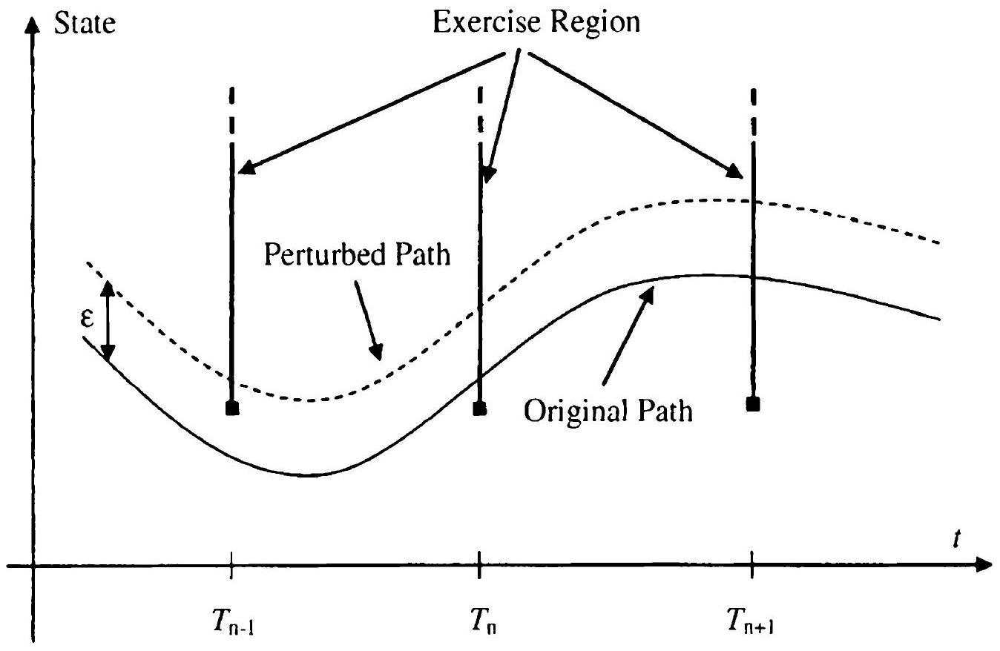

## Pathwise Differentiation

The various payoff smoothing methods of Chapter 23 primarily target greeks computed through outright repricing with perturbed market data. However, as we have already seen in Section 3.3, there exist methods for risk calculations that avoid brute-force repricing entirely. In this chapter, we concentrate on the convenient pathwise differentiation method, paying particular attention to applications involving securities with barriers or early exercise rights.

### 24.1 Pathwise Differentiation: Foundations

### 24.1.1 Callable Libor Exotics

The pathwise differentiation method for European-style derivatives has been considered (in a Monte Carlo setting) in Section 3.3.2. As it turns out, Bermudan-style callable derivatives are also quite amendable to the pathwise differentiation method, as shown in Piterbarg [2004b]. Let us outline the basic ideas.

Using the notations from Chapter 18, we recall that the main valuation recursion for a CLE is given by (see (18.7))

$$
\begin{equation*}
H_{n-1}\left(T_{n-1}\right)=B\left(T_{n-1}\right) \mathrm{E}_{T_{n-1}}\left(B\left(T_{n}\right)^{-1} \max \left(H_{n}\left(T_{n}\right), U_{n}\left(T_{n}\right)\right)\right) \tag{24.1}
\end{equation*}
$$
^eq24-1

for $n=N-1, \ldots, 1$, with the starting condition $H_{N-1} \equiv 0$. Here, E is the expected value operator for the spot measure $\mathrm{Q}^{B}, H_{n}(t)$ is the $n$-th hold value, and $U_{n}(t)$ the $n$-th exercise value, that is, the value of all future cash flows received upon exercise at time $T_{n}$ :

$$
U_{n}(t)=B(t) \sum_{i=n}^{N-1} \mathrm{E}_{t}\left(B\left(T_{i+1}\right)^{-1} X_{i}\right)
$$

Here $X_{i}$ are net coupons, $X_{i}=\tau_{i}\left(C_{i}-L_{i}\left(T_{i}\right)\right)$, with $C_{i}$ being the structured coupons and $L_{i}$ the Libor rates.

Let $\Delta_{\alpha}$ represent a pathwise differentiation operator with respect to a given parameter $\alpha$. In this section we derive the main representation result that allows us to write a pathwise derivative of a callable Libor exotic as an expectation of a function of the optimal exercise time.

### 24.1.1.1 CLE Greeks and the Optimal Exercise Time

In order for the pathwise differentiation method to be applicable, we always assume that all coupons $X_{n}, n=1, \ldots, N-1$, and the inverse numeraire $B(t)^{-1}$, are Lipschitz continuous functions of the parameter $\alpha$. It follows then than the pathwise derivative $\Delta_{\alpha} X_{n}$ exists almost surely for each $n=1, \ldots, N-1$.

From (24.1), carrying out the differentiation under the expectation operator, we obtain our first result for pathwise derivatives of CLEs.

Proposition 24.1.1. Provided the coupons and inverse numeraire are Lipschitz continuous, then, for any $n, n=1, \ldots, N-1$,

$$
\begin{aligned}
\Delta_{\alpha}\left(B\left(T_{n-1}\right)^{-1} H_{n-1}\left(T_{n-1}\right)\right) & \\
& =\mathrm{E}_{T_{n-1}}\left(1_{\left\{U_{n}\left(T_{n}\right)>H_{n}\left(T_{n}\right)\right\}} \Delta_{\alpha}\left(B\left(T_{n}\right)^{-1} U_{n}\left(T_{n}\right)\right)\right) \\
& \quad+\mathrm{E}_{T_{n-1}}\left(1_{\left\{H_{n}\left(T_{n}\right)>U_{n}\left(T_{n}\right)\right\}} \Delta_{\alpha}\left(B\left(T_{n}\right)^{-1} H_{n}\left(T_{n}\right)\right)\right)
\end{aligned}
$$

Proof. The assumption of Lipschitz continuity of the coupons and the inverse numeraire implies that $U_{n}\left(T_{n}\right)$ for each $n, n=1, \ldots, N-1$, is Lipschitz continuous in $\alpha$, as is (by assumption) the inverse numeraire $B(t)^{-1}$. Since the function $\max (x, y)$ is Lipschitz continuous in $x$ (and $y$ ), it can be shown recursively from (24.1) that $H_{n}\left(T_{n}\right)$ for each $n, n=0, \ldots, N-1$, is Lipschitz continuous in $\alpha$ as well. Hence, Proposition 3.3.1 applies and we have,

$$
\begin{aligned}
& \Delta_{\alpha}\left(B\left(T_{n-1}\right)^{-1} H_{n-1}\left(T_{n-1}\right)\right) \\
& \quad=\mathrm{E}_{T_{n-1}}\left(\Delta_{\alpha}\left(\max \left(B\left(T_{n}\right)^{-1} H_{n}\left(T_{n}\right), B\left(T_{n}\right)^{-1} U_{n}\left(T_{n}\right)\right)\right)\right) .
\end{aligned}
$$

The function $x \longmapsto \max (x, c)$ is absolutely continuous with a derivative that is equal to $1_{\{x>c\}}$. Hence, we can differentiate $\max \left(H_{n}\left(T_{n}\right), U_{n}\left(T_{n}\right)\right)$ inside the expected value to obtain

$$
\begin{aligned}
\mathrm{E}_{T_{n-1}}( & \left.\Delta_{\alpha} \max \left(B\left(T_{n}\right)^{-1} H_{n}\left(T_{n}\right), B\left(T_{n}\right)^{-1} U_{n}\left(T_{n}\right)\right)\right) \\
= & \mathrm{E}_{T_{n-1}}\left(1_{\left\{U_{n}\left(T_{n}\right)>H_{n}\left(T_{n}\right)\right\}} \Delta_{\alpha}\left(B\left(T_{n}\right)^{-1} U_{n}\left(T_{n}\right)\right)\right) \\
& +\mathrm{E}_{T_{n-1}}\left(1_{\left\{H_{n}\left(T_{n}\right)>U_{n}\left(T_{n}\right)\right\}} \Delta_{\alpha}\left(B\left(T_{n}\right)^{-1} H_{n}\left(T_{n}\right)\right)\right) .
\end{aligned}
$$

Combining equations we obtain the statement of the proposition.
Proposition 24.1.1 provides us with a recursive relationship (in $n$, the exercise date index) between $\Delta_{\alpha}\left(B\left(T_{n-1}\right)^{-1} H_{n-1}\left(T_{n-1}\right)\right)$ and
$\Delta_{\alpha}\left(B\left(T_{n}\right)^{-1} H_{n}\left(T_{n}\right)\right)$. The next proposition "unwraps" this recursion to give us the formula for $\Delta_{\alpha} H_{0}$.

Proposition 24.1.2. Let $\eta$ be the optimal exercise time index (see Section 18.2.2). Then

$$
\begin{equation*}
\Delta_{\alpha} H_{0}(0)=\mathrm{E}\left(\sum_{n=\eta}^{N-1} \Delta_{\alpha}\left(B\left(T_{n}\right)^{-1} X_{n}\right)\right) . \tag{24.2}
\end{equation*}
$$
^eq24-2

Proof. Unwrapping the recursive statement of Proposition 24.1.1, we find that

$$
\begin{aligned}
& \Delta_{\alpha} H_{0}(0)= \\
& \sum_{n=1}^{N-1} \mathrm{E}\left(\left(\prod_{i=1}^{n-1} 1_{\left\{H_{2}\left(T_{i}\right)>U_{i}\left(T_{,}\right)\right\}}\right) 1_{\left\{U_{n}\left(T_{n}\right)>H_{n}\left(T_{n}\right)\right\}} \Delta_{\alpha}\left(B\left(T_{n}\right)^{-1} U_{n}\left(T_{n}\right)\right)\right)
\end{aligned}
$$

As $\eta$ is the optimal exercise time index,

$$
1_{\{\eta=n\}}=\left(\prod_{i=1}^{n-1} 1_{\left\{H_{l}\left(T_{l}\right)>U_{\iota}\left(T_{\iota}\right)\right\}}\right) 1_{\left\{U_{n}\left(T_{n}\right)>H_{n}\left(T_{n}\right)\right\}},
$$

from which it follows that

$$
\Delta_{\alpha} H_{0}(0)=\sum_{n=1}^{N-1} \mathrm{E}\left(1_{\{\eta=n\}} \Delta_{\alpha}\left(B\left(T_{n}\right)^{-1} U_{n}\left(T_{n}\right)\right)\right)
$$

From Proposition 3.3.1 and the fact that

$$
B\left(T_{n}\right)^{-1} U_{n}\left(T_{n}\right)=\sum_{i=n}^{N-1} \mathrm{E}_{T_{n}}\left(B\left(T_{i+1}\right)^{-1} X_{i}\right)
$$

we obtain

$$
\Delta_{\alpha}\left(B\left(T_{n}\right)^{-1} U_{n}\left(T_{n}\right)\right)=\sum_{i=n}^{N-1} \mathrm{E}_{T_{n}}\left(\Delta_{\alpha}\left(B\left(T_{i+1}\right)^{-1} X_{i}\right)\right)
$$

and therefore

$$
\Delta_{\alpha} H_{0}(0)=\sum_{n=1}^{N-1} \mathrm{E}\left(1_{\{\eta=n\}} \sum_{\imath=n}^{N-1} \mathrm{E}_{T_{n}}\left(\Delta_{\alpha}\left(B\left(T_{i+1}\right)^{-1} X_{i}\right)\right)\right) .
$$

The event $\{\eta=n\}$ is in the sigma-algebra $\mathcal{F}_{T_{n}}$ because $\eta$ is a stopping time. Thus we may carry the indicator $1_{\{\eta=n\}}$ inside the expectation $E_{T \text {,, }}$ to get

$$
\Delta_{\alpha} H_{0}(0)=\mathrm{E}\left(\sum_{n=1}^{N-1} \sum_{i=n}^{N-1} 1_{\{\eta=n\}}\left(\Delta_{\alpha}\left(B\left(T_{i+1}\right)^{-1} X_{i}\right)\right)\right) .
$$

Changing the order of summation we obtain

$$
\Delta_{\alpha} H_{0}(0)=\mathrm{E}\left(\sum_{i=\eta}^{N-1}\left(\Delta_{\alpha}\left(B\left(T_{i+1}\right)^{-1} X_{i}\right)\right)\right)
$$

and the proposition follows. $\square$

The result of Proposition 24.1.2 provides the foundation for computing pathwise derivatives of callable Libor exotics, and relates the derivative of a CLE to derivatives of coupons (that can typically be computed easily) and to the optional stopping time, a quantity that is computed during normal CLE valuation anyway. To proceed further, we need to specialize the setup to either PDE or Monte Carlo based models. First, however, we study some important implications, as well as some generalizations, of Proposition 24.1.2.

### 24.1.1.2 Keeping the Exercise Time Constant

It is instructive to compare the expression for the value of a callable Libor exotic (18.6) with the one for its pathwise derivative in Proposition 24.1.2:

$$
\begin{align*}
H_{0}(0) & =\mathrm{E}\left(\sum_{n=\eta}^{N-1} B\left(T_{n+1}\right)^{-1} X_{n}\right)  \tag{24.3}\\
\Delta_{\alpha} H_{0}(0) & =\mathrm{E}\left(\sum_{n=\eta}^{N-1} \Delta_{\alpha}\left(B\left(T_{n+1}\right)^{-1} X_{n}\right)\right)
\end{align*}
$$
^eq24-3

Somewhat surprisingly, it appears that one can compute the derivative $\Delta_{\alpha}$ by differentiating the sum in (24.3) and pretending that the optimal exercise time index $\eta$ does not depend on $\alpha$. But, paradoxically, in most cases the distribution of $\eta$ does depend on $\alpha$.

The seeming contradiction above can be resolved with the help of the following argument, known to economists as the envelope theorem (see Sydsaeter and Hammond [2008]). For an arbitrary stopping time index $\zeta$, define $V_{\mathrm{ki}}(\zeta, X)$ by

$$
V_{\mathrm{ki}}(\zeta, X)=\mathrm{E}\left(\sum_{n=\zeta}^{N-1} B\left(T_{n+1}\right)^{-1} X_{n}\right)
$$

where, in somewhat loose notation, $X$ in the argument of $V_{\mathrm{ki}}(\zeta, X)$ represents all coupons $X_{n}$ and all numeraire factors $B\left(T_{n}\right)^{-1}$. We can think of $V_{\mathrm{ki}}(\zeta, X)$
as the value of a knock-in barrier option with the barrier defined by $\zeta$. Note that $V_{\mathrm{ki}}(\zeta, X)$ is equal to $H_{0}(0)$ for $\zeta=\eta$. Formally differentiating with respect to $\alpha$,

$$
\begin{equation*}
\Delta_{\alpha} V_{\mathrm{ki}}(\zeta, X)=\frac{\partial}{\partial \zeta} V_{\mathrm{ki}}(\zeta, X) \Delta_{\alpha} \zeta+\frac{\partial}{\partial X} V_{\mathrm{ki}}(\zeta, X) \Delta_{\alpha} X \tag{24.4}
\end{equation*}
$$
^eq24-4

Substituting $\zeta=\eta$ into the last equation, we make a critical observation that

$$
\begin{equation*}
\left.\frac{\partial}{\partial \zeta} V_{\mathrm{ki}}(\zeta, X)\right|_{\zeta=\eta}=0 \tag{24.5}
\end{equation*}
$$
^eq24-5

because $\eta$ by definition is the optimal stopping time index that maximizes the value of a callable Libor exotics over all stopping times (and (24.5) is the necessary first-order optimality condition). Due to ( 24.5 ), the first term in (24.4) drops out and we are left with

$$
\Delta_{\alpha} H_{0}=\Delta_{\alpha} V_{\mathrm{ki}}(\eta, X)=\frac{\partial}{\partial X} V_{\mathrm{ki}}(\eta, X) \times \Delta_{\alpha} X
$$

The expression on the right hand side can be interpreted as the partial derivative of the sum in (24.3) with $\eta$ held constant.

The effective insensitivity of the stopping time with respect to parameter changes has some significant practical applications, even in situations where the pathwise differentiation method cannot be used (or is not used for some other reason). Recall that often a valuation of a callable security in Monte Carlo involves two steps (see Section 18.3.6): first, an optimal exercise boundary is estimated; and second, the value of the callable security is computed as a knock-in option, using the estimated exercise boundary as the barrier. In an implementation where the greeks are computed by shocking the inputs and revaluing the security, the result above states that the exercise time from the base scenario (which is, in a Monte Carlo simulation, just an integer index for each path) could be reused in the shocked scenario - i.e. we would force the exercise on a given path in a shocked scenario at exactly the same index as on the same path in the base scenario ${ }^{1}$. Besides obvious savings in computational time (there is now no need to re-estimate the exercise boundary in the shocked scenario), this scheme improves stability of the greeks, as we explain in the next section.

We should note that if the exercise boundary being used in computations is not truly optimal (which is, of course, nearly always the case in practice), freezing the stopping times in the manner described above will change the meaning of the greeks slightly, in a manner described in Section 24.3.4. Unless the exercise rule is truly inaccurate, these differences are typically small enough to ignore. Also, we point out that a theoretically valid alternative technique involves freezing the exercise boundary, rather than the exercise index. As explained below, the latter has superior numerical properties.

[^84]
### 24.1.1.3 Noise in CLE Greeks

To expand on the discussion above, and to tie it to greeks computations, let us for concreteness consider a Monte Carlo application where we attempt to evaluate CLE greeks by brute-force perturbation methods. From the results above, we have three valid alternatives when deciding how to treat the exercise decision in the perturbed market data scenario: i) re-estimate the exercise boundary (by regression, say); ii) re-use the base scenario exercise boundary; and iii) re-use the base scenario stopping times. While theoretically equivalent in the large-sample limit (due to the envelope theorem), for a realistic number of Monte Carlo paths the numerical properties of these three alternatives will differ substantially. For instance, it should be intuitively clear that re-estimating the exercise boundary will induce a large amount of spurious noise, so most practitioners have traditionally worked with a frozen boundary, as in alternative ii). Even with this approach, however, the derivatives of Bermudan-callable security prices will typically exhibit much higher levels of simulation error than prices of European options. Let us examine why this is the case.

Armed with the estimate of the optimal exercise index $\widetilde{\eta}$, the Monte Carlo estimate of the value of a callable Libor exotic is given by (see Section 18.3.6)

$$
\widetilde{H}_{0}=J^{-1} \sum_{j=1}^{J} \sum_{\imath=1}^{N-1}\left[B\left(T_{i+1}, \omega_{j}\right)^{-1} X_{i}\left(\omega_{j}\right) 1_{\left\{i \geq \tilde{\eta}\left(\omega_{j}\right)\right\}}\right],
$$

where simulated paths are denoted by $\omega_{j}, j=1, \ldots, J$. Clearly, the valuation formula involves exercise indicators $1_{\left\{\imath \geq \pi\left(\omega_{j}\right)\right\}}$. Importantly for our analysis, these indicators are discontinuous functions of the simulated path $\omega$. Figure 24.1 demonstrates the problem visually, for the case where the exercise boundary is frozen (our alternative ii) above).

Notice from Figure 24.1 that if a simulated path passes sufficiently close to the exercise boundary, then a small change in the parameter $\alpha$ can push the path outside of the exercise region for one of the exercise dates, losing a whole coupon as a result. Such a digital-type discontinuity - which is not present in European call/put or other continuous-payoff securities leads to poorer stability and larger simulation errors for risk sensitivities in Bermudan-callable securities, compared to their European-call counterparts.

One way to improve stability and accuracy of the greeks is to use the payoff smoothing method from Section 23.4.3. However, it is much easier to use alternative iii) above, i.e. to re-use the estimate of the optimal exercise index $\widetilde{\eta}(\omega)$ from the base scenario. In practice it means that for each simulated path, we just force the exercise of a CLE at exactly the same time in calculations with the shocked market data as with the base market data. In this approach, no discontinuities are introduced.

Fig. 24.1. Discontinuity of CLE Value in Monte Carlo

Notes: A whole coupon could be added to/subtracted from the value of a CLE valued in Monte Carlo under small, order- $\epsilon$, perturbations of Monte Carlo paths if the exercise time is not kept constant.

### 24.1.2 Barrier Options

A CLE can be interpreted as a type of barrier option where the barrier condition is defined by the optimal exercise rule; one might therefore speculate that the pathwise differentiation method could be extended to general barrier options. This is, indeed, the case, although the presence of discontinuities in barrier options requires some additional care. As a warm-up exercise, recall the example of a pathwise derivative of digital option in Section 3.3.2.1 and consider a $T$-maturity European payoff

$$
\begin{equation*}
X=1_{\{G>h\}} R, \tag{24.6}
\end{equation*}
$$
^eq24-6

where $G$ and $R$ are $\mathcal{F}_{T}$-measurable random variables and $h$ is a particular strike. Differentiating the payoff with respect to $\alpha$, we obtain

$$
\Delta_{\alpha}\left(1_{\{G>h\}} R\right)=1_{\{G>h\}} \Delta_{\alpha} R+\left(\frac{\partial 1_{\{G>h\}}}{\partial G}\right) R \Delta_{\alpha} G
$$

Formally,

$$
\frac{\partial 1_{\{G>h\}}}{\partial G}=\delta(G-h),
$$

where $\delta(x)$ is the delta function at zero. Assuming we can exchange the order of differentiation and expectation, we have

$$
\begin{aligned}
\Delta_{\alpha} \mathrm{E}\left(B(T)^{-1} X\right)= & \mathrm{E}\left(\Delta_{\alpha}\left(B(T)^{-1} X\right)\right) \\
= & \mathrm{E}\left(\Delta_{\alpha}\left(B(T)^{-1}\right) 1_{\{G>h\}} R\right) \\
& +\mathrm{E}\left(B(T)^{-1} 1_{\{G>h\}} \Delta_{\alpha} R\right) \\
& +\mathrm{E}\left(B(T)^{-1} \delta(G-h) R \Delta_{\alpha} G\right) .
\end{aligned}
$$

Rewriting the second term in the last equality, we find that the sensitivity of this digital option is given by

$$
\begin{align*}
& \Delta_{\alpha} \mathrm{E}\left(B(T)^{-1} 1_{\{G>h\}} R\right)=\mathrm{E}\left(\Delta_{\alpha}\left(B(T)^{-1}\right) 1_{\{G>h\}} R\right) \\
& \quad+\mathrm{E}\left(B(T)^{-1} 1_{\{G>h\}} \Delta_{\alpha} R\right)+\gamma_{G}(h) \mathrm{E}\left(B(T)^{-1} R \Delta_{\alpha} G \mid G=h\right) \tag{24.7}
\end{align*}
$$
^eq24-7

where $\gamma_{G}(h)$ is the density of $G$, at $G=h$. While the conditions of Proposition 3.3.1 do not hold for the payoff (24.6) and we cannot rely on Proposition 3.3.1 to justify differentiation inside the expected value operator, the formula (24.7) is, nevertheless, correct, and can be justified by Malliavin calculus, see Fournie et al. [1999].

The expected values on the right-hand side of (24.7) can in general be computed in a numerical scheme such as Monte Carlo, as long as the density of $G$ is known, and the conditional expected value $\mathrm{E}\left(B(T)^{-1} R \Delta_{\alpha} G \mid G=h\right)$ can be evaluated. Both can, in principle, be computed in Monte Carlo using Malliavin calculus techniques (see Fournie et al. [1999]). However, the application of this method is much more practical if both of these quantities can be computed (or approximated) in closed form, which is the case in some models such as, say, Gaussian models.

Proceeding to the case of barrier options, let us introduce a barrier schedule $\left\{T_{n}\right\}_{n=1}^{N-1}$, to which we associate knockout variables $G_{n}$ and barrier levels $h_{n}$, for $n=1, \ldots, N-1$. We consider an option that pays the value $R_{n}, n=1, \ldots, N-1$, on the first $T_{n}$ where $G_{n}>h_{n}$; if this event never takes place, the option pays nothing. Formally, we define $\eta$, the knockout index, by

$$
\eta=\min \left\{k \geq 1: G_{k}>h_{k}\right\} \wedge N .
$$

For notational convenience, set

$$
R_{N} \equiv 0
$$

The time 0 value of our barrier option is then given by

$$
V_{\mathrm{ki}}(0)=\mathrm{E}\left(B\left(T_{\eta}\right)^{-1} R_{\eta}\right)
$$

Note that this is the same knock-in option as considered in Section 23.4.2, if we define $R_{n}=B\left(T_{n}\right) \sum_{i=n}^{N-1} B\left(T_{i+1}\right)^{-1} X_{i}$.

More generally, let us denote

$$
\eta_{n}=\min \left\{k \geq n+1: G_{k}>h_{k}\right\} \wedge N
$$

and

$$
\begin{equation*}
V_{\mathrm{ki}, n}(t)=B(t) \mathrm{E}_{t}\left(B\left(T_{\eta_{n}}\right)^{-1} R_{\eta_{n}}\right), \tag{24.8}
\end{equation*}
$$
^eq24-8

with the convention

$$
V_{\mathrm{ki} . N}(t) \equiv 0 .
$$

Here, $V_{\mathrm{ki}, n}(t)$ can be seen as the value of the option with the barrier condition checked at times $T_{n+1}, \ldots, T_{N-1}$ only. In particular,

$$
V_{\mathrm{ki}}(0)=V_{\mathrm{ki}, 0}(0) .
$$

We denote by $\gamma_{n}(x)$ the density of $G_{n}$ at time $T_{n}$.
Proposition 24.1.3. For the barrier option paying $R_{n}$ on the first $T_{n}$ where $G_{n}>h_{n}, n=1, \ldots, N-1$, the pathwise derivative with respect to a parameter $\alpha$ is given by

$$
\begin{align*}
& \Delta_{\alpha} V_{\mathrm{ki}}(0)=\mathrm{E}\left(\left.B\left(T_{\eta}\right)^{-1} \Delta_{\alpha} R_{n}\right|_{n=\eta}\right) \\
& \quad+\mathrm{E}\left(\left.B\left(T_{\eta}\right)^{-1} \gamma_{\eta}\left(h_{\eta}\right)\left(R_{\eta}-V_{\mathrm{ki}, \eta}\left(T_{\eta}\right)\right) \Delta_{\alpha} G_{n}\right|_{n=\eta} \mid G_{\eta}=h_{\eta}\right) \tag{24.9}
\end{align*}
$$
^eq24-9

Proof. (Sketch) The values of the family of knock-in options defined by (24.8) satisfy the following recursive relationship,

$$
\begin{aligned}
B\left(T_{n}\right)^{-1} V_{\mathrm{ki}, n}\left(T_{n}\right)= & \mathrm{E}_{T_{n}}\left(B\left(T_{n+1}\right)^{-1} R_{n+1} 1_{\left\{G_{n+1}>h_{n+1}\right\}}\right) \\
& +\mathrm{E}_{T_{n}}\left(B\left(T_{n+1}\right)^{-1} V_{\mathrm{ki}, n+1}\left(T_{n+1}\right) 1_{\left\{G_{n+1} \leq h_{n+1}\right\}}\right)
\end{aligned}
$$

Differentiating formally,

$$
\begin{aligned}
& \Delta_{\alpha}\left(B\left(T_{n}\right)^{-1} V_{\mathrm{ki}, n}\left(T_{n}\right)\right)=\mathrm{E}_{T, n}\left(\Delta_{\alpha}\left(B\left(T_{n+1}\right)^{-1} R_{n+1}\right) 1_{\left\{G_{n+1}>h_{n+1}\right\}}\right) \\
&+\mathrm{E}_{T_{n}}\left(\Delta_{\alpha}\left(B\left(T_{n+1}\right)^{-1} V_{\mathrm{ki}, n+1}\left(T_{n+1}\right)\right) 1_{\left\{G_{n+1} \leq h_{n+1}\right\}}\right) \\
&+\mathrm{E}_{T_{n}}\left(B\left(T_{n+1}\right)^{-1}\left(R_{n+1}-V_{\mathrm{ki}, n+1}\left(T_{n+1}\right)\right) \delta\left(G_{n+1}-h_{n+1}\right)\right) .
\end{aligned}
$$

This defines an expression of $\Delta_{\alpha} V_{\mathrm{ki}, n}\left(T_{n}\right)$ in terms of $\Delta_{\alpha} V_{\mathrm{ki}, n+1}\left(T_{n+1}\right)$ and other quantities. Unwrapping the recursion, as in Proposition 24.1.2 earlier, proves the proposition.

Example 24.1.4. Callable Libor exotics are a special case with $R_{n}=U_{n}$, $G_{n}=U_{n}-H_{n}, h_{n}=0$. Proposition 24.1.2 follows from Proposition 24.1.3 once continuity condition for CLEs,

$$
\left.\left(R_{n}-V_{\mathrm{ki}, n}\left(T_{n}\right)\right)\right|_{G_{n}=h_{n}}=0,
$$

is taken into account.

Example 24.1.5. A TARN (See Chapter 20 and Section 23.4.4) can be represented in barrier form. In particular, using the notations of Section 23.4.4, we define

$$
G_{n} \triangleq Q_{n}, \quad h_{n} \triangleq R_{n}, \quad R_{n} \triangleq \sum_{k=n}^{N-1} B\left(T_{k+1}\right)^{-1} X_{k}\left(T_{k}\right)
$$

so that

$$
V_{\mathrm{ki}, 0}(0)+V_{\mathrm{tarn}}(0)=\mathrm{E}\left(\sum_{k=1}^{N-1} B\left(T_{k+1}\right)^{-1} X_{k}\left(T_{k}\right)\right),
$$

where the right-hand side equals the price of a straight (exotic) swap.
Although Proposition 24.1.3 extends the pathwise differentiation method to barrier options, the complexity of the result limits the practicality of the method. In particular, the transition densities and conditional probabilities in (24.9) are often difficult to compute, and it may ultimately be more fruitful to use methods in Chapters 23 and 25 to smooth or integrate out any discontinuities before applying pathwise differentiation techniques.

### 24.2 Pathwise Differentiation for PDE Based Models

The pathwise differentiation method can be applied to both PDE and Monte Carlo based models. In this section we consider PDE applications, mostly following Piterbarg [2004a]; we address Monte Carlo applications in Section 24.3.

### 24.2.1 Model and Setup

The treatment of European-style options in the Section 3.3.2 is rather generic and car canily be implamented in ${ }^{\text {PDE }}$-based mumenical sculemes. Callable Libor exotics, on the other hand, require more effort, to be undertaken in this section. While the method is developed for, and can be applied to, rather general CLEs, for a number of reasons Bermudan swaptions are probably the most natural target of the techniques described here. Indeed, not only have we shown (in Section 19.2) that low-dimensional, PDE-based Markovian models are appropriate for Bermudan swaptions, but Bermudan swaptions often constitute a dominant part of portfolios of interest rate exotics and are therefore subject to high demands for stable and accurate risk reporting.

To focus on the main features of the method without distraction from minor details, let us consider a Gaussian interest rate model as developed in Section 10.1.2.2, parameterized in terms of the short rate state $x(t)$ as in Proposition 10.1.7. We denote the infinitesimal generator associated with the dynamics of $x(t)$ by $\mathcal{L}$,

$$
\begin{equation*}
\mathcal{L}=(y(t)-\varkappa(t) x) \frac{\partial}{\partial x}+\frac{1}{2} \sigma_{r}(t)^{2} \frac{\partial^{2}}{\partial x^{2}} \tag{24.10}
\end{equation*}
$$
^eq24-10

If $V=V(t, x)$ is the value of a contingent claim at time $t$ given $x(t)=x$, then $V(t, x)$ satisfies the equation (see (10.29))

$$
\frac{\partial V}{\partial t}(t, x)+\mathcal{L} V(t, x)=(f(0, t)+x) V(t, x)
$$

Note that this valuation expression is associated with the risk-neutral measure Q , induced by the continuous money market account $\beta(t)$. Previous material in this chapter (and in Chapter 18) used a spot Libor measure, but results carry over unchanged to the risk-neutral measure. Recycling notations, we now denote by E the corresponding, i.e. risk-neutral, expected value operator; while E was earlier used as the expected value operator in spot Libor measure, there should be no confusion which measure is used going forward.

Let us consider a CLE with net coupons $\left\{X_{n}\right\}$, as in Section 24.1.1; as we work in a PDE setting, we assume that the value of the net coupon $X_{n}$ does not depend on the state of the yield curve prior to $T_{n}, n=1, \ldots, N-1$. Recall Proposition 24.1.2 which states that the pathwise derivative $\Delta_{\alpha}$ of a CLE is given by

$$
\Delta_{\alpha} H_{0}(0)=\mathrm{E}\left(\sum_{n=\eta}^{N-1} \Delta_{\alpha}\left(\beta\left(T_{n+1}\right)^{-1} X_{n}\right)\right)
$$

where $\eta$ is the optimal exercise date index. The hold and exercise values are now deterministic functions of $x$, so we use the notations $H_{n}(t, x), U_{n}(t, x)$ where appropriate.

### 24.2.2 Bucketed Deltas

Arguably, the most important risk measures for an interest rate security are the so-called bucketed interest rate deltas, see Section 6.4, that measure the sensitivity of the value of the security to changes in various parts of the yield curve. For the CLE in question, the most natural bucketing ${ }^{2}$ of deltas is induced by the tenor structure $\left\{T_{n}\right\}_{n=0}^{N}$. Specifically, we define the $m$-th (continuously compounded) forward rate by

$$
y_{m}(0) \triangleq y\left(0, T_{m}, T_{m+1}\right)=-\frac{1}{\tau_{m}} \ln \left(P\left(0, T_{m}, T_{m+1}\right)\right), \quad m=0, \ldots, N-1
$$

and denote by $\Delta_{m}$ the pathwise derivative with respect to $y_{m}(0)$,[^85]

$$
\Delta_{m} \triangleq \Delta_{y_{m}(0)}, \quad m=1, \ldots, N-1
$$

To establish $\Delta_{m}$, let us start by rewriting the pathwise derivative in a more convenient form

$$
\begin{align*}
\Delta_{m} H_{0}(0)= & \sum_{n=1}^{N-1} \mathrm{E}\left(1_{\{\eta \geq n\}} \Delta_{m}\left(\beta\left(T_{n+1}\right)^{-1} X_{n}\right)\right) \\
= & \sum_{n=1}^{N-1} \mathrm{E}\left(1_{\{\eta \geq n\}} \beta\left(T_{n+1}\right)^{-1} \frac{\Delta_{m}\left(\beta\left(T_{n+1}\right)^{-1}\right)}{\beta\left(T_{n+1}\right)^{-1}} X_{n}\right) \\
& +\sum_{n=1}^{N-1} \mathrm{E}\left(1_{\{\eta \geq n\}} \beta\left(T_{n+1}\right)^{-1} \Delta_{m}\left(X_{n}\right)\right) \tag{24.11}
\end{align*}
$$
^eq24-11

We shall also need the following lemma.
Lemma 24.2.1. In the Gaussian model the following holds,

$$
\frac{\Delta_{m}\left(\beta\left(T_{n+1}\right)^{-1}\right)}{\beta\left(T_{n+1}\right)^{-1}}=-1_{\{m \leq n\}} \tau_{m} .
$$

Proof. We have

$$
\begin{gathered}
\beta\left(T_{n+1}\right)^{-1}=\exp \left(-\int_{0}^{T_{n+1}} r(t) d t\right)=\exp \left(-\int_{0}^{T_{n+1}}(f(0, t)+x(t)) d t\right) \\
\Delta_{m}\left(\beta\left(T_{n+1}\right)^{-1}\right)=\beta\left(T_{n+1}\right)^{-1} \Delta_{m}\left(-\int_{0}^{T_{n+1}}(f(0, t)+x(t)) d t\right)
\end{gathered}
$$

Since the dynamics of $x(t)$ do not depend on the initial yield curve $P(0, \cdot)$,

$$
\frac{\Delta_{m}\left(\beta\left(T_{n+1}\right)^{-1}\right)}{\beta\left(T_{n+1}\right)^{-1}}=-\Delta_{m}\left(\int_{0}^{T_{n+1}} f(0, t) d t\right)
$$

Moreover, by definition of $y_{k}$ 's,

$$
\int_{0}^{T_{n+1}} f(0, t) d t=\sum_{k=0}^{n} \tau_{k} y_{k}(0)
$$

Hence,

$$
\Delta_{m}\left(\int_{0}^{T_{n+1}} f(0, t) d t\right)=\Delta_{m}\left(\sum_{k=0}^{n} \tau_{k} y_{k}(0)\right)=1_{\{m \leq n\}} \tau_{m}
$$
$\square$

For the next result we need the following definition.

Definition 24.2.2. The time $t$ survival measure $\Psi(\cdot ; t)$ is defined for $\Gamma \subset \mathbb{R}$ by the formula

$$
\Psi(\Gamma ; t)=\mathrm{E}\left(\beta(t)^{-1} 1_{\{\eta \geq q(t)\}} 1_{\{x(t) \in \Gamma\}}\right),
$$

where the index function $q(t)$ for the tenor structure $\left\{T_{n}\right\}$ is defined in (14.2). The survival density, the density $\psi(x ; t)$ of the survival measure with respect to the Lebesgue measure $d x$, is defined by

$$
\Psi(\Gamma ; t)=\int_{\Gamma} \psi(y ; t) d y
$$

and is assumed to exist.
Combined with this definition of the survival density and the representation (24.11), Lemma 24.2.1 allows us to derive the following representation of bucketed deltas of a CLE.

Proposition 24.2.3. In the Gaussian model, the m-th bucketed delta of a $C L E$ is given by

$$
\begin{aligned}
\Delta_{m} H_{0}(0)= & -\sum_{n=m}^{N-1} \tau_{m} \int_{\mathbb{R}} V_{\mathrm{cpn}, n}(x) \psi\left(x ; T_{n}\right) d x \\
& +\sum_{n=1}^{m} \int_{\mathbb{R}} D_{\mathrm{cpn}, n, m}(x) \psi\left(x ; T_{n}\right) d x
\end{aligned}
$$

where $V_{\mathrm{cpn} . n}(x)$ and $D_{\mathrm{cpn}, n, m}(x)$ are the conditional expectations of the discounted value and the discounted derivative of the $n$-th coupon,

$$
\begin{aligned}
V_{\mathrm{cpn}, n}(x) & =\mathrm{E}\left(\beta\left(T_{n}\right) \beta\left(T_{n+1}\right)^{-1} X_{n} \mid x\left(T_{n}\right)=x\right), \\
D_{\mathrm{cpn}, n, m}(x) & =\mathrm{E}\left(\beta\left(T_{n}\right) \beta\left(T_{n+1}\right)^{-1} \Delta_{m} X_{n} \mid x\left(T_{n}\right)=x\right) .
\end{aligned}
$$

Proof. From (24.11),

$$
\begin{aligned}
\Delta_{m} H_{0}(0)=-\sum_{n=1}^{N-1} 1_{\{m \leq n\}} \tau_{m} \mathrm{E}\left(1_{\{\eta \geq n\}} \beta\left(T_{n+1}\right)^{-1} X_{n}\right) & \\
& \quad+\sum_{n=1}^{N-1} \mathrm{E}\left(1_{\{\eta \geq n\}} \beta\left(T_{n+1}\right)^{-1} \Delta_{m} X_{n}\right)
\end{aligned}
$$

By definition of the survival density and from the fact that $q\left(T_{n}-\right)=n$ (see (14.2)) we obtain

$$
\begin{aligned}
\mathrm{E}\left(1_{\{\eta \geq n\}} \beta\left(T_{n+1}\right)^{-1} X_{n}\right) & =\mathrm{E}\left(1_{\left\{\eta \geq q\left(T_{n}-\right)\right\}} \beta\left(T_{n}\right)^{-1} V_{\mathrm{cpn}, n}\left(x\left(T_{n}\right)\right)\right) \\
& =\int V_{\mathrm{cpn}, n}(x) \Psi\left(d x ; T_{n}\right)
\end{aligned}
$$

and

$$
\begin{aligned}
\mathrm{E}\left(1_{\{\eta \geq n\}} \beta\left(T_{n+1}\right)^{-1} \Delta_{m} X_{n}\right) & =\mathrm{E}\left(1_{\left\{\eta \geq q\left(T_{n}-\right)\right\}} \beta\left(T_{n}\right)^{-1} D_{\mathrm{cpn}, n, m}\left(x\left(T_{n}\right)\right)\right) \\
& =\int D_{\mathrm{cpn}, n, m}(x) \Psi\left(d x ; T_{n}\right)
\end{aligned}
$$

Since the net coupon $X_{n}$ depends on the yield curve on or after the fixing time $T_{n}$,

$$
D_{\mathrm{cpn}, n, m}(x) \equiv 0
$$

for $m<n$. The result follows.
Remark 24.2.4. The functions $V_{\mathrm{cpn}, n}(x)$ and $D_{\mathrm{cpn}, n, m}(x)$ are usually easy to calculate, as the net coupon $X_{n}$ is typically a function of discount factors observed at time $T_{n}$. The reader may want to consult Section 24.3.2 where related calculations are performed.

Proposition 24.2.3 represents bucketed deltas in terms of the integrals of known (or easily computed) functions $V_{\mathrm{cpn}, n}(x)$ and $D_{\mathrm{cpn}, n, m}(x)$ against the survival density. Note that the survival density is universal, i.e. it does not depend on a particular delta index $m$. Hence, if we can calculate it efficiently, all pathwise bucketed deltas can be computed quickly, as only simple integrals are required for their calculations. This should be compared to the standard way of computing deltas, where the relevant forward rate is perturbed and the value of a CLE is recomputed by solving a full-blown PDE. We discuss the computation of the survival density in the next section.

### 24.2.3 Survival Density

As a reference point, let us consider the following family of measures defined on $\mathbb{R}$. We fix time $s$ and position $x$ and define, for $t \geq s$,

$$
\begin{aligned}
\Pi_{s, x}(t, \Gamma) & \triangleq \mathrm{E}_{s}\left(\beta(t)^{-1} 1_{\{x(t) \in \Gamma\}} \mid x(s)=x\right) \\
& =\mathrm{E}_{s}\left(e^{-\int_{s}^{t} r(u) d u} 1_{\{x(t) \in \Gamma\}} \mid x(s)=x\right), \quad \Gamma \subset \mathbb{R}
\end{aligned}
$$

For each $s, x$ we can define the density ${ }^{3} \pi_{s, x}(t, y)$ by

$$
\Pi_{s, x}(t, \Gamma)=\int_{\Gamma} \pi_{s, x}(t, y) d y
$$

where $\pi_{s, x}(t, y)$ can be recognized as values of the Arrow-Debreu securities we introduced in Section 11.3.2.1. For fixed $s, x$ these satisfy an analog to forward Kolmogorov equations, see (11.30), which we rewrite in our notations as[^86]

$$
\begin{equation*}
\frac{\partial}{\partial t} \pi_{s, x}(t, y)=\mathcal{L}^{*} \pi_{s, x}(t, y)-r(t) \pi_{s, x}(t, y), \quad(s, x) \text { fixed, } \tag{24.12}
\end{equation*}
$$
^eq24-12
for $t \geq s$. Here $\mathcal{L}^{*}$ is the operator adjoint to $\mathcal{L}$ (see(24.10)),

$$
\mathcal{L}^{*} q(t, y)=-\frac{\partial}{\partial y}((y(t)-\varkappa(t) x) q(t, y))+\frac{\partial^{2}}{\partial y^{2}}\left(\frac{1}{2} \sigma_{r}(t)^{2} q(t, y)\right)
$$
which is applied to $\pi_{s, x}(t, y)$ as a function of $y$.
The following proposition outlines an efficient procedure for computing the survival density $\psi$. The idea of the theorem is that in between the "interesting" times $\left\{T_{n}\right\}$, the density $\psi$ behaves just like the density $\pi$ in the proposition above. When the time crosses an exercise time $T_{n}$, the density $\psi$ gets multiplied by an extra "survival" indicator function $1_{\left\{H_{n}\left(y, T_{n}\right)>U_{n}\left(y, T_{m}\right)\right\}}$.

Proposition 24.2.5. For each $n, 0 \leq n \leq N-1$, the survival density $\psi(y ; t)$ satisfies the forward PDE

$$
\frac{\partial}{\partial t} \psi(y ; t)=\left(\mathcal{L}^{*} \psi\right)(y ; t)-r(t) \psi(y ; t)
$$

on the time interval

$$
t \in\left(T_{n}, T_{n+1}\right)
$$

with the boundary condition

$$
\begin{equation*}
\psi\left(y ; T_{n}\right)=\psi\left(y ; T_{n}-\right) \times 1_{\left\{H_{n}\left(T_{n}, y\right)>U_{n}\left(, T_{n}, y\right)\right\}} . \tag{24.13}
\end{equation*}
$$
^eq24-13

The initial condition for the first interval, $\left(T_{0}, T_{1}\right)=\left(0, T_{1}\right)$, is given by the delta function

$$
\psi(y ; 0)=\delta(y-x(0))
$$

Proof. Assume

$$
T_{n}<t<T_{n+1}
$$

so that $q(t)=n+1$. Then

$$
\begin{aligned}
\Psi(\Gamma ; t) & =\mathrm{E}\left(e^{-\int_{0}^{t} r(u) d u} 1_{\{\eta \geq n+1\}} 1_{\{x(t) \in \Gamma\}}\right) \\
& =\mathrm{E}\left(e^{-\int_{0}^{T_{n}} r(u) d u} 1_{\{\eta>n\}} \mathrm{E}_{T_{n}}\left(e^{-\int_{T_{n}}^{\prime} r(u) d u} 1_{\{x(t) \in \Gamma\}}\right)\right) \\
& =\mathrm{E}\left(e^{-\int_{0}^{T_{n}} r(u) d u} 1_{\{\eta>n\}} \Pi_{T_{n}, x\left(T_{n}\right)}(t, \Gamma)\right)
\end{aligned}
$$

From this formula we obtain

$$
\psi(y ; t)=\mathrm{E}\left(e^{-\int_{0}^{T_{n}} r(u) d u} 1_{\{\eta>n\}} \pi_{T_{n}, x\left(T_{n}\right)}(t, y)\right)
$$

Differentiating this equality with respect to $t$, exchanging the order of differentiation and taking the expectation, applying (24.12) and exchanging
the order of the linear operator $\mathcal{L}^{*}-r(t)$ and the expectation operator, we obtain that the same equation as (24.12) holds for $\psi(y ; t)$,

$$
\frac{\partial}{\partial t} \psi(y ; t)=\mathcal{L}^{*} \psi(y ; t)-r(t) \psi(y ; t)
$$

for $t \in\left(T_{n}, T_{n+1}\right)$. To derive boundary conditions we notice that

$$
\begin{aligned}
\Psi\left(\Gamma ; T_{n}\right) & =\mathrm{E}\left(\beta\left(T_{n}\right)^{-1} 1_{\{\eta \geq n+1\}} 1_{\left\{x\left(T_{n}\right) \in \Gamma\right\}}\right) \\
& =\mathrm{E}\left(\beta\left(T_{n}\right)^{-1} 1_{\{\eta \geq n\}} 1_{\left\{H_{n}\left(T_{n}, x\left(T_{n}\right)\right)>U_{n}\left(T_{n}, x\left(T_{n}\right)\right)\right\}} 1_{\left\{x\left(T_{n}\right) \in \Gamma\right\}}\right)
\end{aligned}
$$

As $x(t)$ and $\beta(t)$ are continuous at $t=T_{n}$ we have

$$
\Psi\left(\Gamma ; T_{n}\right)=\Psi\left(\Gamma \cap\left\{H_{n}\left(T_{n}, x\left(T_{n}\right)\right)>U_{n}\left(T_{n}, x\left(T_{n}\right)\right)\right\} ; T_{n}-\right)
$$

and, calculating the densities of both sides, we obtain (24.13). For more details see Piterbarg [2004a].

Remark 24.2.6. The time- $T_{n}$ conditions (24.13) require knowledge of the "hold" regions

$$
\left\{x \in \mathbb{R}: H_{n}\left(T_{n}, x\right)>U_{n}\left(T_{n}, x\right)\right\} .
$$

These are computed as a by-product of the CLE valuation, since on each exercise date $T_{n}$, the hold values $H_{n}\left(T_{n}, x\right)$ are determined as functions of the state process $x(t)$ evaluated at time $t=T_{n}$.

Proposition 24.2.5 outlines a procedure for computing the survival density in one forward PDE "sweep", starting at $t=0$ with a delta function. The solution is computed forward using an appropriate PDE scheme (see e.g. Sections 11.3.2.1, 11.3.2.2) until the first exercise time $T_{1}$. At this point, the solution (i.e. the survival density) is multiplied by the indicator function of the no-exercise condition. The density is then rolled forward again until the next exercise date where it is multiplied by another no-exercise indicator function, and so on.

The pathwise differentiation method for calculating deltas handily outperforms the standard approach of re-evaluation of a derivative under shocked scenarios. For the pathwise differentiation method, to calculate all $N$ bucketed deltas, we need to calculate one survival density at a cost comparable to one PDE valuation of the derivative, and $2 N$ integrals of Proposition 24.2.3, at a combined cost of about twice the PDE valuation of the derivative. In contrast, the perturb-and-revalue method would require $N$ PDE valuations, one for each bucketed delta. As $N$ is typically significantly larger than 3, the cost savings therefore can be quite significant. Nor is the pathwise method limited to deltas only; as shown in Piterbarg [2004a], one can handle vegas and gammas in the same way. As we can reuse much of the calculations (the survival density) among all these greeks, performance improvements are even more dramatic.

### 24.3 Pathwise Differentiation for Monte Carlo Based Models

Let us now consider applications of pathwise differentiation to Monte Carlo based models. For concreteness, we develop the technique for the LM model (14.13)-(14.14) with separable deterministic local volatility:

$$
\begin{align*}
d L_{n}(t) & =\varphi\left(L_{n}(t)\right) \lambda_{n}(t)^{\top}\left(\mu_{n}(t) d t+d W(t)\right)  \tag{24.14}\\
\mu_{n}(t) & =\sum_{j=q(t)}^{n} \frac{\tau_{j} \varphi\left(L_{j}(t)\right) \lambda_{j}(t)}{1+\tau_{j} L_{j}(t)}
\end{align*}
$$
^eq24-14

The basic principles are, however, quite generic and straightforward to apply to other models. With LM models more naturally presented in the spot measure $\mathrm{Q}^{B}$, we use a setup where the numeraire is chosen to be the rolling money market $B(t)$, see (14.8). For notational convenience, we assume that the LM model and the security to be priced share the same tenor structure $\left\{T_{n}\right\}$; in practice, of course, this need not be the case.

### 24.3.1 Pathwise Derivatives of Forward Libor Rates

The discrete and spanning nature of forward Libor rates makes the definition of bucketed deltas ${ }^{4}$ easy, and we define $\Delta_{m}$ to be the pathwise derivative with respect to $L_{m}(0), m=0, \ldots, N-1$,

$$
\Delta_{m} X \triangleq \frac{\partial X}{\partial L_{m}(0)}
$$

for any random variable $X$. Note that in order to keep notation light, we reuse the definition $\Delta_{m}$ for pathwise derivatives from Section 24.2, but redefine their meaning slightly, as we here calculate derivatives with respect to simply compounded rates, rather than to the continuously compounded rates used in Section 24.2.

As should be clear from the basic discussion in Section 3.3.2, to successfully apply the pathwise differentiation method to a Libor market model, we need to be able to simulate the pathwise derivatives of the forward Libor rates $\Delta_{m} L_{n}(t), n, m=0, \ldots, N-1$. To determine the $\mathrm{Q}^{B}$-dynamics of $\Delta_{m} L_{n}(t)$, we use the standard technique of differentiating the SDEs for $L_{n}(t)$. From (14.13)-(14.14), differentiating with respect to $L_{m}(0)$, we get

$$
\begin{align*}
& d\left(\Delta_{m} L_{n}(t)\right)=\varphi^{\prime}\left(L_{n}(t)\right) \lambda_{n}(t)^{\top} \Delta_{m} L_{n}(t)\left(\mu_{n}(t) d t+d W(t)\right) \\
& \quad+\varphi\left(L_{n}(t)\right) \lambda_{n}(t)^{\top} \sum_{j} \frac{\partial \mu_{n}(t)}{\partial L_{j}(t)} \Delta_{m} L_{j}(t) d t \tag{24.15}
\end{align*}
$$
^eq24-15

[^87]The initial conditions for these SDEs are found by differentiating the initial conditions for $L_{n}(t)$ 's, resulting in

$$
\begin{equation*}
\Delta_{m} L_{n}(0)=1_{\{n=m\}} \tag{24.16}
\end{equation*}
$$
^eq24-16

The system of SDEs given by (24.15) and (14.13)-(14.14) fully specifies the dynamics of the forward Libor rates and their pathwise derivatives through time.

There are $N$ equations in the system (14.13) and $N^{2}$ equations in the system (24.15), and simulating all is computationally expensive, even for relatively low values of $N$. A significant part of the numerical effort originates with drift computations, so it is natural to investigate whether simplifications of the drift term in (24.15) can lighten the computational burden. Glasserman and Zhao [1999] propose to use the following simplified system of SDEs for simulating values and pathwise deltas of forward Libor rates,

$$
\begin{align*}
d L_{n}(t)= & \varphi\left(L_{n}(t)\right) \lambda_{n}(t)^{\top}\left(\mu_{n}(t) d t+d W(t)\right) \\
d\left(\Delta_{m} L_{n}(t)\right)= & \varphi\left(L_{n}(t)\right) \lambda_{n}(t)^{\top} \Delta_{m} L_{n}(t)\left(\mu_{n}(0) d t+d W(t)\right) \\
& +\varphi^{\prime}\left(L_{n}(t)\right) \lambda_{n}(t)^{\top} \sum_{j} \frac{\partial \mu_{n}(0)}{\partial L_{j}(0)} \Delta_{m} L_{j}(t) d t \tag{24.17}
\end{align*}
$$
^eq24-17

Notice that we here retain the original Libor rate dynamics, but have applied the standard "freczing" technique to the drifts when calculating the dynamics of pathwise derivatives of Libor rates. This allows for a considerable speedup, as the drifts in the equations for deltas of forward Libor rates can be pre-computed before the simulation. Glasserman and Zhao [1999] show numerically that the loss of accuracy in (24.17) is typically quite small.

The cost of propagating pathwise derivatives of Libor rates often dominates the computations of pathwise deltas, so let us consider computational complexity in more detail. We denote by $\Delta \mathbf{L}(t)$ an $N \times N$ matrix with the $(n, m)$-th element equal to $\Delta_{m} L_{n}(t)$,

$$
\begin{equation*}
\Delta \mathbf{L}(t)_{n, m}=\frac{\partial L_{n}(t)}{\partial L_{m}(0)}, \quad n, m=0, \ldots, N-1 . \tag{24.18}
\end{equation*}
$$
^eq24-18

To fix ideas, we assume that we need to propagate $\Delta \mathbf{L}(t)$ for $0 \leq t \leq T=T_{k}$ for some $k$, and that we discretize (24.15) using the Euler scheme over the time grid $\left\{T_{i}\right\}_{\imath=0}^{k}$ of the LMM tenor structure. Further assume that a path of the Brownian motion $W(t)$ has been drawn, and we have denoted $Z_{\imath-1}=\left(W\left(T_{i}\right)-W\left(T_{\imath-1}\right)\right) / \sqrt{\tau_{i-1}}$. Then, for any time step $i, i=1, \ldots, k$, we can rewrite (24.15) in matrix form ${ }^{5}$

$$
\begin{equation*}
\Delta \mathrm{L}\left(T_{i}\right)=\mathrm{D}\left(T_{i-1}\right) \Delta \mathrm{L}\left(T_{i-1}\right), \quad i=1, \ldots, k, \tag{24.19}
\end{equation*}
$$
^eq24-19

[^88]where the matrix $\mathbf{D}\left(T_{i-1}\right)$ has elements

$$
\begin{align*}
& \mathrm{D}\left(T_{i-1}\right)_{n, m}=1_{\{n=m\}}+\varphi\left(L_{n}\left(T_{\imath-1}\right)\right) \lambda_{n}\left(T_{\imath-1}\right)^{\top} \frac{\partial \mu_{n}\left(T_{i-1}\right)}{\partial L_{m}\left(T_{i-1}\right)} \tau_{\imath-1} \\
& +1_{\{n=m\}} \varphi^{\prime}\left(L_{n}\left(T_{\imath-1}\right)\right) \lambda_{n}\left(T_{i-1}\right)^{\top}\left(\mu_{n}\left(T_{i-1}\right) \tau_{\imath-1}+Z_{i-1} \sqrt{\tau_{i-1}}\right) \tag{24.20}
\end{align*}
$$
^eq24-20

We see that propagating $\Delta \mathrm{L}(t)$ over one time step requires a matrix-matrix multiplication of order $O\left(N^{3}\right)$, so the calculation of $\Delta \mathrm{L}\left(T_{k}\right)$ (which requires $k$ steps) has total computation effort of order $O\left(k N^{3}\right)$.

It is interesting to compare the computational complexity of this algorithm to a brute-force perturbation method. Let us estimate the cost of calculating $N$ deltas to $L_{m}(0), m=0, \ldots, N-1$, by shocking each of these forward Libor rates and re-running the simulation (24.14). Stepping one Libor rate in one perturbation scenario over one time step costs $O(1)$. Hence, stepping all $N$ Libor rates in all $N$ scenarios over all $k$ time steps has complexity $O\left(k N^{2}\right)$, i.e. it is faster, by a factor of $O(N)$, than propagating $\Delta \mathrm{L}(t)$. On the other hand, once $\Delta \mathrm{L}(t)$ is simulated, it could be reused for calculating deltas of multiple payoffs, a point we return to in Section 24.3.3. It follows that a naive implementation of the pathwise differentiation method only becomes competitive speed-wise when there are more than $N$ payoffs to differentiate in the same simulation. This seemingly limits the usability of the pathwise method, as simultaneous calculation of risk sensitivities for multiple payoffs is often difficult to achieve in practice, since most risk systems treat each trade as a separate work unit ${ }^{6}$. In Section 24.3.3 below, we show that by suitably rearranging the order of calculations in the pathwise differentiation method, the computational cost can be brought down to $O\left(k N^{2}\right)$, making pathwise differentiation computationally competitive with the revaluation method.

Given that the computational effort is no better than for the significantly simpler perturbation-based methods, the reader may wonder whether the pathwise differentiation method is ultimately worth the effort. The answer to this question is not always entirely obvious. On one hand, pathwise differentiation produces a true derivative estimate without a difference coefficient bias (see Section 3.3.1) and, in a sense, can be seen as the ultimate way of "geometry fixing" for Monte Carlo (or PDEs), since greeks are calculated in exactly the same simulation as the base value. Recalling the analysis in Section 23.1, it is therefore not surprising that pathwise differentiation often produces greeks of superior quality to those produced by run-of-the-mill perturbation methods. On the other hand, by scrutinizing a given product in detail and carefully "locking" all relevant computational details, it is often possible to construct perturbation methods that produce

[^89]greeks of comparable quality to those of the pathwise differentiation - CLEs are good examples of this, as discussed in Section 24.1.1.2.

### 24.3.2 Pathwise Deltas of European Options

As in Section 14.6.2.1, let $\mathbf{L}(t)$ be the vector of all Libor rates, and consider a European-style option with time $T$ payoff $V(\mathbf{L}(T))$, for a deterministic function $V(\mathbf{x}), \mathbf{x}=\left(x_{0}, \ldots, x_{N-1}\right)$. The option value at time 0 equals

$$
V(\mathbf{L}(0))=\mathrm{E}\left(B(T)^{-1} V(\mathbf{L}(T))\right),
$$

where E denotes expectations in the spot measure $\mathrm{Q}^{B}$. As required by Proposition 3.3.1, we suppose that $V(\mathbf{x})$ is a Lipschitz continuous function of $\mathbf{x}$. Then the pathwise delta $\Delta_{m}$ can be carried under the expectation operator,

$$
\Delta_{m} \mathrm{E}\left(B(T)^{-1} V(\mathbf{L}(T))\right)=\mathrm{E}\left(\Delta_{m}\left(B(T)^{-1} V(\mathbf{L}(T))\right)\right),
$$

so that

$$
\begin{aligned}
\Delta_{m} V(\mathbf{L}(0))=\mathrm{E}\left(\Delta_{m}( \right. & \left.\left.B(T)^{-1}\right) V(\mathbf{L}(T))\right) \\
& +\mathrm{E}\left(\left.B(T)^{-1} \sum_{i=0}^{N-1} \frac{\partial V(\mathbf{x})}{\partial x_{i}}\right|_{\mathbf{x}=\mathbf{L}(T)} \Delta_{m} L_{i}(T)\right) .
\end{aligned}
$$

To compute deltas of the option, we need to be able to compute the deltas of the numeraire $\Delta_{m}\left(B(T)^{-1}\right)$, as well as the derivatives of the payoff $\partial V(\mathbf{x}) / \partial x_{i}$. We start with the numeraire.

### 24.3.2.1 Pathwise Deltas of the Numeraire

Recall that the discrete money market account $B(T)$ is given by

$$
B(T)=\left(\prod_{i=0}^{n}\left(1+\tau_{i} L_{i}\left(T_{i}\right)\right)\right) P\left(T, T_{n+1}\right)
$$

where we have assumed that $T_{n} \leq T<T_{n+1}$. The pathwise derivative of the stub bond $P\left(T, T_{n+1}\right)$ will depend (mildly) on the interpolation scheme used in the model, see Section 15.1. To keep the exposition simple, we choose the zero-volatility interpolation for the front stub $P\left(T, T_{n+1}\right)$ of Section 15.1.4, whereby

$$
P\left(T, T_{n+1}\right)=P\left(T_{n}, T, T_{n+1}\right)
$$

Applying constant interpolation of simply compounded rates, see (15.4), we arrive at

$$
P\left(T, T_{n+1}\right)=P\left(T_{n}, T, T_{n+1}\right)=\frac{1}{1+\left(T_{n+1}-T\right) L_{n}\left(T_{n}\right)},
$$

so that

$$
B(T)=\left(\prod_{i=0}^{n-1}\left(1+\tau_{i} L_{i}\left(T_{i}\right)\right)\right) \frac{1+\tau_{n} L_{n}\left(T_{n}\right)}{1+\left(T_{n+1}-T\right) L_{n}\left(T_{n}\right)}
$$

Differentiating, we obtain

$$
\begin{align*}
\Delta_{m} & \left(B(T)^{-1}\right)  \tag{24.21}\\
= & \sum_{j=0}^{n} \frac{\partial\left(B(T)^{-1}\right)}{\partial L_{j}\left(T_{j}\right)} \Delta_{m} L_{j}\left(T_{j}\right)  \tag{24.22}\\
= & -B(T)^{-1} \sum_{j=0}^{n-1} \frac{\tau_{j}}{1+\tau_{j} L_{j}\left(T_{j}\right)} \Delta_{m} L_{j}\left(T_{j}\right) \\
& -B(T)^{-1} \frac{T-T_{n}}{\left(1+\left(T_{n+1}-T\right) L_{n}\left(T_{n}\right)\right)\left(1+\tau_{n} L_{n}\left(T_{n}\right)\right)} \Delta_{m} L_{n}\left(T_{n}\right)
\end{align*}
$$
^eq24-21
^eq24-22

### 24.3.2.2 Pathwise Deltas of the Payoff

A typical (Lipschitz continuous) interest rate payoff $V(\mathbf{x})$ can be represented as an absolutely continuous function, say $f(\cdot)$, of one (or more) Libor or CMS rates. Therefore, the pathwise derivatives of this payoff with respect to initial Libor rates $L_{m}(0), m=0, \ldots, N-1$, can be computed by a chain rule, as long as we know how to differentiate market rates with respect to $L_{m}(0), m=0, \ldots, N-1$. For instance, for some swap rate $S(t)$ (note that $t$ is not necessarily equal to $T$ ), we get

$$
\Delta_{m} V(\mathbf{L}(t))=\Delta_{m} f(S(t))=f^{\prime}(S(t)) \Delta_{m} S(t) .
$$

The derivatives $\Delta_{m} S(t)$ are determined by the way the yield curve at future time $t$ is constructed from simulated primary Libor rates $\mathbf{L}(t)$, as discussed in detail in Section 15.1. In particular, the rate $S(t)$ is always a known function of zero-coupon bonds $P(t, s)$ for various $s$, so $\partial S(t) / \partial P(t, s)$ is easily computed. Finally, as we have an algorithm to construct all $P(t, s)$ from $\mathbf{L}(t)$ per Section 15.1, we can calculate $\partial P(t, s) / \partial L_{m}(t)$ along the same lines as in (24.22).

For rates $S(t)$ that are aligned with the tenor structure $\left\{T_{n}\right\}$ of the model (i.e. $S(t)=S_{\imath, j}(t)$ for some $i, j$ as defined in (4.10)), calculations simplify significantly, and we have already derived relevant derivatives in Section 14.4.2, see (14.31). Other methods from Section 14.4.2 also apply for general rates $S(t)$; in particular, we can recycle ideas from Section 14.4.2 on swap rate volatility approximations used for calibrating LM models. Recall the freezing idea of Proposition 14.4.3,

$$
\frac{\partial S(t)}{\partial L_{m}(t)} \frac{\varphi\left(L_{m}(t)\right)}{\varphi(S(t))} \approx \frac{\partial S(0)}{\partial L_{m}(0)} \frac{\varphi\left(L_{m}(0)\right)}{\varphi(S(0))} .
$$

By simple algebraic manipulations we obtain that

$$
\begin{equation*}
\Delta_{m} S(t)=\frac{\partial S(T)}{\partial L_{m}(T)} \approx \Delta_{m} S(0) \frac{\varphi\left(L_{m}(0)\right)}{\varphi(S(0))} \frac{\varphi(S(T))}{\varphi\left(L_{m}(T)\right)} . \tag{24.23}
\end{equation*}
$$
^eq24-23

Numerical errors arising from the approximation (24.23) are typically small, and performance gains are significant as the quantities $\partial S(0) / \partial L_{m}(0)$ can now be pre-computed before the simulation starts.

It is worth mentioning at this point that, while a good part of the discussion above was about deltas, other first-order risk sensitivities such as vegas and, even, second-order sensitivities such as gammas could be computed in a pathwise method as well, as briefly discussed in Section 3.3.2.

### 24.3.3 Adjoint Method For Greeks Calculation

Let us continue contemplating hedge computations for European options paying at time $T$ some function $V$ of the Libor vector $\mathbf{L}(T)$; for notational convenience, define $U \triangleq B(T)^{-1} V(\mathbf{L}(T))$. Once the values of pathwise derivatives of all forward Libor rates $\Delta_{m} L_{n}(T), n, m=0, \ldots, N-1$, are simulated for a given path (using, for example, (24.15) or (24.17)), then the full set of pathwise deltas $\Delta U \triangleq\left(\Delta_{0} U, \ldots, \Delta_{N-1} U\right)$ can be calculated at a small cost of multiplying a vector by a matrix (note the row-vector form of left- and right-hand sides),

$$
\begin{equation*}
\Delta U=\frac{\partial U}{\partial \mathbf{L}(T)} \Delta \mathbf{L}(T) \tag{24.24}
\end{equation*}
$$
^eq24-24

where

$$
\frac{\partial U}{\partial \mathbf{L}(T)}=\left(\frac{\partial U}{\partial L_{0}(T)}, \ldots, \frac{\partial U}{\partial L_{N-1}(T)}\right)
$$

is payoff-specific (but often easy to calculate, see Sections 24.3.2.1 and 24.3.2.2), and $\Delta \mathbf{L}(t)$ is an $N \times N$ matrix with the $(n, m)$-th element equal to $\Delta_{m} L_{n}(t)$, see (24.18).

As we already mentioned in Section 24.3.1, the representation (24.24) is convenient if we want to calculate pathwise deltas of multiple payoffs simultaneously, as the matrix $\Delta \mathbf{L}(T)$ can be reused for each payoff. On the other hand, the calculation of the matrix $\Delta \mathbf{L}(T)$ is computationally costly - as we showed in Section 24.3.1, it is of the order $O(N)$ slower than just calculating deltas by revaluation, and if we only need to calculate pathwise deltas of a single payoff, it is not clear why one would ever want to use the pathwise differentiation method. However, it turns out that by rearranging the order of calculations in what is known as the adjoint method (see Giles
and Glasserman [2006]), the speed of calculations in the pathwise method can be significantly improved.

It follows from (24.24), (24.19) and (24.16) that

$$
\begin{equation*}
\Delta U=\frac{\partial U}{\partial \mathbf{L}\left(T_{k}\right)} \mathbf{D}\left(T_{k-1}\right) \ldots \mathbf{D}\left(T_{0}\right) \tag{24.25}
\end{equation*}
$$
^eq24-25

where the matrices $\mathbf{D}\left(T_{i}\right)$ are defined in (24.20). The standard pathwise differentiation method calculates matrices $\mathbf{D}\left(T_{0}\right), \mathbf{D}\left(T_{1}\right) \mathbf{D}\left(T_{0}\right)$, and so on, using a matrix-matrix multiplication on each step and ultimately multiplying the final matrix by the vector $\partial U / \partial \mathbf{L}\left(T_{k}\right)$. We can, however, rearrange the order of calculations so that on each step we have a vector-matrix multiplication. To accomplish this, we just need to group the terms in (24.25) "from the left":

$$
\Delta U=\left(\cdots\left(\left(\frac{\partial U}{\partial \mathbf{L}\left(T_{k}\right)} \mathbf{D}\left(T_{k-1}\right)\right) \mathbf{D}\left(T_{k-2}\right)\right) \ldots\right) \mathbf{D}\left(T_{0}\right)
$$

In particular, let us define

$$
Y^{k}=\frac{\partial U}{\partial \mathbf{L}\left(T_{k}\right)}
$$

and then, recursively,

$$
\begin{equation*}
Y^{i-1}=Y^{i} \mathbf{D}\left(T_{i-1}\right), \quad i=k, \ldots, 1 \tag{24.26}
\end{equation*}
$$
^eq24-26

Then $Y^{0}$ gives the final solution,

$$
Y^{0}=\Delta U
$$

after applying the recursion (24.26) $k$ times. Each step involves a vectormatrix multiplication and requires only $O\left(N^{2}\right)$ operations - i.e. savings of a factor of $N$ compared to the standard pathwise scheme (see Section 24.3.1) - as is clear from both ( 24.26 ) and from the following explicit representation obtained from (24.20):

$$
\begin{align*}
& Y_{m}^{i-1}=Y_{m}^{i}+\left(\sum_{n} Y_{n}^{i} \varphi\left(L_{n}\left(T_{i-1}\right)\right) \lambda_{n}\left(T_{i-1}\right)^{\top} \frac{\partial \mu_{n}\left(T_{i-1}\right)}{\partial L_{m}\left(T_{i-1}\right)}\right) \tau_{i-1} \\
& \quad+Y_{m}^{i} \varphi^{\prime}\left(L_{m}\left(T_{i-1}\right)\right) \lambda_{m}\left(T_{i-1}\right)^{\top}\left(\mu_{m}\left(T_{i-1}\right) \tau_{i-1}+Z_{i-1} \sqrt{\tau_{i-1}}\right) \tag{24.27}
\end{align*}
$$
^eq24-27

for $m=0, \ldots, N-1$. The computational effort is further reduced by noting that this expression simplifies significantly for some combinations of the indices $i, m, n$. For instance,

$$
\lambda_{m}\left(T_{i-1}\right)=0, \mu_{m}\left(T_{i-1}\right)=0 \text { for } m \leq i-1
$$

in line with our conventions $L_{m}(t) \equiv L_{m}\left(T_{m}\right)$ for $t \geq T_{m}$. Also, in the spot Libor measure, the drift derivatives $\partial \mu_{n}\left(T_{i-1}\right) / \partial L_{m}\left(T_{i-1}\right)$ are non-zero only for $i \leq m \leq n$, and similar conditions exist for drifts in other measures. All these facts could (and should) be used to obtain an efficient numerical implementation.

The recursion (24.26) proceeds backward in time, but as is clear from (24.27) the $i$-th step requires the (simulated) value of the Libor vector $\mathbf{L}\left(T_{i-1}\right)$, which can only be obtained in a forward simulation. This is not much of a problem, however, as we can always save the required values of the Libor rates when calculating the value of the option in the (forward) simulation (14.13)-(14.14) and then use these rates in the backward recursion (24.26), (24.27) when calculating deltas. The extra memory requirements are modest as this is done path-by-path.

From the discussion in this section it should be clear that when the pathwise differentiation method is used, there is limited downside to using the adjoint method to arrange the calculation order. An exception occurs if one is able to compute risk on more than $O(N)$ derivatives in the same model, on a time line shared by all products in the same simulation. In this case, the Libor delta matrix $\Delta \mathrm{L}$ should be pre-computed and applied to each payoff via (24.24).

### 24.3.4 Pathwise Delta Approximation for Callable Libor Exotics

Calculations of pathwise deltas for CLEs can be based on the fundamental result of Proposition 24.1.2 that expresses the pathwise derivative of a CLE in terms of pathwise derivatives of the (net) coupons. Conveniently, as the coupons can be regarded as European options, the results of the previous section can be used to compute pathwise deltas of coupons. Per Proposition 24.1.2, we additionally require an estimate $\tilde{\eta}$ of the optimal exercise index, which fortumately is almost always found as a by-product of a typical Monte Carlo valuation of a callable security, see Section 18.3. Once $\tilde{\eta}$ is obtained, the (lower bound) estimate of the value of the CLE is given by

$$
\begin{equation*}
\tilde{H}_{0}(0)=\mathrm{E}\left(\sum_{n=\widetilde{\eta}}^{N-1} B\left(T_{n+1}\right)^{-1} X_{n}\right), \tag{24.28}
\end{equation*}
$$
^eq24-28

as computed in a Monte Carlo simulation.
Replacing the true exercise index $\eta$ with its estimator $\pi$ gives an approximation of the value of a callable Libor exotic. In the same vein, replacing in Proposition 24.1.1 the true optimal exercise index $\eta$ with $\tilde{\eta}$ gives an approximation of the pathwise delta,

$$
\begin{equation*}
\tilde{\Delta}_{m} H_{0}(0) \triangleq \mathrm{E}\left(\sum_{n=\tilde{\eta}}^{N-1} \Delta_{m}\left(B\left(T_{n+1}\right)^{-1} X_{n}\right)\right), \quad m=0, \ldots, N-1 . \tag{24.29}
\end{equation*}
$$
^eq24-29

It is shown in Piterbarg [2004b] that, as the exercise policy estimate converges to the optimal policy, the estimate in (24.29) approaches the true pathwise delta,

$$
\widetilde{\Delta}_{m} H_{0}(0) \rightarrow \Delta_{m} H_{0}(0) .
$$

This gives risc to an elegant formula for estimating deltas of a callable Libor exotic that is easy to implement in practice. With the estimate of the optimal exercise time, $\widetilde{\eta}$, coming "for free" from the estimation step of the Monte Carlo valuation, we approximate the pathwise delta by

1. Running a forward simulation, for each path $\omega$ determining the exercise time index $\widetilde{\eta}(\omega)$.
2. For each path, computing pathwise deltas of all coupons $X_{n}, n= 1, \ldots, N-1$ (as well as the deltas of the inverse numeraire $B(t)^{-1}$ ), per Section 24.3.2.
3. Adding up deltas $\Delta_{m}\left(B\left(T_{n+1}\right)^{-1} X_{n}\right)$ for those coupons that occur after the exercise index $\widetilde{\eta}(\omega)$.
4. Averaging the result over all paths.

As the pathwise delta of a CLE is given by the sum of pathwise deltas of European-style options, it follows trivially that the adjoint method of Section 24.3.3 could fruitfully be used here as well - an idea discussed at length in Leclerc et al. [2009].

We call the values $\widetilde{\Delta}_{m} H_{0}(0), m=0, \ldots, N-1$, pathwise delta approximations. These should not be confused with the true deltas of the lower bound CLE price estimate. To state this more succinctly, recall the definition of $\widetilde{H}_{0}(0)$ in (24.28), which can be interpreted as the value of a barrier-style Libor exotic that knocks into $U_{n}\left(T_{n}\right)$ for the first $n$ for which the approximate exercise region (characterized by $\tilde{\eta}$ ) is hit. Then, we generally have,

$$
\widetilde{\Delta}_{m} H_{0}(0) \neq \Delta_{m} \widetilde{H}_{0}(0)
$$

where on the right-hand side we have the true delta of the lower bound CLE price estimate.

It can easily be shown that under mild regulatory conditions,

$$
\Delta_{m} \widetilde{H}_{0}(0) \rightarrow \Delta_{m} H_{0}(0)
$$

as the exercise boundary converges to the optimal one. Hence, both approximations $\widetilde{\Delta}_{m} H_{0}(0)$ and $\Delta_{m} \widetilde{H}_{0}(0)$ provide converging approximations to the true delta $\Delta_{m} H_{0}(0)$. We note that it is normally $\Delta_{m} \widetilde{H}_{0}(0)$ that is typically computed in the standard perturbation method. Piterbarg [2004b] compares deltas computed by perturbations and by pathwise differentiation, and finds the latter both more stable and significantly faster to compute: in the tests performed, pathwise delta approximations required about 15 times
less computational effort than delta computations by direct perturbation methods ${ }^{7}$.

As both $\widetilde{\Delta}_{m} H_{0}(0)$ and $\Delta_{m} \widetilde{H}_{0}(0)$ converge to the same value when the exercise policy approaches optimality, we can use the difference between the two as an informal measure of the quality of our exercise decision approximation (or, equivalently, the gap between the true value and the lower bound value calculated in Monte Carlo). In practice this works best if we aggregate all deltas together, and monitor the difference

$$
\sum_{m=0}^{N-1} \tilde{\Delta}_{m} H_{0}(0)-\sum_{m=0}^{N-1} \Delta_{m} \tilde{H}_{0}(0)
$$

for significant deviations from 0 .

### 24.4 Notes on Likelihood Ratio and Hybrid Methods

Section 3.3.3 introduced another non-perturbative differentiation method, the likelihood ratio method. The method shifts differentiation from the payoff to the density of the process and is not limited to smooth (Lipschitz continuous) payoffs. Practical applications of likelihood ratio methods in interest rate modeling are typically limited to fairly special situations, so we do not here expand much on our introduction in Section 3.3.3. Still, it is instructive to understand why the likelihood ratio method in its basic form is not particularly useful for our purposes ${ }^{8}$.

We start by recalling the expression for the log-likelihood ratio (3.80) in the Black-Scholes model. Of particular relevance to our discussion is the presence of $\sqrt{T}$ term in the denominator of the expression for the loglikelihood ratio in (3.80). Clearly, with $T$ approaching zero, the log-likelihood ratio grows to infinity, resulting in exploding variance of the estimate of the likelihood ratio derivative (3.79). In general, it is, in fact, not the time to option expiry that determines how fast the variance of the estimate explodes, but the earliest observation date of the underlying asset process. To demonstrate, we consider a security with payoff $g\left(Y\left(T_{1}\right), \ldots, Y\left(T_{N}\right)\right)$ for

[^90]some $0<T_{1}<\ldots<T_{N}$, with the process $Y(t)$ defined in Section 3.3.3.1. Then, clearly

$$
\mathrm{E}\left(g\left(Y\left(T_{1}\right), \ldots, Y\left(T_{N}\right)\right)\right)=\mathrm{E}\left(\widetilde{g}\left(Y\left(T_{1}\right)\right)\right),
$$
where

$$
\widetilde{g}(y)=\mathrm{E}\left(g\left(Y\left(T_{1}\right), \ldots, Y\left(T_{N}\right)\right) \mid Y\left(T_{1}\right)=y\right) .
$$

Hence,

$$
\begin{aligned}
\frac{d}{d S_{0}} \mathrm{E}\left(g\left(Y\left(T_{1}\right), \ldots, Y\left(T_{N}\right)\right)\right) & =\frac{d}{d S_{0}} \mathrm{E}\left(\widetilde{g}\left(Y\left(T_{1}\right)\right)\right) \\
& =\mathrm{E}\left(l\left(Y\left(T_{1}\right)\right) \mathrm{E}\left(g\left(Y\left(T_{1}\right), \ldots, Y\left(T_{N}\right)\right) \mid Y\left(T_{1}\right)\right)\right) \\
& =\mathrm{E}\left(l\left(Y\left(T_{1}\right)\right) g\left(Y\left(T_{1}\right), \ldots, Y\left(T_{N}\right)\right)\right) \\
& =\frac{1}{S_{0} \sigma \sqrt{T_{1}}} \mathrm{E}\left(Z_{1} g\left(Y\left(T_{1}\right), \ldots, Y\left(T_{N}\right)\right)\right),
\end{aligned}
$$

where $Z_{1}=W\left(T_{1}\right) / \sqrt{T_{1}} \sim \mathcal{N}(0,1)$. The time $T_{1}$ here could, for example, be the time to the first coupon fixing date, to the first exercise date of a CLE, or to the first knockout date of a barrier. Because of the regular structure of most interest rate derivatives, the time $T_{1}$ will in most cases be rather short, resulting in high variance of the estimate.

The fact that the likelihood ratio method does not work for many interest rate derivatives is unfortunate, since, as described in Section 3.3.3, likelihood ratio methods have the potential of handling irregular (e.g., discontinuous) payouts that are outside the scope of pathwise differentiation and perturbation methods. For such payouts, we will often have to apply one of the payoff smoothing methods from Chapter 23, and then apply pathwise differentiation or a perturbation method. An alternative approach involves invoking a hybrid method, that attempts to combine features of both the pathwise differentiation and likelihood ratio methods. In a series of works Fries and Kampen [2006], Fries and Joshi [2008a], Fries [2007], the authors have introduced successively more elaborate hybrid schemes that, roughly speaking, attempt to choose the right combination of a pathwise and a likelihood ratio derivative for each Monte Carlo path, depending on the relationship between the path and "interesting" product features such as strikes or barriers. We cannot possibly do justice to all the nuances involved in developing these schemes, so we simply refer interested readers to the source papers. Many of these methods are both fairly involved and rather specialized, so their deployment in generic risk systems will often be challenging. It is fair to say that the jury is still out when it comes to the practicality of these schemes in actual trading systems.

