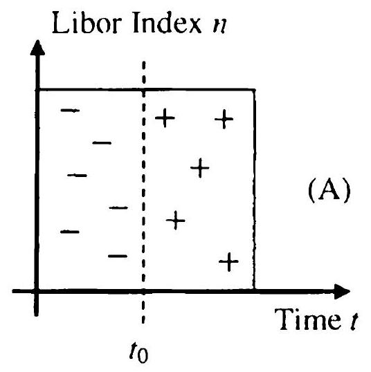

## Importance Sampling and Control Variates

Even if sophisticated payoff smoothing and pathwise derivative schemes are employed, obtaining high-quality Monte Carlo greeks will always require the statistical simulation error to be kept low. Several generic variance reduction techniques were already introduced in Chapter 3; here, we expand on certain applications that are of particular relevance in interest rate modeling. As it turns out, some techniques, such as importance sampling techniques of Section 25.2, produce benefits for greeks estimation that go beyond mere variance reduction. On the other hand, other techniques are less impressive for the greeks than for basic value estimation, as described in Section 25.6. Nevertheless, all variance reduction techniques in this chapter are useful to know.

In our discussion here, we first study a number of applications of the importance sampling technique originally introduced in Section 3.4.4, with a particular emphasis on barrier and TARN products. Subsequently, we turn our attention to the control variate method initially considered in Section 3.4.3, discussing a variety of model- and instrument-based strategies for finding good controls.

### 25.1 Importance Sampling In Short Rate Models

We first look at a classic importance sampling application in simulation of short rate models. For concreteness, let us consider the pricing of a zerocoupon bond maturing at time $T$ in the generic model (11.54); i.e. we are interested in evaluating

$$
\begin{equation*}
X(0, T)=\mathrm{E}\left(\exp \left(-\int_{0}^{T} x(u) d u\right)\right) \triangleq \mathrm{E}(Y(T)) \tag{25.1}
\end{equation*}
$$
^eq25-1

by Monte Carlo methods. Notice that in (25.1) the expectation E is assumed taken under the risk-neutral probability measure Q . We consider now chang-
ing probability measure, from Q to some other measure $\widetilde{\mathrm{Q}}$, with the measure change characterized by a density $\varsigma(t)=\mathrm{E}_{t}(d \widetilde{\mathrm{Q}} / d \mathrm{Q})$ with

$$
d \varsigma(t)=-\varsigma(t) q(t, x(t)) d W(t), \quad \varsigma(0)=1
$$

for some function $q(t, x(t))$ sufficiently regular for $\varsigma(t)$ to be a Q-martingale. By the Radon-Nikodym theorem

$$
X(0, T)=\widetilde{\mathrm{E}}(Y(T) / \varsigma(T))
$$

where $\widetilde{\mathrm{E}}$ is the expected value operator for measure $\widetilde{\mathrm{Q}}$.
In measure $\widetilde{\mathrm{Q}}$, Girsanov's theorem tells us that the joint process for $x(t)$, $1 / \varsigma(t)$, and $Y(t)$ becomes

$$
\begin{array}{r}
d\left(\begin{array}{c}
x(t) \\
1 / \varsigma(t) \\
Y(t)
\end{array}\right)=\left(\begin{array}{c}
\mu_{x}(t, x(t))-q(t, x(t)) \sigma_{x}(t, x(t)) \\
0 \\
-x(t) Y(t)
\end{array}\right) d t \\
\quad+\left(\begin{array}{c}
\sigma_{x}(t, x(t)) \\
q(t, x(t)) / \varsigma(t) \\
0
\end{array}\right) d \widetilde{W}(t)
\end{array}
$$

where $d \widetilde{W}(t)=d W(t)+q(t, x(t)) d t$ is a $\widetilde{\mathrm{Q}}$-Brownian motion.
As showin in Section 3.4.4.3, we can arrange for the random variable $Y(T) / \varsigma(T)$ to have zero variance in measure $\widetilde{\mathrm{Q}}$, provided that we use (3.96) to set

$$
\begin{align*}
\varsigma(t) & =\exp \left(-\int_{0}^{t} x(u) d u\right) X(t, T, x(t)) / X(0, T) \\
q(t, x(t)) & =-X(t, T, x(t))^{-1} \sigma_{x}(t, x(t)) \frac{\partial X(t, T, x(t))}{\partial x(t)} \tag{25.2}
\end{align*}
$$
^eq25-2

where

$$
X(t, T, x)=\mathrm{E}_{t, x}\left(\exp \left(-\int_{t}^{T} x(u) d u\right)\right)
$$

For the SDE (11.54) we generally do not have an analytical (reconstitution) expression for $X(t, T, x)$, but we are free to provide a guess for it. While doing so will most likely not reduce the variance of $Y(T) / \varsigma(T)$ to zero, if the guess is at all reasonable we can still expect a significant variance reduction effect. Onc route to an estimate for the function $X(t, T, x)$ is to assume that the SDE for $x(t)$ can be approximated by a simpler SDE for which a closed-form bond reconstitution formula exists; possible candidates would be, say, the affine class of short rate models or the quadratic Gaussian model. For instance suppose that we feel that the SDE for $x(t)$ can be approximated with a mean-reverting Gaussian model

$$
d x(t) \approx\left(m-\varkappa_{G} x(t)\right) d t+\sigma d W(t),
$$

then we would obtain

$$
\begin{equation*}
q(t, x)=\sigma_{x}(t, x) \frac{1-e^{-\varkappa_{G}(T-t)}}{\varkappa_{G}} . \tag{25.3}
\end{equation*}
$$
^eq25-3

In practice, most models will have a linear mean-reverting drift term, so the estimate of the "best" choice of $\varkappa_{G}$ in (25.3) is often straightforward. If $\mu_{x}(t, x)$ is non-linear, we could simply linearize it around $x=0$ for the purpose of estimating $\varkappa_{G}$.

Andersen [1996] (see also Andersen and Boyle [2000]) tests the efficiency of the choice (25.3) when applied to the problem of computing discount bond prices for the CIR process; the results are far superior to those obtained by traditional variance reduction techniques. Andersen [1996] also notes that the quality of the measure transformation method improves significantly as the number of time steps in the simulation path is increased; this behavior is not surprising given that the method has been designed around the continuoustime limit of the discretized process for $x(t)$. The tendency of the measure transform method to improve with increasing number of discretization steps is quite attractive as it complements the behavior of the bias in the SDE discretization scheme: increasing the number of time steps will lower both the systematic bias and the random Monte Carlo error.

Finally, we note that the principles at play in the method above are general and can be applied to more complicated securities than discount bonds; all that is required is some decent estimate of the expectation value as a function of $t$ and $x$. Often such estimates can be derived - either exactly or at least approximately - in a Gaussian model, for instance. We note that knowledge of an expectation in a closely related model can also form the basis for an application of the control variate method, an idea that we discuss in more detail starting from Section 25.3 below.

### 25.2 Payoff Smoothing by Importance Sampling in TARNs and General Barrier Options

Let us now take a different tack and demonstrate that the importance sampling method may also be used to produce payoff smoothing, in the vein of Chapter 23.

### 25.2.1 Binary Options

We first study a simple example that clearly illustrates the connection between importance sampling and payoff smoothing. Let $X$ be a Gaussian random variable with mean $\mu$ and variance $\sigma^{2}$, and consider an option that pays $g(X)$ (for some smooth $g(x)$ ) if $X$ is below a certain barrier $b$, so that the value of the security is given by

$$
\begin{equation*}
V=\mathrm{E}\left(g(X) 1_{\{X<b\}}\right), \tag{25.4}
\end{equation*}
$$
^eq25-4

where E is an expected value operator for some pricing measure P (note that we do not include discounting in this illustrative example for clarity). Valuing this security by Monte Carlo requires simulating independent Gaussian samples, discarding those that end up above the barrier $b$, and averaging the payoff values over non-discarded samples. If $b$ is low, then the proportion of paths that contribute to the average is small, which leads to a large simulation error (see related discussion in Section 3.4.4.5). Also, the digital feature in the payoff reduces the accuracy and stability of Monte Carlo estimates of greeks. In light of this, it seems natural to change the probability measure to increase the proportion of "interesting" samples, as we did in Section 3.4.4.5. Alternatively, it is tempting to integrate the digital option analytically. As we shall show, the importance sampling method can be set up to implement 'both strategies.

Let us rewrite the value by conditioning on the survival,

$$
\begin{equation*}
V=\mathrm{E}(g(X) \mid X<b) \mathrm{P}(X<b) . \tag{25.5}
\end{equation*}
$$
^eq25-5

The probability of survival in our simple example is known in closed form,

$$
\mathrm{P}(X<b)=\Phi\left(\frac{b-\mu}{\sigma}\right)
$$

where $\Phi(z)$ is the standard Gaussian CDF. Calculating the remaining term $\mathrm{E}(g(X) \mid X<b)$ by Monte Carlo simulation requires us to draw random samples of $X$, conditioned on the event $\{X<b\}$. In order to do this, let us briefly recall from Section 3.1.1 how Gaussian random variables are typically simulated. If $U$ is a uniform random variable on $[0,1]$, then $X$ is obtained by

$$
\begin{equation*}
X=\Phi^{-1}(U) \tag{25.6}
\end{equation*}
$$
^eq25-6

Therefore, $X$ conditioned on $\{X<b\}$ can be sampled by simply drawing a random variable $U^{\prime}$ uniformly distributed on the interval $[0, \Phi(b)]$, followed by an application of the mapping (25.6):

$$
\begin{equation*}
X \mid\{X<b\}=\Phi^{-1}\left(U^{\prime}\right), \quad U^{\prime} \sim \mathcal{U}(0, \Phi(b)) . \tag{25.7}
\end{equation*}
$$
^eq25-7

From (25.5), we may write our option value as

$$
\begin{equation*}
V=\mathrm{E}\left(g\left(\Phi^{-1}\left(U^{\prime}\right)\right)\right) \Phi\left(\frac{b-\mu}{\sigma}\right), \quad U^{\prime} \sim \mathcal{U}(0, \Phi(b)) . \tag{25.8}
\end{equation*}
$$
^eq25-8

Here, the function $g(x)$ is smooth by assumption, and thus a Monte Carlo evaluation of $\mathrm{E}\left(g\left(\Phi\left(U^{\prime}\right)\right)\right)$ will have good convergence and exhibit stable greek estimates. By conditioning, we have, in effect, managed to integrate out the discontinuity analytically, and used the Monte Carlo method for the smooth part of the payoff only.

While a close connection of the method above to the payoff smoothing methods of Chapter 23 is obvious, the method can also be interpreted as a particular case of importance sampling, since in (25.8) all drawn samples come from the "interesting" part of the sample space where survival is guaranteed. The measure effectively used for sampling in (25.8) is often known as the survival measure. To characterize this measure further, notice first that in (25.4) the variable $1_{\{X<b\}}$ is not strictly positive, which requires some additional considerations before using this variable to define a measure shift. Indeed, starting from Section 1.3, we so far have only considered equivalent measures defined by strictly non-zero random variables as RadonNikodym derivatives. The definition of measure change can, however, be extended to Radon-Nikodym derivatives which can hit zero, but in this case the new measure $\widetilde{\mathrm{P}}$ is not equivalent to the original measure P ; instead it is absolutely continuous with respect to the original measure:

$$
\mathrm{P}(A)=0 \Rightarrow \widetilde{\mathrm{P}}(A)=0
$$

but not necessarily the other way around. Notice that the two measures are equivalent when restricted to the set on which the Radon-Nikodym derivative is strictly positive. This set is what we are interested in here. The specific Radon-Nikodym derivative we need is given by

$$
\Lambda=\frac{1_{\{X<b\}}}{\mathrm{P}(X<b)}
$$

note the normalization factor so that $\mathrm{E}(\Lambda)=1$. With this definition, we may write

$$
V=\mathrm{E}\left(g(X) 1_{\{X<b\}}\right)=\mathrm{E}(g(X) \Lambda) \mathrm{P}(X<b)=\widetilde{\mathrm{E}}(g(X)) \mathrm{P}(X<b)
$$

where $\widetilde{E}$ denotes expectation in the survival measure $\widetilde{P}$, defined by

$$
\frac{d \widetilde{\mathrm{P}}}{d \mathrm{P}}=\Lambda
$$

$\widetilde{\mathrm{P}}$ is called a survival measure because it assigns zero probability to all events in the "no-survival" region, i.e. for any event $A$ such that $A \subset\{X \geq b\}$, we have $\widetilde{\mathrm{P}}(A)=0$. The distribution of $X$ under $\widetilde{\mathrm{P}}$ coincides with the distribution of $X$ conditioned on $\{X<b\}$, and is given by (25.7).

The example above is simple, but it demonstrates a general approach to smoothing via importance sampling. Even for more complex barrier-style options, conditioning on survival will often allow us to handle discontinuities analytically, and evaluate the smooth part of the payoff by sampling under the survival measure. These ideas are fully developed in Glasserman and Staum [2001], where the authors observe that conditioning on full survival for a general barrier option is usually not analytically tractable, and instead
propose to condition on one-step survival, from one barrier observation date to the next; at each time step, the measure is changed locally to allow the process to survive until the next time step. Since the behavior of most processes is much simpler on shorter time scales than on longer ones, this strategy will often lead to analytical tractability and efficient Monte Carlo implementation. Our treatment of TAR.Ns in the next section is based on these ideas.

### 25.2.2 TARNs

TARNs and their valuation by Monte Carlo have been introduced in Chapter 20. We recall that the main TARN valuation formula (20.2) under the spot measure $\mathrm{Q}^{B}$ reads

$$
\begin{equation*}
V_{\mathrm{tarn}}(0)=\mathrm{E}\left(\sum_{n=1}^{N-1} B\left(T_{n+1}\right)^{-1} X_{n}\left(T_{n}\right) 1_{\left\{Q_{n}<R\right\}}\right), \tag{25.9}
\end{equation*}
$$
^eq25-9

where $B(t)$ is as the discretely rolled money market numeraire, $X_{n}$ 's are net coupons, $Q_{n}=\sum_{i=1}^{n-1} \tau_{i} C_{i}$ are accumulated structured coupons, and $R$ is the total return. Here E is (re-)defined to be the expected value operator for measure $\mathrm{Q}^{B}$. As described in detail elsewhere, the net coupon $X_{n}$ is paid only if the process survives up to time $T_{n}$; by analogy to the simple example in Section 25.2.1, we expect that conditioning on survival may reduce variance and improve risk stability. We have already seen a payoff smoothing method applied to TARNs based on partial analytical integration in Section 23.2.4. Here we approach the problem from a different angle.

### 25.2.3 Removing the First Digital

In many cases, the biggest contributor to the simulation noise in a TARN is the first embedded digital option, i.e. the contract feature that specifies a knock-out event at date $T_{2}$ if $C_{1}\left(T_{1}\right)$ is above a certain barrier ${ }^{1}$. The variance of the estimate can be reduced if we could handle this digital option explicitly, outside of the Monte Carlo simulation.

To develop the idea in detail, let us for concreteness focus on a TARN of the inverse floating type, where the structured coupon is as in (20.1),

$$
\begin{equation*}
C_{n}=\left(s-g \times L_{n}\left(T_{n}\right)\right)^{+} . \tag{25.10}
\end{equation*}
$$
^eq25-10

We also introduce a sequence of random variables

$$
\begin{equation*}
b_{n}=\left(s-\left(R-Q_{n}\right) / \tau_{n}\right) / g \tag{25.11}
\end{equation*}
$$
^eq25-11

[^91]with $b_{n}$ being $\mathcal{F}_{T_{n-1}}$-measurable. The first variable in the sequence,

$$
b_{1}=\left(s-R . / \tau_{1}\right) / g
$$
(see (20.4)) is deterministic, and we have

$$
\left\{Q_{2}<R\right\} \Leftrightarrow\left\{L_{1}\left(T_{1}\right)>b_{1}\right\} .
$$

Let us denote by $\mathcal{V}$ the path value of the coupons that depend on the first knockout event (the first coupon $X_{1}\left(T_{1}\right)$ is paid always and is easy to handle separately),

$$
\mathcal{V}=\sum_{n=2}^{N-1} B\left(T_{n+1}\right)^{-1} X_{n}\left(T_{n}\right) 1_{\left\{Q_{n}<R\right\}}
$$

Then

$$
\begin{aligned}
\mathrm{E}(\mathcal{V})=\mathrm{E}\left(\mathcal{V} \mid L_{1}\left(T_{1}\right)>b_{1}\right) \mathrm{Q}^{B} & \left(L_{1}\left(T_{1}\right)>b_{1}\right) \\
& +\mathrm{E}\left(\mathcal{V} \mid L_{1}\left(T_{1}\right) \leq b_{1}\right) \mathrm{Q}^{B}\left(L_{1}\left(T_{1}\right) \leq b_{1}\right)
\end{aligned}
$$

Clearly

$$
\mathrm{E}\left(\mathcal{V} \mid L_{1}\left(T_{1}\right) \leq b_{1}\right)=0
$$

so that

$$
\begin{equation*}
\mathrm{E}(\mathcal{V})=\mathrm{E}\left(\mathcal{V} \mid L_{1}\left(T_{1}\right)>b_{1}\right) \mathrm{Q}^{B}\left(L_{1}\left(T_{1}\right)>b_{1}\right) . \tag{25.12}
\end{equation*}
$$
^eq25-12

In (25.12), since $T_{1}$ is typically small (less than one year), the probability $\mathrm{Q}^{B}\left(L_{1}\left(T_{1}\right)>b_{1}\right)$ of not knocking out can nearly always be approximated analytically with a high degree of precision. For instance, since time to expiry is short, the issue of non-deterministic drift of $L_{1}\left(T_{1}\right)$ under the spot measure can be easily dealt with by, say, freezing the drift along the forward yield curve (see related discussion in Section 23.2.4).

The value $\mathrm{E}\left(\mathcal{V} \mid L_{1}\left(T_{1}\right)>b_{1}\right)$ can be interpreted as the value of the TAR.N under the condition that it does not knock out on the date $T_{1}$. This value can be computed in a Monte Carlo simulation by either sampling Gaussian variates that generate simulation steps by a scheme similar to (25.7), or by adjusting the drifts of the forward Libor model in such a way as to move the Libor rate $L_{1}$ away from the knockout region. We do not go into details as we will present a more general scheme in the next section.

### 25.2.4 Smoothing All Digitals by One-Step Survival Conditioning

Removing the first discontinuity from the payoff being calculated by Monte Carlo often reduces the simulation error substantially. However, we can go further. Typically, given the information available on the coupon date $T_{n}$, we can evaluate the probability of knockout on the next day (quasi)-analytically. Following Piterbarg [2004c], we can use this information to develop a scheme where all discontinuities are integrated outside of Monte Carlo.

Proposition 25.2.1. A TARN with structured coupon (25.10) can be valued as follows,

$$
\begin{align*}
V_{\operatorname{tarn}}(0) & =\sum_{n=1}^{N-1} \widetilde{\mathrm{E}}\left(\psi_{n} \mathrm{E}_{T_{n-1}}\left(B\left(T_{n+1}\right)^{-1} X_{n}\left(T_{n}\right)\right)\right)  \tag{25.13}\\
\psi_{n} & =\prod_{k=1}^{n-1} \mathrm{Q}_{T_{k-1}}^{B}\left(L_{k}\left(T_{k}\right)>b_{k}\right) \tag{25.14}
\end{align*}
$$
^eq25-13
^eq25-14

Here the measure $\widetilde{\mathrm{Q}}^{B}$ is defined by its Radon-Nikodym derivative with respect to $\mathrm{Q}^{B}$,

$$
\begin{equation*}
\Lambda(t)=\mathrm{E}_{t}\left(\frac{d \widetilde{\mathrm{Q}}^{B}}{d \mathrm{Q}^{B}}\right) \tag{25.15}
\end{equation*}
$$
^eq25-15

where $\Lambda(t)$ is a non-negative, normalized $\mathrm{Q}^{B}$-martingale such that

$$
\Lambda(t)=\frac{\mathrm{Q}_{t}^{B}\left(L_{m+1}\left(T_{m+1}\right)>b_{m+1}\right)}{\mathrm{Q}_{T_{m}}^{B}\left(L_{m+1}\left(T_{m+1}\right)>b_{m+1}\right)} \prod_{k=1}^{m-1} \frac{1_{\left\{L_{k+1}\left(T_{k+1}\right)>b_{k+1}\right\}}}{\mathrm{Q}_{T_{k}}^{B}\left(L_{k+1}\left(T_{k+1}\right)>b_{k+1}\right)}
$$

for $t \in\left[T_{m}, T_{m+1}\right)$.
Proof. We observe that due to non-negativity of the structured coupon $C_{n-1}$, the following equality holds $\mathrm{Q}^{B}$-almost surely,

$$
\begin{aligned}
\left\{Q_{n}<R\right\} & \Leftrightarrow\left\{Q_{n-1}<R,\left(s-g L_{n-1}\left(T_{n-1}\right)\right)^{+}<\left(R-Q_{n-1}\right) / \tau_{n-1}\right\} \\
& \Leftrightarrow\left\{Q_{n-1}<R, L_{n-1}\left(T_{n-1}\right)>b_{n-1}\right\}
\end{aligned}
$$

Likewise, using non-negativity of all $C_{i}$ 's,

$$
\begin{aligned}
\left\{Q_{n}<R\right\} & \Leftrightarrow\left\{Q_{1}<R, Q_{2}<R, \ldots, Q_{n}<R\right\} \\
& \Leftrightarrow\left\{L_{1}\left(T_{1}\right)>b_{1}, \ldots, L_{n-1}\left(T_{n-1}\right)>b_{n-1}\right\}
\end{aligned}
$$

Hence

$$
1_{\left\{Q_{n}<R\right\}}=\prod_{k=1}^{n-1} 1_{\left\{L_{k}\left(T_{k}\right)>b_{k}\right\}}
$$

Define

$$
\Lambda_{n}(t)= \begin{cases}\frac{\mathrm{Q}_{1}^{\prime \prime}\left(L_{n+1}\left(T_{n+1}\right)>b_{n+1}\right)}{\mathrm{Q}_{n_{n}^{\prime \prime}}^{\prime \prime}\left(L_{n+1}\left(T_{n+1}\right)>b_{n+1}\right)}, & t \in\left[T_{n}, T_{n+1}\right) \\ \frac{1_{\left\{L_{n+1}\left(v_{n+1}\right)>h_{n+1}\right\}}}{\mathrm{Q}_{\eta_{n}^{\prime \prime}}^{\prime \prime}\left(L_{n+1}\left(T_{n+1}\right)>b_{n+1}\right)}, & t \geq T_{n+1} \\ 1, & t<T_{n}\end{cases}
$$

We note that $\Lambda_{n}(t)$ is a non-negative $\mathrm{Q}^{B}$-martingale. Moreover, $\Lambda_{n}(t)$ is constant on $\left[0, T_{n}\right]$ and $\left[T_{n+1}, \infty\right)$. In addition, $\Lambda_{n}(t)$ is $\mathcal{F}_{T_{n+1}}$-measurable for $t \geq T_{n+1}$.

We define $\Lambda(t)$ by

$$
\Lambda(t)=\prod_{n=0}^{N-2} \Lambda_{n}(t)
$$

It is not hard to show that $\Lambda(t)$ is a $\mathrm{Q}^{B}$-martingale as well. Let us denote the value of the $n$-th coupon, contingent on survival to time $T_{n}$, by

$$
V_{\mathrm{cpn}, n}(0)=\mathrm{E}\left(B\left(T_{n+1}\right)^{-1} X_{n}\left(T_{n}\right) 1_{\left\{Q_{n}<R\right\}}\right) .
$$

As

$$
\begin{aligned}
\prod_{k=1}^{n-1} 1_{\left\{L_{k}\left(T_{k}\right)>b_{k}\right\}} & =\left(\prod_{k=1}^{n-1} \frac{1_{\left\{L_{k}\left(T_{k}\right)>b_{k}\right\}}}{\mathrm{Q}_{T_{k-1}}^{B}\left(L_{k}\left(T_{k}\right)>b_{k}\right)}\right)\left(\prod_{k=1}^{n-1} \mathrm{Q}_{T_{k-1}}^{B}\left(L_{k}\left(T_{k}\right)>b_{k}\right)\right) \\
& =\left(\prod_{k=1}^{n-1} \Lambda_{k-1}\left(T_{n-1}\right)\right)\left(\prod_{k=1}^{n-1} \mathrm{Q}_{T_{k-1}}^{B}\left(L_{k}\left(T_{k}\right)>b_{k}\right)\right) \\
& =\left(\prod_{k=1}^{N-1} \Lambda_{k-1}\left(T_{n-1}\right)\right)\left(\prod_{k=1}^{n-1} \mathrm{Q}_{T_{k-1}}^{B}\left(L_{k}\left(T_{k}\right)>b_{k}\right)\right),
\end{aligned}
$$

we have

$$
\begin{equation*}
V_{\mathrm{cpm}, n}(0)=\mathrm{E}\left(\Lambda\left(T_{n-1}\right) B\left(T_{n+1}\right)^{-1} X_{n}\left(T_{n}\right) \prod_{k=1}^{n-1} \mathrm{Q}_{T_{k-1}}^{B}\left(L_{k}\left(T_{k}\right)>b_{k}\right)\right) . \tag{25.16}
\end{equation*}
$$
^eq25-16

Next, taking the $\mathcal{F}_{T_{n-1}}$-conditional expected value inside the expected value in (25.16) and using the measure $\widetilde{\mathrm{Q}}^{B}$ defined by its Radon-Nikodym derivative with respect to $Q^{B}$ in (25.15), we obtain

$$
\begin{aligned}
V_{\mathrm{cpn}, n}(0) & =\widetilde{\mathrm{E}}\left(\psi_{n} \mathrm{E}_{T_{n-1}}\left(B\left(T_{n+1}\right)^{-1} X_{n}\left(T_{n}\right)\right)\right) \\
\psi_{n} & =\prod_{k=1}^{n-1} \mathrm{Q}_{T_{k-1}}^{B}\left(L_{k}\left(T_{k}\right)>b_{k}\right)
\end{aligned}
$$

and the proposition follows.
Remark 25.2.2. Quantities $\psi_{n}$ in (25.14) can be calculated or approximated analytically since each term of the form $\mathrm{Q}_{T_{k-1}}^{B}\left(L_{k}\left(T_{k}\right)>b_{k}\right)$ involves an expected value over a relatively short period $\left[T_{k-1}, T_{k}\right]$, so that short-time approximations (e.g., based on a Gaussian distribution) to the distribution of $L_{k}$ over $\left[T_{k-1}, T_{k}\right]$ may be applied effectively. Note that the fact that $L_{k}$ is a $\mathrm{Q}^{B}$-martingale over time period $\left[T_{k-1}, T_{k}\right]$ would help here. In some simulation schemes, such as those considered in Sections 25.2.5 and 25.2.6 for example, the $\psi_{n}$ come for free, without any extra work.

Remark 25.2.3. The measure $\widetilde{\mathrm{Q}}^{B}$ is not equivalent to $\mathrm{Q}^{B}$ because $\Lambda(t)$ can be zero. However, since the value of the TARN is zero for those paths for which $\Lambda(t)$ is zero, $\widetilde{\mathrm{Q}}^{B}$ and $\mathrm{Q}^{B}$ are equivalent on the relevant subspace of the sample space.

The formula (25.13) specifies that the value of a TAR.N can be computed by Monte Carlo simulation under the measure $\widetilde{\mathrm{Q}}^{B}$ by adding values of net coupons $X_{n}$ scaled by weights $\psi_{n}$. This should be contrasted to the original expression (25.9) where the weights on coupons are instead indicator functions $1_{\left\{Q_{n}<R\right\}}$. Obviously, the $\psi_{n}$ 's are much smoother functions of a simulated path than are indicator functions, since in the former the digital discontinuities have been integrated away by computing the probabilities $\mathrm{Q}_{T_{k-1}}^{B}\left(L_{k}\left(T_{k}\right)>b_{k}\right)$ in (25.14) (quasi)-analytically.

Another feature of note of formula (25.13) is the presence of nested expected values where the inner one is calculated under the original spot measure $\mathrm{Q}^{B}$, while the outer uses the survival measure $\widetilde{\mathrm{Q}}^{B}$. While $\widetilde{\mathrm{Q}}^{B}$ is the main simulation measure, when computing the value of the $n$-th coupon we must return to measure $\mathrm{Q}^{B}$, when stepping from time $T_{n-1}$ to time $T_{n+1}$.

In measure $\widetilde{\mathrm{Q}}^{B}$, the TARN never knocks out, so a simulation based on the result in Proposition 25.2.1 can be interpreted as a version of the importance sampling method in Section 25.2.1, where the measure is changed from $\mathrm{Q}^{B}$ to $\widetilde{\mathrm{Q}}^{B}$ and the likelihood ratio is partially pre-integrated. Of course, to use the method in practice we need to establish how precisely to simulate model dynamics in measure $\widetilde{\mathrm{Q}}^{B}$; we study this topic in the next three sections.

### 25.2.5 Simulating Under the Survival Measure Using Conditional Gaussian Draws

We first consider a special case of the Libor market model (see Chapter 14), where we use a single-factor ${ }^{2}$ volatility specification with separable deterministic local volatility, see (14.13)-(14.14). Continuing with the inverse floater TAR.N example and assuming that the tenor structure coincides with the schedule of the TARN, Libor forwards satisfy

$$
\begin{equation*}
d L_{i}(t)=\lambda_{i}(t) \varphi\left(L_{i}(t)\right)\left(\mu_{i}(t) d t+d W(t)\right) \tag{25.17}
\end{equation*}
$$
^eq25-17

$i=1, \ldots, N-1$, with $W(t)$ being a one-dimensional Brownian motion under the spot measure $\mathrm{Q}^{B}$.

TAR.N valuation with formula (25.13) requires us to simulate Libor rates under measure $\widetilde{\mathrm{Q}}^{B}$, i.e. in such a way that $L_{n}\left(T_{n}\right)>b_{n}$ for each $n$. To see how this would work, let us consider a simulation time step from $T_{n-1}$ to $T_{n}$ for a fixed $n$ for all Libor rates. We note that for each $n, b_{n}$ in (25.11) is $\mathcal{F}_{T_{n-1}}$-measurable, i.e. is known at time $T_{n-1}$. Employing a simple Euler scheme, we can approximate the $\mathrm{Q}^{B}$-dynamics as

[^92]$L_{n}\left(T_{n}\right)=L_{n}\left(T_{n-1}\right)+\lambda_{n}\left(T_{n-1}\right) \varphi\left(L_{n}\left(T_{n-1}\right)\right)\left(\mu_{n}\left(T_{n-1}\right) \tau_{n-1}+\sqrt{\tau_{n-1}} Z\right)$,
where $Z$ is a standard Gaussian random variable. Given that we want to simulate in such a way that $L_{n}\left(T_{n}\right)>b_{n}$, we need to make sure that $Z$ satisfies

$$
\begin{equation*}
L_{n}\left(T_{n-1}\right)+\lambda_{n}\left(T_{n-1}\right) \varphi\left(L_{n}\left(T_{n-1}\right)\right)\left(\mu_{n}\left(T_{n-1}\right) \tau_{n-1}+\sqrt{\tau_{n-1}} Z\right)>b_{n} \tag{25.18}
\end{equation*}
$$
^eq25-18
which can be solved to yield

$$
\begin{equation*}
Z>Z_{\min }, \quad Z_{\min } \triangleq\left(b_{n}-m_{n}\right) / v_{n} \tag{25.19}
\end{equation*}
$$
^eq25-19
where we have denoted

$$
\begin{equation*}
v_{n} \triangleq \lambda_{n}\left(T_{n-1}\right) \varphi\left(L_{n}\left(T_{n-1}\right)\right) \sqrt{\tau_{n-1}}, m_{n} \triangleq L_{n}\left(T_{n-1}\right)+v_{n} \mu_{n}\left(T_{n-1}\right) \sqrt{\tau_{n-1}}, \tag{25.20}
\end{equation*}
$$
^eq25-20
so that

$$
\begin{equation*}
L_{n}\left(T_{n}\right)=m_{n}+v_{n} Z \tag{25.21}
\end{equation*}
$$
^eq25-21

The lower bound $Z_{\min }$ in (25.19) is known at time $T_{n-1}$, and the measure change is expressed by the requirement that the random variable $Z$ should satisfy (25.19). In Section 25.2.1 we have already discussed how to simulate a Gaussian random variable conditioned on it being below (or above) a certain level; all we need to do is to apply the idea behind the scheme (25.7) (with $b$ set to $Z_{\text {min }}$ from (25.19)). In particular we can just set

$$
\begin{equation*}
\widetilde{Z}=\Phi^{-1}\left(\Phi\left(Z_{\min }\right)+\left(1-\Phi\left(Z_{\min }\right)\right) U\right) \tag{25.22}
\end{equation*}
$$
^eq25-22

where $U$ is a uniform draw from $[0,1]$.
While in this new measure we, by construction, have that $L_{n}\left(T_{n}\right)>b_{n}$, it may not be entirely obvious that this is the measure $\widetilde{\mathrm{Q}}^{B}$ as defined by (25.15), since we can satisfy the constraint (25.18) in many different ways. To check, let us denote the measure implicit in the simulation scheme above by $\widehat{\mathrm{Q}}^{B}$ for a moment. We obviously have that for any $l<b_{n}$,

$$
\begin{equation*}
\widehat{\mathrm{Q}}_{T_{n-1}}^{B}\left(L_{n}\left(T_{n}\right)>l\right)=1, \quad l<b_{n} . \tag{25.23}
\end{equation*}
$$
^eq25-23

For $l$ such that $l>b_{n}$, we have

$$
\widehat{\mathrm{Q}}_{T_{n-1}}^{B}\left(L_{n}\left(T_{n}\right)>l\right)=\mathrm{Q}_{T_{n-1}}^{B}\left(\widetilde{Z}>\left(l-m_{n}\right) / v_{n}\right)
$$

and then, from (25.22),

$$
\mathrm{Q}_{T_{n-1}}^{B}\left(\widetilde{Z}>\left(l-m_{n}\right) / v_{n}\right)=\frac{1-\Phi\left(\left(l-m_{n}\right) / v_{n}\right)}{1-\Phi\left(Z_{\min }\right)} .
$$

Now, from (25.20)-(25.21),

$$
\begin{gathered}
1-\Phi\left(\left(l-m_{n}\right) / v_{n}\right)=\mathrm{Q}_{T_{n-1}}^{B}\left(L_{n}\left(T_{n}\right)>l\right) \\
1-\Phi\left(Z_{\min }\right)=\mathrm{Q}_{T_{n-1}}^{B}\left(L_{n}\left(T_{n}\right)>b_{n}\right)
\end{gathered}
$$

and we finally obtain

$$
\widehat{\mathrm{Q}}_{T_{n-1}}^{B}\left(L_{n}\left(T_{n}\right)>l\right)=\frac{\mathrm{Q}_{T_{n-1}}^{B}\left(L_{n}\left(T_{n}\right)>l\right)}{\mathrm{Q}_{T_{n-1}}^{B}\left(L_{n}\left(T_{n}\right)>b_{n}\right)}, \quad l \geq b_{n}
$$

which, together with (25.23), demonstrates that $\widehat{\mathrm{Q}}^{B}$ is the same measure as $\widetilde{\mathrm{Q}}^{B}$ defined by (25.15).

To finish the description of the simulation scheme we note that once $\widetilde{Z}$ has been drawn, all Libor rates $L_{i}(t), i=n, \ldots, N-1$, can be evaluated using

$$
L_{i}\left(T_{n}\right)=L_{i}\left(T_{n-1}\right)+\lambda_{i}\left(T_{n-1}\right) \varphi\left(L_{i}\left(T_{n-1}\right)\right)\left(\mu_{i}\left(T_{n-1}\right) \tau_{n-1}+\sqrt{\tau_{n-1}} \tilde{Z}\right)
$$

for $i=n, \ldots, N-1$.
Notice that the algorithm above not only shows how to easily propagate the Libor curve forward in time, it also gives us the weights $\psi_{n}$ in (25.14) without extra work. Specifically, from (25.19) we see that the one-step survival probability $\mathrm{Q}_{T_{n-1}}^{B}\left(L_{n}\left(T_{n}\right)>b_{n}\right)$ is simply equal to $1-\Phi\left(Z_{\min }\right)$. It should be noted that the simplicity of the algorithm is partly based on the fact that we consider only a single-factor LM model in (25.17), and also by the fact that the payout is such that we can express the survival condition as a simple condition on one of the primary Libor rates over each time period. Both restrictions can, however, be lifted fairly easily. For instance, Pietersz [2005] suggests using a suitable rotation of the local volatility matrix to make sure that the survival (over a given time step) is determined by a single Gaussian draw. A different, and more general, twist is offered in Fries and Joshi [2008b]; we briefly review this approach in the next section.

### 25.2.6 Generalized Trigger Products in Multi-Factor LM Models

Following Fries and Joshi [2008b], we define a generalized trigger product to be a contract that pays a (net) coupon $X_{n}$ until a knockout event, defined as the first time index $n$ where an $\mathcal{F}_{T_{n}}$-measurable trigger variable $G_{n}$ exceeds some trigger level $h_{n}$, i.e. when $G_{n}>h_{n}$, with $h_{n}$ being $\mathcal{F}_{T_{n-1}}$-measurable. In the spot measure, the so-defined security has present value

$$
V_{\mathrm{gtp}}(0)=\mathrm{E}\left(\sum_{n=1}^{\eta-1} B\left(T_{n+1}\right)^{-1} X_{n}\right), \quad \eta=\min \left\{n \geq 1: G_{n} \geq h_{n}\right\} \wedge N .
$$

A generalized trigger product is closely linked to barrier options we considered in Sections 23.4.2 and 24.1.2. TARNs are a special case; for a TARN the
trigger variable is in fact the $n$-th structured coupon $C_{n}$ and the trigger barrier is given by $h_{n}=\left(R-Q_{n-1}\right) / \tau_{n}$, see (20.2). Note that we do not assume any particular form for $G_{n}$ or $h_{n}$ at this point.

Leaning on the results in Proposition 25.2.1, the value $V_{\text {gtp }}(0)$ can be rewritten as an expectation in the survival measure $\widetilde{\mathrm{Q}}^{B}$,

$$
\begin{align*}
V_{\mathrm{gtp}}(0) & =\sum_{n=1}^{N-1} \widetilde{\mathrm{E}}\left(\psi_{n} \mathrm{E}_{T_{n-1}}\left(B\left(T_{n+1}\right)^{-1} X_{n}\right)\right)  \tag{25.24}\\
\psi_{n} & =\prod_{k=1}^{n-1} \mathrm{Q}_{T_{k-1}}^{B}\left(G_{k} \leq h_{k}\right) \tag{25.25}
\end{align*}
$$
^eq25-24
^eq25-25

Let us now generalize (25.17). We assume that all Libor rates are driven by a $d$-dimensional Brownian motion,

$$
d L_{i}(t)=\sigma_{i}(t)^{\top}\left(\mu_{i}(t) d t+d W(t)\right), \quad i=1, \ldots, N-1
$$

where $\sigma_{\imath}(t)$ is a general process that may depend on (potentially all) Libor rates at time $t$. Denoting by $\mathbf{L}(t)$ the vector of all forward Libor rates observed at $t$, we rewrite the dynamics in a vector format

$$
\begin{equation*}
d \mathbf{L}(t)=M(t) d t+\Sigma(t)^{\top} d W(t) \tag{25.26}
\end{equation*}
$$
^eq25-26

for a suitably defined vector function $M(t)$ and a matrix function $\Sigma(t)$ (both of which are functions of $\mathbf{L}(t)$ ).

Let us consider a single time step from $T_{n-1}$ to $T_{n}$, and assume that the $n$-th trigger variable $G_{n}$ is in fact a function $G_{n}\left(\mathbf{L}\left(T_{n}\right)\right)$ of the vector of Libor rates observed at $T_{n}$. An Euler scheme for (25.26) is given by

$$
\begin{equation*}
\mathbf{L}\left(T_{n}\right)=\mathbf{L}\left(T_{n-1}\right)+M\left(T_{n-1}\right) \tau_{n-1}+\widehat{\Sigma}^{\top} Z, \tag{25.27}
\end{equation*}
$$
^eq25-27

where $Z$ is a $d$-dimensional standard Gaussian vector and $\widehat{\Sigma}= \Sigma\left(T_{n-1}\right)^{\top} \sqrt{\tau_{n-1}}$. Let us define by $\gamma(z)$ the value of the trigger variable $G_{n}$ as a function of the realized Gaussian increment in the Euler scheme (25.27),

$$
\gamma(z) \triangleq G_{n}\left(\mathrm{~L}\left(T_{n-1}\right)+M\left(T_{n-1}\right) \tau_{n-1}+z\right)
$$

so that

$$
\begin{equation*}
G_{n}\left(\mathbf{L}\left(T_{n}\right)\right)=\gamma\left(\widehat{\Sigma}^{\top} Z\right) . \tag{25.28}
\end{equation*}
$$
^eq25-28

Next, we define the normalized gradient (a row vector) of the function $\gamma$ by

$$
v=\nabla \gamma(0) /\|\nabla \gamma(0)\| .
$$

The survival boundary is given in terms of the function $\gamma$ as $\gamma(z)=h_{n}$. Let $Y_{\text {max }}$ be the solution of the linearization of this equation in direction $v$, i.e. let us set

$$
\begin{equation*}
Y_{\max }=\left(h_{n}-\gamma(0)\right) /\|\nabla \gamma(0)\| . \tag{25.29}
\end{equation*}
$$
^eq25-29

Then, to first order, as follows from (25.28), the survival condition $G_{n}\left(\mathbf{L}\left(T_{n}\right)\right)<h_{n}$ is equivalent to the following condition on the Gaussian draw $Z$,

$$
\begin{equation*}
Y<Y_{\max }, \quad Y \triangleq v \widehat{\Sigma}^{\top} Z \tag{25.30}
\end{equation*}
$$
^eq25-30

In (25.30) the random variable $Y$ is Gaussian, making it straightforward to design a sampling scheme where (25.30) is always satisfied. Drawing on the same idea that lead to (25.22) and (25.7), we define

$$
U=\Phi\left(Y / \sigma_{Y^{\prime}}\right), \quad \sigma_{Y^{\prime}}^{2}=v \widehat{\Sigma}^{\top} \widehat{\Sigma} v^{\top}
$$

and also set

$$
\begin{equation*}
\widetilde{Y}=\sigma_{Y^{\prime}} \Phi^{-1}\left(U \Phi\left(Y_{\max }\right)\right) . \tag{25.31}
\end{equation*}
$$
^eq25-31

Clearly $\widetilde{Y} \leq Y_{\text {max }}$ always, and

$$
\begin{equation*}
\mathrm{Q}^{B}(Y<K)=\Phi\left(Y_{\max }\right) \mathrm{Q}^{B}(\tilde{Y}<K) \tag{25.32}
\end{equation*}
$$
^eq25-32

for any $K \in\left(-\infty, \Phi\left(Y_{\text {max }}\right)\right]$. In particular, to first order,

$$
\begin{aligned}
\gamma\left(\hat{\Sigma}^{\top} Z+v^{\top}(\tilde{Y}-Y)\right) & \approx \gamma(0)+\|\nabla \gamma(0)\| v\left(\hat{\Sigma}^{\top} Z+v^{\top}(\tilde{Y}-Y)\right) \\
& =\gamma(0)+\|\nabla \gamma(0)\|(Y+\tilde{Y}-Y) \\
& =\gamma(0)+\|\nabla \gamma(0)\| \tilde{Y}
\end{aligned}
$$

and, since $\widetilde{Y} \leq Y_{\text {max }}$, we have that (again to first order)

$$
\gamma\left(\widehat{\Sigma}^{\top} Z+v^{\top}(\tilde{Y}-Y)\right) \leq h_{n}
$$

Therefore, if we replace the stepping scheme (25.27) with

$$
\begin{equation*}
\mathbf{L}\left(T_{n}\right)=\mathbf{L}\left(T_{n-1}\right)+M\left(T_{n-1}\right) \tau_{n-1}+\widehat{\Sigma}^{\top} Z+v^{\top}(\tilde{Y}-Y), \tag{25.33}
\end{equation*}
$$
^eq25-33

then $\mathbf{L}\left(T_{n}\right)$ will always, to first order, be in the survival region. In particular, to make a time step in the survival measure $\widetilde{\mathrm{Q}}^{B}$, we simply make an adjustment to the Gaussian draw to stay in the survival region and instead of $\widehat{\Sigma}^{\top} Z$ use $\widehat{\Sigma}^{\top} Z+v^{\top}(\widetilde{Y}-Y)$. Moreover, from (25.32) we immediately obtain the weight that we need to apply to a Monte Carlo path with a particular draw $Z$ (for time step $T_{n-1} \rightarrow T_{n}$ ) - it is simply equal to $\Phi\left(Y_{\text {max }}\right)$ from (25.29). Putting it all together, we obtain the following result (compare to Proposition 25.2.1).

Proposition 25.2.4. A generalized trigger product can be valued by (25.24)(25.25) where an Euler simulation in the survival measure is given by (25.33). The weights $\psi_{n}$ in (25.25) are given by

$$
\psi_{n}=\prod_{k=1}^{n-1} \mathrm{Q}_{T_{k-1}}^{B}\left(G_{k}\left(\mathbf{L}\left(T_{k}\right)\right)<h_{k}\right)=\prod_{k=1}^{n-1} \Phi\left(Y_{\max , k}\right),
$$

where by $Y_{\max , k}$ we denote the value of $Y_{\max }$ in (25.29) for time step $T_{k-1} \rightarrow T_{k}$ 。

### 25.3 Model-Based Control Variates

The method of control variates was first introduced in Section 3.4.3. As we recall from ( 3.83 ), the method boils down to replacing the standard Monte Carlo estimate

$$
\frac{1}{K^{K}} \sum_{j=1}^{K} Y\left(\omega_{j}\right)
$$

of $\mathrm{E}(Y)$ with

$$
\begin{equation*}
\frac{1}{K} \sum_{j=1}^{K}\left(Y\left(\omega_{j}\right)-\beta^{\top}\left(Y^{c}\left(\omega_{j}\right)-\mathrm{E}\left(Y^{c}\right)\right)\right), \tag{25.34}
\end{equation*}
$$
^eq25-34

where $Y^{c}\left(\omega_{j}\right)$ are random samples of the potentially multi-dimensional control variate $Y^{c}$, chosen such that $\mathrm{E}\left(Y^{c}\right)$ is available in closed form. As shown in (3.85), the variance reduction achieved by the method is directly proportional to the correlation between the primary variable $Y$ and its control $Y^{c}$. There are multiple ways to select the control variate $Y^{c}$. For instance, if $Y$ is the value of a security under a given model, then $Y^{c}$ may represent the value of the same security under a different, but closely related model; or the value of a different (but related) security under the same model; or the value of an approximate hedging strategy of $Y$. Of course, we may also select a control variate that is a weighted combination of many different individual control variates, each chosen by a different strategy.

In the next few sections, we shall study several methods to design control variates. We start with the model-based control variate method, which uses the value of a security in a simplified proxy model as a control for the security value in the actual pricing model. To fix ideas, let $\widehat{V}_{\text {orig }}$ be the Monte Carlo estimate for the true security value in the original pricing model, and let $\widehat{V}_{\text {proxy }}$ be the Monte Carlo estimate for the same security in a proxy model. In the proxy model, assume that a highly accurate price estimate $V_{\text {PDE }}$ is available, most likely computed by the PDE methods of Chapter 2. As in (25.34), let us introduce a corrected value estimate as

$$
\widehat{V}_{\text {corrected }}=\widehat{V}_{\text {orig }}-\beta\left(\widehat{V}_{\text {proxy }}-V_{\mathrm{PDE}}\right)
$$

where $\beta$ is the appropriate regression coefficient. Assuming that $\mathrm{E}\left(\widehat{V}_{\text {proxy }}\right)= V_{\text {PDE }}$ to high precision, the new estimate will be practically unbiased. If the
path values used to compute $\widehat{V}_{\text {orig }}$ are positively correlated with the ones used to obtain $\widehat{V}_{\text {proxy }}$, then the variance of the estimate is reduced.

The computational effort to estimate $\widehat{V}_{\text {corrected }}$ is noticeably higher than that needed to compute $\widehat{V}_{\text {orig }}$, since two additional valuations (one by Monte Carlo and one by PDE methods) are now needed. For the method to lead to an efficiency improvement ${ }^{3}$, the achieved variance reduction needs to be high, in turn requiring very high correlation between the original and proxy model path values of the security. This can typically be only achieved if the two models are closely related, and use random numbers in near-identical fashion to generate security path values. For instance, it is unlikely that one could successfully use a short rate model to compute a control variate when the original model is a Libor market (LM) model.

While on the topic of the LM model, we note that this particular model is particularly in need of variance reduction: not only is the LM model always implemented via Monte Carlo methods, it is also more computationally demanding than many other Monte Carlo based models ${ }^{4}$ and typically is used for complex, compute-intensive payoffs. To find a suitably faithful proxy model for a full-blown LM model, we note that while PDE methods are generally not available for LM models, PDE approximations are possible. While some believe that such approximations may serve as outright substitutes for LM model, in our opinion it is very difficult to make the approximations sufficiently accurate and robust to safely use them for actual security pricing. On the other hand, these approximations are often perfectly adequate for the model-based control variate method, since the requirements on proxy model precision and internal consistency are actually quite low - all that is needed is that the estimator $\widehat{V}_{\text {proxy }}$ is highly correlated to the true model price and has a limit that can be computed accurately by some other scheme. In fact, the proxy model does not have to be arbitrage free, which for LM models opens up the possibility of replacing complicated path-dependent drift terms with simpler ones that admit a PDE representation of security values.

### 25.3.1 Low-Dimensional Markov Approximation for LM models

We recall that an LM model is Markovian only in the full set of all forward Libor rates on the yield curve, plus any additional variables required to model unspanned stochastic volatility. As numerical methods for PDEs start becoming impractical when there are more than 3 or 4 state variables, a fair bit of simplification of the LM model is required to come up with a PDE-friendly model proxy. To show one way of proceeding, let us start with

[^93]a one-factor model equipped with a deterministic local volatility (14.13)(14.14), the spot measure dynamics of which we represent as

$$
\begin{align*}
d L_{n}(t) & =\varphi\left(L_{n}(t)\right) \lambda_{n}(t)\left(\mu_{n}(t, \mathbf{L}(t)) d t+d W(t)\right)  \tag{25.35}\\
\mu_{n}(t, \mathbf{L}(t)) & =\sum_{\imath=q(t)}^{n} \frac{\tau_{i} \varphi\left(L_{i}(t)\right) \lambda_{i}(t)}{1+\tau_{i} L_{i}(t)}
\end{align*}
$$
^eq25-35
for $n=1, \ldots, N-1$, with $\mathbf{L}(t)$ being the vector of all forward Libor rates. $W(t)$ is here a one-dimensional Brownian motion under the spot measure $\mathrm{Q}^{B}$; an extension to two dimensions is studied in Section 25.3.2 below.

In a first step towards a low-dirnensional Markovian approximation of (25.35), we look to get rid of the local volatility $\varphi\left(L_{n}(t)\right)$. To that end, let us introduce the following transform,

$$
\begin{equation*}
f(x)=\int_{x_{0}}^{x} \frac{d \xi}{\varphi(\xi)} \tag{25.36}
\end{equation*}
$$
^eq25-36

where $x_{0}$ is an arbitrary but fixed number (see also (2.81)-(2.82)). Defining new variables

$$
\begin{equation*}
l_{n}(t) \triangleq f\left(L_{n}(t)\right), \quad n=1, \ldots, N-1 \tag{25.37}
\end{equation*}
$$
^eq25-37

we eliminate $\varphi$ from the diffusion part of the SDE and get, for $n=1, \ldots, N-$ 1,

$$
\begin{equation*}
d l_{n}(t)=\lambda_{n}(t)\left(\left(\mu_{n}(t, \mathbf{L}(t))-\frac{1}{2} \lambda_{n}(t) \varphi^{\prime}\left(L_{n}(t)\right)\right) d t+d W(t)\right) . \tag{25.38}
\end{equation*}
$$
^eq25-38

For our purposes here, the main issue with (25.38) is the fact that the drift $\mu_{n}(t, \mathbf{L}(t))$ at each point in time depends on the whole vector of forward Libor rates. An easy way to deal with this is to simply replace in $\mu_{n}$ all Libor forwards with their values at $t=0$, i.e.,

$$
\begin{equation*}
\mu_{n}(t, \mathbf{L}(t)) \approx \mu_{n}(t, \mathbf{L}(0)) . \tag{25.39}
\end{equation*}
$$
^eq25-39

As the LM model drift terms are generally small, the usage of the first-order approximation (25.39) is certainly justifiable for control variate purposes ${ }^{5}$.

With approximation (25.39) we are a long way towards a low-dimensional Markov representation, but still need to simplify the term $\varphi^{\prime}\left(L_{n}(t)\right)$ in (25.38). For local volatility functions $\varphi(x)$ that are close to linear, we can use $\varphi^{\prime}\left(L_{n}(t)\right) \approx \varphi^{\prime}\left(L_{n}(0)\right)$, an approximation that is exact for the important cases of log-normal and displaced log-normal model specifications. With this, we arrive at the following approximate SDE,[^94]

$$
\begin{equation*}
d l_{n}(t)=\lambda_{n}(t)\left(\left(\mu_{n}(t, \mathbf{L}(0))-\frac{1}{2} \lambda_{n}(t) \varphi^{\prime}\left(L_{n}(0)\right)\right) d t+d W(t)\right) \tag{25.40}
\end{equation*}
$$
^eq25-40

In (25.40), each $l_{n}(t)$ is an integral of $\lambda_{n}(t)$ against a Brownian motion with deterministic drift. To make all the variables functions of the same state variable, we approximate the volatility structure with the following separable one,

$$
\begin{equation*}
\lambda_{n}(t) \approx \widehat{\lambda}_{n}(t), \quad \widehat{\lambda}_{n}(t)=\sigma_{n} \alpha(t), \quad n=1, \ldots, N-1 \tag{25.41}
\end{equation*}
$$
^eq25-41

In a separable volatility structure, each forward Libor volatility function equals a Libor-specific scalar multiplied by a function of time common to all Libor rates. This special structure allows us to define a one-dimensional Markovian state variable by

$$
\begin{equation*}
d X(t)=\alpha(t) d W(t) \tag{25.42}
\end{equation*}
$$
^eq25-42

and all variables $l_{n}(t)$ are then deterministic functions of $X(t)$ :

$$
\begin{align*}
l_{n}(t) & =l_{n}(0)+d_{n}(t)+\sigma_{n} X(t)  \tag{25.43}\\
d_{n}(t) & =\int_{0}^{t} \lambda_{n}(s)\left(\mu_{n}(s, \mathbf{L}(0))-\frac{1}{2} \lambda_{n}(s) \varphi^{\prime}\left(L_{n}(0)\right)\right) d s
\end{align*}
$$
^eq25-43

Translated back to Libor forwards, we arrive at the reconstitution formula

$$
\begin{equation*}
L_{n}(t)=f^{-1}\left(f\left(L_{n}(0)\right)+d_{n}(t)+\sigma_{n} X(t)\right), \quad n=1, \ldots, N-1 \tag{25.44}
\end{equation*}
$$
^eq25-44

where we have made an implicit assumption that $f^{-1}(\cdot)$ exists (which is the case if, for example, $\varphi(\cdot)$ is positive in (25.36)).

With the representation above, at each point in time $t$, the value of any path-independent derivative $V$ can be expressed as a function of $t$ and $X(t)$,

$$
V=V(t, X(t))
$$

where the function $V(t, x)$ satisfies the following PDE,

$$
\begin{equation*}
\frac{\partial V(t, x)}{\partial t}+\frac{\alpha(t)^{2}}{2} \frac{\partial^{2} V(t, x)}{\partial x^{2}}=r(t, x) V(t, x) \tag{25.45}
\end{equation*}
$$
^eq25-45

subject to appropriate boundary and jump conditions. In (25.45), $r(t, X(t))$ is the discounting rate applied to any payoff over an instantaneous period of time $[t, t+d t]$, whose specific expression in terms of Libor rates (and, ultimately, $X(t)$ ) depends on the interpolation method used. For instance, under the assumption that instantaneous forward rates $f(t, u)$ are constant ${ }^{6}$ for $u \in\left[t, T_{q(t)}\right]$ (see Section 15.1.6 and equation (15.20)), we obtain

$$
r(t, X(t))=\frac{1}{\tau_{q(t)}} \ln \left(1+\tau_{q(t)} L_{q(t)}(t)\right)
$$

where the right-hand side is understood to be a function of $X(t)$ via (25.44).

[^95]
### 25.3.2 Two-Dimensional Extension

Before turning to the question of how to pick the volatility term structure for the LM proxy model, let us consider the extension to LM models driven by a two-dimensional Brownian motion. To build a two-factor Markovian proxy model, assume that

$$
W(t)=\left(W^{1}(t), W^{2}(t)\right),
$$

and that forward Libor volatilities are two-dimensional processes,

$$
\lambda_{n}(t)=\left(\lambda_{n}^{1}(t), \lambda_{n}^{2}(t)\right) .
$$

In the spot measure, the deterministic local volatility LM model then follows

$$
\begin{aligned}
d L_{n}(t) & =\sum_{k=1}^{2} \lambda_{n}^{k}(t) \varphi\left(L_{n}(t)\right)\left(\mu_{n}^{k}(t, \mathbf{L}(t)) d t+d W^{k}(t)\right) \\
\mu_{n}^{k}(t, \mathbf{L}(t)) & =\sum_{i=q(t)}^{n} \frac{\tau_{i} \varphi\left(L_{i}(t)\right) \lambda_{i}^{k}(t)}{1+\tau_{i} L_{\imath}(t)}
\end{aligned}
$$

for $n=1, \ldots, N-1$. Following the steps in Section 25.3.1, we eventually come to the point where we need to approximate the volatility structure with a separable one similar to (25.41). A naive generalization would specify

$$
\begin{array}{ll}
\lambda_{n}^{1}(t) \approx \widehat{\lambda}_{n}^{1}(t), & \widehat{\lambda}_{n}^{1}(t)=\sigma_{n}^{1} \alpha^{1}(t),  \tag{25.46}\\
\lambda_{n}^{2}(t) \approx \widehat{\lambda}_{n}^{2}(t), & \widehat{\lambda}_{n}^{2}(t)=\sigma_{n}^{2} \alpha^{2}(t),
\end{array}
$$
^eq25-46

for $n=1, \ldots, N-1$. However, an extension is possible (and desirable, as will be clear later), as we can use the more general expression

$$
\begin{align*}
& \widehat{\lambda}_{n}^{1}(t)=\sigma_{n}^{1} \alpha^{11}(t)  \tag{25.47}\\
& \widehat{\lambda}_{n}^{2}(t)=\sigma_{n}^{1} \alpha^{21}(t)+\sigma_{n}^{2} \alpha^{22}(t)
\end{align*}
$$
^eq25-47

while keeping the approximation Markovian. In particular we can then define two (correlated) state variables by ${ }^{7}$

$$
\begin{aligned}
d X_{1}(t) & =\alpha^{11}(t) d W^{1}(t)+\alpha^{21}(t) d W^{2}(t) \\
d X_{2}(t) & =\alpha^{22}(t) d W^{2}(t)
\end{aligned}
$$

The Libor rates can then be computed by (compare to (25.44))[^96]

$$
\begin{equation*}
L_{n}(t)=f^{-1}\left(f\left(L_{n}(0)\right)+\tilde{d}_{n}(t)+\sigma_{n}^{1} X_{1}(t)+\sigma_{n}^{2} X_{2}(t)\right) \tag{25.48}
\end{equation*}
$$
^eq25-48
for $n=1, \ldots, N-1$, where the deterministic part $\widetilde{d}_{n}(t)$ is suitably defined. The (two-dimensional) valuation PDE for $V=V(t, x, y)$ is now given by
\$\$
\begin{align*}
\frac{\partial V}{\partial t}+\frac{\alpha^{11}(t)^{2}+\alpha^{21}(t)^{2}}{2} \frac{\partial^{2} V}{\partial x^{2}}+\alpha^{21}(t) \alpha^{22}(t) \frac{\partial^{2} V}{\partial x \partial y} \&  

+ \& \frac{\alpha^{22}(t)^{2}}{2} \frac{\partial^{2} V}{\partial y^{2}}=r(t, x, y) V, \tag{25.49}
\end{align*}

\$\$
and can be solved with, for example, the Craig-Sneyd scheme from Section 2.11.2. The terminal condition $V(T, x, y)$ here is determined from the payoff of the derivative, after expressing the yicld curve at time $T$ in terms of the state variables $X_{1}(T), X_{2}(T)$ through the reconstitution formula (25.48).

The specification (25.47) is normally substantially more accurate than (25.46) in approximating the volatility structure of the original model. To understand why, recall from the principal components analysis in Section 14.3.1 that the first volatility component of the original model $\lambda_{n}^{1}(t)$ normally represents a near-parallel yield curve shift and is positive for all $t$ and $n$ a shape that can be represented in the form (25.46) quite well. However, the second component $\lambda_{n}^{2}(t)$ models a yield curve twist (see Figure 14.1) which, for a fixed value of $t$, will require that $\left\{\lambda_{n}^{2}(t)\right\}$ crosses zero for some value of $n$. With this in mind, consider the approximations in (25.46) and (25.47). In the former, a function of the form $\sigma_{n}^{2} \alpha^{2}(t)$ can cross zero either "vertically" ( $\sigma_{n}^{2} \alpha^{2}(t)=0$ for some $t=t_{0}$ for all $n$ ) or "horizontally" ( $\sigma_{n}^{2} \alpha^{2}(t)=0$ for some $n=n_{0}$ for all $t$ ). In reality, due to an imposed (or desired) tirnehomogeneity, $\lambda_{n}^{2}(t)$ usually crosses zero "diagonally", in the loose sense that the function $n_{0}(t) \triangleq\left\{n: \lambda_{n}^{2}(t)=0\right\}$ grows with $t$. Figure 25.1 demonstrates the point. On each of the three diagrams of the figure, we plot signs of the second volatility component for all points $(t, n) \in\left[0, T_{N-1}\right] \times\{1, \ldots, N-1\}$. The plus symbol indicates a positive value and the minus symbol represents a negative one. Diagrams (A) and (B) represent the only two possibilities for the second volatility component of the form (25.46). The diagram (C) shows how a typical second volatility component really looks like, a behavior that can be replicated by (25.47) but not by (25.46).

### 25.3.3 Approximating Volatility Structure

So far we have glossed over the actual mechanics of approximating the original model volatility $\lambda(t)$ with a separable proxy version, as in (25.41) or (25.47). One approach would be to perform an outright calibration (see Section 14.5) of the Markov proxy model to the same swaption quotes used to calibrate the original model. We generally do not recommend this when we use the Markov LM model to generate a control variate. Instead, recall

Fig. 25.1. Sign of the Second Volatility Component

Notes: Signs of the second volatility component for separable (diagrams (A), (B)) parameterization of the form (25.46), and a typical non-separable one (diagram (C)).
from Section 3.4.3 that the variance reduction achieved by a control variate method is strongly correlation dependent, which suggests that we attempt to approximate the factor volatilities of the original model directly, without much consideration given to the precision with which the proxy model can price swaptions. In this spirit, calibration of, say, the two-factor separable volatility can be stated as a least-squares problem ${ }^{8}$

$$
\begin{align*}
& \sum_{i=0}^{N-2} \sum_{n=1}^{N-1}\left(\lambda_{n}^{1}\left(T_{i}\right)-\sigma_{n}^{1} \alpha^{11}\left(T_{\imath}\right)\right)^{2} \\
& \quad+\sum_{i=0}^{N-2} \sum_{n=1}^{N-1}\left(\lambda_{n}^{2}\left(T_{\imath}\right)-\left(\sigma_{n}^{1} \alpha^{21}\left(T_{i}\right)+\sigma_{n}^{2} \alpha^{22}\left(T_{\imath}\right)\right)\right)^{2} \rightarrow \min . \tag{25.50}
\end{align*}
$$
^eq25-50

Here we optimize over all $\sigma$ 's and $\alpha$ 's, for a total of $5 \times(N-1)$ variables. Of course, we may extend the norm as we see fit, to include smoothing penalty terms or to use different weights on different terms or factors.

[^97]Denson and Joshi [2009] propose a slightly different fitting algorithm. First, we would set

$$
\sigma_{n}^{1}=\lambda_{n}^{1}\left(T_{0}\right), \quad \sigma_{n}^{2}=\lambda_{n}^{2}\left(T_{0}\right), \quad n=1, \ldots, N-1
$$

and

$$
\alpha^{11}\left(T_{0}\right)=\alpha^{22}\left(T_{0}\right)=1, \quad \alpha^{21}\left(T_{0}\right)=0 .
$$

This ensures that $\lambda_{n}^{i}(t)=\widehat{\lambda}_{n}^{i}(t)$ for $t \in\left[T_{0}, T_{1}\right)$ for all $n=1, \ldots, N-1$, and $i=1,2$. Then we would solve the minimization problem (notice index $i$ starting at $i=1$, rather than at $i=0$ )

$$
\begin{align*}
& \sum_{i=1}^{N-2} \sum_{n=1}^{N-1}\left(\lambda_{n}^{1}\left(T_{i}\right)-\lambda_{n}^{1}\left(T_{0}\right) \alpha^{11}\left(T_{i}\right)\right)^{2} \\
& +\sum_{i=1}^{N-2} \sum_{n=1}^{N-1}\left(\lambda_{n}^{2}\left(T_{i}\right)-\left(\lambda_{n}^{1}\left(T_{0}\right) \alpha^{21}\left(T_{i}\right)+\lambda_{n}^{2}\left(T_{0}\right) \alpha^{22}\left(T_{i}\right)\right)\right)^{2} \rightarrow \min \tag{25.51}
\end{align*}
$$
^eq25-51

for $\alpha$ 's only, a quadratic optimization problem that is solved analytically ${ }^{9}$, e.g.

$$
\alpha^{11}\left(T_{i}\right)=\frac{\sum_{n=1}^{N-1} \lambda_{n}^{1}\left(T_{i}\right) \lambda_{n}^{1}\left(T_{0}\right)}{\sum_{n=1}^{N-1}\left(\lambda_{n}^{1}\left(T_{0}\right)\right)^{2}}, \quad i=1, \ldots, N-2,
$$

and so on. The direct and analytic linkage of $\widehat{\lambda}$ 's to $\lambda$ 's in this approach could lead to better performance of the control variate method when calculating risk sensitivities, especially vegas.

### 25.3.4 Markov Approximation as a Control Variate

To use the Markov approximation as the control variate, we define $\widehat{V}_{\text {proxy }}$ (see the beginning of Section 25.3 for notations) to be the value of the security in the Markov LM model computed by Monte Carlo, and by $V_{\text {PDE }}$ the value computed by the PDE method in the same model. For $V_{\text {PDE }}$ to be consistent with $\widehat{V}_{\text {proxy }}$, both the Monte Carlo and the PDE methods should be applied to the same derivative. While this may seem like a trivial point, some cases are fairly subtle and require care. For example, for callable Libor exotics, the $\widehat{V}_{\text {proxy }}$ value would often be a lower bound (Section 18.3) on the actual value of the callable derivative and, effectively, would represent the value of an exotic swap that knocks out at the estimated exercise boundary. In this case the PDE method should be applied not to a callable Libor exotic, but to a knockout swap with a knockout boundary lifted directly from the Monte

[^98]Carlo valuation. For this to work in practice, the LS regression method for the estimation of the exercise boundary in the Markov LM model should use the Markov state variables $X(t)$ as explanatory variables ${ }^{10}$ so that relevant regression functions can be easily transferred into the PDE setup.

Achieving a high correlation between the path values of a derivative in the original and proxy models is crucial to the performance of the model-based control variate method, so care must be taken in ensuring that the simulation schemes for the original and Markov models are as similar as possible. This ranges from the obvious requirement of using the same simulation seed for random number generation in the two models, to the more subtle issue of discretization scheme compatibility. For example, suppose we use the Euler discretization scheme on the original LM model SDE (25.35). Then, for the Markov LM model we must also use the Euler scheme on the SDE

$$
\begin{aligned}
& d L_{n}(t)=\widehat{\lambda}_{n}(t) \varphi\left(L_{n}(t)\right) \\
& \quad \times\left(\mu_{n}(t, \mathbf{L}(0))-\frac{1}{2} \widehat{\lambda}_{n}(t)\left(\varphi^{\prime}\left(L_{n}(0)\right)-\varphi^{\prime}\left(L_{n}(t)\right)\right) d t+d W(t),\right)
\end{aligned}
$$

obtained from (25.40) and (25.37). Here $\widehat{\lambda}_{n}(t)=\sigma_{n} \alpha(t)$ of course, or the equivalent for the two-dimensional model. In particular, notice that to keep the simulation of the two models in lock-step, we must resist the temptation to be clever, and avoid using special-purpose discretization schemes that take advantage of the simple form of the Markov proxy model dynamics.

The performance of the model-based control variate method can often be quite impressive, with Piterbarg [2003] reporting a reduction in sample standard deviation by a factor of 3 to 10 , corresponding to a speed improvement of 10 to 100 times (see Section 3.4.1). Of course, there is extra work involved that includes an extra Monte Carlo simulation for the Markov model, and a (relatively speedy) PDE valuation. The potential downside of the method is the fact that its scope is somewhat limited by the need to perform a PDE valuation. With three dimensions probably being the practical maximum for a reasonably quick PDE scheme, the model-based control variate method is limited to either i) a two-factor Libor market model (as we developed above), ii) a three-factor model (a straightforward extension), iii) a two-factor model with stochastic volatility, or iv) a two-factor model for a path-dependent trade that could be treated in PDE by introducing an extra state variable (e.g., a TARN, see Section 20.1.5). For products and models that do not fit these categories, a proxy model may still be useful for defining dynamic control variates, as demonstrated in Section 25.5. In addition, we always have the option of using instrument-based control variates, as we clescribe next.

[^99]
### 25.4 Instrument-Based Control Variates

In the model-based control variate method, we created a control variate by introducing a new model and applying it to the (unchanged) payoff of the security we look to price. In the instrument-based control variate method, in a sense we do the opposite: we keep the model fixed but change the payoff. In fixed income applications, the idea of using proxy securities as control variates is most closely associated with Bermudan swaption pricing, but the basic ideas often extend fairly naturally to more complicated callable Libor exotics.

For concreteness, let us start by considering a Bermudan swaption with $N-1$ exercise opportunities. We follow the notation of Chapter 19 and, in particular, denote the $N-1$ exercise values by $U_{n}(t), n=1, \ldots, N-1$ (see (19.1)). The $K$-path Monte Carlo estimate value of a Bermudan swaption, or indeed a general CLE, is given by

$$
\begin{equation*}
H_{0}(0) \approx \frac{1}{K} \sum_{k=1}^{K} Y\left(\omega_{k}\right), \quad Y(\omega)=\sum_{i=\eta(\omega)}^{N-1} B\left(T_{i+1}, \omega\right)^{-1} X_{i}(\omega), \tag{25.52}
\end{equation*}
$$
^eq25-52

where $\left\{\omega_{k}\right\}_{k=1}^{K}$ are the simulated paths and $\eta$ the (estimate of the) optimal exercise time index.

Naively, we could try to introduce control variates based on the $N-1$ (deflated) exercise values, as observed at the final expiry time $T_{N}$. That is, we could define controls $Y^{c}=\left(Y_{1}^{c}, \ldots, Y_{N-1}^{c}\right)^{\top}$, where

$$
\begin{equation*}
Y_{n}^{c}(\omega) \triangleq \sum_{i=n}^{N-1} B\left(T_{i+1}, \omega\right)^{-1} X_{i}(\omega), \quad n=1, \ldots, N-1 \tag{25.53}
\end{equation*}
$$
^eq25-53

Each control is then a sum of path values of net coupons. Alternatively, for Bermudan swaptions in particular, we can use

$$
\begin{equation*}
Y_{n}^{c}(\omega)=U_{n}\left(T_{n}, \omega\right), \quad n=1, \ldots, N-1, \tag{25.54}
\end{equation*}
$$
^eq25-54

where, of course, each $U_{n}(t)$ is the value at time $t$ of all net coupons from the $n$-th one onward (see (18.2)). For Bermudan swaptions the $U_{n}(t)$ are just swap values and are available bias-free in a closed form expression. Note that (25.54) constitutes a different set of control variates than (25.53).

Both of the control variate schemes outlined above are quite simplistic and typically fail to yield good variance reduction. One reason is that both these control variates are, in the case of a standard Bermudan swaption, essentially linear functions of rates, whereas the payoff of a Bermudan swaption is optionlike and clearly not well-approximated by a linear function. We can attempt to rectify this issue by using control variates that are non-linear in rates. European swaptions are natural choices for this, but often must be ruled out due to lack of exact valuation formulas ${ }^{11}$ or approximations that are

[^100]sufficiently accurate across a wide range of moneyness and expiries. For Libor market models, however, caps (or floors) often have exact pricing formulas, so these instruments may be a good option; we explore this idea in more detail below. First, however, let us note that a more subtle reason for the failure of the schemes (25.53) and (25.54) is due to the fact that the control variates effectively are observed "at the wrong time". To elaborate, notice that the value of a Bermudan swaption (or a CLE) along a path $\omega$ in (25.52) involves cash flows fixed at times $T_{\eta(\omega)}, \ldots, T_{N}$, whereas all control variates in (25.53) always include a deterministic number of cash flows. Similarly, in (25.54) each control variate is sampled at a single time only. So, compared to controls, a path value of a Bermudan swaption will often have an incorrect number of net coupons included, and will likely have low correlation with the controls.

The fact that the timing mismatch contributes significantly to decorrelation between a Bermudan swaption and naive controls was noted by Rasmussen [2005], who also proposed to rectify the issue by sampling the controls at the Bermudan swaption exercise time. Here is the technical result that justifies this choice.

Proposition 25.4.1. With $T_{n}$ denoting the $n$-th exercise date, set $U_{n}= U_{n}\left(T_{n}\right)$, and let $Z_{n}, n=0, \ldots, N$, be a martingale process with respect to $\left\{\mathcal{F}_{n} \triangleq \mathcal{F}_{T_{n}}\right\}_{n=0}^{N}$. Let stopping times $\eta, \sigma \in\{1, \ldots, N-1\}$ be given such that $\eta \leq \sigma$. Then

$$
\left(\operatorname{Corr}\left(U_{\eta}, Z_{\eta}\right)\right)^{2} \geq\left(\operatorname{Corr}\left(U_{\eta}, Z_{\sigma}\right)\right)^{2} .
$$

Proof. The proof follows by the repeated applications of the optional sampling theorem. For the covariance term, we have

$$
\begin{aligned}
\operatorname{Cov}\left(U_{\eta}, Z_{\sigma}\right) & =\mathrm{E}\left(U_{\eta} Z_{\sigma}\right)-\mathrm{E}\left(U_{\eta}\right) \mathrm{E}\left(Z_{\sigma}\right) \\
& =\mathrm{E}\left(U_{\eta} \mathrm{E}\left(Z_{\sigma} \mid \mathcal{F}_{\eta}\right)\right)-\mathrm{E}\left(U_{\eta}\right) \mathrm{E}\left(\mathrm{E}\left(Z_{\sigma} \mid \mathcal{F}_{\eta}\right)\right) \\
& =\mathrm{E}\left(U_{\eta} Z_{\eta}\right)-\mathrm{E}\left(U_{\eta}\right) \mathrm{E}\left(Z_{\eta}\right) \\
& =\operatorname{Cov}\left(U_{\eta}, Z_{\eta}\right)
\end{aligned}
$$

For the variance term,

$$
\begin{aligned}
\operatorname{Var}\left(Z_{\sigma}\right) & =\mathrm{E}\left(Z_{\sigma}^{2}\right)-\left(\mathrm{E}\left(Z_{\sigma}\right)\right)^{2} \\
& =\mathrm{E}\left(\mathrm{E}\left(Z_{\sigma}^{2}-Z_{\eta}^{2}+Z_{\eta}^{2} \mid \mathcal{F}_{\eta}\right)\right)-\mathrm{E}\left(\mathrm{E}\left(Z_{\sigma} \mid \mathcal{F}_{\eta}\right)\right)^{2} \\
& =\mathrm{E}\left(\mathrm{E}\left(Z_{\sigma}^{2}-Z_{\eta}^{2} \mid \mathcal{F}_{\eta}\right)\right)+\mathrm{E}\left(Z_{\eta}^{2}-\mathrm{E}\left(Z_{\eta}\right)^{2}\right) \\
& =\mathrm{E}\left(\operatorname{Var}\left(Z_{\sigma} \mid \mathcal{F}_{\eta}\right)\right)+\operatorname{Var}\left(Z_{\eta}\right) \\
& \geq \operatorname{Var}\left(Z_{\eta}\right)
\end{aligned}
$$

and the result follows.
To understand the implications of Proposition 25.4.1, consider using a European option maturing at time $T_{n}$ as a control variate. If for a particular

Monte Carlo path we have that $\eta<n$, then the proposition essentially suggests that we should use the value of the option at time $T_{\eta}$ to generate a control variate, rather than wait until the maturity date $T_{n}$. Of course, since the result in the proposition deals with martingale controls, a little care is required in creation of the control variates. Specifically, most interest rate derivatives (including the prospective controls in (25.53)) pay coupons, and hence need to be adjusted to become martingales. Fortunately, this is fairly easy to do: all coupons paid to time $t$ should not be dropped from the value of the control at time $t$, but should be rolled up (using the numeraire) to time $t$. In particular, since our definition of $U_{n}(t)$ 's in (18.2) makes sense even for $t>T_{n}$, we define new controls $Y^{c}=\left(Y_{1}^{c}, \ldots, Y_{N-1}^{c}\right)^{\top}$ by

$$
\begin{align*}
Y_{n}^{c} \triangleq U_{n}\left(T_{\eta}\right)=B\left(T_{\eta}\right) & \sum_{i=n}^{\eta-1} B\left(T_{i+1}\right)^{-1} X_{i} \\
& +B\left(T_{\eta}\right) \mathrm{E}_{T_{\eta}}\left(\sum_{i=\max (\eta, n)}^{N-1} B\left(T_{\iota+1}\right)^{-1} X_{i}\right) \tag{25.55}
\end{align*}
$$
^eq25-55

for $n=1, \ldots, N-1$ (where we use the convention that $\sum_{a}^{b}=0$ if $b<a$ ). While these controls still do not exhibit the non-linear characteristic of options (we turn to this shortly), they do resolve the timing problem. By the optional sampling theorem the exact values of the controls, as required by the control variate method, are known,

$$
\mathrm{E}\left(U_{n}\left(T_{\eta}\right)\right)=U_{n}(0), \quad n=1, \ldots, N-1 .
$$

In theory, adding more controls never increases the variance of the estimate. However, as explained in Section 3.4.1, the efficiency of the scheme can very well decrease as the additional computational effort of new controls may not be rewarded by sufficiently high decreases in variance. As a consequence, one often is best served by selecting just a few carefully chosen controls, rather than indiscriminately throwing a large set of suboptimal controls at the problem. For the case above, the set of exercise values $U_{n}$, $n=1, \ldots, N-1$, is composed of various subsets of (net) coupons already contained in the "longest" underlying $U_{1}$. The efficiency gains from using sums of subsets of coupons as a vector control compared to using just the sum of all coupons as a single control can rightly be questioned, suggesting that the following one-dimensional control may be useful:

$$
\begin{equation*}
Y^{c}=Y_{1}^{c}, \tag{25.56}
\end{equation*}
$$
^eq25-56

$$
Y_{1}^{c} \triangleq U_{1}\left(T_{\eta}\right)=B\left(T_{\eta}\right) \sum_{i=1}^{\eta-1} B\left(T_{\imath+1}\right)^{-1} X_{i}+B\left(T_{\eta}\right) \mathrm{E}_{T_{\eta}}\left(\sum_{i=\eta}^{N-1} B\left(T_{i+1}\right)^{-1} X_{\imath}\right) .
$$

To introduce non-linearity into the controls for a Bermudan swaption, we can consider using caplets and caps, as these can be valued exactly in the majority of LM models. For concreteness, let us focus on a payer Bermudan swaption with strike $k$, the exercise values of which are given by

$$
U_{n}(t)=B(t) \sum_{i=n}^{N-1} \mathrm{E}_{t}\left(B\left(T_{i+1}\right)^{-1}\left(L_{i}\left(T_{i}\right)-k\right) \tau_{i}\right),
$$

where $L_{i}\left(T_{i}\right)$ is a Libor rate observed at time $T_{i}$ for the period $\left[T_{i}, T_{i+1}\right]$. To construct a suitably non-linear control for the Bermudan swaption, consider using the set of caps ${ }^{12}$,

$$
V_{\text {cap }, n}(t) \triangleq B(t) \sum_{i=n}^{N-1} \mathrm{E}_{t}\left(B\left(T_{i+1}\right)^{-1}\left(L_{i}\left(T_{i}\right)-k\right)^{+} \tau_{i}\right), \quad n=1, \ldots, N-1
$$

With these caps we can construct a few possible controls. For example, in direct analogy to (25.55), we can use a collection of all caps (observed at the Bermudan exercise time) as an ( $N-1$ )-dimensional control,

$$
\begin{align*}
Y^{c}= & \left(Y_{1}^{c}, \ldots, Y_{N-1}^{c}\right)^{\top}  \tag{25.57}\\
Y_{n}^{c} \triangleq & V_{\text {cap }, n}\left(T_{\eta}\right)=B\left(T_{\eta}\right) \sum_{\imath=n}^{\eta-1} B\left(T_{i+1}\right)^{-1}\left(L_{i}\left(T_{i}\right)-k\right)^{+} \tau_{i} \\
& +B\left(T_{\eta}\right) \mathrm{E}_{T_{n}}\left(\sum_{i=\max (\eta, n)}^{N-1} B\left(T_{i+1}\right)^{-1}\left(L_{i}\left(T_{i}\right)-k\right)^{+} \tau_{i}\right)
\end{align*}
$$
^eq25-57

for $n=1, \ldots, N-1$. Alternatively, since each cap is just a sum of different caplets $\left(L_{i}\left(T_{i}\right)-k\right)^{+}$, a closely related, but simpler, control can be constructed by using all caplets (instead of all caps), again sampled at the exercise time,

$$
\begin{aligned}
& Y^{c}=\left(Y_{1}^{c}, \ldots, Y_{N-1}^{c}\right)^{\top} \\
& Y_{n}^{c} \triangleq B\left(T_{\eta}\right) \mathrm{E}_{T_{n}}\left(B\left(T_{n+1}\right)^{-1}\left(L_{n}\left(T_{n}\right)-k\right)^{+} \tau_{n}\right)
\end{aligned}
$$

for $n=1, \ldots, N-1$. Furthermore, in direct analogy to (25.56), we can use only one control, the longest cap, stopped at the exercise time,[^101]

$$
\begin{align*}
Y^{c}= & Y_{1}^{c}  \tag{25.58}\\
Y_{1}^{c} \triangleq & V_{\text {cap }, 1}\left(T_{\eta}\right) \equiv B\left(T_{\eta}\right) \sum_{i=1}^{\eta-1} B\left(T_{i+1}\right)^{-1}\left(L_{i}\left(T_{i}\right)-k\right)^{+} \tau_{i} \\
& +B\left(T_{\eta}\right) \sum_{i=\eta}^{N-1} \mathrm{E}_{T_{\eta}}\left(B\left(T_{i+1}\right)^{-1}\left(L_{i}\left(T_{i}\right)-k\right)^{+} \tau_{i}\right)
\end{align*}
$$
^eq25-58

We note that using just the longest cap as a control variate can be interpreted as using all caplets as controls, but enforcing the same regression coefficient $\beta$ for all of them. Finally, linear (e.g. (25.55)) and non-linear (e.g. (25.57)) controls can be combined together to improve variance reduction further over a wide range of strikes and maturities.

Various strategies for constructing Bermudan swaption control are tested in a LM model setup by Jensen and Svenstrup [2003]; their main conclusion is that the combination of caplets (25.57) and linear controls (25.55) performs well for a diverse set of Bermudan swaptions. Using the longest cap in combination with the longest swap resulted in only a slightly worse control. The achieved reduction in sample standard deviation is of the order 3 to 5 (i.e. speed ups of up to order 9 to 25 times).

For securities more complex than standard Bermudan swaptions, such as general callable Libor exotics, the idea of sampling the controls at the exercise time still applies. The choice of controls, however, becomes nontrivial. If the underlying can be valued in closed form, such as for callable inverse floaters or callable capped floaters on Libor rates, it should be used. The extra non-linearity in the payoff can be handled with caps of different strikes. However, when pricing CLEs we will often find that the underlying exotic swap does not permit closed-form valuation, preventing us from using the underlying as a control. For these securities, a more general, dynamic type of control variate may be an alternative, as we describe next.

### 25.5 Dynamic Control Variates

As demonstrated in the previous section, even for relatively simple securities such as Bermudan swaptions, finding good control variates is often challenging. For more complicated CLEs, the search becomes increasingly involved and, what is probably worse, usually has to be done on a case-by-case basis: what works for callable range accruals will probably not work for callable CMS spread options.

In contrast, dynamic, or delta-based, control variates are always available - at least in theory. As discussed in Section 3.4.3.2, the main idea behind this method is to select as a control variate the value of a self-financing hedging strategy for the security to be priced. Constructing the exact hedging strategy requires knowledge of the deltas of the security, at each point in
time and for each realization of the Monte Carlo paths. These are, of course, rarely available, but often we can use deltas constructed using approximate risk sensitivities instead.

Approximate deltas can be constructed in a number of ways. One idea, suggested by Clewlow and Carverhill [1994] and mentioned already in Section 3.4.3.2, uses deltas from a tractable proxy model. For the Libor market model, these deltas could originate from, say, an approximate Markov proxy model, as described in Section 25.3. Without resorting to proxy models, a general technique suitable for CLEs is suggested in Moni [2005], who proposes to extract approximate deltas from regressed values of CLE prices, as computed by the LS method (see Section 18.3). The method capitalizes on the fact that the regressed values of the CLE are designed to be good approximations to the actual CLE values under various market scenarios. Let us describe this method in a bit more detail.

We use the basic scheme of Section 18.3.1 as an example, with regression variables defined to be polynomials of explanatory variables $x(t)=\left(x_{1}(t), \ldots, x_{d}(t)\right)$ as described in Section 18.3.9.2. The regression approximation (18.11) to the hold value can be written as (using index $n$ instead of $n-1$ to simplify notations)

$$
\tilde{H}_{n}\left(T_{n}\right)=p_{n}\left(x\left(T_{n}\right)\right), \quad n=0, \ldots, N-1,
$$

where $p_{n}(x)$ 's are polynomials in $d$ variables, obtained "for free" as part of the LS algorithm. With this representation, we can compute approximate sensitivities with respect to explanatory variables

$$
\frac{\Delta H_{n}\left(T_{n}\right)}{\Delta x_{m}\left(T_{n}\right)} \approx \frac{\Delta \tilde{H}_{n}\left(T_{n}\right)}{\Delta x_{m}\left(T_{n}\right)}=\frac{\partial p_{n}}{\partial x_{m}}\left(x\left(T_{n}\right)\right), \quad m=1, \ldots, d
$$

to which corresponds the approximate hedging strategy

$$
V_{\mathrm{hs}}\left(T_{n}\right)=H_{0}(0)+\sum_{j=0}^{n-1}\left(\sum_{m=0}^{d} \frac{\partial p_{n}}{\partial x_{m}}\left(x\left(T_{j}\right)\right)\left(x_{m}\left(T_{j+1}\right)-x_{m}\left(T_{\jmath}\right)\right)\right)
$$

for $n=1, \ldots, N-1$. The expected value of the hedging strategy at time 0 under some pricing measure (such as the often-used spot measure) is given by

$$
\begin{equation*}
\mathrm{E}\left(V_{\mathrm{hs}}\left(T_{n}\right)\right)=\sum_{j=0}^{n-1} \mathrm{E}\left(\sum_{m=0}^{d} \frac{\partial p_{n}}{\partial x_{m}}\left(x\left(T_{j}\right)\right)\left(\mathrm{E}\left(x_{m}\left(T_{j+1}\right) \mid \mathcal{F}_{T,}\right)-x_{m}\left(T_{j}\right)\right)\right), \tag{25.59}
\end{equation*}
$$
^eq25-59

which needs to be known bias-free for the control variate method to work. The easiest way to calculate (25.59) is to select all explanatory variables to be martingales, so that

$$
\begin{equation*}
\mathrm{E}\left(x\left(T_{j+1}\right) \mid \mathcal{F}_{T_{l}}\right)=x\left(T_{j}\right) \tag{25.60}
\end{equation*}
$$
^eq25-60

for each $j$, and

$$
\mathrm{E}\left(V_{\mathrm{hs}}\left(T_{n}\right)\right)=H_{0}(0) .
$$

Moreover, in this case the hedging strategy is itself a martingale,

$$
\mathrm{E}\left(V_{\mathrm{hs}}\left(T_{n}\right) \mid \mathcal{F}_{T_{k}}\right)=V_{\mathrm{hs}}\left(T_{k}\right)
$$

for $k \leq n$.
The martingale requirement (25.60) on the explanatory variables is a restriction on the set of all possible explanatory variables used in the LS method, but not a very severe one. Recall (Section 18.3.9.2) that we typically advocate using financially meaningful quantities as explanatory variables. Numeraire-deflated values of traded securities are both financially-meaningful and are martingales, hence they can be used for construct a dynamic control variate. For explanatory variables that themselves cannot be represented as prices of traded securities prices, slight modifications in variable selection can often be used to make them so. For example, while a swap rate is not a martingale, the closely related (deflated) swap value is.

In some cases, linking a required explanatory variable to a particular security price may be difficult, such as for the stochastic variance factor in a stochastic volatility Libor market model (see Section 18.3.9.3). In such cases, we can always construct a martingale from the explanatory variable by simply subtracting out its mean over each simulation time step, as already done in Section 3.5.5 for martingale construction (see e.g. (3.118)).

Once we have constructed an approximate hedging strategy, we can define a control variate as the hedging strategy stopped at the exercise time (employing a key insight from Section 25.4),

$$
Y^{c}=Y_{1}^{c}, \quad Y_{1}^{c} \triangleq V_{\mathrm{hs}}\left(T_{\eta}\right) .
$$

Tests in Moni [2005] show that this approach typically yield reductions in the standard error by a factor of two to three.

The quality of the hedging strategy produced by regressions will depend on the quality of the estimated future hold values implied by the regression functions. While the bias in the lower bound value of the CLE itself also depends on the quality of the regression approximation, there is an important difference: for the basic lower bound price to be of good quality, the approximations to the hold (and exercise) values need only be accurate around the exercise boundary. When using the regression to construct a dynamic control variate, however, the approximations need to be accurate over the whole range of possible values of explanatory variables. The former is obviously much easier to achieve than the letter. When using regression to produce a control variate, Moni [2005] recommends to use polynomials of a higher degree than for the basic lower-bound valuation routine (which, incidentally, means that the regression results no longer come for free from the basic valuation, although the extra cost is modest).

Dynamic hedging ideas are studied in Jensen and Svenstrup [2003], in the context of the approach described in Section 25.4. Here, the authors use hedging strategies to represent values of core European swaptions in a Bermudan swaption, as European option values (and not caps) appear to be the more natural option-based controls. As closed-form values of these controls in Libor market models are unavailable, they resort to approximate hedging strategies based on deltas generated by the swaption approximation formulas that are available for LM models. The authors report good results for this method as well.

Finally, let us note that a number of additional twists on the theme of dynamic control variates have emerged in the literature, some of which are based on information extracted from the upper bound methods of Sections 3.5.5 and 18.3.8. Representative papers on the application of these techniques to CLEs include Beveridge and Joshi [2009] and Bender et al. [2006]. In Juneja and Kalra [2009], the authors additionally suggest to use a measure change arising from multiplicative duality ${ }^{13}$ for importance sampling.

### 25.6 Control Variates and Risk Stability

We finish this chapter with a caveat. The various control variate methods discussed in this chapter often show impressive reductions in simulation error on the basic security price, but are not always equally effective in reducing simulation errors of risk sensitivities. This observation stems from the fact that the sources of simulation errors when calculating risk sensitivities often bear little relationship to the sources of simulation error of the value itself. The following simple example should clarify this point. Consider the problem of pricing a digital option on the underlying $X$ with the payoff

$$
1_{\{X>b\}} .
$$

As $X$ is positively correlated with $1_{\{\mathrm{X}>b\}}$, we can use $X$ itself as a control variate to reduce the variance. Then the value of the security using such control is effectively equal to the value of a new security with the payoff

$$
1_{\{X>b\}}-\beta(X-\mathrm{E}(X)),
$$

with $\beta$ the regression coefficient. Clearly, however, the risk sensitivities of this new security would exhibit the same level of simulation error as the original one, as both payoffs have the same jump discontinuity at $X=b$ which, as

[^102]discussed in Chapter 23, is the dominant factor affecting the simulation error and the stability of risk sensitivities here. This problem is fairly typical of variance reduction techniques in general, and control variate methods in particular. For irregular payoffs, we find that we typically get more "bang for the buck" out of techniques that focus specifically on improving risk stability, rather than on general variance reduction. Sample techniques include the smoothing methods of Chapter 23, the non-perturbation methods of Chapter 24 or, perhaps, payoff smoothing through importance sampling (Section 25.2). Of course, nothing prevents one from combining general variance reduction techniques with payoff smoothing methods, a strategy that often works very well.

