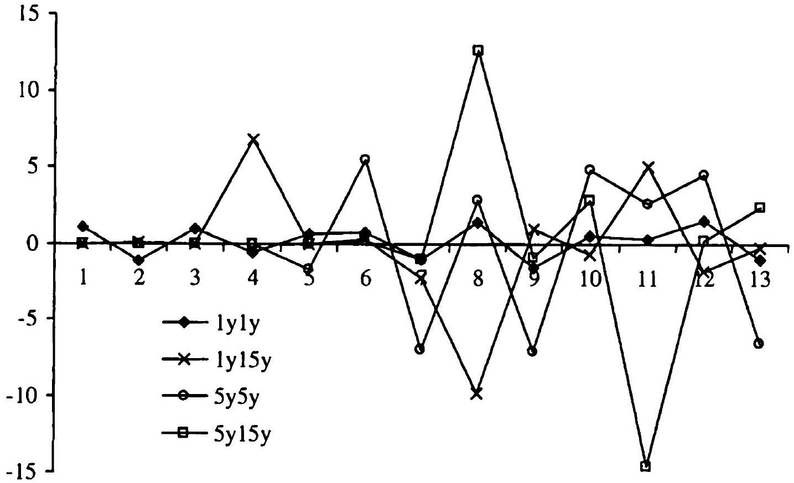

## Vegas in Libor Market Models

We recall that vega measures the sensitivity of a security price to moves in volatility. In interest rate models with rich volatility structures, calculating (and even defining, for that matter) vega can be surprisingly difficult, especially in a Monte Carlo setting where vega computations bring about a new layer of complexity beyond the standard challenges discussed in recent chapters. Since, as explained in Chapter 22, vega is of fundamental importance in risk management, the ability to robustly and accurately compute vega is a key requirement for any actual model implementation. This final chapter of the book is dedicated to the challenging topic of vega computations, mostly using the Libor market (LM) model as a convenient, and highly relevant, example.

### 26.1 Basic Problem of Vega Computations

As discussed in Section 4.4, any diffusive (HJM) model of interest rates is uniquely defined by its volatility structure $\sigma_{f}(t, T)$ (see Lemma 4.4.1). At the most fundamental level, vega calculations involve the computation of interest rate derivative price sensitivities to changes to this fundamental volatility structure. For a general model, $\sigma_{f}(t, T)$ is two-dimensional ${ }^{1}$, depending on both calendar time $t$ and time to maturity $T$. For a given interest rate derivative we, in principle, are faced with the problem of quantifying the impact on the derivative security value of all possible two-dimensional shocks to this volatility structure. While the space of all possible shocks to a twodimensional surface is quite rich, in theory we can decompose each shock into a linear combination of "Dirac delta" shocks to individual points $(t, T)$, $0 \leq t \leq T<T_{\max }$, and measure vegas to those shocks only. This is sufficient,

[^103]as vega is a first-order sensitivity and must therefore be linear with respect to linear combination of shocks.

While interest rate vegas are fundamentally two-dimensional, simpler types of interest rate models often reduce this dimensionality for tractability. For instance, one-factor Gaussian and quasi-Gaussian models reduce the twodimensional structure of a generic HJM volatility structure to a separable factor form

$$
\begin{equation*}
\sigma_{f}(t, T)=g(t) h(T) \tag{26.1}
\end{equation*}
$$
^eq26-1

for some $g(t), h(T)$ (see (4.44) and (13.2)). A shock to the volatility structure that preserves the form (26.1) obviously cannot be two-dimensional, and a two-dimensional "Dirac delta" shock will not preserve the factor form. Instead, if we wish to measure volatility sensitivities in models satisfying (26.1), we would have to either bump the volatility structure for a fixed $t$ and all $T$ (a shock to function $g(\cdot)$ ) or to bump it for all $t$ but a fixed $T$ (a shock to function $h(\cdot))$. In other words, the set of volatility shocks that preserve the volatility structure factor form (26.1) is significantly reduced relative to the general case, and we are consequently prevented from measuring the impact of many types of potentially relevant volatility shocks. Of course, if the factor decomposition is refined relative to (26.1) by using additional state variables (see Section 12.1.5, for instance, or our discussion of multi-factor quasi-Gaussian models in Section 13.3.2), then more complicated shock shapes may be approximated to arbitrarily high precision.

While the discussion above concern model vegas, i.e. sensitivities with respect to perturbations of the model volatility structure, it is often the market vegas, i.e. vegas with respect to volatilities of market-observed vanilla options (see Section 22.1.4), that are ultimately of most practical interest. The dimensionality issue touched upon earlier is equally present in market vegas, since the set of European swaptions is two-dimensional, indexed by option expiry and swap tenor ${ }^{2}$. The dimensionality reduction that is implicit in models such as a one-factor Gaussian model means that we are sometimes unable to quantify the sensitivities of a given derivative to all market instruments. Instead, we are forced to choose, often somewhat arbitrarily, which (much reduced) set of European swaptions we wish to use for model calibration and, ultimately, for vega reporting. While we can make a reasonably informed choice for some derivatives (e.g., vanilla Bermudan swaptions where we would use coterminal European swaptions and, possibly, caplets), many securities will not allow us to easily locate the dominant vega exposure locations, should these even exist in the first place. In contrast, models that either use a high number of Markov state variables (e.g., a multi-factor quasi-Gaussian model) or do not rely on volatility factorization at all (e.g., an LM model) will better preserve the full dimensionality of the volatility structure and hence, at least in theory, could be used to tell us, in

[^104]an unambiguous way, which points of the volatility structure have impact on the value of a given security.

The discussion above is clearly intimately related to our earlier analysis of the debate surrounding local versus global calibration, see Section 14.5.5. With models that require product-specific volatility calibration, the choice of the calibration option set effectively decides in which buckets the vega will be reported, sensibly or not. On the other hand, with globally calibrated models with a fully flexible volatility structure, the model itself will ultimately determine the vega bucketing, in a manner that relies little on (possibly flawed) user intuition. The distinction between model types is fundamental, and irrespective of whether we ultimately choose to use product-specific or global calibration, the ability to discover, in a largely automated way, the set of European swaption volatilities that drive the value of any given derivative can often be essential to robust risk management of interest rate product portfolios. Of course, information uncovered this way could also be used to guide more robust and accurate product-specific calibrations for the local projection method (see Sections 18.4, 20.1.3, 20.2.1).

Our focus in this chapter is squarely on globally calibrated models, with the LM model being our primary example. The same techniques could, however, be applied to any globally-calibrated model underpinned with either a genuinely two-dimensional volatility structure, or one that approximates it closely, such as a multi-factor quasi-Gaussian model.

### 26.2 Review of Calibration

Let us start the technical discussion by recalling some notations from Section 14.5, and also introducing some new ones. We start with $G$ (see Section 14.5.2 and in particular (14.41)), a subset of discretized instantaneous Libor volatilities which we regard as primary model parameters to be calibrated to market data. The ( $N_{t} \times N_{x}$ )-dimensional matrix $G$ is defined by a rectangular grid of times and tenors $\left\{t_{\imath}\right\} \times\left\{x_{j}\right\}, i=1, \ldots, N_{t}, j=1, \ldots, N_{x}$. For the purposes of this chapter, we denote by $G^{\text {full }}$ the full grid of instantaneous Libor volatilities $\left\|\lambda_{n, k}\right\|$ for all $n, k$ (see Section 14.5.3 and (14.42)). The matrix $G$ is obtained from matrix $G^{\text {full }}$ by selecting rows and columns that correspond to times $\left\{t_{\imath}\right\}$ and tenors $\left\{x_{j}\right\}$. As in Section 14.5.8, we assume that the calibration, or benchmark, set consists of all swaptions with expiries $t_{i}$ and tenors $x_{j}, i=1, \ldots, N_{t}, j=1, \ldots, N_{x}$. On the other hand, we call the set of all at-the-money swaptions (i.e. swaptions with expiries $T_{i}$ and tenors $T_{j}-T_{i}$ for all $i=1, \ldots, N-1, j=i+1, \ldots, N-1$ ) the full swaption set.

Recall now the sample calibration algorithm of Section 14.5.7. Given a guess of $G$, we interpolate it to obtain $G^{\text {full }}$, which is then used to calculate model volatilities of swaptions in the benchmark set that we arrange in a matrix $\Lambda(G)$ with entries

$$
\begin{equation*}
(\Lambda(G))_{i, j}, \quad i=1, \ldots, N_{t}, \quad j=1, \ldots, N_{x} . \tag{26.2}
\end{equation*}
$$
^eq26-2

Given $\Lambda(G)$, an objective function $\mathcal{I}(G ; \widehat{\Lambda})$ may then be constructed, typically involving a sum of precision and smoothness terms (see e.g. (14.51) and (14.54)), where the precision targets measure the distance between the model and market volatilities of swaptions in the benchmark set. Here we explicitly highlight the dependence of the objective function on market volatilities of swaptions in the benchmark set; these market volatilities are here assumed arranged in an $N_{t} \times N_{x}$ matrix $\hat{\Lambda}_{i, j}, i=1, \ldots, N_{t}, j=1, \ldots, N_{x}$. The model calibration minimizes the objective function, resulting in a calibrated grid $G^{*}$ of Libor volatilities, given by

$$
\begin{equation*}
G^{*}(\widehat{\Lambda})=\underset{G}{\operatorname{argmin}} \mathcal{I}(G ; \widehat{\Lambda}) . \tag{26.3}
\end{equation*}
$$
^eq26-3

Once the model is calibrated, the value of a given derivative security, $V= V\left(G^{*}(\widehat{\Lambda})\right)$, may be calculated.

### 26.3 Vega Calculation Methods

Having formalized in Section 26.2 above the basic dependency structure of derivative security values on market volatilities, the key question is now how to establish sensitivities with respect to these volatilities. The next few sections outline several potential methods.

### 26.3.1 Direct Vega Calculations

### 26.3.1.1 Definition and Analysis

In the direct method for vega calculations, we simply apply a shock to the matrix of market swaption volatilities $\widehat{\Lambda}$, redo the model calibration, and reprice our security position. Let $\delta$ be an $N_{t} \times N_{x}$ matrix characterizing the shape of the chosen shock; then, the set of shocked market volatilities is given by the matrix

$$
\widehat{\Lambda}+\epsilon \delta,
$$

for some small $\epsilon>0$. We proceed to calibrate the new grid of model volatilities $G^{*}(\widehat{\Lambda}+\epsilon \delta)$ by solving (26.3), i.e.

$$
G^{*}(\widehat{\Lambda}+\epsilon \delta)=\underset{G}{\operatorname{argmin}} \mathcal{I}(G ; \widehat{\Lambda}+\epsilon \delta),
$$

and then estimate the (market) vega $\nu_{\mathrm{mkt}}(\delta)$ in direction $\delta$ by the finite difference ${ }^{3}$[^105]

$$
\begin{equation*}
\nu_{\mathrm{mkt}}(\delta)=\left.\epsilon^{-1}\left(V\left(G^{*}(\widehat{\Lambda}+\epsilon \delta)\right)-V\left(G^{*}(\widehat{\Lambda})\right)\right) \approx \frac{d}{d u} V\left(G^{*}(\widehat{\Lambda}+u \delta)\right)\right|_{u=0} \tag{26.4}
\end{equation*}
$$
^eq26-4

We note that here, and throughout, we think of vegas as pure derivatives, while in reality for reporting purposes the vega is often normalized to represent a change in value of a derivative that corresponds to, say, $1 \%$ change in the quoted market volatility.

The shock $\delta$ could take many forms, starting with the most basic flat shock (or "parallel shift"), where $\delta=\delta_{\text {flat }},\left(\delta_{\text {flat }}\right)_{i, j}=1$ for all $i, j$. For more granular sensitivities, e.g. to measure sensitivities to individual market volatilities, we could use bucketed shocks $\delta=\delta_{n, m}$,

$$
\begin{equation*}
\left(\delta_{n, m}\right)_{i, j}=1_{\{i=n\}} 1_{\{j=m\}} \tag{26.5}
\end{equation*}
$$
^eq26-5

A full collection of bucketed shocks - one for each swaption in the benchmark set - gives rise to a total of $N_{t} \cdot N_{x}$ so-called bucketed vegas ${ }^{4}$.

While it is often the goal to calculate vegas to all swaptions in the benchmark set - i.e. calculate sensitivities in directions $\delta_{n, m}$ in (26.5) for all $n, m$ - it is not necessary to use the directions $\delta_{n, m}$ directly. As we have already seen in the context of interest rate deltas in Section 6.4, as long as we have the same number of directions ( $N_{t} N_{x}$ ) that span the set $\left\{\delta_{n, m}\right\}$, then we can always express vegas in one basis from vegas in another basis by simple linear algebra. To give an example, consider the set of running cumulative shocks $\delta_{n, m}^{\prime}$ given by

$$
\left(\delta_{n, m}^{\prime}\right)_{i, j}=\left\{\begin{array}{l}
1, i<n \text { or } i=n, j \leq m  \tag{26.6}\\
0, \text { otherwise }
\end{array}\right.
$$
^eq26-6

Then, since

$$
\delta_{n, m}^{\prime}=\delta_{n, m-1}^{\prime}+\delta_{n, m}
$$

(with obvious modifications for $m=1$ ), we have

$$
\begin{equation*}
\nu_{\mathrm{mkt}}\left(\delta_{n, m}\right)=\nu_{\mathrm{mkt}}\left(\delta_{n, m}^{\prime}\right)-\nu_{\mathrm{mkt}}\left(\delta_{n, m-1}^{\prime}\right) \tag{26.7}
\end{equation*}
$$
^eq26-7

Hence, we can calculate $\nu_{\mathrm{mkt}}\left(\delta_{n, m}^{\prime}\right)$ for all $n, m$ using the algorithm described above, and then calculate all $\nu_{\mathrm{mkt}}\left(\delta_{n, m}\right)$ using (26.7).

Another sometimes used choice for the vega calculation basis is the set of all cumulative shocks $\delta_{n, m}^{\prime \prime}$ defined by

$$
\begin{equation*}
\left(\delta_{n, m}^{\prime \prime}\right)_{i, j}=1_{\{i \leq n\}} 1_{\{j \leq m\}} \tag{26.8}
\end{equation*}
$$
^eq26-8

for all $n, m$. Again, we can easily express $\delta_{n, m}$ in terms of the $\delta_{n, m}^{\prime \prime}$. The motivation for introducing alternative bases is similar to that for introducing

[^106]alternative ways of bumping the yield curve in Section 6.4.4: cumulative shocks as a rule lead to less distortion in the internal, model-specific volatility representation. We elaborate on this point later in the chapter.

While many variations of the direct vega method are possible, ultimately the accuracy and stability of vegas obtained by direct perturbation are rarely entirely satisfactory. The main reason is the fact that the calibration (26.3) is not exact, in the sense that the model does not exactly replicate all market volatilities of the swaptions in the benchmark set,

$$
\Lambda\left(G^{*}(\widehat{\Lambda})\right) \neq \widehat{\Lambda} .
$$

This imprecision is typically caused by the presence of regularization (smoothness) terms in the objective function, by usage of low-dimensional parametric forms for the volatility structure, or by other smoothness measures introduced to prevent overfitting of the model. For a well-designed calibration procedure, the resulting calibration errors are typically within bid-ask tolerances of market data ${ }^{5}$ and, consequently, are of little concern in securities pricing. However, the accuracy is often insufficient for vega calculations, since the typical size of the shock applied to market data (i.e., the magnitude of $\epsilon$ in (26.4)) is usually of the same order as the calibration errors. As a result, when calculating the vega calibration errors (the "noise") might easily be of the same order of magnitude as the sensitivities themselves (the "signal"), making vegas too noisy to be useful. To improve on this, one can try increasing the size of $\epsilon$ in (26.4), but as described in Section 3.3.1 this leads to a bias relative to the true infinitesimal volatility sensitivity. More worryingly, applying shocks of a large magnitude to small subsets of the swaption volatility surface may result in an unrealistically choppy market data scenario to which the model can no longer calibrate properly.

The noise problems described above are less severe for global shocks than for local ones. For example, calculating the flat shift vega with $\delta=\delta_{\text {flat }}$ by direct methods is often possible, and in fact can serve as a benchmark and a reality check for the more advanced methods that we introduce later. The relatively good performance for global shocks is easy to understand, as they tend to preserve the distribution of calibration error among swaptions in the base and bumped scenario; i.e. we roughly have

$$
\begin{equation*}
\Lambda\left(G^{*}(\widehat{\Lambda})\right)-\widehat{\Lambda} \approx \Lambda\left(G^{*}(\widehat{\Lambda}+\delta)\right)-(\widehat{\Lambda}+\delta) . \tag{26.9}
\end{equation*}
$$
^eq26-9

In other words, such shocks do not affect (too much) the calibration error for individual market volatilities; when calculating vegas by (26.4), the calibration errors therefore tend to cancel out. In fact, the introduction of cumulative shocks such as (26.6) and (26.8) can, in part, be motivated by the notion of keeping calibration errors relatively constant to ensure that

[^107](26.9) holds. While usage of a cumulative shock basis can, in fact, improve the vega noise somewhat, it still rarely produces satisfactory results.

Below, we elaborate a bit more on the noise issues plaguing the direct vega method. We should note that even if one were to find a remedy for the noise problem, the direct vega method may still be unattractive due to the need to repeatedly run a computationally intensive calibration algorithm for each shocked scenario. While the calibration algorithm of Section 14.5 is often relatively fast, if multiple scenarios are required, the total computation time per security can easily become impractically large.

### 26.3.1.2 Numerical Example

To demonstrate how the (basic) direct vega method performs on a simple example, we set up a 20 year one-factor LM model with 6 month Libor tenors, using a relatively coarse calibration grid: $\left\{t_{\imath}\right\}=\left\{x_{j}\right\}=\{1 y, 5 y, 10 y, 15 y\}$. For simplicity, the LM model is log-normal with flat Libor volatilities at $20 \%$, i.e. $\lambda_{n, m}=20 \%$ for all $n, m$. The yield curve is also assumed flat, at a level of $5 \%$ continuously compounded.

In our model calibration, the swaption benchmark set consists of swaptions with expiry/tenor matching Libor volatilities in the matrix $G$, i.e. on the grid $\left\{t_{i}\right\} \times\left\{x_{j}\right\}$. We use a global calibration as outlined in Section 26.2 with smoothing weights (in expiry and tenor direction) set high enough to remove unwanted oscillations in the model volatility surface. Additionally, the vega shocks $\delta_{n, m}, n, m=1, \ldots, 4$, are assumed to be the bucketed shocks (26.5) applied to the $4 \times 4$ swaption matrix $\hat{\Lambda}$. In this and subsequent examples we consider three instruments:

1. $5 y 5 y$ European swaption: a European payer swaption with strike $5 \%$, expiry $5 y$ and tenor $5 y$. Note that this swaption belongs to the benchmark set.
2. $3 y 7 y$ European swaption: a European payer swaption with strike $5 \%$, expiry $3 y$ and tenor $7 y$. Note that this swaption does not belong to the benchmark set.
3. 10nc1 Bermudan swaption: a 10 no-call 1 (see Section 5.12) Bermudan payer swaption with annual exercise rights and a $5 \%$ strike.

All three derivatives have a notional of 1 , and in all examples their values are calculated by Monte Carlo with 16,384 paths.

Table 26.1 shows the vegas obtained by the direct method for the $5 y 5 y$ European swaption. As the 5y5y swaption is part of the benchmark set, we would expect a non-zero bucket vega number in only the 5y5y expiry/tenor bucket. While the largest vega exposure indeed does show up in this bucket, the table results are noisy and there are non-zero vegas in most other buckets as well.

Consider now our second test instrument, the 3y7y European swaption which is not in the benchmark set; its vegas are given in Table 26.2. As this

|  | $1 y$ | $5 y$ | $10 y$ | $15 y$ |
| ---: | ---: | ---: | ---: | ---: |
| $1 y$ | -0.1 | 0.2 | 0.0 | 0.0 |
| $5 y$ | -0.8 | 16.5 | 0.3 | 0.1 |
| $10 y$ | -0.1 | 0.8 | -1.0 |  |
| $15 y$ | -0.6 | 2.5 |  |  |

Table 26.1. Vegas by the direct method for the 5 y 5 y European swaption as defined in the text, in basis points ( $1 \mathrm{bp}=10^{-4}$ ) per $1 \%$ shift in volatility of each swaption in the benchmark set. Rows are expiries and columns are tenors of swaptions in the benchmark set.

swaption is not in the benchmark set, we here do not expect only a single non-zero bucket vega; instead, a well-behaved algorithm should produce non-zero numbers only in the four buckets that immediately surround the 3 y 7 y point (the $1 \mathrm{y} 5 \mathrm{y}, 1 \mathrm{y} 10 \mathrm{y}, 5 \mathrm{y} 5 \mathrm{y}$, and 5 y 10 y swaptions). As is evident from the table, however, the direct vega method assigns non-zero vegas to many other buckets as well, with some of the vegas being substantially negative.

|  | 1 y | 5 y | 10 y | 15 y |
| ---: | ---: | ---: | ---: | ---: |
| 1 y | -3.0 | 6.6 | 7.9 | -0.7 |
| 5 y | -0.2 | 7.0 | 2.3 | -0.2 |
| 10 y | 0.0 | 0.3 | -0.4 |  |
| 15 y | -0.2 | 0.9 |  |  |

Table 26.2. Vegas by the direct method for the 3y7y European swaption as defined in the text, in basis points ( $1 \mathrm{bp}=10^{-4}$ ) per $1 \%$ shift in volatility of each swaption in the benchmark set. Rows are expiries and columns are tenors of swaptions in the benchmark set.

Finally, let us look at vegas of the 10 -nocall-1 Bermudan swaption. While results in Tables 26.1 and 26.2 primarily served to show the deficiencies of the direct vega method, the Bermudan swaptions vegas will be used as a useful benchmark for better methods we shall develop later in the chapter. Table 26.3 lists the relevant results; we notice that there are non-zero vega numbers in buckets corresponding to swaptions with total maturity (expiry + tenor) exceeding the 10 year life of the Bermudan swaption, so again we must conclude that the vega report in the table is affected by a significant amount of noise.

### 26.3.2 What is a Good Vega?

In the previous section, we pointed out some obvious deficiencies of vegas computed by direct perturbation methods. Before developing other methods

|  | $1 y$ | $5 y$ | $10 y$ | $15 y$ |
| ---: | ---: | ---: | ---: | ---: |
| $1 y$ | 1.9 | 3.8 | 1.1 | 0.4 |
| $5 y$ | 6.0 | 6.8 | -0.2 | -0.1 |
| $10 y$ | 3.0 | -0.6 | -0.2 |  |
| $15 y$ | -0.2 | 1.1 |  |  |

Table 26.3. Vegas by the direct method for the 10 ncl Bermudan swaption as defined in the text, in basis points ( $1 \mathrm{bp}=10^{-4}$ ) per $1 \%$ shift in volatility of each swaption in the benchmark set. Rows are expiries and columns are tenors of swaptions in the benchmark set.

for calculating vegas, it is useful to first define what characteristics a method for computing vegas should ideally have. For starters, we obviously require that all computed risk sensitivities, including vegas, to be both stable and accurate. While stability can (and should, on a regular basis) be tested empirically by observing calculated risk measure over long periods of time, accuracy is often mode difficult to measure. One relevant metric for accuracy could be the performance of the P\&L predict from Section 22.2.1, since accurately calculated risk measures typically imply low unpredicted P\&L. While a P\&L predict analysis is always useful, tests of vega accuracy in this manner may be inconclusive, as the $\mathrm{P} \& \mathrm{~L}$ predict measures aggregate quality of all risk sensitivities and could be thrown off by inaccuracy of greeks other than the vega. As a consequence, it is often helpful to have more tailored measures of vega "goodness"; the list below contains several relevant measures. All the equalities below should be understood as "equality within tolerance", where tolerances are typically determined by the requirements of the trading desk that uses the LM model.

1. Additivity. We normally would expect that

$$
\nu_{\mathrm{mkt}}\left(\delta_{1}+\delta_{2}\right)=\nu_{\mathrm{mkt}}\left(\delta_{1}\right)+\nu_{\mathrm{mkt}}\left(\delta_{2}\right),
$$

i.e. that applying two shocks together gives a vega that is a sum of vegas that correspond to the two individual shocks. As a particularly important case, the flat-shift vega should be reproduced as a sum of bucketed vegas:

$$
\sum_{n, m} \nu_{\mathrm{mkt}}\left(\delta_{n, m}\right)=\nu_{\mathrm{mkt}}\left(\delta_{\mathrm{flat}}\right) .
$$

2. Scaling. Scaling the size of a shock should scale the vega accordingly,

$$
\nu_{\mathrm{mkt}}(c \delta)=c \nu_{\mathrm{mkt}}(\delta)
$$

for a reasonable range of values of $c$, e.g. $c \in[0.5,2]$. It is often also natural to require that the vega is invariant with respect to the sign of the bump, i.e. the equality holds with $c=-1$,

$$
\nu_{\mathrm{mkt}}(-\delta)=-\nu_{\mathrm{mkt}}(\delta)
$$

3. Locality. Our notion of vega locality is similar to the one used for yield curve perturbations in Chapter 6, and loosely requires that vega exposure "lives" where we expect it to. In this requirement, we can distinguish between a few variations:
a) Benchmark set locality. The bucketed vegas calculated for a European swaption in the benchmark set are equal to zero everywhere except in the bucket that corresponds to the swaption itself. In other words, for a swaption with expiry $t_{i}$ and tenor $x_{j}$,

$$
\nu_{\mathrm{mkt}}\left(\delta_{n, m}\right)=0 \text { for } n \neq i, m \neq j
$$

and $\nu_{\mathrm{mkt}}\left(\delta_{i, j}\right)=\partial V_{\text {swaption }, i, j} / \partial \widehat{\lambda}_{\imath, j}$, where the right-hand side, the vega of the European swaption, is calculated in a vanilla model compatible with the LM model used. As we saw from Table 26.1, the direct method does not have benchmark set locality.
b) Full swaption set locality. This is a stronger version of the previous point. For standard European swaptions that are not part of the benchmark set, we expect the vega to be non-zero only in the four buckets that surround the swaption in question. In particular, for a European swaption with expiry $T_{l}$ and final swap maturity of $T_{k}$, we expect that

$$
\nu_{\mathrm{mkt}}\left(\delta_{n, m}\right)=0 \text { for } n \notin\{i-1, i\} \text { and } m \notin\{j-1, j\},
$$

where

$$
i=\min \left\{a: t_{a} \geq T_{l}\right\}, \quad j=\min \left\{b: x_{b} \geq T_{k}-T_{l}\right\}
$$

Moreover we require that

$$
\nu_{\mathrm{mkt}}\left(\delta_{i-1, j-1}\right)+\nu_{\mathrm{mkt}}\left(\delta_{i-1, j}\right)+\nu_{\mathrm{mkt}}\left(\delta_{i, j-1}\right)+\nu_{\mathrm{mkt}}\left(\delta_{i, j}\right)
$$

equals the vega of the European swaption in the compatible vanilla model. Again, the direct method does not satisfy this property as clear from Table 26.2.
c) Exotic locality. For many exotics derivatives such as, for example, Bermudan swaptions, we know a-priori in which buckets the vega is supposed to reside (and often what sign it is supposed to have). For example, for a Bermudan swaption with final maturity $T_{k}$, we would expect no vega below the coterminal diagonal ${ }^{6}$ :

$$
\nu_{\mathrm{mkt}}\left(\delta_{n, m}\right)=0 \text { if } t_{n}+x_{m}>T_{k}
$$

Given that the direct vega method fails simpler tests of locality, it is unlikely that it will respect the theoretical location (or sign) of Bermudan swaption vegas, an observation confirmed by Table 26.3.

[^108]4. Convergence. As with all quantities calculated by Monte Carlo methods, we expect vegas to converge to some value as we increase the number of paths. In particular, for the number of Monte Carlo paths $N_{\mathrm{MC}}$ used, the vegas calculated with $N_{\mathrm{MC}}$ paths should be within required tolerances compared to vegas calculated with $2 N_{\mathrm{MC}}$ paths, and vegas calculated with two different Monte Carlo seeds should be identical to within given tolerance.
5. Stability. Again, as a general requirement on values calculated by numerical methods, we expect vegas to vary smoothly with changing market inputs.

### 26.3.3 Indirect Vega Calculations

### 26.3.3.1 Definition and Analysis

While the mapping (26.3) of market volatilities to model volatilities involves non-linear optimization that adds noise, the reverse mapping of model volatilities to market volatilities (26.2) is typically done by direct application of swaption volatility approximation formulas and is, consequently, noiseless. Hence, it is natural to think that Jacobian techniques - which we have already encountered in Sections 6.4.3 and 22.1.4 - could be fruitfully applied here, with the exact mapping (26.2) used to define the transformation from model vegas to market vegas. To motivate the method we write, informally,

$$
\begin{equation*}
\frac{\partial V}{\partial G}=\frac{\partial V}{\partial \Lambda} \frac{\partial \Lambda}{\partial G} \tag{26.10}
\end{equation*}
$$
^eq26-10

where on the left hand side we have (a vector of) model vegas, i.e. sensitivities with respect to changes in model volatilities, and on the right a product of (a vector of) market vegas and (a matrix of) sensitivities of swaption volatilities with respect to model parameters. As it is the market vegas we are interested in, we solve this linear system to obtain

$$
\begin{equation*}
\frac{\partial V}{\partial \Lambda}=\left(\frac{\partial \Lambda}{\partial G}\right)^{-1} \frac{\partial V}{\partial G} \tag{26.11}
\end{equation*}
$$
^eq26-11

In this equation, $\partial \Lambda / \partial G$ can be computed analytically, whereas the term $\partial V / \partial G$ (the model vegas) normally must be computed by Monte Carlo methods.

Let us develop the ideas above a bit more carefully. For a given $N_{t} \times N_{x}$ perturbation matrix $\delta$, we define the model vega $\nu_{\text {mdl }}(\delta)$ in direction $\delta$ by

$$
\nu_{\mathrm{mdl}}(\delta)=\left.\epsilon^{-1}\left(V\left(G^{*}+\epsilon \delta\right)-V\left(G^{*}\right)\right) \approx \frac{d}{d u} V\left(G^{*}+u \delta\right)\right|_{u=0}
$$

where $\epsilon>0$ is a small number, and $G^{*}=G^{*}(\widehat{\Lambda})$ as before is the matrix of model volatilities calibrated to market.

Let us consider applying, to the model volatilities, a set of $N_{t} \cdot N_{x}$ shocks denoted by $\delta_{n, m}$ for $n=1, \ldots, N_{t}, m=1, \ldots, N_{x}$. These could be the unit shocks of (26.5), or any of the other families we introduced in Section 26.3.1. It often helps to think of these shocks as market data scenarios, with vega hedging being the exercise of finding weights for the hedging instruments (swaptions in the benchnnark set) to neutralize as much as possible the sensitivity of a given security to the chosen scenarios. The sensitivity of the volatility of the $(i, j)$-th swaption in the benchmark set to "scenario" $\delta_{n, m}$ is given by

$$
\left.\frac{\partial \Lambda_{i, j}}{\partial \delta_{n, m}} \triangleq \epsilon^{-1}\left(\Lambda_{\imath, j}\left(G^{*}+\epsilon \delta_{n, m}\right)-\Lambda_{i, j}\left(G^{*}\right)\right) \approx \frac{d}{d u} \Lambda_{\imath, j}\left(G^{*}+u \delta_{n, m}\right)\right|_{u=0}
$$

a quantity that can easily be calculated by differentiating the formula for approximation swaption volatility in the LM model with respect to model volatilities ${ }^{7}$. Hence, in its most basic form, the market vega matrix $\left(\nu_{\mathrm{mkt}}\right)_{i, j}$ can be introduced as the solution to the following least-squares minimization problem

$$
\begin{equation*}
\sum_{m=1}^{N_{i}} \sum_{n=1}^{N_{i}}\left(\nu_{\mathrm{mdl}}\left(\delta_{n, m}\right)-\sum_{j=1}^{N_{i}} \sum_{i=1}^{N_{i}}\left(\nu_{\mathrm{mkt}}\right)_{2, j} \frac{\partial \Lambda_{i, j}}{\partial \delta_{n, m}}\right)^{2} \rightarrow \min \tag{26.12}
\end{equation*}
$$
^eq26-12

The definition (26.12) can be extended in a number of ways, along the same lines as in Section 6.4.3. We could, for instance, use a different number of scenarios than hedging instruments, either by supplying more scenarios or by utilizing only a subset of the benchmark set for hedging purposes. We could also use different weights for different scenarios, with higher weights applied to the scenarios we care more about. In addition, we could introduce regularization weights to, say, penalize hedging positions of excessive size. A reasonably general definition of market vegas in the indirect method for vega calculations is then given by the solution to the following least-squares minimization problem (compare to (6.29))

$$
\begin{align*}
\sum_{n, m} W_{n, m}^{2}\left(\nu_{\mathrm{mdl}}\left(\delta_{n, m}\right)\right. & \left.-\sum_{i, j}\left(\nu_{\mathrm{mkt}}\right)_{i, j} \frac{\partial \Lambda_{l, j}}{\partial \delta_{n, m}}\right)^{2} \\
& +\sum_{i, j} U_{l, j}^{2}\left(\left(\nu_{\mathrm{mkt}}\right)_{i, j}\right)^{2} \rightarrow \mathrm{~min} \tag{26.13}
\end{align*}
$$
^eq26-13

where $W_{n, m}$ are weights applied to different scenarios and $U_{i, j}$ are penalty weights for different hedges. This problem can be formulated in matrix form

[^109](see e.g. (6.30)) and could be solved by standard methods of linear algebra, as in (6.31).

The indirect method for computing vegas avoids noisy (and costly) model recalibration, and often results in a marked improvement over the direct vega method of Section 26.3.1. Still, the results are not perfect, as the vegas calculated by the indirect method will often violate several of the criteria for good vegas listed in Section 26.3.2. In particular, while the indirect vega method tends to satisfy the additivity and scalability properties, it is often quite noisy and exhibits unsatisfactory convergence and stability.

Stability and convergence issues could in principle be addressed by modifying (26.12) (or (26.13)). Specifically, we can add penalty terms that would promote smoothness of market vegas in expiry and tenor dimensions, in the same spirit as we smooth model volatilities during calibration, see Section 14.5.6 and in particular equation (14.51). For example, to promote first-order smoothness we can change (26.12) to

$$
\begin{aligned}
\sum_{n, m}\left(\nu_{\mathrm{mdl}}\left(\delta_{n, m}\right)\right. & \left.-\sum_{i, j}\left(\nu_{\mathrm{mkt}}\right)_{i, j} \frac{\partial \Lambda_{i, j}}{\partial \delta_{n, m}}\right)^{2} \\
& +w_{\partial t} \sum_{\imath, j}\left(\left(\nu_{\mathrm{mkt}}\right)_{i, j}-\left(\nu_{\mathrm{mkt}}\right)_{i-1, j}\right)^{2} \\
& +w_{\partial x} \sum_{i, j}\left(\left(\nu_{\mathrm{mkt}}\right)_{i, j}-\left(\nu_{\mathrm{mkt}}\right)_{\imath, j-1}\right)^{2}
\end{aligned} \min .
$$

We can also add second-order smoothing terms along the same lines as in (26.12). These modifications do not make the minimization problem any harder to solve, as it remains quadratic.

As one would expect, the addition of smoothing terms often significantly improves the stability and convergence characteristics of the indirect method. Unfortunately, however, extra smoothing destroys the locality of vegas: if we apply the indirect method with smoothing to a European swaption in the calibration set, then its vega will "leak out" from its native bucket to other nearby buckets. Despite this issue, we believe that the indirect method with smoothing (and its variants) is widely used in industry for vega calculations in LM models. The locality problems of the method are either ignored on pragmatic grounds (in effect choosing the lesser of two evils, non-locality over instability), or justified by the fact that vegas for actual trading books tend to be spread out over all buckets anyway. Such arguments are obviously not entirely convincing, and assigning vega to buckets where there should be none has strong negative implications for hedging and P\&L explain.

### 26.3.3.2 Numerical Example and Performance Analysis

In order to later improve on the indirect vega method, let us first gain some understanding of the actual performance of the method. For concreteness,
we continue with the LM model example from Section 26.3.1.2 using Monte Carlo with 16,384 paths (the same as in the examples of Section 26.3.1.2), and apply shocks $\delta_{n, m}, n, m=1, \ldots, 4$, (assumed to be the bucketed shocks (26.5)) to the $4 \times 4$ Libor volatility matrix $G$. In all tests, we do not use smoothing, i.e. we compute vegas by applying the basic equation (26.12).

Considering first the 5y5y European swaption defined in Section 26.3.1.2, vegas computed by the indirect method are given in Table 26.4. Comparison with Table 26.1 shows that there is a marked improvement over the direct method, but a fair amount of noise is still apparent. For example, the vega of -0.9 bp in the 5yly bucket is clearly incorrect.

|  | 1 y | 5 y | 10 y | 15 y |
| ---: | ---: | ---: | ---: | ---: |
| 1 y | 0.0 | 0.0 | 0.1 | 0.0 |
| 5 y | -0.9 | 17.0 | 0.2 | 0.0 |
| 10 y | 0.0 | 0.0 | 0.0 |  |
| 15 y | 0.0 | 0.0 |  |  |

Table 26.4. Vegas by the indirect method for the 5 y 5 y European swaption as defined in the text, in basis points ( $1 \mathrm{bp}=10^{-4}$ ) per $1 \%$ shift in volatility of each swaption in the benchmark set. Rows are expiries and columns are tenors of swaptions in the benchmark set.

Table 26.5 lists vegas for a $3 y 7 y$ European swaption. Again, we see an improvement over the vegas calculated by the direct method in Table 26.2, but non-zero values in the 1 year tenor column again indicate that the method is not completely satisfactory.

|  | 1 y | 5 y | 10 y | 15 y |
| ---: | ---: | ---: | ---: | ---: |
| 1 y | -2.9 | 6.4 | 8.2 | -0.9 |
| 5 y | -0.2 | 7.3 | 1.9 | 0.0 |
| 10 y | 0.0 | 0.0 | 0.0 |  |
| 15 y | 0.0 | 0.0 |  |  |

Table 26.5. Vegas by the indirect method for the $3 y 7 y$ European swaption as defined in the text, in basis points ( $1 \mathrm{bp}=10^{-4}$ ) per $1 \%$ shift in volatility of each swaption in the benchmark set. Rows are expiries and columns are tenors of swaptions in the benchmark set.

Finally, we consider the 10 nc 1 Bermudan swaption, the indirect method vegas of which are shown in Table 26.6. While overall somewhat cleaner than the vegas in Table 26.3, negative values in the 15 year expiry row indicate the presence of noise.

|  | 1 y | 5 y | 10 y | 15 y |
| ---: | ---: | ---: | ---: | ---: |
| 1 y | 1.9 | 4.3 | 1.9 | 0.2 |
| 5 y | 6.2 | 5.1 | 1.4 | 0.5 |
| 10 y | 2.4 | 0.2 | -0.3 |  |
| 15 y | -0.4 | -0.2 |  |  |

Table 26.6. Vegas by the indirect method for the 10 ncl Bermudan swaption as defined in the text, in basis points ( $1 \mathrm{bp}=10^{-4}$ ) per $1 \%$ shift in volatility of each swaption in the benchmark set. Rows are expiries and columns are tenors of swaptions in the benchmark set.

To understand why the performance of the indirect vega method is unimpressive, let us first note that the solution to (26.12) is given by (26.11), where $\left(\nu_{\mathrm{mdl}}\right)_{i, j}$ is arranged into a vector ${ }^{8} \partial V / \partial G,\left(\nu_{\mathrm{mkt}}\right)_{i, j}$ is arranged into a vector $\partial V / \partial \Lambda$, and the matrix $\partial \Lambda / \partial G$ is an appropriately arranged matrix of sensitivities of swaption volatilities with respect to Libor volatilities. Some of the buckets - namely $10 \mathrm{y} 15 \mathrm{y}, 15 \mathrm{y} 10 \mathrm{y}$ and 15 y 15 y - are outside of the 20 year model horizon and can be discarded, so the dimension of the matrix $\partial \Lambda / \partial G$ is $13 \times 13$.

The vector of model vegas $\partial V / \partial G$ is calculated numerically in Monte Carlo, by perturbing individual entries in the matrix $G$ and repricing the derivative ${ }^{9}$. This procedure induces noise in the model vegas which will be transmitted into market vegas through (26.11), by multiplication with the inverse of the matrix $\partial \Lambda / \partial G$. Let us look at this matrix in more detail, as clearly its properties will influence the propagation of noise. Using our test setup above, Figure 26.1 represents the matrix $(\partial \Lambda / \partial G)^{-1}$ graphically, with a few selected columns plotted as separate lines, showing how a shock to a particular swaption volatility in the benchmark set affects all Libor volatilities in $G$. Each market vega is obtained by adding up all model vegas weighted by the values of a corresponding column (line in the figure).

Two things are apparent in Figure 26.1. First, each column is rather "wiggly", with positive and negative values alternating in a ringing pattern. This behavior - which is not due to numerical noise, since the calculation of the matrix $(\partial \Lambda / \partial G)^{-1}$ is exact - is likely to exacerbate any noise in model vegas. Second, the (absolute values of) values in the matrix are quite high, reaching values of 10 to 15 . This is significant, as any noise in the market vegas is then essentially multiplied by a factor of 10 to 15 . This noise-amplifying effect is confirmed by looking at the eigenvalues of the matrix $(\partial \Lambda / \partial G)^{-1}$ : the lowest and highest eigenvalues equal 1 and 18, respectively. If we make the reasonable assumption that the level of

[^110]Fig. 26.1. Inverse Jacobian for Indirect Vega Method

Notes: Each line represents how a shock to a given swaption volatility affects forward Libor (i.e. model) volatilities in matrix $G$ arranged in a row-major order. The lines are graphic representations of (a few selected) columns from the inverse Jacobian $(\partial \Lambda / \partial G)^{-1}$, see text for details.
accuracy in calculating model vegas is roughly the same as for deltas, then the accuracy in market vegas could be 10 or even 20 times worse. And this is only for our simplistic example - in real applications with models of longer tenors and larger benchmark sets, the noise amplification factor could easily be in the hundreds, making the indirect vega method perform poorly.

Incidentally, looking at the matrix $(\partial \Lambda / \partial G)^{-1}$ in Figure 26.1 also sheds more light on the poor performance of the direct method of calculating vegas, as described earlier in Section 26.3.1. When a particular swaption volatility is shocked and the model is recalibrated, Figure 26.1 shows that the resulting model will effectively have its Libor rate volatilities severely distorted by a large shock with irregular shape. For example, a perturbation of $1 \%$ to a $5 y 5 y$ swaption volatility would move some of the Libor volatilities by almost $15 \%$ (and others by $-15 \%$ ). Clearly, with shocks of this size we cannot hope to accurately capture only first-order sensitivity, as second- and higher-order effects will pollute the vega we are trying to calculate.

### 26.3.4 Hybrid Vega Calculations

### 26.3.4.1 Definition and Analysis

In Section 26.3.3 we identified poor numerical invertibility (also known as stiffness) of the matrix $\partial \Lambda / \partial G$ as the main reason for poor performance of the basic indirect method for vega calculations. This stiffness primarily arises from the usage of shocks to model volatilities that do not adequately take into consideration the dependence of swaption volatilities on Libor volatilities. To improve the indirect vega method, it is therefore natural to change our set of simple bucketed shocks in Libor volatilities to a set of shaped shocks that will result in a better Jacobian, with less ringing and smaller noise amplification factors than in Figure 26.1.

One good choice for the Jacobian would be a unit matrix, which is both perfectly smooth and involves no amplification of noise. A unit Jacobian matrix will arise only if we use Libor volatility shocks that correspond to shocks of individual swaption volatilities in the benchmark set. It may appear that this line of reasoning simply leads us back to the direct method of vega calculations, but we here make a subtle but critical distinction: instead of outright shocking swaption volatilities and recalibrating the model, we instead construct Libor volatility shocks that are approximately equivalent to bucketed swaption volatility shocks, and then apply these shocks through the Jacobian technique outlined earlier. Avoiding recalibration and carefully controlling the shape of shocks to the Libor rate volatility surface not only leads to better computational performance, it also ultimately will lead to better vega quality ${ }^{10}$, in the sense defined in Section 26.3.2.

In light of the discussion above, the key problem we have to deal with is how to construct, in a noise-free manner, a shaped shock to Libor volatilities that approximates a shock to a particular European swaption. Here, the bootstrap LM model calibration presented in Section 14.5.8 turns out to be useful. Recall that the idea of bootstrap (or cascade) calibration is to find the instantaneous volatility of each Libor rate over each time period one at a time by solving a quadratic equation, a procedure that is enabled by doing the calculations in a certain (row-major) order. As pointed out in Section 14.5.8, bootstrap calibration is normally not suitable for a full calibration to market data, as market volatilities of swaptions typically come with some amount of noise in them or, at any rate, are not guaranteed to change smoothly across expiries and tenors. As exemplified by Figure 26.1, this leads to rapid accumulation of noise in Libor volatilities during the bootstrap and almost unavoidable calibration failure (where quadratic equations fail to have real roots). On the other hand, if the input volatilities happened to be smooth and "compatible" with a Libor market model, there would be no reason why the bootstrap calibration would not work. This suggests

[^111]that we should apply swaption volatility shocks not to market values of swaption volatilities, but to the implied swaption volatilities returned by the calibrated model. The latter are fundamentally compatible with an LM model and, assuming that a reasonable amount of smoothing was enforced in the calibration norm, smooth enough for the bootstrap method to work.

These ideas lead us to the following hybrid method for calculating vegas, combining features of both the direct and indirect methods.

1. Calibrate the LMI model to market data, i.e. obtain $G^{*}$ from $\widehat{\Lambda}$, using our global calibration method.
2. Calculate $\Lambda$, the model-implied swaption volatilities.
3. Fix expiry $t_{n}$ and tenor $x_{m}$.
4. Apply a unit shock $\alpha_{n, m} \delta_{n, m}$ with $\delta_{n, m}$ shaped as in (26.5), for sufficiently small ${ }^{11} \alpha_{n, m}>0$ to $\Lambda$.
5. Bootstrap calibrate an LM model to swaption volatilities $\Lambda+\alpha_{n, m} \delta_{n, m}$, to obtain a matrix of shocked Libor volatilities $G^{*, n, m}$.
6. Calculate a Libor shock $\delta_{\text {Libor. } n, m}$ by $\delta_{\text {Libor, } n, m}=\beta_{n, m}\left(G^{*, n, m}-\right. G^{*}$ ), where the scaling constant $\beta_{n, m} \neq 0$ is chosen so that $\max _{l, j}\left|\left(\delta_{\text {Libor }, n, m}\right)_{i, j}\right| \leq \epsilon$ for a small $\epsilon>0$.
7. Repeat Steps 3-6 for all expiries and tenors, and save all shocks $\left\{\delta_{\text {Libor }, n, n}\right\}$.
8. Apply the indirect method of Section 26.3.3 with the collection of Libor volatility shocks $\left\{\delta_{\text {Libor }, n, m}\right\}$.

The Jacobian matrix $\dot{\partial} \Lambda_{i, j} / \partial \delta_{\text {Libor, } n, m}$ will here be exactly diagonal, with the element $\alpha_{n, m} \beta_{n, m}$ on the diagonal in the position determined by the ordering of swaptions in the benchmark set; the inverse transformation (26.11) will amount to an appropriate scaling of each model vega. Of course, the choice of $\delta_{n, m}$ 's in Step 4 is not unique, and instead of (26.5) we could have used other families such as (26.6) or (26.8). In this case the Jacobian would no longer be diagonal, but otherwise the method would still work the same way.

Let us discuss now the choice of various constants that appear in the algorithm. In Step 4 we need a choice for the positive constant $a_{n, m}>0$. The idea here is to apply a constant small enough that the bootstrap calibration of Step 5 works. Clearly for $\alpha_{n, m}=0$ this is the case, so there exists a small enough $\alpha_{n . m}>0$ that satisfies this criteria. On the other hand, we should not choose $a_{n, m}$ too small as it may adversely affect the Monte Carlo simulation error when computing relevant finite differences (see Section 23.2). In practice, we may start with some reasonable large value of $\alpha_{n, m}$, say $1 \%$, and attempt the bootstrap. If this fails, we reduce $\alpha_{n, m}$ by half and try again - and so on until we find the value of $\alpha_{n, m}$ that allows the bootstrap to succeed.

[^112]As for the constant $\epsilon>0$ required in Step 6, we should choose it in a way that ensures that shocks to Libor volatilities are small enough to prevent significant second-order effects to show up in vegas, yet big enough to control the level of Monte Carlo error in the numerically calculated sensitivity. A reasonable choice here is to set $\epsilon$ somewhere between $0.1 \%$ to $1 \%$.

### 26.3.4.2 Numerical Example

To present test results for the hybrid vega method, we continue the numerical example of Sections 26.3.1.2 and 26.3.3.2. Looking first at the 5y5y European swaption, the hybrid method vegas are listed in Table 26.7. As we can see, results are much improved compared to the direct and indirect methods (see Tables 26.1 and 26.4 , respectively) with very little noise and the only significant vega correctly showing up in the $5 y 5 y$ bucket (as expected).

|  | 1 y | 5 y | 10 y | 15 y |
| ---: | ---: | ---: | ---: | ---: |
| 1 y | 0.0 | 0.0 | 0.1 | 0.0 |
| 5 y | -0.1 | 16.3 | 0.0 | 0.0 |
| 10 y | 0.0 | 0.0 | 0.0 |  |
| 15 y | 0.0 | 0.0 |  |  |

Table 26.7. Vegas by the hybrid method for the 5y5y European swaption as defined in the text, in basis points ( $1 \mathrm{bp}=10^{-4}$ ) per $1 \%$ shift in volatility of each swaption in the benchmark set. Rows are expiries and columns are tenors of swaptions in the benchmark set.

Similar good results are obtained for the 3y7y European swaption, as shown in Table 26.8. Unlike the results in Tables 26.2 and 26.5, there is here hardly any noise visible outside of the four neighboring buckets where we expect the vega to be located.

|  | 1 y | 5 y | 10 y | 15 y |
| ---: | ---: | ---: | ---: | ---: |
| 1 y | 0.0 | 5.3 | 4.9 | 0.0 |
| 5 y | 0.0 | 5.2 | 4.5 | 0.0 |
| 10 y | 0.0 | 0.0 | 0.0 |  |
| 15 y | 0.0 | 0.0 |  |  |

Table 26.8. Vegas by the hybrid method for the 3y7y European swaption as defined in the text, in basis points ( $1 \mathrm{bp}=10^{-4}$ ) per $1 \%$ shift in volatility of each swaption in the benchmark set. Rows are expiries and columns are tenors of swaptions in the benchmark set.

Finally, Table 26.9 lists hybrid method vegas for a Bermudan swaption. Once again, we only see vega where it is expected to be, in contrast to Tables 26.3 and 26.6.

|  | 1 y | 5 y | 10 y | 15 y |
| ---: | ---: | ---: | ---: | ---: |
| 1 y | 3.3 | 3.4 | 2.0 | 0.0 |
| 5 y | 6.5 | 4.6 | 0.6 | 0.0 |
| 10 y | 2.8 | 0.5 | 0.0 |  |
| 15 y | 0.0 | 0.0 |  |  |

Table 26.9. Vegas by the hybrid method for the 10 ncl Bermudan swaption as defined in the text, in basis points ( $1 \mathrm{bp}=10^{-4}$ ) per $1 \%$ shift in volatility of each swaption in the benchmark set. Rows are expiries and columns are tenors of swaptions in the benchmark set.

### 26.4 Skew and Smile Vegas

So far, we have focused our discussion of vega on the computation of sensitivities to at-the-money swaption volatilities. Together with the correlation sensitivities that we touch upon in Section 26.5, this comprises the full set of volatility sensitivities in models that parametrize each swaption volatility smile with a single number representing the overall level of volatilities across all strikes (such as a log-normal LM model). In models with richer volatility smile parameterizations, such vegas also have a meaningful interpretation as sensitivities to parallel shifts of volatility smiles of each swaption in the benchmark set. For such models, however, there are other volatility sensitivities that so far have been left out of the discussion, namely the sensitivities to changes in shapes of swaption volatility smiles. Sensitivities to changes in the volatility smile slope and curvature are often denoted skew vegas and smile vegas, respectively.

As with ATM vegas, in principle there are skew and smile vegas for each swaption in the benchmark set. However, it is rarely a requirement that one be able to calculate them all individually, as ATM vegas capture the majority of volatility sensitivity. More often, what is required are aggregated measures of skew and smile risk, such as a single number that corresponds to a change in slope or curvature of all volatility smiles together. For such aggregated measures of risk, brute-force recalibration and recomputation along the lines of the direct vega method is often sufficient. Moreover, it is typically more useful to use a scenario-based approach with large slope or curvature shocks, rather than true first-order differentiation. For example, in a displaced log-normal LM model (see Table 14.1 in Section 14.2.4) one
can switch the skew parameter from 1 (log-normal) to 0 (Gaussian) to get a good idea of the impact of the slope of volatility smile.

In the off-chance that bucketed skew/smile exposure is required, the indirect (Section 26.3.3) method or the hybrid (Section 26.3.4) approach that we developed for the ATM vegas could often be reused. In some cases skew and smile sensitivities are even easier to calculate than ATM vegas, due to a simpler connection between the model and market parameters. For example, the term swaption skew in a displaced log-normal LM model is a linear function of instantaneous Libor skews, see Section 15.2, making the Jacobian-type methods particularly easy to apply. We do not go into further detail here, as the mechanics of these calculations should be clear to the reader by now.

### 26.5 Vegas and Correlations

Earlier in the chapter we used a one-factor version of the LM model in our numerical examples, but in practice we are often more interested in calculating vegas in multi-factor LM models. For a $q$-factor LM model, yield curve dynamics are characterized by factor volatilities, i.e. $q$-dimensional vectors $\lambda_{k}\left(T_{n}\right)$ associated with each Libor rate $L_{k}(t)$ and each time period ( $T_{n-1}, T_{n}$ ]. As we recall from Section 14.5.4, these are constructed from the volatility norm $\left\|\lambda_{n, k}\right\|$ (which we denoted by $G^{\text {full }}$ in Section 26.2) and instantaneous correlations of Libor rates. In the indirect and hybrid methods of Sections 26.3.3 and 26.3.4 we shocked the elements of $G$ (and, ultimately, $G^{\text {full }}$ ), with the understanding that instantaneous correlations of Libor rates remained fixed in all scenarios. In the direct method of Section 26.3.1, we referenced the sample calibration algorithm of Section 14.5.7, which implicitly assumed that the instantaneous correlations of Libor rates were untouched while perturbing swaption volatilities. So, in all three methods we so far have calculated interest rate vegas under the assumption that instantaneous Libor correlations are kept constant when forming the derivative with respect to volatility. While not unreasonable, this choice is not unique and several viable alternatives exist. We discuss some of these in this section.

### 26.5.1 Term Correlation Effects

While the correlation structure in the LM model is typically captured through a parameterization of instantaneous Libor correlations, the prices of traded correlation-sensitive instruments - CMS spread options, in particular depend more directly on term correlations of swap rates (see Section 14.4.3.1). Importantly, when Libor volatilities are changed with instantaneous Libor correlations kept constant, term correlations of swap rates will generally change quite significantly. This effect should be intuitively clear and is a
consequence of the dependence of the formula for term correlation in Section 14.4.3.1 on Libor volatilities.

To demonstrate the magnitude of the vega effect on term correlations, we continue the numerical example of Sections 26.3.1.2, 26.3.3.2 and 26.3.4.2, but now extend our setup to a 10 -factor LM model with the instantaneous Libor correlations parameterized by a function of the form (14.19) (with $\rho_{\infty}=0.5$, $a_{0}=0.42, a_{\infty}=0, \kappa=0.08$ ) and instantaneous Libor volatilities fixed at $20 \%$. For concreteness, let us study the sensitivity of the term correlation between the 10 and 1 year swap rates over a 10 year horizon $\left(\rho_{\text {term }}(0,10)\right.$ in the notation of Section 14.4.3.1). The base value of this correlation in our setup is about $83 \%$. As demonstrated in Table 26.10, $\rho_{\text {term }}(0,10)$ is quite sensitive to shocks to some of the volatilities. For example, a shock of $1 \%$ to the volatility of a 10 y 10 y swaption would change this term correlation by $-0.85 \%$, which is highly significant.

|  | 1 y | 5 y | 10 y | 15 y |
| ---: | ---: | ---: | ---: | ---: |
| 1 y | 0.1 | -6.2 | -3.1 | 2.0 |
| 5 y | -5.0 | -5.6 | 7.0 | 4.7 |
| 10 y | 14.1 | 45.7 | -85.3 |  |
| 15 y | 0.0 | 0.0 |  |  |

Table 26.10. Sensitivity for the 10 yly term (10 years) swap rate correlation, in basis points ( $1 \mathrm{bp}=10^{-4}$ ) per $1 \%$ shift in volatility of each swaption in the benchmark set. All numbers are computed using the hybrid method in Section 26.3.4.2. Rows are expiries and columns are tenors of swaptions in the benchmark set.

### 26.5.2 What Correlations should be Kept Constant?

Since term swap rate correlations change under volatility shocks when instantaneous Libor correlations are fixed, we could instead decide to keep term swap rate correlations constant (while allowing instantaneous Libor correlations to move) under volatility shocks; this choice would lead to different vegas, of course. As we discussed in Chapter 22, this ambivalence is not unique to the problem of calculating vegas, and we often need to decide which quantities to keep constant and which to let float when calculating risk sensitivities. Ultimately, such decisions are often driven by traders' preferences for risk representation, or by the types of hedging strategies that they want to pursue. In making these decisions, traders generally (and reasonably) tend to emphasize the issue of consistency across different products.

A typical interest rate exotics trading desk will trade correlation-sensitive exotics (e.g., CMS spread TARNs, see Section 5.13.3), as well as vanilla
spread options. The exotic derivatives will often be risk managed in an LM model, while for spread options the desk may use a simpler vanilla model, as discussed in Chapter 17. These two models will typically have different (internal) correlation parameters: the LM model will use instantaneous Libor correlations, while a vanilla model (based, say, on a Gaussian copula) will use a term correlation between swap rates as an input. While it is natural for each model to keep its internal correlation parameters constant when calculating vegas, doing so would lead to inconsistency in the definition of vegas between the exotic derivatives and their vanilla hedges. Such inconsistency is typically quite dangerous as it could lead to a position that is deemed hedged, but in fact has an outright exposure.

In the example above, as well as many other similar situations, arguably the easiest way to maintain consistency is to use the more general model (here, the LM model) as the risk "engine" for all products in the book, exotic or not. In an LM model setting, we would then need to compute the volatility sensitivity of both exotics and vanilla securities assuming fixed instantaneous Libor correlations. For the vanilla securities, computation of this sensitivity could be done by either outright valuation of vanilla spread options in a LM model or, perhaps more pragmatically, by calculating the volatility shock impacts on the relevant term correlations of swap rates and combining the results (Jacobian-style) with known correlation sensitivities of the vanilla model. To complement the resulting vega report, it would be natural to also report correlation sensitivities, by calculating sensitivities of the portfolio to instantaneous Libor correlations ${ }^{12}$.

While not entirely without merit, the approach outlined above has its limitations. Of course, if the portfolio is fully hedged to both vegas (under the assumption of constant Libor correlations) and to instantaneous Libor correlations, then it has no volatility risk, irrespective of how we define vega. However, a fully hedged position is rarely, if ever, achieved, in which case reported volatility and correlation sensitivities are used as a monitoring tool. As we have commented before, it is often much easier for traders to understand sensitivities expressed in terms of traded quantities, rather than in terms of non-traded quantities such as instantaneous Libor correlations. Traders therefore typically have a strong preference for seeing their correlation risk expressed in terms of market-implied swap rate correlations, which, for consistency reasons, dictates that vegas should be calculated under the assumption that market (and not model) correlations are kept constant. In addition, we should note that the LM model typically uses a fairly parsimonious correlation parameterization, often comprised of just a handful of numbers (see Section 14.3.2). Hence, correlation risk produced by the LM model would tend to be insufficiently granular for risk-managing vanilla spread options which often are quite liquid for a range of expiries

[^113]and a reasonably large number of swap rate pairs. This issue also favors using term swap rate correlations for risk management purposes.

### 26.5.3 Vegas with Fixed Term Correlations

In the last section we made the case for holding term correlations of swap rates fixed when computing vegas. Let us discuss how to turn this idea into practice, by suitably modifying the various computational methods discussed earlier in this chapter. The direct method of Section 26.3.1 is the easiest to modify: all we need to do is to add the relevant ${ }^{13}$ term swap rate correlations as targets in the basic model calibration, with the calibration algorithm extended along the lines of Section 14.5.9. Note that it is spread option correlations that should be the calibration targets and not spread option values - we certainly expect the values of spread options to change under different volatility scenarios, even as we keep correlations constant. While it is easy to extend the direct method, its limitations with regards to the quality of vegas produced remain (or are amplified, most likely), and consequently this approach is not recommended.

Extending the indirect (or hybrid, as the procedure is more or less the same) method to control spread option correlations is somewhat more difficult. One naive choice would involve appending a correlation calibration to every shock of Libor volatilities, to ensure that term swap correlations stay fixed after each perturbation of volatilities. In other words, after applying a shock to $G$, we would then proceed to solve for new parameters to the instantaneous Libor correlation function in order to remain in calibration with term swap rate correlations. In this approach, we would need to run a separate optimization problem for each model vega shock, which most likely would make the method prohibitively slow and introduce extra noise due to non-exact nature of the solution of the optimization problem.

Our preferred method for extending the indirect vega computation is, once again, based on Jacobian methods. In this approach, we would i) apply shocks to model volatilities and to model correlations, ii) calculate the value of a derivative as well as changes to swaption volatilities and swap rate correlations, and iii) manipulate these quantities to obtain the vegas. Let us present the blueprint of the scheme using the stylized notations of (26.10) - we trust that the reader can expand our presentation into a workable algorithm.

Let $\xi$ be the vector of instantaneous Libor correlations, and $\rho$ the vector of term swap rate correlations (sec footnote 13). We recognize security value and market data dependence on model data through the notations[^114]

$$
V=V(G, \xi), \quad \Lambda=\Lambda(G, \xi), \quad \rho=\rho(G, \xi) .
$$

Our goal is to compute the vector

$$
\begin{equation*}
\left.\frac{\partial V}{\partial \Lambda}\right|_{\rho=\mathrm{const}}, \tag{26.14}
\end{equation*}
$$
^eq26-14

i.e. sensitivities to market swaption volatility shocks, keeping market correlations constant. Implicitly, $G$ and $\xi$ are functions of $\Lambda$ and $\rho$,

$$
G=G(\Lambda, \rho), \quad \xi=\xi(\Lambda, \rho)
$$

and so is $V$,

$$
\begin{equation*}
V(\Lambda, \rho)=V(G(\Lambda, \rho), \xi(\Lambda, \rho)) \tag{26.15}
\end{equation*}
$$
^eq26-15

By an application of the chain rule to (26.15), we get

$$
\begin{equation*}
\left.\frac{\partial V}{\partial \Lambda}\right|_{\rho=\text { const }}=\frac{\partial V}{\partial G} \frac{\partial G}{\partial \Lambda}+\frac{\partial V}{\partial \xi} \frac{\partial \xi}{\partial \Lambda} . \tag{26.16}
\end{equation*}
$$
^eq26-16

Here, the sensitivities $\partial V / \partial G$ and $\partial V / \partial \xi$ may be obtained by application of model parameter shocks to the valuation of the derivative. $\partial G / \partial \Lambda$ and $\partial \xi / \partial \Lambda$ can be found by inverting the (full) Jacobian (inversion should be understood in the generalized least-squares sense as in (26.12) vs. (26.11) as the matrices involved may not even be square),

$$
\left(\begin{array}{l}
\partial G / \partial \Lambda  \tag{26.17}\\
\partial \xi / \partial \Lambda \\
\partial \xi / \partial \rho
\end{array}\right)=\left(\begin{array}{ll}
\partial \Lambda / \partial G & \partial \Lambda / \partial \xi \\
\partial \rho / \partial G & \partial \rho / \partial \xi
\end{array}\right)^{-1}
$$
^eq26-17

The matrix on the right-hand side of (26.17) is obtained by applying shocks to model volatilities and correlations, following the same approach as outlined for the indirect and hybrid vega methods. As a by-product of this calculation we also conveniently obtain risk sensitivities with respect to market correlations, since

$$
\begin{equation*}
\left.\frac{\partial V}{\partial \rho}\right|_{\Lambda=\mathrm{const}}=\frac{\partial V}{\partial G} \frac{\partial G}{\partial \rho}+\frac{\partial V}{\partial \xi} \frac{\partial \xi}{\partial \rho}, \tag{26.18}
\end{equation*}
$$
^eq26-18

where $\partial G / \partial \rho$ and $\partial \xi / \partial \rho$ are obtained in (26.17).

### 26.5.4 Numerical Example

To demonstrate the difference between various definitions of vegas, we look at a simple, single 10 year option on the spread between 10 year and 1 year swap rates. We calculate its vegas in the 10 -factor LM model used in Section 26.5.1, under the assumption of constant instantaneous Libor correlations (Table 26.11) and constant term swap rate correlations (Table
26.12). The second method puts all vega (apart from some minor noise) into the 10 yly and 10 y 10 y buckets, unlike the first method which assigns significant vega to, for example, the 10 y 5 y bucket. Arguably, most traders would consider the vega in Table 26.12 more intuitive, as it is exactly the shape of the vega profile that one would obtain for this spread option from a typical vanilla model.

|  | 1 y | 5 y | 10 y | 15 y |
| ---: | ---: | ---: | ---: | ---: |
| 1 y | 0.00 | 0.10 | 0.05 | -0.03 |
| 5 y | 0.08 | 0.10 | -0.12 | -0.08 |
| 10 y | 2.10 | -0.77 | 2.00 |  |
| 15 y | 0.00 | 0.00 |  |  |

Table 26.11. Vegas by the hybrid method for the 10 y option on the spread between 10 y and 1 y swap rates while keeping instantaneous Libor correlations constant, in basis points ( $1 \mathrm{bp}=10^{-4}$ ) per $1 \%$ shift in volatility of each swaption in the benchmark set. Rows are expiries and columns are tenors of swaptions in the benchmark set.

|  | $1 y$ | $5 y$ | $10 y$ | $15 y$ |
| ---: | ---: | ---: | ---: | ---: |
| $1 y$ | 0.00 | -0.01 | 0.00 | 0.00 |
| $5 y$ | -0.01 | -0.01 | 0.01 | 0.01 |
| $10 y$ | 2.36 | 0.05 | 0.47 |  |
| $15 y$ | 0.00 | 0.00 |  |  |

Table 26.12. Vegas by the hybrid method for the 10 y option on the spread between 10 y and 1 y swap rate while keeping 10 y term swap rate correlation between 10 y and 1 y swap rates constant, in basis points ( $1 \mathrm{bp}=10^{-4}$ ) per $1 \%$ shift in volatility of each swaption in the benchmark set. Rows are expiries and columns are tenors of swaptions in the benchmark set.

### 26.6 Deltas with Backbone

As we saw in Section 26.5, the need for consistency between exotic and vanilla models often drives the definitions of risk sensitivities. Such consistency requirements, it turns out, also affect calculations of deltas (and, of course, gammas) in the LM and other term structure models. To describe this effect in more detail, we first recall the discussion of Section 16.1.2 and, in particular, the fact that vanilla models are sometimes set up to attribute some user-specified amount of the vega to delta. If such a procedure is used,
it would be useful to ensure that the deltas computed in models for more exotic derivatives have the same meaning as in the vanilla model. In essence, this would require a link in the exotic model between the volatility smile and the level of rates.

Sometimes vanilla-exotic delta consistency is ensured automatically, as a consequence of the choice of the models in use. For example, the vanilla SV model (16.8)-(16.9) is naturally consistent with the SV LM model (14.15)(14.16). On the other hand, if we start adjusting the backbone of the vanilla model as in Section 16.1.2, the consistency would often be lost. For example, were we to use a vanilla model of the type (16.5), we would need to modify the volatility terms for SDEs for Libor rates under the LM model to have the same form, e.g.

$$
\begin{aligned}
& d L_{n}(t)=O(d t)+\left(b_{n}(t) L_{n}(t)+(m-b(t)) L_{n}(0)+(1-m) L\right) \\
& \times \lambda_{n}(t)^{\top} d W(t), \quad n=1, \ldots, N-1,
\end{aligned}
$$

for some mixing $m$ and level $L$.
A more complicated situation would arise were we to use a vanilla delta convention without a natural exotic counterpart, such as the SABR model of Section 8.6 or the SVI interpolation rule of Section 16.1.5. In these cases, it would be difficult to "internalize" the same smile move logic in the LM model dynamics. Fortunately, we can use an external brute-force approach that, in principle, works for any combination of the vanilla and exotic models.

The method we have in mind is quite straightforward, and we describe it with a log-normal LM model representing the exotic model. With $f$ denoting the yield curve, let $\widehat{\Lambda}(f)$ be the ATM Black volatilities of the swaptions in the benchmark set, given the yield curve $f$. Suppose the delta is calculated by shifting the yield curve from $f$ to $f^{\prime}$, which causes a move in swaptions to $\widehat{\Lambda}\left(f^{\prime}\right)$, as dictated by our vanilla rule for smile moves. How we proceed depends on the vega calculation method in use. In the direct method, we simply recalibrate the LM model to the new set of swaption volatilities $\widehat{\Lambda}\left(f^{\prime}\right)$, and then proceed to use the resulting LM model parameterization together with the shifted yield curve $f^{\prime}$ to calculate the shocked value of the security in question.

In the indirect vega method, we would do conceptually the same calculation as for the direct method, except we would obtain the LM model parameterization for the shocked yield curve scenario by applying the inverse Jacobian $(\partial \Lambda / \partial G)^{-1}$ to the shifted swaption volatilities $\hat{\Lambda}\left(f^{\prime}\right)$. The inverse Jacobian would automatically be available as part of the basic vega calculation. In the hybrid method, we would first apply the shift in market swaption volatilities arising from the shift in the yield curve, i.e. $\widehat{\Lambda}\left(f^{\prime}\right)-\widehat{\Lambda}(f)$, to the base model swaption volatilities, by setting

$$
\Lambda^{\prime}=\Lambda+\left(\widehat{\Lambda}\left(f^{\prime}\right)-\widehat{\Lambda}(f)\right)
$$

Subsequently, we would bootstrap-calibrate the LM model to $\Lambda^{\prime}$ and, once again, use this model to calculate the shocked value of the security in question.

### 26.7 Vega Projections

After our short detour into delta computations, we return to LM vegas. Clearly, the reporting of vega depends on the benchmark set of swaptions used in the vega calculation method: simply put, the vega is reported only to those swaptions that are in the benchmark set. Note that, while we so far assumed that this benchmark set is the same as used for calibrating the LM model in the first place, it actually need not be. Indeed, it is often a good idea to use different sets for calibration and vega calculation. For calibration we often seek to include as many European swaptions as possible to capture the maximum amount of market information in the model calibration, but for vegas it may be preferable to choose a smaller set of benchmarks. There are several reasons for this, starting with the fact that liquidity in different European swaptions is not the same, and the desk may want to express vegas in only the most liquid swaptions ${ }^{14}$. In addition, both the computation time (which is linear in the number of shocks applied) and the numerical properties of all vega calculation methods (properties such as the stiffness of the matrix $\partial \Lambda / \partial G$ in Section 26.3.3 or the shape of the Libor volatility bumps in Section 26.3.4) tend to deteriorate as the number of benchmark swaptions grows. For crisper and quicker vegas, it is therefore often useful to cut down on the number of benchmark swaptions.

To understand the issues that a reduced benchmark set of swaptions may lead to, let us revert to the setup used for numerical results in earlier sections (see Section 26.3.1.2, for instance) and imagine that we use an LM model calibrated to European swaptions with expiries and maturities of $1 \mathrm{y}, 2 \mathrm{y}, \ldots, 19 \mathrm{y}$ (the "full swaption set" discussed in Section 26.2), yet the vega is to be calculated with the $4 \times 4$ benchmark set of swaptions used in previous numerical results (see e.g. Table 26.3). Then the vega for the 10nc1 Bermudan swaption would be reported in the 5y5y bucket but not, say, in 4 y 5 y buckets (as the 4 y 5 y swaption is not in the benchmark set). This, of course, is slightly misleading - it is not that the Bermudan swaption has zero vega in the $4 y 5 y$ swaption bucket, but that the choice of our benchmark set effectively aggregates that sensitivity and reports it in the $5 y 5 y$ and, less pronounced, 1y5y buckets. As a trading desk may want to use a fairly granular grid for keeping track of its vega exposure, we should think about how to rationally "project" our coarser vegas onto a finer grid. The idea of

[^115]just assigning our computed 5 y 5 y LMM vega to the 5 y 5 y bucket of the full grid is clearly suboptimal; instead we should somehow spread some of the vega around to buckets surrounding the $5 y 5 y$ grid point.

There are various methods for projecting vegas from small to full grids, and they all suffer from a degree of arbitrariness as, ultimately, we are trying to create information where there is none. Perhaps the simplest method here is to interpolate (bi)linearly between the points of the small grid to get the values for all points on the full grid, and then rescale to make sure the total vega (i.e. the sum of all vegas in the grid) is the same for the full and reduced-size grids. A slightly more advanced - but nevertheless still somewhat arbitrary - method utilizes the LM model itself to come up with the interpolation scheme. To elaborate on this, let $\nu^{\mathrm{ex}}$ be the LM vegas for some exotic derivative on the small grid $N_{t} \times N_{x}$ (which we are trying to project on a full grid). Furthermore, let the matrix $\nu^{i, j}$ be the matrix (of size $N_{t} \times N_{x}$ ) of vegas for ( $i, j$ )-th swaption in the full swaption set; see the start of Section 26.2 for more detail. Then we find the matrix $\Upsilon^{\text {ex }}$ of vegas on the full grid by solving the minimization problem

$$
\begin{equation*}
\left\|\nu^{\mathrm{ex}}-\sum_{i, j}\left(Y^{\mathrm{ex}}\right)_{i, j} \nu^{i, j}\right\|^{2}+\mathcal{I}_{\text {smooth }}\left(Y^{\mathrm{ex}}\right) \rightarrow \min \tag{26.19}
\end{equation*}
$$
^eq26-19

where the norm $\|\cdot\|$ is some suitable matrix norm (such as the Frobenius norm used in Section 3.1.3) and $\mathcal{I}_{\text {smooth }}\left(\Upsilon^{\mathrm{ex}}\right)$ is a smoothing objective along the lines of the definition (14.51); for instance, for first-order smoothness in expiry and tenor directions we would specify

$$
\begin{aligned}
\mathcal{I}_{\text {smooth }}\left(Y^{\mathrm{ex}}\right)=w_{\partial t} \sum_{i, j}\left(\left(Y^{\mathrm{ex}}\right)_{\imath, j}-\right. & \left.\left(Y^{\mathrm{ex}}\right)_{\imath-1, j}\right)^{2} \\
& +w_{\partial x} \sum_{i, j}\left(\left(Y^{\mathrm{ex}}\right)_{\imath, j}-\left(Y^{\mathrm{ex}}\right)_{i, j-1}\right)^{2}
\end{aligned}
$$

The problem (26.19) is quadratic and easily solved with linear algebra methods.

Without a smoothing term, the problem (26.19) is under-specified as there are more free variables that constraints. The smoothing term is essential to pick a unique solution, yet it may lead to undesirable effects like affecting the locality of the vega. Another issue to keep in mind here is that it is not clear how these smoothing weights should be estimated, yet they would impact strongly the allocation of vega. Ultimately, however, one has to live with such issues since, as pointed out, we are filling information "gaps" using fairly arbitrary rules.

On the positive side, the method of projecting LM vegas on a full grid allows for consistent risk representation across a whole portfolio that a trading desk normally trades, including European swaptions, other vanilla
products, and interest rate exotics. This method also allows benchmark sets to be tailored to the features of each derivative thus, potentially, getting better risk resolution and saving computational time by minimizing the number of shocks applied to each derivative. On the other hand, it obviously also introduces a certain level of arbitrariness into the vega calculation and aggregation, and even a danger that the vega for a particular derivative will be reported in inappropriate buckets. To guard against errors, it is often advisable to also calculate LM vegas for all products on the same - and relatively large - set of benchmark swaptions. This could be done relatively infrequently, for instance as part of weekly or monthly control calculations, while leaving daily vegas to be calculated with smaller, product-specific benchmark sets.

Besides the problem of projecting benchmark vegas "up" to a large common grid, we could also contemplate the possibility of projecting vegas "down", to a smaller grid of potentially different benchmark swaptions. While this capability may seem rather esoteric, some traders find it useful to be able to express their vegas in terms of different sets of European swaptions. It could also be useful for other functions within a bank, such as the risk management department who may use a volatility grid of different shape for calculating risk numbers such as the VaR (see Section 22.3). As the "down" projection compresses information rather than creates it, it is easy to imagine a reasonable algorithm - one just needs to decide how to aggregate "old" buckets into "new" ones. This could be done by, for example, adding up all vegas in the old buckets that are within a certain distance (in expiry/tenor space) from a given new bucket.

### 26.8 Some Notes on Computing Model Vegas

In all of the vega calculation methods covered in this section, at some point we still need to compute a sensitivity, most typically by Monte Carlo. The standard advice from chapters in Part V of this book for calculating these risk sensitivities apply; however, let us emphasize a few salient points.

- Just like for deltas, the main source of noise for model vegas of callable securities is the jumps in the exercise indicators, so the exercise boundary should be kept constant when calculating model vegas, see Section 24.1.1.2.
- More generally, pathwise differentiation of Section 24.3 could be used for model vegas. SDEs for model vegas can be derived by differentiating the SDEs for primary Libor rates with respect to volatility.
- The likelihood ratio or hybrid methods that we just touched upon in Section 24.4 actually work rather better for vegas than for deltas, and could be a viable alternative. Intuitively, a shock to the initial value of a forward Libor rate to compute a delta affects a Monte Carlo path
only up until the first event time (such as an option exercise or a barrier check), whereas the bump to a vega affects the whole path. As the time to the first event goes to zero, the likelihood weight for the delta then explodes, but the one for the vega does not.
- Smoothing of the payoffs by tube Monte Carlo (see Section 23.4) or by importance sampling (see Section 25.2) benefits vegas as well as deltas.
- The variance reduction method in Section 25.3 based on a Markovian approximation could be applied to vegas, but a direct linkage between the original volatility structure and the Markovian approximation is needed, so we should use (25.51) instead of (25.50).

